# Life & Annuity (L&A) Insurance Organization — Conceptual Data Model

## 1. Enterprise Life & Annuity Product & Data Architecture Insights

Modeling an enterprise Life, Annuity, and Institutional Retirement carrier introduces several specialized real-world capabilities that a standard retail-only L&A model often misses:

1. **Dual Contract Hierarchy (Institutional Plan vs. Individual Contract/Certificate)**
   - Policies can be issued either as **Direct Retail Policies** (individual life, IRA, after-tax annuities) or under an **Employer Institutional Plan** (403(b), 401(a), 457(b), 401(k)) where plan-level rules govern liquidity, loans, vesting, and eligible funds/products.
2. **General Account "Vintage Bucketing" (Participating General Account Architecture)**
   - Unlike simple fixed annuities with a single crediting rate, participating general account fixed annuities track contributions in **Crediting Rate Vintages (Buckets)**. Depending on *when* a premium was contributed, it earns a specific guaranteed minimum rate (e.g., 1%–3%) plus vintage-specific additional interest declared by the Board, and carries specific liquidity rules (e.g., lump-sum vs. 10-year *Transfer Payout Annuity [TPA]* or 84-month installments).
3. **Separate Account Dual-Unit Accounting (Variable Accumulation & Annuity Accounts)**
   - Variable accounts (Variable Equity, Social Choice, Real Estate Separate Account, Lifecycle Target-Date sub-accounts) use **Accumulation Units** during the savings phase and convert into **Annuity Units** during the lifetime payout phase, where income adjusts periodically based on actual investment performance vs. an **Assumed Investment Return (AIR)** (e.g., 4%).
4. **Two-Phase Contract Lifecycle (Accumulation Phase  Annuitization / Income Phase)**
   - A deferred annuity or retirement contract transitions into a payout contract (Single Life, Joint & Survivor with 50%/66.7%/75%/100% survivor continuance, Guaranteed Period Certain of 10/15/20 years, or Required Minimum Distribution [RMD] / Interest-Only payments).

---

## 2. Enterprise L&A Data Domains (16 Core Domains)

The conceptual data model spans **16 enterprise domains** covering the complete Life & Annuity value chain:

1. **Product**: Product lines, annuity & life products, state filings, and crediting/liquidity rules.
2. **Policy**: Individual contracts, group certificates, coverage segments, general account vintage buckets, and policy loans.
3. **Riders**: Living benefit guarantees (GMWB, GMIB), death benefit guarantees (GMDB), waiver of premium, and benefit base valuations.
4. **Fund**: General Account fixed options, Separate Account variable sub-accounts, accumulation & annuity unit prices, and allocations.
5. **Transactions**: Financial money movement (contributions, rollovers, transfers, surrenders, payouts) and non-financial endorsements.
6. **Reinsurance**: Reinsurer counterparties, YRT/Coinsurance/ModCo treaties, policy cessions, and claim recoveries.
7. **Finance**: Chart of accounts, insurance sub-ledger journal entries, GAAP LDTI / Statutory accounting, and crediting rate declarations.
8. **Experience Studies**: Mortality, longevity, lapse, annuitization, and rider utilization studies with Actual-to-Expected (A/E) cohorts.
9. **Actuarial**: Actuarial assumption sets, LDTI cohorts, statutory (VM-20/VM-21/VM-22) & GAAP reserves, and cash flow projections.
10. **Agent & Agency**: Distribution partner organizations, producers/advisors, state licenses/appointments, splits, and commissions.
11. **Party, Customer & Household**: Centralizes *Individual Customers*, *Organizations*, *Beneficiaries*, *Annuitants*, *Insured Lives*, and *Households* so a person isn't duplicated across multiple policies, plans, and claims.
12. **Institutional Plan & Employer Sponsor**: Captures employer-sponsored retirement plans (403(b), 401(a), 457), plan eligibility, employer matching rules, and vesting schedules (core to institutional retirement plans).
13. **Underwriting & New Business**: Covers *Applications*, *Quotes/Illustrations*, *Medical/Mortality Requirements*, and *Risk Classifications* (Preferred, Standard, Table Ratings, Replacement/1035 Exchanges).
14. **Claims, Annuitization & Benefit Payouts**: Separates benefit settlement from everyday policy administration—handling *Death Claims*, *Living Benefit Claims*, *Annuitization Payout Schedules*, and *Required Minimum Distributions (RMDs)*.
15. **Billing, Remittance & Tax Reporting**: Tracks *Institutional Payroll Remittances*, *Individual Billing Schedules*, *Tax Withholding Elections*, and IRS reporting (*1099-R*, *5498*).
16. **Compliance, Suitability & Regulatory Governance**: Tracks *State Product Filings*, *Best Interest / Suitability Reviews*, *Free-Look Periods*, and *Unclaimed Property / Escheatment*.

---

## 3. High-Level Cross-Domain Conceptual Diagram

```mermaid
erDiagram
    "Employer Sponsor Organization" ||--|{ "Institutional Retirement Plan" : "sponsors"
    "Institutional Retirement Plan" ||--o{ "Policy" : "governs / issues certificates under"
    "Household" ||--|{ "Party" : "groups members of"
    "Party" ||--o{ "Policy Party Role" : "participates in"
    "Policy" ||--|{ "Policy Party Role" : "assigns role to"
    "Quote & Policy Illustration" ||--o| "Application" : "converts into"
    "Application" ||--|| "Underwriting Case & Risk Decision" : "evaluated through"
    "Underwriting Case & Risk Decision" ||--o{ "Medical & Mortality Requirement" : "orders / reviews"
    "Application" ||--o| "Suitability & Best Interest Review" : "requires compliance approval via"
    "Application" ||--o| "Policy" : "issues as"
    "Product" ||--o{ "Product State Filing & Availability" : "approved via"
    "Product" ||--o{ "Policy" : "instantiates as"
    "Product" ||--o{ "Rider Product Definition" : "offers optional/included"
    "Policy" ||--o{ "Policy Rider Coverage" : "attaches"
    "Rider Product Definition" ||--o{ "Policy Rider Coverage" : "defines terms for"
    "Policy" ||--|{ "Policy Valuation Account" : "holds balances in"
    "Policy Valuation Account" }o--|| "Investment Fund" : "invested in (Variable/Fixed)"
    "Policy Valuation Account" }o--o| "Policy Vintage Bucket Balance" : "bucketed by (General Account Vintage)"
    "Investment Fund" ||--o{ "Fund Unit Price" : "valued daily/periodically by"
    "Institutional Retirement Plan" ||--o{ "Institutional Payroll Remittance Batch" : "remits contributions via"
    "Institutional Payroll Remittance Batch" ||--|{ "Financial Transaction" : "allocates participant contributions to"
    "Policy" ||--o{ "Billing & Tax Withholding Schedule" : "billed and withheld under"
    "Policy" ||--o{ "Financial Transaction" : "records activity via"
    "Policy" ||--o{ "Tax Reporting Statement" : "generates IRS 1099-R / 5498"
    "Financial Transaction" ||--o{ "Sub-Ledger Journal Entry" : "posts to"
    "Sub-Ledger Journal Entry" }o--|| "General Ledger Account" : "summarizes into"
    "Policy" ||--o{ "Actuarial Valuation Reserve" : "requires reserve for"
    "Experience Study" ||--o{ "Actuarial Assumption Set" : "calibrates"
    "Actuarial Assumption Set" ||--o{ "Actuarial Valuation Reserve" : "drives calculation of"
    "Reinsurance Treaty" ||--o{ "Reinsured Policy Cession" : "covers risk via"
    "Policy" ||--o{ "Reinsured Policy Cession" : "cedes risk to"
    "Agency" ||--|{ "Producer / Advisor" : "affiliates"
    "Producer / Advisor" ||--o{ "Policy Producer Assignment" : "services / sells"
    "Policy" ||--|{ "Policy Producer Assignment" : "credited to"
    "Policy" ||--o{ "Annuitization Payout Schedule" : "transitions into lifetime income via"
    "Policy" ||--o{ "Required Minimum Distribution Schedule" : "calculates mandatory withdrawals via"
    "Policy" ||--o{ "Claim & Benefit Settlement" : "triggers"
    "Policy" ||--o| "Free-Look & Rescission Tracking" : "governed upon delivery by"
    "Policy" ||--o| "Unclaimed Property & Escheatment Case" : "monitored for dormancy via"
```

---

## 4. Conceptual Data Model by Domain (All 16 Domains)

### Domain 1: Product
Defines the catalog of marketable Life & Annuity offerings (e.g., *General Account Fixed Annuities (RA/GRA/RC)*, *Separate Account Variable Annuities*, *Fixed Indexed Annuities*, *Single Premium Immediate Annuities*, *Term & Universal Life*).

* **Product Line**
  * *Business Attributes*: `Product Line Name` (e.g., Qualified Institutional Annuity, Retail Deferred Annuity, Individual Life Insurance), `Line of Business Code`, `Regulatory Tax Qualification Type` (e.g., 403(b), 401(a), Traditional IRA, Roth IRA, Non-Qualified).
* **Product**
  * *Business Attributes*: `Product Name`, `Product Code`, `Product Category` (Fixed Annuity, Variable Annuity, Indexed Annuity, Term Life, Universal Life, Whole Life), `General or Separate Account Indicator`, `Effective Launch Date`, `Closure Date`, `Minimum Issue Age`, `Maximum Issue Age`, `Minimum Initial Contribution Amount`, `Surrender Charge Schedule Type`.
* **Product State Filing & Availability**
  * *Business Attributes*: `Jurisdiction State Name`, `State Filing Approval Number`, `Approval Effective Date`, `State Variation Form Number`, `Distribution Channel Eligibility`.
* **Product Crediting & Liquidity Rule** *(General Account Fixed)*
  * *Business Attributes*: `Rule Name`, `Guaranteed Minimum Interest Rate`, `Lump Sum Withdrawal Allowed Indicator`, `Required Installment Payout Period Months` (e.g., 120 Months for TPA, 84 Months for RC), `Early Withdrawal Penalty Percentage`.
* **Conceptual Relationships**:
  * A **Product Line** categorizes one or more **Products** ($1:M$).
  * A **Product** is approved via one or more **Product State Filings** ($1:M$) and governed by **Product Crediting & Liquidity Rules** ($1:M$).

---

### Domain 2: Policy (Contract & Certificate Administration)
Represents the in-force or terminated legal contract between the carrier and the Policyholder / Plan Participant.

* **Policy (or Annuity Contract)**
  * *Business Attributes*: `Policy Number`, `Contract Certificate Number`, `Policy Status` (Pending, Active in Accumulation, Active in Payout/Annuitized, Surrendered, Lapsed, Death Claim Pending, Terminated), `Contract Issue Date`, `Issue State`, `Tax Qualification Status`, `Face Amount` (for Life), `Current Total Contract Value`, `Current Cash Surrender Value`, `Cost Basis Amount`, `Free Look Expiration Date`, `Maturity / Mandatory Annuitization Date`.
* **Policy Coverage / Benefit Segment**
  * *Business Attributes*: `Coverage Sequence Number`, `Coverage Type` (Base Life Coverage, Base Annuity Accumulation, Supplemental Term), `Coverage Effective Date`, `Coverage Benefit Amount`, `Mortality Risk Class` (Super Preferred, Preferred Non-Smoker, Standard, Substandard Table Rating), `Premium Payment Mode` (Payroll Deduction, Monthly, Annual, Single Premium).
* **Policy Vintage Bucket Balance** *(General Account Vintage Architecture)*
  * *Business Attributes*: `Vintage Period Identifier`, `Contribution Start Date`, `Contribution End Date`, `Guaranteed Minimum Interest Rate`, `Current Declared Total Crediting Rate`, `Vintage Accumulated Balance Amount`, `Restricted Liquidity Indicator`.
* **Policy Loan**
  * *Business Attributes*: `Loan Number`, `Loan Issue Date`, `Loan Type` (General Purpose Loan, Primary Residence Loan, Policy Collateral Loan), `Original Loan Principal Amount`, `Outstanding Principal Balance`, `Accrued Loan Interest Amount`, `Loan Interest Rate`, `Loan Default Status`.
* **Conceptual Relationships**:
  * A **Product** is instantiated as many **Policies** ($1:M$).
  * A **Policy** contains one or more **Policy Coverage Segments** ($1:M$), zero or more **Policy Vintage Bucket Balances** ($1:M$), and zero or more **Policy Loans** ($1:M$).

---

### Domain 3: Riders (Supplemental Benefits & Living/Death Guarantees)
Models optional or embedded benefit riders attached to Life and Annuity policies (e.g., Guaranteed Minimum Withdrawal Benefit [GMWB], Guaranteed Minimum Income Benefit [GMIB], Guaranteed Minimum Death Benefit [GMDB], Waiver of Premium, Accelerated Death Benefit).

* **Rider Product Definition**
  * *Business Attributes*: `Rider Name`, `Rider Code`, `Rider Category` (Living Income Guarantee, Death Benefit Guarantee, Long-Term Care / Chronic Illness, Waiver of Premium, Cost of Living Adjustment), `Optional vs Embedded Indicator`, `Rider Fee Calculation Basis` (Percentage of Benefit Base, Percentage of Account Value, Cost per Thousand), `Annual Step-Up Rate`, `Waiting Period Years`.
* **Policy Rider Coverage**
  * *Business Attributes*: `Policy Rider Identifier`, `Rider Status` (Active, Exercised/In-Payment, Cancelled, Expired), `Rider Effective Date`, `Rider Termination Date`, `Current Annual Rider Charge Rate`.
* **Rider Benefit Base Valuation**
  * *Business Attributes*: `Valuation Date`, `Guaranteed Benefit Base Amount`, `High Water Mark Value`, `Roll-Up Base Amount`, `Maximum Annual Lifetime Withdrawal Percentage`, `Remaining Guaranteed Annual Withdrawal Amount`, `Excess Withdrawal Reduction Amount`.
* **Conceptual Relationships**:
  * A **Rider Product Definition** is eligible for one or more **Products** ($M:N$) and is attached to a **Policy** as a **Policy Rider Coverage** ($1:M$).
  * Each **Policy Rider Coverage** tracks its guaranteed values over time through **Rider Benefit Base Valuations** ($1:M$).

---

### Domain 4: Fund (Separate Accounts & General Account Funds)
Covers the investment options underlying variable annuities, variable life, indexed strategies, and general account fixed options (e.g., *Core Equity Variable Account*, *Direct Real Estate Separate Account*, *Lifecycle Target-Date Index Funds*, *Participating General Account Fixed*).

* **Investment Fund / Sub-Account**
  * *Business Attributes*: `Fund Name`, `Fund Ticker / Code`, `Account Structure Type` (General Account Fixed, Registered Separate Account, Variable Sub-Account, Direct Real Estate Separate Account, Index Strategy Account), `Asset Class` (Equities, Fixed Income, Multi-Asset Target Date, Direct Real Estate, Money Market), `Fund Manager Name` (e.g., Nuveen, Vanguard, BlackRock, PIMCO), `Net Expense Ratio Percentage`, `Assumed Investment Return Rate (AIR)` (for variable annuitization), `Fund Inception Date`, `Closed to New Investors Indicator`.
* **Fund Unit Price (Accumulation & Annuity Units)**
  * *Business Attributes*: `Valuation Date`, `Accumulation Unit Value (AUV)`, `Annuity Unit Value` (for policies in payout phase), `Daily Net Investment Factor`, `Total Fund Net Assets Amount`.
* **Policy Fund Allocation Election**
  * *Business Attributes*: `Allocation Type` (Future Contribution Allocation, Automatic Rebalancing Target, Dollar Cost Averaging Source/Target), `Allocation Effective Date`, `Allocation Percentage`.
* **Policy Valuation Account (Sub-Account Holding)**
  * *Business Attributes*: `Holding Account Identifier`, `Valuation Phase` (Accumulation Phase vs Payout Phase), `Number of Accumulation Units Held`, `Number of Annuity Units Held`, `Current Market Value Amount`, `Surrender Free Value Amount`.
* **Conceptual Relationships**:
  * A **Product** makes eligible a set of **Investment Funds** ($M:N$).
  * A **Policy** holds balances in one or more **Policy Valuation Accounts** ($1:M$), each linked to a specific **Investment Fund** ($M:1$) and valued daily via **Fund Unit Prices** ($1:M$).

---

### Domain 5: Transactions (Policy Financial & Non-Financial Activity)
Tracks all money movement and contract lifecycle events across accumulation and payout phases.

* **Financial Transaction**
  * *Business Attributes*: `Transaction Reference Number`, `Transaction Type` (Employee Pre-Tax Contribution, Employer Match Contribution, Rollover In, 1035 Exchange In, Fund-to-Fund Transfer, Transfer Payout Annuity Installment, Systematic Withdrawal, Required Minimum Distribution, Partial Surrender, Full Surrender, Annuity Income Payment, Rider Fee Deduction, Cost of Insurance Deduction, Death Benefit Payout), `Transaction Effective Date`, `Transaction Processing Date`, `Valuation Price Date`, `Gross Transaction Amount`, `Surrender Charge Deducted Amount`, `Market Value Adjustment (MVA) Amount`, `Federal Tax Withheld Amount`, `State Tax Withheld Amount`, `Net Transaction Amount`, `Transaction Reversal Indicator`.
* **Transaction Fund Allocation Detail**
  * *Business Attributes*: `Transaction Line Number`, `Allocated Dollar Amount`, `Unit Price Applied`, `Units Purchased or Redeemed Count`, `Crediting Rate Vintage Assigned`.
* **Non-Financial Service Transaction (Endorsement)**
  * *Business Attributes*: `Service Request Number`, `Endorsement Type` (Beneficiary Change, Address Change, Future Allocation Change, Name Change, Ownership Transfer, Automatic Rebalancing Enrollment), `Request Received Date`, `Effective Date`, `Processed By Channel`.
* **Conceptual Relationships**:
  * A **Policy** generates many **Financial Transactions** ($1:M$) and **Non-Financial Service Transactions** ($1:M$).
  * Each **Financial Transaction** breaks down into one or more **Transaction Fund Allocation Details** ($1:M$) impacting specific **Policy Valuation Accounts** ($M:1$).

---

### Domain 6: Reinsurance (Ceded & Assumed Risk Management)
Models mortality, longevity, and financial risk transfer to external or captive reinsurers (e.g., YRT for Life mortality, Coinsurance for Fixed/Payout Annuities, Longevity Swaps).

* **Reinsurer Counterparty**
  * *Business Attributes*: `Reinsurer Legal Name`, `NAIC Company Code`, `Federal Tax Identification Number`, `Credit Rating (AM Best / S&P)`, `Authorized vs Unauthorized Reinsurer Status`, `Domicile Country`, `Collateral Trust Required Indicator`.
* **Reinsurance Treaty**
  * *Business Attributes*: `Treaty Number`, `Treaty Name`, `Treaty Structure Type` (Yearly Renewable Term [YRT], Coinsurance, Modified Coinsurance [ModCo], Funds Withheld Coinsurance, Longevity Swap, Catastrophe Excess of Loss), `Automatic vs Facultative Indicator`, `Treaty Effective Date`, `Treaty Termination Date`, `Carrier Retention Limit Amount`, `Cession Percentage`, `Experience Refund Eligible Indicator`.
* **Reinsured Policy Cession**
  * *Business Attributes*: `Cession Identifier`, `Cession Effective Date`, `Direct Face Amount`, `Retained Risk Amount`, `Ceded Net Amount at Risk (NAR)`, `Ceded Reserve Amount`, `Reinsurance Premium Due Amount`, `Expense Allowance Amount`.
* **Reinsurance Claim Recovery**
  * *Business Attributes*: `Recovery Claim Number`, `Direct Claim Paid Amount`, `Reinsurance Recoverable Amount`, `Recovery Settlement Status`, `Recovery Received Date`.
* **Conceptual Relationships**:
  * A **Reinsurer Counterparty** participates in one or more **Reinsurance Treaties** ($1:M$).
  * A **Reinsurance Treaty** covers multiple **Policies** via **Reinsured Policy Cessions** ($1:M$) and generates **Reinsurance Claim Recoveries** ($1:M$) when claims occur.

---

### Domain 7: Finance (Insurance Sub-Ledger, General Ledger & Investment Accounting)
Bridges policy-level transactions and actuarial reserves to statutory (STAT), GAAP (including LDTI - Long-Duration Targeted Improvements), and tax financial reporting.

* **General Ledger Account (Chart of Accounts)**
  * *Business Attributes*: `GL Account Number`, `GL Account Name`, `Account Classification` (Asset, Liability, Policyholder Surplus/Equity, Revenue, Expense), `Accounting Basis` (US GAAP, Statutory NAIC, Tax), `Separate vs General Account Ledger Code`.
* **Accounting Period**
  * *Business Attributes*: `Fiscal Year`, `Fiscal Month / Quarter`, `Period Start Date`, `Period End Date`, `Period Close Status`.
* **Sub-Ledger Journal Entry**
  * *Business Attributes*: `Journal Entry Number`, `Accounting Event Type` (Premium Recognition, Surrender Benefit Expense, Reserve Change, Investment Income Credited, Commission Expense, Rider Fee Revenue), `Posting Date`, `Effective Accounting Date`, `Accounting Basis`, `Legal Entity Name`.
* **Journal Entry Line**
  * *Business Attributes*: `Line Sequence Number`, `Debit Amount`, `Credit Amount`, `Currency Code`, `Statutory Annual Statement Line Reference` (Blue Book Page/Line), `LDTI Cohort Identifier`.
* **General Account Crediting Rate Declaration**
  * *Business Attributes*: `Declaration Effective Date`, `Product Code`, `Vintage Period Identifier`, `Guaranteed Base Interest Rate`, `Additional Declared Dividend / Excess Interest Rate`, `Total Effective Crediting Rate`, `Board Approval Date`.
* **Conceptual Relationships**:
  * **Financial Transactions** and **Actuarial Valuation Reserves** generate **Sub-Ledger Journal Entries** ($1:M$), which contain **Journal Entry Lines** ($1:M$) that roll up to **General Ledger Accounts** ($M:1$) within an **Accounting Period** ($M:1$).

---

### Domain 8: Experience Studies (Historical Behavioral & Biometric Analytics)
Tracks actual vs. expected policyholder behavior and biometric outcomes to calibrate actuarial assumptions.

* **Experience Study**
  * *Business Attributes*: `Study Name`, `Study Type` (Mortality Study, Longevity / Annuitant Mortality Study, Lapse & Surrender Study, Annuitization Election Rate Study, GMWB Rider Utilization Study, Expense Study), `Observation Start Date`, `Observation End Date`, `Industry Benchmark Table Name` (e.g., 2015 VBT, Pri-2012, IAM 2012), `Study Completion Status`.
* **Experience Exposure & Decrement Cohort**
  * *Business Attributes*: `Cohort Identifier`, `Product Category`, `Attained Age Band`, `Policy Duration Year`, `Gender`, `Smoker Status`, `Tax Qualification Type`, `In-The-Moneyness Band` (for living benefit riders), `Total Policies Exposed Count`, `Total Face / Account Value Exposed Amount`, `Actual Decrement Count` (Deaths, Surrenders, Annuitizations), `Actual Decrement Dollar Amount`, `Expected Decrement Count`, `Actual-to-Expected (A/E) Ratio`.
* **Conceptual Relationships**:
  * Historical **Policies**, **Financial Transactions**, and **Claims** feed **Experience Studies** ($M:N$), which aggregate results into **Experience Exposure & Decrement Cohorts** ($1:M$).
  * **Experience Studies** directly inform and calibrate **Actuarial Assumption Sets** ($1:M$).

---

### Domain 9: Actuarial (Valuation, Reserves, Pricing & Capital Modeling)
Manages statutory (VM-20, VM-21, VM-22), GAAP (LDTI), and economic valuation reserves, risk capital, and asset-liability management (ALM).

* **Actuarial Assumption Set**
  * *Business Attributes*: `Assumption Set Name`, `Assumption Version Number`, `Valuation Purpose` (US GAAP LDTI, Statutory Principles-Based Reserving, Pricing, Asset Adequacy Analysis / Cash Flow Testing), `Effective Valuation Date`, `Base Mortality / Longevity Table`, `Mortality Improvement Scale` (e.g., MP-2021), `Dynamic Lapse Formula Type`, `Discount Rate Curve Reference`, `Assumed Annuitization Utilization Rate`, `Governance Approval Status`.
* **LDTI Valuation Cohort** *(GAAP Long-Duration Targeted Improvements)*
  * *Business Attributes*: `Cohort Identifier`, `Product Issue Year`, `Product Grouping Name`, `Locked-In Discount Rate`, `Current Market Discount Rate`, `Deferred Acquisition Cost (DAC) Balance`, `Market Risk Benefit (MRB) Fair Value`.
* **Actuarial Valuation Reserve (Policy / Model Point Level)**
  * *Business Attributes*: `Valuation Date`, `Valuation Basis` (GAAP LDTI, Statutory Carve-Out, VM-20 Life, VM-21 Variable Annuity, VM-22 Fixed Annuity, Tax Reserve), `Net Premium Reserve Amount`, `Deterministic Reserve Amount`, `Stochastic Reserve Amount`, `Future Policy Benefit Reserve Amount`, `Additional Actuarial Reserve (AAR) Amount` (for General Account / Payout guarantees), `Net Amount at Risk (NAR)`, `Required Risk-Based Capital (RBC) C-1/C-2/C-3 Amount`.
* **Actuarial Cash Flow Projection**
  * *Business Attributes*: `Projection Run Identifier`, `Economic Scenario Number`, `Projection Month / Year`, `Projected Premium Inflow Amount`, `Projected Death Benefit Outflow`, `Projected Annuity Income Outflow`, `Projected Surrender Outflow`, `Projected Net Investment Income`.
* **Conceptual Relationships**:
  * An **Actuarial Assumption Set** governs the calculation of **Actuarial Valuation Reserves** ($1:M$) and **Actuarial Cash Flow Projections** ($1:M$).
  * Each **Policy** (or **LDTI Valuation Cohort**) has periodic **Actuarial Valuation Reserves** ($1:M$).

---

### Domain 10: Agent & Agency (Distribution, Wealth Management & Compensation)
Models both institutional relationship managers/wealth advisors (salaried + bonus model) and independent/affiliated insurance producers, broker-dealers, and agencies.

* **Agency / Distribution Partner Organization**
  * *Business Attributes*: `Agency Name`, `Agency Type` (Internal Wealth Advisory Channel, Broker-Dealer Partner, Independent Marketing Organization [IMO], Bank / Wirehouse), `National Producer Number (NPN) - Entity`, `Broker-Dealer CRD Number`, `Selling Agreement Status`, `Contract Effective Date`.
* **Producer / Advisor (Agent)**
  * *Business Attributes*: `Producer Full Name`, `National Producer Number (NPN)`, `FINRA CRD Number`, `Producer Role Type` (Institutional Relationship Manager, Wealth Management Advisor, Licensed Life & Annuity Agent, Internal Wholesaler), `Active Status`, `Onboarding Date`.
* **Producer License & Carrier Appointment**
  * *Business Attributes*: `State Jurisdiction`, `License Number`, `Line of Authority` (Life, Variable Life & Variable Annuity, Health), `License Expiration Date`, `Carrier Appointment Status`, `FINRA Series Qualification` (Series 6, Series 7, Series 63, Series 65/66), `Product Training / Reg BI Completion Date`.
* **Policy Producer Assignment (Split Hierarchy)**
  * *Business Attributes*: `Assignment Role` (Writing Agent, Servicing Advisor, Override Agency), `Commission Split Percentage`, `Assignment Effective Date`.
* **Compensation Schedule & Commission Statement**
  * *Business Attributes*: `Commission Schedule Code`, `Compensation Type` (First-Year Upfront Commission, Renewal Commission, Asset-Based Trail Commission, Advisory Fee, Chargeback), `Commission Rate Percentage`, `Earned Commission Amount`, `Chargeback Recovery Amount`, `Statement Payment Date`.
* **Conceptual Relationships**:
  * An **Agency / Distribution Partner** affiliates many **Producers / Advisors** ($1:M$).
  * A **Producer / Advisor** holds multiple **Producer Licenses & Carrier Appointments** ($1:M$) and is linked to **Policies** via **Policy Producer Assignments** ($1:M$), earning compensation via **Compensation Schedules & Commission Statements** ($1:M$).

---

### Domain 11: Party, Customer & Household
Centralizes *Individual Customers*, *Organizations*, *Beneficiaries*, *Annuitants*, *Insured Lives*, and *Households* so a person isn't duplicated across multiple policies, plans, and claims.

* **Party (Individual or Organization)**
  * *Business Attributes*: `Party Identifier`, `Party Type` (Individual Person, Employer Organization, Trust, Estate, Charity), `Full Legal Name`, `Date of Birth`, `Date of Death`, `Gender`, `Marital Status`, `Tax Identification Number (SSN/EIN)`, `Citizenship & Tax Residency Status`, `Smoking / Tobacco Status`, `Occupation Class`, `Primary Residence State`, `KYC / AML Verification Status`.
* **Party Contact & Address Profile**
  * *Business Attributes*: `Contact Profile Identifier`, `Address Type` (Primary Residence, Mailing Address, Tax Reporting Address, Electronic Delivery Email), `Street Address`, `City`, `State / Province`, `Postal Code`, `Country`, `Primary Phone Number`, `Electronic Delivery Consent Indicator`.
* **Household**
  * *Business Attributes*: `Household Identifier`, `Household Name`, `Primary Household Head Party`, `Household Tier Segment` (Institutional Participant, Mass Affluent, High Net Worth, Private Wealth), `Total Household Aggregated Assets`, `Household Formation Date`.
* **Policy Party Role**
  * *Business Attributes*: `Policy Party Role Identifier`, `Role Type` (Policy Owner, Joint Owner, Plan Participant, Primary Insured, Joint Insured, Primary Annuitant, Joint Survivor Annuitant, Primary Beneficiary, Contingent Beneficiary, Payor, Trustee, Power of Attorney), `Beneficiary Share Percentage`, `Per Stirpes vs Per Capita Indicator`, `Revocable vs Irrevocable Indicator`, `Relationship to Primary Insured or Annuitant`, `Role Effective Date`, `Role End Date`.
* **Conceptual Relationships**:
  * A **Household** groups one or more **Parties** ($1:M$).
  * A **Party** maintains one or more **Party Contact & Address Profiles** ($1:M$) and participates in multiple **Policies** through **Policy Party Roles** ($1:M$).

---

### Domain 12: Institutional Plan & Employer Sponsor *(Institutional Retirement Core Domain)*
Captures employer-sponsored retirement plans (403(b), 401(a), 457), plan eligibility, employer matching rules, and vesting schedules (core to institutional retirement plan administration).

* **Employer Sponsor Organization**
  * *Business Attributes*: `Employer Sponsor Identifier`, `Institution Legal Name`, `Institution Sector` (Higher Education University/College, Academic Medical Center / Healthcare, K-12 Public School District, Non-Profit Research Institute, Governmental Entity), `Employer Identification Number (EIN)`, `Master Services Agreement Effective Date`, `Relationship Manager Assigned`.
* **Institutional Retirement Plan**
  * *Business Attributes*: `Plan Number`, `Plan Official Name`, `Plan Tax Code Type` (403(b) ERISA, 403(b) Non-ERISA, 401(a) Defined Contribution, 457(b) Governmental, 457(b) Tax-Exempt, 457(f) Non-Qualified Deferred Compensation, 401(k)), `Plan Effective Date`, `Auto-Enrollment Enabled Indicator`, `Auto-Escalation Default Percentage`, `Plan Loan Permitted Indicator`, `Maximum Active Loans Allowed`, `Hardship Withdrawal Permitted Indicator`, `Qualified Default Investment Alternative (QDIA) Fund Code`.
* **Plan Eligibility & Contribution Rule**
  * *Business Attributes*: `Rule Identifier`, `Employee Classification Group` (Faculty, Administrative Staff, Medical Resident, Union, Adjunct), `Minimum Service Waiting Period Months`, `Employer Base Contribution Percentage`, `Employer Matching Formula Description`, `Maximum Employer Match Cap Percentage`, `Mandatory Employee Contribution Percentage`.
* **Plan Vesting Schedule**
  * *Business Attributes*: `Vesting Schedule Identifier`, `Vesting Schedule Type` (Immediate 100% Vesting, 3-Year Cliff Vesting, 5-Year Graded Vesting, 6-Year Graded Vesting), `Contribution Source Covered` (Employer Match, Employer Basic Contribution), `Years of Service Required for Full Vesting`, `Forfeiture Reallocation Rule`.
* **Conceptual Relationships**:
  * An **Employer Sponsor Organization** sponsors one or more **Institutional Retirement Plans** ($1:M$).
  * Each **Institutional Retirement Plan** defines **Plan Eligibility & Contribution Rules** ($1:M$) and **Plan Vesting Schedules** ($1:M$), and governs all participant **Policies / Certificates** issued under the plan ($1:M$).

---

### Domain 13: Underwriting & New Business
Covers *Applications*, *Quotes/Illustrations*, *Medical/Mortality Requirements*, and *Risk Classifications* (Preferred, Standard, Table Ratings, Replacement/1035 Exchanges).

* **Quote & Policy Illustration**
  * *Business Attributes*: `Illustration Number`, `Illustration Preparation Date`, `Proposed Product Name`, `Illustrated Initial Contribution or Face Amount`, `Illustrated Periodic Premium Amount`, `Guaranteed Values Projection Summary`, `Non-Guaranteed Assumed Crediting Rate`, `Signed Illustration Received Indicator`.
* **Application**
  * *Business Attributes*: `Application Number`, `Submission Date`, `Application Channel` (Advisor Portal, Institutional Participant Web Enrollment, Paper, Order Entry Platform), `Application Type` (New Retail Policy, Institutional Plan Enrollment, 1035 Tax-Free Exchange, Qualified Rollover, Internal Contract Replacement), `Requested Face Amount`, `Planned Initial Contribution Amount`, `Existing Insurance Replacement Indicator`, `Electronic Signature Status`, `Application Status` (In Good Order, Not In Good Order [NIGO], Underwriting Review, Approved, Issued, Withdrawn).
* **Underwriting Case & Risk Decision**
  * *Business Attributes*: `Underwriting Case Number`, `Underwriting Method` (Guaranteed Issue [Institutional Plan], Simplified Issue, Accelerated Algorithmic Underwriting, Full Medical Underwriting), `Underwriter Assigned Name`, `Assigned Mortality Risk Classification` (Super Preferred, Preferred Non-Smoker, Standard Non-Smoker, Preferred Smoker, Standard Smoker, Substandard Table Rated, Declined), `Substandard Table Rating Factor` (e.g., Table B / 150%), `Flat Extra Premium Per Thousand Amount`, `Underwriting Decision Date`, `Final Underwriting Decision`.
* **Medical & Mortality Requirement**
  * *Business Attributes*: `Requirement Identifier`, `Requirement Type` (Attending Physician Statement [APS], Paramedical Exam & Blood Profile, Prescription Drug History Check [Rx], MIB Group Check, Motor Vehicle Report [MVR], Financial Justification Questionnaire), `Ordered Date`, `Received Date`, `Requirement Evaluation Result`, `Requirement Status`.
* **Conceptual Relationships**:
  * A **Quote & Policy Illustration** precedes and converts into an **Application** ($1:1$ or $1:M$).
  * An **Application** initiates an **Underwriting Case & Risk Decision** ($1:1$), which orders and evaluates one or more **Medical & Mortality Requirements** ($1:M$) before issuing a **Policy** ($1:1$).

---

### Domain 14: Claims, Annuitization & Benefit Payouts
Separates benefit settlement from everyday policy administration—handling *Death Claims*, *Living Benefit Claims*, *Annuitization Payout Schedules*, and *Required Minimum Distributions (RMDs)*.

* **Annuitization Payout Schedule** *(Lifetime Income Core)*
  * *Business Attributes*: `Payout Contract Number`, `Annuitization Effective Date`, `First Income Payment Date`, `Payout Option Type` (Single Life Annuity, Joint and 50% Survivor, Joint and Two-Thirds [66.7%] Survivor, Joint and 75% Survivor, Joint and 100% Survivor, Life with 10/15/20-Year Guaranteed Period Certain, Fixed Period Transfer Payout Annuity [TPA], Retirement Transition Benefit), `Payment Frequency` (Monthly, Quarterly, Semi-Annual, Annual), `Guaranteed Minimum Periodic Payment Amount`, `Current Variable / Additional Dividend Payment Amount`, `Assumed Investment Return (AIR) Election` (e.g., 4%), `Guaranteed Period Certain End Date`.
* **Required Minimum Distribution (RMD) Schedule**
  * *Business Attributes*: `RMD Schedule Identifier`, `Tax Calendar Year`, `Applicable IRS Life Expectancy Table` (Uniform Lifetime Table, Joint Life and Last Survivor Table, Single Life Inherited Table), `Prior Year December 31 Fair Market Value`, `Actuarial Present Value of Additional Plan Benefits`, `Calculated Annual RMD Amount`, `Satisfied RMD Amount Year-to-Date`, `Remaining RMD Amount Due`, `Automated RMD Payout Election Indicator`.
* **Claim & Benefit Settlement**
  * *Business Attributes*: `Claim Number`, `Claim Type` (Death Benefit Claim, Living Benefit GMWB/GMIB Claim, Terminal / Chronic Illness Accelerated Benefit Claim, Disability Waiver of Premium Claim, Contract Maturity Claim), `Date of Loss or Death`, `Claim Notification Date`, `Proof of Death / Loss Verified Date`, `Base Contract Benefit Amount`, `Guaranteed Minimum Death Benefit (GMDB) Step-Up Amount`, `Delayed Settlement Interest Credited Amount`, `Less Outstanding Policy Loan Balance`, `Net Payable Claim Benefit Amount`, `Claim Status` (Reported, Under Investigation, Approved, In Settlement, Closed).
* **Beneficiary Claim Payout Election**
  * *Business Attributes*: `Payout Election Identifier`, `Beneficiary Party`, `Elected Settlement Method` (Single Lump Sum Payment, Spousal Contract Continuation, Non-Spouse 10-Year Inherited Stretch IRA, Beneficiary Life Expectancy Annuity Payout, 5-Year Deferral Rule), `Share Percentage Paid`, `Disbursement Date`, `Payment Method` (ACH Direct Deposit, Wire, Check).
* **Conceptual Relationships**:
  * A **Policy** transitions into or establishes an **Annuitization Payout Schedule** ($1:M$), tracks annual **Required Minimum Distribution (RMD) Schedules** ($1:M$), and triggers **Claim & Benefit Settlements** ($1:M$).
  * A **Claim & Benefit Settlement** is distributed to one or more beneficiaries via **Beneficiary Claim Payout Elections** ($1:M$).

---

### Domain 15: Billing, Remittance & Tax Reporting
Tracks *Institutional Payroll Remittances*, *Individual Billing Schedules*, *Tax Withholding Elections*, and IRS reporting (*1099-R*, *5498*).

* **Institutional Payroll Remittance Batch**
  * *Business Attributes*: `Remittance Batch Number`, `Institutional Retirement Plan`, `Payroll Pay Period End Date`, `Remittance File Received Date`, `Wire / ACH Settlement Date`, `Total Employee Pre-Tax Contribution Amount`, `Total Employee Roth After-Tax Amount`, `Total Employer Matching Contribution Amount`, `Total Employer Basic Contribution Amount`, `Total Loan Repayment Amount`, `Batch Reconciliation Status` (Balanced, Exception Pending, Posted to Participant Policies).
* **Billing & Tax Withholding Schedule**
  * *Business Attributes*: `Schedule Identifier`, `Billing Mode` (Institutional Payroll Deduction, Monthly EFT Auto-Draft, Quarterly Direct Bill, Annual Bill, Single Premium), `Billed Modal Premium Amount`, `Next Bill Due Date`, `Grace Period Expiration Date`, `Federal Income Tax Withholding Election Type` (W-4P Periodic Wage Table, Flat Percentage, Do Not Withhold), `Federal Withholding Percentage or Dollar Amount`, `State Income Tax Withholding Percentage or Dollar Amount`.
* **Tax Reporting Statement (IRS 1099-R / 5498)**
  * *Business Attributes*: `Tax Statement Identifier`, `Tax Year`, `Tax Form Type` (IRS Form 1099-R Distributions, IRS Form 5498 IRA Contribution & FMV Information, IRS Form 1099-INT, IRS Form 1042-S), `Gross Distribution Amount (Box 1)`, `Taxable Amount (Box 2a)`, `Taxable Amount Not Determined Indicator`, `Federal Income Tax Withheld (Box 4)`, `Employee After-Tax Contributions / Cost Basis Recovered (Box 5)`, `IRS Distribution Code (Box 7)` (Code 1 Early, Code 4 Death, Code 7 Normal, Code G Direct Rollover, Code 6 1035 Exchange), `Rollover Contributions Amount`, `December 31 Fair Market Value`, `Correction / Amended Filing Indicator`.
* **Conceptual Relationships**:
  * An **Institutional Retirement Plan** submits periodic **Institutional Payroll Remittance Batches** ($1:M$), which allocate into individual participant **Financial Transactions** ($1:M$).
  * Each **Policy** maintains a **Billing & Tax Withholding Schedule** ($1:M$) and produces annual **Tax Reporting Statements (IRS 1099-R / 5498)** ($1:M$).

---

### Domain 16: Compliance, Suitability & Regulatory Governance
Tracks *State Product Filings*, *Best Interest / Suitability Reviews*, *Free-Look Periods*, and *Unclaimed Property / Escheatment*.

* **Suitability & Best Interest Review**
  * *Business Attributes*: `Compliance Review Identifier`, `Regulatory Framework` (SEC Regulation Best Interest [Reg BI], NAIC Suitability in Annuity Transactions Model Reg #275, DOL / ERISA PTE 2020-02 Fiduciary Advice, NY Regulation 187), `Customer Risk Tolerance`, `Customer Financial Objectives`, `Customer Investment Time Horizon`, `Existing Liquid Net Worth Amount`, `Source of Funds`, `1035 Replacement Surrender Penalty Incurred Amount`, `Replacement Benefit Comparison Score`, `Supervisory Principal Name`, `Compliance Review Decision` (Approved, Exception Flagged, Rejected), `Approval Date`.
* **Free-Look & Rescission Tracking**
  * *Business Attributes*: `Free-Look Tracking Identifier`, `Policy Delivery Date`, `State Mandated Free-Look Period Days` (e.g., 10, 20, or 30 Days for Senior Citizens / Replacements), `Free-Look Expiration Date`, `Refund Basis Rule` (Return of Premium vs Return of Account Value), `Free-Look Exercised Indicator`, `Rescission Processed Date`.
* **Unclaimed Property & Escheatment Case**
  * *Business Attributes*: `Escheatment Case Identifier`, `Trigger Source` (Death Master File [DMF] Match, Returned Undeliverable Mail [RPO], Uncashed Distribution Check, Dormant Matured Contract), `Date of First Dormancy or DMF Match`, `Good Faith Outreach Due Diligence Status`, `State Dormancy Period Years`, `Target Escheatment State Jurisdiction`, `Escheatable Amount`, `State Remittance Filing Date`, `Case Status` (Outreach In Progress, Owner/Beneficiary Located, Escheated to State).
* **Conceptual Relationships**:
  * An **Application** undergoes a **Suitability & Best Interest Review** ($1:1$) prior to policy issuance.
  * An issued **Policy** is governed by **Free-Look & Rescission Tracking** ($1:1$) upon delivery and monitored throughout its lifecycle by **Unclaimed Property & Escheatment Cases** ($1:M$).
