# L&A Ontology Knowledge Framework (OKF) -- Domain 1: Product (Product Catalog, Filings & Crediting/Liquidity Rules)


| OKF Metadata Attribute               | Value                                                                                                                     |
| ------------------------------------ | ------------------------------------------------------------------------------------------------------------------------- |
| **OKF Catalog Document**             | `L&A OKF/01 - OKF - Product.MD`                                                                                           |
| **Enterprise Data Domain**           | **Domain 1: Product (Product Catalog, Filings & Crediting/Liquidity Rules)**                                              |
| **Target Physical Database Engine**  | Amazon RDS Aurora PostgreSQL (PostgreSQL 15/16 Compatible)                                                                |
| **Physical Database Schema**         | `product`                                                                                                                 |
| **Domain Table Count**               | **6 Physical Tables / Logical Entities**                                                                                  |
| **Outbound Foreign Key Joins**       | **7 Foreign Key Relationships** (Intra-Domain & Cross-Domain)                                                             |
| **Inbound Foreign Key Joins**        | **4 Cross-Domain Referencing Relationships**                                                                              |
| **Performance Indexes**              | **6 B-Tree & Composite Indexes**                                                                                          |
| **Inherited Business Context Rules** | `BC-001` **through** `BC-020` **(20 Rules)**                                                                              |
| **Source Knowledge Layer Artifacts** | `L&A - Ontology.MD`, `L&A Data Model - Logical.MD`, `L&A Data Model - Physical DDL.sql`, `L&A Data Model - Conceptual.MD` |


---


## 1. Domain Executive Ontology & Business Context Overview

The **Product** domain serves as the foundational master catalog, regulatory rulebook, and structural blueprint for every marketable Life Insurance contract and Annuity offering designed, filed, and distributed by the enterprise. Across the US Life and Annuity industry—spanning institutional retirement leaders like Corebridge Financial, Empower, Nationwide, Voya, and Principal, as well as retail annuity and life powerhouses such as Athene, Lincoln Financial, Jackson National, Pacific Life, Prudential, New York Life, MassMutual, and Equitable—no policy or group certificate can be quoted, underwritten, issued, or valued without inheriting its governing rules from the Product domain. Architecturally, this domain is organized across six core logical entities: `Product Line`, `Product`, `Product State Filing & Availability`, `Product Crediting & Liquidity Rule`, `Product Eligible Investment Fund`, and `Product Eligible Rider`.

At the top of the hierarchy, `Product Line` categorizes offerings by statutory NAIC Annual Statement ("Blue Book") line of business (`Line of Business Code`), primary Internal Revenue Code tax regime (`Regulatory Tax Qualification Type` such as IRC 403(b), 401(a), 457(b), Traditional/Roth IRA, Non-Qualified Annuity under IRC Section 72, or Life Insurance under IRC Section 7702), and `Target Market Segment` (Higher Education & Research, Healthcare & Non-Profit, K-12 Public Education, Retail Wealth Management, and High Net Worth Estate Planning). Beneath each product line, the `Product` entity defines the exact actuarial, legal, and operational parameters of each contract form (`Product Identifier`, `Product Code`, `Product Name`, `Product Category`), distinguishing between General Account Fixed Annuities (such as Institutional Retirement Annuity [RA], Group Retirement Annuity [GRA], Retirement Choice [RC], and Multi-Year Guaranteed Annuities [MYGAs]), Registered Separate Account Variable Annuities (such as CREF Variable Retirement Annuities), Fixed Indexed Annuities (FIAs), Registered Index-Linked Annuities (RILAs), Single/Deferred Payout Annuities (SPIAs/DIAs), and Life Insurance designs (Term Life, Whole Life, Universal Life [UL], Indexed Universal Life [IUL], and Variable Universal Life [VUL]).

Furthermore, the Product domain enforces strict state-by-state jurisdictional compliance via `Product State Filing & Availability`, tracking SERFF and Interstate Insurance Product Regulation Commission (IIPRC) approvals alongside extraterritorial state variations such as New York Department of Financial Services (NY DFS) versus non-NY companion carriers (`Issuing Legal Company Code`). It governs General Account guaranteed interest rate floors and withdrawal restrictions through `Product Crediting & Liquidity Rule`—capturing institutional liquidity constructs like institutional lifetime-income-only RA rules, 10-year Transfer Payout Annuity (TPA) installments, and 84-month Retirement Choice systematic withdrawals—while `Product Eligible Investment Fund` and `Product Eligible Rider` act as associative rule tables constraining which sub-accounts and supplemental guarantees can legally attach to each base product. For AI agents, the Product domain is the primary dimension for slicing enterprise Assets Under Management (AUM), statutory reserves, net flows, and new business production by product mechanics, balance sheet backing (`General or Separate Account Indicator`), and regulatory perimeter.

---


## 2. Physical Schema & Logical Entity Architecture Catalog (Schema: `product`)


| #       | Logical Entity Name                     | Physical Table Name (`schema.table`)            | Primary Key Column (`PK`)                 | Business Cols | Audit Cols | Constraints (`PK`/`UQ`/`CHK`)                                                                                      | Logical Entity & Physical Table Definition                                                                                                                                                                                                                                                                                                                       |
| ------- | --------------------------------------- | ----------------------------------------------- | ----------------------------------------- | ------------- | ---------- | ------------------------------------------------------------------------------------------------------------------ | ---------------------------------------------------------------------------------------------------------------------------------------------------------------------------------------------------------------------------------------------------------------------------------------------------------------------------------------------------------------- |
| **1.1** | **Product Line**                        | `product.product_line`                          | `product_line_identifier`                 | 5             | 2          | `pk_product_line`, `uq_product_line_lob_code`                                                                      | Product Line entity defines the high-level executive and regulatory categorization of Life and Annuity offerings marketed by the organization, grouping individual products by tax qualification structure, institutional versus retail target market, and statutory line of business reporting.                                                                 |
| **1.2** | **Product**                             | `product.product`                               | `product_identifier`                      | 13            | 2          | `pk_product`, `uq_product_code`, `chk_product_issue_age`, `chk_product_min_contrib`                                | Product entity holds the master catalog definition of each marketable Life Insurance or Annuity contract design (such as Participating General Account Retirement Annuity, Separate Account Variable Annuity, Fixed Indexed Annuity, or Universal Life), capturing issue age boundaries, contribution limits, account structure, and surrender charge schedules. |
| **1.3** | **Product State Filing & Availability** | `product.product_state_filing_and_availability` | `product_state_filing_identifier`         | 7             | 2          | `pk_product_state_filing`, `uq_product_state_jurisdiction`                                                         | Product State Filing & Availability entity tracks the regulatory submission, Interstate Insurance Product Regulation Commission (IIPRC) or state Department of Insurance approval status, policy form numbers, and channel selling eligibility for each product across every US state jurisdiction.                                                              |
| **1.4** | **Product Crediting & Liquidity Rule**  | `product.product_crediting_and_liquidity_rule`  | `crediting_and_liquidity_rule_identifier` | 7             | 2          | `pk_product_crediting_liquidity_rule`, `chk_pclr_guar_rate`, `chk_pclr_installment_months`, `chk_pclr_penalty_pct` | Product Crediting & Liquidity Rule entity defines the contractual interest rate floors, liquidity restrictions, and mandatory multi-year installment withdrawal rules (such as 10-year Transfer Payout Annuity [TPA] or 84-month Retirement Choice [RC] rules) governing general account and fixed products.                                                     |
| **1.5** | **Product Eligible Investment Fund**    | `product.product_eligible_investment_fund`      | `product_eligible_fund_identifier`        | 4             | 2          | `pk_product_eligible_investment_fund`, `uq_product_eligible_fund`, `chk_pef_max_alloc_pct`                         | Product Eligible Investment Fund entity serves as the associative logical rule table linking Products to the specific Investment Funds approved and available for allocation under that product's prospectus or plan menu, along with fund-level allocation caps and minimums.                                                                                   |
| **1.6** | **Product Eligible Rider**              | `product.product_eligible_rider`                | `product_eligible_rider_identifier`       | 4             | 2          | `pk_product_eligible_rider`, `uq_product_eligible_rider`                                                           | Product Eligible Rider entity serves as the associative logical rule table linking base Products to the specific Rider Product Definitions that can be attached at issue or post-issue, capturing state-specific availability and age eligibility overrides.                                                                                                     |


---


## 3. Relational Join Mining & Foreign Key Topology


### 3.1 Entity-Relationship & Foreign Key Join Diagram (Mermaid)

```mermaid
erDiagram
    "Product Line (product.product_line)" ||--o{ "Product (product.product)" : "product_line_identifier"
    "Product (product.product)" ||--o{ "Product State Filing & Availability (product.product_state_filing_and_availability)" : "product_identifier"
    "Product (product.product)" ||--o{ "Product Crediting & Liquidity Rule (product.product_crediting_and_liquidity_rule)" : "product_identifier"
    "Product (product.product)" ||--o{ "Product Eligible Investment Fund (product.product_eligible_investment_fund)" : "product_identifier"
    "Investment Fund (fund.investment_fund)" ||--o{ "Product Eligible Investment Fund (product.product_eligible_investment_fund)" : "investment_fund_identifier"
    "Product (product.product)" ||--o{ "Product Eligible Rider (product.product_eligible_rider)" : "product_identifier"
    "Rider Product Definition (riders.rider_product_definition)" ||--o{ "Product Eligible Rider (product.product_eligible_rider)" : "rider_product_identifier"
    "Product (product.product)" ||--o{ "Policy (policy.policy)" : "product_identifier"
    "Product (product.product)" ||--o{ "General Account Crediting Rate Declaration (finance.general_account_crediting_rate_declaration)" : "product_identifier"
    "Product (product.product)" ||--o{ "Quote & Policy Illustration (underwriting_and_new_business.quote_and_policy_illustration)" : "product_identifier"
    "Product (product.product)" ||--o{ "Application (underwriting_and_new_business.application)" : "product_identifier"
```




### 3.2 Outbound Foreign Key Join Matrix (Tables in `product` Referencing Parent Entities)


| FK Constraint Name                  | Child Table (`product`)                         | Child FK Column              | Join Scope              | Parent Referenced Table           | Parent PK Column             | Referential Action                     | Exact SQL Join Predicate                                                                                                |
| ----------------------------------- | ----------------------------------------------- | ---------------------------- | ----------------------- | --------------------------------- | ---------------------------- | -------------------------------------- | ----------------------------------------------------------------------------------------------------------------------- |
| `fk_product_product_line`           | `product.product`                               | `product_line_identifier`    | Intra-Domain            | `product.product_line`            | `product_line_identifier`    | `ON UPDATE CASCADE ON DELETE RESTRICT` | `product.product.product_line_identifier = product.product_line.product_line_identifier`                                |
| `fk_product_state_filing_product`   | `product.product_state_filing_and_availability` | `product_identifier`         | Intra-Domain            | `product.product`                 | `product_identifier`         | `ON UPDATE CASCADE ON DELETE CASCADE`  | `product.product_state_filing_and_availability.product_identifier = product.product.product_identifier`                 |
| `fk_product_crediting_rule_product` | `product.product_crediting_and_liquidity_rule`  | `product_identifier`         | Intra-Domain            | `product.product`                 | `product_identifier`         | `ON UPDATE CASCADE ON DELETE CASCADE`  | `product.product_crediting_and_liquidity_rule.product_identifier = product.product.product_identifier`                  |
| `fk_pef_product`                    | `product.product_eligible_investment_fund`      | `product_identifier`         | Intra-Domain            | `product.product`                 | `product_identifier`         | `ON UPDATE CASCADE ON DELETE CASCADE`  | `product.product_eligible_investment_fund.product_identifier = product.product.product_identifier`                      |
| `fk_pef_investment_fund`            | `product.product_eligible_investment_fund`      | `investment_fund_identifier` | Cross-Domain (`fund`)   | `fund.investment_fund`            | `investment_fund_identifier` | `ON UPDATE CASCADE ON DELETE RESTRICT` | `product.product_eligible_investment_fund.investment_fund_identifier = fund.investment_fund.investment_fund_identifier` |
| `fk_per_product`                    | `product.product_eligible_rider`                | `product_identifier`         | Intra-Domain            | `product.product`                 | `product_identifier`         | `ON UPDATE CASCADE ON DELETE CASCADE`  | `product.product_eligible_rider.product_identifier = product.product.product_identifier`                                |
| `fk_per_rider_product`              | `product.product_eligible_rider`                | `rider_product_identifier`   | Cross-Domain (`riders`) | `riders.rider_product_definition` | `rider_product_identifier`   | `ON UPDATE CASCADE ON DELETE RESTRICT` | `product.product_eligible_rider.rider_product_identifier = riders.rider_product_definition.rider_product_identifier`    |


### 3.3 Inbound Cross-Domain Foreign Key Join Matrix (External Schemas Referencing `product`)


| FK Constraint Name  | Referencing Child Schema        | Referencing Child Table                                       | Child FK Column      | Referenced Target Table (`product`) | Target PK Column     | Referential Action                     | Exact SQL Join Predicate                                                                                              |
| ------------------- | ------------------------------- | ------------------------------------------------------------- | -------------------- | ----------------------------------- | -------------------- | -------------------------------------- | --------------------------------------------------------------------------------------------------------------------- |
| `fk_policy_product` | `policy`                        | `policy.policy`                                               | `product_identifier` | `product.product`                   | `product_identifier` | `ON UPDATE CASCADE ON DELETE RESTRICT` | `policy.policy.product_identifier = product.product.product_identifier`                                               |
| `fk_gacrd_product`  | `finance`                       | `finance.general_account_crediting_rate_declaration`          | `product_identifier` | `product.product`                   | `product_identifier` | `ON UPDATE CASCADE ON DELETE RESTRICT` | `finance.general_account_crediting_rate_declaration.product_identifier = product.product.product_identifier`          |
| `fk_qpi_product`    | `underwriting_and_new_business` | `underwriting_and_new_business.quote_and_policy_illustration` | `product_identifier` | `product.product`                   | `product_identifier` | `ON UPDATE CASCADE ON DELETE RESTRICT` | `underwriting_and_new_business.quote_and_policy_illustration.product_identifier = product.product.product_identifier` |
| `fk_app_product`    | `underwriting_and_new_business` | `underwriting_and_new_business.application`                   | `product_identifier` | `product.product`                   | `product_identifier` | `ON UPDATE CASCADE ON DELETE RESTRICT` | `underwriting_and_new_business.application.product_identifier = product.product.product_identifier`                   |


---


## 4. Detailed Table-by-Table Schema, Column Dictionary & DDL Constraints


### 4.1 Logical Entity: `Product Line` <-> Physical Table: `product.product_line`

- **Business & Technical Purpose**: Product Line entity defines the high-level executive and regulatory categorization of Life and Annuity offerings marketed by the organization, grouping individual products by tax qualification structure, institutional versus retail target market, and statutory line of business reporting.
- **PostgreSQL Catalog Comment**: *""*
- **Primary Key**: `product_line_identifier`


#### Attribute-to-Column Schema Mapping & Business Dictionary


| Ord   | Logical Attribute Name                | Physical Column Name                | Logical Type | Physical PostgreSQL Type | Key       | Column Modifiers / Default           | Business Definition, Domain Semantics & Sample Values                                                                                                                                                                                                                                                                          |
| ----- | ------------------------------------- | ----------------------------------- | ------------ | ------------------------ | --------- | ------------------------------------ | ------------------------------------------------------------------------------------------------------------------------------------------------------------------------------------------------------------------------------------------------------------------------------------------------------------------------------ |
| **1** | **Product Line Identifier**           | `product_line_identifier`           | String       | `VARCHAR(64)`            | **PK**    | `NOT NULL`                           | Unique system-generated surrogate identifier assigned to each Product Line in the enterprise product catalog to link products to statutory and management reporting hierarchies. Sample values: `PL-1001`, `PL-1002`, `PL-2001`.                                                                                               |
| **2** | **Line of Business Code**             | `line_of_business_code`             | String       | `VARCHAR(32)`            | **NK**    | `NOT NULL`                           | Standardized alphanumeric business code identifying the statutory NAIC and internal management line of business for financial and actuarial segmentation. Sample values: `IND-LIFE`, `GRP-ANN`, `RTL-DEF-ANN`, `INST-RET-ANN`, `IMM-PAY-ANN`.                                                                                  |
| **3** | **Product Line Name**                 | `product_line_name`                 | String       | `VARCHAR(150)`           | **NK**    | `NOT NULL`                           | Business-friendly descriptive name of the overarching Life or Annuity product line offered to institutional plan sponsors or retail customers. Sample values: `Qualified Institutional Retirement Annuity`, `Retail Deferred Variable Annuity`, `Individual Term & Universal Life`, `Single Premium Immediate Income Annuity`. |
| **4** | **Regulatory Tax Qualification Type** | `regulatory_tax_qualification_type` | String       | `VARCHAR(100)`           | **NK**    | `NOT NULL`                           | Indicates the primary Internal Revenue Code tax qualification regime under which products in this line are marketed and administered. Sample values: `IRC 403(b) Tax-Sheltered Annuity`, `IRC 401(a) Institutional Plan`, `IRC 457(b) Deferred Compensation`, `Traditional IRA`, `Roth IRA`, `Non-Qualified After-Tax`.        |
| **5** | **Target Market Segment**             | `target_market_segment`             | String       | `VARCHAR(120)`           | **NK**    | `NOT NULL`                           | Identifies the primary customer or institutional segment targeted by the product line for distribution strategy and suitability governance. Sample values: `Higher Education & Research`, `Healthcare & Non-Profit`, `K-12 Public Education`, `Retail Wealth Management`, `High Net Worth Estate Planning`.                    |
| **6** | **Record Created Timestamp (Audit)**  | `created_at`                        | Timestamp    | `TIMESTAMPTZ`            | **AUDIT** | `NOT NULL DEFAULT CURRENT_TIMESTAMP` | System audit timestamp recording when the physical row was initially inserted into the Aurora PostgreSQL table.                                                                                                                                                                                                                |
| **7** | **Record Updated Timestamp (Audit)**  | `updated_at`                        | Timestamp    | `TIMESTAMPTZ`            | **AUDIT** | `NOT NULL DEFAULT CURRENT_TIMESTAMP` | System audit timestamp recording when the physical row was last modified in the Aurora PostgreSQL table.                                                                                                                                                                                                                       |


#### Declarative DDL Constraints & Indexes on `product.product_line`


| Constraint / Index Category | Identifier Name            | Definition / Target Columns & Referential Integrity Rule |
| --------------------------- | -------------------------- | -------------------------------------------------------- |
| **PRIMARY KEY**             | `pk_product_line`          | `PRIMARY KEY (product_line_identifier)`                  |
| **UNIQUE**                  | `uq_product_line_lob_code` | `UNIQUE (line_of_business_code)`                         |


### 4.2 Logical Entity: `Product` <-> Physical Table: `product.product`

- **Business & Technical Purpose**: Product entity holds the master catalog definition of each marketable Life Insurance or Annuity contract design (such as Participating General Account Retirement Annuity, Separate Account Variable Annuity, Fixed Indexed Annuity, or Universal Life), capturing issue age boundaries, contribution limits, account structure, and surrender charge schedules.
- **PostgreSQL Catalog Comment**: *""*
- **Primary Key**: `product_identifier`


#### Attribute-to-Column Schema Mapping & Business Dictionary


| Ord    | Logical Attribute Name                    | Physical Column Name                    | Logical Type | Physical PostgreSQL Type | Key       | Column Modifiers / Default           | Business Definition, Domain Semantics & Sample Values                                                                                                                                                                                                                                                                                               |
| ------ | ----------------------------------------- | --------------------------------------- | ------------ | ------------------------ | --------- | ------------------------------------ | --------------------------------------------------------------------------------------------------------------------------------------------------------------------------------------------------------------------------------------------------------------------------------------------------------------------------------------------------- |
| **1**  | **Product Identifier**                    | `product_identifier`                    | String       | `VARCHAR(64)`            | **PK**    | `NOT NULL`                           | Unique surrogate primary key identifying a specific marketable Life Insurance or Annuity product design in the enterprise catalog. Sample values: `PROD-GA-RA-01`, `PROD-CREF-VA-02`, `PROD-FIA-05`, `PROD-IUL-10`.                                                                                                                                 |
| **2**  | **Product Line Identifier**               | `product_line_identifier`               | String       | `VARCHAR(64)`            | **FK**    | `NOT NULL`                           | Foreign key reference linking the individual Product to its parent Product Line for executive and statutory line-of-business rollups. Sample values: `PL-1001`, `PL-1002`, `PL-2001`.                                                                                                                                                               |
| **3**  | **Product Code**                          | `product_code`                          | String       | `VARCHAR(32)`            | **NK**    | `NOT NULL`                           | Unique business-facing alphanumeric product code used across policy administration systems, illustrations, and rate tables to identify the contract design. Sample values: `GA-RA`, `GA-GRA`, `GA-RC`, `CREF-PA`, `LIFE-UL-100`, `TERM-20`.                                                                                                         |
| **4**  | **Product Name**                          | `product_name`                          | String       | `VARCHAR(200)`           | **NK**    | `NOT NULL`                           | Official marketing and contractual name of the Life or Annuity product as filed with state insurance regulators and the SEC. Sample values: `Participating General Account Retirement Annuity (RA)`, `Group Retirement Annuity (GRA)`, `CREF Variable Retirement Annuity`, `Secure Income Fixed Indexed Annuity`, `Premier Indexed Universal Life`. |
| **5**  | **Product Category**                      | `product_category`                      | String       | `VARCHAR(100)`           | **NK**    | `NOT NULL`                           | High-level actuarial and functional classification of the insurance or annuity contract mechanism. Sample values: `General Account Fixed Annuity`, `Variable Annuity`, `Fixed Indexed Annuity (FIA)`, `Registered Index-Linked Annuity (RILA)`, `Single Premium Immediate Annuity (SPIA)`, `Term Life`, `Universal Life`, `Whole Life`.             |
| **6**  | **General or Separate Account Indicator** | `general_or_separate_account_indicator` | String       | `VARCHAR(64)`            | **NK**    | `NOT NULL`                           | Specifies whether contract assets are backed by the insurer's General Account, insulated Separate Accounts (such as CREF or variable sub-accounts), or a hybrid combination of both. Sample values: `General Account Only`, `Separate Account Only`, `Hybrid General and Separate Account`.                                                         |
| **7**  | **Issuing Legal Company Code**            | `issuing_legal_company_code`            | String       | `VARCHAR(32)`            | **NK**    | `NOT NULL`                           | Statutory legal entity code of the issuing insurance carrier or companion company within the corporate holding group. Sample values: `GA-NY-01` (Primary New York Statutory Carrier), `SA-VA-01`, `LA-LIFE-02`.                                                                                                                                     |
| **8**  | **Effective Launch Date**                 | `effective_launch_date`                 | Date         | `DATE`                   | **NK**    | `NOT NULL`                           | Calendar date on which the product becomes active and eligible for new business quotes, applications, and institutional plan enrollments. Sample values: `1918-04-17`, `2015-01-01`, `2024-07-01`.                                                                                                                                                  |
| **9**  | **Closure to New Business Date**          | `closure_to_new_business_date`          | Date         | `DATE`                   | **NK**    | `NULL`                               | Calendar date on which the product was sunset or closed to new policy issues while remaining active for in-force administration (null if currently open). Sample values: `2020-12-31`, `2025-06-30`, `Null (Open to New Business)`.                                                                                                                 |
| **10** | **Minimum Issue Age**                     | `minimum_issue_age`                     | Integer      | `INTEGER`                | **NK**    | `NOT NULL DEFAULT 0`                 | Minimum attained or nearest age (in years) of the primary insured or annuitant allowed at contract issue under product underwriting rules. Sample values: `0`, `18`, `21`, `50`.                                                                                                                                                                    |
| **11** | **Maximum Issue Age**                     | `maximum_issue_age`                     | Integer      | `INTEGER`                | **NK**    | `NOT NULL DEFAULT 95`                | Maximum attained or nearest age (in years) of the primary insured or annuitant permitted to purchase the contract at issue. Sample values: `75`, `80`, `85`, `90`.                                                                                                                                                                                  |
| **12** | **Minimum Initial Contribution Amount**   | `minimum_initial_contribution_amount`   | Decimal      | `NUMERIC(18,2)`          | **NK**    | `NOT NULL DEFAULT 0.00`              | Minimum initial dollar premium or rollover contribution required to establish a new policy or annuity contract in good order. Sample values: `25.00`, `1000.00`, `10000.00`, `25000.00`.                                                                                                                                                            |
| **13** | **Surrender Charge Schedule Type**        | `surrender_charge_schedule_type`        | String       | `VARCHAR(150)`           | **NK**    | `NOT NULL`                           | Describes the declining contingent deferred sales charge (CDSC) structure applied to early withdrawals during the surrender period. Sample values: `No Surrender Charge (Liquid)`, `7-Year Declining (7%-6%-5%-4%-3%-2%-1%)`, `10-Year Institutional Lump-Sum Surrender Fee (2.5%)`, `Restricted Non-Cashable (Institutional RA)`.                  |
| **14** | **Record Created Timestamp (Audit)**      | `created_at`                            | Timestamp    | `TIMESTAMPTZ`            | **AUDIT** | `NOT NULL DEFAULT CURRENT_TIMESTAMP` | System audit timestamp recording when the physical row was initially inserted into the Aurora PostgreSQL table.                                                                                                                                                                                                                                     |
| **15** | **Record Updated Timestamp (Audit)**      | `updated_at`                            | Timestamp    | `TIMESTAMPTZ`            | **AUDIT** | `NOT NULL DEFAULT CURRENT_TIMESTAMP` | System audit timestamp recording when the physical row was last modified in the Aurora PostgreSQL table.                                                                                                                                                                                                                                            |


#### Declarative DDL Constraints & Indexes on `product.product`


| Constraint / Index Category | Identifier Name               | Definition / Target Columns & Referential Integrity Rule                                                                               |
| --------------------------- | ----------------------------- | -------------------------------------------------------------------------------------------------------------------------------------- |
| **PRIMARY KEY**             | `pk_product`                  | `PRIMARY KEY (product_identifier)`                                                                                                     |
| **UNIQUE**                  | `uq_product_code`             | `UNIQUE (product_code)`                                                                                                                |
| **CHECK**                   | `chk_product_issue_age`       | `CHECK (maximum_issue_age >= minimum_issue_age AND minimum_issue_age >= 0)`                                                            |
| **CHECK**                   | `chk_product_min_contrib`     | `CHECK (minimum_initial_contribution_amount >= 0)`                                                                                     |
| **FOREIGN KEY**             | `fk_product_product_line`     | `FOREIGN KEY (product_line_identifier) REFERENCES product.product_line (product_line_identifier) ON UPDATE CASCADE ON DELETE RESTRICT` |
| **B-TREE INDEX**            | `idx_product_line_id`         | `ON product.product (product_line_identifier)`                                                                                         |
| **B-TREE INDEX**            | `idx_product_category_status` | `ON product.product (product_category, effective_launch_date)`                                                                         |


### 4.3 Logical Entity: `Product State Filing & Availability` <-> Physical Table: `product.product_state_filing_and_availability`

- **Business & Technical Purpose**: Product State Filing & Availability entity tracks the regulatory submission, Interstate Insurance Product Regulation Commission (IIPRC) or state Department of Insurance approval status, policy form numbers, and channel selling eligibility for each product across every US state jurisdiction.
- **PostgreSQL Catalog Comment**: *""*
- **Primary Key**: `product_state_filing_identifier`


#### Attribute-to-Column Schema Mapping & Business Dictionary


| Ord   | Logical Attribute Name               | Physical Column Name               | Logical Type | Physical PostgreSQL Type | Key       | Column Modifiers / Default           | Business Definition, Domain Semantics & Sample Values                                                                                                                                                                                                                                                       |
| ----- | ------------------------------------ | ---------------------------------- | ------------ | ------------------------ | --------- | ------------------------------------ | ----------------------------------------------------------------------------------------------------------------------------------------------------------------------------------------------------------------------------------------------------------------------------------------------------------- |
| **1** | **Product State Filing Identifier**  | `product_state_filing_identifier`  | String       | `VARCHAR(64)`            | **PK**    | `NOT NULL`                           | Unique primary key identifying a specific state regulatory filing and availability record for a Product. Sample values: `PSF-10001`, `PSF-10002`, `PSF-10003`.                                                                                                                                              |
| **2** | **Product Identifier**               | `product_identifier`               | String       | `VARCHAR(64)`            | **FK**    | `NOT NULL`                           | Foreign key linking the state filing approval record to the master Product entity being regulated. Sample values: `PROD-GA-RA-01`, `PROD-CREF-VA-02`.                                                                                                                                                       |
| **3** | **Jurisdiction State Name**          | `jurisdiction_state_name`          | String       | `VARCHAR(64)`            | **NK**    | `NOT NULL`                           | Two-letter US postal code or full name of the state or territory insurance department governing the contract form approval (with special distinction for New York DFS vs. Interstate Compact states). Sample values: `NY - New York`, `CA - California`, `TX - Texas`, `FL - Florida`, `PA - Pennsylvania`. |
| **4** | **State Filing Approval Number**     | `state_filing_approval_number`     | String       | `VARCHAR(100)`           | **NK**    | `NOT NULL`                           | Official SERFF (System for Electronic Rates & Forms Filing) or Interstate Insurance Product Regulation Commission tracking number assigned by the regulator. Sample values: `SERFF-LA-132948102`, `IIPRC-2024-VA-0089`.                                                                                     |
| **5** | **Approval Effective Date**          | `approval_effective_date`          | Date         | `DATE`                   | **NK**    | `NOT NULL`                           | Date from which the product form is legally approved for solicitation and issuance to residents or plans situs in that state jurisdiction. Sample values: `2021-01-01`, `2023-04-15`, `2025-01-01`.                                                                                                         |
| **6** | **State Variation Form Number**      | `state_variation_form_number`      | String       | `VARCHAR(100)`           | **NK**    | `NOT NULL`                           | Printed policy contract form number appearing on the bottom corner of the legal policy pages issued in that jurisdiction. Sample values: `GA-RA-1000.24-NY`, `GRA-2020-STD`, `IC-UL-2023-CA`.                                                                                                               |
| **7** | **Distribution Channel Eligibility** | `distribution_channel_eligibility` | String       | `VARCHAR(150)`           | **NK**    | `NOT NULL`                           | Specifies which sales and advisory channels are authorized to solicit the product within the approved state. Sample values: `All Channels`, `Institutional Plan Channel Only`, `Affiliated Wealth Advisors Only`, `Independent Broker-Dealer & IMO`.                                                        |
| **8** | **Record Created Timestamp (Audit)** | `created_at`                       | Timestamp    | `TIMESTAMPTZ`            | **AUDIT** | `NOT NULL DEFAULT CURRENT_TIMESTAMP` | System audit timestamp recording when the physical row was initially inserted into the Aurora PostgreSQL table.                                                                                                                                                                                             |
| **9** | **Record Updated Timestamp (Audit)** | `updated_at`                       | Timestamp    | `TIMESTAMPTZ`            | **AUDIT** | `NOT NULL DEFAULT CURRENT_TIMESTAMP` | System audit timestamp recording when the physical row was last modified in the Aurora PostgreSQL table.                                                                                                                                                                                                    |


#### Declarative DDL Constraints & Indexes on `product.product_state_filing_and_availability`


| Constraint / Index Category | Identifier Name                   | Definition / Target Columns & Referential Integrity Rule                                                               |
| --------------------------- | --------------------------------- | ---------------------------------------------------------------------------------------------------------------------- |
| **PRIMARY KEY**             | `pk_product_state_filing`         | `PRIMARY KEY (product_state_filing_identifier)`                                                                        |
| **UNIQUE**                  | `uq_product_state_jurisdiction`   | `UNIQUE (product_identifier, jurisdiction_state_name, state_variation_form_number)`                                    |
| **FOREIGN KEY**             | `fk_product_state_filing_product` | `FOREIGN KEY (product_identifier) REFERENCES product.product (product_identifier) ON UPDATE CASCADE ON DELETE CASCADE` |
| **B-TREE INDEX**            | `idx_psf_product_state`           | `ON product.product_state_filing_and_availability (product_identifier, jurisdiction_state_name)`                       |


### 4.4 Logical Entity: `Product Crediting & Liquidity Rule` <-> Physical Table: `product.product_crediting_and_liquidity_rule`

- **Business & Technical Purpose**: Product Crediting & Liquidity Rule entity defines the contractual interest rate floors, liquidity restrictions, and mandatory multi-year installment withdrawal rules (such as 10-year Transfer Payout Annuity [TPA] or 84-month Retirement Choice [RC] rules) governing general account and fixed products.
- **PostgreSQL Catalog Comment**: *""*
- **Primary Key**: `crediting_and_liquidity_rule_identifier`


#### Attribute-to-Column Schema Mapping & Business Dictionary


| Ord   | Logical Attribute Name                        | Physical Column Name                        | Logical Type | Physical PostgreSQL Type | Key       | Column Modifiers / Default           | Business Definition, Domain Semantics & Sample Values                                                                                                                                                                                                                                                                                                     |
| ----- | --------------------------------------------- | ------------------------------------------- | ------------ | ------------------------ | --------- | ------------------------------------ | --------------------------------------------------------------------------------------------------------------------------------------------------------------------------------------------------------------------------------------------------------------------------------------------------------------------------------------------------------- |
| **1** | **Crediting & Liquidity Rule Identifier**     | `crediting_and_liquidity_rule_identifier`   | String       | `VARCHAR(64)`            | **PK**    | `NOT NULL`                           | Unique primary key identifying a specific interest crediting and withdrawal liquidity rule configuration for a general account or fixed product. Sample values: `CLR-GA-RA-01`, `CLR-GA-GRA-02`, `CLR-GA-RC-03`.                                                                                                                                          |
| **2** | **Product Identifier**                        | `product_identifier`                        | String       | `VARCHAR(64)`            | **FK**    | `NOT NULL`                           | Foreign key linking the crediting and liquidity rule to the parent Product it governs. Sample values: `PROD-GA-RA-01`, `PROD-GA-GRA-01`.                                                                                                                                                                                                                  |
| **3** | **Rule Name**                                 | `rule_name`                                 | String       | `VARCHAR(200)`           | **NK**    | `NOT NULL`                           | Business-friendly title describing the contractual crediting floor and withdrawal liquidity regime. Sample values: `Institutional RA Lifetime Income Only Rule`, `GRA 10-Year Transfer Payout Annuity (TPA) Rule`, `RC 84-Month Systematic Withdrawal Rule`, `Liquid Fixed Account Rule`.                                                                 |
| **4** | **Guaranteed Minimum Interest Rate**          | `guaranteed_minimum_interest_rate`          | Decimal      | `NUMERIC(9,6)`           | **NK**    | `NOT NULL DEFAULT 0.010000`          | Contractual minimum annual compound interest rate floor guaranteed during the accumulation phase regardless of market interest rates. Sample values: `0.0100` (1.00%), `0.0150` (1.50%), `0.0250` (2.50%), `0.0300` (3.00%).                                                                                                                              |
| **5** | **Lump Sum Withdrawal Allowed Indicator**     | `lump_sum_withdrawal_allowed_indicator`     | String       | `VARCHAR(100)`           | **NK**    | `NOT NULL`                           | Boolean or categorical flag indicating whether the participant can withdraw or transfer balances in a single immediate lump sum during accumulation, or if withdrawals must be paid over multi-year installments. Sample values: `False (Installments Only)`, `True (Within 120 Days of Termination with Surrender Fee)`, `True (Unrestricted Lump Sum)`. |
| **6** | **Required Installment Payout Period Months** | `required_installment_payout_period_months` | Integer      | `INTEGER`                | **NK**    | `NOT NULL DEFAULT 0`                 | Minimum number of monthly or annual installment months over which transfers or withdrawals from the general account must be staged when lump-sum liquidity is restricted. Sample values: `120` (10 annual payments under Transfer Payout Annuity), `84` (84 monthly installments under Retirement Choice), `60` (5-year payout), `0` (Immediate).         |
| **7** | **Early Withdrawal Penalty Percentage**       | `early_withdrawal_penalty_percentage`       | Decimal      | `NUMERIC(9,6)`           | **NK**    | `NOT NULL DEFAULT 0.000000`          | Contractual surrender charge or liquidity fee percentage deducted by the carrier if the participant elects an accelerated lump-sum withdrawal where permitted. Sample values: `0.0000` (0%), `0.0250` (2.50% GRA Lump Sum Surrender Charge), `0.0500` (5.00%).                                                                                            |
| **8** | **Record Created Timestamp (Audit)**          | `created_at`                                | Timestamp    | `TIMESTAMPTZ`            | **AUDIT** | `NOT NULL DEFAULT CURRENT_TIMESTAMP` | System audit timestamp recording when the physical row was initially inserted into the Aurora PostgreSQL table.                                                                                                                                                                                                                                           |
| **9** | **Record Updated Timestamp (Audit)**          | `updated_at`                                | Timestamp    | `TIMESTAMPTZ`            | **AUDIT** | `NOT NULL DEFAULT CURRENT_TIMESTAMP` | System audit timestamp recording when the physical row was last modified in the Aurora PostgreSQL table.                                                                                                                                                                                                                                                  |


#### Declarative DDL Constraints & Indexes on `product.product_crediting_and_liquidity_rule`


| Constraint / Index Category | Identifier Name                       | Definition / Target Columns & Referential Integrity Rule                                                               |
| --------------------------- | ------------------------------------- | ---------------------------------------------------------------------------------------------------------------------- |
| **PRIMARY KEY**             | `pk_product_crediting_liquidity_rule` | `PRIMARY KEY (crediting_and_liquidity_rule_identifier)`                                                                |
| **CHECK**                   | `chk_pclr_guar_rate`                  | `CHECK (guaranteed_minimum_interest_rate >= 0)`                                                                        |
| **CHECK**                   | `chk_pclr_installment_months`         | `CHECK (required_installment_payout_period_months >= 0)`                                                               |
| **CHECK**                   | `chk_pclr_penalty_pct`                | `CHECK (early_withdrawal_penalty_percentage >= 0 AND early_withdrawal_penalty_percentage <= 1)`                        |
| **FOREIGN KEY**             | `fk_product_crediting_rule_product`   | `FOREIGN KEY (product_identifier) REFERENCES product.product (product_identifier) ON UPDATE CASCADE ON DELETE CASCADE` |
| **B-TREE INDEX**            | `idx_pclr_product_id`                 | `ON product.product_crediting_and_liquidity_rule (product_identifier)`                                                 |


### 4.5 Logical Entity: `Product Eligible Investment Fund` <-> Physical Table: `product.product_eligible_investment_fund`

- **Business & Technical Purpose**: Product Eligible Investment Fund entity serves as the associative logical rule table linking Products to the specific Investment Funds approved and available for allocation under that product's prospectus or plan menu, along with fund-level allocation caps and minimums.
- **PostgreSQL Catalog Comment**: *""*
- **Primary Key**: `product_eligible_fund_identifier`


#### Attribute-to-Column Schema Mapping & Business Dictionary


| Ord   | Logical Attribute Name               | Physical Column Name               | Logical Type | Physical PostgreSQL Type | Key       | Column Modifiers / Default           | Business Definition, Domain Semantics & Sample Values                                                                                                                                                                                                                                  |
| ----- | ------------------------------------ | ---------------------------------- | ------------ | ------------------------ | --------- | ------------------------------------ | -------------------------------------------------------------------------------------------------------------------------------------------------------------------------------------------------------------------------------------------------------------------------------------- |
| **1** | **Product Eligible Fund Identifier** | `product_eligible_fund_identifier` | String       | `VARCHAR(64)`            | **PK**    | `NOT NULL`                           | Unique primary key for the associative rule record linking a Product to an eligible Investment Fund. Sample values: `PEF-5001`, `PEF-5002`, `PEF-5003`.                                                                                                                                |
| **2** | **Product Identifier**               | `product_identifier`               | String       | `VARCHAR(64)`            | **FK**    | `NOT NULL`                           | Foreign key referencing the Product under which the investment fund option is offered. Sample values: `PROD-CREF-VA-02`, `PROD-GA-RC-01`.                                                                                                                                              |
| **3** | **Investment Fund Identifier**       | `investment_fund_identifier`       | String       | `VARCHAR(64)`            | **FK**    | `NOT NULL`                           | Foreign key referencing the eligible Investment Fund / Sub-Account available for policyholder allocation. Sample values: `FUND-CREF-STK`, `FUND-SA-REA`, `FUND-NUV-2050`.                                                                                                              |
| **4** | **Maximum Allocation Percentage**    | `maximum_allocation_percentage`    | Decimal      | `NUMERIC(9,6)`           | **NK**    | `NOT NULL DEFAULT 1.000000`          | Maximum percentage of a single premium contribution or total contract value permitted to be allocated into this fund under product risk controls (e.g., direct real estate concentration limits). Sample values: `1.0000` (100% Unrestricted), `0.2500` (25% Cap), `0.5000` (50% Cap). |
| **5** | **Record Created Timestamp (Audit)** | `created_at`                       | Timestamp    | `TIMESTAMPTZ`            | **AUDIT** | `NOT NULL DEFAULT CURRENT_TIMESTAMP` | System audit timestamp recording when the physical row was initially inserted into the Aurora PostgreSQL table.                                                                                                                                                                        |
| **6** | **Record Updated Timestamp (Audit)** | `updated_at`                       | Timestamp    | `TIMESTAMPTZ`            | **AUDIT** | `NOT NULL DEFAULT CURRENT_TIMESTAMP` | System audit timestamp recording when the physical row was last modified in the Aurora PostgreSQL table.                                                                                                                                                                               |


#### Declarative DDL Constraints & Indexes on `product.product_eligible_investment_fund`


| Constraint / Index Category | Identifier Name                       | Definition / Target Columns & Referential Integrity Rule                                                                                     |
| --------------------------- | ------------------------------------- | -------------------------------------------------------------------------------------------------------------------------------------------- |
| **PRIMARY KEY**             | `pk_product_eligible_investment_fund` | `PRIMARY KEY (product_eligible_fund_identifier)`                                                                                             |
| **UNIQUE**                  | `uq_product_eligible_fund`            | `UNIQUE (product_identifier, investment_fund_identifier)`                                                                                    |
| **CHECK**                   | `chk_pef_max_alloc_pct`               | `CHECK (maximum_allocation_percentage > 0 AND maximum_allocation_percentage <= 1)`                                                           |
| **FOREIGN KEY**             | `fk_pef_product`                      | `FOREIGN KEY (product_identifier) REFERENCES product.product (product_identifier) ON UPDATE CASCADE ON DELETE CASCADE`                       |
| **FOREIGN KEY**             | `fk_pef_investment_fund`              | `FOREIGN KEY (investment_fund_identifier) REFERENCES fund.investment_fund (investment_fund_identifier) ON UPDATE CASCADE ON DELETE RESTRICT` |
| **B-TREE INDEX**            | `idx_pef_fund_id`                     | `ON product.product_eligible_investment_fund (investment_fund_identifier)`                                                                   |


### 4.6 Logical Entity: `Product Eligible Rider` <-> Physical Table: `product.product_eligible_rider`

- **Business & Technical Purpose**: Product Eligible Rider entity serves as the associative logical rule table linking base Products to the specific Rider Product Definitions that can be attached at issue or post-issue, capturing state-specific availability and age eligibility overrides.
- **PostgreSQL Catalog Comment**: *""*
- **Primary Key**: `product_eligible_rider_identifier`


#### Attribute-to-Column Schema Mapping & Business Dictionary


| Ord   | Logical Attribute Name                      | Physical Column Name                      | Logical Type | Physical PostgreSQL Type | Key       | Column Modifiers / Default           | Business Definition, Domain Semantics & Sample Values                                                                                                                                                                                                                   |
| ----- | ------------------------------------------- | ----------------------------------------- | ------------ | ------------------------ | --------- | ------------------------------------ | ----------------------------------------------------------------------------------------------------------------------------------------------------------------------------------------------------------------------------------------------------------------------- |
| **1** | **Product Eligible Rider Identifier**       | `product_eligible_rider_identifier`       | String       | `VARCHAR(64)`            | **PK**    | `NOT NULL`                           | Unique primary key for the associative rule record linking a base Product to an eligible Rider Product Definition. Sample values: `PER-7001`, `PER-7002`.                                                                                                               |
| **2** | **Product Identifier**                      | `product_identifier`                      | String       | `VARCHAR(64)`            | **FK**    | `NOT NULL`                           | Foreign key referencing the base Life or Annuity Product to which the rider can be attached. Sample values: `PROD-CREF-VA-02`, `PROD-IUL-10`.                                                                                                                           |
| **3** | **Rider Product Identifier**                | `rider_product_identifier`                | String       | `VARCHAR(64)`            | **FK**    | `NOT NULL`                           | Foreign key referencing the supplemental Rider Product Definition eligible for attachment. Sample values: `RDR-GMWB-01`, `RDR-GMDB-02`, `RDR-WOP-03`.                                                                                                                   |
| **4** | **Mandatory Embedded vs Optional Election** | `mandatory_embedded_vs_optional_election` | String       | `VARCHAR(100)`           | **NK**    | `NOT NULL`                           | Specifies whether the rider is automatically included in the base contract at no separate election or requires an affirmative optional election by the applicant. Sample values: `Automatically Embedded`, `Optional at Issue Only`, `Optional at Issue or Post-Issue`. |
| **5** | **Record Created Timestamp (Audit)**        | `created_at`                              | Timestamp    | `TIMESTAMPTZ`            | **AUDIT** | `NOT NULL DEFAULT CURRENT_TIMESTAMP` | System audit timestamp recording when the physical row was initially inserted into the Aurora PostgreSQL table.                                                                                                                                                         |
| **6** | **Record Updated Timestamp (Audit)**        | `updated_at`                              | Timestamp    | `TIMESTAMPTZ`            | **AUDIT** | `NOT NULL DEFAULT CURRENT_TIMESTAMP` | System audit timestamp recording when the physical row was last modified in the Aurora PostgreSQL table.                                                                                                                                                                |


#### Declarative DDL Constraints & Indexes on `product.product_eligible_rider`


| Constraint / Index Category | Identifier Name             | Definition / Target Columns & Referential Integrity Rule                                                                                            |
| --------------------------- | --------------------------- | --------------------------------------------------------------------------------------------------------------------------------------------------- |
| **PRIMARY KEY**             | `pk_product_eligible_rider` | `PRIMARY KEY (product_eligible_rider_identifier)`                                                                                                   |
| **UNIQUE**                  | `uq_product_eligible_rider` | `UNIQUE (product_identifier, rider_product_identifier)`                                                                                             |
| **FOREIGN KEY**             | `fk_per_product`            | `FOREIGN KEY (product_identifier) REFERENCES product.product (product_identifier) ON UPDATE CASCADE ON DELETE CASCADE`                              |
| **FOREIGN KEY**             | `fk_per_rider_product`      | `FOREIGN KEY (rider_product_identifier) REFERENCES riders.rider_product_definition (rider_product_identifier) ON UPDATE CASCADE ON DELETE RESTRICT` |
| **B-TREE INDEX**            | `idx_per_rider_id`          | `ON product.product_eligible_rider (rider_product_identifier)`                                                                                      |


---


## 5. Inherited Business Context Ontology Rules (`BC-001` to `BC-020`)

> **Semantic Inheritance Notice**: The following **20 Business Context rules** are inherited verbatim from `L&A Data Domain/L&A - Ontology.MD` to provide autonomous AI agents, data engineers, and actuaries with complete domain rules, accounting identities, statutory compliance mandates, and SQL join guardrails for the **Product** domain.


#### BC-001: Every Product Must Belong to Exactly One Executive and Statutory Product Line

**Domains**: Product | **Entities**: `Product Line`, `Product` | **Key Attributes**: `Product Line Identifier`, `Line of Business Code`, `Product Line Name`, `Regulatory Tax Qualification Type`, `Target Market Segment`, `Product Identifier`

In an enterprise Life and Annuity insurance organization, no marketable `Product` can exist as an ungrouped orphan in the product catalog; every record in the `Product` entity must link via a mandatory foreign key (`Product Line Identifier`) to a single parent `Product Line`. This structural hierarchy reflects how US insurance carriers—such as Corebridge, Prudential, MetLife, New York Life, Lincoln Financial, and Nationwide—organize their commercial operations, statutory NAIC Annual Statement ("Blue Book") reporting lines, and executive profit-and-loss (P&L) centers. The `Product Line` entity establishes the macro-level classification through `Line of Business Code` (such as `IND-LIFE` for Individual Life, `GRP-ANN` for Group Annuities, `RTL-DEF-ANN` for Retail Deferred Annuities, `INST-RET-ANN` for Institutional Retirement Annuities, and `IMM-PAY-ANN` for Immediate Payout Annuities), alongside the overarching `Regulatory Tax Qualification Type` (e.g., `IRC 403(b) Tax-Sheltered Annuity`, `IRC 401(a) Institutional Plan`, `IRC 457(b) Deferred Compensation`, `Traditional IRA`, `Roth IRA`, or `Non-Qualified After-Tax`) and `Target Market Segment` (`Higher Education & Research`, `Healthcare & Non-Profit`, `K-12 Public Education`, `Retail Wealth Management`, `High Net Worth Estate Planning`). When individual contract designs in `Product` inherit this parent linkage, financial controllers and actuaries can seamlessly aggregate policy liabilities, premium inflows, and surrender outflows into statutory reporting lines (such as NAIC Summary of Operations lines for Individual Life vs. Group Annuities) and market segment dashboards. When AI agents generate executive summary reports, statutory line-of-business rollups, or segment profitability data products, they must always join `Policy` to `Product` on `Product Identifier` and then join `Product` to `Product Line` on `Product Line Identifier`, using `Line of Business Code` and `Target Market Segment` as the authoritative top-level grouping dimensions rather than attempting to parse substring patterns from `Product Code` or `Product Name`.

#### BC-002: Fundamental Actuarial and Balance Sheet Distinction Across Annuity and Life Product Categories

**Domains**: Product, Fund, Finance | **Entities**: `Product`, `General Ledger Account` | **Key Attributes**: `Product Identifier`, `Product Category`, `General or Separate Account Indicator`, `Separate vs General Account Ledger Code`

Every record in the `Product` entity is classified by `Product Category` and `General or Separate Account Indicator`, which together govern how policyholder assets are invested, who bears capital market and interest rate risk, and how liabilities sit on the insurer's balance sheet. In `General Account Fixed Annuity` products (such as Participating General Account Fixed, Multi-Year Guaranteed Annuities [MYGAs] from Athene or Symetra, and traditional fixed annuities), `General or Separate Account Indicator` is set to `General Account Only`, meaning all premiums flow into the insurer's unified General Account portfolio of corporate bonds, commercial mortgages, and private placements, and the carrier guarantees principal plus a contractual floor interest rate. Conversely, in `Variable Annuity` and `Variable Universal Life (VUL)` products (such as CREF Variable Retirement Annuities or Jackson National and Equitable variable annuities), assets are held in insulated sub-accounts (`Separate Account Only`) where the policyholder bears direct equity/bond market performance risk and assets are legally segregated from the insurer's general creditors. Between these poles sit `Hybrid General and Separate Account` designs, including `Fixed Indexed Annuity (FIA)` products (where funds reside in the General Account and earn index-linked interest via option budgets with a 0% floor), `Registered Index-Linked Annuity (RILA)` products (structured with buffers or floors of -10% or -20% over an index term), `Single Premium Immediate Annuity (SPIA)` / `Deferred Income Annuity (DIA)` payout contracts, and permanent life designs (`Whole Life`, `Universal Life`, `Indexed Universal Life (IUL)`). AI agents building balance sheet risk, Asset-Liability Management (ALM), or capital-efficiency data products must never commingle `General Account Only` balances (which drive spread income and C-1/C-3 statutory capital requirements) with `Separate Account Only` balances (which drive fee-based M&E revenue). Agents must explicitly group or filter by `Product Category` and `General or Separate Account Indicator` whenever reporting carrier balance sheet exposure versus third-party assets under administration.

#### BC-003: General Account Institutional Contract Variants (RA, GRA, RC, SRA, GSRA, RCP) Have Distinct Liquidity and Ownership Mechanics

**Domains**: Product, Policy, Institutional Plan & Employer Sponsor | **Entities**: `Product`, `Product Crediting & Liquidity Rule`, `Policy` | **Key Attributes**: `Product Code`, `Product Name`, `Lump Sum Withdrawal Allowed Indicator`, `Required Installment Payout Period Months`, `Early Withdrawal Penalty Percentage`

Within an institutional retirement data model for institutional and retail retirement carriers, AI agents must never treat "Participating General Account Fixed" as a single monolithic product with uniform withdrawal rules; instead, each institutional contract form in `Product` (`Product Code` and `Product Name`) links to vastly different liquidity and ownership regimes in `Product Crediting & Liquidity Rule`. The flagship `Participating General Account Retirement Annuity (RA)` (`Product Code = GA-RA`) is an individual ownership contract designed purely for lifetime retirement income: `Lump Sum Withdrawal Allowed Indicator` is `False (Installments Only)`, meaning principal can never be cashed out in a single lump sum during accumulation, and transfers or withdrawals out of Institutional RA must be staged over 10 annual payments (`Required Installment Payout Period Months = 120`) via a Transfer Payout Annuity (TPA). By contrast, the `Group Retirement Annuity (GRA)` (`GA-GRA`) permits lump-sum withdrawals only within 120 days of termination of employment subject to a 2.50% surrender fee (`Early Withdrawal Penalty Percentage = 0.0250`), or penalty-free over 10 annual TPA installments. Newer institutional designs—`Institutional Retirement Choice (RC)` (`GA-RC`), `Retirement Choice Plus (RCP)`, `Supplemental Retirement Annuity (SRA)`, and `Group Supplemental Retirement Annuity (GSRA)`—govern employer-controlled vs. voluntary supplemental plans: `GA-RC` permits withdrawals and transfers in 84 monthly installments (`Required Installment Payout Period Months = 84`) or a lump sum within 120 days of employment termination with a 2.50% surrender charge, whereas `SRA`, `GSRA`, and `RCP` contracts offer full lump-sum liquidity (`Lump Sum Withdrawal Allowed Indicator = True (Unrestricted Lump Sum)` and `Early Withdrawal Penalty Percentage = 0.0000`) in exchange for a lower guaranteed interest rate floor (typically 1.00% to 3.00% vs. higher total crediting rates on illiquid RA/GRA contracts). AI agents building liquidity risk models, participant rollover eligibility tools, or cash-flow projection engines must always join `Product` to `Product Crediting & Liquidity Rule` on `Product Identifier` to determine whether a policy's general account balance is liquid, subject to a 2.5% fee, or locked into 84-month or 120-month installment payouts.

#### BC-004: Dual-Regime Securities (SEC/FINRA) vs. State Department of Insurance Filing Governance

**Domains**: Product, Agent & Agency, Compliance, Suitability & Regulatory Governance | **Entities**: `Product`, `Product State Filing & Availability`, `Producer License & Carrier Appointment` | **Key Attributes**: `Product Category`, `State Filing Approval Number`, `Line of Authority`, `FINRA Series Qualification`

In the United States regulatory architecture, Life and Annuity products are governed by either a single-tier state insurance regulatory framework or a dual-tier federal securities AND state insurance framework, dictated by the `Product Category` in `Product`. Fixed products—including `General Account Fixed Annuity` (Participating General Account Fixed, MYGAs), `Fixed Indexed Annuity (FIA)` (exempt under the Harkin Amendment when meeting standard non-forfeiture laws), `Single Premium Immediate Annuity (SPIA)`, `Term Life`, `Whole Life`, `Universal Life`, and `Indexed Universal Life (IUL)`—are regulated exclusively as insurance contracts by state Departments of Insurance (DOIs). Conversely, `Variable Annuity`, `Registered Index-Linked Annuity (RILA)`, and `Variable Universal Life (VUL)` contracts are legally classified as both insurance contracts and federal securities registered with the US Securities and Exchange Commission (SEC) under the Securities Act of 1933 and/or the Investment Company Act of 1940 (with CREF uniquely registered as a management investment company). Despite SEC registration, variable and RILA policy forms must still be filed with and approved by every state DOI where sold, tracked in `Product State Filing & Availability` via `State Filing Approval Number`. This dual-regime classification cascades directly into distribution and compliance rules: to sell a fixed or indexed insurance product, a producer in `Producer License & Carrier Appointment` requires only a state `Line of Authority = Life Insurance Only`, whereas soliciting a Variable Annuity, RILA, or VUL legally requires `Line of Authority = Life and Variable Contracts` plus active FINRA broker-dealer registration (`FINRA Series Qualification` containing `Series 6` or `Series 7` and `Series 63`). AI agents building producer eligibility validation tools or compliance audit queries must cross-check `Product Category` against `Line of Authority` and `FINRA Series Qualification` to flag any unregistered solicitation of variable or RILA products as a severe FINRA/SEC regulatory violation.

#### BC-005: Interstate Insurance Product Regulation Commission (IIPRC) Compact vs. Non-Compact State Variations (New York DFS Regulation)

**Domains**: Product | **Entities**: `Product`, `Product State Filing & Availability` | **Key Attributes**: `Product Identifier`, `Issuing Legal Company Code`, `Jurisdiction State Name`, `State Filing Approval Number`, `State Variation Form Number`

When a US Life and Annuity carrier launches a new product design in `Product`, it cannot simply offer a single nationwide contract form without navigating state jurisdictional sovereignty captured in `Product State Filing & Availability`. Approximately 46 US states and territories participate in the Interstate Insurance Product Regulation Commission (IIPRC / "Interstate Compact"), allowing carriers to submit a unified product filing via SERFF (`State Filing Approval Number` prefixed with `IIPRC-`) that, once approved under uniform national standards, becomes valid across all participating Compact jurisdictions using a standard policy form (`State Variation Form Number`). However, several major insurance jurisdictions—most notably **New York** (regulated by the New York State Department of Financial Services [NY DFS]), **California**, **Florida**, and **South Carolina** (or states opting out of specific annuity/LTC compact standards)—require independent state-specific SERFF filings (`SERFF-`) with strict statutory modifications to non-forfeiture floors, surrender charge caps, free-look periods, and suicide contestability clauses (`State Variation Form Number` suffixed with `-NY`, `-CA`, or `-FL`). Furthermore, because New York Insurance Law Section 4228 and Regulation 187 impose extraterritorial expense limits and reserve rules on NY-domiciled insurers, national carrier groups (such as Lincoln Financial vs. Lincoln Life & Annuity Company of New York, Prudential vs. Pruco Life of New Jersey/NY, or Pacific Life vs. Pacific Life & Annuity Company) issue policies through distinct statutory legal entities tracked in `Issuing Legal Company Code` (whereas the carrier and CREF are uniquely domiciled directly in New York as `GA-NY-01` and `CREF-01`). AI agents querying product availability or validating new business applications must join `Product` to `Product State Filing & Availability` on `Product Identifier` and match the application's situs state against `Jurisdiction State Name`, verifying that `Approval Effective Date` is on or before the application signature date.

#### BC-006: Product Launch and Sunset Lifecycle — Open vs. Closed Blocks of Business

**Domains**: Product, Policy, Underwriting & New Business | **Entities**: `Product`, `Policy`, `Application` | **Key Attributes**: `Product Identifier`, `Effective Launch Date`, `Closure to New Business Date`, `Contract Issue Date`, `Submission Date`

Every contract specification in `Product` has a defined commercial solicitation window bounded by `Effective Launch Date` and `Closure to New Business Date`. When a carrier introduces a new product series (for example, transitioning from legacy 3.0% minimum floor annuities to updated 1.0%–3.0% floating floor designs, or launching a new CSO mortality table life series), `Effective Launch Date` marks the first calendar day on which quotes (`Quote & Policy Illustration`) and applications (`Application`) may be accepted. When interest rates shift, regulatory rules change (such as Principle-Based Reserving VM-20/VM-21 updates or SECURE 2.0 changes), or a product is superseded by a newer generation, the carrier sets `Closure to New Business Date` to a concrete calendar date (whereas currently marketed products have `Closure to New Business Date = Null (Open to New Business)`). Crucially, in Life and Annuity insurance, setting `Closure to New Business Date` **only stops the issuance of new policies** (`Application` records where `Submission Date > Closure to New Business Date` are prohibited, subject to brief regulatory pipeline transition windows); it **does not terminate or invalidate existing in-force policies** in the `Policy` entity! Millions of "closed-block" policies issued prior to `Closure to New Business Date` (such as legacy Institutional RA contracts from the 1980s and 1990s, or closed variable annuity blocks at Hartford/Talcott Resolution, Venerable, and Fortitude Re) remain `Active in Accumulation` or `Active in Payout / Annuitized` for decades, continuing to accept recurring payroll/modal premiums, accrue interest, and pay claims under their original grandfathered contract terms. AI agents must never filter out products where `Closure to New Business Date IS NOT NULL` when calculating total in-force AUM, statutory reserves, or active policyholder counts; that filter should only be applied when querying the active product catalog available for new sales illustrations and new business applications.

#### BC-007: Contractual Issue Age Boundaries (`Minimum Issue Age` and `Maximum Issue Age`) by Product Design

**Domains**: Product, Policy, Party, Customer & Household, Underwriting & New Business | **Entities**: `Product`, `Policy`, `Party`, `Application` | **Key Attributes**: `Product Identifier`, `Minimum Issue Age`, `Maximum Issue Age`, `Date of Birth`, `Contract Issue Date`

Every product in the `Product` entity enforces strict demographic entry boundaries through `Minimum Issue Age` and `Maximum Issue Age`, which constrain the age of the `Primary Insured` (for life insurance) or `Primary Annuitant` / `Policy Owner` (for annuities) on the `Contract Issue Date` (or `Submission Date` on `Application`). Depending on the state filing and actuarial mortality basis, carriers calculate issue age as either **Attained Age** (exact age on the last birthday prior to issue, standard across annuities and institutional retirement plans) or **Age Nearest Birthday** (the birthday within 6 months of issue, common in traditional Whole Life and Term Life policies). Juvenile whole life and indexed universal life products allow a `Minimum Issue Age` of `0` (typically 14 or 15 days old), workplace institutional retirement annuities (`GA-RA`, `GA-RC`, `CREF-PA`) typically set `Minimum Issue Age = 18`, and specialized longevity or GMWB income riders often require a `Minimum Issue Age` of `50` or `55`. At the upper boundary, `Maximum Issue Age` protects the carrier from adverse mortality/longevity selection and suitability violations against elderly consumers: 20-year or 30-year Term Life policies typically cap `Maximum Issue Age` at `65` or `70`; retail Variable and Fixed Indexed Annuities with 7-to-10-year surrender charges commonly cap `Maximum Issue Age` at `80` or `85` (often lower in states like California or New York under senior suitability guidelines); and Single Premium Immediate Annuities (`SPIA`) or institutional Required Minimum Distribution payout contracts allow `Maximum Issue Age` up to `90` or `95`. AI agents building pre-issue underwriting validation or data quality rules must verify that the insured/annuitant's age (derived from `Party.Date of Birth` and `Policy.Contract Issue Date`) falls inclusively between `Product.Minimum Issue Age` and `Product.Maximum Issue Age`.

#### BC-008: Minimum Initial Contribution Thresholds: Institutional Payroll Plans vs. Retail Lump-Sum Contracts

**Domains**: Product, Policy, Underwriting & New Business | **Entities**: `Product`, `Policy`, `Application` | **Key Attributes**: `Product Identifier`, `Minimum Initial Contribution Amount`, `Planned Initial Contribution Amount`, `Regulatory Tax Qualification Type`

The attribute `Minimum Initial Contribution Amount` on the `Product` entity defines the minimum dollar funding required to establish a new contract in good order (`Received - In Good Order (IGO)`), and its magnitude varies by several orders of magnitude depending on whether the product serves institutional workplace retirement plans or retail wealth management channels. In institutional workplace retirement plans—such as `IRC 403(b) Tax-Sheltered Annuity` and `IRC 401(a) Institutional Plan` offerings administered by Empower, Fidelity, or Corebridge for university staff, adjunct faculty, nurses, and K-12 teachers—participants fund their contracts incrementally through bi-weekly or monthly payroll deductions. Consequently, institutional products (`GA-RA`, `GA-GRA`, `GA-RC`, `CREF-PA`) set `Minimum Initial Contribution Amount` to a nominal threshold such as `$0.00` (allowing shell enrollment prior to the first payroll batch) or `$25.00` per payroll cycle so that every eligible employee can participate regardless of income level. Conversely, in retail wealth management channels—such as retail `Fixed Indexed Annuity (FIA)`, `Multi-Year Guaranteed Annuity (MYGA)`, `Registered Index-Linked Annuity (RILA)`, or `Single Premium Immediate Annuity (SPIA)` contracts distributed through broker-dealers like LPL Financial—the carrier incurs substantial upfront issue, underwriting, and commission expenses, requiring a `Minimum Initial Contribution Amount` of `$10,000.00`, `$25,000.00`, or `$50,000.00` (frequently with lower minimums of `$5,000.00` for qualified Traditional/Roth IRAs versus `$10,000.00` or `$25,000.00` for Non-Qualified lump sums, and `$100,000.00` or `$1,000,000.00` breakpoints for institutional or premier high-band crediting rate tiers). When AI agents evaluate new business pipeline conversion or validate `Application.Planned Initial Contribution Amount` against `Product.Minimum Initial Contribution Amount`, they must account for institutional payroll shell enrollments where initial cash arrives asynchronously via `Institutional Payroll Remittance Batch` rather than as a single check or wire accompanying the retail application.

#### BC-009: Surrender Charge Schedule Structures (CDSC) and Free Withdrawal Corridor Mechanics

**Domains**: Product, Policy, Fund, Transactions | **Entities**: `Product`, `Product Crediting & Liquidity Rule`, `Policy Valuation Account`, `Financial Transaction` | **Key Attributes**: `Surrender Charge Schedule Type`, `Early Withdrawal Penalty Percentage`, `Surrender Free Value Amount`, `Surrender Charge Deducted Amount`

To recover upfront distribution commissions and enable the insurer to invest General Account assets in longer-duration, higher-yielding fixed-income securities without sudden disintermediation risk, most deferred annuities and Universal Life policies impose a Contingent Deferred Sales Charge (CDSC), captured on `Product` via `Surrender Charge Schedule Type` and detailed in `Product Crediting & Liquidity Rule`. Across the US L&A market, `Surrender Charge Schedule Type` spans four distinct paradigms: (1) `No Surrender Charge (Liquid)` contracts, such as CREF Variable Annuities, Institutional SRA/GSRA/RCP supplemental contracts, and fee-based RIA advisory variable annuities ("I-share" or "Advisory share" annuities); (2) retail declining schedules such as `7-Year Declining (7%-6%-5%-4%-3%-2%-1%)` or 10-year declining schedules measured from either `Contract Issue Date` ("contract-year CDSC") or each individual premium payment date ("rolling premium-year CDSC"); (3) `10-Year Institutional Lump-Sum Surrender Fee (2.5%)` structures such as Institutional GRA and RC when cashed out within 120 days of employment separation; and (4) `Restricted Non-Cashable (Institutional RA)` contracts where lump-sum surrenders are prohibited altogether. In retail declining-CDSC annuities (from carriers like Athene, Jackson National, Lincoln, and Pacific Life), contracts typically include a "10% Free Withdrawal Corridor," allowing the owner to withdraw up to 10% of the prior anniversary's `Current Total Contract Value` (or 100% of Required Minimum Distributions [RMDs]) each year with zero surrender charge, tracked in `Policy Valuation Account.Surrender Free Value Amount`. Any withdrawal exceeding `Surrender Free Value Amount` during the CDSC window triggers a penalty recorded in `Financial Transaction.Surrender Charge Deducted Amount`, and causes a sharp spike in voluntary surrenders ("shock lapse") in the exact policy duration year immediately following the expiration of the surrender schedule. AI agents modeling liquidity or surrender behavior must always join `Product` and `Policy Valuation Account` to distinguish penalty-free corridor withdrawals from CDSC-bearing surrenders.

#### BC-010: Product Crediting Floor Rates and Standard Non-Forfeiture Law Compliance

**Domains**: Product, Policy, Finance | **Entities**: `Product`, `Product Crediting & Liquidity Rule`, `Policy Vintage Bucket Balance`, `General Account Crediting Rate Declaration` | **Key Attributes**: `Crediting & Liquidity Rule Identifier`, `Guaranteed Minimum Interest Rate`, `Guaranteed Base Interest Rate`, `Additional Declared Dividend or Excess Interest Rate`, `Total Effective Crediting Rate`

Every General Account fixed annuity, Fixed Indexed Annuity fixed-account option, Whole Life policy, and Universal Life contract is legally required under the NAIC Standard Non-Forfeiture Law for Individual Deferred Annuities (Model #805) and Standard Non-Forfeiture Law for Life Insurance (Model #808) to guarantee a contractual minimum interest floor, stored in `Product Crediting & Liquidity Rule.Guaranteed Minimum Interest Rate`. Historically, legacy institutional and retail contracts issued prior to the early 2000s (such as legacy Institutional RA/GRA vintages or 1980s/1990s Universal Life policies) guaranteed a fixed lifetime floor of `3.00%` (`0.0300`), `4.00%`, or `4.50%` across all contributions. In modern contract designs (`GA-RC`, modern RA/GRA rules, and contemporary retail fixed annuities), the statutory minimum floor during the accumulation phase is dynamically indexed to the 5-year Constant Maturity Treasury (CMT) rate minus 125 basis points, bounded within a statutory corridor of `1.00%` (`0.0100`) to `3.00%` (`0.0300`) (recently updated in many states under NAIC revisions to allow floors down to `0.15%` or `0.50%` in ultra-low rate environments). Above this contractual floor (`Guaranteed Base Interest Rate`), the carrier's Board of Trustees or Asset-Liability Management (ALM) Committee periodically declares discretionary excess interest or dividends recorded in `General Account Crediting Rate Declaration.Additional Declared Dividend or Excess Interest Rate`, producing the `Total Effective Crediting Rate` (`Guaranteed Base Interest Rate + Additional Declared Dividend or Excess Interest Rate`). When AI agents analyze interest rate spread compression, minimum guarantee exposure ("in-the-moneyness of interest floors"), or statutory Additional Actuarial Reserves (AAR), they must compare `Product Crediting & Liquidity Rule.Guaranteed Minimum Interest Rate` (and `Policy Vintage Bucket Balance.Guaranteed Minimum Interest Rate`) against current portfolio earned yields and `Total Effective Crediting Rate`, flagging legacy `3.00%+` guaranteed blocks as high-priority ALM cohorts.

#### BC-011: Multi-Year Staged Installment Liquidity Rules (the carrier 10-Year TPA and 84-Month RC Rules)

**Domains**: Product, Policy, Claims, Annuitization & Benefit Payouts | **Entities**: `Product Crediting & Liquidity Rule`, `Policy Vintage Bucket Balance`, `Annuitization Payout Schedule` | **Key Attributes**: `Rule Name`, `Lump Sum Withdrawal Allowed Indicator`, `Required Installment Payout Period Months`, `Restricted Liquidity Indicator`, `Payout Option Type`

A defining structural innovation of institutional general account retirement products—exemplified by Participating General Account Fixed—is the replacement of immediate lump-sum cashability with mandatory multi-year staged withdrawal rules stored in `Product Crediting & Liquidity Rule` (`Lump Sum Withdrawal Allowed Indicator` and `Required Installment Payout Period Months`). Why do institutional participants accept restricted liquidity? Because by insulating the insurer's General Account from sudden "bank-run" disintermediation when market interest rates rise, the carrier can invest in long-duration illiquid assets (private placements, infrastructure, commercial real estate, timberland) and pass that **illiquidity premium** back to participants in the form of total crediting rates typically 50 to 150 basis points higher than liquid fixed accounts. When `Rule Name` is `GRA 10-Year Transfer Payout Annuity (TPA) Rule` or `Institutional RA Lifetime Income Only Rule`, `Required Installment Payout Period Months` equals `120`, meaning a participant who wishes to move accumulated Participating General Account Fixed funds into a CREF variable fund or roll them over to an external IRA must execute a `Transfer Payout Annuity (TPA 10-Year Fixed Installment)` in `Annuitization Payout Schedule`, which pays out principal and interest in 10 annual installments over 9 years and 1 day (120 months). Similarly, under `RC 84-Month Systematic Withdrawal Rule`, `Required Installment Payout Period Months` equals `84` (7 years of monthly installments). AI agents building retirement rollover calculators, participant liquidity dashboards, or cash-flow forecasting models must never treat balances where `Policy Vintage Bucket Balance.Restricted Liquidity Indicator` is `Restricted - Lifetime Income or 10-Year TPA` or `Restricted - 84-Month Systematic Installment` as immediately withdrawable cash; they must model outflows according to `Required Installment Payout Period Months`.

#### BC-012: Product-to-Fund Eligibility Constraints and Concentration Caps (`Product Eligible Investment Fund`)

**Domains**: Product, Fund | **Entities**: `Product`, `Product Eligible Investment Fund`, `Investment Fund`, `Policy Fund Allocation Election` | **Key Attributes**: `Product Eligible Fund Identifier`, `Product Identifier`, `Investment Fund Identifier`, `Maximum Allocation Percentage`, `Allocation Percentage`

A policyholder cannot allocate premiums or transfer accumulation balances into any arbitrary fund in the `Investment Fund` master table; rather, the associative entity `Product Eligible Investment Fund` strictly defines which `Investment Fund Identifier` records are legally and operationally available under a specific `Product Identifier` (and subject to further plan-level menu filtering in `Institutional Retirement Plan`). For example, a retail Fixed Indexed Annuity (`PROD-FIA-05`) will only link in `Product Eligible Investment Fund` to General Account fixed options and S&P 500 / Nasdaq-100 index crediting strategies, whereas a CREF Variable Retirement Annuity (`PROD-CREF-VA-02`) or open-architecture institutional retirement contract (`PROD-GA-RC-01`) links to registered separate account sub-accounts such as `FUND-CREF-STK` (`CREF Stock Account`), `FUND-SA-REA` (`Direct Real Estate Separate Account`), and Nuveen target-date funds (`FUND-NUV-2050`). Critically, `Product Eligible Investment Fund` also enforces sub-account risk concentration guardrails via `Maximum Allocation Percentage`. For instance, because the `Direct Real Estate Separate Account` invests directly in physical commercial office, industrial, retail, and multifamily properties rather than publicly traded REIT equities—and carries a liquidity guarantee backed by the carrier's General Account—product rules frequently impose a concentration cap (such as `Maximum Allocation Percentage = 0.2500` or `25%`, or historical $150,000 transfer limits) or volatile sector sub-account caps to prevent excessive liquidity strain or tail risk on living benefit riders. When AI agents validate standing allocation instructions in `Policy Fund Allocation Election` or recommend portfolio rebalancing splits, they must join `Policy` to `Product Eligible Investment Fund` on `Product Identifier` and verify both that the `Investment Fund Identifier` exists as an active eligible row and that `Policy Fund Allocation Election.Allocation Percentage <= Product Eligible Investment Fund.Maximum Allocation Percentage`.

#### BC-013: Product-to-Rider Attachment Rules: Automatically Embedded vs. Optional Elections (`Product Eligible Rider`)

**Domains**: Product, Riders | **Entities**: `Product`, `Product Eligible Rider`, `Rider Product Definition`, `Policy Rider Coverage` | **Key Attributes**: `Product Eligible Rider Identifier`, `Product Identifier`, `Rider Product Identifier`, `Mandatory Embedded vs Optional Election`, `Optional vs Embedded Indicator`

Not every supplemental benefit rider in `Rider Product Definition` can be attached to every base contract in `Product`. The associative rule entity `Product Eligible Rider` governs all permissible pairings of `Product Identifier` and `Rider Product Identifier`, and specifies via `Mandatory Embedded vs Optional Election` whether the benefit is `Automatically Embedded`, `Optional at Issue Only`, or `Optional at Issue or Post-Issue`. In US Life and Annuity product design, many baseline guarantees are `Automatically Embedded` in the base contract at issue with no separate election required and no explicit fee deduction (`Current Annual Rider Charge Rate = 0.0000`, as the cost is priced into the base Mortality & Expense [M&E] charge or interest spread)—classic examples include a standard Return-of-Premium Guaranteed Minimum Death Benefit (`GMDB`) on a variable annuity, or a Terminal Illness Accelerated Death Benefit rider on a Term or Universal Life policy. Conversely, rich living benefit guarantees—such as a 5% or 6% roll-up Guaranteed Lifetime Withdrawal Benefit (`RDR-GMWB-01`), a Maximum Anniversary Value (`GMDB-MAV`) death benefit step-up, or a Waiver of Monthly Deduction disability rider (`RDR-WOP-03`)—are typically `Optional at Issue Only` (to prevent anti-selection where a policyholder waits until a market crash or health decline to add the rider) or `Optional at Issue or Post-Issue` during designated policy anniversary windows, and carry an explicit fee (`Optional Fee-Bearing Rider`). Furthermore, when a customer elects a rich GMWB/GLWB rider via `Product Eligible Rider`, product rules often restrict which high-volatility equity sub-accounts in `Product Eligible Investment Fund` the policyholder may select. AI agents querying rider penetration rates or validating new business rider elections must join `Product` to `Product Eligible Rider` and distinguish `Automatically Embedded` riders (which achieve 100% attachment on that product) from voluntary `Optional Fee-Bearing Rider` elections.

#### BC-014: Legal Issuing Company Segregation Across Holding Group Entities (`Issuing Legal Company Code`)

**Domains**: Product, Policy, Finance, Reinsurance | **Entities**: `Product`, `Policy`, `Sub-Ledger Journal Entry` | **Key Attributes**: `Issuing Legal Company Code`, `Product Identifier`, `Legal Entity Name`, `Separate vs General Account Ledger Code`

Major US Life and Annuity insurance organizations operate through multiple distinct statutory legal entities within a corporate holding group, captured on the `Product` entity via `Issuing Legal Company Code` and reflected in the Finance sub-ledger via `Sub-Ledger Journal Entry.Legal Entity Name`. Within the the carrier enterprise architecture, for example, guaranteed general account annuities (`Institutional RA`, `GRA`, `RC`) and the `Direct Real Estate Separate Account` are issued by `Primary Life & Annuity Insurance Company` (`Issuing Legal Company Code = GA-NY-01`), a New York-domiciled stock life insurance company operating on a non-profit-like dividend-sharing basis; variable annuities (`CREF Stock`, `CREF Social Choice`, `CREF Global Equities`) are issued by the companion organization `College Retirement Equities Fund` (`Issuing Legal Company Code = CREF-01`), a unique nonprofit companion corporation created by a special act of the New York State Legislature and registered with the SEC as an open-end management investment company; and retail life insurance or retail annuities may be issued by a subsidiary such as `Companion Life Insurance Company` (`LA-LIFE-02`). Similarly, across peer US carriers—such as Prudential (`Pruco Life` vs. `Prudential Insurance Company of America`), MetLife (`Metropolitan Life` vs. `Metropolitan Tower Life`), or Corebridge (`VALIC` vs. `American General Life` vs. `United States Life in the City of New York`)—each statutory legal entity files its own separate NAIC Annual Statement ("Blue Book"), maintains its own statutory surplus and Risk-Based Capital (RBC) ratio, and holds separate state licenses. When a participant in a university 403(b) plan allocates 50% of their payroll contribution to Participating General Account Fixed and 50% to CREF Stock, the administration platform (`OMNI-RET`) often presents a unified retirement plan view, but legally and financially those assets sit in two separate legal entities (`GA-NY-01` and `CREF-01`). AI agents generating statutory accounting entries, legal entity solvency reports, or NAIC Schedule S reinsurance filings must always segment by `Product.Issuing Legal Company Code` and `Sub-Ledger Journal Entry.Legal Entity Name`.

#### BC-015: Tax Qualification Compatibility Between Product Line and Individual Policy Instances

**Domains**: Product, Policy, Institutional Plan & Employer Sponsor | **Entities**: `Product Line`, `Product`, `Policy`, `Institutional Retirement Plan` | **Key Attributes**: `Regulatory Tax Qualification Type`, `Tax Qualification Status`, `Plan Tax Code Type`

A critical regulatory invariant across the Product, Policy, and Institutional Plan domains is that a policy's `Tax Qualification Status` on the `Policy` entity must be legally compatible with both its parent `Product Line.Regulatory Tax Qualification Type` and (if institutional) its `Institutional Retirement Plan.Plan Tax Code Type`. Under the US Internal Revenue Code, retirement and insurance contracts fall into strictly segregated tax buckets: workplace qualified plans (`403(b) Pre-Tax`, `403(b) Designated Roth`, `401(a) Qualified`, `457(b) Governmental`, `457(b) Tax-Exempt Top-Hat Plan`, `401(k) Corporate Plan`), individual retirement arrangements (`Traditional IRA`, `Roth IRA`, `SEP IRA`), after-tax retail annuities (`Non-Qualified Annuity` governed by IRC Section 72), and life insurance contracts (`IRC 7702 Life Insurance`). A `Product` belonging to a `Product Line` where `Regulatory Tax Qualification Type = IRC 403(b) Tax-Sheltered Annuity` (such as a Group Retirement Annuity `GA-GRA` or `GA-RC`) can only be issued to policies with `Tax Qualification Status` of `403(b) Pre-Tax` or `403(b) Designated Roth` linked to a valid `403(b)` `Institutional Plan Identifier`. Conversely, a `Non-Qualified Annuity` cannot be held inside a 403(b) plan, and under IRC Section 72(u), if a `Non-Qualified Annuity` is owned by a non-natural person (such as a corporation rather than an individual or an agent for a natural person), it loses its tax-deferred status and inside build-up becomes currently taxable each year. Furthermore, life insurance products (`Term Life`, `Whole Life`, `Universal Life`, `IUL`, `VUL`) must carry `Tax Qualification Status = IRC 7702 Life Insurance` and satisfy either the Cash Value Accumulation Test (CVAT) or the Guideline Premium and Corridor Test (GPT) so that death benefits remain income-tax-free under IRC Section 101(a) and inside cash value growth is not taxed as a Modified Endowment Contract (MEC) under IRC Section 7702A. AI agents building tax reporting or compliance checks must validate consistency across `Regulatory Tax Qualification Type`, `Tax Qualification Status`, and `Plan Tax Code Type`.

#### BC-016: Fixed Indexed Annuity (FIA) vs. Registered Index-Linked Annuity (RILA) Product Mechanics

**Domains**: Product, Fund | **Entities**: `Product`, `Product Crediting & Liquidity Rule`, `Investment Fund` | **Key Attributes**: `Product Category`, `General or Separate Account Indicator`, `Guaranteed Minimum Interest Rate`, `Account Structure Type`

Two of the fastest-growing product categories in the US retail annuity market—offered by carriers such as Athene, Allianz, Lincoln Financial, Equitable, Jackson National, Brighthouse, Prudential, and Nationwide—are the `Fixed Indexed Annuity (FIA)` and the `Registered Index-Linked Annuity (RILA)` (also known as a buffered or structured variable annuity). Although both link policyholder returns to an external market index (such as the S&P 500, Russell 2000, or MSCI EAFE) over a crediting term (typically 1, 2, 3, or 6 years) using `Investment Fund` records with `Account Structure Type = Indexed Strategy Crediting Account`, AI agents must understand their fundamental legal, accounting, and downside-risk differences. In a `Fixed Indexed Annuity (FIA)`, `Guaranteed Minimum Interest Rate` is at least `0.0000` (a **0% downside floor**): the policyholder can never lose principal due to negative index performance, in exchange for upside growth limited by a Cap Rate (e.g., 7.5% max), a Participation Rate (e.g., 80% of index gain), or a Spread/Margin. Because principal is protected, FIAs are backed by the `General Account Only` (hedged with call options) and regulated as state fixed insurance products. In a `Registered Index-Linked Annuity (RILA)`, the policyholder accepts limited downside market risk in exchange for significantly higher upside Cap or Participation Rates: either via a **Buffer** (where the insurer absorbs the first 10%, 15%, or 20% of index loss, and the policyholder loses money only if the index drops more than the buffer) or a **Floor** (where the policyholder bears the first -10% of loss, and the insurer absorbs losses beyond -10%). Because the policyholder can lose principal in a market downturn, RILAs are SEC-registered securities using `Hybrid General and Separate Account` (non-unitized insulated separate accounts for index option hedging) structures. AI agents must never classify RILAs as principal-protected fixed annuities when matching products against a customer's `Customer Risk Tolerance = Conservative (Principal Preservation Priority)`.

#### BC-017: Immediate Payout Annuities (SPIA / DIA / QLAC) vs. Deferred Accumulation Annuities

**Domains**: Product, Policy, Claims, Annuitization & Benefit Payouts | **Entities**: `Product`, `Policy`, `Annuitization Payout Schedule` | **Key Attributes**: `Product Category`, `Line of Business Code`, `Policy Status`, `Annuitization Effective Date`, `First Income Payment Date`

In the `Product` catalog, annuity offerings divide structurally between **Deferred Annuities** (designed with both an accumulation phase and an optional future payout phase) and **Income / Payout Annuities** (`Line of Business Code = IMM-PAY-ANN`), which exist solely to generate guaranteed lifetime or period-certain income streams. In a `Single Premium Immediate Annuity (SPIA)`—offered by income leaders like Corebridge, New York Life, MassMutual, Northwestern Mutual, Western & Southern, and Pacific Life—the customer pays a single lump-sum premium at issue, and the contract immediately enters `Policy Status = Active in Payout / Annuitized` at or shortly after `Contract Issue Date`, with `Annuitization Payout Schedule.First Income Payment Date` occurring within 1 to 12 months of purchase. A closely related variant is the `Deferred Income Annuity (DIA)` (or Longevity Annuity), including **Qualified Longevity Annuity Contracts (QLACs)** governed by IRS Treasury Regulation 1.401(a)(9)-6 (where SECURE 2.0 allows participants to invest up to $200,000 indexed for inflation of qualified IRA/403(b) funds into a QLAC that is exempt from Required Minimum Distributions until income begins as late as age 85). Unlike a standard deferred variable or fixed annuity, a SPIA or DIA typically has no liquid `Current Cash Surrender Value` (`0.00`) during deferral or payout (unless an optional commutation or refund rider is attached) because actuarial mortality credits (survivorship pooling from annuitants who die early subsidizing those who live past age 95) are locked in at purchase. AI agents analyzing policy balances must recognize that for SPIAs and annuitized contracts (`Policy Status = Active in Payout / Annuitized`), `Current Cash Surrender Value` is normally `0.00`, and the contract's economic value is measured instead by its `Actuarial Valuation Reserve.Future Policy Benefit Reserve Amount` and the annualized income stream in `Annuitization Payout Schedule`.

#### BC-018: Life Insurance Product Continuum: Term Life, Whole Life, Universal Life (UL), IUL, and VUL

**Domains**: Product, Policy, Fund | **Entities**: `Product`, `Policy`, `Policy Coverage Segment`, `Policy Valuation Account` | **Key Attributes**: `Product Category`, `General or Separate Account Indicator`, `Face Amount`, `Current Total Contract Value`, `Current Cash Surrender Value`

Within Individual Life Insurance (`Line of Business Code = IND-LIFE`), the `Product Category` attribute on `Product` distinguishes five core actuarial architectures that dictate whether a policy accumulates cash value, how premiums are paid, and how mortality charges are deducted. (1) `Term Life` provides pure mortality protection (`Face Amount` payable only if the insured dies during a 10-, 15-, 20-, or 30-year level term period); `Current Total Contract Value` and `Current Cash Surrender Value` are always `0.00`, making `Policy Valuation Account` unpopulated for pure term policies. (2) `Whole Life` (flagship of mutual/fraternal carriers like New York Life, Northwestern Mutual, MassMutual, and Guardian) features fixed level premiums for life, guaranteed cash value schedules (`Current Cash Surrender Value > 0`), and participating annual dividends that can purchase `Paid-Up Additions (PUA) Layer` segments in `Policy Coverage Segment`. (3) `Universal Life (UL)` unbundles the contract into a transparent accumulation account (`Current Total Contract Value`), flexible premium payments (`Premium Payment Mode = Flexible Premium`), monthly `Monthly Cost of Insurance (COI) Deduction` transactions based on Net Amount at Risk, and General Account declared interest crediting. (4) `Indexed Universal Life (IUL)` (major product line at Pacific Life, Lincoln Financial, Nationwide, Securian, and Transamerica) operates like UL except cash value growth is linked to equity index options (subject to AG49-A illustration caps and a 0% floor). (5) `Variable Universal Life (VUL)` invests the unbundled cash value in `Separate Account Only` variable sub-accounts (`Policy Valuation Account`), exposing the policy's cash value—and potential lapse risk if sub-accounts decline—to market performance. AI agents must never expect `Current Total Contract Value > 0` on `Term Life` policies, and must recognize that for `UL`, `IUL`, and `VUL`, if `Current Cash Surrender Value` drops to zero without a Secondary Guarantee (No-Lapse Guarantee) rider, the policy enters `Grace Period` and risks lapsing.

#### BC-019: Distribution Channel Eligibility by State and Product (`Distribution Channel Eligibility`)

**Domains**: Product, Agent & Agency | **Entities**: `Product`, `Product State Filing & Availability`, `Agency`, `Policy Producer Assignment` | **Key Attributes**: `Product Identifier`, `Jurisdiction State Name`, `Distribution Channel Eligibility`, `Agency Type`

Even when a `Product` is approved in a state jurisdiction within `Product State Filing & Availability`, it is not necessarily open for sale by every distribution channel in the `Agency` entity. The attribute `Distribution Channel Eligibility` on `Product State Filing & Availability` (`All Channels`, `Institutional Plan Channel Only`, `Affiliated Wealth Advisors Only`, `Independent Broker-Dealer & IMO`) enforces commercial and regulatory segmentation across channels (`Agency.Agency Type`). Why do carriers restrict product availability by channel? First, institutional retirement products such as `Participating General Account Retirement Annuity (RA)`, `Group Retirement Annuity (GRA)`, and `Institutional Retirement Choice (RC)` are legally structured as workplace plan contracts with zero upfront sales load and institutional pricing; therefore, `Distribution Channel Eligibility` is set to `Institutional Plan Channel Only`, preventing retail IMO agents from selling institutional contracts outside an employer-sponsored plan. Second, proprietary wealth products or specialized institutional share classes may be restricted to `Affiliated Wealth Advisors Only` (where `Agency Type = Internal Salaried Wealth Advisory Channel`). Third, within `Independent Broker-Dealer & IMO` channels (such as LPL Financial, where `Agency Type = Independent Broker-Dealer Partner`), carriers often file distinct product codes for commission-based "B-Share" annuities (sold by commissioned registered reps) versus zero-commission, low-fee "Advisory / I-Share" annuities (sold exclusively by fee-based RIAs and hybrid advisors on advisory platforms). AI agents building product recommendation engines or pre-issue New Business In-Good-Order (IGO) validation rules must join `Application` -> `Product` -> `Product State Filing & Availability` (on `Product Identifier` and `Issue State = Jurisdiction State Name`) and cross-check `Distribution Channel Eligibility` against the submitting producer's `Agency.Agency Type`, rejecting any submission where an external broker-dealer or IMO attempts to submit an `Institutional Plan Channel Only` or `Affiliated Wealth Advisors Only` product.

#### BC-020: Market Value Adjustment (MVA) Mechanics on Fixed and Multi-Year Guaranteed Annuities

**Domains**: Product, Policy, Transactions | **Entities**: `Product`, `Product Crediting & Liquidity Rule`, `Policy`, `Financial Transaction` | **Key Attributes**: `Product Category`, `Surrender Charge Schedule Type`, `Current Cash Surrender Value`, `Market Value Adjustment (MVA) Amount`

On many retail `General Account Fixed Annuity` (especially Multi-Year Guaranteed Annuities [MYGAs] with 3-, 5-, 7-, or 10-year guarantee periods) and `Fixed Indexed Annuity (FIA)` products issued by carriers like Athene, Global Atlantic, MassMutual Ascend, Symetra, and Lincoln Financial, early withdrawals exceeding the annual free-withdrawal allowance during the surrender period are subject not only to a percentage surrender charge (`Surrender Charge Deducted Amount`), but also to a **Market Value Adjustment (MVA)** recorded in `Financial Transaction.Market Value Adjustment (MVA) Amount` and reflected in `Policy.Current Cash Surrender Value`. An MVA is an actuarial interest-rate parity formula that transfers bond-market interest rate risk back to the policyholder if they break their multi-year guarantee early: it compares the benchmark treasury or corporate bond yield index at `Policy.Contract Issue Date` ($i_{\text{issue}}$) against the prevailing benchmark yield at the time of early withdrawal ($i_{\text{current}}$), multiplied by the remaining years in the guarantee term ($N - t$). If market interest rates have **risen** since the policy was issued ($i_{\text{current}} > i_{\text{issue}}$), the carrier's backing General Account bonds have lost market value, so the MVA is **negative** (e.g., `Market Value Adjustment (MVA) Amount = -420.50`), further reducing the customer's net payout and `Current Cash Surrender Value` (subject to statutory non-forfeiture floors). Conversely, if market interest rates have **fallen** since contract issue ($i_{\text{current}} < i_{\text{issue}}$), the MVA is **positive** (e.g., `+185.20`), rebating value to the policyholder and partially or fully offsetting the surrender charge! By enabling MVAs in `Product`, the carrier reduces its statutory C-3 interest rate disintermediation risk and can credit 25 to 50 bps higher guaranteed interest rates to policyholders who hold to maturity. AI agents verifying transaction math must always use the signed algebraic formula: $\text{Net Payout (before tax)} = \text{Gross Transaction Amount} - \text{Surrender Charge Deducted Amount} + \text{Market Value Adjustment (MVA) Amount}$.

---


## 6. Canonical AI Agent SQL Query Patterns & Join Recipes (`product`)

When generating SQL queries or building enterprise data products against the `product` schema, AI agents must use explicit schema-qualified table names, enforce active status / point-in-time `valuation_date` filters, and pre-aggregate `1:M` child tables in Common Table Expressions (`CTE`s) prior to joining to avoid Cartesian fan-out:

```sql
-- Canonical Verified Join Pattern for Domain 1: Product (Product Catalog, Filings & Crediting/Liquidity Rules)
SELECT
    t0.product_line_identifier,
    t0.line_of_business_code,
    t0.product_line_name,
    t0.regulatory_tax_qualification_type,
    t0.target_market_segment,
    t0.created_at
FROM product.product_line t0
ORDER BY t0.product_line_identifier
LIMIT 100;
```

