# L&A Ontology Knowledge Framework (OKF) -- Domain 2: Policy (Contract & Certificate Administration, Vintages & Loans)

| OKF Metadata Attribute | Value |
| :--- | :--- |
| **OKF Catalog Document** | `L&A OKF/02 - OKF - Policy.MD` |
| **Enterprise Data Domain** | **Domain 2: Policy (Contract & Certificate Administration, Vintages & Loans)** |
| **Target Physical Database Engine** | Amazon RDS Aurora PostgreSQL (PostgreSQL 15/16 Compatible) |
| **Physical Database Schema** | `policy` |
| **Domain Table Count** | **4 Physical Tables / Logical Entities** |
| **Outbound Foreign Key Joins** | **7 Foreign Key Relationships** (Intra-Domain & Cross-Domain) |
| **Inbound Foreign Key Joins** | **19 Cross-Domain Referencing Relationships** |
| **Performance Indexes** | **9 B-Tree & Composite Indexes** |
| **Inherited Business Context Rules** | **`BC-021` through `BC-042` (22 Rules)** |
| **Source Knowledge Layer Artifacts** | `L&A - Ontology.MD`, `L&A Data Model - Logical.MD`, `L&A Data Model - Physical DDL.sql`, `L&A Data Model - Conceptual.MD` |

---

## 1. Domain Executive Ontology & Business Context Overview

The **Policy** domain represents the operational heart of the insurance carrier's core administration ecosystem, housing the master contract and group certificate records for every Life Insurance policy and Annuity contract ever issued, administered, or terminated across the enterprise. In major US L&A organizations—which frequently operate heterogeneous policy administration systems (`Source Administration System Code`) such as OMNI for institutional retirement plans, ALIP or Vantage-One for life insurance, and FAST or BaNCS for retail annuities—the Policy domain provides the unified enterprise system of record across four core logical entities: `Policy`, `Policy Coverage Segment`, `Policy Vintage Bucket Balance`, and `Policy Loan`. Every record in the `Policy` entity (`Policy Identifier`, `Policy Number`, `Contract Certificate Number`) instantiates a specific `Product Identifier` and optionally links to an employer-sponsored `Institutional Plan Identifier` when issued as an institutional retirement plan certificate (such as an institutional Retirement Choice Plus certificate or a 403(b) individual annuity contract).

The `Policy` entity tracks the complete contractual lifecycle through `Policy Status` (`Pending Issue`, `Free Look`, `Active in Accumulation`, `Active in Payout / Annuitized`, `Paid-Up`, `Grace Period`, `Surrendered`, `Lapsed`, `Death Claim Pending`, `Terminated`, `Closed`), alongside critical financial valuation balances including `Face Amount` (for life contracts), `Current Total Contract Value` (gross accumulation across fixed and variable accounts), `Current Cash Surrender Value` (net liquid value after surrender charges, Market Value Adjustments [MVA], and outstanding policy loans), and `Cost Basis Amount` (cumulative after-tax investment in the contract under IRC Section 72). Because complex life and annuity contracts are rarely monolithic, `Policy Coverage Segment` decomposes a single policy into distinct actuarial layers (`Coverage Sequence Number`, `Coverage Type`) such as base life coverage, supplemental level term riders, paid-up additions (PUA) layers from whole life dividends, or separate employee versus employer-match coverage segments, each carrying its own `Coverage Benefit Amount` and underwritten `Mortality Risk Class`.

Crucially, the Policy domain models two specialized balance-sheet mechanisms essential to US institutional and retail carriers. First, `Policy Vintage Bucket Balance` supports participating general account vintage accounting, where participant contributions are grouped into specific calendar contribution windows (`Vintage Period Identifier`, `Contribution Start Date`, `Contribution End Date`) so that each vintage tranche earns its own guaranteed minimum interest rate (`Guaranteed Minimum Interest Rate`) plus Board-declared excess interest (`Current Declared Total Crediting Rate`) based on the fixed-income yields prevailing when the money was invested. Second, `Policy Loan` manages collateralized loans taken against life insurance cash values or qualified retirement plan accumulations, enforcing IRS Section 72(p) statutory borrowing limits ($50,000 or 50% of vested balance), tracking `Outstanding Principal Balance` and `Accrued Loan Interest Amount`, and flagging delinquent loans that trigger taxable `1099-R` deemed distributions (`Loan Default Status`). AI agents querying in-force metrics, net surrender exposure, or policy counts must treat the Policy domain as the central fact/dimension hub connecting customers, products, funds, riders, and transactions.

---

## 2. Physical Schema & Logical Entity Architecture Catalog (Schema: `policy`)

| # | Logical Entity Name | Physical Table Name (`schema.table`) | Primary Key Column (`PK`) | Business Cols | Audit Cols | Constraints (`PK`/`UQ`/`CHK`) | Logical Entity & Physical Table Definition |
| :--- | :--- | :--- | :--- | :--- | :--- | :--- | :--- |
| **2.1** | **Policy** | `policy.policy` | `policy_identifier` | 17 | 2 | `pk_policy`, `uq_policy_number`, `chk_policy_amounts` | Policy entity holds the core contract and certificate master information for all Life Insurance policies and Annuity contracts ever issued or administered by the carrier, linking the underlying product, institutional retirement plan, administration system,company code, valuation balances, and lifecycle status. |
| **2.2** | **Policy Coverage Segment** | `policy.policy_coverage_segment` | `policy_coverage_segment_identifier` | 8 | 2 | `pk_policy_coverage_segment`, `uq_policy_coverage_seq`, `chk_coverage_seq_positive` | Policy Coverage Segment entity represents an individual benefit layer or coverage tranche within a Policy (such as base life coverage, supplemental term layer, or paid-up additions), storing the specific face amount, mortality risk classification, underwriting rating, and premium payment mode. |
| **2.3** | **Policy Vintage Bucket Balance** | `policy.policy_vintage_bucket_balance` | `policy_vintage_bucket_identifier` | 10 | 2 | `pk_policy_vintage_bucket_balance`, `uq_policy_vintage_period`, `chk_vintage_dates`, `chk_vintage_rates` | Policy Vintage Bucket Balance entity tracks contributions and accumulated general account values grouped by the specific calendar window ("vintage") in which premiums were received, enabling vintage-specific guaranteed interest rates, board-declared excess dividends, and liquidity rules. |
| **2.4** | **Policy Loan** | `policy.policy_loan` | `policy_loan_identifier` | 10 | 2 | `pk_policy_loan`, `uq_policy_loan_number`, `chk_loan_amounts` | Policy Loan entity records collateralized loans taken by a policyholder or retirement plan participant against their policy cash surrender value or vested retirement plan accumulation, tracking principal balances, accrued loan interest, repayment schedules, and IRS 72(p) deemed distribution defaults. |

---

## 3. Relational Join Mining & Foreign Key Topology

### 3.1 Entity-Relationship & Foreign Key Join Diagram (Mermaid)

```mermaid
erDiagram
    "Product (product.product)" ||--o{ "Policy (policy.policy)" : "product_identifier"
    "Institutional Retirement Plan (institutional_plan_and_employer_sponsor.institutional_retirement_plan)" ||--o{ "Policy (policy.policy)" : "institutional_plan_identifier"
    "Application (underwriting_and_new_business.application)" ||--o{ "Policy (policy.policy)" : "application_identifier"
    "Policy (policy.policy)" ||--o{ "Policy Coverage Segment (policy.policy_coverage_segment)" : "policy_identifier"
    "Policy (policy.policy)" ||--o{ "Policy Vintage Bucket Balance (policy.policy_vintage_bucket_balance)" : "policy_identifier"
    "General Account Crediting Rate Declaration (finance.general_account_crediting_rate_declaration)" ||--o{ "Policy Vintage Bucket Balance (policy.policy_vintage_bucket_balance)" : "crediting_rate_declaration_identifier"
    "Policy (policy.policy)" ||--o{ "Policy Loan (policy.policy_loan)" : "policy_identifier"
    "Policy (policy.policy)" ||--o{ "Policy Rider Coverage (riders.policy_rider_coverage)" : "policy_identifier"
    "Policy (policy.policy)" ||--o{ "Policy Fund Allocation Election (fund.policy_fund_allocation_election)" : "policy_identifier"
    "Policy (policy.policy)" ||--o{ "Policy Valuation Account (fund.policy_valuation_account)" : "policy_identifier"
    "Policy Vintage Bucket Balance (policy.policy_vintage_bucket_balance)" ||--o{ "Policy Valuation Account (fund.policy_valuation_account)" : "policy_vintage_bucket_identifier"
    "Policy (policy.policy)" ||--o{ "Financial Transaction (transactions.financial_transaction)" : "policy_identifier"
    "Policy (policy.policy)" ||--o{ "Non-Financial Service Transaction (transactions.non_financial_service_transaction)" : "policy_identifier"
    "Policy (policy.policy)" ||--o{ "Reinsured Policy Cession (reinsurance.reinsured_policy_cession)" : "policy_identifier"
    "Policy (policy.policy)" ||--o{ "Experience Study Policy Observation (experience_studies.experience_study_policy_observation)" : "policy_identifier"
    "Policy (policy.policy)" ||--o{ "Actuarial Valuation Reserve (actuarial.actuarial_valuation_reserve)" : "policy_identifier"
    "Policy (policy.policy)" ||--o{ "Actuarial Cash Flow Projection (actuarial.actuarial_cash_flow_projection)" : "policy_identifier"
    "Policy (policy.policy)" ||--o{ "Policy Producer Assignment (agent_and_agency.policy_producer_assignment)" : "policy_identifier"
    "Policy (policy.policy)" ||--o{ "Policy Party Role (party_customer_and_household.policy_party_role)" : "policy_identifier"
    "Policy (policy.policy)" ||--o{ "Annuitization Payout Schedule (claims_annuitization_and_benefit_payouts.annuitization_payout_schedule)" : "policy_identifier"
    "Policy (policy.policy)" ||--o{ "Required Minimum Distribution Schedule (claims_annuitization_and_benefit_payouts.required_minimum_distribution_schedule)" : "policy_identifier"
    "Policy (policy.policy)" ||--o{ "Claim & Benefit Settlement (claims_annuitization_and_benefit_payouts.claim_and_benefit_settlement)" : "policy_identifier"
    "Policy (policy.policy)" ||--o{ "Billing & Tax Withholding Schedule (billing_remittance_and_tax_reporting.billing_and_tax_withholding_schedule)" : "policy_identifier"
    "Policy (policy.policy)" ||--o{ "Tax Reporting Statement (billing_remittance_and_tax_reporting.tax_reporting_statement)" : "policy_identifier"
    "Policy (policy.policy)" ||--o{ "Free-Look & Rescission Tracking (compliance_suitability_and_regulatory_governance.free_look_and_rescission_tracking)" : "policy_identifier"
    "Policy (policy.policy)" ||--o{ "Unclaimed Property & Escheatment Case (compliance_suitability_and_regulatory_governance.unclaimed_property_and_escheatment_case)" : "policy_identifier"
```



### 3.2 Outbound Foreign Key Join Matrix (Tables in `policy` Referencing Parent Entities)

| FK Constraint Name | Child Table (`policy`) | Child FK Column | Join Scope | Parent Referenced Table | Parent PK Column | Referential Action | Exact SQL Join Predicate |
| :--- | :--- | :--- | :--- | :--- | :--- | :--- | :--- |
| `fk_policy_product` | `policy.policy` | `product_identifier` | Cross-Domain (`product`) | `product.product` | `product_identifier` | `ON UPDATE CASCADE ON DELETE RESTRICT` | `policy.policy.product_identifier = product.product.product_identifier` |
| `fk_policy_institutional_plan` | `policy.policy` | `institutional_plan_identifier` | Cross-Domain (`institutional_plan_and_employer_sponsor`) | `institutional_plan_and_employer_sponsor.institutional_retirement_plan` | `institutional_plan_identifier` | `ON UPDATE CASCADE ON DELETE RESTRICT` | `policy.policy.institutional_plan_identifier = institutional_plan_and_employer_sponsor.institutional_retirement_plan.institutional_plan_identifier` |
| `fk_policy_application` | `policy.policy` | `application_identifier` | Cross-Domain (`underwriting_and_new_business`) | `underwriting_and_new_business.application` | `application_identifier` | `ON UPDATE CASCADE ON DELETE RESTRICT` | `policy.policy.application_identifier = underwriting_and_new_business.application.application_identifier` |
| `fk_coverage_segment_policy` | `policy.policy_coverage_segment` | `policy_identifier` | Intra-Domain | `policy.policy` | `policy_identifier` | `ON UPDATE CASCADE ON DELETE CASCADE` | `policy.policy_coverage_segment.policy_identifier = policy.policy.policy_identifier` |
| `fk_vintage_bucket_policy` | `policy.policy_vintage_bucket_balance` | `policy_identifier` | Intra-Domain | `policy.policy` | `policy_identifier` | `ON UPDATE CASCADE ON DELETE CASCADE` | `policy.policy_vintage_bucket_balance.policy_identifier = policy.policy.policy_identifier` |
| `fk_vintage_bucket_crediting_decl` | `policy.policy_vintage_bucket_balance` | `crediting_rate_declaration_identifier` | Cross-Domain (`finance`) | `finance.general_account_crediting_rate_declaration` | `crediting_rate_declaration_identifier` | `ON UPDATE CASCADE ON DELETE SET NULL` | `policy.policy_vintage_bucket_balance.crediting_rate_declaration_identifier = finance.general_account_crediting_rate_declaration.crediting_rate_declaration_identifier` |
| `fk_policy_loan_policy` | `policy.policy_loan` | `policy_identifier` | Intra-Domain | `policy.policy` | `policy_identifier` | `ON UPDATE CASCADE ON DELETE RESTRICT` | `policy.policy_loan.policy_identifier = policy.policy.policy_identifier` |

### 3.3 Inbound Cross-Domain Foreign Key Join Matrix (External Schemas Referencing `policy`)

| FK Constraint Name | Referencing Child Schema | Referencing Child Table | Child FK Column | Referenced Target Table (`policy`) | Target PK Column | Referential Action | Exact SQL Join Predicate |
| :--- | :--- | :--- | :--- | :--- | :--- | :--- | :--- |
| `fk_policy_rider_policy` | `riders` | `riders.policy_rider_coverage` | `policy_identifier` | `policy.policy` | `policy_identifier` | `ON UPDATE CASCADE ON DELETE CASCADE` | `riders.policy_rider_coverage.policy_identifier = policy.policy.policy_identifier` |
| `fk_pfae_policy` | `fund` | `fund.policy_fund_allocation_election` | `policy_identifier` | `policy.policy` | `policy_identifier` | `ON UPDATE CASCADE ON DELETE CASCADE` | `fund.policy_fund_allocation_election.policy_identifier = policy.policy.policy_identifier` |
| `fk_pva_policy` | `fund` | `fund.policy_valuation_account` | `policy_identifier` | `policy.policy` | `policy_identifier` | `ON UPDATE CASCADE ON DELETE CASCADE` | `fund.policy_valuation_account.policy_identifier = policy.policy.policy_identifier` |
| `fk_pva_vintage_bucket` | `fund` | `fund.policy_valuation_account` | `policy_vintage_bucket_identifier` | `policy.policy_vintage_bucket_balance` | `policy_vintage_bucket_identifier` | `ON UPDATE CASCADE ON DELETE SET NULL` | `fund.policy_valuation_account.policy_vintage_bucket_identifier = policy.policy_vintage_bucket_balance.policy_vintage_bucket_identifier` |
| `fk_fin_tx_policy` | `transactions` | `transactions.financial_transaction` | `policy_identifier` | `policy.policy` | `policy_identifier` | `ON UPDATE CASCADE ON DELETE RESTRICT` | `transactions.financial_transaction.policy_identifier = policy.policy.policy_identifier` |
| `fk_nfst_policy` | `transactions` | `transactions.non_financial_service_transaction` | `policy_identifier` | `policy.policy` | `policy_identifier` | `ON UPDATE CASCADE ON DELETE CASCADE` | `transactions.non_financial_service_transaction.policy_identifier = policy.policy.policy_identifier` |
| `fk_rpc_policy` | `reinsurance` | `reinsurance.reinsured_policy_cession` | `policy_identifier` | `policy.policy` | `policy_identifier` | `ON UPDATE CASCADE ON DELETE RESTRICT` | `reinsurance.reinsured_policy_cession.policy_identifier = policy.policy.policy_identifier` |
| `fk_espo_policy` | `experience_studies` | `experience_studies.experience_study_policy_observation` | `policy_identifier` | `policy.policy` | `policy_identifier` | `ON UPDATE CASCADE ON DELETE RESTRICT` | `experience_studies.experience_study_policy_observation.policy_identifier = policy.policy.policy_identifier` |
| `fk_avr_policy` | `actuarial` | `actuarial.actuarial_valuation_reserve` | `policy_identifier` | `policy.policy` | `policy_identifier` | `ON UPDATE CASCADE ON DELETE RESTRICT` | `actuarial.actuarial_valuation_reserve.policy_identifier = policy.policy.policy_identifier` |
| `fk_acfp_policy` | `actuarial` | `actuarial.actuarial_cash_flow_projection` | `policy_identifier` | `policy.policy` | `policy_identifier` | `ON UPDATE CASCADE ON DELETE SET NULL` | `actuarial.actuarial_cash_flow_projection.policy_identifier = policy.policy.policy_identifier` |
| `fk_ppa_policy` | `agent_and_agency` | `agent_and_agency.policy_producer_assignment` | `policy_identifier` | `policy.policy` | `policy_identifier` | `ON UPDATE CASCADE ON DELETE CASCADE` | `agent_and_agency.policy_producer_assignment.policy_identifier = policy.policy.policy_identifier` |
| `fk_ppr_policy` | `party_customer_and_household` | `party_customer_and_household.policy_party_role` | `policy_identifier` | `policy.policy` | `policy_identifier` | `ON UPDATE CASCADE ON DELETE CASCADE` | `party_customer_and_household.policy_party_role.policy_identifier = policy.policy.policy_identifier` |
| `fk_aps_policy` | `claims_annuitization_and_benefit_payouts` | `claims_annuitization_and_benefit_payouts.annuitization_payout_schedule` | `policy_identifier` | `policy.policy` | `policy_identifier` | `ON UPDATE CASCADE ON DELETE RESTRICT` | `claims_annuitization_and_benefit_payouts.annuitization_payout_schedule.policy_identifier = policy.policy.policy_identifier` |
| `fk_rmd_policy` | `claims_annuitization_and_benefit_payouts` | `claims_annuitization_and_benefit_payouts.required_minimum_distribution_schedule` | `policy_identifier` | `policy.policy` | `policy_identifier` | `ON UPDATE CASCADE ON DELETE CASCADE` | `claims_annuitization_and_benefit_payouts.required_minimum_distribution_schedule.policy_identifier = policy.policy.policy_identifier` |
| `fk_cbs_policy` | `claims_annuitization_and_benefit_payouts` | `claims_annuitization_and_benefit_payouts.claim_and_benefit_settlement` | `policy_identifier` | `policy.policy` | `policy_identifier` | `ON UPDATE CASCADE ON DELETE RESTRICT` | `claims_annuitization_and_benefit_payouts.claim_and_benefit_settlement.policy_identifier = policy.policy.policy_identifier` |
| `fk_btws_policy` | `billing_remittance_and_tax_reporting` | `billing_remittance_and_tax_reporting.billing_and_tax_withholding_schedule` | `policy_identifier` | `policy.policy` | `policy_identifier` | `ON UPDATE CASCADE ON DELETE CASCADE` | `billing_remittance_and_tax_reporting.billing_and_tax_withholding_schedule.policy_identifier = policy.policy.policy_identifier` |
| `fk_trs_policy` | `billing_remittance_and_tax_reporting` | `billing_remittance_and_tax_reporting.tax_reporting_statement` | `policy_identifier` | `policy.policy` | `policy_identifier` | `ON UPDATE CASCADE ON DELETE RESTRICT` | `billing_remittance_and_tax_reporting.tax_reporting_statement.policy_identifier = policy.policy.policy_identifier` |
| `fk_flrt_policy` | `compliance_suitability_and_regulatory_governance` | `compliance_suitability_and_regulatory_governance.free_look_and_rescission_tracking` | `policy_identifier` | `policy.policy` | `policy_identifier` | `ON UPDATE CASCADE ON DELETE CASCADE` | `compliance_suitability_and_regulatory_governance.free_look_and_rescission_tracking.policy_identifier = policy.policy.policy_identifier` |
| `fk_upec_policy` | `compliance_suitability_and_regulatory_governance` | `compliance_suitability_and_regulatory_governance.unclaimed_property_and_escheatment_case` | `policy_identifier` | `policy.policy` | `policy_identifier` | `ON UPDATE CASCADE ON DELETE RESTRICT` | `compliance_suitability_and_regulatory_governance.unclaimed_property_and_escheatment_case.policy_identifier = policy.policy.policy_identifier` |

---

## 4. Detailed Table-by-Table Schema, Column Dictionary & DDL Constraints

### 4.1 Logical Entity: `Policy` <-> Physical Table: `policy.policy`

- **Business & Technical Purpose**: Policy entity holds the core contract and certificate master information for all Life Insurance policies and Annuity contracts ever issued or administered by the carrier, linking the underlying product, institutional retirement plan, administration system,company code, valuation balances, and lifecycle status.
- **PostgreSQL Catalog Comment**: _""_
- **Primary Key**: `policy_identifier`

#### Attribute-to-Column Schema Mapping & Business Dictionary

| Ord | Logical Attribute Name | Physical Column Name | Logical Type | Physical PostgreSQL Type | Key | Column Modifiers / Default | Business Definition, Domain Semantics & Sample Values |
| :--- | :--- | :--- | :--- | :--- | :--- | :--- | :--- |
| **1** | **Policy Identifier** | `policy_identifier` | String | `VARCHAR(64)` | **PK** | `NOT NULL` | Unique enterprise surrogate primary key assigned to each policy or annuity contract across all underlying policy administration systems. Sample values: `POL-UUID-90001421`, `POL-UUID-90001422`. |
| **2** | **Product Identifier** | `product_identifier` | String | `VARCHAR(64)` | **FK** | `NOT NULL` | Foreign key linking the Policy to the specific marketable Product definition under which it was issued. Sample values: `PROD-GA-RA-01`, `PROD-CREF-VA-02`, `PROD-IUL-10`. |
| **3** | **Institutional Plan Identifier** | `institutional_plan_identifier` | String | `VARCHAR(64)` | **FK** | `NULL` | Foreign key linking the Policy or group certificate to its sponsoring Institutional Retirement Plan (null for direct retail individual policies). Sample values: `PLAN-403B-HARV-01`, `PLAN-401A-SUNY-02`, `Null (Direct Retail)`. |
| **4** | **Application Identifier** | `application_identifier` | String | `VARCHAR(64)` | **FK** | `NULL` | Foreign key linking the issued Policy back to the originating new business Application or plan enrollment record. Sample values: `APP-2024-883920`, `APP-2025-110294`. |
| **5** | **Policy Number** | `policy_number` | String | `VARCHAR(64)` | **NK** | `NOT NULL` | Unique business-facing alphanumeric contract number assigned by the insurance company to identify a specific insurance or annuity contract in all customer communications, statements, and claims. Usually consists of 9 to 13 characters. Sample values: `A-84920194`, `B-10294851`, `L-993847102`. |
| **6** | **Contract Certificate Number** | `contract_certificate_number` | String | `VARCHAR(64)` | **NK** | `NULL` | Participant certificate number issued when the contract is a certificate under a master group annuity or institutional retirement plan (such as an institutional Retirement Choice Plus certificate). Sample values: `CERT-00491822`, `CERT-00881234`, `Not Applicable (Individual Contract)`. |
| **7** | **Source Administration System Code** | `source_administration_system_code` | String | `VARCHAR(50)` | **NK** | `NOT NULL` | Identifies the core policy administration platform of record where the contract is maintained. Sample values: `OMNI-RET`, `ALIP-LIFE`, `FAST-ANNUITY`, `VANTAGE-ONE`, `BANCS-PAS`. |
| **8** | **Policy Status** | `policy_status` | String | `VARCHAR(64)` | **NK** | `NOT NULL` | Current lifecycle state of the policy or annuity contract governing what financial and service transactions are permitted. Sample values: `Pending Issue`, `Free Look`, `Active in Accumulation`, `Active in Payout / Annuitized`, `Paid-Up`, `Suspended`, `Grace Period`, `Surrendered`, `Lapsed`, `Death Claim Pending`, `Terminated`, `Closed`. |
| **9** | **Contract Issue Date** | `contract_issue_date` | Date | `DATE` | **NK** | `NOT NULL` | Official calendar date on which the policy or annuity contract was executed and placed in force, establishing policy anniversary dates and surrender charge schedules. Sample values: `2012-09-01`, `2019-06-15`, `2025-01-15`. |
| **10** | **Issue State** | `issue_state` | String | `VARCHAR(10)` | **NK** | `NOT NULL` | US state or jurisdiction where the contract was delivered and whose insurance regulations govern contractual terms, free-look windows, and non-forfeiture rules. Sample values: `NY`, `CA`, `TX`, `IL`, `MA`. |
| **11** | **Tax Qualification Status** | `tax_qualification_status` | String | `VARCHAR(100)` | **NK** | `NOT NULL` | Internal Revenue Code tax treatment of the specific policy instance, governing contribution deductibility, tax-deferred growth, and distribution taxation. Sample values: `403(b) Pre-Tax`, `403(b) Designated Roth`, `401(a) Qualified`, `457(b) Governmental`, `Traditional IRA`, `Roth IRA`, `SEP IRA`, `Non-Qualified Annuity`, `IRC 7702 Life Insurance`. |
| **12** | **Face Amount** | `face_amount` | Decimal | `NUMERIC(18,2)` | **NK** | `NOT NULL DEFAULT 0.00` | Total stated death benefit coverage amount for a Life Insurance policy at issue or current endorsement (zero or not applicable for pure deferred annuities without life face coverage). Sample values: `500000.00`, `1000000.00`, `250000.00`, `0.00`. |
| **13** | **Current Total Contract Value** | `current_total_contract_value` | Decimal | `NUMERIC(18,2)` | **NK** | `NOT NULL DEFAULT 0.00` | Total current gross accumulation value of the policy across all general account vintage buckets, fixed accounts, and separate account variable sub-accounts before surrender charges or loan offsets. Sample values: `145230.85`, `892410.12`, `24500.00`. |
| **14** | **Current Cash Surrender Value** | `current_cash_surrender_value` | Decimal | `NUMERIC(18,2)` | **NK** | `NOT NULL DEFAULT 0.00` | Net dollar amount available to the policy owner upon full voluntary surrender today, calculated as Current Total Contract Value minus applicable Surrender Charges, Market Value Adjustments (MVA), and Outstanding Policy Loans. Sample values: `138950.40`, `892410.12`, `0.00` (if non-cashable RA). |
| **15** | **Cost Basis Amount** | `cost_basis_amount` | Decimal | `NUMERIC(18,2)` | **NK** | `NOT NULL DEFAULT 0.00` | Cumulative after-tax investment in the contract under IRC Section 72, representing non-taxable principal that is recovered tax-free upon withdrawal or annuitization. Sample values: `0.00` (100% Pre-Tax Qualified), `45000.00`, `120000.00`. |
| **16** | **Free Look Expiration Date** | `free_look_expiration_date` | Date | `DATE` | **NK** | `NULL` | Last calendar date on which the policyholder can exercise their statutory right to examine and cancel the contract for a full refund. Sample values: `2025-01-25`, `2025-02-14`. |
| **17** | **Maturity or Mandatory Annuitization Date** | `maturity_or_mandatory_annuitization_date` | Date | `DATE` | **NK** | `NULL` | Contractual date (typically attained age 90, 95, or 100 for annuities, or age 121 for life) by which an accumulation contract matures or must convert into an annuity payout stream. Sample values: `2048-06-01`, `2055-12-31`. |
| **18** | **Record Created Timestamp (Audit)** | `created_at` | Timestamp | `TIMESTAMPTZ` | **AUDIT** | `NOT NULL DEFAULT CURRENT_TIMESTAMP` | System audit timestamp recording when the physical row was initially inserted into the Aurora PostgreSQL table. |
| **19** | **Record Updated Timestamp (Audit)** | `updated_at` | Timestamp | `TIMESTAMPTZ` | **AUDIT** | `NOT NULL DEFAULT CURRENT_TIMESTAMP` | System audit timestamp recording when the physical row was last modified in the Aurora PostgreSQL table. |

#### Declarative DDL Constraints & Indexes on `policy.policy`

| Constraint / Index Category | Identifier Name | Definition / Target Columns & Referential Integrity Rule |
| :--- | :--- | :--- |
| **PRIMARY KEY** | `pk_policy` | `PRIMARY KEY (policy_identifier)` |
| **UNIQUE** | `uq_policy_number` | `UNIQUE (policy_number)` |
| **CHECK** | `chk_policy_amounts` | `CHECK (face_amount >= 0 AND current_total_contract_value >= 0 AND current_cash_surrender_value >= 0 AND cost_basis_amount >= 0)` |
| **FOREIGN KEY** | `fk_policy_product` | `FOREIGN KEY (product_identifier) REFERENCES product.product (product_identifier) ON UPDATE CASCADE ON DELETE RESTRICT` |
| **FOREIGN KEY** | `fk_policy_institutional_plan` | `FOREIGN KEY (institutional_plan_identifier) REFERENCES institutional_plan_and_employer_sponsor.institutional_retirement_plan (institutional_plan_identifier) ON UPDATE CASCADE ON DELETE RESTRICT` |
| **FOREIGN KEY** | `fk_policy_application` | `FOREIGN KEY (application_identifier) REFERENCES underwriting_and_new_business.application (application_identifier) ON UPDATE CASCADE ON DELETE RESTRICT` |
| **B-TREE INDEX** | `idx_policy_product_id` | `ON policy.policy (product_identifier)` |
| **B-TREE INDEX** | `idx_policy_inst_plan_id` | `ON policy.policy (institutional_plan_identifier)` |
| **B-TREE INDEX** | `idx_policy_application_id` | `ON policy.policy (application_identifier)` |
| **B-TREE INDEX** | `idx_policy_status_issue_date` | `ON policy.policy (policy_status, contract_issue_date)` |
| **B-TREE INDEX** | `idx_policy_certificate_num` | `ON policy.policy (contract_certificate_number)` |

### 4.2 Logical Entity: `Policy Coverage Segment` <-> Physical Table: `policy.policy_coverage_segment`

- **Business & Technical Purpose**: Policy Coverage Segment entity represents an individual benefit layer or coverage tranche within a Policy (such as base life coverage, supplemental term layer, or paid-up additions), storing the specific face amount, mortality risk classification, underwriting rating, and premium payment mode.
- **PostgreSQL Catalog Comment**: _""_
- **Primary Key**: `policy_coverage_segment_identifier`

#### Attribute-to-Column Schema Mapping & Business Dictionary

| Ord | Logical Attribute Name | Physical Column Name | Logical Type | Physical PostgreSQL Type | Key | Column Modifiers / Default | Business Definition, Domain Semantics & Sample Values |
| :--- | :--- | :--- | :--- | :--- | :--- | :--- | :--- |
| **1** | **Policy Coverage Segment Identifier** | `policy_coverage_segment_identifier` | String | `VARCHAR(64)` | **PK** | `NOT NULL` | Unique primary key identifying an individual coverage layer or benefit segment within a Policy. Sample values: `COV-80001`, `COV-80002`. |
| **2** | **Policy Identifier** | `policy_identifier` | String | `VARCHAR(64)` | **FK** | `NOT NULL` | Foreign key linking the coverage segment to its parent Policy contract. Sample values: `POL-UUID-90001421`, `POL-UUID-90001422`. |
| **3** | **Coverage Sequence Number** | `coverage_sequence_number` | Integer | `INTEGER` | **NK** | `NOT NULL` | Sequential integer ordering the coverage layers on the policy (where `1` is typically the base coverage and `2+` represent supplemental term layers or paid-up additions). Sample values: `1`, `2`, `3`. |
| **4** | **Coverage Type** | `coverage_type` | String | `VARCHAR(100)` | **NK** | `NOT NULL` | Functional classification of the benefit layer provided by this segment of the contract. Sample values: `Base Life Insurance Coverage`, `Base Deferred Annuity Accumulation`, `Supplemental Level Term Layer`, `Paid-Up Additions (PUA) Layer`, `Employer Match Coverage Segment`. |
| **5** | **Coverage Effective Date** | `coverage_effective_date` | Date | `DATE` | **NK** | `NOT NULL` | Calendar date on which this specific coverage segment became active (which may be the policy issue date or a later policy increase/endorsement date). Sample values: `2019-06-15`, `2022-01-01`. |
| **6** | **Coverage Benefit Amount** | `coverage_benefit_amount` | Decimal | `NUMERIC(18,2)` | **NK** | `NOT NULL DEFAULT 0.00` | Stated face amount or guaranteed benefit amount associated with this specific coverage segment. Sample values: `500000.00`, `250000.00`, `100000.00`. |
| **7** | **Mortality Risk Class** | `mortality_risk_class` | String | `VARCHAR(100)` | **NK** | `NOT NULL` | Underwriting mortality risk classification assigned to the insured for this coverage layer, driving Cost of Insurance (COI) charges or term premium rates. Sample values: `Super Preferred Non-Tobacco`, `Preferred Non-Tobacco`, `Standard Non-Tobacco`, `Preferred Tobacco`, `Standard Tobacco`, `Substandard Table Rated`, `Guaranteed Issue Unisex`. |
| **8** | **Premium Payment Mode** | `premium_payment_mode` | String | `VARCHAR(100)` | **NK** | `NOT NULL` | Scheduled frequency or method by which premiums or contributions are funded into this coverage segment. Sample values: `Institutional Bi-Weekly Payroll Deduction`, `Institutional Monthly Payroll Deduction`, `Monthly EFT`, `Quarterly`, `Semi-Annual`, `Annual`, `Single Premium`, `Flexible Premium`. |
| **9** | **Record Created Timestamp (Audit)** | `created_at` | Timestamp | `TIMESTAMPTZ` | **AUDIT** | `NOT NULL DEFAULT CURRENT_TIMESTAMP` | System audit timestamp recording when the physical row was initially inserted into the Aurora PostgreSQL table. |
| **10** | **Record Updated Timestamp (Audit)** | `updated_at` | Timestamp | `TIMESTAMPTZ` | **AUDIT** | `NOT NULL DEFAULT CURRENT_TIMESTAMP` | System audit timestamp recording when the physical row was last modified in the Aurora PostgreSQL table. |

#### Declarative DDL Constraints & Indexes on `policy.policy_coverage_segment`

| Constraint / Index Category | Identifier Name | Definition / Target Columns & Referential Integrity Rule |
| :--- | :--- | :--- |
| **PRIMARY KEY** | `pk_policy_coverage_segment` | `PRIMARY KEY (policy_coverage_segment_identifier)` |
| **UNIQUE** | `uq_policy_coverage_seq` | `UNIQUE (policy_identifier, coverage_sequence_number)` |
| **CHECK** | `chk_coverage_seq_positive` | `CHECK (coverage_sequence_number >= 1)` |
| **FOREIGN KEY** | `fk_coverage_segment_policy` | `FOREIGN KEY (policy_identifier) REFERENCES policy.policy (policy_identifier) ON UPDATE CASCADE ON DELETE CASCADE` |
| **B-TREE INDEX** | `idx_pcs_policy_id` | `ON policy.policy_coverage_segment (policy_identifier)` |

### 4.3 Logical Entity: `Policy Vintage Bucket Balance` <-> Physical Table: `policy.policy_vintage_bucket_balance`

- **Business & Technical Purpose**: Policy Vintage Bucket Balance entity tracks contributions and accumulated general account values grouped by the specific calendar window ("vintage") in which premiums were received, enabling vintage-specific guaranteed interest rates, board-declared excess dividends, and liquidity rules.
- **PostgreSQL Catalog Comment**: _""_
- **Primary Key**: `policy_vintage_bucket_identifier`

#### Attribute-to-Column Schema Mapping & Business Dictionary

| Ord | Logical Attribute Name | Physical Column Name | Logical Type | Physical PostgreSQL Type | Key | Column Modifiers / Default | Business Definition, Domain Semantics & Sample Values |
| :--- | :--- | :--- | :--- | :--- | :--- | :--- | :--- |
| **1** | **Policy Vintage Bucket Identifier** | `policy_vintage_bucket_identifier` | String | `VARCHAR(64)` | **PK** | `NOT NULL` | Unique primary key identifying a specific general account contribution vintage bucket held within a Policy (core to general account vintage accounting). Sample values: `PVB-30001`, `PVB-30002`, `PVB-30003`. |
| **2** | **Policy Identifier** | `policy_identifier` | String | `VARCHAR(64)` | **FK** | `NOT NULL` | Foreign key linking the general account vintage balance bucket to the parent Policy. Sample values: `POL-UUID-90001421`. |
| **3** | **Crediting Rate Declaration Identifier** | `crediting_rate_declaration_identifier` | String | `VARCHAR(64)` | **FK** | `NULL` | Foreign key linking this policy vintage bucket to the active Board-approved General Account Crediting Rate Declaration for that vintage period. Sample values: `CRD-2026-V2024Q1`, `CRD-2026-V2018Q3`. |
| **4** | **Vintage Period Identifier** | `vintage_period_identifier` | String | `VARCHAR(64)` | **NK** | `NOT NULL` | Standardized business code representing the calendar window ("vintage") during which the underlying premiums were contributed to the General Account. Sample values: `VINT-1995-2001`, `VINT-2022-Q4`, `VINT-2025-M01`, `VINT-2026-M03`. |
| **5** | **Contribution Start Date** | `contribution_start_date` | Date | `DATE` | **NK** | `NOT NULL` | First calendar date of the contribution window for which premiums allocated to this bucket were received. Sample values: `2024-01-01`, `2025-03-01`. |
| **6** | **Contribution End Date** | `contribution_end_date` | Date | `DATE` | **NK** | `NOT NULL` | Last calendar date of the contribution window for which premiums were grouped into this specific crediting rate vintage. Sample values: `2024-03-31`, `2025-03-31`. |
| **7** | **Guaranteed Minimum Interest Rate** | `guaranteed_minimum_interest_rate` | Decimal | `NUMERIC(9,6)` | **NK** | `NOT NULL` | Contractual minimum annual interest rate guaranteed for funds held inside this vintage bucket. Sample values: `0.0300` (3.00% Legacy Vintage Floor), `0.0150` (1.50%), `0.0215` (2.15% Floating Indexed Floor). |
| **8** | **Current Declared Total Crediting Rate** | `current_declared_total_crediting_rate` | Decimal | `NUMERIC(9,6)` | **NK** | `NOT NULL` | Total effective annual interest rate currently being credited to this vintage bucket, combining the guaranteed minimum rate plus Board-declared additional excess interest. Sample values: `0.0425` (4.25%), `0.0525` (5.25%), `0.0550` (5.50%). |
| **9** | **Vintage Accumulated Balance Amount** | `vintage_accumulated_balance_amount` | Decimal | `NUMERIC(18,2)` | **NK** | `NOT NULL DEFAULT 0.00` | Current dollar balance of principal and compounded interest held within this specific vintage bucket as of the latest valuation date. Sample values: `32450.75`, `118900.00`, `8420.15`. |
| **10** | **Restricted Liquidity Indicator** | `restricted_liquidity_indicator` | String | `VARCHAR(120)` | **NK** | `NOT NULL` | Indicates whether balances in this vintage bucket are subject to multi-year installment payout rules (such as 10-year TPA or 84-month RC) or lifetime-income-only restrictions. Sample values: `Restricted - Lifetime Income or 10-Year TPA`, `Restricted - 84-Month Systematic Installment`, `Liquid - Unrestricted Transfer`. |
| **11** | **Record Created Timestamp (Audit)** | `created_at` | Timestamp | `TIMESTAMPTZ` | **AUDIT** | `NOT NULL DEFAULT CURRENT_TIMESTAMP` | System audit timestamp recording when the physical row was initially inserted into the Aurora PostgreSQL table. |
| **12** | **Record Updated Timestamp (Audit)** | `updated_at` | Timestamp | `TIMESTAMPTZ` | **AUDIT** | `NOT NULL DEFAULT CURRENT_TIMESTAMP` | System audit timestamp recording when the physical row was last modified in the Aurora PostgreSQL table. |

#### Declarative DDL Constraints & Indexes on `policy.policy_vintage_bucket_balance`

| Constraint / Index Category | Identifier Name | Definition / Target Columns & Referential Integrity Rule |
| :--- | :--- | :--- |
| **PRIMARY KEY** | `pk_policy_vintage_bucket_balance` | `PRIMARY KEY (policy_vintage_bucket_identifier)` |
| **UNIQUE** | `uq_policy_vintage_period` | `UNIQUE (policy_identifier, vintage_period_identifier)` |
| **CHECK** | `chk_vintage_dates` | `CHECK (contribution_end_date >= contribution_start_date)` |
| **CHECK** | `chk_vintage_rates` | `CHECK (current_declared_total_crediting_rate >= guaranteed_minimum_interest_rate)` |
| **FOREIGN KEY** | `fk_vintage_bucket_policy` | `FOREIGN KEY (policy_identifier) REFERENCES policy.policy (policy_identifier) ON UPDATE CASCADE ON DELETE CASCADE` |
| **FOREIGN KEY** | `fk_vintage_bucket_crediting_decl` | `FOREIGN KEY (crediting_rate_declaration_identifier) REFERENCES finance.general_account_crediting_rate_declaration (crediting_rate_declaration_identifier) ON UPDATE CASCADE ON DELETE SET NULL` |
| **B-TREE INDEX** | `idx_pvbb_policy_vintage` | `ON policy.policy_vintage_bucket_balance (policy_identifier, vintage_period_identifier)` |
| **B-TREE INDEX** | `idx_pvbb_crd_id` | `ON policy.policy_vintage_bucket_balance (crediting_rate_declaration_identifier)` |

### 4.4 Logical Entity: `Policy Loan` <-> Physical Table: `policy.policy_loan`

- **Business & Technical Purpose**: Policy Loan entity records collateralized loans taken by a policyholder or retirement plan participant against their policy cash surrender value or vested retirement plan accumulation, tracking principal balances, accrued loan interest, repayment schedules, and IRS 72(p) deemed distribution defaults.
- **PostgreSQL Catalog Comment**: _""_
- **Primary Key**: `policy_loan_identifier`

#### Attribute-to-Column Schema Mapping & Business Dictionary

| Ord | Logical Attribute Name | Physical Column Name | Logical Type | Physical PostgreSQL Type | Key | Column Modifiers / Default | Business Definition, Domain Semantics & Sample Values |
| :--- | :--- | :--- | :--- | :--- | :--- | :--- | :--- |
| **1** | **Policy Loan Identifier** | `policy_loan_identifier` | String | `VARCHAR(64)` | **PK** | `NOT NULL` | Unique primary key identifying a specific loan contract taken against a Policy. Sample values: `LOAN-40001`, `LOAN-40002`. |
| **2** | **Policy Identifier** | `policy_identifier` | String | `VARCHAR(64)` | **FK** | `NOT NULL` | Foreign key linking the Policy Loan to the parent Policy or retirement certificate providing the collateral. Sample values: `POL-UUID-90001421`. |
| **3** | **Loan Number** | `loan_number` | String | `VARCHAR(64)` | **NK** | `NOT NULL` | Business-facing alphanumeric loan account number displayed on participant statements and loan repayment schedules. Sample values: `LN-2023-009481`, `LN-2025-041209`. |
| **4** | **Loan Issue Date** | `loan_issue_date` | Date | `DATE` | **NK** | `NOT NULL` | Calendar date on which the loan proceeds were disbursed to the policyholder or plan participant. Sample values: `2023-05-10`, `2025-02-01`. |
| **5** | **Loan Type** | `loan_type` | String | `VARCHAR(120)` | **NK** | `NOT NULL` | Categorizes the legal structure and IRS qualification rules governing the loan (such as 5-year general purpose retirement plan loan vs. 15-year primary residence loan vs. life insurance policy loan). Sample values: `Qualified Plan General Purpose Loan (5-Year Max)`, `Qualified Plan Primary Residence Loan (15-Year)`, `Collateralized General Account Loan`, `Life Insurance Conventional Policy Loan`, `Variable Wash Loan`. |
| **6** | **Original Loan Principal Amount** | `original_loan_principal_amount` | Decimal | `NUMERIC(18,2)` | **NK** | `NOT NULL` | Initial gross dollar amount borrowed by the policyholder at loan origination (subject to IRS $50,000 or 50% vested balance caps for qualified plans). Sample values: `15000.00`, `50000.00`, `8500.00`. |
| **7** | **Outstanding Principal Balance** | `outstanding_principal_balance` | Decimal | `NUMERIC(18,2)` | **NK** | `NOT NULL DEFAULT 0.00` | Remaining unpaid loan principal dollar amount owed by the policyholder as of the current valuation date. Sample values: `11240.50`, `42100.00`, `0.00`. |
| **8** | **Accrued Loan Interest Amount** | `accrued_loan_interest_amount` | Decimal | `NUMERIC(18,2)` | **NK** | `NOT NULL DEFAULT 0.00` | Unpaid interest dollar amount that has accrued on the outstanding principal balance since the last loan payment or policy anniversary capitalization. Sample values: `142.30`, `510.85`, `0.00`. |
| **9** | **Loan Interest Rate** | `loan_interest_rate` | Decimal | `NUMERIC(9,6)` | **NK** | `NOT NULL` | Annual effective interest rate charged on the outstanding loan balance (e.g., Moody's Corporate Bond Yield Index or Prime + 1%). Sample values: `0.0550` (5.50%), `0.0625` (6.25%), `0.0800` (8.00%). |
| **10** | **Loan Default Status** | `loan_default_status` | String | `VARCHAR(100)` | **NK** | `NOT NULL` | Tracks whether the loan is current on repayments, in a cure period, or has defaulted into a taxable IRS Section 72(p) deemed distribution. Sample values: `Active - Current`, `Delinquent - In Cure Period`, `Defaulted - Deemed Distribution (1099-R Issued)`, `Paid Off in Full`, `Offset at Claim/Surrender`. |
| **11** | **Record Created Timestamp (Audit)** | `created_at` | Timestamp | `TIMESTAMPTZ` | **AUDIT** | `NOT NULL DEFAULT CURRENT_TIMESTAMP` | System audit timestamp recording when the physical row was initially inserted into the Aurora PostgreSQL table. |
| **12** | **Record Updated Timestamp (Audit)** | `updated_at` | Timestamp | `TIMESTAMPTZ` | **AUDIT** | `NOT NULL DEFAULT CURRENT_TIMESTAMP` | System audit timestamp recording when the physical row was last modified in the Aurora PostgreSQL table. |

#### Declarative DDL Constraints & Indexes on `policy.policy_loan`

| Constraint / Index Category | Identifier Name | Definition / Target Columns & Referential Integrity Rule |
| :--- | :--- | :--- |
| **PRIMARY KEY** | `pk_policy_loan` | `PRIMARY KEY (policy_loan_identifier)` |
| **UNIQUE** | `uq_policy_loan_number` | `UNIQUE (loan_number)` |
| **CHECK** | `chk_loan_amounts` | `CHECK (original_loan_principal_amount > 0 AND outstanding_principal_balance >= 0 AND accrued_loan_interest_amount >= 0)` |
| **FOREIGN KEY** | `fk_policy_loan_policy` | `FOREIGN KEY (policy_identifier) REFERENCES policy.policy (policy_identifier) ON UPDATE CASCADE ON DELETE RESTRICT` |
| **B-TREE INDEX** | `idx_policy_loan_policy_status` | `ON policy.policy_loan (policy_identifier, loan_default_status)` |

---

## 5. Inherited Business Context Ontology Rules (`BC-021` to `BC-042`)

> **Semantic Inheritance Notice**: The following **22 Business Context rules** are inherited verbatim from `L&A Data Domain/L&A - Ontology.MD` to provide autonomous AI agents, data engineers, and actuaries with complete domain rules, accounting identities, statutory compliance mandates, and SQL join guardrails for the **Policy** domain.

#### BC-021: A Policy Always Has to Have a Product Assigned to It

**Domains**: Policy, Product | **Entities**: `Policy`, `Product`, `Product Line`, `Product Crediting & Liquidity Rule`, `Product Eligible Investment Fund`, `Product Eligible Rider` | **Key Attributes**: `Policy Identifier`, `Product Identifier`, `Policy Number`, `Product Code`, `Product Name`, `Product Category`, `General or Separate Account Indicator`, `Surrender Charge Schedule Type`

A foundational ontological invariant of the Life and Annuity data model is that **a** `Policy` **always has to have a** `Product` **assigned to it**. In the relational and semantic architecture, every single record in the `Policy` entity (`Policy Identifier`, `Policy Number`) must contain a non-null, validated foreign key reference (`Product Identifier`) pointing to an existing master record in the `Product` entity; an "untyped" or "product-less" policy cannot legally or operationally exist in any policy administration system (`OMNI-RET`, `ALIP-LIFE`, `FAST-ANNUITY`, `VANTAGE-ONE`, `BANCS-PAS`). Why is this mandatory $M:1$ linkage between `Policy` and `Product` so critical? Because the `Policy` entity stores instance-specific state—such as `Contract Issue Date`, `Policy Status`, `Current Total Contract Value`, and `Current Cash Surrender Value`—while the governing contractual mechanics, regulatory classifications, and financial boundaries flow down from `Product` and its child rule tables. Specifically, through `Product Identifier`, a policy inherits its `Product Category` (e.g., whether it is a `General Account Fixed Annuity` like Institutional RA, a `Variable Annuity` like CREF, a `Fixed Indexed Annuity (FIA)`, or an `Indexed Universal Life (IUL)` contract), its `Issuing Legal Company Code` (`GA-NY-01` vs. `CREF-01`), its `General or Separate Account Indicator`, its `Surrender Charge Schedule Type`, its contractual interest rate floor and installment withdrawal constraints via `Product Crediting & Liquidity Rule`, its menu of allowable sub-accounts via `Product Eligible Investment Fund`, and its allowable living or death benefit riders via `Product Eligible Rider`. Furthermore, joining `Policy` to `Product` and then to `Product Line` (`Product Line Identifier`) is the only way to determine the policy's statutory NAIC `Line of Business Code` and `Target Market Segment`. Consequently, AI agents building SQL queries, semantic views, or analytical data products over `Policy` must always perform an `INNER JOIN` (never a lossy filter, and with guaranteed 100% referential integrity) from `Policy.Product Identifier` to `Product.Product Identifier` whenever classifying contracts by product type, legal carrier, surrender regime, or balance sheet backing.

#### BC-022: A Policy Can Have More Than One Rider Active at Any Given Point of Time

**Domains**: Policy, Riders | **Entities**: `Policy`, `Policy Rider Coverage`, `Rider Product Definition`, `Product Eligible Rider` | **Key Attributes**: `Policy Identifier`, `Policy Rider Identifier`, `Rider Product Identifier`, `Rider Status`, `Rider Category`, `Current Total Contract Value`, `Current Annual Rider Charge Rate`

A core structural rule of Life and Annuity contract administration is that **a** `Policy` **can have more than one Rider active at any given point of time**. In the logical data model, `Policy` has a one-to-many ($1:M$) relationship with `Policy Rider Coverage` (linked via `Policy Identifier`), where each row in `Policy Rider Coverage` (`Policy Rider Identifier`) represents a distinct instance of a `Rider Product Definition` (`Rider Product Identifier`) attached to that contract. In real-world US insurance operations across carriers like Jackson National, Lincoln Financial, Prudential, Nationwide, Pacific Life, New York Life, and Corebridge, policyholders routinely combine multiple compatible supplemental benefits on a single contract to protect against different biometric and financial risks simultaneously. For example, on a retail Variable Annuity or Fixed Indexed Annuity, a policyholder may simultaneously hold an active living benefit rider (`Rider Category = Guaranteed Minimum Withdrawal Benefit (GMWB / GLWB)`, such as `RDR-GMWB-01`) with `Rider Status = Active in Deferral / Roll-Up` AND an active enhanced death benefit rider (`Rider Category = Guaranteed Minimum Death Benefit (GMDB)`, such as `RDR-GMDB-03` Maximum Anniversary Value) on the exact same `Policy Identifier` (whereas two competing living benefits like a GMWB and a GMIB are mutually exclusive under `Product Eligible Rider` compatibility rules). Even more commonly, on an Individual Whole Life, Universal Life, or Indexed Universal Life policy, a single `Policy` frequently carries three or four concurrently active riders in `Policy Rider Coverage`: a `Waiver of Premium` disability rider (`WOP-DIS`), a `Long-Term Care / Chronic Illness` Accelerated Death Benefit rider (`ADB-CHRONIC`), a `Cost of Living Adjustment (COLA)` inflation rider, and an Accidental Death Benefit or Children's Term rider. **Critical AI Agent Data-Product Guardrail**: Because `Policy` to `Policy Rider Coverage` is a $1:M$ relationship even after filtering for active riders (`Rider Status IN ('Active in Deferral / Roll-Up', 'Active - Exercised in Lifetime Withdrawal Phase', 'Claim Triggered')`), an AI agent that directly joins `Policy` to `Policy Rider Coverage` and executes `SUM(Policy.Current Total Contract Value)` or `SUM(Policy.Face Amount)` will cause **relational fan-out double-counting**, multiplying a policy's contract value by the number of active riders attached to it! To prevent this severe error, AI agents must either aggregate `Policy Rider Coverage` metrics (such as `SUM(Current Annual Rider Charge Rate)` or rider counts) to the `Policy Identifier` grain in a Common Table Expression (CTE) before joining to `Policy`, or use `COUNT(DISTINCT Policy Identifier)` and policy-grain subqueries when reporting total AUM with rider attributes.

#### BC-023: The Policy Value Must Be 0.00 If the Policy Status Is Not Active (Terminated, Cancelled, Rejected, Surrendered, Lapsed, Closed)

**Domains**: Policy, Fund, Transactions | **Entities**: `Policy`, `Policy Valuation Account`, `Policy Vintage Bucket Balance`, `Financial Transaction` | **Key Attributes**: `Policy Identifier`, `Policy Status`, `Current Total Contract Value`, `Current Cash Surrender Value`, `Current Market Value Amount`, `Vintage Accumulated Balance Amount`

A strict accounting and valuation integrity rule across the enterprise data model is that **the Policy Value (**`Current Total Contract Value` **and** `Current Cash Surrender Value`**) must be** `0.00` **if the** `Policy Status` **is not active—specifically whenever** `Policy Status` **is in a terminal or non-in-force state such as** `Terminated`**,** `Cancelled`**,** `Rejected`**,** `Surrendered`**,** `Lapsed`**,** `Free Look Rescinded`**,** `Death Claim Settled`**, or** `Closed`. Why does this rule hold universally across Life and Annuity administration systems? Because `Current Total Contract Value` and `Current Cash Surrender Value` on the `Policy` entity (along with `Current Market Value Amount` and `Number of Accumulation Units Held` in `Policy Valuation Account`, and `Vintage Accumulated Balance Amount` in `Policy Vintage Bucket Balance`) represent the **current point-in-time live liability balance** still held by the insurance company on behalf of the contract owner. When a policyholder executes a `Full Surrender`, exercises a `Free Look` cancellation, has a `Death Benefit Payout` fully settled to beneficiaries, or allows a policy to enter `Lapsed` / `Terminated` status with no remaining non-forfeiture cash value (or when an application/shell contract is `Cancelled` or `Rejected` prior to placement in force), a final relieving transaction in `Financial Transaction` liquidates 100% of the contract's units and vintage balances, bringing `Current Total Contract Value` and `Current Cash Surrender Value` to exactly `0.00`. Crucially, setting the current balance on `Policy` to `0.00` upon termination **does not delete or zero out the historical transaction amounts**: the exact dollar amount surrendered, refunded, or paid out as a death claim remains permanently recorded in `Financial Transaction` (`Gross Transaction Amount`, `Net Transaction Amount`) and `Claim & Benefit Settlement` (`Net Payable Claim Benefit Amount`) for historical cash-flow and audit reporting. Conversely, policies in active or in-force states (`Active in Accumulation`, `Free Look`, `Paid-Up`, `Grace Period`, `Suspended`, `Death Claim Pending`) carry positive accumulation values (except pure `Term Life` or fully `Annuitized` life-only payout contracts where cash surrender value is contractually zero). **Critical AI Agent Guardrail**: When AI agents build data products for Active In-Force Policy Counts, Average Policy Size, or Enterprise AUM, they must filter `Policy Status` to active in-force statuses AND enforce data quality assertions that any row with `Policy Status IN ('Terminated', 'Cancelled', 'Rejected', 'Surrendered', 'Lapsed', 'Closed')` has `Current Total Contract Value = 0.00` and `Current Cash Surrender Value = 0.00`, flagging any non-zero balance on a terminated policy as a critical PAS sub-ledger synchronization defect.

#### BC-024: A Policy Always Needs to Have a Primary Policyholder, an Assigned Servicing Agent, and a Producing Agent

**Domains**: Policy, Party, Customer & Household, Agent & Agency | **Entities**: `Policy`, `Policy Party Role`, `Party`, `Policy Producer Assignment`, `Producer / Advisor`, `Agency` | **Key Attributes**: `Policy Identifier`, `Role Type`, `Party Identifier`, `Assignment Role`, `Producer Identifier`, `Commission Split Percentage`

A foundational governance rule linking the Policy, Party, and Agent & Agency domains is that **every issued** `Policy` **always needs to have a Primary Policyholder (**`Policy Owner`**), an assigned Servicing Agent (**`Servicing Advisor`**), and a Producing Agent (**`Primary Writing Agent`**)**. In the logical data model, these three mandatory relationships are resolved through two associative entities tied to `Policy Identifier`: customer ownership is stored in `Policy Party Role`, while advisor/agent accountability is stored in `Policy Producer Assignment`. First, on the customer side, every contract in `Policy` must have an active row in `Policy Party Role` (`Role End Date IS NULL`) with `Role Type = Policy Owner` (linking to `Party Identifier`, which may be an `Individual Person`—who in an institutional 403(b)/401(a) certificate is also the `Institutional Plan Participant`—or a legal entity such as an `Irrevocable Life Insurance Trust (ILIT)` or `Employer Sponsor Institution`). Without a designated `Policy Owner`, no one holds legal title to exercise contract rights, change beneficiaries, or receive IRS Form 1099-R/5498 tax statements. Second, on the distribution and servicing side, every `Policy` must link in `Policy Producer Assignment` to both a **Producing Agent** (`Assignment Role = Primary Writing Agent`, optionally accompanied by `Joint Writing Agent` rows whose `Commission Split Percentage` sums to `1.0000` / 100%) and an active **Servicing Agent** (`Assignment Role = Current Servicing Advisor (Orphan Reassigned)` or the original writing agent acting as servicing advisor, or `Institutional Relationship Manager` / `Workplace Retirement Consultant` for institutional plan certificates). Why does the ontology strictly separate the **Producing Agent** from the **Servicing Agent**? Over a 20- to 40-year life or annuity contract lifecycle, the original `Primary Writing Agent` who solicited the application may retire, leave the broker-dealer (e.g., LPL Financial or Institutional Wealth Management), or have their appointment terminated (`Producer / Advisor.Active Status = Inactive / Terminated`). When that happens, the carrier cannot leave the policyholder as an unserviced "orphan policy"; the contract is reassigned in `Policy Producer Assignment` to a new active `Current Servicing Advisor (Orphan Reassigned)` (or changed via a Broker-Dealer Change of Dealer endorsement) who handles ongoing annual reviews, RMD planning, and beneficiary updates, while the historical `Primary Writing Agent` record is preserved immutably so new-business production credit and vested renewal commissions are never corrupted. AI agents querying advisor books of business must explicitly filter `Policy Producer Assignment.Assignment Role` depending on whether the user is asking for **historical new-business sales production** (`Primary Writing Agent` / `Joint Writing Agent`) versus **current active client servicing and AUM responsibility** (`Current Servicing Advisor` / `Institutional Relationship Manager`).

#### BC-025: Individual Retail Contracts vs. Institutional Group Certificates (`Policy Number` vs. `Contract Certificate Number`)

**Domains**: Policy, Institutional Plan & Employer Sponsor | **Entities**: `Policy`, `Institutional Retirement Plan` | **Key Attributes**: `Policy Identifier`, `Institutional Plan Identifier`, `Policy Number`, `Contract Certificate Number`, `Product Code`

In a hybrid institutional and retail Life & Annuity enterprise like Corebridge, Prudential, Empower, or Corebridge, contracts in the `Policy` entity are issued under two distinct legal structures reflected by the interplay of `Institutional Plan Identifier`, `Policy Number`, and `Contract Certificate Number`. When a customer purchases an individual retail product—such as a retail Variable Annuity, Fixed Indexed Annuity, Traditional/Roth IRA, or Individual Universal Life policy—the contract is a standalone legal agreement between the carrier and the `Policy Owner`: `Institutional Plan Identifier` is `Null (Direct Retail)`, `Policy Number` holds the unique 9-to-13-character contract identifier (e.g., `L-993847102`), and `Contract Certificate Number` is populated as `Not Applicable (Individual Contract)`. Conversely, when a participant enrolls in an employer-sponsored workplace retirement plan (`Institutional Plan Identifier IS NOT NULL`, such as `PLAN-403B-HARV-01`), the legal structure depends on whether the underlying institutional product is an **individual annuity contract issued under a plan** (such as Participating General Account Fixed `RA`, `SRA`, or legacy `GRA`, where each participant receives their own individual `Policy Number` like `A-84920194` paired with a companion CREF `B-10294851` contract number) or a **Master Group Annuity Contract** (such as `Institutional Retirement Choice (RC)` and `Retirement Choice Plus (RCP)`). Under a Master Group Annuity structure, the master contract is issued to the `Employer Sponsor Organization` (`Institutional Retirement Plan`), and each participating university professor or hospital employee is issued an individual participant certificate tracked by `Contract Certificate Number` (e.g., `CERT-00491822`) alongside its unique enterprise `Policy Identifier` and `Policy Number`. AI agents must always use the surrogate primary key `Policy Identifier` for all relational joins across `Policy Valuation Account`, `Financial Transaction`, and `Actuarial Valuation Reserve`, while exposing both `Policy Number` and `Contract Certificate Number` in customer-service and participant-facing data products.

#### BC-026: Multi-System Policy Administration Lineage (`Source Administration System Code`) and Enterprise Surrogate Key Resolution

**Domains**: Policy | **Entities**: `Policy` | **Key Attributes**: `Policy Identifier`, `Policy Number`, `Source Administration System Code`, `Contract Issue Date`

Large US Life and Annuity insurers grow over decades through product evolution and mergers and acquisitions, resulting in multiple specialized Policy Administration Systems (PAS) operating concurrently across the enterprise, captured on every `Policy` record via `Source Administration System Code`. In our enterprise logical architecture, institutional retirement contracts and group certificates are administered on `OMNI-RET` (FIS OMNI / recordkeeping engines); modern individual life insurance policies (Term, UL, IUL, VUL) run on `ALIP-LIFE` (Accenture Life Insurance & Annuity Platform); modern retail fixed, indexed, and variable annuities run on `FAST-ANNUITY` or `BANCS-PAS` (TCS BaNCS); and closed blocks of legacy traditional life and annuity policies reside on heritage mainframe systems like `VANTAGE-ONE` or CyberLife. Because two different source administration systems can occasionally generate colliding natural `Policy Number` strings or use incompatible numbering formats (e.g., 9-digit numeric vs. alphanumeric prefixed `A-84920194` or `L-993847102`), the enterprise data layer assigns a globally unique, immutable surrogate primary key—`Policy Identifier` (e.g., `POL-UUID-90001421`)—to every contract upon ingestion into the semantic layer. Furthermore, knowing the `Source Administration System Code` provides vital operational context for AI data engineering agents: batch processing cutoff windows, nightly valuation cycles, transaction reversal mechanics, and source-system data latency vary significantly by platform (for instance, `OMNI-RET` processes institutional payroll batches tied to `Remittance Batch Identifier`, whereas `ALIP-LIFE` processes monthly policy anniversary sweeps for Universal Life Cost of Insurance deductions). AI agents must always join tables using `Policy Identifier` rather than `Policy Number`, and when asked to reconcile enterprise data warehouse totals back to operational IT systems of record, they must group and segment policy populations by `Source Administration System Code` to isolate platform-specific reconciliation variances.

#### BC-027: Policy Lifecycle State Machine and Permitted Transaction Matrix (`Policy Status`)

**Domains**: Policy, Transactions, Claims, Annuitization & Benefit Payouts | **Entities**: `Policy`, `Financial Transaction`, `Annuitization Payout Schedule`, `Claim & Benefit Settlement` | **Key Attributes**: `Policy Identifier`, `Policy Status`, `Current Total Contract Value`, `Transaction Type`

The `Policy Status` attribute on the `Policy` entity acts as the master state machine governing where a contract sits in its multi-decade lifecycle and what financial or administrative transactions are legally permitted. A newly approved contract transitions from `Pending Issue` into `Free Look` upon delivery (`Contract Issue Date`), and then into `Active in Accumulation` (or directly into `Active in Payout / Annuitized` for a SPIA). While a policy is `Active in Accumulation` (or `Free Look`), it can accept incoming premium contributions (`Employee Pre-Tax Contribution`, `Direct Rollover In`), process internal fund transfers, and disburse partial withdrawals or policy loans. If a life insurance policy's owner has completed all required premium payments (such as a 10-Pay Whole Life policy or a Reduced Paid-Up endorsement), `Policy Status` transitions to `Paid-Up`, where coverage remains fully in force (`Current Total Contract Value > 0` and `Face Amount > 0`) but recurring modal billing stops. If a required life insurance premium is missed or a Universal Life policy's cash value is insufficient to cover monthly COI deductions, `Policy Status` enters `Grace Period` (31 or 61 days); if cured, it returns to `Active in Accumulation`, whereas if uncured at `Grace Period Expiration Date`, it transitions to `Lapsed`. When an annuity owner converts their savings into a lifetime income stream via `Annuitization Payout Schedule`, `Policy Status` shifts to `Active in Payout / Annuitized`, locking out ad-hoc partial surrenders and initiating recurring `Lifetime Annuity Income Payment` transactions. Finally, upon receipt of a death notification, `Policy Status` immediately shifts to `Death Claim Pending`—which freezes all automated withdrawals, loans, and EFT drafts to prevent post-death overpayment—and upon full disbursement in `Claim & Benefit Settlement`, transitions permanently to `Terminated` or `Closed` (just as a full cash-out transitions the contract to `Surrendered`). AI agents must consult `Policy Status` to segment active accumulation vs. active payout vs. pending-claim vs. terminated populations.

#### BC-028: Gross Contract Value (`Current Total Contract Value`) vs. Net Liquid Value (`Current Cash Surrender Value`) Reconciliation Formula

**Domains**: Policy, Fund, Product | **Entities**: `Policy`, `Policy Valuation Account`, `Policy Vintage Bucket Balance`, `Policy Loan` | **Key Attributes**: `Current Total Contract Value`, `Current Cash Surrender Value`, `Current Market Value Amount`, `Vintage Accumulated Balance Amount`, `Outstanding Principal Balance`, `Accrued Loan Interest Amount`

One of the most frequent analytical errors in insurance reporting is confusing a policy's gross accumulation balance (`Current Total Contract Value`) with its net walk-away liquidation value (`Current Cash Surrender Value`). On the `Policy` entity, `Current Total Contract Value` represents the gross sum of all underlying investment holdings before any exit penalties or debt offsets: mathematically, for any active policy, `Policy.Current Total Contract Value` must reconcile to the sum of `Policy Valuation Account.Current Market Value Amount` across all variable/fixed sub-accounts (where general account vintage holdings equal the sum of `Policy Vintage Bucket Balance.Vintage Accumulated Balance Amount`). By contrast, `Current Cash Surrender Value` represents the exact net cash dollar amount the policyholder would receive today if they requested an immediate full voluntary surrender (prior to income tax withholding). The algebraic reconciliation connecting these two attributes is:
$$\text{Current Cash Surrender Value} = \max\Big(0, \text{Current Total Contract Value} - \text{Applicable Surrender Charges (CDSC)} \pm \text{Market Value Adjustment (MVA)} - (\text{Outstanding Principal Balance} + \text{Accrued Loan Interest Amount})\Big)$$
Why can `Current Cash Surrender Value` be dramatically lower than—or even zero compared to—`Current Total Contract Value`? First, if the contract is within its 7-to-10-year surrender charge schedule (`Surrender Charge Schedule Type`), early surrender charges and negative MVAs reduce the net cash value. Second, if the policyholder has an active loan in `Policy Loan`, the unpaid `Outstanding Principal Balance` and `Accrued Loan Interest Amount` are collateralized by the policy and deducted upon surrender. Third, and most importantly for the carrier institutional contracts: if the policy is a `Participating General Account Retirement Annuity (RA)` where `Lump Sum Withdrawal Allowed Indicator = False (Installments Only)`, the contract is legally **non-cashable as a lump sum**, so `Current Total Contract Value` may be `$892,410.12` while `Current Cash Surrender Value` is `0.00`! AI agents must always use `Current Total Contract Value` when reporting total Assets Under Management (AUM) and investment exposure, and use `Current Cash Surrender Value` when evaluating maximum loan collateral, immediate lump-sum liquidity, or statutory surrender value floors.

#### BC-029: IRC Section 72 Cost Basis (`Cost Basis Amount`) Tracking and Pre-Tax vs. After-Tax Taxation Mechanics

**Domains**: Policy, Billing, Remittance & Tax Reporting | **Entities**: `Policy`, `Tax Reporting Statement` | **Key Attributes**: `Policy Identifier`, `Tax Qualification Status`, `Cost Basis Amount`, `Current Total Contract Value`, `Gross Distribution Amount (Box 1)`, `Taxable Amount (Box 2a)`, `Employee After-Tax Contributions or Cost Basis Recovered (Box 5)`

The attribute `Cost Basis Amount` on the `Policy` entity tracks the policyholder's cumulative unrecovered after-tax dollar investment in the contract under Internal Revenue Code (IRC) Section 72, which governs how withdrawals, surrenders, and annuity income payments are split between tax-free return of principal (`Tax Reporting Statement.Employee After-Tax Contributions or Cost Basis Recovered (Box 5)`) and taxable ordinary income (`Taxable Amount (Box 2a)` on IRS Form 1099-R). How `Cost Basis Amount` behaves depends entirely on `Policy.Tax Qualification Status`. For policies funded 100% with pre-tax salary deferrals or pre-tax employer contributions (`403(b) Pre-Tax`, `401(a) Qualified`, `457(b) Governmental`, `Traditional IRA` with deductible contributions), the policyholder has never paid income tax on the contributed dollars; therefore, `Cost Basis Amount` is `0.00`, and 100% of every distribution is taxable as ordinary income (`Box 2a = Box 1`). Conversely, for a `Non-Qualified Annuity` (purchased with after-tax retail savings), a `403(b) Designated Roth`, a `Roth IRA`, or a life insurance policy (`IRC 7702 Life Insurance`), `Cost Basis Amount` equals the sum of all after-tax premiums contributed minus any prior tax-free recoveries of basis. Critically, the IRS enforces opposite ordering rules for non-annuitized withdrawals from Non-Qualified Annuities versus Life Insurance: under IRC Section 72(e), non-qualified annuities follow a **LIFO (Last-In, First-Out / "Income-First")** rule, meaning withdrawals are taxed 100% as ordinary income to the extent `Current Total Contract Value > Cost Basis Amount`, and `Cost Basis Amount` is only recovered tax-free after all accumulated investment gains have been withdrawn! By contrast, non-MEC Life Insurance policies (`IRC 7702 Life Insurance`) follow a **FIFO (First-In, First-Out / "Basis-First")** rule, allowing the owner to withdraw up to `Cost Basis Amount` completely tax-free before touching taxable gains. Once a contract is annuitized into lifetime income, IRC Section 72(b) applies an **Exclusion Ratio** ($\text{Cost Basis Amount} / \text{Expected Return}$), allowing a pro-rata portion of each monthly check to be recovered tax-free until `Cost Basis Amount` is exhausted. AI agents calculating client "unrealized taxable gain" on a contract must compute $\max(0, \text{Current Total Contract Value} - \text{Cost Basis Amount})$.

#### BC-030: Statutory Free-Look Examination Window (`Free Look Expiration Date`) and Policy Activation

**Domains**: Policy, Compliance, Suitability & Regulatory Governance | **Entities**: `Policy`, `Free-Look & Rescission Tracking` | **Key Attributes**: `Policy Identifier`, `Contract Issue Date`, `Policy Status`, `Free Look Expiration Date`, `Policy Delivery Date`, `State Mandated Free-Look Period Days`, `Free-Look Exercised Indicator`

Every newly issued Life Insurance policy and retail Annuity contract includes a mandatory consumer-protection "right to examine" period—known across the insurance industry as the **Free-Look Window**—tracked on the `Policy` entity via `Free Look Expiration Date` and managed in detail within the `Free-Look & Rescission Tracking` entity. The free-look clock does not start on the `Contract Issue Date` when the home office prints or generates the contract; legally, it starts on the `Policy Delivery Date` when the physical policy or electronic DocuSign delivery package is actually received by the policyholder. Adding `State Mandated Free-Look Period Days` (typically 10 days for standard adult purchases, 20 to 30 days for contract replacements, and 30 to 60 days for senior citizens aged 60+ or 65+ in states like California, New York, and Florida) to `Policy Delivery Date` establishes the `Free Look Expiration Date` mirrored on `Policy`. While the current date is on or before `Free Look Expiration Date`, the policy often carries `Policy Status = Free Look` (or `Active in Accumulation` with `Free-Look Exercised Indicator = Active - Currently Within Free-Look Window`). During this window, the policyholder has an unconditional statutory right to return the contract and demand a full cancellation without incurring any surrender charge (`Surrender Charge Deducted Amount = 0.00`) or negative Market Value Adjustment. In states mandating a `Return of Full Gross Premium Paid` refund basis, some carriers hold initial variable annuity premiums in a money market sub-account until `Free Look Expiration Date` passes so the carrier does not suffer market losses if the market drops and the customer rescinds. AI agents building "net placed new business" or producer commission vesting reports must distinguish policies still inside their `Free Look Expiration Date` window from policies whose free-look period has expired (`False (Free-Look Expired - Policy Retained In Force)`).

#### BC-031: Contractual Maturity and Mandatory Annuitization Date (`Maturity or Mandatory Annuitization Date`)

**Domains**: Policy, Claims, Annuitization & Benefit Payouts, Compliance, Suitability & Regulatory Governance | **Entities**: `Policy`, `Annuitization Payout Schedule`, `Unclaimed Property & Escheatment Case` | **Key Attributes**: `Policy Identifier`, `Maturity or Mandatory Annuitization Date`, `Policy Status`, `Date of Birth`, `Trigger Source`

Every deferred annuity and permanent life insurance contract in the `Policy` entity contains a contractual horizon date stored in `Maturity or Mandatory Annuitization Date`. For Deferred Annuities (such as retail variable, fixed, and indexed annuities from Lincoln, Nationwide, Pacific Life, Jackson National, or Corebridge individual contracts), state standard non-forfeiture laws and contract forms specify a **Maximum Annuitization Age**—historically age 85 or 90 on older contracts, and typically attained age **95, 100, or 105** on modern contracts—calculated by adding the maximum contractual age to the `Primary Annuitant`'s `Date of Birth`. When the calendar reaches `Maturity or Mandatory Annuitization Date` on a deferred annuity that is still in `Policy Status = Active in Accumulation`, the contract reaches **Mandatory Annuitization (Forced Maturity)**: the policyholder must either elect a lifetime/period-certain payout stream in `Annuitization Payout Schedule`, take a lump-sum surrender, or execute a maturity extension endorsement. Similarly, on Whole Life and Universal Life insurance policies, `Maturity or Mandatory Annuitization Date` corresponds to the terminal age of the underlying Commissioners Standard Ordinary (CSO) mortality table—age **99 or 100** for legacy 1958 CSO and 1980 CSO policies, and age **121** for modern 2001 CSO and 2017 CSO policies. If an insured survives to the life policy's maturity age (and the policy does not have a Maturity Extension Rider), the policy **endows**: `Current Total Contract Value` equals the `Face Amount`, and the carrier pays out the endowment benefit via `Claim & Benefit Settlement` (`Claim Type = Endowment / Contract Maturity Claim`). Critically, if a contract reaches `Maturity or Mandatory Annuitization Date` and the carrier cannot contact the owner to obtain payout instructions, it automatically triggers an `Unclaimed Property & Escheatment Case` (`Trigger Source = Matured / Mandatory Annuitization Age Reached with No Owner Contact`). AI agents building proactive customer outreach or retention workbenches should query active policies where `Maturity or Mandatory Annuitization Date` is within the next 12 months.

#### BC-032: Multi-Layer Coverage Architecture (`Policy Coverage Segment` and `Coverage Sequence Number`)

**Domains**: Policy | **Entities**: `Policy`, `Policy Coverage Segment` | **Key Attributes**: `Policy Identifier`, `Policy Coverage Segment Identifier`, `Coverage Sequence Number`, `Coverage Type`, `Coverage Effective Date`, `Coverage Benefit Amount`, `Face Amount`

In Life and Annuity administration, treating a `Policy` as a flat, single-tranche record is insufficient because a single legal contract frequently comprises multiple distinct benefit layers added at issue or over time, modeled in the child entity `Policy Coverage Segment` ($1:M$ from `Policy`). Each layer is uniquely identified by `Policy Coverage Segment Identifier` and ordered chronologically or structurally by `Coverage Sequence Number` (`1`, `2`, `3`, ...). On a Life Insurance policy, `Coverage Sequence Number = 1` always represents the `Base Life Insurance Coverage` established on `Contract Issue Date` (e.g., `$500,000.00` of Whole Life or Universal Life base coverage). Simultaneously at issue, or years later via a policy increase endorsement (`Coverage Effective Date > Contract Issue Date`), the policyholder may add `Coverage Sequence Number = 2` as a `Supplemental Level Term Layer` (e.g., `$250,000.00` of blended 20-year term coverage to lower the blended premium per thousand) and `Coverage Sequence Number = 3` as a `Paid-Up Additions (PUA) Layer` (e.g., `$100,000.00` of fully paid-up additional death benefit purchased by annual Whole Life dividends or single dump-in premiums). Similarly, on an institutional retirement annuity certificate in `Policy`, `Policy Coverage Segment` separates `Base Deferred Annuity Accumulation` (employee pre-tax and Roth salary deferral money sources) from `Employer Match Coverage Segment` (employer matching and basic contribution money sources, which are subject to `Plan Vesting Schedule` rules). For any active Life Insurance policy, the parent `Policy.Face Amount` equals the sum of `Coverage Benefit Amount` across all active life coverage segments on that policy. AI agents must join `Policy` to `Policy Coverage Segment` whenever analyzing blended life insurance designs, post-issue face amount increases, dividend PUA accumulation, or money-source-specific coverage layers, while being careful not to sum `Policy.Current Total Contract Value` across coverage segments without deduplicating at the `Policy Identifier` grain.

#### BC-033: Segment-Level Underwriting Risk Class (`Mortality Risk Class`) and Post-Issue Policy Increases

**Domains**: Policy, Underwriting & New Business | **Entities**: `Policy`, `Policy Coverage Segment`, `Underwriting Case & Risk Decision` | **Key Attributes**: `Policy Coverage Segment Identifier`, `Coverage Sequence Number`, `Coverage Effective Date`, `Mortality Risk Class`, `Assigned Mortality Risk Classification`

Why is `Mortality Risk Class` stored at the `Policy Coverage Segment` grain rather than solely on the parent `Policy` header? Because in Individual Life Insurance (`Whole Life`, `Universal Life`, `IUL`, `VUL`), different coverage layers on the exact same `Policy` can carry different underwritten mortality risk classifications! Consider a common real-world scenario at carriers like Pacific Life, Lincoln Financial, Prudential, or MassMutual: a 35-year-old customer purchases a `$500,000` Universal Life policy in 2019 (`Coverage Sequence Number = 1`, `Coverage Effective Date = 2019-06-15`) and qualifies in `Underwriting Case & Risk Decision` for `Super Preferred Non-Tobacco`. Four years later, in 2023, after thebirth of a second child, the policyholder applies for a `$250,000` face amount increase on the same policy (`Coverage Sequence Number = 2`, `Coverage Effective Date = 2023-01-01`). Because a face increase increases the carrier's Net Amount at Risk, the new layer requires fresh medical underwriting; if the insured has developed mild hypertension in the interim, `Coverage Sequence Number = 2` may be approved at `Standard Non-Tobacco` or `Substandard Table Rated`, while `Coverage Sequence Number = 1` legally retains its grandfathered `Super Preferred Non-Tobacco` rate scale! Conversely, if an insured who was originally classified as `Standard Tobacco` quits smoking for at least 12 to 24 months and passes a negative cotinine urinalysis test via a `Non-Financial Service Transaction` (`Endorsement Type = Smoker to Non-Smoker Reclassification`), the segment's `Mortality Risk Class` is upgraded to `Standard Non-Tobacco`, lowering monthly `Monthly Cost of Insurance (COI) Deduction` charges. For institutional group retirement annuities (`GA-RA`, `CREF-PA`) governed by Supreme Court *Arizona Governing Committee v. Norris* (1983) ERISA rules, `Mortality Risk Class` is always `Guaranteed Issue Unisex`. AI agents modeling mortality charges (COI) or experience study exposures by risk class must always retrieve `Mortality Risk Class` from `Policy Coverage Segment`.

#### BC-034: Modal Premium Payment Frequencies (`Premium Payment Mode`) Across Institutional Payroll and Retail Billing

**Domains**: Policy, Billing, Remittance & Tax Reporting | **Entities**: `Policy Coverage Segment`, `Billing & Tax Withholding Schedule`, `Institutional Payroll Remittance Batch` | **Key Attributes**: `Policy Identifier`, `Premium Payment Mode`, `Billing Mode`, `Billed Modal Premium Amount`

The `Premium Payment Mode` attribute on `Policy Coverage Segment` (paired with `Billing Mode` on `Billing & Tax Withholding Schedule`) defines the operational cadence and funding rail through which premiums and contributions enter the policy. Across our hybrid institutional-and-retail data model, `Premium Payment Mode` bifurcates into three distinct operational patterns. First, **Institutional Workplace Payroll Modes** (`Institutional Bi-Weekly Payroll Deduction` for 26 pay periods per year, or `Institutional Monthly Payroll Deduction` for 9-month, 10-month, or 12-month university academic faculty pay calendars) govern 403(b), 401(a), and 457(b) retirement certificates. For these policies, the carrier never sends an individual bill to the participant; instead, contributions arrive via bulk employer files in `Institutional Payroll Remittance Batch`. Second, **Scheduled Modal Retail Life Modes** (`Monthly EFT`, `Quarterly`, `Semi-Annual`, `Annual`) govern traditional Term Life and Whole Life policies where a fixed `Billed Modal Premium Amount` is required to keep coverage in force; when a policyholder elects `Monthly EFT`, `Quarterly`, or `Semi-Annual` instead of `Annual`, traditional life pricing applies a "modal factor" (e.g., 0.0875 per month or 0.265 per quarter) to compensate the insurer for lost interim investment income and administrative billing costs. Third, **Unscheduled / Single Premium Modes** (`Single Premium` for SPIAs, MYGAs, FIAs, and 1035 exchanges, or `Flexible Premium` for Universal Life, IUL, VUL, and retail deferred annuities) allow the policyholder to vary the timing and amount of contributions subject to IRS guideline premium or contribution caps. AI agents calculating "Annualized New Business Premium" (ANBP) or "Weighted Sales" (commonly defined in the L&A industry as $100 \text{ of Recurring Annualized Premium} + 10 \text{ of Single Premium}$) must use `Premium Payment Mode` to distinguish recurring modal premiums from single lump-sum deposits.

#### BC-035: Participating General Account Vintage Bucketing Architecture (`Policy Vintage Bucket Balance`)

**Domains**: Policy, Finance, Fund | **Entities**: `Policy`, `Policy Vintage Bucket Balance`, `General Account Crediting Rate Declaration`, `Policy Valuation Account` | **Key Attributes**: `Policy Vintage Bucket Identifier`, `Policy Identifier`, `Crediting Rate Declaration Identifier`, `Vintage Period Identifier`, `Contribution Start Date`, `Contribution End Date`, `Vintage Accumulated Balance Amount`

One of the most distinctive and sophisticated actuarial mechanisms in the entire Life and Annuity industry—pioneered by the carrier for the `Participating General Account Fixed` general account annuity and replicated in "new-money / vintage-banded" fixed accounts at major institutional carriers—is modeled in the `Policy Vintage Bucket Balance` entity. Why does Participating General Account Fixed use **vintage bucketing** instead of a single pooled portfolio crediting rate? Suppose a university professor contributes `$10,000` in 2020 when 10-year corporate bond yields are 2.5%, and contributes another `$10,000` in 2025 when corporate bond yields are 5.5%. If the insurer credited a single blended portfolio rate to all deposits regardless of when they arrived, new contributors in high-rate environments would be penalized while existing participants would face disintermediation incentives. Instead, `Policy Vintage Bucket Balance` groups every dollar of premium contributed (or transferred in) to the General Account into a discrete calendar contribution window identified by `Vintage Period Identifier` (bounded by `Contribution Start Date` and `Contribution End Date`, such as `VINT-1995-2001`, `VINT-2022-Q4`, `VINT-2025-M01`, or `VINT-2026-M03`). Because the carrier invests the cash flows of each calendar vintage into General Account fixed-income and real-asset instruments at the yields prevailing during that specific window, a single `Policy` held by a 25-year faculty member will have dozens of active rows in `Policy Vintage Bucket Balance` ($1:M$ from `Policy`), each tracking its own accumulated principal and compounded interest in `Vintage Accumulated Balance Amount` and linked via `Crediting Rate Declaration Identifier` to `General Account Crediting Rate Declaration`. AI agents querying a Participating General Account Fixed policy's balance or crediting rate must understand that there is no single "policy crediting rate"—instead, each policy holds a portfolio of vintage buckets, and the policy's weighted-average effective crediting rate is $\sum (\text{Vintage Accumulated Balance Amount} \times \text{Current Declared Total Crediting Rate}) / \sum (\text{Vintage Accumulated Balance Amount})$.

#### BC-036: Vintage Guaranteed Floor Rates vs. Board-Declared Excess Interest (`Current Declared Total Crediting Rate`)

**Domains**: Policy, Finance | **Entities**: `Policy Vintage Bucket Balance`, `General Account Crediting Rate Declaration` | **Key Attributes**: `Vintage Period Identifier`, `Guaranteed Minimum Interest Rate`, `Current Declared Total Crediting Rate`, `Guaranteed Base Interest Rate`, `Additional Declared Dividend or Excess Interest Rate`, `Declaration Effective Date`

Within each row of `Policy Vintage Bucket Balance`, the interest rate earned by the participant's accumulated funds is governed by a two-tier contractual structure linking `Policy Vintage Bucket Balance` to `General Account Crediting Rate Declaration` via `Crediting Rate Declaration Identifier`. The first tier is the **Contractual Guaranteed Floor**, stored in `Policy Vintage Bucket Balance.Guaranteed Minimum Interest Rate` (and `General Account Crediting Rate Declaration.Guaranteed Base Interest Rate`): for legacy Institutional RA/GRA contributions made under older contract rules, this floor is fixed at `0.0300` (`3.00%`), whereas for modern RC/RCP or floating-floor contracts, the guaranteed minimum rate is set between `0.0100` (`1.00%`) and `0.0300` (`3.00%`). This guaranteed floor is an absolute legal obligation backed by the claims-paying ability of the carrier's General Account. The second tier is **Additional Declared Excess Interest** (historically referred to as "additional amounts" or Board-declared dividends), stored in `General Account Crediting Rate Declaration.Additional Declared Dividend or Excess Interest Rate`. Every year (typically taking effect on March 1 for in-force accumulation vintages, or declared monthly for new-money contributions via `Declaration Effective Date` and approved on `Board Approval Date`), the Carrier Board of Trustees evaluates the net investment yield earned on the General Account assets backing each specific `Vintage Period Identifier` and declares an additional interest rate above the guaranteed floor. The sum of these two components equals `Policy Vintage Bucket Balance.Current Declared Total Crediting Rate` (e.g., `3.00% Guaranteed Floor + 2.25% Additional Rate = 5.25% Total Effective Crediting Rate`), which is guaranteed for a 12-month dividend year at a time. Crucially, when a participant later annuitizes their Participating General Account Fixed balance into lifetime income, the specific `Vintage Period Identifier` buckets they accumulated over their career also govern the vintage-specific payout dividend scale they receive in retirement (`Annuitization Payout Schedule`), rewarding long-tenured savers who contributed during favorable investment vintages.

#### BC-037: Vintage-Level Liquidity Classifications (`Restricted Liquidity Indicator`) and Internal Transfer Mechanics

**Domains**: Policy, Product, Transactions | **Entities**: `Policy Vintage Bucket Balance`, `Product Crediting & Liquidity Rule`, `Transaction Fund Allocation Detail` | **Key Attributes**: `Policy Vintage Bucket Identifier`, `Vintage Period Identifier`, `Restricted Liquidity Indicator`, `Vintage Accumulated Balance Amount`, `Crediting Rate Vintage Assigned`

Every record in `Policy Vintage Bucket Balance` carries a `Restricted Liquidity Indicator` (`Restricted - Lifetime Income or 10-Year TPA`, `Restricted - 84-Month Systematic Installment`, or `Liquid - Unrestricted Transfer`), inherited from the contract's `Product Crediting & Liquidity Rule` and governing how funds can exit that vintage bucket. When a policyholder executes a financial transaction affecting a vintage-bucketed General Account holding—such as a new payroll contribution, an internal transfer out, a Required Minimum Distribution (RMD), or a Transfer Payout Annuity (TPA) installment—the child line in `Transaction Fund Allocation Detail` explicitly records which vintage bucket was impacted via `Crediting Rate Vintage Assigned`. How do withdrawals, transfers, and RMDs relieve multiple vintage buckets on a single policy? Under standard vintage accounting rules, when a participant takes a partial distribution (such as an annual RMD or a systematic 84-month or 10-year TPA installment) from a contract containing multiple `Policy Vintage Bucket Balance` rows, the withdrawal is deducted **pro-rata across all active vintage buckets** (or according to contractually specified FIFO/LIFO vintage relief rules), preserving the participant's weighted-average vintage profile on the remaining balance. Furthermore, if a participant executes an internal transfer between eligible institutional contracts (for example, consolidating an older employer's GRA into a new employer's RC contract, or starting a 10-year TPA where annual installments transfer into a CREF variable fund), the system must track whether the original vintage attribution (`Crediting Rate Vintage Assigned`) is preserved ("vintage portability") or reset into the current calendar month's new-money vintage (`VINT-2026-M10`). AI agents building transaction audit trails or vintage roll-forward reconciliations must verify that for every `Policy Vintage Bucket Identifier`, the opening `Vintage Accumulated Balance Amount` plus sum of `Transaction Fund Allocation Detail.Allocated Dollar Amount` (where `Crediting Rate Vintage Assigned = Vintage Period Identifier`) plus credited interest equals the closing `Vintage Accumulated Balance Amount`.

#### BC-038: Policy Loan Structures: Qualified Plan Loans (`IRC 72(p)`) vs. Life Insurance Policy Loans

**Domains**: Policy, Institutional Plan & Employer Sponsor | **Entities**: `Policy`, `Policy Loan`, `Institutional Retirement Plan` | **Key Attributes**: `Policy Loan Identifier`, `Policy Identifier`, `Loan Type`, `Original Loan Principal Amount`, `Plan Loan Permitted Indicator`, `Maximum Active Loans Allowed`

The `Policy Loan` entity (`Policy Loan Identifier`, `Loan Number`) models collateralized borrowing by a policyholder or plan participant against their contract's accumulated value, and its legal and operational rules bifurcate sharply based on `Loan Type`. The first category comprises **Qualified Retirement Plan Loans** (`Qualified Plan General Purpose Loan (5-Year Max)`, `Qualified Plan Primary Residence Loan (15-Year)`, and `Collateralized General Account Loan`) taken against 403(b), 401(a), 401(k), or governmental 457(b) contracts. Before a qualified plan loan can be issued, the parent `Institutional Retirement Plan` must have `Plan Loan Permitted Indicator = True`, and the count of active loans on the participant's plan certificates (`Loan Default Status = Active - Current` or `Delinquent - In Cure Period`) must be strictly less than `Institutional Retirement Plan.Maximum Active Loans Allowed` (typically 1, 2, or 3). Furthermore, under Internal Revenue Code **Section 72(p)**, `Original Loan Principal Amount` (combined with the highest outstanding loan balance in the prior 12 months across all plans of the employer) can never exceed the lesser of **$50,000.00** or **50% of the participant's vested account balance** (with the carrier collateralized general account loans typically requiring 110% collateralization, capping the loan at 45% of the Participating General Account Fixed balance), and the loan must be amortized via substantially level quarterly or payroll payments over a maximum of **5 years** (extended up to **15 or 30 years** only for `Qualified Plan Primary Residence Loan`). By contrast, the second category—`Life Insurance Conventional Policy Loan` and `Variable Wash Loan` on Whole Life, UL, IUL, and VUL policies (`Tax Qualification Status = IRC 7702 Life Insurance`)—is not subject to the $50,000 IRS cap or mandatory 5-year amortization: a life policyholder can borrow up to 90%–95% of `Current Cash Surrender Value` and is never required to make scheduled principal repayments as long as `Outstanding Principal Balance + Accrued Loan Interest Amount` remains below the policy's cash value! AI agents must always check `Loan Type` and `Tax Qualification Status` before applying IRC 72(p) $50,000 caps or repayment delinquency rules.

#### BC-039: Policy Loan Interest Mechanics: Wash Loans, Direct Recognition, and Collateralized General Account Loans

**Domains**: Policy | **Entities**: `Policy`, `Policy Loan`, `Policy Valuation Account` | **Key Attributes**: `Policy Loan Identifier`, `Loan Type`, `Outstanding Principal Balance`, `Accrued Loan Interest Amount`, `Loan Interest Rate`

When a policyholder borrows money via `Policy Loan`, the insurer does not simply deduct cash from the policy as a withdrawal; instead, the insurer lends General Account funds to the policyholder and holds an equivalent portion of the policy's cash value as loan collateral, charging `Loan Interest Rate` (which accrues daily into `Accrued Loan Interest Amount` and capitalizes into `Outstanding Principal Balance` if unpaid on the policy anniversary). Across US Life and Annuity carriers (such as New York Life, MassMutual, Northwestern Mutual, Pacific Life, Lincoln Financial, and the carrier), the interaction between `Loan Interest Rate` and the crediting rate earned on the collateralized cash value follows three distinct actuarial structures captured by `Loan Type`:

1. **Zero-Net-Cost / Wash Loans (**`Variable Wash Loan` **or IUL/UL Wash Loan)**: Available on many Universal Life, IUL, and VUL contracts (often after policy year 5 or 10), where the interest rate credited to the loan collateral account exactly equals the `Loan Interest Rate` charged on the loan (e.g., `5.00% charged - 5.00% credited = 0.00% net cost`), allowing tax-free retirement income distribution from non-MEC life policies.
2. **Direct Recognition vs. Non-Direct Recognition Whole Life Loans (**`Life Insurance Conventional Policy Loan`**)**: In Direct Recognition mutual carriers, the dividend crediting rate on the borrowed portion of cash value is adjusted upward or downward to match the `Loan Interest Rate` less a small spread, whereas in Non-Direct Recognition carriers (and participating IUL fixed loans), the full policy cash value continues to earn the standard dividend or indexed crediting rate regardless of whether a loan is outstanding (creating positive arbitrage when index credits exceed `Loan Interest Rate`).
3. **the carrier Collateralized General Account vs. Variable Plan Loans**: In the carrier institutional plans, a participant can either take a plan loan funded by transferring 110% of the loan amount into the General Account as collateral (where the collateral continues to earn Participating General Account Fixed interest while the participant pays a variable `Loan Interest Rate` tied to Moody's Corporate Bond Yield Index) or take a participant-repaid loan where repayments flow directly back into the participant's sub-accounts (`Policy Valuation Account`). AI agents calculating total debt offset on a policy must always sum `Outstanding Principal Balance + Accrued Loan Interest Amount`.

#### BC-040: IRS Section 72(p) Loan Default Cure Periods, Deemed Distributions (`1099-R Code L`), and Loan Offsets (`Code M`)

**Domains**: Policy, Claims, Annuitization & Benefit Payouts, Billing, Remittance & Tax Reporting | **Entities**: `Policy Loan`, `Policy`, `Claim & Benefit Settlement`, `Tax Reporting Statement` | **Key Attributes**: `Policy Loan Identifier`, `Loan Default Status`, `Outstanding Principal Balance`, `Accrued Loan Interest Amount`, `Less Outstanding Policy Loan Balance`, `IRS Distribution Code (Box 7)`

The lifecycle of a `Policy Loan` is governed by `Loan Default Status` (`Active - Current`, `Delinquent - In Cure Period`, `Defaulted - Deemed Distribution (1099-R Issued)`, `Paid Off in Full`, `Offset at Claim/Surrender`), which drives critical tax reporting and balance sheet consequences. Under IRS Treasury Regulation 1.72(p)-1 for qualified retirement plan loans (`403(b)`, `401(a)`, `401(k)`, `457(b)`), if a participant misses a scheduled quarterly or payroll loan repayment, the loan enters `Delinquent - In Cure Period`. Federal tax law grants a maximum **Cure Period** extending until the **last day of the calendar quarter following the calendar quarter in which the required installment was missed** (for example, if a payment due May 15 in Q2 is missed, the participant has until September 30—the end of Q3—to remit the missed payment). If the delinquency is not cured by that deadline, `Loan Default Status` transitions to `Defaulted - Deemed Distribution (1099-R Issued)`. At that moment, the entire `Outstanding Principal Balance + Accrued Loan Interest Amount` becomes immediately taxable to the participant, and the carrier generates a `Tax Reporting Statement` (IRS Form 1099-R) with `IRS Distribution Code (Box 7) = L` (`Loan Treated as Deemed Distribution under Section 72(p)`). **Critical Operational Nuance**: A `Deemed Distribution (Code L)` is a **tax event, NOT a cash liquidation event**—because the participant is still employed and lacks a distributable severance event, the defaulted loan balance remains on the books as a "phantom loan" continuing to accrue interest (reducing future loan eligibility) until the participant terminates employment or surrenders, at which point the loan is extinguished via `Offset at Claim/Surrender`. By contrast, if an active loan in good standing is extinguished when a participant terminates employment or surrenders (`Offset at Claim/Surrender`), it is a **Qualified Plan Loan Offset (QPLO)** reported on Form 1099-R with `Code M` (which gives the participant until their tax filing deadline to roll the offset amount into an IRA), or if offset at death, deducted via `Claim & Benefit Settlement.Less Outstanding Policy Loan Balance`. AI agents must never treat a `Deemed Distribution` (`Loan Default Status = Defaulted - Deemed Distribution (1099-R Issued)`) as a paid-off loan (`Paid Off in Full`).

#### BC-041: Over-Loan Lapse Risk and Over-Loan Protection Rider Mechanics on Life Insurance Policies

**Domains**: Policy, Riders, Billing, Remittance & Tax Reporting | **Entities**: `Policy`, `Policy Loan`, `Billing & Tax Withholding Schedule`, `Tax Reporting Statement` | **Key Attributes**: `Policy Identifier`, `Tax Qualification Status`, `Current Total Contract Value`, `Current Cash Surrender Value`, `Cost Basis Amount`, `Outstanding Principal Balance`, `Accrued Loan Interest Amount`, `Grace Period Expiration Date`

On permanent life insurance policies (`Whole Life`, `Universal Life`, `Indexed Universal Life (IUL)`, and `Variable Universal Life (VUL)` where `Tax Qualification Status = IRC 7702 Life Insurance`), policyholders in High Net Worth and retirement supplement markets (at carriers like Pacific Life, Lincoln Financial, Penn Mutual, Nationwide, and Northwestern Mutual) frequently take decades of tax-free policy loans (`Policy Loan`) to supplement retirement income. However, because `Accrued Loan Interest Amount` compounds annually into `Outstanding Principal Balance`, a severe financial hazard known as the **"Over-Loan Tax Bomb"** arises if total loan debt ($\text{Outstanding Principal Balance} + \text{Accrued Loan Interest Amount}$) grows to equal the policy's `Current Total Contract Value` (driving `Current Cash Surrender Value` to `0.00`). If the policy enters `Grace Period` and is allowed to **lapse (**`Policy Status = Lapsed`**) or surrender while a massive policy loan is outstanding**, Internal Revenue Code Section 72 extinguishes the loan against the gross contract value and treats the entire forgiven loan balance above `Cost Basis Amount` as **immediate taxable ordinary income** reported on IRS Form 1099-R (`Gross Distribution Amount (Box 1) = Total Forgiven Loan`, `Taxable Amount (Box 2a) = Gross Contract Value - Cost Basis Amount`), leaving the elderly policyholder with zero life insurance coverage, zero cash payout, and a massive IRS tax bill on phantom income! To prevent this catastrophic outcome, modern UL and IUL contracts include an **Over-Loan Protection Rider** (or Overloan Lapse Protection endorsement): when the insured reaches age 75+ and the loan-to-contract-value ratio hits a critical threshold (e.g., 93%–96% of `Current Total Contract Value`), exercising the rider freezes the policy in a `Paid-Up` status with a nominal death benefit corridor just sufficient to maintain IRC Section 7702 life insurance qualification for the rest of the insured's life, ensuring the loan is extinguished tax-free at death under IRC Section 101(a) (`Claim & Benefit Settlement.Less Outstanding Policy Loan Balance`). AI agents monitoring in-force life blocks must flag any life policy where $(\text{Outstanding Principal Balance} + \text{Accrued Loan Interest Amount}) / \text{Current Total Contract Value} \ge 0.85$ and `CurrentTotalContractValue > CostBasisAmount` as a high-priority "Over-Loan Tax Bomb Risk" alert for the servicing advisor.

#### BC-042: Issue State Situs Governance (`Issue State`) vs. Current Residence State (`Primary Residence State`)

**Domains**: Policy, Product, Party, Customer & Household, Billing, Remittance & Tax Reporting, Compliance, Suitability & Regulatory Governance | **Entities**: `Policy`, `Product State Filing & Availability`, `Party`, `Billing & Tax Withholding Schedule`, `Unclaimed Property & Escheatment Case` | **Key Attributes**: `Policy Identifier`, `Issue State`, `Jurisdiction State Name`, `Primary Residence State`, `State Income Tax Withholding Percentage or Dollar Amount`, `Target Escheatment State Jurisdiction`

In the enterprise data model, a policy is associated with two distinct US state codes that serve completely different legal and operational functions: `Policy.Issue State` (fixed on the `Policy` entity at contract inception) and `Party.Primary Residence State` (maintained dynamically on the `Policy Owner`'s record in the `Party` entity as the customer moves across state lines over their lifetime). **AI agents must never confuse or substitute** `Issue State` **and** `Primary Residence State`**!** Under US conflict-of-laws and insurance contract law, `Policy.Issue State`—the jurisdiction where the application was signed and the contract was delivered—is **immutable for the life of the policy** and permanently governs the **contractual and statutory policy terms**:

1. Which approved policy form (`Product State Filing & Availability.State Variation Form Number` where `Jurisdiction State Name = Issue State`) applies.
2. The statutory Free-Look window (`Free-Look & Rescission Tracking.State Mandated Free-Look Period Days`) and suicide/contestability period (1 year vs. 2 years).
3. Standard non-forfeiture guaranteed interest floors and statutory delayed claim settlement interest rates (`Claim & Benefit Settlement.Delayed Settlement Interest Credited Amount`).

Conversely, if a university professor buys a the carrier annuity while living and working in New York (`Policy.Issue State = NY`) and retires 20 years later to Florida or North Carolina (`Party.Primary Residence State = FL` or `NC`), the dynamic `Party.Primary Residence State` of the `Policy Owner` (or `Recipient Party Identifier` / `Beneficiary`) governs **current residency-based tax and regulatory obligations**:

1. Current state income tax withholding rules (`Billing & Tax Withholding Schedule.State Income Tax Withholding Percentage or Dollar Amount` and `Financial Transaction.State Tax Withheld Amount`—e.g., 0% state income tax once the retiree moves to Florida or Texas!).
2. State Life & Health Insurance Guaranty Association coverage limits.
3. Supreme Court unclaimed property escheatment priority (`Unclaimed Property & Escheatment Case.Target Escheatment State Jurisdiction`, which goes to the owner/beneficiary's last known `Primary Residence State`, defaulting to the carrier's state of domicile only if no address is known).

---

## 6. Canonical AI Agent SQL Query Patterns & Join Recipes (`policy`)

When generating SQL queries or building enterprise data products against the `policy` schema, AI agents must use explicit schema-qualified table names, enforce active status / point-in-time `valuation_date` filters, and pre-aggregate `1:M` child tables in Common Table Expressions (`CTE`s) prior to joining to avoid Cartesian fan-out:

```sql
-- Canonical Verified Join Pattern for Domain 2: Policy (Contract & Certificate Administration, Vintages & Loans)
SELECT
    t0.policy_identifier,
    t0.product_identifier,
    t0.institutional_plan_identifier,
    t0.application_identifier,
    t0.policy_number,
    t0.created_at
FROM policy.policy t0
LEFT JOIN product.product p1
    ON t0.product_identifier = p1.product_identifier
LEFT JOIN institutional_plan_and_employer_sponsor.institutional_retirement_plan p2
    ON t0.institutional_plan_identifier = p2.institutional_plan_identifier
LEFT JOIN underwriting_and_new_business.application p3
    ON t0.application_identifier = p3.application_identifier
ORDER BY t0.policy_identifier
LIMIT 100;
```
