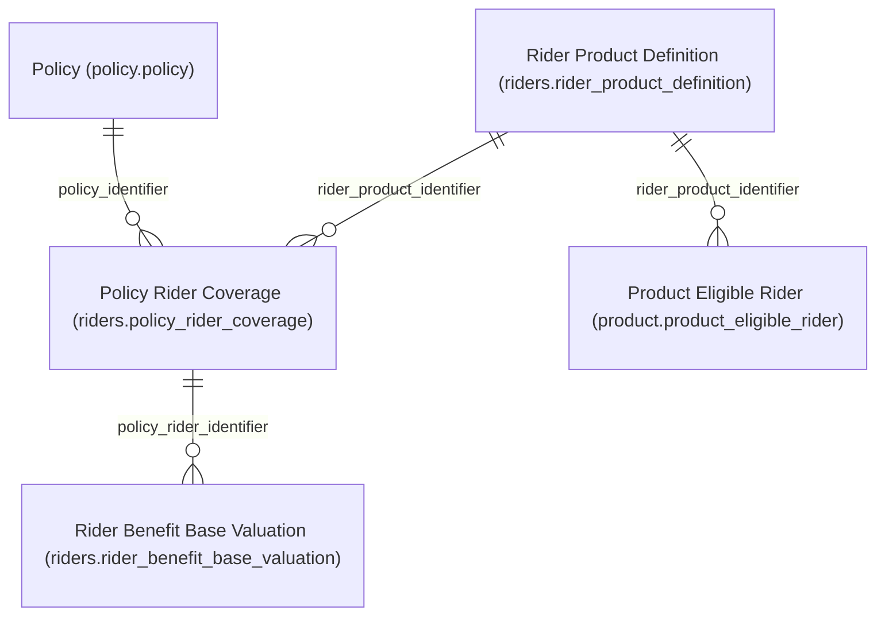

# L&A Ontology Knowledge Framework (OKF) -- Domain 3: Riders (Supplemental Benefits & Living/Death Guarantees)

| OKF Metadata Attribute | Value |
| :--- | :--- |
| **OKF Catalog Document** | `L&A OKF/03 - OKF - Riders.MD` |
| **Enterprise Data Domain** | **Domain 3: Riders (Supplemental Benefits & Living/Death Guarantees)** |
| **Target Physical Database Engine** | Amazon RDS Aurora PostgreSQL (PostgreSQL 15/16 Compatible) |
| **Physical Database Schema** | `riders` |
| **Domain Table Count** | **3 Physical Tables / Logical Entities** |
| **Outbound Foreign Key Joins** | **3 Foreign Key Relationships** (Intra-Domain & Cross-Domain) |
| **Inbound Foreign Key Joins** | **10 Cross-Domain Referencing Relationships** |
| **Performance Indexes** | **3 B-Tree & Composite Indexes** |
| **Inherited Business Context Rules** | **`BC-043` through `BC-061` (19 Rules)** |
| **Source Knowledge Layer Artifacts** | `L&A - Ontology.MD`, `L&A Data Model - Logical.MD`, `L&A Data Model - Physical DDL.sql`, `L&A Data Model - Conceptual.MD` |

---

## 1. Domain Executive Ontology & Business Context Overview

The **Riders** domain governs the catalog, policy-level attachment, and complex shadow-account valuation of optional and embedded supplemental benefit guarantees that modify or enhance the risk profile of a base Life Insurance or Annuity contract. Across the US retail and institutional annuity landscape—particularly at variable, indexed, and RILA carriers such as Jackson National, Lincoln Financial, Nationwide, Allianz, Prudential, Equitable, Pacific Life, and Principal—supplemental living and death benefit riders are the primary value proposition driving trillions of dollars of retirement savings, while simultaneously representing the most capital-intensive, market-sensitive liabilities on an insurer's balance sheet. This domain is structured around three tightly integrated logical entities: `Rider Product Definition`, `Policy Rider Coverage`, and `Rider Benefit Base Valuation`.

`Rider Product Definition` serves as the master specification table for all supplemental benefits (`Rider Product Identifier`, `Rider Code`, `Rider Name`, `Rider Category`), encompassing Guaranteed Minimum Withdrawal Benefits (GMWB) and Guaranteed Lifetime Withdrawal Benefits (GLWB) that guarantee a lifetime income stream even if market downturns or longevity exhaust the underlying contract account value; Guaranteed Minimum Income Benefits (GMIB) that guarantee a favorable annuitization purchase floor; Guaranteed Minimum Accumulation Benefits (GMAB) that protect principal over a holding period; and Guaranteed Minimum Death Benefits (GMDB) that protect beneficiaries via Return of Premium (ROP), Maximum Anniversary Value (MAV) high-water-mark step-ups, or compound roll-ups. On the life insurance side, it defines Waiver of Premium / Monthly Deduction disability riders, Accelerated Death Benefit (ADB) riders for terminal or chronic illness / Long-Term Care (under IRC Sections 101(g) and 7702B), and Cost of Living Adjustment (COLA) inflation riders. It also captures pricing parameters such as `Rider Fee Calculation Basis`, `Annual Step-Up Rate`, and `Waiting Period Years`.

When a policyholder elects (or receives an embedded) rider, `Policy Rider Coverage` links the `Rider Product Identifier` to the `Policy Identifier`, tracking its operational `Rider Status` (`Active in Deferral / Roll-Up`, `Active - Exercised in Lifetime Withdrawal Phase`, `Terminated due to Excess Withdrawal`), `Rider Effective Date`, and `Current Annual Rider Charge Rate`. Because living and death benefit riders operate on contractual "shadow bases" that diverge from actual cash value, `Rider Benefit Base Valuation` records periodic point-in-time snapshots of the policy's `Guaranteed Benefit Base Amount`, `High Water Mark Value`, and `Roll-Up Base Amount`, alongside the age-tiered `Maximum Annual Lifetime Withdrawal Percentage`, `Remaining Guaranteed Annual Withdrawal Amount`, and any `Excess Withdrawal Reduction Amount`. For AI agents, the single most critical semantic rule in the Riders domain is recognizing that the `Guaranteed Benefit Base Amount` is a non-cashable actuarial calculation shadow base used solely to compute guaranteed lifetime withdrawal allowances or death benefit step-ups—it can never be withdrawn as a lump sum and must never be added to `Current Total Contract Value` when calculating enterprise Assets Under Management (AUM).

---

## 2. Physical Schema & Logical Entity Architecture Catalog (Schema: `riders`)

| # | Logical Entity Name | Physical Table Name (`schema.table`) | Primary Key Column (`PK`) | Business Cols | Audit Cols | Constraints (`PK`/`UQ`/`CHK`) | Logical Entity & Physical Table Definition |
| :--- | :--- | :--- | :--- | :--- | :--- | :--- | :--- |
| **3.1** | **Rider Product Definition** | `riders.rider_product_definition` | `rider_product_identifier` | 8 | 2 | `pk_rider_product_definition`, `uq_rider_code`, `chk_rider_waiting_years` | Rider Product Definition entity catalogs all optional and embedded supplemental benefit guarantees offered by the carrier—including Guaranteed Minimum Withdrawal Benefits (GMWB), Guaranteed Minimum Income Benefits (GMIB), Guaranteed Minimum Death Benefits (GMDB), and Waiver of Premium riders—along with fee formulas and roll-up rules. |
| **3.2** | **Policy Rider Coverage** | `riders.policy_rider_coverage` | `policy_rider_identifier` | 7 | 2 | `pk_policy_rider_coverage`, `chk_rider_dates` | Policy Rider Coverage entity represents an active or historical instance of a supplemental Rider Product attached to a specific Policy, capturing the election effective date, rider status, current annual charge rate deducted from the contract, and waiting period completion. |
| **3.3** | **Rider Benefit Base Valuation** | `riders.rider_benefit_base_valuation` | `rider_valuation_identifier` | 9 | 2 | `pk_rider_benefit_base_valuation`, `uq_rider_valuation_date` | Rider Benefit Base Valuation entity records periodic point-in-time valuations of a policy rider's guaranteed benefit base, tracking step-up high-water marks, compound roll-up bases, maximum annual lifetime withdrawal allowances, and pro-rata reductions caused by excess withdrawals. |

---

## 3. Relational Join Mining & Foreign Key Topology

### 3.1 Entity-Relationship & Foreign Key Join Diagram (Mermaid)



### 3.2 Outbound Foreign Key Join Matrix (Tables in `riders` Referencing Parent Entities)

| FK Constraint Name | Child Table (`riders`) | Child FK Column | Join Scope | Parent Referenced Table | Parent PK Column | Referential Action | Exact SQL Join Predicate |
| :--- | :--- | :--- | :--- | :--- | :--- | :--- | :--- |
| `fk_policy_rider_policy` | `riders.policy_rider_coverage` | `policy_identifier` | Cross-Domain (`policy`) | `policy.policy` | `policy_identifier` | `ON UPDATE CASCADE ON DELETE CASCADE` | `riders.policy_rider_coverage.policy_identifier = policy.policy.policy_identifier` |
| `fk_policy_rider_definition` | `riders.policy_rider_coverage` | `rider_product_identifier` | Intra-Domain | `riders.rider_product_definition` | `rider_product_identifier` | `ON UPDATE CASCADE ON DELETE RESTRICT` | `riders.policy_rider_coverage.rider_product_identifier = riders.rider_product_definition.rider_product_identifier` |
| `fk_rider_valuation_policy_rider` | `riders.rider_benefit_base_valuation` | `policy_rider_identifier` | Intra-Domain | `riders.policy_rider_coverage` | `policy_rider_identifier` | `ON UPDATE CASCADE ON DELETE CASCADE` | `riders.rider_benefit_base_valuation.policy_rider_identifier = riders.policy_rider_coverage.policy_rider_identifier` |

### 3.3 Inbound Cross-Domain Foreign Key Join Matrix (External Schemas Referencing `riders`)

| FK Constraint Name | Referencing Child Schema | Referencing Child Table | Child FK Column | Referenced Target Table (`riders`) | Target PK Column | Referential Action | Exact SQL Join Predicate |
| :--- | :--- | :--- | :--- | :--- | :--- | :--- | :--- |
| `fk_per_rider_product` | `product` | `product.product_eligible_rider` | `rider_product_identifier` | `riders.rider_product_definition` | `rider_product_identifier` | `ON UPDATE CASCADE ON DELETE RESTRICT` | `product.product_eligible_rider.rider_product_identifier = riders.rider_product_definition.rider_product_identifier` |

---

## 4. Detailed Table-by-Table Schema, Column Dictionary & DDL Constraints

### 4.1 Logical Entity: `Rider Product Definition` <-> Physical Table: `riders.rider_product_definition`

- **Business & Technical Purpose**: Rider Product Definition entity catalogs all optional and embedded supplemental benefit guarantees offered by the carrier—including Guaranteed Minimum Withdrawal Benefits (GMWB), Guaranteed Minimum Income Benefits (GMIB), Guaranteed Minimum Death Benefits (GMDB), and Waiver of Premium riders—along with fee formulas and roll-up rules.
- **PostgreSQL Catalog Comment**: _""_
- **Primary Key**: `rider_product_identifier`

#### Attribute-to-Column Schema Mapping & Business Dictionary

| Ord | Logical Attribute Name | Physical Column Name | Logical Type | Physical PostgreSQL Type | Key | Column Modifiers / Default | Business Definition, Domain Semantics & Sample Values |
| :--- | :--- | :--- | :--- | :--- | :--- | :--- | :--- |
| **1** | **Rider Product Identifier** | `rider_product_identifier` | String | `VARCHAR(64)` | **PK** | `NOT NULL` | Unique primary key identifying a supplemental benefit rider specification in the enterprise catalog. Sample values: `RDR-GMWB-01`, `RDR-GMIB-02`, `RDR-GMDB-03`, `RDR-WOP-04`. |
| **2** | **Rider Code** | `rider_code` | String | `VARCHAR(50)` | **NK** | `NOT NULL` | Standardized alphanumeric business code identifying the rider form for administration, actuarial valuation, and pricing. Sample values: `GLWB-5PCT-SNGL`, `GLWB-5PCT-JNT`, `GMDB-MAV`, `ADB-CHRONIC`, `WOP-DIS`. |
| **3** | **Rider Name** | `rider_name` | String | `VARCHAR(200)` | **NK** | `NOT NULL` | Business-friendly marketing and contractual name of the supplemental rider. Sample values: `Income Horizon Single Life GMWB`, `Premier Maximum Anniversary Value GMDB`, `Waiver of Monthly Deduction for Disability`, `Chronic & Terminal Illness Accelerated Death Benefit`. |
| **4** | **Rider Category** | `rider_category` | String | `VARCHAR(120)` | **NK** | `NOT NULL` | High-level classification of the risk protection or guarantee provided by the rider. Sample values: `Guaranteed Minimum Withdrawal Benefit (GMWB / GLWB)`, `Guaranteed Minimum Income Benefit (GMIB)`, `Guaranteed Minimum Accumulation Benefit (GMAB)`, `Guaranteed Minimum Death Benefit (GMDB)`, `Long-Term Care / Chronic Illness`, `Waiver of Premium`, `Cost of Living Adjustment (COLA)`. |
| **5** | **Optional vs Embedded Indicator** | `optional_vs_embedded_indicator` | String | `VARCHAR(100)` | **NK** | `NOT NULL` | Indicates whether the rider is an optional fee-bearing benefit elected by the customer or an embedded contractual benefit included in the base product. Sample values: `Optional Fee-Bearing Rider`, `Embedded Base Contract Guarantee`, `Optional No-Cost Endorsement`. |
| **6** | **Rider Fee Calculation Basis** | `rider_fee_calculation_basis` | String | `VARCHAR(120)` | **NK** | `NOT NULL` | Specifies the financial denominator to which the annual rider charge rate is applied when deducting periodic rider fees. Sample values: `Percentage of Guaranteed Benefit Base`, `Percentage of Current Contract Account Value`, `Monthly Cost per $1,000 of Net Amount at Risk`, `No Separate Fee (Built into Spread)`. |
| **7** | **Annual Step-Up Rate** | `annual_step_up_rate` | Decimal | `NUMERIC(9,6)` | **NK** | `NOT NULL DEFAULT 0.000000` | Simple or compound annual roll-up percentage guaranteed to increase the rider Benefit Base during years when no withdrawals are taken in the deferral period. Sample values: `0.0500` (5.00% Annual Roll-Up), `0.0600` (6.00% Roll-Up), `0.0000` (Market Anniversary Step-Up Only). |
| **8** | **Waiting Period Years** | `waiting_period_years` | Integer | `INTEGER` | **NK** | `NOT NULL DEFAULT 0` | Minimum number of contract years the policyholder must wait after rider issue before exercising the guaranteed income benefit or bonus roll-up. Sample values: `0`, `1`, `5`, `10`. |
| **9** | **Record Created Timestamp (Audit)** | `created_at` | Timestamp | `TIMESTAMPTZ` | **AUDIT** | `NOT NULL DEFAULT CURRENT_TIMESTAMP` | System audit timestamp recording when the physical row was initially inserted into the Aurora PostgreSQL table. |
| **10** | **Record Updated Timestamp (Audit)** | `updated_at` | Timestamp | `TIMESTAMPTZ` | **AUDIT** | `NOT NULL DEFAULT CURRENT_TIMESTAMP` | System audit timestamp recording when the physical row was last modified in the Aurora PostgreSQL table. |

#### Declarative DDL Constraints & Indexes on `riders.rider_product_definition`

| Constraint / Index Category | Identifier Name | Definition / Target Columns & Referential Integrity Rule |
| :--- | :--- | :--- |
| **PRIMARY KEY** | `pk_rider_product_definition` | `PRIMARY KEY (rider_product_identifier)` |
| **UNIQUE** | `uq_rider_code` | `UNIQUE (rider_code)` |
| **CHECK** | `chk_rider_waiting_years` | `CHECK (waiting_period_years >= 0)` |

### 4.2 Logical Entity: `Policy Rider Coverage` <-> Physical Table: `riders.policy_rider_coverage`

- **Business & Technical Purpose**: Policy Rider Coverage entity represents an active or historical instance of a supplemental Rider Product attached to a specific Policy, capturing the election effective date, rider status, current annual charge rate deducted from the contract, and waiting period completion.
- **PostgreSQL Catalog Comment**: _""_
- **Primary Key**: `policy_rider_identifier`

#### Attribute-to-Column Schema Mapping & Business Dictionary

| Ord | Logical Attribute Name | Physical Column Name | Logical Type | Physical PostgreSQL Type | Key | Column Modifiers / Default | Business Definition, Domain Semantics & Sample Values |
| :--- | :--- | :--- | :--- | :--- | :--- | :--- | :--- |
| **1** | **Policy Rider Identifier** | `policy_rider_identifier` | String | `VARCHAR(64)` | **PK** | `NOT NULL` | Unique primary key identifying an instance of a Rider attached to a specific Policy. Sample values: `PRC-60001`, `PRC-60002`. |
| **2** | **Policy Identifier** | `policy_identifier` | String | `VARCHAR(64)` | **FK** | `NOT NULL` | Foreign key linking the attached rider coverage to the parent Policy contract. Sample values: `POL-UUID-90001421`. |
| **3** | **Rider Product Identifier** | `rider_product_identifier` | String | `VARCHAR(64)` | **FK** | `NOT NULL` | Foreign key linking the policy rider instance to its master Rider Product Definition. Sample values: `RDR-GMWB-01`, `RDR-GMDB-03`. |
| **4** | **Rider Status** | `rider_status` | String | `VARCHAR(100)` | **NK** | `NOT NULL` | Current operational lifecycle status of the rider on this policy. Sample values: `Active in Deferral / Roll-Up`, `Active - Exercised in Lifetime Withdrawal Phase`, `Claim Triggered`, `Cancelled by Owner`, `Expired at Maturity`, `Terminated due to Excess Withdrawal`. |
| **5** | **Rider Effective Date** | `rider_effective_date` | Date | `DATE` | **NK** | `NOT NULL` | Calendar date on which the rider coverage took effect on the policy. Sample values: `2019-06-15`, `2023-01-01`. |
| **6** | **Rider Termination Date** | `rider_termination_date` | Date | `DATE` | **NK** | `NULL` | Calendar date on which the rider coverage ended, expired, or was revoked (null if currently active). Sample values: `2026-06-15`, `Null (Active)`. |
| **7** | **Current Annual Rider Charge Rate** | `current_annual_rider_charge_rate` | Decimal | `NUMERIC(9,6)` | **NK** | `NOT NULL DEFAULT 0.000000` | Annualized percentage fee currently charged to the policyholder for this rider (often expressed in basis points, e.g., 125 bps = 1.25%). Sample values: `0.0095` (0.95%), `0.0125` (1.25%), `0.0150` (1.50%), `0.0000`. |
| **8** | **Record Created Timestamp (Audit)** | `created_at` | Timestamp | `TIMESTAMPTZ` | **AUDIT** | `NOT NULL DEFAULT CURRENT_TIMESTAMP` | System audit timestamp recording when the physical row was initially inserted into the Aurora PostgreSQL table. |
| **9** | **Record Updated Timestamp (Audit)** | `updated_at` | Timestamp | `TIMESTAMPTZ` | **AUDIT** | `NOT NULL DEFAULT CURRENT_TIMESTAMP` | System audit timestamp recording when the physical row was last modified in the Aurora PostgreSQL table. |

#### Declarative DDL Constraints & Indexes on `riders.policy_rider_coverage`

| Constraint / Index Category | Identifier Name | Definition / Target Columns & Referential Integrity Rule |
| :--- | :--- | :--- |
| **PRIMARY KEY** | `pk_policy_rider_coverage` | `PRIMARY KEY (policy_rider_identifier)` |
| **CHECK** | `chk_rider_dates` | `CHECK (rider_termination_date IS NULL OR rider_termination_date >= rider_effective_date)` |
| **FOREIGN KEY** | `fk_policy_rider_policy` | `FOREIGN KEY (policy_identifier) REFERENCES policy.policy (policy_identifier) ON UPDATE CASCADE ON DELETE CASCADE` |
| **FOREIGN KEY** | `fk_policy_rider_definition` | `FOREIGN KEY (rider_product_identifier) REFERENCES riders.rider_product_definition (rider_product_identifier) ON UPDATE CASCADE ON DELETE RESTRICT` |
| **B-TREE INDEX** | `idx_prc_policy_status` | `ON riders.policy_rider_coverage (policy_identifier, rider_status)` |
| **B-TREE INDEX** | `idx_prc_rider_product_id` | `ON riders.policy_rider_coverage (rider_product_identifier)` |

### 4.3 Logical Entity: `Rider Benefit Base Valuation` <-> Physical Table: `riders.rider_benefit_base_valuation`

- **Business & Technical Purpose**: Rider Benefit Base Valuation entity records periodic point-in-time valuations of a policy rider's guaranteed benefit base, tracking step-up high-water marks, compound roll-up bases, maximum annual lifetime withdrawal allowances, and pro-rata reductions caused by excess withdrawals.
- **PostgreSQL Catalog Comment**: _""_
- **Primary Key**: `rider_valuation_identifier`

#### Attribute-to-Column Schema Mapping & Business Dictionary

| Ord | Logical Attribute Name | Physical Column Name | Logical Type | Physical PostgreSQL Type | Key | Column Modifiers / Default | Business Definition, Domain Semantics & Sample Values |
| :--- | :--- | :--- | :--- | :--- | :--- | :--- | :--- |
| **1** | **Rider Valuation Identifier** | `rider_valuation_identifier` | String | `VARCHAR(64)` | **PK** | `NOT NULL` | Unique primary key identifying a point-in-time valuation snapshot of a Policy Rider Coverage's guaranteed benefit values. Sample values: `RBV-71001`, `RBV-71002`. |
| **2** | **Policy Rider Identifier** | `policy_rider_identifier` | String | `VARCHAR(64)` | **FK** | `NOT NULL` | Foreign key linking the valuation snapshot to the specific Policy Rider Coverage being valued. Sample values: `PRC-60001`. |
| **3** | **Valuation Date** | `valuation_date` | Date | `DATE` | **NK** | `NOT NULL` | Effective business date of the rider benefit base calculation (e.g., daily, monthly, or contract anniversary valuation). Sample values: `2026-09-30`, `2026-10-21`. |
| **4** | **Guaranteed Benefit Base Amount** | `guaranteed_benefit_base_amount` | Decimal | `NUMERIC(18,2)` | **NK** | `NOT NULL DEFAULT 0.00` | Shadow contractual value (typically the greater of the High Water Mark or Roll-Up Base) used to calculate guaranteed lifetime withdrawal amounts or guaranteed death benefits; cannot be withdrawn as a lump sum. Sample values: `250000.00`, `312500.00`, `500000.00`. |
| **5** | **High Water Mark Value** | `high_water_mark_value` | Decimal | `NUMERIC(18,2)` | **NK** | `NOT NULL DEFAULT 0.00` | Highest contract account value achieved on any prior policy anniversary date (adjusted for subsequent contributions and withdrawals) used for step-up guarantees. Sample values: `285400.00`, `312500.00`. |
| **6** | **Roll-Up Base Amount** | `roll_up_base_amount` | Decimal | `NUMERIC(18,2)` | **NK** | `NOT NULL DEFAULT 0.00` | Guaranteed benefit value accumulated by applying the contractual annual roll-up interest rate to net premiums during the deferral period. Sample values: `268000.00`, `305000.00`. |
| **7** | **Maximum Annual Lifetime Withdrawal Percentage** | `maximum_annual_lifetime_withdrawal_percentage` | Decimal | `NUMERIC(9,6)` | **NK** | `NOT NULL DEFAULT 0.000000` | Age-tiered contractual withdrawal rate applied to the Guaranteed Benefit Base once lifetime income begins (e.g., 4.0% at age 60, 5.0% at age 65, 6.0% at age 70+). Sample values: `0.0450` (4.50%), `0.0500` (5.00%), `0.0550` (5.50%). |
| **8** | **Remaining Guaranteed Annual Withdrawal Amount** | `remaining_guaranteed_annual_withdrawal_amount` | Decimal | `NUMERIC(18,2)` | **NK** | `NOT NULL DEFAULT 0.00` | Remaining dollar amount the policyholder can withdraw during the current contract year under the GMWB rider without triggering an excess withdrawal penalty. Sample values: `15625.00`, `7812.50`, `0.00` (Annual Allowance Fully Taken). |
| **9** | **Excess Withdrawal Reduction Amount** | `excess_withdrawal_reduction_amount` | Decimal | `NUMERIC(18,2)` | **NK** | `NOT NULL DEFAULT 0.00` | Dollar-for-dollar or pro-rata reduction applied to the Guaranteed Benefit Base during the period because the policyholder withdrew more than the permitted annual allowance. Sample values: `0.00`, `12450.00`. |
| **10** | **Record Created Timestamp (Audit)** | `created_at` | Timestamp | `TIMESTAMPTZ` | **AUDIT** | `NOT NULL DEFAULT CURRENT_TIMESTAMP` | System audit timestamp recording when the physical row was initially inserted into the Aurora PostgreSQL table. |
| **11** | **Record Updated Timestamp (Audit)** | `updated_at` | Timestamp | `TIMESTAMPTZ` | **AUDIT** | `NOT NULL DEFAULT CURRENT_TIMESTAMP` | System audit timestamp recording when the physical row was last modified in the Aurora PostgreSQL table. |

#### Declarative DDL Constraints & Indexes on `riders.rider_benefit_base_valuation`

| Constraint / Index Category | Identifier Name | Definition / Target Columns & Referential Integrity Rule |
| :--- | :--- | :--- |
| **PRIMARY KEY** | `pk_rider_benefit_base_valuation` | `PRIMARY KEY (rider_valuation_identifier)` |
| **UNIQUE** | `uq_rider_valuation_date` | `UNIQUE (policy_rider_identifier, valuation_date)` |
| **FOREIGN KEY** | `fk_rider_valuation_policy_rider` | `FOREIGN KEY (policy_rider_identifier) REFERENCES riders.policy_rider_coverage (policy_rider_identifier) ON UPDATE CASCADE ON DELETE CASCADE` |
| **B-TREE INDEX** | `idx_rbbv_policy_rider_date` | `ON riders.rider_benefit_base_valuation (policy_rider_identifier, valuation_date DESC)` |

---

## 5. Inherited Business Context Ontology Rules (`BC-043` to `BC-061`)

> **Semantic Inheritance Notice**: The following **19 Business Context rules** are inherited verbatim from `L&A Data Domain/L&A - Ontology.MD` to provide autonomous AI agents, data engineers, and actuaries with complete domain rules, accounting identities, statutory compliance mandates, and SQL join guardrails for the **Riders** domain.

#### BC-043: Master Taxonomy of Supplemental Guarantees (`Rider Category`) — Living Benefits vs. Death and Morbidity Riders

**Domains**: Riders | **Entities**: `Rider Product Definition`, `Policy Rider Coverage` | **Key Attributes**: `Rider Product Identifier`, `Rider Code`, `Rider Name`, `Rider Category`, `Optional vs Embedded Indicator`

The `Rider Product Definition` entity (`Rider Product Identifier`, `Rider Code`, `Rider Name`) serves as the enterprise master catalog for all supplemental benefits, classified via `Rider Category` into seven core actuarial risk families that modify the cash flow and risk profile of a base policy. On Deferred Variable Annuities, Fixed Indexed Annuities (FIAs), and Registered Index-Linked Annuities (RILAs) across carriers like Jackson National, Lincoln Financial, Nationwide, Allianz, Prudential, Equitable, and Pacific Life, the four **GMxB (Guaranteed Minimum Benefit)** categories dominate:

1. `Guaranteed Minimum Withdrawal Benefit (GMWB / GLWB)` (such as `GLWB-5PCT-SNGL` or `GLWB-5PCT-JNT`), which guarantees the owner can withdraw a specified percentage of a protected benefit base every year for life without having to annuitize the contract, even if the underlying `Current Total Contract Value` drops to `$0.00`.
2. `Guaranteed Minimum Income Benefit (GMIB)`, which guarantees a minimum future income stream ONLY if the policyholder irrevocably annuitizes the Benefit Base using contractual GMIB purchase rates after a mandatory waiting period.
3. `Guaranteed Minimum Accumulation Benefit (GMAB)`, which guarantees that after a fixed holding period (e.g., 10 years), the policy's actual `Current Total Contract Value` will be stepped up by the carrier to at least 100% of initial principal (or a roll-up amount) if market returns were negative.
4. `Guaranteed Minimum Death Benefit (GMDB)` (`GMDB-MAV`), which guarantees a minimum death benefit payout to beneficiaries upon the owner/annuitant's death during accumulation.

Complementing the GMxB suite, three rider categories span both Life Insurance and Annuities: `Long-Term Care / Chronic Illness` (`ADB-CHRONIC`), `Waiver of Premium` (`WOP-DIS`), and `Cost of Living Adjustment (COLA)`. AI agents building actuarial risk or product analytics products must use `Rider Category` to distinguish capital-market-sensitive riders (which are accounted for as Market Risk Benefits [MRBs] under US GAAP LDTI in `LDTI Valuation Cohort.Market Risk Benefit (MRB) Fair Value`) from biometric insurance riders.

#### BC-044: CRITICAL AI GUARDRAIL — The `Guaranteed Benefit Base Amount` Is a Shadow Calculation Base, NOT Cash Surrender Value or AUM!

**Domains**: Riders, Policy, Actuarial | **Entities**: `Rider Benefit Base Valuation`, `Policy`, `Actuarial Valuation Reserve` | **Key Attributes**: `Guaranteed Benefit Base Amount`, `Current Total Contract Value`, `Current Cash Surrender Value`, `Net Amount at Risk (NAR)`

The single most important domain rule in the entire Riders ontology—and a frequent source of catastrophic hallucination for untrained AI agents and financial analysts—is understanding the ontological difference between `Rider Benefit Base Valuation.Guaranteed Benefit Base Amount` and `Policy.Current Total Contract Value` / `Policy.Current Cash Surrender Value`. On any GMWB, GLWB, GMIB, or GMDB rider, the `Guaranteed Benefit Base Amount` (also referred to on customer statements as the "Protected Income Value," "Benefit Base," or "Total Guaranteed Withdrawal Balance") is strictly a **virtual, non-cashable actuarial shadow accounting ledger** maintained solely as the mathematical denominator to multiply by `Maximum Annual Lifetime Withdrawal Percentage` (to determine annual lifetime income) or to determine a death benefit step-up at death. **A policyholder can NEVER withdraw or surrender the** `Guaranteed Benefit Base Amount` **as a lump sum of cash!** For example, suppose a policyholder invests `$200,000` into a Variable Annuity with a 6% roll-up GLWB rider (`RDR-GMWB-01`). Over 10 years of severe equity market turmoil and withdrawals, the actual invested sub-account balance (`Policy.Current Total Contract Value`) falls to `$140,000.00`, while the shadow `Guaranteed Benefit Base Amount` in `Rider Benefit Base Valuation` has rolled up to `$312,500.00`. If the policyholder walks away and surrenders the contract today, they receive `Policy.Current Cash Surrender Value` (`$140,000.00` less any surrender charge), **NOT** `$312,500.00`! Conversely, if they keep the policy and exercise lifetime income at a `5.00%` withdrawal rate, they receive `5.00% * $312,500.00 = $15,625.00` per year for life. **Mandatory AI Agent SQL Guardrail**: AI agents must **NEVER** sum `Guaranteed Benefit Base Amount` into enterprise Assets Under Management (AUM), Total Contract Value, or Cash Surrender Value, and must **NEVER** add `Guaranteed Benefit Base Amount` + `Current Total Contract Value` together! Instead, the positive difference $\max(0, \text{Guaranteed Benefit Base Amount} - \text{Current Total Contract Value})$ represents the insurer's unhedged **Living/Death Benefit Net Amount at Risk (*`*Actuarial Valuation Reserve.Net Amount at Risk (NAR)`**)**.

#### BC-045: Benefit Base Growth Mechanics: `High Water Mark Value` (Market Step-Up) vs. `Roll-Up Base Amount` (Guaranteed Deferral Bonus)

**Domains**: Riders | **Entities**: `Rider Product Definition`, `Policy Rider Coverage`, `Rider Benefit Base Valuation` | **Key Attributes**: `Annual Step-Up Rate`, `Waiting Period Years`, `Guaranteed Benefit Base Amount`, `High Water Mark Value`, `Roll-Up Base Amount`, `Valuation Date`

During the deferral phase of a GMWB/GLWB, GMIB, or enhanced GMDB rider (`Policy Rider Coverage.Rider Status = Active in Deferral / Roll-Up`), how does the shadow `Guaranteed Benefit Base Amount` in `Rider Benefit Base Valuation` grow over time? Most modern living and death benefit riders Offered by US carriers (such as Lincoln Financial's *i4LIFE / ProtectedPay*, Jackson National's *LifeGuard Freedom*, Nationwide's *Destination*, or Prudential's *Highest Daily / SurePath*) feature a **"Greater-Of" dual-ratchet mechanism** combining two separately tracked components on `Rider Benefit Base Valuation`: the `High Water Mark Value` and the `Roll-Up Base Amount`.

1. `High Water Mark Value` **(Market Anniversary / Daily Step-Up)**: On every contract anniversary (or quarterly/daily on highest-daily designs), the administration system compares the policy's actual `Current Total Contract Value` against the prior `High Water Mark Value`. If strong equity or index performance has pushed `Current Total Contract Value` to a new all-time peak (e.g., `$312,500.00`), the `High Water Mark Value` automatically steps up ("ratchets") to lock in that market gain permanently, protecting it from future market crashes.
2. `Roll-Up Base Amount` **(Guaranteed Deferral Growth)**: Simultaneously, during years within the roll-up period (commonly the first 10 contract years or up to age 80) when the policyholder takes **zero withdrawals** during the contract year, the `Roll-Up Base Amount` grows by the contractual `Rider Product Definition.Annual Step-Up Rate` (e.g., `0.0500` [5.00%] or `0.0600` [6.00%] simple or compound interest applied to net premiums, such as `$268,000.00` or `$305,000.00`), guaranteeing Benefit Base growth even in flat or bear markets.

At each `Valuation Date`, the active `Guaranteed Benefit Base Amount` is set equal to:
$$\text{Guaranteed Benefit Base Amount} = \max\Big(\text{High Water Mark Value}, \text{Roll-Up Base Amount}\Big)$$
Once the policyholder initiates lifetime income withdrawals (`Rider Status = Active - Exercised in Lifetime Withdrawal Phase`), the `Roll-Up Base Amount` stops accruing annual roll-up bonuses, though `High Water Mark Value` step-ups may continue if `Current Total Contract Value` exceeds the `Guaranteed Benefit Base Amount` on a future anniversary.

#### BC-046: Age-Tiered `Maximum Annual Lifetime Withdrawal Percentage` and Single Life vs. Joint Spousal Life Bands

**Domains**: Riders, Party, Customer & Household | **Entities**: `Rider Product Definition`, `Policy Rider Coverage`, `Rider Benefit Base Valuation`, `Policy Party Role`, `Party` | **Key Attributes**: `Rider Code`, `Rider Status`, `Guaranteed Benefit Base Amount`, `Maximum Annual Lifetime Withdrawal Percentage`, `Remaining Guaranteed Annual Withdrawal Amount`, `Date of Birth`

When a policyholder with an active GMWB / GLWB rider transitions from deferral into retirement income (`Policy Rider Coverage.Rider Status = Active - Exercised in Lifetime Withdrawal Phase`), the maximum dollar amount they can withdraw each contract year for life without penalty—the **Maximum Annual Withdrawal Amount (MAWA)**—is calculated in `Rider Benefit Base Valuation` by multiplying `Guaranteed Benefit Base Amount` by `Maximum Annual Lifetime Withdrawal Percentage`. Crucially, `Maximum Annual Lifetime Withdrawal Percentage` is **not a static percentage across all customers**; it is locked in based on two actuarial factors at the exact date of the first lifetime income withdrawal:

1. **Attained Age Band at First Withdrawal**: Because a older retiree has a shorter remaining life expectancy, the rider's contractual age schedule grants higher withdrawal percentages at older entry ages—for example, `0.0400` (`4.00%`) if income starts at ages 55–59, `0.0450` (`4.50%`) at ages 60–64, `0.0500` (`5.00%`) at ages 65–69, `0.0550` (`5.50%`) at ages 70–74, and `0.0600` (`6.00%`) at age 75+.
2. **Single Life vs. Joint Spousal Life Election (**`Rider Code`**)**: If the policyholder elected a Single Life rider (`GLWB-5PCT-SNGL`), the age band is determined by the `Primary Owner / Annuitant`'s `Party.Date of Birth`. However, if the policyholder elected a Joint & Survivor Spousal GLWB (`GLWB-5PCT-JNT`, guaranteeing lifetime income until the **second spouse dies**), the age band is governed by the **younger spouse's attained age** on the first withdrawal date (linked via `Policy Party Role` where `Role Type = Joint Survivor Co-Annuitant` or `Spouse`), and the joint withdrawal rate is typically 25 to 50 basis points lower than the single-life rate at the same age to price for dual-life longevity.

Throughout each contract year, as the policyholder takes systematic monthly or quarterly withdrawals, `Remaining Guaranteed Annual Withdrawal Amount` counts down from the annual allowance ($\text{Guaranteed Benefit Base Amount} \times \text{Maximum Annual Lifetime Withdrawal Percentage}$) toward `0.00`, resetting back to the full annual allowance on each policy anniversary.

#### BC-047: Excess Withdrawals (`Excess Withdrawal Reduction Amount`) — Pro-Rata vs. Dollar-for-Dollar Benefit Base Erosion

**Domains**: Riders, Transactions, Claims, Annuitization & Benefit Payouts | **Entities**: `Rider Benefit Base Valuation`, `Policy Rider Coverage`, `Financial Transaction`, `Required Minimum Distribution Schedule` | **Key Attributes**: `Guaranteed Benefit Base Amount`, `Remaining Guaranteed Annual Withdrawal Amount`, `Excess Withdrawal Reduction Amount`, `Rider Status`, `Calculated Annual RMD Amount`

One of the most perilous financial mechanics in annuity administration—and a critical domain rule for AI agents advising servicing teams or auditing rider valuations—is what happens when a policyholder withdraws **more** than their permitted `Remaining Guaranteed Annual Withdrawal Amount` during a contract year (or takes any withdrawal during the deferral phase prior to income activation), triggering an `Excess Withdrawal Reduction Amount` in `Rider Benefit Base Valuation`. While regular withdrawals up to the annual GMWB allowance reduce the policy's actual `Current Total Contract Value` dollar-for-dollar **without reducing the shadow** `Guaranteed Benefit Base Amount`, any dollar withdrawn **above** the annual allowance is an **Excess Withdrawal** that permanently erodes the `Guaranteed Benefit Base Amount` (and future lifetime income!) under one of two contractual formulas:

1. **Dollar-for-Dollar Reduction**: The `Guaranteed Benefit Base Amount` is reduced by the exact dollar amount of the excess withdrawal.
2. **Pro-Rata Reduction (Industry Standard & Severe Penalty When In-The-Money)**: The `Guaranteed Benefit Base Amount` is reduced by the **same percentage** that the excess withdrawal reduces the remaining `Current Total Contract Value` immediately prior to the excess withdrawal:

$$\text{Excess Withdrawal Reduction Amount} = \text{Guaranteed Benefit Base Amount} \times \left(\frac{\text{Excess Withdrawal Dollar Amount}}{\text{Current Total Contract Value}_{\text{post-regular allowance}}}\right)$$
Why is a Pro-Rata reduction so dangerous when a rider is deeply "in the money" ($\text{Guaranteed Benefit Base Amount} \gg \text{Current Total Contract Value}$)? Suppose `Guaranteed Benefit Base Amount` is `$300,000` and `Current Total Contract Value` has fallen in a bear market to `$100,000` (a 3:1 ratio). If the policyholder takes an excess withdrawal of `$10,000` (10% of their `$100,000` cash value), the Pro-Rata formula reduces their `$300,000` `Guaranteed Benefit Base Amount` by 10%—an `Excess Withdrawal Reduction Amount` of `$30,000.00` ($3\times$ the cash taken)! If an excess withdrawal exhausts the remaining cash value, the rider terminates (`Policy Rider Coverage.Rider Status = Terminated due to Excess Withdrawal`). **Important IRS RMD Exception ("RMD Friendly" Rule)**: On qualified contracts (`403(b)`, `Traditional IRA`), if the policy's `Required Minimum Distribution Schedule.Calculated Annual RMD Amount` for that specific contract exceeds the GMWB annual withdrawal allowance, almost all US carriers waive the excess withdrawal penalty up to the `Calculated Annual RMD Amount`.

#### BC-048: What Happens When `Current Total Contract Value` Hits Zero While a GMWB/GLWB Rider Is Active (The "Settlement / Guarantee Phase")

**Domains**: Riders, Policy, Actuarial, Claims, Annuitization & Benefit Payouts | **Entities**: `Policy`, `Policy Rider Coverage`, `Rider Benefit Base Valuation`, `Actuarial Valuation Reserve`, `Claim & Benefit Settlement` | **Key Attributes**: `Current Total Contract Value`, `Current Cash Surrender Value`, `Policy Status`, `Rider Status`, `Guaranteed Benefit Base Amount`, `Maximum Annual Lifetime Withdrawal Percentage`

A quintessential scenario that tests an AI agent's deep understanding of variable and fixed indexed annuity mechanics is: **What happens when a policy with an active GMWB/GLWB rider (**`Policy Rider Coverage.Rider Status = Active - Exercised in Lifetime Withdrawal Phase`**) sees its actual** `Policy.Current Total Contract Value` **drop all the way to** `$0.00` due to a combination of permitted annual lifetime withdrawals, ongoing rider/M&E fees, and poor sub-account investment returns (provided the exhaustion was NOT caused by an Excess Withdrawal)? On a policy *without* a living benefit rider, hitting `$0.00` contract value would terminate the contract (`Policy Status = Terminated`). However, on a policy *with* an active GMWB/GLWB rider where `Rider Benefit Base Valuation.Guaranteed Benefit Base Amount > 0`, **this is the exact moment the insurance guarantee kicks in and pays off for the retiree!**
When `Current Total Contract Value` reaches `0.00` through permitted withdrawals:

1. The policy does **NOT** terminate; `Policy Status` transitions to `Active in Payout / Annuitized` (specifically the GMWB Settlement Phase), and `Policy Rider Coverage.Rider Status` transitions to `Claim Triggered` (creating or linking to a `Claim & Benefit Settlement` record with `Claim Type = GMWB / GMIB Living Benefit Guarantee Claim`).
2. Even though `Policy.Current Total Contract Value = 0.00` and `Policy.Current Cash Surrender Value = 0.00`, `Rider Benefit Base Valuation.Guaranteed Benefit Base Amount` remains positive (e.g., `$250,000.00`), and the insurance carrier is contractually obligated to pay the annual lifetime withdrawal allowance ($\text{Guaranteed Benefit Base Amount} \times \text{Maximum Annual Lifetime Withdrawal Percentage}$, e.g., `$12,500.00/year`) directly out of the carrier's **General Account reserves** (`Actuarial Valuation Reserve.Future Policy Benefit Reserve Amount`) for as long as the covered annuitant (or surviving spouse on a Joint GLWB) remains alive!
3. Periodic rider fees (`Current Annual Rider Charge Rate`) cease being deducted once `Current Total Contract Value = 0.00`.

**Critical AI Agent Guardrail**: AI agents must never classify a policy with `Current Total Contract Value = 0.00` as an inactive/dead policy if it has an active `Policy Rider Coverage` record in `Active - Exercised in Lifetime Withdrawal Phase` or `Claim Triggered` with `Guaranteed Benefit Base Amount > 0`! Those contracts represent active, 100% in-the-money General Account annuity payment liabilities.

#### BC-049: Guaranteed Minimum Income Benefit (`GMIB`) Mechanics vs. GMWB/GLWB — Mandatory Annuitization Requirement

**Domains**: Riders, Claims, Annuitization & Benefit Payouts | **Entities**: `Rider Product Definition`, `Policy Rider Coverage`, `Rider Benefit Base Valuation`, `Annuitization Payout Schedule` | **Key Attributes**: `Rider Category`, `Waiting Period Years`, `Guaranteed Benefit Base Amount`, `Roll-Up Base Amount`, `Payout Option Type`, `Guaranteed Minimum Periodic Payment Amount`

While both `Guaranteed Minimum Withdrawal Benefit (GMWB / GLWB)` and `Guaranteed Minimum Income Benefit (GMIB)` riders (offered historically and currently by carriers like Equitable, MetLife/Brighthouse, Prudential, Lincoln Financial, and MassMutual) use a shadow `Guaranteed Benefit Base Amount` in `Rider Benefit Base Valuation` that grows via a `Roll-Up Base Amount` (e.g., 5% or 6% compound roll-up) or `High Water Mark Value`, AI agents must never conflate how the two riders deliver retirement income. Under a **GMWB / GLWB**, the policyholder does **not** have to annuitize the contract: the contract remains in the deferred accumulation structure (`Policy Valuation Account` holdings remain invested in sub-accounts), the owner retains access to any remaining `Current Cash Surrender Value`, and they simply take systematic withdrawals up to `Remaining Guaranteed Annual Withdrawal Amount`. By contrast, under a **GMIB** (`Rider Category = Guaranteed Minimum Income Benefit (GMIB)`):

1. The policyholder must first satisfy a mandatory waiting period (`Rider Product Definition.Waiting Period Years`, typically `7` or `10` full contract years from `Rider Effective Date` or the last step-up date).
2. To actually collect the guaranteed GMIB income stream based on the shadow `Guaranteed Benefit Base Amount`, the policyholder **MUST irrevocably annuitize the contract**—converting the policy into an `Annuitization Payout Schedule` (`Policy Status = Active in Payout / Annuitized`) using conservative, contractually fixed GMIB annuity purchase rates (for example, based on a 1.5% or 2.5% interest rate and an older mortality table with a 10-year age setback).
3. When the GMIB is exercised at annuitization, the carrier compares the lifetime income produced by applying **current marketSPIA purchase rates** to the actual `Current Total Contract Value` against the lifetime income produced by applying **contractual GMIB purchase rates** to the shadow `Guaranteed Benefit Base Amount`, setting `Annuitization Payout Schedule.Guaranteed Minimum Periodic Payment Amount` to the greater of the two. Once annuitized under a GMIB, the underlying `Current Cash Surrender Value` is permanently surrendered in exchange for the lifetime annuity check.

#### BC-050: Guaranteed Minimum Accumulation Benefit (`GMAB`) — Principal Protection Holding Period and Contract Value True-Up

**Domains**: Riders, Policy, Transactions | **Entities**: `Rider Product Definition`, `Policy Rider Coverage`, `Rider Benefit Base Valuation`, `Policy`, `Financial Transaction` | **Key Attributes**: `Rider Category`, `Waiting Period Years`, `Rider Status`, `Guaranteed Benefit Base Amount`, `Current Total Contract Value`, `Rider Termination Date`

The `Guaranteed Minimum Accumulation Benefit (GMAB)` (`Rider Category = Guaranteed Minimum Accumulation Benefit (GMAB)`) is unique among all living benefit riders because it is the **only GMxB rider that actually credits real cash value into** `Policy.Current Total Contract Value` **at the end of a specified waiting period** rather than paying out via lifetime income installments or death claims. Offered on variable annuities by carriers like Pacific Life, Jackson National, Nationwide, and Thrivent for investors who want equity market upside with medium-term principal protection, a GMAB operates over a fixed contractual holding window defined by `Rider Product Definition.Waiting Period Years` (typically `7`, `10`, or `12` years from `Policy Rider Coverage.Rider Effective Date`). Upon election, `Rider Benefit Base Valuation.Guaranteed Benefit Base Amount` is initialized to 100% of net eligible premiums (adjusted downward for any partial withdrawals taken during the holding period, and optionally stepped up on early anniversaries). During the 10-year `Waiting Period Years`, the policyholder's `Current Total Contract Value` fluctuates freely with the performance of their elected `Policy Valuation Account` variable sub-accounts. On the exact contract anniversary marking the completion of `Waiting Period Years` (the GMAB Maturity Date):

1. If `Policy.Current Total Contract Value >= Rider Benefit Base Valuation.Guaranteed Benefit Base Amount` (meaning cumulative 10-year market returns were positive), the rider expires out-of-the-money (`Policy Rider Coverage.Rider Status = Expired at Maturity`, `Rider Termination Date = Valuation Date`) with no payout needed.
2. If a prolonged bear market has left `Policy.Current Total Contract Value < Guaranteed Benefit Base Amount` on the GMAB Maturity Date, the insurance carrier injects a **one-time lump-sum General Account true-up credit** via `Financial Transaction` equal to $\text{Guaranteed Benefit Base Amount} - \text{Current Total Contract Value}$ directly into the policyholder's `Current Total Contract Value`! Once that true-up is credited (or if the owner does not elect a renewal window), the GMAB rider completes its purpose and transitions to `Expired at Maturity`. AI agents modeling GMAB risk must track the exact maturity calendar date ($\text{Rider Effective Date} + \text{Waiting Period Years}$) to forecast potential one-time cash true-up liabilities.

#### BC-051: Guaranteed Minimum Death Benefit (`GMDB`) Variants: Return of Premium (ROP), Maximum Anniversary Value (MAV), and Roll-Up

**Domains**: Riders, Policy, Claims, Annuitization & Benefit Payouts | **Entities**: `Rider Product Definition`, `Policy Rider Coverage`, `Rider Benefit Base Valuation`, `Policy`, `Claim & Benefit Settlement` | **Key Attributes**: `Rider Category`, `Rider Code`, `Guaranteed Benefit Base Amount`, `High Water Mark Value`, `Roll-Up Base Amount`, `Base Contract Benefit Amount`, `Guaranteed Minimum Death Benefit (GMDB) Step-Up Amount`

On Deferred Annuities (`Variable Annuity`, `FIA`, `RILA`), what beneficiaries receive if the Policy Owner / Annuitant dies prior to annuitization is governed by `Guaranteed Minimum Death Benefit (GMDB)` riders (`Rider Category = Guaranteed Minimum Death Benefit (GMDB)`). Without a GMDB rider (i.e., an "Account Value Only" annuity, often purchased at a lower M&E fee), the death benefit is simply `Policy.Current Total Contract Value` on the date of death or proof of death (`Claim & Benefit Settlement.Base Contract Benefit Amount`). However, most variable annuities include either an embedded or optional GMDB tracked in `Policy Rider Coverage` and valued in `Rider Benefit Base Valuation` across three escalating guarantee tiers:

1. **Return of Premium (ROP) GMDB** (often `Automatically Embedded` in base contracts): Guarantees that `Guaranteed Benefit Base Amount` equals total gross premiums contributed minus adjusted partial withdrawals, ensuring beneficiaries never receive less than the original principal invested even if the stock market crashes 40% the day before the owner dies.
2. **Maximum Anniversary Value (MAV) / High-Water-Mark GMDB** (`Rider Code = GMDB-MAV`, an `Optional Fee-Bearing Rider` typically costing 20–45 bps): Tracks the highest `Current Total Contract Value` achieved on any prior policy anniversary in `Rider Benefit Base Valuation.High Water Mark Value` (usually up to age 80), locking in bull-market gains for beneficiaries.
3. **Roll-Up / Combo GMDB**: Grows `Roll-Up Base Amount` at a fixed annual interest rate (e.g., 4% or 5%) up to a cap (such as $200$ of net premiums), setting `Guaranteed Benefit Base Amount = MAX(High Water Mark Value, Roll-Up Base Amount)`.

When the owner/annuitant dies and a `Deferred Annuity Death Benefit Claim` is adjudicated in `Claim & Benefit Settlement`, `Base Contract Benefit Amount` records the actual `Current Total Contract Value`, while `Guaranteed Minimum Death Benefit (GMDB) Step-Up Amount` records the positive excess paid by the carrier's General Account:
$$\text{Guaranteed Minimum Death Benefit (GMDB) Step-Up Amount} = \max\Big(0, \text{Guaranteed Benefit Base Amount} - \text{Base Contract Benefit Amount}\Big)$$
AI agents auditing annuity death claims must verify that `Base Contract Benefit Amount + Guaranteed Minimum Death Benefit (GMDB) Step-Up Amount` equals $\max(\text{Current Total Contract Value}, \text{Guaranteed Benefit Base Amount})$.

#### BC-052: Rider Fee Calculation Denominators (`Rider Fee Calculation Basis`) and Fee Drag Mechanics During Market Downturns

**Domains**: Riders, Policy, Transactions | **Entities**: `Rider Product Definition`, `Policy Rider Coverage`, `Rider Benefit Base Valuation`, `Policy`, `Financial Transaction` | **Key Attributes**: `Rider Fee Calculation Basis`, `Current Annual Rider Charge Rate`, `Guaranteed Benefit Base Amount`, `Current Total Contract Value`, `Transaction Type`, `Gross Transaction Amount`

How much does a policyholder pay for an optional living or death benefit rider, and how is that fee deducted from the policy? The calculation rule is governed by pairing `Rider Product Definition.Rider Fee Calculation Basis` with `Policy Rider Coverage.Current Annual Rider Charge Rate` (expressed as an annual decimal rate such as `0.0095` [95 bps], `0.0125` [125 bps], or `0.0150` [150 bps]), and the resulting dollar deduction is posted quarterly, monthly, or on each policy anniversary in `Financial Transaction` (with `Transaction Type = GMWB Rider Fee Deduction` or `Monthly Cost of Insurance (COI) Deduction`). Crucially, `Rider Fee Calculation Basis` specifies four fundamentally different denominators:

1. `Percentage of Guaranteed Benefit Base` (Standard for GMWB / GLWB and GMIB riders): The periodic dollar fee is computed by multiplying `Current Annual Rider Charge Rate` by `Rider Benefit Base Valuation.Guaranteed Benefit Base Amount`, **even though the cash to pay that fee is deducted by redeeming units from** `Policy.Current Total Contract Value`**!** Why is this distinction so important for AI agents? Because during a bear market or late in retirement when `Guaranteed Benefit Base Amount` (`$300,000`) is twice as large as `Current Total Contract Value` (`$150,000`), a `1.25%` fee charged against the `$300,000` Benefit Base equals `$3,750/year`—which represents an effective **2.50% annual drag** on the remaining `$150,000` `Current Total Contract Value`, accelerating the trajectory of the account value toward `$0.00`!
2. `Percentage of Current Contract Account Value`: The fee scales up and down proportionately with `Policy.Current Total Contract Value` (common on basic ROP/MAV GMDB riders).
3. `Monthly Cost per $1,000 of Net Amount at Risk`: Used on Universal Life and IUL riders (such as Chronic Illness ADB or Waiver of Monthly Deduction), where the monthly charge equals a mortality/morbidity rate per `$1,000` of exposed risk.
4. `No Separate Fee (Built into Spread)`: Used on embedded guarantees (`Current Annual Rider Charge Rate = 0.0000`). AI agents calculating expected rider fee revenue for the carrier must always check `Rider Fee Calculation Basis` to know whether to multiply `Current Annual Rider Charge Rate` by `Guaranteed Benefit Base Amount` or by `Current Total Contract Value`.

#### BC-053: Deferral Waiting Periods (`Waiting Period Years`) Before Living Benefit Exercise or Bonus Vesting

**Domains**: Riders | **Entities**: `Rider Product Definition`, `Policy Rider Coverage`, `Rider Benefit Base Valuation` | **Key Attributes**: `Rider Product Identifier`, `Waiting Period Years`, `Rider Effective Date`, `Rider Status`, `Annual Step-Up Rate`, `Roll-Up Base Amount`

The attribute `Waiting Period Years` on `Rider Product Definition` (`0`, `1`, `5`, `10` years) defines the minimum number of full contract years that must elapse from `Policy Rider Coverage.Rider Effective Date` before the policyholder is contractually permitted to exercise the guaranteed benefit or lock in a bonus roll-up. Why do actuaries build `Waiting Period Years` into living benefit riders across US carriers (such as Lincoln Financial, Nationwide, Athene, Allianz, and Prudential)? To prevent immediate anti-selection, ensure the carrier collects several years of rider fees (`Current Annual Rider Charge Rate`) to fund dynamic hedging programs, and align the product with long-term retirement planning. How `Waiting Period Years` operates varies by `Rider Category`:

- On a **GMIB (**`Guaranteed Minimum Income Benefit`**)**, `Waiting Period Years` is typically `7` or `10` years: the policyholder is strictly prohibited from annuitizing the shadow `Guaranteed Benefit Base Amount` under the GMIB purchase rates until `Current Date >= Rider Effective Date + Waiting Period Years` (moreover, if the policyholder elects an optional anniversary step-up to a new `High Water Mark Value`, many GMIB contracts restart a fresh 7- or 10-year waiting clock on the stepped-up base!).
- On a **GMAB (**`Guaranteed Minimum Accumulation Benefit`**)**, `Waiting Period Years` (`7` or `10` years) is the exact holding horizon at which the principal true-up is evaluated; surrendering before the waiting period ends forfeits the GMAB guarantee entirely.
- On a **GMWB / GLWB (**`Guaranteed Minimum Withdrawal Benefit`**)**, `Waiting Period Years` may be `0` (allowing immediate lifetime income withdrawals at issue for retirees aged 60+) or `1` to `5` years on "Bonus / Stacking Roll-Up" GLWB designs (common on Fixed Indexed Annuities), where taking any withdrawal prior to completing `Waiting Period Years` forfeits the multi-year `Annual Step-Up Rate` roll-up bonus or locks in a lower withdrawal tier. AI agents building retirement income readiness tools must compare $\text{DateDiff}(\text{Year}, \text{Policy Rider Coverage.Rider Effective Date}, \text{Current Valuation Date})$ against `Rider Product Definition.Waiting Period Years` to determine whether a policy in `Rider Status = Active in Deferral / Roll-Up` is currently eligible to exercise income without penalty.

#### BC-054: Rider Lifecycle Transitions (`Rider Status`) Independent of Base `Policy Status`

**Domains**: Riders, Policy | **Entities**: `Policy Rider Coverage`, `Policy`, `Rider Benefit Base Valuation` | **Key Attributes**: `Policy Rider Identifier`, `Policy Identifier`, `Rider Status`, `Rider Effective Date`, `Rider Termination Date`, `Policy Status`

Every attached rider record in `Policy Rider Coverage` maintains its own operational lifecycle state via `Rider Status` (`Active in Deferral / Roll-Up`, `Active - Exercised in Lifetime Withdrawal Phase`, `Claim Triggered`, `Cancelled by Owner`, `Expired at Maturity`, `Terminated due to Excess Withdrawal`), bounded by `Rider Effective Date` and `Rider Termination Date` (`Null (Active)` while in force). A crucial structural principle for AI agents is that **a rider's** `Rider Status` **can transition or even terminate while the parent** `Policy.Policy Status` **remains** `Active in Accumulation`**!** Let us trace the distinct lifecycle paths:

1. `Active in Deferral / Roll-Up` **$\rightarrow$** `Active - Exercised in Lifetime Withdrawal Phase`: The policyholder is still in `Policy.Policy Status = Active in Accumulation` (their sub-accounts in `Policy Valuation Account` remain invested), but they have turned on their GMWB/GLWB lifetime income stream, locking in their `Maximum Annual Lifetime Withdrawal Percentage` and stopping future deferral roll-ups (`Roll-Up Base Amount`).
2. `Active in Deferral / Roll-Up` **$\rightarrow$** `Cancelled by Owner`: After a multi-year bull market where `Policy.Current Total Contract Value` has grown far above the original principal (making the rider deeply out-of-the-money) or after the policyholder's retirement needs change, the owner submits a `Non-Financial Service Transaction` after the contractual lock-in window to drop the optional rider and stop paying the `1.25%` `Current Annual Rider Charge Rate`. Here, `Policy Rider Coverage.Rider Status` becomes `Cancelled by Owner` and `Rider Termination Date` is populated, while `Policy.Policy Status` remains `Active in Accumulation`!
3. `Terminated due to Excess Withdrawal` **or** `Expired at Maturity`: If the owner takes an excess withdrawal that wipes out the Benefit Base (or a 10-year GMAB or 20-year level term rider reaches its expiration date), `Rider Status` terminates (`Rider Termination Date IS NOT NULL`), even if the base policy continues.
4. Conversely, if the parent `Policy.Policy Status` transitions to `Surrendered`, `Lapsed`, or `Terminated`, all active rows in `Policy Rider Coverage` for that `Policy Identifier` must simultaneously terminate (`Rider Termination Date = Policy Termination Date`). AI agents querying active rider exposure must filter **both** `Policy.Policy Status` AND `Policy Rider Coverage.Rider Status IN ('Active in Deferral / Roll-Up', 'Active - Exercised in Lifetime Withdrawal Phase', 'Claim Triggered')` with `Rider Termination Date IS NULL`.

#### BC-055: Long-Term Care (LTC) and Chronic / Terminal Illness Accelerated Death Benefit (`ADB`) Riders (`IRC 7702B` vs. `IRC 101(g)`)

**Domains**: Riders, Policy, Claims, Annuitization & Benefit Payouts, Agent & Agency | **Entities**: `Rider Product Definition`, `Policy Rider Coverage`, `Policy`, `Claim & Benefit Settlement`, `Producer License & Carrier Appointment` | **Key Attributes**: `Rider Category`, `Rider Code`, `Face Amount`, `Current Total Contract Value`, `Claim Type`, `Line of Authority`

In the modern US Life Insurance market—led by carriers such as Lincoln Financial (*MoneyGuard*), Nationwide (*CareMatters*), Pacific Life, Securian, OneAmerica, John Hancock, and New York Life—traditional standalone Long-Term Care insurance has been largely superseded by **Life Insurance with** `Long-Term Care / Chronic Illness` **Riders** (`Rider Category = Long-Term Care / Chronic Illness`, `Rider Code = ADB-CHRONIC`). When a policyholder suffers a qualifying health event—specifically, being certified by a licensed healthcare practitioner as unable to perform at least **2 out of 6 Activities of Daily Living (ADLs)** (bathing, continence, dressing, eating, toileting, transferring) for at least 90 days, or suffering severe cognitive impairment (such as Alzheimer's disease), or being diagnosed with a **Terminal Illness** (life expectancy of 12 or 24 months or less)—they can trigger a living claim in `Claim & Benefit Settlement` (`Claim Type = Chronic or Terminal Illness Accelerated Benefit Claim`). Instead of waiting until the insured dies to pay the `Policy.Face Amount` to beneficiaries, the rider **accelerates** the `Face Amount` to the living policyholder on a tax-free basis (up to the IRS daily per-diem cap or actual qualified LTC costs) to pay for home health care, assisted living, or nursing home care! Every dollar accelerated via an ADB/LTC claim reduces the remaining `Policy.Face Amount` (and proportionately reduces `Current Total Contract Value`) either dollar-for-dollar (via a lien/reimbursement or indemnity model) or on an actuarial discounted basis. Furthermore, AI agents must distinguish the two statutory regulatory regimes under this category:

1. **IRC Section 7702B Long-Term Care Riders**: Marketed explicitly as Long-Term Care insurance, often featuring an "Extension of Benefits" rider that continues paying LTC benefits for 2 to 6 additional years even after 100% of the base `Policy.Face Amount` has been exhausted! To solicit a 7702B rider, the agent in `Producer License & Carrier Appointment` must hold `Line of Authority = Life, Accident & Health` and `Long-Term Care Partnership Certified` continuing education.
2. **IRC Section 101(g) Chronic Illness Accelerated Death Benefit Riders**: Regulated purely as life insurance death benefit acceleration (limited to accelerating the base `Face Amount` with no extension beyond 100% of `Face Amount`), requiring only a `Life Insurance Only` license.

#### BC-056: Waiver of Premium and Waiver of Monthly Deduction Disability Riders (`Waiver of Premium`)

**Domains**: Riders, Policy, Claims, Annuitization & Benefit Payouts, Billing, Remittance & Tax Reporting | **Entities**: `Rider Product Definition`, `Policy Rider Coverage`, `Policy`, `Claim & Benefit Settlement`, `Billing & Tax Withholding Schedule` | **Key Attributes**: `Rider Category`, `Rider Code`, `Rider Status`, `Claim Type`, `Billing Mode`, `Billed Modal Premium Amount`

On Individual Life Insurance policies (`Term Life`, `Whole Life`, `Universal Life`, `IUL`, `VUL`), one of the most valuable morbidity protections available to working-age insureds (such as university professors, hospital physicians, and corporate professionals in `Party.Occupation Class`) is the `Waiver of Premium` rider (`Rider Category = Waiver of Premium`, `Rider Code = WOP-DIS`, `Rider Name = Waiver of Monthly Deduction for Disability`). What happens if the `Primary Insured` becomes totally disabled due to injury or sickness prior to age 60 or 65 and remains totally disabled through the contractual elimination period (typically 6 consecutive months)? The policyholder files a claim in `Claim & Benefit Settlement` with `Claim Type = Waiver of Premium Disability Claim`. Once the claim is approved (`Policy Rider Coverage.Rider Status = Claim Triggered`), the operational mechanics depend on the base product's architecture:

1. **Traditional Whole Life and Term Life (**`Waiver of Specified Premium`**)**: The insurance carrier waives the policyholder's recurring modal premium obligation (`Billing & Tax Withholding Schedule.Billing Mode` is placed on disability waiver hold) and the carrier's General Account literally credits the scheduled `Billed Modal Premium Amount` into the policy on every due date! Because the carrier is funding the premium on the disabled insured's behalf, a Whole Life policy's `Current Total Contract Value`, `Current Cash Surrender Value`, and annual dividend Paid-Up Additions continue to grow exactly as if the customer were paying cash out of pocket, and the policy can never lapse for non-payment during disability.
2. **Universal Life, IUL, and VUL (**`Waiver of Monthly Deduction` **vs.** `Waiver of Target Premium`**)**: Under a *Waiver of Monthly Deduction* (`WOP-DIS`), the carrier waives the monthly Cost of Insurance (`Monthly Cost of Insurance (COI) Deduction`), administrative fees, and rider charges so the policy cannot lapse even if the disabled owner stops paying flexible premiums; under a richer *Waiver of Specified/Target Premium*, the carrier also deposits the planned monthly target premium into the policy's accumulation account. AI agents analyzing billing delinquency or revenue inflows must recognize that policies with `Rider Status = Claim Triggered` on a `Waiver of Premium` rider are in force and exempted from standard lapse/grace-period processing.

#### BC-057: Cost of Living Adjustment (`COLA`) Riders — Inflation Protection in Accumulation and Payout Phases

**Domains**: Riders, Policy, Claims, Annuitization & Benefit Payouts | **Entities**: `Rider Product Definition`, `Policy Rider Coverage`, `Policy Coverage Segment`, `Annuitization Payout Schedule` | **Key Attributes**: `Rider Category`, `Annual Step-Up Rate`, `Coverage Benefit Amount`, `Face Amount`, `Guaranteed Minimum Periodic Payment Amount`

Inflation is one of the greatest long-term threats to both life insurance purchasing power and fixed retirement annuity income over a 30-year horizon. To combat inflation erosion, the enterprise catalog includes `Cost of Living Adjustment (COLA)` riders (`Rider Category = Cost of Living Adjustment (COLA)`) that operate across both Life Insurance policies and Payout Annuities (`Annuitization Payout Schedule`):

1. **Life Insurance COLA Rider**: Attached to a `Term Life`, `Whole Life`, or `Universal Life` policy in `Policy Rider Coverage`, a COLA rider automatically increases the policy's death benefit `Face Amount` every year on the policy anniversary—without requiring any medical underwriting evidence of insurability (`Underwriting Case & Risk Decision`)! The annual increase is calculated either as a fixed compound percentage (`Rider Product Definition.Annual Step-Up Rate`, e.g., `3.00%` or `5.00%` per year) or tied to increases in the Consumer Price Index (CPI-U) up to a contractual cap (e.g., max 6% per year and $2\times$ original face amount), adding or incrementing a `Policy Coverage Segment` layer (`Coverage Benefit Amount`) and adjusting the modal premium accordingly.
2. **Payout Annuity Graded / COLA Income Rider**: When an institutional retirement participant or retail SPIA/DIA buyer annuitizes their contract into `Annuitization Payout Schedule`, a traditional fixed Single Life or Joint & Survivor annuity pays a level `Guaranteed Minimum Periodic Payment Amount` (or relies on discretionary Board-declared payout dividends / CREF variable performance to keep pace with inflation). If the annuitant elects a contractual `Cost of Living Adjustment (COLA)` payout rider (e.g., a 2.00% or 3.00% annual compound COLA), the initial `Guaranteed Minimum Periodic Payment Amount` starts roughly 15% to 25% lower than a level payout annuity at `First Income Payment Date`, but contractually escalates by exact `Annual Step-Up Rate` on every anniversary for the rest of the annuitant's life. AI agents projecting future annuity cash outflows (`Actuarial Cash Flow Projection.Projected Annuity Income Outflow`) or life insurance Net Amount at Risk must check for active `COLA` riders in `Policy Rider Coverage` and compound the projected benefit stream by `Annual Step-Up Rate`.

#### BC-058: Actuarial In-The-Moneyness (ITM) Calculation and Dynamic Policyholder Behavior (`In-The-Moneyness Band`)

**Domains**: Riders, Policy, Experience Studies, Actuarial | **Entities**: `Rider Benefit Base Valuation`, `Policy`, `Experience Exposure & Decrement Cohort`, `Actuarial Assumption Set`, `Actuarial Valuation Reserve` | **Key Attributes**: `Guaranteed Benefit Base Amount`, `Current Total Contract Value`, `Net Amount at Risk (NAR)`, `In-The-Moneyness Band`, `Dynamic Lapse Formula Type`

In actuarial science, enterprise risk management (ERM), and US GAAP LDTI / Statutory VM-21 valuation, the single most powerful predictor of how a variable or indexed annuity policyholder will behave is the **In-The-Moneyness (ITM)** of their attached living or death benefit rider, linking `Rider Benefit Base Valuation` (`Guaranteed Benefit Base Amount`) and `Policy` (`Current Total Contract Value`) directly to `Experience Exposure & Decrement Cohort.In-The-Moneyness Band` and `Actuarial Assumption Set.Dynamic Lapse Formula Type`. Mathematically, for any policy with an active GMWB/GLWB, GMIB, GMAB, or GMDB rider, the **ITM Ratio** is defined as:
$$\text{ITM Ratio} = \frac{\text{Rider Benefit Base Valuation.Guaranteed Benefit Base Amount}}{\text{Policy.Current Total Contract Value}}$$
(and the dollar ITM exposure is `Actuarial Valuation Reserve.Net Amount at Risk (NAR)` $= \max(0, \text{Guaranteed Benefit Base Amount} - \text{Current Total Contract Value})$). Based on this ratio, `Experience Exposure & Decrement Cohort` segments policies into four standardized `In-The-Moneyness Band` buckets:

- `Out of the Money (< 100%)`: `Current Total Contract Value` exceeds `Guaranteed Benefit Base Amount` (or has just stepped up), meaning the rider currently provides zero excess liquidation value; policyholders exhibit higher voluntary surrender rates, especially after surrender charges expire.
- `At the Money (100% - 110%)`: The Benefit Base is roughly equal to the Account Value.
- `Moderately In the Money (110% - 130%)`: The Benefit Base is 10% to 30% higher than the Account Value; voluntary lapses drop significantly because surrendering the contract would forfeit the valuable income guarantee.
- `Deeply In the Money (> 130%)`: The Benefit Base exceeds the Account Value by more than 30% (e.g., `$300,000` Benefit Base vs. `$180,000` Account Value = `166.7%` ITM). In this band, policyholders become "anti-selective / sticky": voluntary surrender rates drop near zero (`Dynamic Lapse Formula Type` applies a steep downward multiplier to base lapse rates), and GMWB/GMIB utilization approaches 100%. AI agents building lapse prediction models, retention dashboards, or VM-21 / LDTI reserve analytics must always compute the ITM Ratio by joining `Policy` to the latest `Rider Benefit Base Valuation` snapshot (`Valuation Date`) via `Policy Rider Coverage`.

#### BC-059: Mutually Exclusive vs. Combinable Rider Compatibility Rules on a Single Policy

**Domains**: Riders, Product, Policy | **Entities**: `Product Eligible Rider`, `Rider Product Definition`, `Policy Rider Coverage`, `Policy` | **Key Attributes**: `Product Identifier`, `Rider Product Identifier`, `Rider Category`, `Policy Identifier`, `Rider Status`

While `BC-022` establishes that a `Policy` can have multiple active rows in `Policy Rider Coverage` at the same time, insurance product rules enforced through `Product Eligible Rider` and new-business In-Good-Order (IGO) engines strictly govern **which combinations of** `Rider Category` **are mutually exclusive versus combinable** on a single `Policy Identifier`. Why can't a customer simply attach every rider in the catalog to one annuity? Because overlapping living benefit guarantees would create duplicate option risk, conflicting investment sub-account restrictions, and excessive fee drag. Specifically, across US annuity carriers (Jackson National, Lincoln, Nationwide, Prudential, Pacific Life, Equitable):

1. **Living Benefit Mutual Exclusivity**: A policy can generally have **at most ONE active Living Benefit Rider** at any given point in time—meaning `Guaranteed Minimum Withdrawal Benefit (GMWB / GLWB)`, `Guaranteed Minimum Income Benefit (GMIB)`, and `Guaranteed Minimum Accumulation Benefit (GMAB)` are **mutually exclusive** with one another (and within GMWB, a `Single Life` GMWB `GLWB-5PCT-SNGL` and a `Joint Life` GMWB `GLWB-5PCT-JNT` are mutually exclusive).
2. **Living Benefit + Death Benefit Combinability**: A policy **CAN** simultaneously have one active Living Benefit Rider (`GMWB / GLWB`) AND one active `Guaranteed Minimum Death Benefit (GMDB)` rider (such as a Return of Premium or `GMDB-MAV` Maximum Anniversary Value rider), because the GMWB protects against longevity/market risk while alive and the GMDB protects beneficiaries upon early death (subject to total combined rider fee caps).
3. **Life Insurance Multi-Rider Stackability**: On Individual Life Insurance (`Whole Life`, `UL`, `IUL`, `VUL`), riders across distinct morbidity and inflation categories are broadly stackable—a single policy routinely combines `Waiver of Premium` + `Long-Term Care / Chronic Illness` + `Cost of Living Adjustment (COLA)`. AI agents validating application rider selections or auditing `Policy Rider Coverage` data integrity should flag any single `Policy Identifier` that has two concurrently active `GMWB / GLWB` or `GMWB + GMIB` rows as a contract configuration anomaly.

#### BC-060: Point-in-Time Time-Series Grain of `Rider Benefit Base Valuation` (`Valuation Date`)

**Domains**: Riders, Policy | **Entities**: `Policy`, `Policy Rider Coverage`, `Rider Benefit Base Valuation` | **Key Attributes**: `Rider Valuation Identifier`, `Policy Rider Identifier`, `Policy Identifier`, `Valuation Date`, `Guaranteed Benefit Base Amount`, `High Water Mark Value`, `Roll-Up Base Amount`, `Remaining Guaranteed Annual Withdrawal Amount`

A critical data engineering rule for AI agents writing SQL queries over the Riders domain is understanding the **cardinality and temporal grain** of the three entities in Domain 3:

- `Policy` (`Policy Identifier`) is at the **1-row-per-policy** master grain.
- `Policy Rider Coverage` (`Policy Rider Identifier`) is at the **1-row-per-attached-rider-per-policy** ($1:M$ from `Policy`) grain.
- `Rider Benefit Base Valuation` (`Rider Valuation Identifier`) is a **periodic historical time-series snapshot table** ($1:M$ from `Policy Rider Coverage`) keyed by `(Policy Rider Identifier, Valuation Date)`!
Why does `Rider Benefit Base Valuation` store multiple historical rows per `Policy Rider Identifier` across successive `Valuation Date` timestamps (such as monthly/quarterly valuation dates `2026-09-30`, `2026-10-21`, and contract anniversary dates) rather than overwriting a single row? Because actuaries, auditors, and customer service representatives must be able to reconstruct the exact historical progression of the `Guaranteed Benefit Base Amount`, verify when a `High Water Mark Value` anniversary step-up occurred, trace how `Roll-Up Base Amount` compounded during deferral years, audit how `Remaining Guaranteed Annual Withdrawal Amount` was drawn down over the course of a contract year, and feed quarterly `Valuation Date` snapshots into `Experience Exposure & Decrement Cohort` and GAAP LDTI `Market Risk Benefit (MRB) Fair Value` roll-forwards.
**Mandatory AI Agent Query Pattern**: If an AI agent joins `Policy Rider Coverage` to `Rider Benefit Base Valuation` **without filtering** `Rider Benefit Base Valuation` **to a single** `Valuation Date` (or using a `ROW_NUMBER() OVER (PARTITION BY "Policy Rider Identifier" ORDER BY "Valuation Date" DESC) = 1` window function to get the latest snapshot), every rider's `Guaranteed Benefit Base Amount` will be multiplied across all historical valuation dates in the table! AI agents must ALWAYS apply a latest-snapshot filter (`rn = 1`) or an explicit `WHERE Valuation Date = <Target Date>` predicate whenever querying `Rider Benefit Base Valuation` for current reporting.

#### BC-061: Impact of Ownership Changes, Divorce (`QDRO`), and Spousal Continuation on Rider Guarantees

**Domains**: Riders, Policy, Party, Customer & Household, Transactions, Claims, Annuitization & Benefit Payouts | **Entities**: `Policy Rider Coverage`, `Rider Benefit Base Valuation`, `Policy Party Role`, `Non-Financial Service Transaction`, `Beneficiary Claim Payout Election` | **Key Attributes**: `Policy Rider Identifier`, `Rider Code`, `Rider Status`, `Guaranteed Benefit Base Amount`, `Role Type`, `Endorsement Type`, `Elected Settlement Method`

Because living and death benefit riders (`GMWB / GLWB`, `GMIB`, `GMDB`) are actuarially priced and underwritten based on the specific age and longevity of the measuring life (`Primary Annuitant` / `Policy Owner`, plus the `Joint Survivor Co-Annuitant` spouse on a Joint GLWB), post-issue changes to policy ownership or marital status in `Policy Party Role` and `Non-Financial Service Transaction` have profound impacts on `Policy Rider Coverage` and `Rider Benefit Base Valuation`:

1. **Unilateral Ownership Transfer (**`Endorsement Type = Policy Owner Transfer / Assignment`**)**: If a retail annuity owner transfers ownership of the contract to a non-spouse third party (such as an adult child or unrelated trust) or changes the `Primary Annuitant`, living benefit riders (`GMWB / GLWB`, `GMIB`) and stepped-up `GMDB` riders generally **terminate immediately** (`Rider Status = Cancelled by Owner`), or reset the `Guaranteed Benefit Base Amount` down to the current `Current Total Contract Value`, because the measuring life upon which the guarantee was priced has changed!
2. **Divorce and Qualified Domestic Relations Orders (**`Role Type = QDRO Alternate Payee`**)**: If a married couple divorces and a court issues a QDRO splitting an institutional 403(b)/401(a) or retail annuity contract—or removing an ex-spouse from a Joint & Survivor GLWB (`GLWB-5PCT-JNT`)—splitting the policy via a partial withdrawal reduces the `Guaranteed Benefit Base Amount` pro-rata, and on most Joint GLWB forms, the owner can remove the ex-spouse as a covered life (continuing the rider on a Single Life basis for the remaining owner, though the lower Joint `Maximum Annual Lifetime Withdrawal Percentage` typically remains locked in if income has already started).
3. **Death of First Spouse and** `Spousal Contract Continuation`: When the primary owner of an annuity dies and the surviving spouse is the sole `Primary Beneficiary` who elects `Beneficiary Claim Payout Election.Elected Settlement Method = Spousal Contract Continuation (Surviving Spouse Becomes Owner)`, two valuable rider rules apply: first, if the contract had an in-the-money `GMDB`, the carrier steps up `Policy.Current Total Contract Value` by `Guaranteed Minimum Death Benefit (GMDB) Step-Up Amount` at continuation; second, if the contract had a **Joint & Survivor GLWB** (`GLWB-5PCT-JNT`), `Policy Rider Coverage` remains `Active - Exercised in Lifetime Withdrawal Phase` and the surviving spouse continues receiving the exact same `Guaranteed Benefit Base Amount` lifetime income stream for the rest of their life (whereas a *Single Life* GLWB terminates upon the single covered life's death). AI agents advising servicing workflows on ownership or beneficiary endorsements must always check active `Policy Rider Coverage` rows before executing a change of ownership.


*End of Part 1 (*`Output/_ontology_part1.md` *— Enterprise Domain Definitions 1–16 & Business Context Ontology Rules* `BC-001` *through* `BC-061`*).*

---

## 6. Canonical AI Agent SQL Query Patterns & Join Recipes (`riders`)

When generating SQL queries or building enterprise data products against the `riders` schema, AI agents must use explicit schema-qualified table names, enforce active status / point-in-time `valuation_date` filters, and pre-aggregate `1:M` child tables in Common Table Expressions (`CTE`s) prior to joining to avoid Cartesian fan-out:

```sql
-- Canonical Verified Join Pattern for Domain 3: Riders (Supplemental Benefits & Living/Death Guarantees)
SELECT
    t0.rider_product_identifier,
    t0.rider_code,
    t0.rider_name,
    t0.rider_category,
    t0.optional_vs_embedded_indicator,
    t0.created_at
FROM riders.rider_product_definition t0
ORDER BY t0.rider_product_identifier
LIMIT 100;
```
