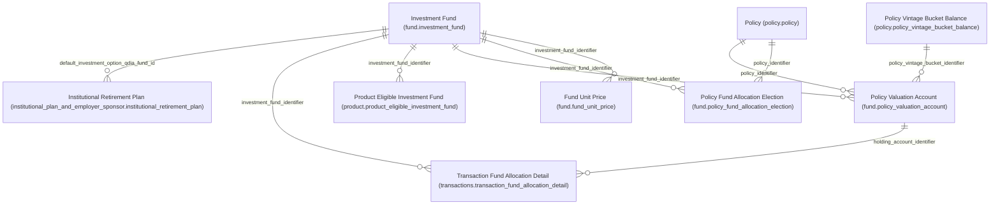

# L&A Ontology Knowledge Framework (OKF) -- Domain 4: Fund (Separate Accounts, Dual-Unit Prices & General Account Funds)

| OKF Metadata Attribute | Value |
| :--- | :--- |
| **OKF Catalog Document** | `L&A OKF/04 - OKF - Fund.MD` |
| **Enterprise Data Domain** | **Domain 4: Fund (Separate Accounts, Dual-Unit Prices & General Account Funds)** |
| **Target Physical Database Engine** | Amazon RDS Aurora PostgreSQL (PostgreSQL 15/16 Compatible) |
| **Physical Database Schema** | `fund` |
| **Domain Table Count** | **4 Physical Tables / Logical Entities** |
| **Outbound Foreign Key Joins** | **6 Foreign Key Relationships** (Intra-Domain & Cross-Domain) |
| **Inbound Foreign Key Joins** | **4 Cross-Domain Referencing Relationships** |
| **Performance Indexes** | **6 B-Tree & Composite Indexes** |
| **Inherited Business Context Rules** | **`BC-062` through `BC-081` (20 Rules)** |
| **Source Knowledge Layer Artifacts** | `L&A - Ontology.MD`, `L&A Data Model - Logical.MD`, `L&A Data Model - Physical DDL.sql`, `L&A Data Model - Conceptual.MD` |

---

## 1. Domain Executive Ontology & Business Context Overview

The **Fund** domain models the investment vehicles, daily unitized net asset valuations, policyholder allocation instructions, and sub-account position holdings that underpin variable annuities, variable universal life (VUL) policies, registered index-linked annuities (RILAs), fixed indexed annuities (FIAs), and general account investment options. In the US retirement and insurance market, carriers offer a spectrum of investment structures (`Account Structure Type`): insulated Separate Accounts registered with the SEC as Unit Investment Trusts (UITs) investing in underlying mutual fund sub-accounts (such as Nuveen, Vanguard, BlackRock, or Fidelity VIP portfolios), unique registered management investment company variable accounts like the College Retirement Equities Fund (`CREF Stock Account`, `CREF Social Choice Account`), non-unitized direct commercial property separate accounts like the `Direct Real Estate Separate Account` (equipped with a carrier-backed liquidity guarantee), indexed crediting strategies linked to the S&P 500 or MSCI EAFE, and General Account fixed options (`Participating General Account Fixed`). The Fund domain organizes these mechanics across four core entities: `Investment Fund`, `Fund Unit Price`, `Policy Fund Allocation Election`, and `Policy Valuation Account`.

The `Investment Fund` entity (`Investment Fund Identifier`, `Fund Ticker or Code`, `Fund Name`) defines each fund's `Asset Class`, `Fund Manager Name`, `Net Expense Ratio Percentage` (combining investment management fees, Mortality & Expense [M&E] risk charges, and administrative fees), and `Assumed Investment Return Rate (AIR)`. A hallmark of the institutional variable dual-unit accounting architecture—and variable annuity administration broadly—is captured in `Fund Unit Price`. Every business day at the 4:00 PM ET New York Stock Exchange market close (`Valuation Date`), the fund accounting engine calculates two distinct unit prices: the `Accumulation Unit Value (AUV)`, which measures the net asset value of a unit held by participants during the savings/accumulation phase via the `Daily Net Investment Factor`, and the `Annuity Unit Value`, which governs variable lifetime income checks during the payout phase by measuring whether actual fund investment performance exceeded or trailed the hurdle `Assumed Investment Return Rate (AIR)` (commonly 4.00% in CREF).

At the contract level, `Policy Fund Allocation Election` stores the policyholder's standing percentage splits (`Allocation Percentage` summing to 100% per `Allocation Type`) for future employee contributions, employer matches, automatic quarterly rebalancing, and Dollar Cost Averaging (DCA). Finally, `Policy Valuation Account` (`Holding Account Identifier`) records the policy's actual point-in-time position in each fund, tracking `Valuation Phase` (`Accumulation Phase` vs. `Annuitized Lifetime Payout Phase`), exact fractional `Number of Accumulation Units Held` or `Number of Annuity Units Held`, `Current Market Value Amount`, `Surrender Free Value Amount`, and optional linkage to `Policy Vintage Bucket Identifier` for vintage-bucketed general account holdings. AI agents building portfolio exposure, asset class concentration, or fund flow data products rely on the Fund domain to bridge policy-level balances to underlying capital market assets.

---

## 2. Physical Schema & Logical Entity Architecture Catalog (Schema: `fund`)

| # | Logical Entity Name | Physical Table Name (`schema.table`) | Primary Key Column (`PK`) | Business Cols | Audit Cols | Constraints (`PK`/`UQ`/`CHK`) | Logical Entity & Physical Table Definition |
| :--- | :--- | :--- | :--- | :--- | :--- | :--- | :--- |
| **4.1** | **Investment Fund** | `fund.investment_fund` | `investment_fund_identifier` | 10 | 2 | `pk_investment_fund`, `uq_investment_fund_ticker` | Investment Fund entity defines each underlying investment vehicle available within Separate Account variable products (such as Variable Equity, Direct Real Estate Separate Account, and target-date sub-accounts), Indexed Annuity strategies, and General Account fixed options, storing asset class, expense ratios, and Assumed Investment Return (AIR) rates. |
| **4.2** | **Fund Unit Price** | `fund.fund_unit_price` | `fund_unit_price_identifier` | 7 | 2 | `pk_fund_unit_price`, `uq_fund_unit_price_date`, `chk_fund_auv_positive` | Fund Unit Price entity stores the daily or periodic net asset valuation for each Investment Fund, capturing both the Accumulation Unit Value (AUV) used during the savings phase and the Annuity Unit Value used to adjust variable lifetime income payments during the payout phase. |
| **4.3** | **Policy Fund Allocation Election** | `fund.policy_fund_allocation_election` | `policy_allocation_election_identifier` | 6 | 2 | `pk_policy_fund_allocation_election`, `chk_pfae_alloc_pct` | Policy Fund Allocation Election entity captures the policyholder's or participant's standing instructions for how future premium contributions, automatic portfolio rebalancing, and dollar-cost averaging transfers are split across eligible Investment Funds. |
| **4.4** | **Policy Valuation Account** | `fund.policy_valuation_account` | `holding_account_identifier` | 9 | 2 | `pk_policy_valuation_account`, `chk_pva_units_non_neg` | Policy Valuation Account entity holds the current sub-account position and unit balance for a specific Policy within a specific Investment Fund, distinguishing between accumulation-phase units, payout-phase annuity units, total market value, and surrender-free value. |

---

## 3. Relational Join Mining & Foreign Key Topology

### 3.1 Entity-Relationship & Foreign Key Join Diagram (Mermaid)



### 3.2 Outbound Foreign Key Join Matrix (Tables in `fund` Referencing Parent Entities)

| FK Constraint Name | Child Table (`fund`) | Child FK Column | Join Scope | Parent Referenced Table | Parent PK Column | Referential Action | Exact SQL Join Predicate |
| :--- | :--- | :--- | :--- | :--- | :--- | :--- | :--- |
| `fk_fund_unit_price_fund` | `fund.fund_unit_price` | `investment_fund_identifier` | Intra-Domain | `fund.investment_fund` | `investment_fund_identifier` | `ON UPDATE CASCADE ON DELETE CASCADE` | `fund.fund_unit_price.investment_fund_identifier = fund.investment_fund.investment_fund_identifier` |
| `fk_pfae_policy` | `fund.policy_fund_allocation_election` | `policy_identifier` | Cross-Domain (`policy`) | `policy.policy` | `policy_identifier` | `ON UPDATE CASCADE ON DELETE CASCADE` | `fund.policy_fund_allocation_election.policy_identifier = policy.policy.policy_identifier` |
| `fk_pfae_investment_fund` | `fund.policy_fund_allocation_election` | `investment_fund_identifier` | Intra-Domain | `fund.investment_fund` | `investment_fund_identifier` | `ON UPDATE CASCADE ON DELETE RESTRICT` | `fund.policy_fund_allocation_election.investment_fund_identifier = fund.investment_fund.investment_fund_identifier` |
| `fk_pva_policy` | `fund.policy_valuation_account` | `policy_identifier` | Cross-Domain (`policy`) | `policy.policy` | `policy_identifier` | `ON UPDATE CASCADE ON DELETE CASCADE` | `fund.policy_valuation_account.policy_identifier = policy.policy.policy_identifier` |
| `fk_pva_investment_fund` | `fund.policy_valuation_account` | `investment_fund_identifier` | Intra-Domain | `fund.investment_fund` | `investment_fund_identifier` | `ON UPDATE CASCADE ON DELETE RESTRICT` | `fund.policy_valuation_account.investment_fund_identifier = fund.investment_fund.investment_fund_identifier` |
| `fk_pva_vintage_bucket` | `fund.policy_valuation_account` | `policy_vintage_bucket_identifier` | Cross-Domain (`policy`) | `policy.policy_vintage_bucket_balance` | `policy_vintage_bucket_identifier` | `ON UPDATE CASCADE ON DELETE SET NULL` | `fund.policy_valuation_account.policy_vintage_bucket_identifier = policy.policy_vintage_bucket_balance.policy_vintage_bucket_identifier` |

### 3.3 Inbound Cross-Domain Foreign Key Join Matrix (External Schemas Referencing `fund`)

| FK Constraint Name | Referencing Child Schema | Referencing Child Table | Child FK Column | Referenced Target Table (`fund`) | Target PK Column | Referential Action | Exact SQL Join Predicate |
| :--- | :--- | :--- | :--- | :--- | :--- | :--- | :--- |
| `fk_pef_investment_fund` | `product` | `product.product_eligible_investment_fund` | `investment_fund_identifier` | `fund.investment_fund` | `investment_fund_identifier` | `ON UPDATE CASCADE ON DELETE RESTRICT` | `product.product_eligible_investment_fund.investment_fund_identifier = fund.investment_fund.investment_fund_identifier` |
| `fk_tfad_holding_account` | `transactions` | `transactions.transaction_fund_allocation_detail` | `holding_account_identifier` | `fund.policy_valuation_account` | `holding_account_identifier` | `ON UPDATE CASCADE ON DELETE RESTRICT` | `transactions.transaction_fund_allocation_detail.holding_account_identifier = fund.policy_valuation_account.holding_account_identifier` |
| `fk_tfad_investment_fund` | `transactions` | `transactions.transaction_fund_allocation_detail` | `investment_fund_identifier` | `fund.investment_fund` | `investment_fund_identifier` | `ON UPDATE CASCADE ON DELETE RESTRICT` | `transactions.transaction_fund_allocation_detail.investment_fund_identifier = fund.investment_fund.investment_fund_identifier` |
| `fk_irp_qdia_fund` | `institutional_plan_and_employer_sponsor` | `institutional_plan_and_employer_sponsor.institutional_retirement_plan` | `default_investment_option_qdia_fund_id` | `fund.investment_fund` | `investment_fund_identifier` | `ON UPDATE CASCADE ON DELETE SET NULL` | `institutional_plan_and_employer_sponsor.institutional_retirement_plan.default_investment_option_qdia_fund_id = fund.investment_fund.investment_fund_identifier` |

---

## 4. Detailed Table-by-Table Schema, Column Dictionary & DDL Constraints

### 4.1 Logical Entity: `Investment Fund` <-> Physical Table: `fund.investment_fund`

- **Business & Technical Purpose**: Investment Fund entity defines each underlying investment vehicle available within Separate Account variable products (such as Variable Equity, Direct Real Estate Separate Account, and target-date sub-accounts), Indexed Annuity strategies, and General Account fixed options, storing asset class, expense ratios, and Assumed Investment Return (AIR) rates.
- **PostgreSQL Catalog Comment**: _""_
- **Primary Key**: `investment_fund_identifier`

#### Attribute-to-Column Schema Mapping & Business Dictionary

| Ord | Logical Attribute Name | Physical Column Name | Logical Type | Physical PostgreSQL Type | Key | Column Modifiers / Default | Business Definition, Domain Semantics & Sample Values |
| :--- | :--- | :--- | :--- | :--- | :--- | :--- | :--- |
| **1** | **Investment Fund Identifier** | `investment_fund_identifier` | String | `VARCHAR(64)` | **PK** | `NOT NULL` | Unique primary key identifying an underlying investment fund, variable separate account, or fixed interest account option in the master fund catalog. Sample values: `FUND-CREF-STK`, `FUND-SA-REA`, `FUND-GA-TRAD`, `FUND-NUV-IDX500`. |
| **2** | **Fund Ticker or Code** | `fund_ticker_or_code` | String | `VARCHAR(32)` | **NK** | `NOT NULL` | Standardized alphanumeric ticker symbol, CUSIP, or internal sub-account code used on participant statements and trading interfaces. Sample values: `QCSTRX` (CREF Stock R3), `QREARX` (Direct Real Estate Separate Account), `QCGLRX` (CREF Global Equities), `QCSCRX` (CREF Social Choice), `GA-TRAD`. |
| **3** | **Fund Name** | `fund_name` | String | `VARCHAR(200)` | **NK** | `NOT NULL` | Official prospectus and participant-facing name of the investment fund or sub-account. Sample values: `CREF Stock Account`, `CREF Social Choice Account`, `Direct Real Estate Separate Account`, `Participating General Account Fixed`, `Nuveen Lifecycle Index 2045 Fund`. |
| **4** | **Account Structure Type** | `account_structure_type` | String | `VARCHAR(120)` | **NK** | `NOT NULL` | Legal and regulatory accounting structure under which the fund's assets are held and insulated. Sample values: `General Account Fixed Option`, `Registered Separate Account (Unit Investment Trust)`, `Registered Management Investment Company (CREF)`, `Direct Real Estate Non-Unitized Separate Account`, `Indexed Strategy Crediting Account`. |
| **5** | **Asset Class** | `asset_class` | String | `VARCHAR(120)` | **NK** | `NOT NULL` | Primary financial asset class categorization used for portfolio risk analytics, rebalancing, and suitability checks. Sample values: `US Large Cap Equities`, `Global / International Equities`, `Core Fixed Income`, `Inflation-Protected Securities`, `Direct Commercial Real Estate`, `Multi-Asset Target Date`, `Balanced ESG / Social Choice`, `Money Market`. |
| **6** | **Fund Manager Name** | `fund_manager_name` | String | `VARCHAR(150)` | **NK** | `NOT NULL` | Investment management company or sub-advisor responsible for managing the underlying portfolio assets. Sample values: `Nuveen Asset Management`, `Institutional Variable Account Advisors`, `General Account Investment Management`, `Vanguard`, `BlackRock`. |
| **7** | **Net Expense Ratio Percentage** | `net_expense_ratio_percentage` | Decimal | `NUMERIC(9,6)` | **NK** | `NOT NULL DEFAULT 0.000000` | Total annual operating, investment management, mortality & expense (M&E) risk, and administrative fee deducted from fund assets, expressed as an annual decimal rate. Sample values: `0.0026` (0.26% / 26 bps), `0.0045` (0.45%), `0.0085` (0.85%), `0.0000` (General Account Spread). |
| **8** | **Assumed Investment Return Rate (AIR)** | `assumed_investment_return_rate_air` | Decimal | `NUMERIC(9,6)` | **NK** | `NULL` | Benchmark annual investment return hurdle (commonly 4.0% in CREF variable annuity payouts) used to calculate initial variable annuity income and determine whether subsequent periodic annuity unit values increase or decrease. Sample values: `0.0400` (4.00% Standard CREF AIR), `0.0350` (3.50%), `0.0500` (5.00%). |
| **9** | **Fund Inception Date** | `fund_inception_date` | Date | `DATE` | **NK** | `NOT NULL` | Calendar date on which the fund or sub-account commenced operations and established its initial unit value. Sample values: `1952-07-01` (CREF Stock), `1995-10-02` (Direct Real Estate Separate Account), `2018-05-01`. |
| **10** | **Closed to New Investors Indicator** | `closed_to_new_investors_indicator` | String | `VARCHAR(100)` | **NK** | `NOT NULL` | Boolean or status flag indicating whether the fund is soft-closed (existing participants only), hard-closed (no new contributions), or open to all eligible policies. Sample values: `Open to All Eligible Policies`, `Soft Closed - Existing Policyholders Only`, `Hard Closed / Frozen`. |
| **11** | **Record Created Timestamp (Audit)** | `created_at` | Timestamp | `TIMESTAMPTZ` | **AUDIT** | `NOT NULL DEFAULT CURRENT_TIMESTAMP` | System audit timestamp recording when the physical row was initially inserted into the Aurora PostgreSQL table. |
| **12** | **Record Updated Timestamp (Audit)** | `updated_at` | Timestamp | `TIMESTAMPTZ` | **AUDIT** | `NOT NULL DEFAULT CURRENT_TIMESTAMP` | System audit timestamp recording when the physical row was last modified in the Aurora PostgreSQL table. |

#### Declarative DDL Constraints & Indexes on `fund.investment_fund`

| Constraint / Index Category | Identifier Name | Definition / Target Columns & Referential Integrity Rule |
| :--- | :--- | :--- |
| **PRIMARY KEY** | `pk_investment_fund` | `PRIMARY KEY (investment_fund_identifier)` |
| **UNIQUE** | `uq_investment_fund_ticker` | `UNIQUE (fund_ticker_or_code)` |
| **B-TREE INDEX** | `idx_fund_asset_class` | `ON fund.investment_fund (asset_class, account_structure_type)` |

### 4.2 Logical Entity: `Fund Unit Price` <-> Physical Table: `fund.fund_unit_price`

- **Business & Technical Purpose**: Fund Unit Price entity stores the daily or periodic net asset valuation for each Investment Fund, capturing both the Accumulation Unit Value (AUV) used during the savings phase and the Annuity Unit Value used to adjust variable lifetime income payments during the payout phase.
- **PostgreSQL Catalog Comment**: _""_
- **Primary Key**: `fund_unit_price_identifier`

#### Attribute-to-Column Schema Mapping & Business Dictionary

| Ord | Logical Attribute Name | Physical Column Name | Logical Type | Physical PostgreSQL Type | Key | Column Modifiers / Default | Business Definition, Domain Semantics & Sample Values |
| :--- | :--- | :--- | :--- | :--- | :--- | :--- | :--- |
| **1** | **Fund Unit Price Identifier** | `fund_unit_price_identifier` | String | `VARCHAR(64)` | **PK** | `NOT NULL` | Unique primary key identifying a daily or periodic unit valuation record for an Investment Fund. Sample values: `FUP-20261021-CREFSTK`, `FUP-20261021-SAREA`. |
| **2** | **Investment Fund Identifier** | `investment_fund_identifier` | String | `VARCHAR(64)` | **FK** | `NOT NULL` | Foreign key linking the unit price valuation record to its parent Investment Fund. Sample values: `FUND-CREF-STK`, `FUND-SA-REA`. |
| **3** | **Valuation Date** | `valuation_date` | Date | `DATE` | **NK** | `NOT NULL` | Market close business date for which the net asset value and accumulation/annuity unit prices were calculated (typically 4:00 PM ET NYSE close). Sample values: `2026-10-19`, `2026-10-20`, `2026-10-21`. |
| **4** | **Accumulation Unit Value (AUV)** | `accumulation_unit_value_auv` | Decimal | `NUMERIC(18,6)` | **NK** | `NOT NULL` | Price of a single accumulation unit on the Valuation Date used to process contributions, transfers, and withdrawals for policies in the accumulation (savings) phase. Sample values: `412.849201`, `198.441029`, `24.109482`. |
| **5** | **Annuity Unit Value** | `annuity_unit_value` | Decimal | `NUMERIC(18,6)` | **NK** | `NULL` | Value of a single annuity payout unit used to determine the dollar amount of variable lifetime income checks for annuitized contracts (revalued monthly or annually in CREF based on performance relative to the 4% AIR). Sample values: `318.442100`, `84.192044`, `52.901120`. |
| **6** | **Daily Net Investment Factor** | `daily_net_investment_factor` | Decimal | `NUMERIC(18,8)` | **NK** | `NOT NULL DEFAULT 1.00000000` | Daily total return multiplier (1 + daily gross return minus daily expense accrual) used to roll yesterday's Accumulation Unit Value forward to today's AUV. Sample values: `1.0042185`, `0.9984120`, `1.0001540`. |
| **7** | **Total Fund Net Assets Amount** | `total_fund_net_assets_amount` | Decimal | `NUMERIC(20,2)` | **NK** | `NOT NULL DEFAULT 0.00` | Total net market value of all securities, real estate, and cash held inside the separate account or fund on the Valuation Date. Sample values: `142500000000.00`, `28400000000.00`, `950000000.00`. |
| **8** | **Record Created Timestamp (Audit)** | `created_at` | Timestamp | `TIMESTAMPTZ` | **AUDIT** | `NOT NULL DEFAULT CURRENT_TIMESTAMP` | System audit timestamp recording when the physical row was initially inserted into the Aurora PostgreSQL table. |
| **9** | **Record Updated Timestamp (Audit)** | `updated_at` | Timestamp | `TIMESTAMPTZ` | **AUDIT** | `NOT NULL DEFAULT CURRENT_TIMESTAMP` | System audit timestamp recording when the physical row was last modified in the Aurora PostgreSQL table. |

#### Declarative DDL Constraints & Indexes on `fund.fund_unit_price`

| Constraint / Index Category | Identifier Name | Definition / Target Columns & Referential Integrity Rule |
| :--- | :--- | :--- |
| **PRIMARY KEY** | `pk_fund_unit_price` | `PRIMARY KEY (fund_unit_price_identifier)` |
| **UNIQUE** | `uq_fund_unit_price_date` | `UNIQUE (investment_fund_identifier, valuation_date)` |
| **CHECK** | `chk_fund_auv_positive` | `CHECK (accumulation_unit_value_auv > 0)` |
| **FOREIGN KEY** | `fk_fund_unit_price_fund` | `FOREIGN KEY (investment_fund_identifier) REFERENCES fund.investment_fund (investment_fund_identifier) ON UPDATE CASCADE ON DELETE CASCADE` |
| **B-TREE INDEX** | `idx_fup_fund_val_date` | `ON fund.fund_unit_price (investment_fund_identifier, valuation_date DESC)` |

### 4.3 Logical Entity: `Policy Fund Allocation Election` <-> Physical Table: `fund.policy_fund_allocation_election`

- **Business & Technical Purpose**: Policy Fund Allocation Election entity captures the policyholder's or participant's standing instructions for how future premium contributions, automatic portfolio rebalancing, and dollar-cost averaging transfers are split across eligible Investment Funds.
- **PostgreSQL Catalog Comment**: _""_
- **Primary Key**: `policy_allocation_election_identifier`

#### Attribute-to-Column Schema Mapping & Business Dictionary

| Ord | Logical Attribute Name | Physical Column Name | Logical Type | Physical PostgreSQL Type | Key | Column Modifiers / Default | Business Definition, Domain Semantics & Sample Values |
| :--- | :--- | :--- | :--- | :--- | :--- | :--- | :--- |
| **1** | **Policy Allocation Election Identifier** | `policy_allocation_election_identifier` | String | `VARCHAR(64)` | **PK** | `NOT NULL` | Unique primary key identifying a standing fund allocation instruction line on a Policy. Sample values: `PFAE-88001`, `PFAE-88002`. |
| **2** | **Policy Identifier** | `policy_identifier` | String | `VARCHAR(64)` | **FK** | `NOT NULL` | Foreign key linking the standing allocation instruction to the parent Policy. Sample values: `POL-UUID-90001421`. |
| **3** | **Investment Fund Identifier** | `investment_fund_identifier` | String | `VARCHAR(64)` | **FK** | `NOT NULL` | Foreign key linking the allocation instruction to the target or source Investment Fund. Sample values: `FUND-CREF-STK`, `FUND-GA-TRAD`. |
| **4** | **Allocation Type** | `allocation_type` | String | `VARCHAR(120)` | **NK** | `NOT NULL` | Specifies the operational purpose of the standing percentage split across funds. Sample values: `Future Employee Contribution Allocation`, `Future Employer Match Allocation`, `Automatic Quarterly Rebalancing Target`, `Dollar Cost Averaging (DCA) Target Fund`, `Systematic Fee Deduction Source`. |
| **5** | **Allocation Effective Date** | `allocation_effective_date` | Date | `DATE` | **NK** | `NOT NULL` | Calendar date on which the policyholder's allocation instruction became active for subsequent transactions. Sample values: `2024-01-01`, `2026-07-15`. |
| **6** | **Allocation Percentage** | `allocation_percentage` | Decimal | `NUMERIC(9,6)` | **NK** | `NOT NULL` | Proportion of the contribution or rebalancing portfolio directed to this specific Investment Fund (must sum to 100% across all active lines of the same Allocation Type). Sample values: `0.5000` (50.00%), `0.3000` (30.00%), `0.2000` (20.00%), `1.0000` (100.00%). |
| **7** | **Record Created Timestamp (Audit)** | `created_at` | Timestamp | `TIMESTAMPTZ` | **AUDIT** | `NOT NULL DEFAULT CURRENT_TIMESTAMP` | System audit timestamp recording when the physical row was initially inserted into the Aurora PostgreSQL table. |
| **8** | **Record Updated Timestamp (Audit)** | `updated_at` | Timestamp | `TIMESTAMPTZ` | **AUDIT** | `NOT NULL DEFAULT CURRENT_TIMESTAMP` | System audit timestamp recording when the physical row was last modified in the Aurora PostgreSQL table. |

#### Declarative DDL Constraints & Indexes on `fund.policy_fund_allocation_election`

| Constraint / Index Category | Identifier Name | Definition / Target Columns & Referential Integrity Rule |
| :--- | :--- | :--- |
| **PRIMARY KEY** | `pk_policy_fund_allocation_election` | `PRIMARY KEY (policy_allocation_election_identifier)` |
| **CHECK** | `chk_pfae_alloc_pct` | `CHECK (allocation_percentage >= 0 AND allocation_percentage <= 1)` |
| **FOREIGN KEY** | `fk_pfae_policy` | `FOREIGN KEY (policy_identifier) REFERENCES policy.policy (policy_identifier) ON UPDATE CASCADE ON DELETE CASCADE` |
| **FOREIGN KEY** | `fk_pfae_investment_fund` | `FOREIGN KEY (investment_fund_identifier) REFERENCES fund.investment_fund (investment_fund_identifier) ON UPDATE CASCADE ON DELETE RESTRICT` |
| **B-TREE INDEX** | `idx_pfae_policy_type` | `ON fund.policy_fund_allocation_election (policy_identifier, allocation_type)` |
| **B-TREE INDEX** | `idx_pfae_fund_id` | `ON fund.policy_fund_allocation_election (investment_fund_identifier)` |

### 4.4 Logical Entity: `Policy Valuation Account` <-> Physical Table: `fund.policy_valuation_account`

- **Business & Technical Purpose**: Policy Valuation Account entity holds the current sub-account position and unit balance for a specific Policy within a specific Investment Fund, distinguishing between accumulation-phase units, payout-phase annuity units, total market value, and surrender-free value.
- **PostgreSQL Catalog Comment**: _""_
- **Primary Key**: `holding_account_identifier`

#### Attribute-to-Column Schema Mapping & Business Dictionary

| Ord | Logical Attribute Name | Physical Column Name | Logical Type | Physical PostgreSQL Type | Key | Column Modifiers / Default | Business Definition, Domain Semantics & Sample Values |
| :--- | :--- | :--- | :--- | :--- | :--- | :--- | :--- |
| **1** | **Holding Account Identifier** | `holding_account_identifier` | String | `VARCHAR(64)` | **PK** | `NOT NULL` | Unique primary key identifying a Policy's position holding in a specific Investment Fund. Sample values: `PVA-55001`, `PVA-55002`. |
| **2** | **Policy Identifier** | `policy_identifier` | String | `VARCHAR(64)` | **FK** | `NOT NULL` | Foreign key linking the sub-account holding balance to the parent Policy. Sample values: `POL-UUID-90001421`. |
| **3** | **Investment Fund Identifier** | `investment_fund_identifier` | String | `VARCHAR(64)` | **FK** | `NOT NULL` | Foreign key linking the holding balance to the underlying Investment Fund. Sample values: `FUND-CREF-STK`, `FUND-SA-REA`, `FUND-GA-TRAD`. |
| **4** | **Policy Vintage Bucket Identifier** | `policy_vintage_bucket_identifier` | String | `VARCHAR(64)` | **FK** | `NULL` | Optional foreign key linking a General Account holding position to its specific Policy Vintage Bucket Balance (populated for vintage-bucketed general account funds; null for unitized variable funds). Sample values: `PVB-30001`, `Null (Unitized Separate Account)`. |
| **5** | **Valuation Phase** | `valuation_phase` | String | `VARCHAR(100)` | **NK** | `NOT NULL` | Indicates whether the holding is currently accumulating savings in Accumulation Units or paying out lifetime income in Annuity Units. Sample values: `Accumulation Phase`, `Annuitized Lifetime Payout Phase`, `Transfer Payout Installment Phase`. |
| **6** | **Number of Accumulation Units Held** | `number_of_accumulation_units_held` | Decimal | `NUMERIC(18,6)` | **NK** | `NOT NULL DEFAULT 0.000000` | Exact fractional count of Accumulation Units owned by the policy in this sub-account (typically tracked to 4 or 6 decimal places). Sample values: `351.776942`, `1240.000000`, `0.000000`. |
| **7** | **Number of Annuity Units Held** | `number_of_annuity_units_held` | Decimal | `NUMERIC(18,6)` | **NK** | `NOT NULL DEFAULT 0.000000` | Fixed number of Annuity Units assigned to the contract upon annuitization, which is multiplied by the current Annuity Unit Value to determine each periodic variable income payment. Sample values: `0.000000` (In Accumulation), `14.829104` (Monthly Annuity Units), `42.500000`. |
| **8** | **Current Market Value Amount** | `current_market_value_amount` | Decimal | `NUMERIC(18,2)` | **NK** | `NOT NULL DEFAULT 0.00` | Current dollar value of the holding, equal to Accumulation Units Held multiplied by the latest Accumulation Unit Value (or accumulated principal plus interest for fixed accounts). Sample values: `145230.85`, `64120.00`, `210450.30`. |
| **9** | **Surrender Free Value Amount** | `surrender_free_value_amount` | Decimal | `NUMERIC(18,2)` | **NK** | `NOT NULL DEFAULT 0.00` | Portion of the Current Market Value in this sub-account that can be withdrawn or transferred immediately without incurring a surrender charge or liquidity restriction. Sample values: `145230.85`, `14523.09` (10% Free Withdrawal Allowance), `0.00`. |
| **10** | **Record Created Timestamp (Audit)** | `created_at` | Timestamp | `TIMESTAMPTZ` | **AUDIT** | `NOT NULL DEFAULT CURRENT_TIMESTAMP` | System audit timestamp recording when the physical row was initially inserted into the Aurora PostgreSQL table. |
| **11** | **Record Updated Timestamp (Audit)** | `updated_at` | Timestamp | `TIMESTAMPTZ` | **AUDIT** | `NOT NULL DEFAULT CURRENT_TIMESTAMP` | System audit timestamp recording when the physical row was last modified in the Aurora PostgreSQL table. |

#### Declarative DDL Constraints & Indexes on `fund.policy_valuation_account`

| Constraint / Index Category | Identifier Name | Definition / Target Columns & Referential Integrity Rule |
| :--- | :--- | :--- |
| **PRIMARY KEY** | `pk_policy_valuation_account` | `PRIMARY KEY (holding_account_identifier)` |
| **CHECK** | `chk_pva_units_non_neg` | `CHECK (number_of_accumulation_units_held >= 0 AND number_of_annuity_units_held >= 0)` |
| **FOREIGN KEY** | `fk_pva_policy` | `FOREIGN KEY (policy_identifier) REFERENCES policy.policy (policy_identifier) ON UPDATE CASCADE ON DELETE CASCADE` |
| **FOREIGN KEY** | `fk_pva_investment_fund` | `FOREIGN KEY (investment_fund_identifier) REFERENCES fund.investment_fund (investment_fund_identifier) ON UPDATE CASCADE ON DELETE RESTRICT` |
| **FOREIGN KEY** | `fk_pva_vintage_bucket` | `FOREIGN KEY (policy_vintage_bucket_identifier) REFERENCES policy.policy_vintage_bucket_balance (policy_vintage_bucket_identifier) ON UPDATE CASCADE ON DELETE SET NULL` |
| **B-TREE INDEX** | `idx_pva_policy_fund` | `ON fund.policy_valuation_account (policy_identifier, investment_fund_identifier)` |
| **B-TREE INDEX** | `idx_pva_vintage_bucket_id` | `ON fund.policy_valuation_account (policy_vintage_bucket_identifier)` |

---

## 5. Inherited Business Context Ontology Rules (`BC-062` to `BC-081`)

> **Semantic Inheritance Notice**: The following **20 Business Context rules** are inherited verbatim from `L&A Data Domain/L&A - Ontology.MD` to provide autonomous AI agents, data engineers, and actuaries with complete domain rules, accounting identities, statutory compliance mandates, and SQL join guardrails for the **Fund** domain.

#### BC-062: General Account vs. Registered Separate Account Legal Insulation and Balance Sheet Segregation

**Domains**: Fund, Product, Finance | **Entities**: `Investment Fund`, `Product`, `General Ledger Account` | **Key Attributes**: `Account Structure Type`, `General or Separate Account Indicator`, `Separate vs General Account Ledger Code`, `Total Fund Net Assets Amount`

In Life and Annuity insurance architecture, the most fundamental legal, regulatory, and accounting boundary is the separation between the insurer's General Account and its insulated Separate Accounts. Within the `Investment Fund` entity, this structural distinction is explicitly governed by `Account Structure Type` (with values such as `General Account Fixed Option`, `Registered Separate Account (Unit Investment Trust)`, `Registered Management Investment Company (CREF)`, `Direct Real Estate Non-Unitized Separate Account`, and `Indexed Strategy Crediting Account`), which aligns with `Product`.`General or Separate Account Indicator` and `General Ledger Account`.`Separate vs General Account Ledger Code`. When a policyholder allocates premiums to a General Account option—such as `Participating General Account Fixed` (`FUND-GA-TRAD`) or a fixed annuity issued by Athene, Lincoln Financial, or Pacific Life—those funds become part of the issuing carrier's undivided general corporate assets. The insurer invests the General Account portfolio primarily in investment-grade corporate bonds, commercial mortgages, and private placements, bearing 100% of the investment default and market fluctuation risk while guaranteeing principal and a contractual minimum crediting rate to the policyholder. Conversely, assets held in a Separate Account (such as variable annuity sub-accounts or CREF variable accounts) are legally segregated under state insurance statutes (e.g., New York Insurance Law Section 4240) and federal securities laws from the general liabilities of the insurance carrier. In the event of carrier insolvency, general creditors of the insurance company cannot attach or claim assets held inside an insulated Separate Account. Conversely, variable policyholders bear the direct market gain and loss of the underlying securities without a principal floor (absent an attached living or death benefit rider). AI agents building enterprise balance sheet reports, AUM dashboards, or statutory Schedule BA / Separate Account Annual Statement extracts must never commingle `General Account Ledger` assets with `Separate Account Ledger` assets without explicit segmentation by `Account Structure Type`.

#### BC-063: CREF Registered Management Investment Company Dual-Unit Accounting Architecture (`Accumulation Unit Value (AUV)` vs. `Annuity Unit Value`)

**Domains**: Fund, Claims, Annuitization & Benefit Payouts | **Entities**: `Investment Fund`, `Fund Unit Price`, `Policy Valuation Account`, `Annuitization Payout Schedule` | **Key Attributes**: `Account Structure Type`, `Accumulation Unit Value (AUV)`, `Annuity Unit Value`, `Valuation Phase`, `Number of Accumulation Units Held`, `Number of Annuity Units Held`

A defining hallmark of the Institutional Variable & General Account retirement architecture—and variable annuity administration across major US carriers such as Prudential, Jackson National, and Equitable—is the dual-unit valuation system that separates savings-phase unit accounting from lifetime-payout-phase unit accounting. The College Retirement Equities Fund (`CREF`), established in 1952 as the nation's first variable annuity and structured as a `Registered Management Investment Company (CREF)` under the Investment Company Act of 1940, maintains two completely distinct unit prices in the `Fund Unit Price` entity for every `Valuation Date`: the `Accumulation Unit Value (AUV)` and the `Annuity Unit Value`. While a participant's contract is in the savings stage (`Policy Valuation Account`.`Valuation Phase` = `Accumulation Phase`), all incoming payroll contributions, employer matches, and fund transfers purchase fractional accumulation units (`Number of Accumulation Units Held`) priced at the daily `Accumulation Unit Value (AUV)`. The `Accumulation Unit Value (AUV)` functions similarly to a mutual fund total-return net asset value, growing or shrinking daily based on capital appreciation, dividends, and net expense deductions. However, when the participant elects to annuitize their variable balance into a lifetime variable income stream (`Valuation Phase` = `Annuitized Lifetime Payout Phase`), their entire balance of `Number of Accumulation Units Held` is extinguished and converted—using age-based mortality tables and the `Assumed Investment Return Rate (AIR)`—into a permanently fixed count of `Number of Annuity Units Held`. From that date forward, the participant's periodic income check is equal to their fixed `Number of Annuity Units Held` multiplied by the prevailing `Annuity Unit Value`. AI agents must never multiply `Number of Annuity Units Held` by `Accumulation Unit Value (AUV)`, nor apply `Annuity Unit Value` to accumulation-phase contracts; doing so corrupts policy market values and variable payout projections by orders of magnitude.

#### BC-064: Assumed Investment Return Rate (`Assumed Investment Return Rate (AIR)`) Hurdle Mechanics and the 4.00% CREF Benchmark

**Domains**: Fund, Claims, Annuitization & Benefit Payouts | **Entities**: `Investment Fund`, `Fund Unit Price`, `Annuitization Payout Schedule` | **Key Attributes**: `Assumed Investment Return Rate (AIR)`, `Assumed Investment Return (AIR) Election`, `Annuity Unit Value`, `Daily Net Investment Factor`

The `Assumed Investment Return Rate (AIR)` stored on the `Investment Fund` entity (and elected at the payout schedule level via `Annuitization Payout Schedule`.`Assumed Investment Return (AIR) Election`) is the actuarial hurdle rate that governs both the initial dollar payment of a variable lifetime annuity and the trajectory of all subsequent variable payments. In CREF variable annuity accounts (such as `CREF Stock Account`, `CREF Social Choice Account`, and `CREF Global Equities`) as well as retail variable annuities from carriers like Lincoln and Nationwide, the standard benchmark `Assumed Investment Return Rate (AIR)` is `0.0400` (4.00% annualized), though certain retail contracts offer 3.50% or 5.00% AIR elections. Actuarially, setting a 4.00% AIR allows the carrier to front-load a higher initial monthly income payment at retirement than a 0% hurdle would permit, because the mortality and annuity purchase factor assumes the underlying portfolio will earn at least 4.00% per year over the annuitant's life expectancy. Consequently, during the payout phase, the `Annuity Unit Value` in `Fund Unit Price` does not increase simply because the fund had a positive net return; it increases only if the fund's net total return exceeds the 4.00% annualized `Assumed Investment Return Rate (AIR)` hurdle. Specifically, if a CREF sub-account achieves a net return of exactly 4.00% over the revaluation period, the `Annuity Unit Value` remains completely unchanged and the retiree's monthly check stays constant. If the fund earns 10.00% net of expenses, the `Annuity Unit Value` rises by approximately $(1.10 / 1.04) - 1 = +5.77$; if the fund earns +1.00% net of expenses, even though nominal return is positive, it underperformed the 4.00% AIR hurdle, causing the `Annuity Unit Value` and the retiree's check to decline by $(1.01 / 1.04) - 1 = -2.88$. AI agents modeling retirement income scenarios must incorporate this exact AIR discount factor when projecting `Annuity Unit Value` movements.

#### BC-065: Annual May 1 vs. Monthly Variable Annuity Unit Revaluation Methodologies

**Domains**: Fund, Claims, Annuitization & Benefit Payouts | **Entities**: `Fund Unit Price`, `Annuitization Payout Schedule`, `Policy Valuation Account` | **Key Attributes**: `Annuity Unit Value`, `Assumed Investment Return (AIR) Election`, `Current Variable or Additional Dividend Payment Amount`, `Number of Annuity Units Held`, `Payment Frequency`

When a policyholder annuitizes a variable separate account such as `CREF Stock Account` (`FUND-CREF-STK`) or `Direct Real Estate Separate Account` (`FUND-SA-REA`), the contract permits the annuitant to choose how frequently their variable income payment is recalculated to reflect actual investment performance relative to the 4.00% `Assumed Investment Return Rate (AIR)`. This contractual choice is captured in `Annuitization Payout Schedule`.`Assumed Investment Return (AIR) Election` with values such as `4.00% AIR - Annual Revaluation (May 1)` and `4.00% AIR - Monthly Revaluation`. Under the traditional CREF Annual Revaluation method, the retiree's `Annuity Unit Value`—and therefore their monthly check amount (`Guaranteed Minimum Periodic Payment Amount` + `Current Variable or Additional Dividend Payment Amount`)—is revalued once per year effective May 1, based on the fund's net investment return over the preceding 12-month fiscal valuation year ending March 31. This provides retirees with predictable, level monthly income checks for 12 consecutive months (May through April), shielding household budgets from month-to-month stock market volatility. Under the alternative Monthly Revaluation election (also standard in retail variable annuities at Pacific Life and Prudential), the `Annuity Unit Value` applied to the contract is updated every single month based on the prior month's performance relative to the monthly compounded equivalent of the 4.00% annual AIR. Because `Fund Unit Price` stores daily and periodic `Annuity Unit Value` series, AI agents and data products calculating expected variable annuity disbursements or auditing `Financial Transaction` records of type `Lifetime Annuity Income Payment` must join `Policy Valuation Account` to `Annuitization Payout Schedule` and inspect `Assumed Investment Return (AIR) Election` to determine whether to apply the locked May 1 annual `Annuity Unit Value` or the rolling monthly `Annuity Unit Value`.

#### BC-066: Direct Real Estate Separate Account Property Separate Account Structure and Liquidity Guarantee

**Domains**: Fund, Product | **Entities**: `Investment Fund`, `Fund Unit Price`, `Product Eligible Investment Fund` | **Key Attributes**: `Investment Fund Identifier`, `Fund Ticker or Code`, `Account Structure Type`, `Asset Class`, `Net Expense Ratio Percentage`, `Maximum Allocation Percentage`

Unlike standard variable annuity sub-accounts that operate as Unit Investment Trusts (`Registered Separate Account (Unit Investment Trust)`) investing passively in shares of underlying mutual funds, the flagship `Direct Real Estate Separate Account` (`Investment Fund Identifier` = `FUND-SA-REA`, ticker `QREARX`, launched on `Fund Inception Date` `1995-10-02`) is a unique insurance product innovation classified in `Investment Fund`.`Account Structure Type` as a `Direct Real Estate Non-Unitized Separate Account` (or direct-property variable separate account registered under the Securities Act of 1933) with `Asset Class` = `Direct Commercial Real Estate`. Instead of holding REIT stocks, `FUND-SA-REA` directly owns a diversified portfolio of institutional-grade commercial real estate properties—industrial logistics centers, multifamily residential complexes, medical offices, and retail properties—alongside a liquid sleeve of short-term marketable securities. Every business day, `Fund Unit Price` strikes an `Accumulation Unit Value (AUV)` for `FUND-SA-REA` by accruing daily net rental income, property operating expenses, and independent quarterly external property appraisals across `Total Fund Net Assets Amount`. Because physical commercial buildings cannot be liquidated overnight at 4:00 PM ET when participants request withdrawals or transfers during commercial real estate downturns, the carrier's General Account provides a contractual liquidity guarantee to the `Direct Real Estate Separate Account`, standing ready to purchase Liquidity Units if net participant redemptions exceed the separate account's liquid cash reserves. In exchange for assuming this balance sheet liquidity risk, the carrier deducts an explicit liquidity fee component embedded within `Investment Fund`.`Net Expense Ratio Percentage`, and enforces concentration risk guardrails via `Product Eligible Investment Fund`.`Maximum Allocation Percentage` (e.g., capping participant allocations or limiting lump-sum transfers into `FUND-SA-REA` to $150,000 or `0.2500` / 25% of contract value). AI agents analyzing fund risk or liquidity exposure must treat `Direct Real Estate Non-Unitized Separate Account` holdings distinctly from equity UIT sub-accounts.

#### BC-067: Daily Net Investment Factor (`Daily Net Investment Factor`) Roll-Forward Calculation and AUV Continuity Invariant

**Domains**: Fund | **Entities**: `Investment Fund`, `Fund Unit Price` | **Key Attributes**: `Fund Unit Price Identifier`, `Valuation Date`, `Accumulation Unit Value (AUV)`, `Daily Net Investment Factor`, `Net Expense Ratio Percentage`

In the `Fund Unit Price` entity, the time-series progression of a variable sub-account's `Accumulation Unit Value (AUV)` from one NYSE market close (`Valuation Date` $t-1$) to the next (`Valuation Date` $t$) is governed by an exact actuarial and investment accounting identity driven by `Daily Net Investment Factor`. Specifically, for every unitized separate account (`Account Structure Type` in `Registered Separate Account (Unit Investment Trust)`, `Registered Management Investment Company (CREF)`, or `Direct Real Estate Non-Unitized Separate Account`), the continuity equation mandates:
$$\text{Accumulation Unit Value (AUV)}*{t} = \text{Accumulation Unit Value (AUV)}*{t-1} \times \text{Daily Net Investment Factor}*{t}$$
The* `Daily Net Investment Factor` *(stored to seven decimal places, such as* `1.0042185` *on an up-market day or* `0.9984120` *on a down-market day) is computed by taking 1.0000000 plus the gross daily investment return of the underlying portfolio (realized and unrealized capital gains/losses plus reinvested dividend and interest income divided by prior day net assets) minus the daily accrued slice of the fund's* `Net Expense Ratio Percentage` *(annual expense ratio divided by 365 or 366 calendar days, multiplied by the number of calendar days elapsed since the previous* `Valuation Date`*, such as 3 days over a standard weekend or 4 days over a holiday weekend). Because variable annuity sub-accounts automatically reinvest all underlying mutual fund dividends and capital gain distributions directly into the unit value rather than distributing cash shares,* `Accumulation Unit Value (AUV)` *is a pure total-return index that never drops due to an ex-dividend date distribution. AI agents building fund performance analytics, calculating time-weighted returns (TWR) between two arbitrary dates $t_0$ and $t_1$, or auditing pricing feeds from fund accounting engines (such as State Street, BNY Mellon, or Nuveen Fund Administration) can compute exact cumulative net performance simply as $(\text{AUV}*{t_1} / \text{AUV}_{t_0}) - 1$, or by taking the geometric product of `Daily Net Investment Factor` over the date range.

#### BC-068: Net Expense Ratio (`Net Expense Ratio Percentage`) Decomposition: M&E Risk, Administrative, and Sub-Advisor Fees vs. General Account Spread

**Domains**: Fund, Finance | **Entities**: `Investment Fund`, `Sub-Ledger Journal Entry` | **Key Attributes**: `Net Expense Ratio Percentage`, `Account Structure Type`, `Fund Manager Name`, `Accounting Event Type`

The `Net Expense Ratio Percentage` attribute on the `Investment Fund` entity represents the total annualized percentage fee deducted daily from the net assets of a separate account or variable fund before striking the `Accumulation Unit Value (AUV)`. In Life and Annuity insurance products, this expense ratio is structurally different from a retail mutual fund expense ratio because it bundles both investment management costs and insurance-specific risk charges. For a variable sub-account or CREF account (managed by `Fund Manager Name` such as `Teachers Advisors, LLC / Nuveen`, `College Retirement Equities Fund (CREF)`, `Vanguard`, or `BlackRock`), `Net Expense Ratio Percentage` comprises three distinct components: (1) the underlying portfolio investment advisory or sub-advisor fee, (2) the plan/contract administrative expense charge, and (3) the Mortality and Expense (`M&E`) risk charge. The M&E risk charge compensates the insurance carrier for guaranteeing that annuity purchase rates (`Annuitization Payout Schedule`) and administrative fee caps will never be raised even if annuitants live longer than actuarial tables predicted or carrier operating expenses escalate. Notably, CREF institutional retirement accounts operate on an "at-cost" structure with remarkably low `Net Expense Ratio Percentage` values (e.g., `0.0026` or 26 bps for `QCSTRX`), whereas retail variable annuities with embedded death benefits may carry `Net Expense Ratio Percentage` values of `0.0085` (85 bps) to `0.0150` (150 bps), recognized in `Sub-Ledger Journal Entry` under `Accounting Event Type` = `Rider Fee & M&E Revenue Recognition`. Conversely, for `General Account Fixed Option` funds like `Participating General Account Fixed` (`FUND-GA-TRAD`), `Net Expense Ratio Percentage` is recorded as `0.0000` (`0.0000 (General Account Spread)`). General Account options do not deduct an explicit unitized expense ratio; instead, operating expenses and risk margins are funded through the net investment spread between the yield earned on the carrier's general account bond portfolio and the `Total Effective Crediting Rate` declared to policyholders. AI agents generating fee disclosure reports (such as DOL 404a-5 participant fee disclosures) must never interpret a `0.0000` expense ratio on a General Account option as an anomaly or missing value.

#### BC-069: Product-to-Fund Menu Eligibility Governance and Concentration Caps (`Product Eligible Investment Fund`)

**Domains**: Fund, Product, Institutional Plan & Employer Sponsor | **Entities**: `Product Eligible Investment Fund`, `Product`, `Investment Fund`, `Institutional Retirement Plan` | **Key Attributes**: `Product Eligible Fund Identifier`, `Product Identifier`, `Investment Fund Identifier`, `Maximum Allocation Percentage`, `Default Investment Option (QDIA) Fund Identifier`

An insurance or retirement policy cannot allocate money to an arbitrary `Investment Fund` in the enterprise catalog; fund availability is strictly governed by the associative rule entity `Product Eligible Investment Fund`, which links a parent `Product` (`Product Identifier`) to its legally approved menu of `Investment Fund` records (`Investment Fund Identifier`). In the Life and Annuity industry, each marketable `Product`—such as `Participating General Account Retirement Annuity (RA)`, `CREF Variable Retirement Annuity`, `Institutional Retirement Choice (RC)`, or a retail variable annuity or Indexed Universal Life (`PROD-IUL-10`) policy—is filed with the SEC and state insurance departments with a specific prospectus and sub-account menu. Furthermore, in institutional retirement plans (`Institutional Retirement Plan`), the employer plan sponsor and their ERISA 3(21) or 3(38) investment fiduciary curate a plan-specific investment lineup from the carrier's `Product Eligible Investment Fund` universe. A critical risk-control attribute on `Product Eligible Investment Fund` is `Maximum Allocation Percentage`, which sets a hard ceiling (such as `0.2500` for a 25% cap, `0.5000` for a 50% cap, or `1.0000` for 100% unrestricted) on the proportion of a contribution or contract accumulation value that a policyholder may direct into that specific fund. Carriers such as Corebridge, Lincoln Financial, and Prudential enforce `Maximum Allocation Percentage` restrictions for two primary reasons: (1) protecting liquidity in illiquid asset classes like `FUND-SA-REA` (`Direct Commercial Real Estate`), and (2) enforcing volatility-control rules on policies that have attached a `Guaranteed Minimum Withdrawal Benefit (GMWB / GLWB)` rider, where policyholders are contractually prohibited from allocating more than 20% or 30% into high-beta emerging-market or aggressive-growth equity sub-accounts. AI agents validating `Policy Fund Allocation Election` requests or building digital enrollment assistants must join `Policy` $\rightarrow$ `Product` $\rightarrow$ `Product Eligible Investment Fund` to verify both fund eligibility and `Maximum Allocation Percentage` compliance.

#### BC-070: Standing Allocation Election 100% Partition Invariant by Allocation Type (`Policy Fund Allocation Election`)

**Domains**: Fund, Policy | **Entities**: `Policy Fund Allocation Election`, `Policy`, `Investment Fund` | **Key Attributes**: `Policy Allocation Election Identifier`, `Policy Identifier`, `Investment Fund Identifier`, `Allocation Type`, `Allocation Effective Date`, `Allocation Percentage`

The `Policy Fund Allocation Election` entity stores a policyholder's standing instructions for how future cash inflows, automated portfolio rebalancings, or systematic fee deductions are distributed across eligible `Investment Fund` options on a `Policy`. Because a single `Policy` can simultaneously maintain completely different percentage splits for employee salary deferrals, employer matching contributions, and quarterly rebalancing targets, every row in `Policy Fund Allocation Election` is partitioned by `Allocation Type` (`Future Employee Contribution Allocation`, `Future Employer Match Allocation`, `Automatic Quarterly Rebalancing Target`, `Dollar Cost Averaging (DCA) Target Fund`, and `Systematic Fee Deduction Source`) and versioned by `Allocation Effective Date`. The foundational mathematical integrity constraint of this entity is the **100% Partition Invariant**: for any given `Policy Identifier` and a specific `Allocation Type`, the sum of `Allocation Percentage` across all currently active `Policy Fund Allocation Election` rows (those sharing the latest `Allocation Effective Date` for that `Allocation Type`) must equal exactly `1.0000` (100.00%):
$$\sum_{i \in \text{Active}(\text{Policy}, \text{Allocation Type})} \text{Allocation Percentage}_{i} = 1.0000$$
For example, a university professor's 403(b) contract (`POL-UUID-90001421`) might have three active rows under `Allocation Type` = `Future Employee Contribution Allocation`: `0.5000` (50%) to `FUND-CREF-STK`, `0.3000` (30%) to `FUND-GA-TRAD`, and `0.2000` (20%) to `FUND-SA-REA`, summing to `1.0000`. At the same time, the same policy can have two active rows under `Allocation Type` = `Automatic Quarterly Rebalancing Target` summing to `1.0000` across variable funds. If an AI agent sums `Allocation Percentage` across a `Policy Identifier` without grouping by both `Allocation Type` and the latest `Allocation Effective Date`, the query will sum to 200%, 300%, or more across historical and multi-purpose elections. AI agents must always filter to the most recent `Allocation Effective Date` per `Policy Identifier` and `Allocation Type` when reading active standing elections.

#### BC-071: Future Employee Contribution vs. Future Employer Match Split Allocation Mechanics

**Domains**: Fund, Transactions, Billing, Remittance & Tax Reporting | **Entities**: `Policy Fund Allocation Election`, `Financial Transaction`, `Transaction Fund Allocation Detail`, `Institutional Payroll Remittance Batch` | **Key Attributes**: `Allocation Type`, `Allocation Percentage`, `Transaction Type`, `Remittance Batch Identifier`, `Allocated Dollar Amount`

In institutional 403(b), 401(a), and 401(k) retirement plans administered by Corebridge, Fidelity, or Empower, participants and plan sponsors frequently establish distinct investment allocation rules for employee-funded salary deferrals versus employer-funded contributions. The `Policy Fund Allocation Election` entity supports this requirement by separating `Allocation Type` = `Future Employee Contribution Allocation` from `Allocation Type` = `Future Employer Match Allocation`. When an `Institutional Payroll Remittance Batch` (`Remittance Batch Identifier`, e.g., `RMB-20261015-HARV`) settles in cash and is decomposed into policy-level `Financial Transaction` records, the policy administration engine inspects the `Transaction Type` of each incoming contribution. For transactions with `Transaction Type` in (`Employee Pre-Tax Contribution`, `Designated Roth Contribution`), the engine multiplies the `Gross Transaction Amount` by the active `Allocation Percentage` lines under `Allocation Type` = `Future Employee Contribution Allocation` to generate the child `Transaction Fund Allocation Detail` records (`Allocated Dollar Amount`). Conversely, for transactions with `Transaction Type` = `Employer Matching Contribution` (or employer basic non-elective contributions), the engine applies the active `Allocation Percentage` lines under `Allocation Type` = `Future Employer Match Allocation`. This separation is essential in higher education and healthcare plans where the `Employer Sponsor Organization` either mandates that employer contributions be directed into a specific fixed or target-date vehicle until the participant satisfies the `Plan Vesting Schedule`, or where the participant intentionally directs their own contributions into aggressive equity funds (`CREF Stock Account`) while directing the employer match into `Participating General Account Fixed` to build a guaranteed lifetime income floor. AI agents simulating future retirement balances or auditing payroll batch postings must match each contribution `Transaction Type` to its corresponding `Allocation Type` in `Policy Fund Allocation Election`.

#### BC-072: Automatic Quarterly Rebalancing Target Elections and Drift Reset Execution

**Domains**: Fund, Transactions | **Entities**: `Policy Fund Allocation Election`, `Policy Valuation Account`, `Financial Transaction`, `Transaction Fund Allocation Detail`, `Non-Financial Service Transaction` | **Key Attributes**: `Allocation Type`, `Allocation Percentage`, `Current Market Value Amount`, `Restricted Liquidity Indicator`, `Transaction Type`, `Endorsement Type`

Over time, differential market returns across equity, real estate, and fixed-income sub-accounts cause a policyholder's actual portfolio weights in `Policy Valuation Account` (`Current Market Value Amount` divided by total rebalancable value) to drift away from their desired risk profile. When a policyholder enrolls in automatic portfolio rebalancing—logged as a `Non-Financial Service Transaction` with `Endorsement Type` = `Automatic Rebalancing Enrollment`—their target asset weights are stored in `Policy Fund Allocation Election` under `Allocation Type` = `Automatic Quarterly Rebalancing Target`. On the scheduled quarterly, semi-annual, or annual rebalancing date, the policy administration engine evaluates all `Policy Valuation Account` holdings on the policy that are eligible for unrestricted transfer. Crucially, in institutional multi-account annuity architectures, restricted General Account holdings—specifically `Policy Valuation Account` records linked to a `Policy Vintage Bucket Balance` where `Restricted Liquidity Indicator` is `Restricted - Lifetime Income or 10-Year TPA` or `Restricted - 84-Month Systematic Installment`—cannot be liquidated in a lump sum and are therefore excluded from the rebalancable asset pool (or treated as a fixed external weight). Across the liquid separate account holdings (such as `CREF Stock Account`, `CREF Social Choice Account`, `Direct Real Estate Separate Account`, and `Nuveen Lifecycle Index` funds), the engine calculates the target dollar balance for each fund ($\text{Total Rebalancable Value} \times \text{Allocation Percentage}$) and executes a single zero-net-cash `Financial Transaction` with `Transaction Type` = `Internal Fund-to-Fund Transfer`. Within `Transaction Fund Allocation Detail`, over-weight sub-accounts receive negative `Allocated Dollar Amount` lines (selling units at that day's `Accumulation Unit Value (AUV)`), and under-weight sub-accounts receive positive `Allocated Dollar Amount` lines (buying units at that day's AUV). Note that `Direct Real Estate Separate Account` (`FUND-SA-REA`) often enforces a once-per-calendar-quarter transfer-in limitation that AI agents must respect when checking rebalancing eligibility.

#### BC-073: Dollar Cost Averaging (`Dollar Cost Averaging (DCA) Target Fund`) and Systematic Fee Deduction Source Rules

**Domains**: Fund, Transactions | **Entities**: `Policy Fund Allocation Election`, `Policy Valuation Account`, `Financial Transaction`, `Transaction Fund Allocation Detail` | **Key Attributes**: `Allocation Type`, `Allocation Percentage`, `Investment Fund Identifier`, `Transaction Type`, `Allocated Dollar Amount`

Beyond new-money contribution splits and periodic rebalancing, `Policy Fund Allocation Election` governs two specialized automated sub-account workflows through `Allocation Type` values `Dollar Cost Averaging (DCA) Target Fund` and `Systematic Fee Deduction Source`. First, when a customer funds a retail or institutional annuity with a large single lump sum—such as a $500,000 `Direct Rollover In` or `IRC 1035 Tax-Free Exchange In`—they often wish to mitigate market-timing risk by parking the initial deposit in a low-volatility money market or fixed holding account (`Asset Class` = `Money Market` or a short-term DCA fixed bucket) and systematically transferring a fixed dollar amount or fraction each month over 6 or 12 months into equity and real estate sub-accounts. The destination weights of these monthly sweeps are stored under `Allocation Type` = `Dollar Cost Averaging (DCA) Target Fund` (summing to `1.0000`). Each month, the administration system generates an `Internal Fund-to-Fund Transfer` transaction that redeems units from the source money market `Policy Valuation Account` and purchases units across the `Dollar Cost Averaging (DCA) Target Fund` lines according to their `Allocation Percentage`. Second, when a policy incurs recurring internal charges—such as `Monthly Cost of Insurance (COI) Deduction`, `GMWB Rider Fee Deduction`, or `Fee-Based RIA Advisory Fee Deduction`—the system must know which `Policy Valuation Account` sub-accounts to debit. If the policyholder has configured rows with `Allocation Type` = `Systematic Fee Deduction Source` (for example, 100% from a Money Market sub-account to avoid selling equity units during market downturns), the fee deduction `Transaction Fund Allocation Detail` lines are drawn exclusively from those designated funds; if no `Systematic Fee Deduction Source` election exists, fees are deducted pro-rata based on each sub-account's share of `Current Market Value Amount`. AI agents modeling sub-account unit depletion must check for an active `Systematic Fee Deduction Source` election before defaulting to pro-rata fee deductions.

#### BC-074: Policy Valuation Account Market Value Invariant ($\text{Units} \times \text{AUV} = \text{Current Market Value Amount}$)

**Domains**: Fund, Policy | **Entities**: `Policy Valuation Account`, `Fund Unit Price`, `Policy` | **Key Attributes**: `Holding Account Identifier`, `Valuation Phase`, `Number of Accumulation Units Held`, `Accumulation Unit Value (AUV)`, `Current Market Value Amount`, `Current Total Contract Value`

The `Policy Valuation Account` entity is the core position-keeping table that records each `Policy`'s current holdings in each `Investment Fund`. For any unitized variable separate account or CREF fund held in the savings phase (`Valuation Phase` = `Accumulation Phase` and `Policy Vintage Bucket Identifier` is null), the dollar balance stored in `Policy Valuation Account`.`Current Market Value Amount` is governed by the strict **Unit-Price Multiplication Invariant**:
$$\text{Current Market Value Amount} = \text{round}\left(\text{Number of Accumulation Units Held} \times \text{Accumulation Unit Value (AUV)}, 2\right)$$
where `Accumulation Unit Value (AUV)` is fetched from the `Fund Unit Price` record for that `Investment Fund Identifier` on the latest market `Valuation Date`. Because `Number of Accumulation Units Held` is tracked to six decimal places (e.g., `351.776942` units) and `Accumulation Unit Value (AUV)` is tracked to six decimal places (e.g., `412.849201`), their product yields an exact penny-rounded `Current Market Value Amount` (`145230.85`). Importantly, `Number of Accumulation Units Held` only changes when a unit-bearing `Transaction Fund Allocation Detail` record is posted (such as a contribution, withdrawal, fee deduction, or transfer); on days with no policy transaction activity, `Number of Accumulation Units Held` remains completely static while `Current Market Value Amount` fluctuates daily solely due to changes in `Fund Unit Price`.`Accumulation Unit Value (AUV)`. Furthermore, at the parent contract level, the sum of `Policy Valuation Account`.`Current Market Value Amount` across all active holdings of a `Policy` must reconcile exactly to `Policy`.`Current Total Contract Value`:
$$\sum_{k \in \text{Holdings}(\text{Policy})} \text{Policy Valuation Account}_{k}.\text{Current Market Value Amount} = \text{Policy}.\text{Current Total Contract Value}$$
AI agents building customer portfolio views, household AUM aggregations (`Household`.`Total Household Aggregated Assets`), or daily valuation checks must enforce both the unit-to-market-value equation and the sub-account-to-policy rollup invariant.

#### BC-075: Valuation Phase State Machine: Accumulation Phase, Annuitized Lifetime Payout Phase, and Transfer Payout Installment Phase

**Domains**: Fund, Policy, Claims, Annuitization & Benefit Payouts | **Entities**: `Policy Valuation Account`, `Policy`, `Annuitization Payout Schedule` | **Key Attributes**: `Valuation Phase`, `Number of Accumulation Units Held`, `Number of Annuity Units Held`, `Current Market Value Amount`, `Surrender Free Value Amount`

Every record in `Policy Valuation Account` carries a `Valuation Phase` attribute that dictates how the position is valued, what unit column is active, and whether the policyholder retains liquid cash surrender rights. The three valid states of `Valuation Phase` are `Accumulation Phase`, `Annuitized Lifetime Payout Phase`, and `Transfer Payout Installment Phase`. During the `Accumulation Phase`, the policyholder is building retirement savings; for variable sub-accounts, `Number of Accumulation Units Held` is positive, `Number of Annuity Units Held` is `0.000000`, and `Current Market Value Amount` represents the owned account balance. When the policyholder elects to convert some or all of their contract into a lifetime annuity stream (creating an `Annuitization Payout Schedule`), the converted holdings transition to `Valuation Phase` = `Annuitized Lifetime Payout Phase`. In this state, for variable CREF or separate account holdings, `Number of Accumulation Units Held` becomes `0.000000` and `Number of Annuity Units Held` is populated with the fixed periodic payout unit count (e.g., `14.829104` monthly annuity units). Crucially, once a holding enters `Annuitized Lifetime Payout Phase`, the annuitant has irrevocably exchanged their principal lump sum for a lifetime income guarantee; therefore, `Surrender Free Value Amount` becomes `0.00` (the annuitized position cannot be cashed out or surrendered), and any reported `Current Market Value Amount` represents either `0.00` or the actuarial present value of remaining guaranteed period-certain payments. The third state, `Transfer Payout Installment Phase`, applies specifically when a participant initiates a 10-year `Transfer Payout Annuity (TPA)` or 84-month systematic liquidation out of a restricted General Account holding (`FUND-GA-TRAD`), staging principal and interest payments over the required installment window (`Required Installment Payout Period Months`). AI agents calculating withdrawable cash balances must filter out or treat distinctly any `Policy Valuation Account` in `Annuitized Lifetime Payout Phase`.

#### BC-076: Dual-Key Bridge Between `Policy Valuation Account` and `Policy Vintage Bucket Balance` for General Account Vintages

**Domains**: Fund, Policy, Finance | **Entities**: `Policy Valuation Account`, `Policy Vintage Bucket Balance`, `Investment Fund`, `General Account Crediting Rate Declaration` | **Key Attributes**: `Holding Account Identifier`, `Investment Fund Identifier`, `Policy Vintage Bucket Identifier`, `Vintage Period Identifier`, `Vintage Accumulated Balance Amount`, `Current Market Value Amount`

A critical architectural feature of our Logical Data Model—designed specifically to unify unitized variable sub-accounts and vintage-bucketed General Account products like `Participating General Account Fixed` (`FUND-GA-TRAD`) under a single portfolio valuation framework—is the optional foreign key `Policy Valuation Account`.`Policy Vintage Bucket Identifier` referencing `Policy Vintage Bucket Balance`. Unlike a variable equity fund where all dollars held by a policy are fungible and priced at a single daily `Accumulation Unit Value (AUV)`, contributions to `Participating General Account Fixed` are segregated into distinct chronological "vintages" (`Policy Vintage Bucket Balance`.`Vintage Period Identifier`, such as `VINT-1995-2001`, `VINT-2022-Q4`, or `VINT-2026-M03`) based on the calendar window (`Contribution Start Date` to `Contribution End Date`) when the money was contributed. Each vintage bucket earns its own specific `Current Declared Total Crediting Rate` (composed of `Guaranteed Minimum Interest Rate` plus `Additional Declared Dividend or Excess Interest Rate` from `General Account Crediting Rate Declaration`) based on the prevailing market bond yields at the time the carrier invested those incoming premiums. In `Policy Valuation Account`, unitized separate account holdings (`FUND-CREF-STK`, `FUND-SA-REA`, `FUND-NUV-IDX500`) have `Policy Vintage Bucket Identifier` set to `Null (Unitized Separate Account)`. Conversely, for `FUND-GA-TRAD`, `Policy Valuation Account` links directly via `Policy Vintage Bucket Identifier` to the underlying `Policy Vintage Bucket Balance` records, where `Number of Accumulation Units Held` is either not applicable or tracked at a $1.00 par unit (`Unit Price Applied` = `1.000000`), and `Policy Valuation Account`.`Current Market Value Amount` equals `Policy Vintage Bucket Balance`.`Vintage Accumulated Balance Amount`. AI agents querying a policy's General Account balance must never join `Policy Valuation Account` to `Policy Vintage Bucket Balance` unconditionally without handling both an aggregated General Account holding view and a granular vintage-level view, lest they double-count or drop non-vintage variable funds (always use a `LEFT JOIN` on `Policy Vintage Bucket Identifier`).

#### BC-077: Soft-Closed vs. Hard-Closed Investment Fund Lifecycle Governance (`Closed to New Investors Indicator`)

**Domains**: Fund, Product, Transactions | **Entities**: `Investment Fund`, `Policy Fund Allocation Election`, `Policy Valuation Account`, `Transaction Fund Allocation Detail` | **Key Attributes**: `Investment Fund Identifier`, `Closed to New Investors Indicator`, `Allocation Type`, `Transaction Type`

Over the multi-decade lifespan of life insurance and retirement annuity contracts, the carrier's investment committee or an institutional plan's fiduciary committee frequently modifies the status of sub-accounts in the `Investment Fund` catalog using the `Closed to New Investors Indicator` attribute. This attribute distinguishes three operational states: `Open to All Eligible Policies`, `Soft Closed - Existing Policyholders Only`, and `Hard Closed / Frozen`. When an `Investment Fund` is `Open to All Eligible Policies`, any policy whose `Product` includes that fund in `Product Eligible Investment Fund` may establish new `Policy Fund Allocation Election` instructions or transfer money into the fund. When a fund transitions to `Soft Closed - Existing Policyholders Only`—a common occurrence when an actively managed small-cap fund reaches capacity or when a legacy sub-account share class (e.g., CREF R1/R2 or a legacy variable sub-account) is closed to new enrollees—only policies that already hold a positive `Current Market Value Amount` in `Policy Valuation Account` or already have an active `Policy Fund Allocation Election` row for that fund prior to the soft-close date are permitted to continue making recurring payroll contributions (`Employee Pre-Tax Contribution`, `Employer Matching Contribution`) into it; newly issued policies and existing policies with zero prior allocation are blocked from selecting it. Finally, when a fund is marked `Hard Closed / Frozen`, no new contributions, rollovers, or incoming `Internal Fund-to-Fund Transfer` buys are permitted from any policy, even existing holders. Existing balances in a `Hard Closed / Frozen` fund either remain invested for outgoing withdrawals/transfers only, or are scheduled for an automated fund merger/mapping transfer into a replacement `Investment Fund` (such as a lower-cost `Nuveen Lifecycle Index` share class). AI agents powering participant self-service allocation portals or validating NIGO (Not-In-Good-Order) payroll remittances must check `Closed to New Investors Indicator` before permitting positive `Allocated Dollar Amount` buys.

#### BC-078: Surrender-Free Value (`Surrender Free Value Amount`) Calculation Across Liquid Separate Accounts and Restricted General Accounts

**Domains**: Fund, Policy, Product | **Entities**: `Policy Valuation Account`, `Policy`, `Product`, `Product Crediting & Liquidity Rule`, `Policy Vintage Bucket Balance` | **Key Attributes**: `Current Market Value Amount`, `Surrender Free Value Amount`, `Surrender Charge Schedule Type`, `Lump Sum Withdrawal Allowed Indicator`, `Restricted Liquidity Indicator`, `Current Cash Surrender Value`

On the `Policy Valuation Account` entity, `Current Market Value Amount` measures the gross accumulated dollar value of a policy's position in a specific `Investment Fund`, whereas `Surrender Free Value Amount` measures the exact dollar portion of that position that the policyholder can withdraw or transfer out immediately today in a single lump sum without incurring a contingent deferred sales charge (`Surrender Charge Deducted Amount`) or violating institutional liquidity locks. The relationship between `Current Market Value Amount` and `Surrender Free Value Amount` varies dramatically by product and fund structure:

1. **Institutional Variable Separate Accounts (CREF & Nuveen)**: Under Institutional Variable & General Account institutional retirement contracts (`GA-RA`, `GA-GRA`, `GA-RC`), variable separate accounts (`FUND-CREF-STK`, `FUND-SA-REA`, etc.) carry `Surrender Charge Schedule Type` = `No Surrender Charge (Liquid)`. Consequently, during the `Accumulation Phase`, `Surrender Free Value Amount` equals 100% of `Current Market Value Amount` (e.g., `145230.85` = `145230.85`).
2. **Retail Variable and Fixed Indexed Annuities with CDSC Schedules**: For retail deferred annuities issued by carriers like Lincoln, Jackson, or Athene during their declining surrender period (`7-Year Declining (7%-6%-5%-4%-3%-2%-1%)`), contracts typically grant an annual "10% Free Withdrawal Corridor." In those sub-accounts, `Surrender Free Value Amount` equals 10% of the contract value (e.g., `14523.09` on a `145230.85` balance) less any free withdrawals already taken during the current contract year.
3. **Restricted Participating General Account Fixed Vintages**: For `FUND-GA-TRAD` under a `Participating General Account Retirement Annuity (RA)` contract (`Product Crediting & Liquidity Rule`.`Lump Sum Withdrawal Allowed Indicator` = `False (Installments Only)` and `Restricted Liquidity Indicator` = `Restricted - Lifetime Income or 10-Year TPA`), lump-sum cash withdrawals are contractually prohibited; all principal transfers must occur via 10 annual `Transfer Payout Annuity (TPA) Installment` payments or lifetime annuitization. Thus, for an RA General Account position, `Current Market Value Amount` may be `210450.30`, while `Surrender Free Value Amount` for immediate lump-sum cash out is `0.00`. AI agents answering customer questions like "How much cash can I withdraw today without penalty?" must query `Surrender Free Value Amount` and `Policy`.`Current Cash Surrender Value`, never `Current Market Value Amount` alone.

#### BC-079: Fixed Indexed Annuity (FIA) and Registered Index-Linked Annuity (RILA) Indexed Strategy Crediting Accounts

**Domains**: Fund, Product, Policy | **Entities**: `Investment Fund`, `Product`, `Policy Valuation Account`, `Fund Unit Price` | **Key Attributes**: `Account Structure Type`, `Product Category`, `General or Separate Account Indicator`, `Asset Class`, `Current Market Value Amount`

Modern Life and Annuity product lines increasingly feature hybrid risk-sharing products—specifically `Fixed Indexed Annuity (FIA)`, `Registered Index-Linked Annuity (RILA)` (also known as buffered or structured annuities offered by Equitable, Brighthouse, Allianz, Lincoln, and Prudential), and Indexed Universal Life (`Premier Indexed Universal Life`, `PROD-IUL-10`). Within the `Investment Fund` entity, the index-linked crediting options elected by policyholders under these contracts are represented with `Account Structure Type` = `Indexed Strategy Crediting Account`. Although an `Indexed Strategy Crediting Account` references an external market benchmark (such as the S&P 500, Russell 2000, or MSCI EAFE Index), the policyholder does **not** directly own shares of the underlying equity index, nor do they receive index dividends. Instead, the insurer invests the backing reserves in fixed-income bonds (held in the General Account for FIAs or an insulated non-unitized Separate Account/derivative book for RILAs) and uses the portfolio yield to purchase call and put option spreads on the benchmark index over a defined "Index Crediting Term" (typically 1-year, 2-year, or 6-year point-to-point segments). In a `Fixed Indexed Annuity (FIA)`, the carrier guarantees a 0% principal floor (the customer never loses principal due to negative index performance) in exchange for limiting upside return via a **Cap Rate** (e.g., 8.50% maximum annual credit) or a **Participation Rate** (e.g., 110% of a volatility-controlled index return). In a `Registered Index-Linked Annuity (RILA)`, the customer accepts partial downside market risk in exchange for much higher upside Cap Rates (e.g., 16% to 25%), protected by either a **Buffer** (where the carrier absorbs the first 10% or 20% of negative index loss, and the customer suffers losses only beyond the buffer) or a **Floor** (where the customer's maximum loss is capped at -10%). Prior to the segment maturity date, `Policy Valuation Account`.`Current Market Value Amount` reflects an interim daily fair value (or proxy option value in `Fund Unit Price`) of the embedded derivative package. AI agents analyzing equity exposure must distinguish `Indexed Strategy Crediting Account` options from pure variable sub-accounts because downside losses are truncated by contractual floors or buffers.

#### BC-080: Qualified Default Investment Alternative (QDIA) Target-Date Lifecycle Fund Mapping for Auto-Enrolled Participants

**Domains**: Fund, Institutional Plan & Employer Sponsor, Policy, Party, Customer & Household | **Entities**: `Investment Fund`, `Institutional Retirement Plan`, `Policy Fund Allocation Election`, `Policy`, `Party` | **Key Attributes**: `Default Investment Option (QDIA) Fund Identifier`, `Auto-Enrollment Enabled Indicator`, `Asset Class`, `Date of Birth`, `Allocation Type`, `Allocation Percentage`

Under the Pension Protection Act of 2006 (PPA), DOL Regulation 2550.404c-5, and SECURE 2.0 Act mandates, institutional retirement plans (`Institutional Retirement Plan`) frequently utilize automatic enrollment (`Auto-Enrollment Enabled Indicator` = `True (Auto-Enroll at 5% Default)`) to enroll newly hired university faculty, hospital staff, and corporate employees into 403(b), 401(a), or 401(k) plans unless the employee affirmatively opts out. When an employee is automatically enrolled via an institutional census feed without submitting an explicit investment fund selection, the plan sponsor and recordkeeper must invest their contributions into a Department of Labor-compliant **Qualified Default Investment Alternative (QDIA)** to preserve ERISA Section 404(c) fiduciary safe-harbor protection. In our Logical Data Model, the plan's default fund family is linked via `Institutional Retirement Plan`.`Default Investment Option (QDIA) Fund Identifier` to `Investment Fund` (typically a `Multi-Asset Target Date` lifecycle suite managed by `Teachers Advisors, LLC / Nuveen`, such as `Nuveen Lifecycle Index 2045 Fund` (`FUND-NUV-IDX2045`) or `Nuveen Lifecycle Index 2050 Fund` (`FUND-NUV-IDX2050`), or a balanced account like `CREF Social Choice Account`). When the new `Policy` certificate is auto-issued, the administration engine joins `Policy` $\rightarrow$ `Policy Party Role` (`Role Type` = `Institutional Plan Participant`) $\rightarrow$ `Party` to read the participant's `Date of Birth` (e.g., `1982-07-04`), adds the plan's normal retirement age (typically age 65, yielding target retirement year $1982 + 65 = 2047$), and selects the `Investment Fund` in the plan's QDIA target-date suite whose vintage year (`2045` or `2050`) is closest to the participant's age-65 retirement year. The system then automatically inserts a `Policy Fund Allocation Election` record with `Allocation Percentage` = `1.0000` (100%) for both `Future Employee Contribution Allocation` and `Future Employer Match Allocation`. AI agents analyzing participant engagement or QDIA concentration can identify defaulted participants by matching a policy's sole `1.0000` `Policy Fund Allocation Election` in a `Multi-Asset Target Date` fund with the absence of any post-issue `Non-Financial Service Transaction` of `Endorsement Type` = `Future Contribution Allocation Change`.

#### BC-081: Total Fund Net Assets Reconciliation Between Sub-Account Holdings (`Policy Valuation Account`) and `Fund Unit Price`

**Domains**: Fund, Finance | **Entities**: `Fund Unit Price`, `Policy Valuation Account`, `Investment Fund`, `General Ledger Account` | **Key Attributes**: `Investment Fund Identifier`, `Valuation Date`, `Total Fund Net Assets Amount`, `Accumulation Unit Value (AUV)`, `Annuity Unit Value`, `Current Market Value Amount`

In enterprise insurance investment accounting and regulatory auditing (including SEC Form N-CEN / N-CSR filings for registered variable accounts like CREF and NAIC Separate Account Annual Statement schedules), the carrier must maintain daily reconciliation between the top-down investment portfolio accounting book and the bottom-up policy administration recordkeeping book. On the `Fund Unit Price` entity, `Total Fund Net Assets Amount` captures the total net market value of all underlying securities, commercial real estate properties, cash equivalents, receivables, and payables held inside the `Investment Fund` as of 4:00 PM ET on the `Valuation Date` (for example, `142500000000.00` [$142.5 billion] for `CREF Stock Account` or `28400000000.00` [$28.4 billion] for `Direct Real Estate Separate Account`). From the bottom up, the policy administration system tracks every individual participant's and annuitant's ownership slice of that fund in `Policy Valuation Account`. For any proprietary separate account where 100% of the fund's units are held by policies administered within the enterprise data warehouse, the sum of all accumulation-phase market values plus the actuarial reserve value of all payout-phase annuity units across all active `Policy Valuation Account` records for that `Investment Fund Identifier` (plus any carrier seed capital or liquidity units held by the General Account) must reconcile to `Fund Unit Price`.`Total Fund Net Assets Amount`:
$$\sum_{p \in \text{Active Policies}} \left(\text{Accumulation Market Value}*{p} + \text{Payout Annuity Reserve Value}*{p}\right) + \text{Seed/Liquidity Units} = \text{Total Fund Net Assets Amount}$$
Note, however, an important nuance for AI agents: when an `Investment Fund` is an external retail or institutional mutual fund sub-account (such as a `Vanguard` or `BlackRock` fund offered inside a 403(b) custodial or variable universal life menu), `Fund Unit Price`.`Total Fund Net Assets Amount` may reflect either the carrier's omnibus separate account sub-trust net assets or the total fund-level net assets reported by the external fund manager. AI agents building carrier-level AUM (Assets Under Management) or AUA (Assets Under Administration) executive KPIs must always aggregate `Policy Valuation Account`.`Current Market Value Amount` across active in-force policies rather than blindly summing `Fund Unit Price`.`Total Fund Net Assets Amount`, which would overstate carrier AUM whenever external multi-carrier mutual funds are included in the catalog.

---

## 6. Canonical AI Agent SQL Query Patterns & Join Recipes (`fund`)

When generating SQL queries or building enterprise data products against the `fund` schema, AI agents must use explicit schema-qualified table names, enforce active status / point-in-time `valuation_date` filters, and pre-aggregate `1:M` child tables in Common Table Expressions (`CTE`s) prior to joining to avoid Cartesian fan-out:

```sql
-- Canonical Verified Join Pattern for Domain 4: Fund (Separate Accounts, Dual-Unit Prices & General Account Funds)
SELECT
    t0.investment_fund_identifier,
    t0.fund_ticker_or_code,
    t0.fund_name,
    t0.account_structure_type,
    t0.asset_class,
    t0.created_at
FROM fund.investment_fund t0
ORDER BY t0.investment_fund_identifier
LIMIT 100;
```
