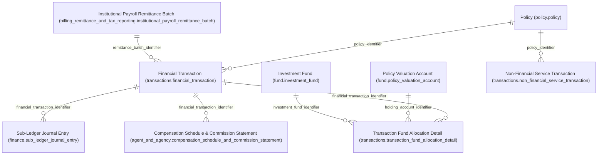

# L&A Ontology Knowledge Framework (OKF) -- Domain 5: Transactions (Policy Financial Activity & Non-Financial Endorsements)

| OKF Metadata Attribute | Value |
| :--- | :--- |
| **OKF Catalog Document** | `L&A OKF/05 - OKF - Transactions.MD` |
| **Enterprise Data Domain** | **Domain 5: Transactions (Policy Financial Activity & Non-Financial Endorsements)** |
| **Target Physical Database Engine** | Amazon RDS Aurora PostgreSQL (PostgreSQL 15/16 Compatible) |
| **Physical Database Schema** | `transactions` |
| **Domain Table Count** | **3 Physical Tables / Logical Entities** |
| **Outbound Foreign Key Joins** | **6 Foreign Key Relationships** (Intra-Domain & Cross-Domain) |
| **Inbound Foreign Key Joins** | **2 Cross-Domain Referencing Relationships** |
| **Performance Indexes** | **7 B-Tree & Composite Indexes** |
| **Inherited Business Context Rules** | **`BC-082` through `BC-103` (22 Rules)** |
| **Source Knowledge Layer Artifacts** | `L&A - Ontology.MD`, `L&A Data Model - Logical.MD`, `L&A Data Model - Physical DDL.sql`, `L&A Data Model - Conceptual.MD` |

---

## 1. Domain Executive Ontology & Business Context Overview

The **Transactions** domain serves as the immutable event ledger and operational audit trail for all monetary movements and administrative contract modifications occurring across the lifecycle of a Policy. In US Life and Annuity administration, every change in a policy's accumulation value, unit balance, loan balance, or contractual configuration must be driven by a discrete, timestamped transaction event to satisfy SEC Rule 22c-1 forward-pricing mandates, FINRA books-and-records rules, NAIC market conduct audits, SOX financial controls, and IRS tax reporting. This domain comprises three primary logical entities: `Financial Transaction`, `Transaction Fund Allocation Detail`, and `Non-Financial Service Transaction`.

`Financial Transaction` (`Financial Transaction Identifier`, `Transaction Reference Number`) captures the header-level monetary event posted to a `Policy Identifier` (and optionally linked to an institutional `Remittance Batch Identifier`). Through `Transaction Type`, it classifies inflows (such as `Employee Pre-Tax Contribution`, `Designated Roth Contribution`, `Employer Matching Contribution`, `Direct Rollover In`, and `IRC 1035 Tax-Free Exchange In`), internal movements (`Internal Fund-to-Fund Transfer`, `Transfer Payout Annuity (TPA) Installment`), outflows (`Systematic Withdrawal`, `Required Minimum Distribution (RMD)`, `Partial Surrender`, `Full Surrender`, `Lifetime Annuity Income Payment`, `Policy Loan Disbursement`, `Death Benefit Payout`), and internal contract charges (`GMWB Rider Fee Deduction`, `Monthly Cost of Insurance (COI) Deduction`). Crucially, the entity tracks three distinct dates—`Transaction Effective Date` (contractual as-of date for interest/tax), `Transaction Processing Date` (system execution date), and `Valuation Price Date` (the market close date whose `Accumulation Unit Value (AUV)` was applied when In-Good-Order [IGO] instructions arrived prior to the 4:00 PM ET cutoff)—alongside the full gross-to-net financial waterfall: `Gross Transaction Amount` minus `Surrender Charge Deducted Amount`, plus/minus `Market Value Adjustment (MVA) Amount`, minus `Federal Tax Withheld Amount` and `State Tax Withheld Amount`, equaling `Net Transaction Amount`. It also manages backouts and NSF check reversals via `Transaction Reversal Indicator`.

Because a single financial transaction (such as a $2,000 payroll contribution or a $10,000 rebalancing transfer) typically spans multiple investment funds or general account vintages, `Transaction Fund Allocation Detail` breaks the parent transaction into granular fund-level debit and credit lines (`Allocated Dollar Amount`, `Unit Price Applied`, `Units Purchased or Redeemed Count`, and `Crediting Rate Vintage Assigned`), updating the corresponding `Holding Account Identifier` in `Policy Valuation Account`. Complementing the monetary ledger, `Non-Financial Service Transaction` (`Service Transaction Identifier`, `Endorsement Type`) logs non-monetary contract maintenance events—such as beneficiary changes, future contribution allocation changes, ownership transfers, address updates, and smoker-to-non-smoker reclassifications—across self-service web, mobile, advisor workbench, and contact center channels (`Processed By Channel`). AI agents calculating net cash flows, organic growth, surrender rates, or fee revenue must always filter `Transaction Reversal Indicator` and distinguish external cash inflows/outflows from internal fund-to-fund transfers.

---

## 2. Physical Schema & Logical Entity Architecture Catalog (Schema: `transactions`)

| # | Logical Entity Name | Physical Table Name (`schema.table`) | Primary Key Column (`PK`) | Business Cols | Audit Cols | Constraints (`PK`/`UQ`/`CHK`) | Logical Entity & Physical Table Definition |
| :--- | :--- | :--- | :--- | :--- | :--- | :--- | :--- |
| **5.1** | **Financial Transaction** | `transactions.financial_transaction` | `financial_transaction_identifier` | 15 | 2 | `pk_financial_transaction`, `uq_financial_transaction_ref` | Financial Transaction entity serves as the immutable financial activity register for a Policy, recording every premium contribution, employer match, rollover, fund-to-fund transfer, systematic withdrawal, surrender, fee deduction, and annuity payout along with gross, tax, penalty, and net amounts. |
| **5.2** | **Transaction Fund Allocation Detail** | `transactions.transaction_fund_allocation_detail` | `transaction_allocation_detail_identifier` | 9 | 2 | `pk_transaction_fund_allocation_detail`, `uq_tfad_tx_line` | Transaction Fund Allocation Detail entity breaks down a parent Financial Transaction into individual fund-level and vintage-level debits or credits, recording the exact dollar amount, unit price applied, number of accumulation or annuity units bought or sold, and vintage bucket assigned. |
| **5.3** | **Non-Financial Service Transaction** | `transactions.non_financial_service_transaction` | `service_transaction_identifier` | 7 | 2 | `pk_non_financial_service_transaction`, `uq_service_request_number` | Non-Financial Service Transaction entity logs administrative and contractual maintenance endorsements performed on a Policy that do not immediately move money—such as beneficiary changes, ownership transfers, address updates, and future allocation changes—for audit and customer service traceability. |

---

## 3. Relational Join Mining & Foreign Key Topology

### 3.1 Entity-Relationship & Foreign Key Join Diagram (Mermaid)



### 3.2 Outbound Foreign Key Join Matrix (Tables in `transactions` Referencing Parent Entities)

| FK Constraint Name | Child Table (`transactions`) | Child FK Column | Join Scope | Parent Referenced Table | Parent PK Column | Referential Action | Exact SQL Join Predicate |
| :--- | :--- | :--- | :--- | :--- | :--- | :--- | :--- |
| `fk_fin_tx_policy` | `transactions.financial_transaction` | `policy_identifier` | Cross-Domain (`policy`) | `policy.policy` | `policy_identifier` | `ON UPDATE CASCADE ON DELETE RESTRICT` | `transactions.financial_transaction.policy_identifier = policy.policy.policy_identifier` |
| `fk_fin_tx_remittance_batch` | `transactions.financial_transaction` | `remittance_batch_identifier` | Cross-Domain (`billing_remittance_and_tax_reporting`) | `billing_remittance_and_tax_reporting.institutional_payroll_remittance_batch` | `remittance_batch_identifier` | `ON UPDATE CASCADE ON DELETE SET NULL` | `transactions.financial_transaction.remittance_batch_identifier = billing_remittance_and_tax_reporting.institutional_payroll_remittance_batch.remittance_batch_identifier` |
| `fk_tfad_financial_transaction` | `transactions.transaction_fund_allocation_detail` | `financial_transaction_identifier` | Intra-Domain | `transactions.financial_transaction` | `financial_transaction_identifier` | `ON UPDATE CASCADE ON DELETE CASCADE` | `transactions.transaction_fund_allocation_detail.financial_transaction_identifier = transactions.financial_transaction.financial_transaction_identifier` |
| `fk_tfad_holding_account` | `transactions.transaction_fund_allocation_detail` | `holding_account_identifier` | Cross-Domain (`fund`) | `fund.policy_valuation_account` | `holding_account_identifier` | `ON UPDATE CASCADE ON DELETE RESTRICT` | `transactions.transaction_fund_allocation_detail.holding_account_identifier = fund.policy_valuation_account.holding_account_identifier` |
| `fk_tfad_investment_fund` | `transactions.transaction_fund_allocation_detail` | `investment_fund_identifier` | Cross-Domain (`fund`) | `fund.investment_fund` | `investment_fund_identifier` | `ON UPDATE CASCADE ON DELETE RESTRICT` | `transactions.transaction_fund_allocation_detail.investment_fund_identifier = fund.investment_fund.investment_fund_identifier` |
| `fk_nfst_policy` | `transactions.non_financial_service_transaction` | `policy_identifier` | Cross-Domain (`policy`) | `policy.policy` | `policy_identifier` | `ON UPDATE CASCADE ON DELETE CASCADE` | `transactions.non_financial_service_transaction.policy_identifier = policy.policy.policy_identifier` |

### 3.3 Inbound Cross-Domain Foreign Key Join Matrix (External Schemas Referencing `transactions`)

| FK Constraint Name | Referencing Child Schema | Referencing Child Table | Child FK Column | Referenced Target Table (`transactions`) | Target PK Column | Referential Action | Exact SQL Join Predicate |
| :--- | :--- | :--- | :--- | :--- | :--- | :--- | :--- |
| `fk_slje_financial_transaction` | `finance` | `finance.sub_ledger_journal_entry` | `financial_transaction_identifier` | `transactions.financial_transaction` | `financial_transaction_identifier` | `ON UPDATE CASCADE ON DELETE SET NULL` | `finance.sub_ledger_journal_entry.financial_transaction_identifier = transactions.financial_transaction.financial_transaction_identifier` |
| `fk_cscs_financial_transaction` | `agent_and_agency` | `agent_and_agency.compensation_schedule_and_commission_statement` | `financial_transaction_identifier` | `transactions.financial_transaction` | `financial_transaction_identifier` | `ON UPDATE CASCADE ON DELETE SET NULL` | `agent_and_agency.compensation_schedule_and_commission_statement.financial_transaction_identifier = transactions.financial_transaction.financial_transaction_identifier` |

---

## 4. Detailed Table-by-Table Schema, Column Dictionary & DDL Constraints

### 4.1 Logical Entity: `Financial Transaction` <-> Physical Table: `transactions.financial_transaction`

- **Business & Technical Purpose**: Financial Transaction entity serves as the immutable financial activity register for a Policy, recording every premium contribution, employer match, rollover, fund-to-fund transfer, systematic withdrawal, surrender, fee deduction, and annuity payout along with gross, tax, penalty, and net amounts.
- **PostgreSQL Catalog Comment**: _""_
- **Primary Key**: `financial_transaction_identifier`

#### Attribute-to-Column Schema Mapping & Business Dictionary

| Ord | Logical Attribute Name | Physical Column Name | Logical Type | Physical PostgreSQL Type | Key | Column Modifiers / Default | Business Definition, Domain Semantics & Sample Values |
| :--- | :--- | :--- | :--- | :--- | :--- | :--- | :--- |
| **1** | **Financial Transaction Identifier** | `financial_transaction_identifier` | String | `VARCHAR(64)` | **PK** | `NOT NULL` | Unique surrogate primary key identifying an individual financial transaction event posted to a Policy. Sample values: `FTX-99000101`, `FTX-99000102`. |
| **2** | **Policy Identifier** | `policy_identifier` | String | `VARCHAR(64)` | **FK** | `NOT NULL` | Foreign key linking the financial transaction to the Policy whose balances are impacted. Sample values: `POL-UUID-90001421`. |
| **3** | **Remittance Batch Identifier** | `remittance_batch_identifier` | String | `VARCHAR(64)` | **FK** | `NULL` | Optional foreign key linking institutional payroll contribution transactions back to the Employer Sponsor's Institutional Payroll Remittance Batch. Sample values: `RMB-20261015-HARV`, `Null (Individual Retail Transaction)`. |
| **4** | **Transaction Reference Number** | `transaction_reference_number` | String | `VARCHAR(64)` | **NK** | `NOT NULL` | Unique business-facing confirmation number provided to the customer, advisor, or institutional plan administrator on receipts and statements. Sample values: `CNF-20261021-004819`, `CNF-20261021-004820`. |
| **5** | **Transaction Type** | `transaction_type` | String | `VARCHAR(120)` | **NK** | `NOT NULL` | Standardized classification of the financial event driving accounting, unit purchases/redemptions, and IRS tax reporting. Sample values: `Employee Pre-Tax Contribution`, `Designated Roth Contribution`, `Employer Matching Contribution`, `Direct Rollover In`, `IRC 1035 Tax-Free Exchange In`, `Internal Fund-to-Fund Transfer`, `Transfer Payout Annuity (TPA) Installment`, `Systematic Withdrawal`, `Required Minimum Distribution (RMD)`, `Partial Surrender`, `Full Surrender`, `Lifetime Annuity Income Payment`, `GMWB Rider Fee Deduction`, `Monthly Cost of Insurance (COI) Deduction`, `Policy Loan Disbursement`, `Policy Loan Repayment`, `Death Benefit Payout`. |
| **6** | **Transaction Effective Date** | `transaction_effective_date` | Date | `DATE` | **NK** | `NOT NULL` | Contractual "as-of" date governing the policyholder's entitlement, tax year attribution, and interest accrual start/stop. Sample values: `2026-10-15`, `2026-10-21`. |
| **7** | **Transaction Processing Date** | `transaction_processing_date` | Date | `DATE` | **NK** | `NOT NULL` | System calendar date on which the transaction was actually executed and posted in the policy administration engine. Sample values: `2026-10-16`, `2026-10-21`. |
| **8** | **Valuation Price Date** | `valuation_price_date` | Date | `DATE` | **NK** | `NOT NULL` | Market close date whose Fund Unit Prices (AUVs) were applied to convert dollar amounts into accumulation units under SEC Rule 22c-1 forward pricing rules. Sample values: `2026-10-15`, `2026-10-21`. |
| **9** | **Gross Transaction Amount** | `gross_transaction_amount` | Decimal | `NUMERIC(18,2)` | **NK** | `NOT NULL` | Total principal dollar amount of the contribution, transfer, or distribution before any surrender charges, market value adjustments, or tax withholdings. Sample values: `1500.00`, `50000.00`, `3250.00`. |
| **10** | **Surrender Charge Deducted Amount** | `surrender_charge_deducted_amount` | Decimal | `NUMERIC(18,2)` | **NK** | `NOT NULL DEFAULT 0.00` | Contingent deferred sales charge or institutional liquidity fee deducted from a withdrawal or surrender transaction. Sample values: `0.00`, `1250.00`, `350.00`. |
| **11** | **Market Value Adjustment (MVA) Amount** | `market_value_adjustment_mva_amount` | Decimal | `NUMERIC(18,2)` | **NK** | `NOT NULL DEFAULT 0.00` | Positive or negative dollar adjustment applied to early withdrawals from a fixed or indexed annuity based on changes in prevailing treasury/corporate interest rates since contract issue. Sample values: `0.00`, `-420.50`, `185.20`. |
| **12** | **Federal Tax Withheld Amount** | `federal_tax_withheld_amount` | Decimal | `NUMERIC(18,2)` | **NK** | `NOT NULL DEFAULT 0.00` | Dollar amount withheld from a distribution or annuity payment and remitted to the IRS for federal income tax (e.g., mandatory 20% withholding on eligible rollover distributions). Sample values: `0.00`, `650.00`, `10000.00`. |
| **13** | **State Tax Withheld Amount** | `state_tax_withheld_amount` | Decimal | `NUMERIC(18,2)` | **NK** | `NOT NULL DEFAULT 0.00` | Dollar amount withheld from a distribution or annuity payment and remitted to the applicable state revenue department. Sample values: `0.00`, `162.50`, `2500.00`. |
| **14** | **Net Transaction Amount** | `net_transaction_amount` | Decimal | `NUMERIC(18,2)` | **NK** | `NOT NULL` | Final net cash dollar amount invested into the contract or disbursed to the policyholder after all charges, MVAs, and tax withholdings. Sample values: `1500.00`, `36250.00`, `2437.50`. |
| **15** | **Transaction Reversal Indicator** | `transaction_reversal_indicator` | String | `VARCHAR(64)` | **NK** | `NOT NULL DEFAULT 'Active Original Posting'` | Indicates whether this transaction is an active original posting, a reversed transaction (e.g., NSF check or NIGO correction), or the offsetting reversal entry. Sample values: `Active Original Posting`, `Reversed by Later Entry`, `Reversal / Backout Entry`. |
| **16** | **Record Created Timestamp (Audit)** | `created_at` | Timestamp | `TIMESTAMPTZ` | **AUDIT** | `NOT NULL DEFAULT CURRENT_TIMESTAMP` | System audit timestamp recording when the physical row was initially inserted into the Aurora PostgreSQL table. |
| **17** | **Record Updated Timestamp (Audit)** | `updated_at` | Timestamp | `TIMESTAMPTZ` | **AUDIT** | `NOT NULL DEFAULT CURRENT_TIMESTAMP` | System audit timestamp recording when the physical row was last modified in the Aurora PostgreSQL table. |

#### Declarative DDL Constraints & Indexes on `transactions.financial_transaction`

| Constraint / Index Category | Identifier Name | Definition / Target Columns & Referential Integrity Rule |
| :--- | :--- | :--- |
| **PRIMARY KEY** | `pk_financial_transaction` | `PRIMARY KEY (financial_transaction_identifier)` |
| **UNIQUE** | `uq_financial_transaction_ref` | `UNIQUE (transaction_reference_number)` |
| **FOREIGN KEY** | `fk_fin_tx_policy` | `FOREIGN KEY (policy_identifier) REFERENCES policy.policy (policy_identifier) ON UPDATE CASCADE ON DELETE RESTRICT` |
| **FOREIGN KEY** | `fk_fin_tx_remittance_batch` | `FOREIGN KEY (remittance_batch_identifier) REFERENCES billing_remittance_and_tax_reporting.institutional_payroll_remittance_batch (remittance_batch_identifier) ON UPDATE CASCADE ON DELETE SET NULL` |
| **B-TREE INDEX** | `idx_ftx_policy_eff_date` | `ON transactions.financial_transaction (policy_identifier, transaction_effective_date DESC)` |
| **B-TREE INDEX** | `idx_ftx_type_proc_date` | `ON transactions.financial_transaction (transaction_type, transaction_processing_date DESC)` |
| **B-TREE INDEX** | `idx_ftx_remittance_batch_id` | `ON transactions.financial_transaction (remittance_batch_identifier)` |

### 4.2 Logical Entity: `Transaction Fund Allocation Detail` <-> Physical Table: `transactions.transaction_fund_allocation_detail`

- **Business & Technical Purpose**: Transaction Fund Allocation Detail entity breaks down a parent Financial Transaction into individual fund-level and vintage-level debits or credits, recording the exact dollar amount, unit price applied, number of accumulation or annuity units bought or sold, and vintage bucket assigned.
- **PostgreSQL Catalog Comment**: _""_
- **Primary Key**: `transaction_allocation_detail_identifier`

#### Attribute-to-Column Schema Mapping & Business Dictionary

| Ord | Logical Attribute Name | Physical Column Name | Logical Type | Physical PostgreSQL Type | Key | Column Modifiers / Default | Business Definition, Domain Semantics & Sample Values |
| :--- | :--- | :--- | :--- | :--- | :--- | :--- | :--- |
| **1** | **Transaction Allocation Detail Identifier** | `transaction_allocation_detail_identifier` | String | `VARCHAR(64)` | **PK** | `NOT NULL` | Unique primary key identifying a fund-level or vintage-level line item within a parent Financial Transaction. Sample values: `TFAD-100001`, `TFAD-100002`. |
| **2** | **Financial Transaction Identifier** | `financial_transaction_identifier` | String | `VARCHAR(64)` | **FK** | `NOT NULL` | Foreign key linking the fund allocation line item to its parent Financial Transaction header. Sample values: `FTX-99000101`. |
| **3** | **Holding Account Identifier** | `holding_account_identifier` | String | `VARCHAR(64)` | **FK** | `NOT NULL` | Foreign key linking the transaction line to the specific Policy Valuation Account whose unit or dollar balance is updated. Sample values: `PVA-55001`, `PVA-55002`. |
| **4** | **Investment Fund Identifier** | `investment_fund_identifier` | String | `VARCHAR(64)` | **FK** | `NOT NULL` | Foreign key referencing the specific Investment Fund bought, sold, or credited on this line. Sample values: `FUND-CREF-STK`, `FUND-GA-TRAD`. |
| **5** | **Transaction Line Number** | `transaction_line_number` | Integer | `INTEGER` | **NK** | `NOT NULL` | Sequential line number ordering the fund allocation splits within the parent transaction (1, 2, 3, etc.). Sample values: `1`, `2`, `3`. |
| **6** | **Allocated Dollar Amount** | `allocated_dollar_amount` | Decimal | `NUMERIC(18,2)` | **NK** | `NOT NULL` | Dollar amount of the parent transaction allocated to or redeemed from this specific Investment Fund (positive for inflows/buys, negative for outflows/sells). Sample values: `750.00`, `450.00`, `-1500.00`. |
| **7** | **Unit Price Applied** | `unit_price_applied` | Decimal | `NUMERIC(18,6)` | **NK** | `NOT NULL DEFAULT 1.000000` | Exact Accumulation Unit Value (AUV) or Annuity Unit Value used on the Valuation Price Date to convert the Allocated Dollar Amount into units (1.000000 for non-unitized general account buckets). Sample values: `412.849201`, `198.441029`, `1.000000`. |
| **8** | **Units Purchased or Redeemed Count** | `units_purchased_or_redeemed_count` | Decimal | `NUMERIC(18,6)` | **NK** | `NOT NULL DEFAULT 0.000000` | Net number of Accumulation or Annuity Units credited (positive) or redeemed (negative) in this sub-account as a result of the transaction line. Sample values: `1.816644`, `2.267676`, `-12.110960`. |
| **9** | **Crediting Rate Vintage Assigned** | `crediting_rate_vintage_assigned` | String | `VARCHAR(64)` | **NK** | `NULL` | Vintage bucket code assigned to the contribution or relieved upon withdrawal when the transaction impacts a vintage-bucketed general account product such as participating general account fixed contracts. Sample values: `VINT-2026-M10`, `VINT-2019-Q2`, `Not Applicable (Separate Account)`. |
| **10** | **Record Created Timestamp (Audit)** | `created_at` | Timestamp | `TIMESTAMPTZ` | **AUDIT** | `NOT NULL DEFAULT CURRENT_TIMESTAMP` | System audit timestamp recording when the physical row was initially inserted into the Aurora PostgreSQL table. |
| **11** | **Record Updated Timestamp (Audit)** | `updated_at` | Timestamp | `TIMESTAMPTZ` | **AUDIT** | `NOT NULL DEFAULT CURRENT_TIMESTAMP` | System audit timestamp recording when the physical row was last modified in the Aurora PostgreSQL table. |

#### Declarative DDL Constraints & Indexes on `transactions.transaction_fund_allocation_detail`

| Constraint / Index Category | Identifier Name | Definition / Target Columns & Referential Integrity Rule |
| :--- | :--- | :--- |
| **PRIMARY KEY** | `pk_transaction_fund_allocation_detail` | `PRIMARY KEY (transaction_allocation_detail_identifier)` |
| **UNIQUE** | `uq_tfad_tx_line` | `UNIQUE (financial_transaction_identifier, transaction_line_number)` |
| **FOREIGN KEY** | `fk_tfad_financial_transaction` | `FOREIGN KEY (financial_transaction_identifier) REFERENCES transactions.financial_transaction (financial_transaction_identifier) ON UPDATE CASCADE ON DELETE CASCADE` |
| **FOREIGN KEY** | `fk_tfad_holding_account` | `FOREIGN KEY (holding_account_identifier) REFERENCES fund.policy_valuation_account (holding_account_identifier) ON UPDATE CASCADE ON DELETE RESTRICT` |
| **FOREIGN KEY** | `fk_tfad_investment_fund` | `FOREIGN KEY (investment_fund_identifier) REFERENCES fund.investment_fund (investment_fund_identifier) ON UPDATE CASCADE ON DELETE RESTRICT` |
| **B-TREE INDEX** | `idx_tfad_fin_tx_id` | `ON transactions.transaction_fund_allocation_detail (financial_transaction_identifier)` |
| **B-TREE INDEX** | `idx_tfad_holding_acct_id` | `ON transactions.transaction_fund_allocation_detail (holding_account_identifier)` |
| **B-TREE INDEX** | `idx_tfad_fund_id` | `ON transactions.transaction_fund_allocation_detail (investment_fund_identifier)` |

### 4.3 Logical Entity: `Non-Financial Service Transaction` <-> Physical Table: `transactions.non_financial_service_transaction`

- **Business & Technical Purpose**: Non-Financial Service Transaction entity logs administrative and contractual maintenance endorsements performed on a Policy that do not immediately move money—such as beneficiary changes, ownership transfers, address updates, and future allocation changes—for audit and customer service traceability.
- **PostgreSQL Catalog Comment**: _""_
- **Primary Key**: `service_transaction_identifier`

#### Attribute-to-Column Schema Mapping & Business Dictionary

| Ord | Logical Attribute Name | Physical Column Name | Logical Type | Physical PostgreSQL Type | Key | Column Modifiers / Default | Business Definition, Domain Semantics & Sample Values |
| :--- | :--- | :--- | :--- | :--- | :--- | :--- | :--- |
| **1** | **Service Transaction Identifier** | `service_transaction_identifier` | String | `VARCHAR(64)` | **PK** | `NOT NULL` | Unique primary key identifying a non-financial administrative service request or policy endorsement. Sample values: `SRV-33001`, `SRV-33002`. |
| **2** | **Policy Identifier** | `policy_identifier` | String | `VARCHAR(64)` | **FK** | `NOT NULL` | Foreign key linking the administrative endorsement to the Policy being modified. Sample values: `POL-UUID-90001421`. |
| **3** | **Service Request Number** | `service_request_number` | String | `VARCHAR(64)` | **NK** | `NOT NULL` | Business-facing workflow case or ticket number tracking the customer or advisor service request. Sample values: `SR-2026-774819`, `SR-2026-881023`. |
| **4** | **Endorsement Type** | `endorsement_type` | String | `VARCHAR(120)` | **NK** | `NOT NULL` | Categorizes the contractual or administrative change executed on the policy. Sample values: `Beneficiary Designation Change`, `Future Contribution Allocation Change`, `Automatic Rebalancing Enrollment`, `Policy Owner Transfer / Assignment`, `Legal Name Change`, `Address & Contact Update`, `Tax Withholding Election Change`, `Smoker to Non-Smoker Reclassification`. |
| **5** | **Request Received Date** | `request_received_date` | Date | `DATE` | **NK** | `NOT NULL` | Date and time when the signed form, web submission, or recorded voice authorization was received in good order by the carrier. Sample values: `2026-10-18`, `2026-10-20`. |
| **6** | **Effective Date** | `effective_date` | Date | `DATE` | **NK** | `NOT NULL` | Contractual date on which the endorsement takes legal effect (for example, beneficiary changes typically take effect on the date signed by the owner). Sample values: `2026-10-17`, `2026-10-20`. |
| **7** | **Processed By Channel** | `processed_by_channel` | String | `VARCHAR(100)` | **NK** | `NOT NULL` | Originating servicing channel through which the non-financial change was submitted and processed. Sample values: `Participant Self-Service Web Portal`, `Mobile App`, `Advisor Wealth Workbench`, `Contact Center Representative`, `Automated Institutional Data Feed`, `Back-Office Paper Processing`. |
| **8** | **Record Created Timestamp (Audit)** | `created_at` | Timestamp | `TIMESTAMPTZ` | **AUDIT** | `NOT NULL DEFAULT CURRENT_TIMESTAMP` | System audit timestamp recording when the physical row was initially inserted into the Aurora PostgreSQL table. |
| **9** | **Record Updated Timestamp (Audit)** | `updated_at` | Timestamp | `TIMESTAMPTZ` | **AUDIT** | `NOT NULL DEFAULT CURRENT_TIMESTAMP` | System audit timestamp recording when the physical row was last modified in the Aurora PostgreSQL table. |

#### Declarative DDL Constraints & Indexes on `transactions.non_financial_service_transaction`

| Constraint / Index Category | Identifier Name | Definition / Target Columns & Referential Integrity Rule |
| :--- | :--- | :--- |
| **PRIMARY KEY** | `pk_non_financial_service_transaction` | `PRIMARY KEY (service_transaction_identifier)` |
| **UNIQUE** | `uq_service_request_number` | `UNIQUE (service_request_number)` |
| **FOREIGN KEY** | `fk_nfst_policy` | `FOREIGN KEY (policy_identifier) REFERENCES policy.policy (policy_identifier) ON UPDATE CASCADE ON DELETE CASCADE` |
| **B-TREE INDEX** | `idx_nfst_policy_eff_date` | `ON transactions.non_financial_service_transaction (policy_identifier, effective_date DESC)` |

---

## 5. Inherited Business Context Ontology Rules (`BC-082` to `BC-103`)

> **Semantic Inheritance Notice**: The following **22 Business Context rules** are inherited verbatim from `L&A Data Domain/L&A - Ontology.MD` to provide autonomous AI agents, data engineers, and actuaries with complete domain rules, accounting identities, statutory compliance mandates, and SQL join guardrails for the **Transactions** domain.

#### BC-082: Immutable Financial Transaction Ledger Architecture and Three-State Reversal Accounting (`Transaction Reversal Indicator`)

**Domains**: Transactions, Finance | **Entities**: `Financial Transaction`, `Transaction Fund Allocation Detail`, `Sub-Ledger Journal Entry` | **Key Attributes**: `Financial Transaction Identifier`, `Transaction Reference Number`, `Transaction Reversal Indicator`, `Gross Transaction Amount`, `Net Transaction Amount`

In regulated Life and Annuity policy administration systems (such as `OMNI-RET`, `ALIP-LIFE`, `FAST-ANNUITY`, and `VANTAGE-ONE`), the `Financial Transaction` entity and its child `Transaction Fund Allocation Detail` entity operate as an **immutable, append-only financial ledger**. Once a financial transaction is posted and assigned a `Financial Transaction Identifier` and customer-facing `Transaction Reference Number` (e.g., `CNF-20261021-004819`), the physical database record is never deleted, overwritten, or mutated in place—even if a customer's premium check bounces for Non-Sufficient Funds (NSF), an institutional payroll file is discovered to contain an erroneous contribution, or a back-office processor keyed a withdrawal in error. Instead, the data model tracks lifecycle corrections using the three-state `Transaction Reversal Indicator` attribute, which takes values `Active Original Posting`, `Reversed by Later Entry`, and `Reversal / Backout Entry`. When a transaction is originally posted, its `Transaction Reversal Indicator` is set to `Active Original Posting`. If that transaction must subsequently be voided or backed out, the administration engine performs two coordinated actions: (1) it updates the status of the original transaction row's `Transaction Reversal Indicator` from `Active Original Posting` to `Reversed by Later Entry`, and (2) it inserts a brand-new offsetting `Financial Transaction` record with `Transaction Reversal Indicator` = `Reversal / Backout Entry` carrying exact equal-and-opposite dollar (`Gross Transaction Amount`, `Net Transaction Amount`) and unit (`Units Purchased or Redeemed Count`) amounts, which in turn generates an offsetting `Sub-Ledger Journal Entry` in the Finance domain. This provides a complete, SOX-compliant audit trail for external auditors, SEC examiners, and state insurance department market conduct reviewers. For AI agents and SQL/data product builders, this creates two critical query patterns: if the user asks for **net effective activity** (e.g., "What were total net employee contributions in Q3 2026?"), the query can either filter strictly to `Transaction Reversal Indicator = 'Active Original Posting'` OR sum across all three states (since `Reversed by Later Entry` and `Reversal / Backout Entry` mathematically cancel each other out); however, when counting **transaction volume** or **distinct distribution events**, AI agents must strictly filter to `Transaction Reversal Indicator = 'Active Original Posting'` so reversed and backout rows are not double-counted as valid customer events.

#### BC-083: SEC Rule 22c-1 Forward Pricing Triad: `Transaction Effective Date`, `Transaction Processing Date`, and `Valuation Price Date`

**Domains**: Transactions, Fund | **Entities**: `Financial Transaction`, `Transaction Fund Allocation Detail`, `Fund Unit Price` | **Key Attributes**: `Transaction Effective Date`, `Transaction Processing Date`, `Valuation Price Date`, `Unit Price Applied`, `Accumulation Unit Value (AUV)`

Every record in the `Financial Transaction` entity carries three distinct date attributes—`Transaction Effective Date`, `Transaction Processing Date`, and `Valuation Price Date`—whose interplay is governed by **SEC Rule 22c-1 (Forward Pricing)** under the Investment Company Act of 1940 as well as state insurance contract law. Under SEC Rule 22c-1, any purchase, redemption, or transfer of redeemable securities in a registered variable annuity or variable life separate account (such as `CREF Stock Account`, `Direct Real Estate Separate Account`, or retail variable sub-accounts at Prudential, Lincoln, or Jackson) must be priced at the net asset value (`Accumulation Unit Value (AUV)`) next computed after receipt of the order in good order ("In Good Order" or IGO), typically at the 4:00 PM Eastern Time close of the New York Stock Exchange (NYSE). Specifically:

1. `Transaction Effective Date` is the contractual "as-of" date governing the policyholder's legal entitlement, IRS tax-year attribution, and general account interest accrual start/stop date.
2. `Valuation Price Date` is the exact NYSE market close date whose `Fund Unit Price`.`Accumulation Unit Value (AUV)` was applied (`Transaction Fund Allocation Detail`.`Unit Price Applied`) to convert dollars into units. If a participant submits an online fund transfer or contribution in good order at 2:15 PM ET on Tuesday (`2026-10-20`), before the 4:00 PM ET NYSE market cutoff, both `Transaction Effective Date` and `Valuation Price Date` are `2026-10-20`. If the request is submitted at 4:05 PM ET on Tuesday (`2026-10-20`), after market close, SEC Rule 22c-1 prohibits backward pricing at Tuesday's known close; the order receives Wednesday's (`2026-10-21`) `Valuation Price Date`.
3. `Transaction Processing Date` is the physical system calendar date on which the batch cycle or back-office engine executed and committed the posting. During overnight batch runs or legitimate backdated "as-of" NIGO error corrections, `Transaction Processing Date` (`2026-10-21`) will be later than `Transaction Effective Date` and `Valuation Price Date` (`2026-10-15`). When joining `Transaction Fund Allocation Detail` to `Fund Unit Price` to verify unit pricing, AI agents must always join on `Financial Transaction`.`Valuation Price Date` = `Fund Unit Price`.`Valuation Date`, never on `Transaction Processing Date`.

#### BC-084: Gross-to-Net Cash Flow Mathematical Reconciliation Invariant on `Financial Transaction`

**Domains**: Transactions, Billing, Remittance & Tax Reporting | **Entities**: `Financial Transaction`, `Tax Reporting Statement` | **Key Attributes**: `Transaction Type`, `Gross Transaction Amount`, `Surrender Charge Deducted Amount`, `Market Value Adjustment (MVA) Amount`, `Federal Tax Withheld Amount`, `State Tax Withheld Amount`, `Net Transaction Amount`

The `Financial Transaction` header entity enforces an exact accounting reconciliation between the gross economic value removed from or added to a policy (`Gross Transaction Amount`) and the final cash amount disbursed to the customer or invested into the contract (`Net Transaction Amount`). Across all outflow and distribution `Transaction Type` values—including `Partial Surrender`, `Full Surrender`, `Systematic Withdrawal`, `Required Minimum Distribution (RMD)`, `Lifetime Annuity Income Payment`, `Transfer Payout Annuity (TPA) Installment`, and `Death Benefit Payout`—the **Gross-to-Net Reconciliation Invariant** states:
$$\text{Net Transaction Amount} = \text{Gross Transaction Amount} - \text{Surrender Charge Deducted Amount} + \text{Market Value Adjustment (MVA) Amount} - \text{Federal Tax Withheld Amount} - \text{State Tax Withheld Amount}$$
Notice the sign conventions in this formula based on the Logical Data Model attribute definitions: `Gross Transaction Amount`, `Surrender Charge Deducted Amount`, `Federal Tax Withheld Amount`, and `State Tax Withheld Amount` are stored as non-negative decimal magnitudes (`0.00` or positive), whereas `Market Value Adjustment (MVA) Amount` is a signed decimal that can be negative (`-420.50` when prevailing interest rates have risen above the contract's baseline rate, reducing the payout) or positive (`+185.20` when interest rates have fallen, increasing the payout). For example, if a policyholder requests a `50000.00` `Partial Surrender` from a deferred annuity that incurs a `1250.00` `Surrender Charge Deducted Amount`, a `0.00` MVA, `10000.00` (20%) in `Federal Tax Withheld Amount`, and `2500.00` (5%) in `State Tax Withheld Amount`, the policy's account balance is reduced by the full `50000.00` `Gross Transaction Amount`, while the wire or check sent to the policyholder's bank account is `Net Transaction Amount` = $50000.00 - 1250.00 + 0.00 - 10000.00 - 2500.00 = 36250.00$. Conversely, for incoming contributions (`Employee Pre-Tax Contribution`, `Designated Roth Contribution`, `Employer Matching Contribution`, `Direct Rollover In`) where no surrender charges, MVAs, or tax withholdings apply, `Gross Transaction Amount` equals `Net Transaction Amount` (`1500.00` = `1500.00`). AI agents reconciling IRS Form 1099-R Box 1 (`Gross Distribution Amount (Box 1)`) must sum `Gross Transaction Amount` less surrender charges/MVA per IRS tax rules, never `Net Transaction Amount` (which excludes taxes withheld on the customer's behalf).

#### BC-085: Parent-to-Child Header-Line Dollar Conservation Invariant (`Financial Transaction` to `Transaction Fund Allocation Detail`)

**Domains**: Transactions, Fund | **Entities**: `Financial Transaction`, `Transaction Fund Allocation Detail`, `Policy Valuation Account` | **Key Attributes**: `Financial Transaction Identifier`, `Transaction Type`, `Gross Transaction Amount`, `Transaction Line Number`, `Allocated Dollar Amount`

Every `Financial Transaction` header record (which captures the policy-level financial event) is decomposed into one or more child records in `Transaction Fund Allocation Detail` (ordered sequentially by `Transaction Line Number` = `1`, `2`, `3`, $\dots$), where each child line records the exact dollar and unit impact on a specific `Policy Valuation Account` (`Holding Account Identifier`) and `Investment Fund` (`Investment Fund Identifier`). The relationship between the parent header and its child detail lines is governed by the **Header-Line Dollar Conservation Invariant**, which takes two forms depending on whether the transaction moves money into/out of the policy or reallocates money internally within the policy:

1. **External Inflow, Outflow, and Fee Deduction Transactions**: For all contributions (`Employee Pre-Tax Contribution`, `Designated Roth Contribution`, `Employer Matching Contribution`, `Direct Rollover In`, `IRC 1035 Tax-Free Exchange In`), distributions (`Partial Surrender`, `Full Surrender`, `Systematic Withdrawal`, `Required Minimum Distribution (RMD)`), and internal fee deductions (`Monthly Cost of Insurance (COI) Deduction`, `GMWB Rider Fee Deduction`), the absolute value of the sum of `Transaction Fund Allocation Detail`.`Allocated Dollar Amount` across all child lines for a given `Financial Transaction Identifier` must equal `Financial Transaction`.`Gross Transaction Amount`:

$$\left|\sum_{i=1}^{n} \text{Transaction Fund Allocation Detail}_{i}.\text{Allocated Dollar Amount}\right| = \text{Financial Transaction}.\text{Gross Transaction Amount}$$
Specifically, inflows carry positive `Allocated Dollar Amount` lines (e.g., `+750.00`, `+450.00`, `+300.00` summing to `+1500.00`), whereas outflows and fee deductions carry negative `Allocated Dollar Amount` lines (e.g., `-1500.00`) because they reduce the sub-account balance.
2. **Internal Fund-to-Fund Transfers**: As detailed in `BC-087`, when `Transaction Type` = `Internal Fund-to-Fund Transfer`, positive buy lines and negative sell lines offset each other to `0.00`, while the sum of the positive buy lines (and the absolute sum of the negative sell lines) equals `Gross Transaction Amount`. AI agents must never join `Financial Transaction` to `Transaction Fund Allocation Detail` and sum `Financial Transaction`.`Gross Transaction Amount` without deduplicating the header key, as doing so multiplies the header amount by the number of child fund lines ($n$).

#### BC-086: Unit Purchase and Redemption Conversion Math (`Allocated Dollar Amount` $\div$ `Unit Price Applied` $=$ `Units Purchased or Redeemed Count`)

**Domains**: Transactions, Fund | **Entities**: `Transaction Fund Allocation Detail`, `Fund Unit Price`, `Policy Valuation Account`, `Investment Fund` | **Key Attributes**: `Allocated Dollar Amount`, `Unit Price Applied`, `Units Purchased or Redeemed Count`, `Crediting Rate Vintage Assigned`, `Number of Accumulation Units Held`

Within `Transaction Fund Allocation Detail`, every dollar allocated to or redeemed from an `Investment Fund` is converted into a precise unit delta recorded in `Units Purchased or Redeemed Count` using the **Unit Conversion Identity**:
$$\text{Units Purchased or Redeemed Count} = \text{round}\left(\frac{\text{Allocated Dollar Amount}}{\text{Unit Price Applied}}, 6\right)$$
For unitized variable separate accounts and CREF funds (where `Crediting Rate Vintage Assigned` = `Not Applicable (Separate Account)`), `Unit Price Applied` is populated with the exact six-decimal `Accumulation Unit Value (AUV)` (or `Annuity Unit Value` for payout transactions) from `Fund Unit Price` for that `Investment Fund Identifier` on the parent transaction's `Valuation Price Date`. For example, if a participant's payroll contribution allocates `Allocated Dollar Amount` = `750.00` to `CREF Stock Account` (`FUND-CREF-STK`) on a date when `Unit Price Applied` (`Accumulation Unit Value (AUV)`) is `412.849201`, the system calculates `Units Purchased or Redeemed Count` = $750.00 / 412.849201 = +1.816644$ units, and increments `Policy Valuation Account`.`Number of Accumulation Units Held` by `+1.816644`. Conversely, if a participant withdraws `-1500.00` from a sub-account whose `Unit Price Applied` is `123.854756`, `Units Purchased or Redeemed Count` is $-1500.00 / 123.854756 = -12.110960$ units, which decrements `Number of Accumulation Units Held`. For non-unitized General Account vintage buckets such as `Participating General Account Fixed` (`FUND-GA-TRAD`), where balances are tracked in nominal principal plus compounded interest dollars rather than variable market units, `Unit Price Applied` is standardized to `1.000000` (one dollar per par unit) so that `Units Purchased or Redeemed Count` numerically equals `Allocated Dollar Amount`, and the specific vintage bucket impacted is recorded in `Crediting Rate Vintage Assigned` (e.g., `VINT-2026-M10`). This unified design ensures that the division identity holds across 100% of rows in `Transaction Fund Allocation Detail` without divide-by-zero exceptions.

#### BC-087: Zero-Net-Cash Internal Fund-to-Fund Transfers, Rebalancing, and Dollar-Cost Averaging Sweep Accounting

**Domains**: Transactions, Fund | **Entities**: `Financial Transaction`, `Transaction Fund Allocation Detail`, `Policy Valuation Account` | **Key Attributes**: `Transaction Type`, `Gross Transaction Amount`, `Net Transaction Amount`, `Allocated Dollar Amount`, `Units Purchased or Redeemed Count`

When a policyholder executes an exchange between investment options inside the same contract—whether initiated as an ad-hoc participant exchange on the web portal, an automated quarterly portfolio rebalancing (`BC-072`), or a monthly Dollar Cost Averaging sweep (`BC-073`)—the activity is recorded in `Financial Transaction` with `Transaction Type` = `Internal Fund-to-Fund Transfer`. Because an internal transfer moves value strictly between sub-accounts (`Policy Valuation Account`) inside the same tax-deferred `Policy` wrapper without any cash entering or leaving the contract, it is a non-taxable event (generating no IRS Form 1099-R) and has zero net cash flow impact at the policy level. In the `Financial Transaction` header, `Gross Transaction Amount` records the total dollar volume moved from the source fund(s) to the destination fund(s) (e.g., `25000.00`), while `Surrender Charge Deducted Amount`, `Federal Tax Withheld Amount`, and `State Tax Withheld Amount` are `0.00`. In the child `Transaction Fund Allocation Detail` table, the transaction produces a balanced set of negative redemption lines (for the source sub-accounts being sold) and positive purchase lines (for the destination sub-accounts being bought) whose signed sum is identically zero:
$$\sum_{i \in \text{Transfer Lines}} \text{Allocated Dollar Amount}*{i} = 0.00$$
$$\sum*{i \in \text{Buy Lines}} \text{Allocated Dollar Amount}*{i} = -\sum*{j \in \text{Sell Lines}} \text{Allocated Dollar Amount}_{j} = \text{Gross Transaction Amount}$$
All sell lines and buy lines within a single `Internal Fund-to-Fund Transfer` execute simultaneously at the same 4:00 PM ET `Valuation Price Date` under SEC Rule 22c-1. AI agents constructing Net Cash Flow (NCF) or Net Flows metrics (defined in the asset management and insurance industry as $\text{Total New Contributions & Rollovers} - \text{Total Withdrawals, Surrenders & Claims}$) must exclude `Transaction Type` = `Internal Fund-to-Fund Transfer` at the company and policy levels, while including the individual positive and negative `Transaction Fund Allocation Detail` lines when computing fund-level net flows between `CREF`, `Nuveen`, and `Participating General Account Fixed` accounts.

#### BC-088: the carrier Transfer Payout Annuity (`Transfer Payout Annuity (TPA) Installment`) 10-Year / 84-Month Staged Liquidity Mechanics

**Domains**: Transactions, Product, Policy, Claims, Annuitization & Benefit Payouts | **Entities**: `Financial Transaction`, `Transaction Fund Allocation Detail`, `Product Crediting & Liquidity Rule`, `Policy Vintage Bucket Balance`, `Annuitization Payout Schedule` | **Key Attributes**: `Transaction Type`, `Rule Name`, `Required Installment Payout Period Months`, `Restricted Liquidity Indicator`, `Payout Option Type`, `Valuation Phase`

One of the most distinctive institutional retirement mechanics in the US Life and Annuity industry is the institutional staged withdrawal structure for restricted General Account balances (`Participating General Account Fixed`), represented in `Financial Transaction` by `Transaction Type` = `Transfer Payout Annuity (TPA) Installment`. Because the carrier invests `Participating General Account Fixed` Retirement Annuity (`GA-RA`), Group Retirement Annuity (`GA-GRA`), and Retirement Choice (`GA-RC`) premiums into long-duration illiquid fixed-income assets and commercial real estate mortgages to deliver guaranteed base interest plus excess dividends (`Total Effective Crediting Rate` often 50 to 150 bps higher than liquid fixed accounts), `Product Crediting & Liquidity Rule` restricts immediate lump-sum cash-outs (`Lump Sum Withdrawal Allowed Indicator` = `False (Installments Only)`). When a participant wishes to move accumulated `Participating General Account Fixed` funds into variable equity sub-accounts (like `CREF Stock Account`), take cash withdrawals, or roll funds over to an external IRA without annuitizing for life:

1. Under `GA-RA` and `GA-GRA` (`Rule Name` = `GRA 10-Year Transfer Payout Annuity (TPA) Rule`, `Required Installment Payout Period Months` = `120`), the participant commits the selected `Policy Vintage Bucket Balance` amount into a **Transfer Payout Annuity (**`TPA`**)** schedule (`Annuitization Payout Schedule`.`Payout Option Type` = `Transfer Payout Annuity (TPA 10-Year Fixed Installment)`, and `Policy Valuation Account`.`Valuation Phase` = `Transfer Payout Installment Phase`), which liquidates the principal plus continuing credited interest in 10 annual installments (9 years and 1 day across 10 annual payments) or 120 monthly installments.
2. Under newer `GA-RC` institutional contracts (`Rule Name` = `RC 84-Month Systematic Withdrawal Rule`, `Required Installment Payout Period Months` = `84`), transfers out are staged over 84 consecutive monthly installments (7 years).

Each periodic installment generates a `Financial Transaction` with `Transaction Type` = `Transfer Payout Annuity (TPA) Installment`. If the TPA installment is directed into an internal variable fund (`FUND-CREF-STK`), it stays tax-deferred inside the plan; if disbursed in cash to the participant, it triggers 1099-R tax reporting. AI agents forecasting liquidity outflows from the General Account must model TPA and 84-month cohorts as deterministic multi-year installment streams rather than immediate single-day redemptions.

#### BC-089: Institutional Payroll Remittance Batch (`Remittance Batch Identifier`) Reconciliation to Participant Contribution Transactions

**Domains**: Transactions, Billing, Remittance & Tax Reporting, Institutional Plan & Employer Sponsor | **Entities**: `Financial Transaction`, `Institutional Payroll Remittance Batch`, `Institutional Retirement Plan`, `Policy` | **Key Attributes**: `Remittance Batch Identifier`, `Batch Reconciliation Status`, `Total Employee Pre-Tax Contribution Amount`, `Total Employee Roth After-Tax Amount`, `Total Employer Matching Contribution Amount`, `Total Employer Basic Contribution Amount`, `Total Loan Repayment Amount`, `Transaction Type`, `Gross Transaction Amount`

In institutional retirement plan recordkeeping (covering 403(b), 401(a), 457(b), and 401(k) plans for universities and hospital systems like `President and Fellows of Harvard College`, `State University of New York (SUNY)`, and `Mayo Clinic Health System`), individual participant contributions do not arrive one by one; they arrive via bi-weekly or monthly bulk employer payroll feeds tracked in `Institutional Payroll Remittance Batch`. Each batch record (`Remittance Batch Identifier`, e.g., `RMB-20261015-HARV`) captures the employer's aggregate cash wire/ACH settlement (`Wire or ACH Settlement Date`) broken down across five money-source header totals: `Total Employee Pre-Tax Contribution Amount`, `Total Employee Roth After-Tax Amount`, `Total Employer Matching Contribution Amount`, `Total Employer Basic Contribution Amount`, and `Total Loan Repayment Amount`. Under Department of Labor (DOL) ERISA timely remittance regulations, once the carrier's clearing bank confirms that the wire/ACH cash matches the payroll file header (`Batch Reconciliation Status` = `Cash & Data Balanced - Posted to Participant Policies`), the administration system fans the batch out into thousands of individual participant-level `Financial Transaction` records linked back via the foreign key `Financial Transaction`.`Remittance Batch Identifier`. For every balanced batch, the **Batch-to-Transaction Money Source Invariant** holds across all active (`Active Original Posting`) transactions linked to that `Remittance Batch Identifier`:

- Sum of `Gross Transaction Amount` where `Transaction Type = 'Employee Pre-Tax Contribution'` $=$ `Total Employee Pre-Tax Contribution Amount`
- Sum of `Gross Transaction Amount` where `Transaction Type = 'Designated Roth Contribution'` $=$ `Total Employee Roth After-Tax Amount`
- Sum of `Gross Transaction Amount` where `Transaction Type = 'Employer Matching Contribution'` $=$ `Total Employer Matching Contribution Amount` + `Total Employer Basic Contribution Amount`
- Sum of `Gross Transaction Amount` where `Transaction Type = 'Policy Loan Repayment'` $=$ `Total Loan Repayment Amount`
For direct retail policies (where `Policy`.`Institutional Plan Identifier` is null), `Financial Transaction`.`Remittance Batch Identifier` is `Null (Individual Retail Transaction)`. AI agents investigating institutional suspense exceptions (`Batch Reconciliation Status` = `Out-of-Balance Suspense Exception`) should compare the batch header money-source totals against the sum of posted `Financial Transaction` rows grouped by `Remittance Batch Identifier` and `Transaction Type`.

#### BC-090: Monthly Cost of Insurance (`Monthly Cost of Insurance (COI) Deduction`) Net Amount at Risk Assessment in Universal Life

**Domains**: Transactions, Policy, Actuarial | **Entities**: `Financial Transaction`, `Transaction Fund Allocation Detail`, `Policy`, `Policy Coverage Segment`, `Actuarial Valuation Reserve` | **Key Attributes**: `Transaction Type`, `Gross Transaction Amount`, `Face Amount`, `Current Total Contract Value`, `Mortality Risk Class`, `Net Amount at Risk (NAR)`

Unlike traditional Whole Life or Term Life insurance policies where the policyholder pays a fixed, bundled modal premium, Universal Life (`Universal Life`), Indexed Universal Life (`Premier Indexed Universal Life`, `PROD-IUL-10`), and Variable Universal Life (VUL) policies operate on an unbundled "transparent account value" architecture. Every month on the monthly processing anniversary date (the "monthiversary"), the policy administration system executes an internal `Financial Transaction` with `Transaction Type` = `Monthly Cost of Insurance (COI) Deduction`. Crucially, the insurance company does **not** charge mortality rates on the full `Policy`.`Face Amount`; because the policyholder's own `Current Total Contract Value` (accumulated cash value) funds the first portion of any death claim, the carrier only bears mortality risk on the difference between the total death benefit and the policy's current account value—known actuarially as the **Net Amount at Risk (**`NAR`**)**, stored in `Actuarial Valuation Reserve`.`Net Amount at Risk (NAR)`:
$$\text{Net Amount at Risk (NAR)} = \text{Death Benefit Amount} - \text{Current Total Contract Value}$$
(Under UL Death Benefit Option A [Level], $\text{Death Benefit Amount} = \text{Face Amount}$, so as `Current Total Contract Value` grows, `Net Amount at Risk (NAR)` shrinks; under Option B [Increasing], $\text{Death Benefit Amount} = \text{Face Amount} + \text{Current Total Contract Value}$, keeping `Net Amount at Risk (NAR)` equal to `Face Amount`.) The monthly COI deduction (`Gross Transaction Amount`) is calculated across each active `Policy Coverage Segment` by dividing the segment's `Net Amount at Risk (NAR)` by $1,000$ and multiplying by the monthly COI rate per thousand for the insured's current attained age, `Gender`, `Smoking or Tobacco Status`, and `Policy Coverage Segment`.`Mortality Risk Class` (plus any `Substandard Table Rating Factor` or `Flat Extra Premium Per Thousand Amount`), plus monthly policy administrative expense charges. The resulting `Monthly Cost of Insurance (COI) Deduction` is deducted from the policy's sub-accounts via negative `Transaction Fund Allocation Detail` lines. If `Current Total Contract Value` falls below the monthly COI deduction amount, the policy enters its 61-day `Grace Period Expiration Date` (`Policy Status` = `Grace Period`) to prevent unintentional lapse.

#### BC-091: Guaranteed Living and Death Benefit Rider Fee Deductions (`GMWB Rider Fee Deduction`) Across Sub-Accounts

**Domains**: Transactions, Riders, Fund, Policy | **Entities**: `Financial Transaction`, `Transaction Fund Allocation Detail`, `Policy Rider Coverage`, `Rider Product Definition`, `Rider Benefit Base Valuation`, `Policy Valuation Account` | **Key Attributes**: `Transaction Type`, `Gross Transaction Amount`, `Rider Fee Calculation Basis`, `Current Annual Rider Charge Rate`, `Guaranteed Benefit Base Amount`, `Current Total Contract Value`, `Allocation Type`

When a deferred variable annuity or fixed indexed annuity has one or more optional fee-bearing riders attached in `Policy Rider Coverage` (where `Rider Product Definition`.`Optional vs Embedded Indicator` = `Optional Fee-Bearing Rider` and `Rider Status` is `Active in Deferral / Roll-Up` or `Active - Exercised in Lifetime Withdrawal Phase`), the policy administration engine periodically assesses a rider fee recorded in `Financial Transaction` with `Transaction Type` = `GMWB Rider Fee Deduction`. Calculating the exact `Gross Transaction Amount` of a `GMWB Rider Fee Deduction` requires joining `Policy Rider Coverage` to `Rider Product Definition` and `Rider Benefit Base Valuation` to inspect `Rider Fee Calculation Basis`. In the US annuity market (across carriers such as Jackson National, Lincoln, Prudential, and Institutional & Retail retail variable annuities), `Rider Fee Calculation Basis` is almost universally set to `Percentage of Guaranteed Benefit Base` rather than `Percentage of Current Contract Account Value`. That means on each quarterly or contract-anniversary fee assessment date, the periodic fee is calculated as:
$$\text{Gross Transaction Amount} = \text{Rider Benefit Base Valuation}.\text{Guaranteed Benefit Base Amount} \times \left(\frac{\text{Policy Rider Coverage}.\text{Current Annual Rider Charge Rate}}{\text{Billing Periods Per Year}}\right)$$
For example, if a policy's `Current Total Contract Value` has fallen in a bear market to `$180,000.00`, but its protected `Guaranteed Benefit Base Amount` (`High Water Mark Value` or `Roll-Up Base Amount`) stands at `$312,500.00` with a `Current Annual Rider Charge Rate` of `0.0125` (125 bps) assessed quarterly, the quarterly `GMWB Rider Fee Deduction` is $312,500.00 \times (0.0125 / 4) = 976.56$. Even though the fee is calculated as a percentage of the shadow `Guaranteed Benefit Base Amount`, the `$976.56` charge is physically deducted in cash/units from the policy's real `Policy Valuation Account` holdings via negative `Transaction Fund Allocation Detail` lines (either from the designated `Systematic Fee Deduction Source` in `Policy Fund Allocation Election` or pro-rata across active sub-accounts), reducing `Current Total Contract Value` without reducing the `Guaranteed Benefit Base Amount`. AI agents auditing rider fee revenue must always verify whether `Rider Fee Calculation Basis` uses `Guaranteed Benefit Base Amount` or `Current Total Contract Value`.

#### BC-092: Market Value Adjustment (`Market Value Adjustment (MVA) Amount`) Treasury/Corporate Rate Duration Formula on Early Surrenders

**Domains**: Transactions, Policy, Product | **Entities**: `Financial Transaction`, `Policy`, `Product` | **Key Attributes**: `Transaction Type`, `Gross Transaction Amount`, `Market Value Adjustment (MVA) Amount`, `Surrender Charge Deducted Amount`, `Net Transaction Amount`, `Contract Issue Date`

On Multi-Year Guaranteed Annuities (MYGAs), Fixed Indexed Annuities (`PROD-FIA-05`), and fixed rate buckets offered by carriers such as Athene, Global Atlantic, Symetra, and Pacific Life, policyholders who execute a `Partial Surrender` or `Full Surrender` in excess of their annual free withdrawal corridor during the multi-year guarantee period are subject to a **Market Value Adjustment (**`Market Value Adjustment (MVA) Amount`**)** recorded on `Financial Transaction`. Economically, an MVA protects the insurer's General Account against **disintermediation risk** (asset-liability duration mismatch). When a customer deposits $100,000 into a 7-year fixed annuity at a 4.50% guaranteed rate on `Contract Issue Date`, the carrier buys 7-year corporate bonds yielding ~5.50%. If market interest rates spike by +200 bps three years later and the customer surrenders early to chase higher rates elsewhere, the carrier must sell those backing bonds at a capital loss to raise cash for the surrender. The `Market Value Adjustment (MVA) Amount` transfers that bond market gain or loss directly to the surrendering policyholder using a duration-based formula:
$$\text{MVA Factor} \approx -\left(i_{\text{current}} - i_{\text{issue}} + s\right) \times \left(\frac{\text{Remaining Guarantee Months}}{12}\right)$$
where $i_{\text{issue}}$ is the benchmark Treasury or Bloomberg US Corporate bond index yield at `Contract Issue Date`, $i_{\text{current}}$ is the benchmark yield on `Transaction Effective Date`, and $s$ is a small contractual spread (e.g., 0.00% to 0.25%). When current interest rates are **higher** than at issue ($i_{\text{current}} > i_{\text{issue}}$), `Market Value Adjustment (MVA) Amount` is **negative** (e.g., `-420.50`), reducing `Net Transaction Amount` paid to the customer. Conversely, when current interest rates have **fallen** below issue rates ($i_{\text{current}} < i_{\text{issue}}$), the backing bonds have appreciated in value, resulting in a **positive** `Market Value Adjustment (MVA) Amount` (e.g., `+185.20`) that increases the customer's payout (subject to state non-forfeiture floors ensuring the combined surrender charge and negative MVA never invade minimum statutory non-forfeiture value). AI agents must preserve the algebraic sign of `Market Value Adjustment (MVA) Amount` in all reconciliation queries.

#### BC-093: Contingent Deferred Sales Charge (`Surrender Charge Deducted Amount`) and Free Withdrawal Corridor Enforcement

**Domains**: Transactions, Policy, Product, Fund, Agent & Agency | **Entities**: `Financial Transaction`, `Policy`, `Product`, `Policy Valuation Account`, `Compensation Schedule & Commission Statement` | **Key Attributes**: `Surrender Charge Deducted Amount`, `Surrender Charge Schedule Type`, `Early Withdrawal Penalty Percentage`, `Contract Issue Date`, `Transaction Effective Date`, `Surrender Free Value Amount`

The `Surrender Charge Deducted Amount` attribute on `Financial Transaction` captures the Contingent Deferred Sales Charge (CDSC) or institutional liquidity fee withheld by the carrier when a policyholder executes an early `Partial Surrender` or `Full Surrender` prior to the expiration of the contract's surrender period. In the Life and Annuity business model, carriers pay upfront sales compensation (`Compensation Schedule & Commission Statement`.`Compensation Type` = `First-Year Upfront Premium Commission`, often 4% to 7% of premium) to the writing `Producer / Advisor` and `Agency` (`LPL Financial LLC`, IMO partners, etc.) at policy issue, capitalizing that expense on the GAAP balance sheet as `Deferred Acquisition Cost (DAC) Balance` (`LDTI Valuation Cohort`). If a policyholder surrenders early, the carrier has not yet recovered that upfront acquisition cost through annual investment spreads or M&E charges. Therefore, `Product`.`Surrender Charge Schedule Type` defines a declining schedule by policy duration year (calculated from `Policy`.`Contract Issue Date` to `Financial Transaction`.`Transaction Effective Date`), such as `7-Year Declining (7%-6%-5%-4%-3%-2%-1%)`, or in institutional the carrier Group Retirement Annuities (`GA-GRA`), `10-Year Institutional Lump-Sum Surrender Fee (2.5%)` (`Product Crediting & Liquidity Rule`.`Early Withdrawal Penalty Percentage` = `0.0250`) when a terminated employee elects an accelerated lump-sum distribution within 120 days of employment separation. Crucially, on retail contracts with a 10% Free Withdrawal Corridor (`Policy Valuation Account`.`Surrender Free Value Amount`), the surrender charge rate is applied **only** to the excess withdrawal amount above the free corridor:
$$\text{Surrender Charge Deducted Amount} = \max\left(0, \text{Gross Transaction Amount} - \text{Surrender Free Value Amount}\right) \times \text{Applicable CDSC Rate}$$
Furthermore, surrender charges are contractually waived upon `Death Benefit Payout`, `Required Minimum Distribution (RMD)` satisfaction, annuitization, or qualifying nursing home/terminal illness waivers. AI agents auditing surrender charge assessments must compute policy duration year from `Contract Issue Date` to `Transaction Effective Date` and verify whether an RMD or free-corridor waiver applied.

#### BC-094: IRC Section 1035 Tax-Free Exchanges vs. Qualified Plan Direct Rollovers (`Direct Rollover In` vs. `IRC 1035 Tax-Free Exchange In`)

**Domains**: Transactions, Policy, Underwriting & New Business, Billing, Remittance & Tax Reporting, Compliance, Suitability & Regulatory Governance | **Entities**: `Financial Transaction`, `Policy`, `Application`, `Tax Reporting Statement`, `Suitability & Best Interest Review` | **Key Attributes**: `Transaction Type`, `Tax Qualification Status`, `Cost Basis Amount`, `Contract Issue Date`, `Application Type`, `IRS Distribution Code (Box 7)`

In wealth management and retirement distribution (such as advisors on the LPL Financial or Institutional Wealth Management platform consolidating client assets), external money transferred from another financial institution into a new annuity or life policy arrives via one of two legally distinct `Financial Transaction`.`Transaction Type` classifications: `Direct Rollover In` or `IRC 1035 Tax-Free Exchange In`. AI agents must never conflate these two transaction types because they apply to mutually exclusive tax regimes (`Policy`.`Tax Qualification Status`) and carry entirely different cost-basis preservation rules:

1. `Direct Rollover In`: Applies strictly to **Qualified Pre-Tax or Designated Roth Retirement Plans and IRAs** (`Tax Qualification Status` in `403(b) Pre-Tax`, `403(b) Designated Roth`, `401(a) Qualified`, `457(b) Governmental`, `Traditional IRA`, `Roth IRA`, `SEP IRA`) under Internal Revenue Code Sections 402(c), 403(b)(8), and 408(d)(3). When a retiring university professor rolls a 403(b) or 401(k) balance into a the carrier or retail `Traditional IRA` annuity via trustee-to-trustee transfer, the incoming funds are recorded as `Direct Rollover In` (`Application Type` = `Direct Qualified Plan-to-IRA Rollover`), reported by the relinquishing carrier on Form 1099-R with `IRS Distribution Code (Box 7)` = `G` (`Direct Rollover to Qualified Plan or IRA`) and by the receiving carrier on `IRS Form 5498` (`Rollover Contributions Amount`), with `Policy`.`Cost Basis Amount` remaining `0.00` (for pre-tax qualified money).
2. `IRC 1035 Tax-Free Exchange In`: Applies strictly to **Non-Qualified After-Tax Annuities and Life Insurance Policies** (`Tax Qualification Status` in `Non-Qualified Annuity`, `IRC 7702 Life Insurance`) under Internal Revenue Code Section 1035. Under Section 1035, a policyholder can exchange a Life policy for another Life policy or Non-Qualified Annuity, or a Non-Qualified Annuity for another Non-Qualified Annuity (never an Annuity for a Life policy!), without recognizing accumulated tax-deferred gains at the time of exchange (`IRS Distribution Code (Box 7)` = `6`). Crucially, upon posting an `IRC 1035 Tax-Free Exchange In`, the receiving carrier must carry over the relinquishing contract's exact historical after-tax investment into `Policy`.`Cost Basis Amount` (e.g., if a client paid $120,000 in after-tax premiums into an old annuity now worth $185,000 and exchanges it via 1035 into a new RILA, `Gross Transaction Amount` is `185000.00` while `Policy`.`Cost Basis Amount` is initialized to `120000.00`, preserving the $65,000 embedded taxable gain). Both 1035 exchanges and rollovers require rigorous replacement scrutiny in `Suitability & Best Interest Review` (`1035 Replacement Surrender Penalty Incurred Amount` and `Replacement Benefit Comparison Score`).

#### BC-095: Policy Loan Disbursement Collateralization and Payroll/EFT Loan Repayment Amortization (`Policy Loan Disbursement` & `Policy Loan Repayment`)

**Domains**: Transactions, Policy, Billing, Remittance & Tax Reporting | **Entities**: `Financial Transaction`, `Transaction Fund Allocation Detail`, `Policy Loan`, `Policy Valuation Account`, `Tax Reporting Statement` | **Key Attributes**: `Transaction Type`, `Loan Type`, `Original Loan Principal Amount`, `Outstanding Principal Balance`, `Accrued Loan Interest Amount`, `Loan Default Status`, `IRS Distribution Code (Box 7)`

When a policyholder or retirement plan participant borrows against their accumulated cash value—governed by the `Policy Loan` entity (`Loan Type` such as `Qualified Plan General Purpose Loan (5-Year Max)`, `Qualified Plan Primary Residence Loan (15-Year)`, `Collateralized General Account Loan`, or `Life Insurance Conventional Policy Loan`)—all cash movements are tracked in `Financial Transaction` via `Transaction Type` = `Policy Loan Disbursement` and `Transaction Type` = `Policy Loan Repayment`. Under IRC Section 72(p), qualified 403(b)/401(k) loans are capped at the lesser of `$50,000.00` (reduced by the highest outstanding loan balance in the prior 12 months) or 50% of the participant's vested account balance. When a `Policy Loan Disbursement` is executed, the transaction does not trigger tax withholding (`Federal Tax Withheld Amount` = `0.00`) because a bona fide loan is not a taxable distribution. However, the sub-account collateralization mechanics in `Transaction Fund Allocation Detail` depend on `Loan Type`: for a standard retirement plan loan or variable wash loan, `Transaction Fund Allocation Detail` redeems units (`Allocated Dollar Amount` < 0) from the participant's variable sub-accounts (`CREF Stock Account`, etc.) and transfers an equal collateral reserve into a dedicated loan collateral general account bucket (typically earning a credited rate 100 to 200 bps below `Policy Loan`.`Loan Interest Rate`). Conversely, for a the carrier `Collateralized General Account Loan`, the participant locks 110% of the loan amount inside `Participating General Account Fixed` as collateral while continuing to earn `Participating General Account Fixed` interest. As subsequent `Policy Loan Repayment` transactions arrive via `Institutional Payroll Remittance Batch` or monthly EFT bank drafts, each payment is split between reducing `Policy Loan`.`Accrued Loan Interest Amount` and amortizing `Outstanding Principal Balance`, while `Transaction Fund Allocation Detail` sweeps the repaid principal and interest back into the participant's elected `Policy Valuation Account` funds. If the borrower misses repayments beyond the statutory cure period (`Loan Default Status` = `Defaulted - Deemed Distribution (1099-R Issued)`), the unpaid balance plus accrued interest is reported on `Tax Reporting Statement` (`IRS Form 1099-R`) with `IRS Distribution Code (Box 7)` = `L` (`Loan Treated as Deemed Distribution under Section 72(p)`).

#### BC-096: Mandatory vs. Voluntary Federal and State Income Tax Withholding Rules on Distributions (`Federal Tax Withheld Amount` & `State Tax Withheld Amount`)

**Domains**: Transactions, Billing, Remittance & Tax Reporting, Policy, Party, Customer & Household | **Entities**: `Financial Transaction`, `Billing & Tax Withholding Schedule`, `Tax Reporting Statement`, `Policy`, `Party` | **Key Attributes**: `Transaction Type`, `Gross Transaction Amount`, `Federal Tax Withheld Amount`, `State Tax Withheld Amount`, `Net Transaction Amount`, `Federal Income Tax Withholding Election Type`, `Primary Residence State`, `Tax Qualification Status`

Whenever a taxable distribution or annuity payment is processed in `Financial Transaction`, the carrier is legally obligated under Internal Revenue Code Section 3405 and state revenue statutes to calculate and withhold income taxes in `Federal Tax Withheld Amount` and `State Tax Withheld Amount` based on the policy's `Tax Qualification Status`, the `Transaction Type`, the customer's `Primary Residence State` (`Party`), and the standing elections in `Billing & Tax Withholding Schedule`:

1. **Eligible Rollover Distributions (Mandatory 20% Federal Rule)**: When a participant in a qualified institutional plan (`403(b) Pre-Tax`, `401(a) Qualified`, `457(b) Governmental`) takes a cash lump-sum withdrawal (`Partial Surrender`, `Full Surrender`) or a short-term installment payout lasting fewer than 10 years that is eligible to be rolled over to an IRA or another plan, IRC Section 3405(c) mandates that if the money is paid directly to the participant rather than via a `Direct Rollover`, the carrier **must** withhold a mandatory 20% in `Federal Tax Withheld Amount` (`Federal Income Tax Withholding Election Type` = `Mandatory 20% Eligible Rollover Distribution Withholding`). The participant cannot waive or elect below 20%.
2. **Non-Periodic IRA and Non-Qualified Distributions (IRS Form W-4R)**: For ad-hoc withdrawals from a `Traditional IRA`, `SEP IRA`, or `Non-Qualified Annuity` (where only the earnings portion above `Cost Basis Amount` is taxable on a LIFO "earnings-first" basis under IRC Section 72(e)), `Federal Income Tax Withholding Election Type` follows `IRS Form W-4R Non-Periodic Flat Percentage (10% Default)`, allowing the customer to elect any integer rate between 0% (`Elect Out of Federal Withholding (0% - Non-Rollover Only)`) and 100%, except that `Required Minimum Distribution (RMD)` payments are also eligible for W-4R elections because RMDs are not eligible rollover distributions.
3. **Periodic Lifetime Annuity Payments (IRS Form W-4P)**: For `Lifetime Annuity Income Payment` transactions lasting 10+ years or for life, withholding follows `IRS Form W-4P Periodic Wage Withholding Table` based on marital status and tax brackets.
4. **State Tax Withholding**: `State Tax Withheld Amount` is governed by `Party`.`Primary Residence State`—being `0.00` in no-income-tax states (`FL`, `TX`, `NV`, `WA`) and following mandatory percentage floors in states like `CA`, `NC`, `MA`, and `VA` whenever federal tax is withheld. AI agents validating distribution quotes must enforce the mandatory 20% floor on qualified cash payouts.

#### BC-097: Required Minimum Distribution (`Required Minimum Distribution (RMD)`) Transaction Satisfaction and Auto-Sweep Execution

**Domains**: Transactions, Claims, Annuitization & Benefit Payouts, Billing, Remittance & Tax Reporting | **Entities**: `Financial Transaction`, `Required Minimum Distribution Schedule`, `Tax Reporting Statement`, `Party` | **Key Attributes**: `Transaction Type`, `Gross Transaction Amount`, `Calculated Annual RMD Amount`, `Satisfied RMD Amount Year-to-Date`, `Remaining RMD Amount Due`, `Automated RMD Payout Election Indicator`

Under Internal Revenue Code Section 401(a)(9) and the SECURE 2.0 Act (which raised the RMD starting age to 73 and subsequently 75 based on birth cohort), owners of pre-tax qualified contracts (`403(b) Pre-Tax`, `401(a) Qualified`, `457(b) Governmental`, `Traditional IRA`, `SEP IRA`) must withdraw at least their `Calculated Annual RMD Amount` each `Tax Calendar Year`, tracked in `Required Minimum Distribution Schedule`. A critical business rule connecting `Required Minimum Distribution Schedule` to the `Financial Transaction` ledger is that **any** gross taxable distribution taken during the calendar year counts toward satisfying the contract's annual RMD before any portion of a distribution is eligible for rollover. Specifically, whenever a `Financial Transaction` with `Transaction Reversal Indicator` = `Active Original Posting` and `Transaction Type` in (`Required Minimum Distribution (RMD)`, `Systematic Withdrawal`, `Partial Surrender`, `Full Surrender`, `Transfer Payout Annuity (TPA) Installment`, or `Lifetime Annuity Income Payment`) is posted with a `Transaction Effective Date` falling in `Tax Calendar Year`, its `Gross Transaction Amount` increments `Required Minimum Distribution Schedule`.`Satisfied RMD Amount Year-to-Date`, and `Remaining RMD Amount Due` is updated via the identity:
$$\text{Remaining RMD Amount Due} = \max\left(0.00, \text{Calculated Annual RMD Amount} - \text{Satisfied RMD Amount Year-to-Date}\right)$$
To prevent retirees from inadvertently missing the December 31 statutory deadline (which triggers a 25% IRS excise tax penalty under SECURE 2.0, reduced to 10% if timely corrected), leading institutional and retail annuity carriers offer an automated Minimum Distribution Option (`Automated RMD Payout Election Indicator` in `Enrolled - Monthly Automated MDO` or `Enrolled - Annual December 15 Auto-Sweep`). When a policy is enrolled in `Enrolled - Annual December 15 Auto-Sweep`, the batch engine scans `Required Minimum Distribution Schedule` in mid-December; if `Remaining RMD Amount Due > 0.00`, it automatically generates a `Financial Transaction` with `Transaction Type` = `Required Minimum Distribution (RMD)` and `Gross Transaction Amount` = `Remaining RMD Amount Due`, reducing `Remaining RMD Amount Due` to `0.00 (Fully Satisfied)`. Note that under IRS aggregation rules, a participant with multiple 403(b) contracts or multiple IRAs may satisfy their combined RMD from another 403(b) or IRA (`Not Enrolled (Customer Self-Managed or Satisfied via Another 403(b)/IRA)`), whereas 401(a) and 401(k) RMDs must be satisfied separately from each plan.

#### BC-098: Vintage Bucket Assignment and LIFO/FIFO/Pro-Rata Vintage Relief on General Account Transactions (`Crediting Rate Vintage Assigned`)

**Domains**: Transactions, Fund, Policy, Finance | **Entities**: `Transaction Fund Allocation Detail`, `Policy Vintage Bucket Balance`, `Policy Valuation Account`, `General Account Crediting Rate Declaration` | **Key Attributes**: `Crediting Rate Vintage Assigned`, `Allocated Dollar Amount`, `Vintage Period Identifier`, `Current Declared Total Crediting Rate`, `Vintage Accumulated Balance Amount`, `Declaration Effective Date`

Whenever a `Financial Transaction` impacts a vintage-bucketed General Account fund such as `Participating General Account Fixed` (`Investment Fund Identifier` = `FUND-GA-TRAD`), the child `Transaction Fund Allocation Detail` record must populate `Crediting Rate Vintage Assigned` with the exact `Vintage Period Identifier` (e.g., `VINT-2026-M10` or `VINT-2019-Q2`) so that the dollar movement is reconciled against the corresponding `Policy Vintage Bucket Balance` record. The rules governing which vintage code is assigned in `Crediting Rate Vintage Assigned` differ fundamentally between **inflows** (`Allocated Dollar Amount > 0`) and **outflows** (`Allocated Dollar Amount < 0`):

1. **Inflows (Contributions, Rollovers, and Transfers Into Participating General Account Fixed)**: Every incoming dollar allocated to `FUND-GA-TRAD` is assigned to the currently open "new money" vintage bucket (`Crediting Rate Vintage Assigned` = current open `Vintage Period Identifier`, such as `VINT-2026-M10`) whose `Contribution Start Date` and `Contribution End Date` bracket the transaction's `Transaction Effective Date`. That deposit locks in the `Guaranteed Minimum Interest Rate` and `Current Declared Total Crediting Rate` established by the Board of Trustees in `General Account Crediting Rate Declaration` for that open vintage window. An incoming contribution can **never** be deposited back into a closed historical vintage bucket (such as `VINT-1995-2001` or `VINT-2022-Q4`), which prevents rate-arbitrage when historical vintages have higher guaranteed floors or dividends than current market rates.
2. **Outflows (Withdrawals, Surrenders, TPA Installments, and Annuitizations)**: When a policyholder holds multiple historical vintage buckets in `Policy Vintage Bucket Balance` (e.g., `PVB-30001` from `VINT-1995-2001` at 3.00% guaranteed minimum, `PVB-30002` from `VINT-2022-Q4` at 4.25% total rate, and `PVB-30003` from `VINT-2025-M01` at 5.50% total rate) and executes a partial withdrawal or TPA transfer, the administration engine must relieve balances across those vintage buckets according to the product's contractual vintage relief rule (typically **pro-rata across all active vintage buckets** or participant-selected vintage tranche). Consequently, a single `Financial Transaction` withdrawal from `FUND-GA-TRAD` generates multiple child rows in `Transaction Fund Allocation Detail`—one row per relieved `Crediting Rate Vintage Assigned`—where each line decrements its specific `Policy Vintage Bucket Balance`.`Vintage Accumulated Balance Amount`. AI agents analyzing general account yield attribution or interest cost must join `Transaction Fund Allocation Detail`.`Crediting Rate Vintage Assigned` to `Policy Vintage Bucket Balance`.`Vintage Period Identifier` to track vintage-specific cash flows accurately.

#### BC-099: Non-Financial Service Transaction (`Non-Financial Service Transaction`) Endorsement Audit Trail and Channel Attribution

**Domains**: Transactions, Policy, Party, Customer & Household, Fund | **Entities**: `Non-Financial Service Transaction`, `Policy`, `Policy Party Role`, `Policy Fund Allocation Election`, `Party Contact & Address Profile` | **Key Attributes**: `Service Transaction Identifier`, `Service Request Number`, `Endorsement Type`, `Request Received Date`, `Effective Date`, `Processed By Channel`

While `Financial Transaction` records every monetary event that alters unit counts or cash balances, the `Non-Financial Service Transaction` entity logs all administrative maintenance requests and contractual endorsements (`Endorsement Type`) that modify policy metadata, legal relationships, or standing instructions without immediately moving a single dollar. The standardized catalog of `Endorsement Type` values includes `Beneficiary Designation Change`, `Future Contribution Allocation Change`, `Automatic Rebalancing Enrollment`, `Policy Owner Transfer / Assignment`, `Legal Name Change`, `Address & Contact Update`, `Tax Withholding Election Change`, and `Smoker to Non-Smoker Reclassification`. In enterprise insurance operations, every modification to a mutable state table—such as updating `Policy Party Role` for a new beneficiary, inserting a new `Allocation Effective Date` set in `Policy Fund Allocation Election`, changing `Party Contact & Address Profile`, or updating `Billing & Tax Withholding Schedule`—must be accompanied by a corresponding audit record in `Non-Financial Service Transaction` identified by `Service Transaction Identifier` and customer-facing ticket number `Service Request Number` (e.g., `SR-2026-774819`). Furthermore, `Processed By Channel` tracks the originating servicing rail (`Participant Self-Service Web Portal`, `Mobile App`, `Advisor Wealth Workbench`, `Contact Center Representative`, `Automated Institutional Data Feed`, or `Back-Office Paper Processing`). This entity is vital for two AI agent use cases: first, **digital straight-through-processing (STP) and operational cost analytics**, where leadership measures self-service containment rates (`Participant Self-Service Web Portal` + `Mobile App` vs. high-cost `Contact Center Representative` and `Back-Office Paper Processing`); and second, **fraud and cybersecurity anomaly detection**, where an `Address & Contact Update` or bank EFT change (`Non-Financial Service Transaction`) followed within 72 hours by a large `Partial Surrender` or `Policy Loan Disbursement` (`Financial Transaction`) is the #1 industry red flag for Account Takeover (ATO) fraud. AI agents building fraud surveillance or customer journey timelines must union `Financial Transaction` and `Non-Financial Service Transaction` chronologically by `Policy Identifier`.

#### BC-100: Beneficiary Designation Change "Date Signed" Legal Retroactivity Rule vs. Good-Order Receipt (`Request Received Date` vs. `Effective Date`)

**Domains**: Transactions, Party, Customer & Household, Claims, Annuitization & Benefit Payouts | **Entities**: `Non-Financial Service Transaction`, `Policy Party Role`, `Claim & Benefit Settlement` | **Key Attributes**: `Endorsement Type`, `Request Received Date`, `Effective Date`, `Role Type`, `Role Effective Date`, `Role End Date`, `Date of Loss or Death`

On the `Non-Financial Service Transaction` entity, the distinction between `Request Received Date` and `Effective Date` is not merely a back-office processing lag metric; in life insurance and annuity contract law, it governs millions of dollars in contested beneficiary litigation. Under the standard provisions of the carrier, CREF, and commercial life/annuity contracts across US jurisdictions, when a policy owner executes a `Non-Financial Service Transaction` with `Endorsement Type` = `Beneficiary Designation Change` (or `Smoker to Non-Smoker Reclassification` / `Policy Owner Transfer / Assignment`), the carrier first validates that the submission is "In Good Order" (IGO)—meaning the form is properly signed and dated by the policy owner, beneficiary share percentages in `Policy Party Role`.`Beneficiary Share Percentage` sum to `1.0000` (100%) within each `Primary Beneficiary` and `Contingent Beneficiary` class, and if the contract is an ERISA-covered retirement plan (`403(b) ERISA Covered Plan`, `401(a)`) where a married participant (`Party`.`Marital Status` = `Married`) designates someone other than their legal spouse for more than 50% of the benefit, a notarized ERISA Spousal Waiver is attached (`Revocable vs Irrevocable Indicator` = `ERISA Spousal Protected Beneficiary`). Once the carrier receives the request in good order on `Request Received Date` (e.g., `2026-10-20`), the legal `Effective Date` of the beneficiary change relates back retroactively to the **date the owner signed the request** (e.g., `Effective Date` = `2026-10-17`), updating `Policy Party Role`.`Role Effective Date` to `2026-10-17` and closing the prior beneficiary's `Role End Date` to `2026-10-16` (provided the carrier has not already disbursed claim proceeds before receiving the form). Consequently, if an insured signs a valid beneficiary form on October 17, mails it, dies on October 18 (`Claim & Benefit Settlement`.`Date of Loss or Death` = `2026-10-18`), and the form arrives at the carrier on October 20 (`Request Received Date` = `2026-10-20`), the new beneficiary legally takes the death benefit because `Effective Date` (`2026-10-17`) $\le$ `Date of Loss or Death` (`2026-10-18`). AI agents adjudicating claims or auditing beneficiary history must always compare `Claim & Benefit Settlement`.`Date of Loss or Death` against `Non-Financial Service Transaction`.`Effective Date` and `Policy Party Role`.`Role Effective Date`, never `Request Received Date`.

#### BC-101: Sub-Ledger Journal Entry (`Sub-Ledger Journal Entry`) Double-Entry Synchronization with Policy Financial Transactions

**Domains**: Transactions, Finance | **Entities**: `Financial Transaction`, `Sub-Ledger Journal Entry`, `Journal Entry Line`, `General Ledger Account`, `Accounting Period` | **Key Attributes**: `Financial Transaction Identifier`, `Transaction Type`, `Gross Transaction Amount`, `Net Transaction Amount`, `Accounting Event Type`, `Debit Amount`, `Credit Amount`, `Accounting Basis`

In an enterprise insurance architecture, the policy administration system (Domain 5: Transactions) is not the corporate General Ledger; rather, every `Financial Transaction` posted in Domain 5 acts as an operational sub-ledger event that triggers one or more balanced double-entry accounting headers in `Sub-Ledger Journal Entry` (Domain 7: Finance), linked via the foreign key `Sub-Ledger Journal Entry`.`Financial Transaction Identifier`. Because a Life and Annuity insurance carrier must report financial results across multiple regulatory frameworks simultaneously, a single `Financial Transaction` (such as a `Partial Surrender`, `Employee Pre-Tax Contribution`, or `Death Benefit Payout`) generates distinct `Sub-Ledger Journal Entry` records partitioned by `Accounting Basis` (`US GAAP (LDTI)`, `Statutory NAIC (SAP)`, and `US Tax`) and mapped to the appropriate `Legal Entity Name` (`Primary Life & Annuity Insurance Company`, `College Retirement Equities Fund (CREF)`, or `Companion Life Insurance Company`). Within each `Sub-Ledger Journal Entry`, the child `Journal Entry Line` rows must satisfy the fundamental **Double-Entry Balancing Invariant**:
$$\sum_{l \in \text{Lines}(\text{Journal Entry})} \text{Debit Amount}*{l} = \sum*{l \in \text{Lines}(\text{Journal Entry})} \text{Credit Amount}_{l}$$
For example, when a policyholder executes a `50000.00` `Partial Surrender` (`Financial Transaction Identifier` = `FTX-99000102`) with `1250.00` in `Surrender Charge Deducted Amount`, `10000.00` in `Federal Tax Withheld Amount`, `2500.00` in `State Tax Withheld Amount`, and `36250.00` in `Net Transaction Amount`, the corresponding `Sub-Ledger Journal Entry` (`Accounting Event Type` = `Surrender Benefit Expense`) posts a `50000.00` `Debit Amount` to `Surrender Benefits Paid Expense` (or Policyholder Account Balance Liability under GAAP) and four offsetting `Credit Amount` lines: `36250.00` to `Cash and Short-Term Investments - General Account` (disbursement clearing), `1250.00` to Surrender Fee Revenue, `10000.00` to Federal Tax Withholding Payable Liability, and `2500.00` to State Tax Withholding Payable Liability (total debits = `50000.00` = total credits). Note that `Sub-Ledger Journal Entry`.`Financial Transaction Identifier` is nullable because actuarial reserve accruals (`Actuarial Valuation Reserve Identifier`) also post journals without a policy cash transaction. AI agents performing PAS-to-GL reconciliation must verify that every `Active Original Posting` and `Reversal / Backout Entry` in `Financial Transaction` has a balanced `Sub-Ledger Journal Entry` in the corresponding `Accounting Period`.

#### BC-102: Fundamental Risk Partition Invariant: Direct Face/NAR = Retained Risk + Ceded Net Amount at Risk (`Reinsured Policy Cession`)

**Domains**: Reinsurance, Policy, Actuarial | **Entities**: `Reinsured Policy Cession`, `Policy`, `Actuarial Valuation Reserve`, `Reinsurance Treaty` | **Key Attributes**: `Cession Identifier`, `Policy Identifier`, `Reinsurance Treaty Identifier`, `Direct Face Amount`, `Retained Risk Amount`, `Ceded Net Amount at Risk (NAR)`, `Net Amount at Risk (NAR)`

In Life and Annuity risk management, direct insurance carriers (such as Companion Life Insurance Company, Lincoln Financial, Pacific Life, or Prudential) rarely keep 100% of the mortality, longevity, or market guarantee risk of every policy on their own corporate balance sheet. Instead, the carrier transfers ("cedes") a portion of that risk to institutional reinsurers (such as `RGA Reinsurance Company`, `Swiss Re Life & Health America Inc.`, `Munich American Reassurance Company`, and `Hannover Life Reassurance Company of America`). The `Reinsured Policy Cession` entity records the policy-level periodic bordereau snapshot (`Cession Effective Date`) of how each reinsured `Policy`'s risk exposure is partitioned between the direct writing company and its governing `Reinsurance Treaty`. On every `Reinsured Policy Cession` record, `Direct Face Amount` captures the gross death benefit or annuity guarantee in force on the underlying `Policy` prior to reinsurance (`Policy`.`Face Amount`), while `Retained Risk Amount` and `Ceded Net Amount at Risk (NAR)` partition the policy's total mortality/longevity exposure (`Actuarial Valuation Reserve`.`Net Amount at Risk (NAR)`). The foundational accounting and actuarial identity of the Reinsurance domain is the **Direct-Retained-Ceded Risk Partition Invariant**:
$$\text{Total Policy Net Amount at Risk (NAR)} = \text{Retained Risk Amount} + \sum_{t \in \text{Active Treaties}} \text{Ceded Net Amount at Risk (NAR)}_{t}$$
For pure Term Life insurance (`Product Category` = `Term Life`) where cash surrender value is zero, the policy's total Net Amount at Risk equals `Direct Face Amount`, so $\text{Direct Face Amount} = \text{Retained Risk Amount} + \text{Ceded Net Amount at Risk (NAR)}$ (for example, on a `$2,000,000.00` `Direct Face Amount` policy under a 90% quota-share treaty, `Retained Risk Amount` = `$200,000.00` and `Ceded Net Amount at Risk (NAR)` = `$1,800,000.00`). For permanent life (`Universal Life`, `Whole Life`) or annuities with account values, the cash value is already funded by policy assets, so `Retained Risk Amount` + `Ceded Net Amount at Risk (NAR)` equals the net unfunded exposure ($\text{Direct Face Amount} - \text{Cash Value/Reserve}$). AI agents calculating net corporate mortality exposure must always sum `Retained Risk Amount`, never `Direct Face Amount`.

#### BC-103: Yearly Renewable Term (`Yearly Renewable Term (YRT - Mortality Only)`) Mortality Risk Transfer Mechanics and Zero First-Year Allowances

**Domains**: Reinsurance, Actuarial, Policy | **Entities**: `Reinsurance Treaty`, `Reinsured Policy Cession`, `Policy`, `Actuarial Valuation Reserve` | **Key Attributes**: `Treaty Structure Type`, `Ceded Net Amount at Risk (NAR)`, `Ceded Reserve Amount`, `Reinsurance Premium Due Amount`, `Expense Allowance Amount`

The most prevalent reinsurance treaty structure for individual Term Life, Universal Life, and Indexed Universal Life policies in the United States is **Yearly Renewable Term (**`Yearly Renewable Term (YRT - Mortality Only)`**)**, specified in `Reinsurance Treaty`.`Treaty Structure Type`. Under a YRT treaty (such as `2020 Term & Universal Life 90% Quota Share YRT Treaty`, `TRT-YRT-2020-01`), the direct carrier transfers **only** the pure mortality risk (`Ceded Net Amount at Risk (NAR)`) to the reinsurer, while retaining 100% of the policyholder's cash value assets, investment spread risk, and surrender/lapse administration on the direct carrier's own balance sheet. Functionally, the direct carrier buys one-year renewable term insurance from the reinsurer on the ceded portion of each policy's Net Amount at Risk. Each year on the policy's anniversary (`Cession Effective Date`), the `Reinsurance Premium Due Amount` on `Reinsured Policy Cession` is calculated by multiplying `Ceded Net Amount at Risk (NAR)` (per $1,000) by a treaty-specific YRT mortality rate schedule that steps up annually with the insured's attained age and policy duration (select-and-ultimate YRT rates). Because YRT transfers only current-year mortality risk rather than long-term cash value accumulations, two distinctive financial signatures appear in `Reinsured Policy Cession` for YRT treaties:

1. **Minimal Statutory Reserve Credit (**`Ceded Reserve Amount`**)**: Unlike coinsurance where the reinsurer holds the full policy reserve, the `Ceded Reserve Amount` on a YRT cession is limited to the small unearned net valuation premium for the remaining fraction of the policy year (e.g., `3200.00` on a `$1,800,000.00` `Ceded Net Amount at Risk (NAR)`), or the mortality portion of a VM-20 principles-based reserve.
2. **First-Year Zero YRT Pricing (**`Expense Allowance Amount`**)**: To help the direct carrier offset steep first-year underwriting and producer commission expenses without paying an explicit ceding commission, YRT treaties commonly set the first-year YRT premium rate to $0.00 (or offer a 100% first-year discount), resulting in `Expense Allowance Amount` = `0.00 (First-Year Zero YRT)` or a modest renewal allowance. AI agents comparing reserve credits across treaties must never expect `Ceded Reserve Amount` on a YRT treaty to match the policy's full `Future Policy Benefit Reserve Amount`.

---

## 6. Canonical AI Agent SQL Query Patterns & Join Recipes (`transactions`)

When generating SQL queries or building enterprise data products against the `transactions` schema, AI agents must use explicit schema-qualified table names, enforce active status / point-in-time `valuation_date` filters, and pre-aggregate `1:M` child tables in Common Table Expressions (`CTE`s) prior to joining to avoid Cartesian fan-out:

```sql
-- Canonical Verified Join Pattern for Domain 5: Transactions (Policy Financial Activity & Non-Financial Endorsements)
SELECT
    t0.financial_transaction_identifier,
    t0.policy_identifier,
    t0.remittance_batch_identifier,
    t0.transaction_reference_number,
    t0.transaction_type,
    t0.created_at
FROM transactions.financial_transaction t0
LEFT JOIN policy.policy p1
    ON t0.policy_identifier = p1.policy_identifier
LEFT JOIN billing_remittance_and_tax_reporting.institutional_payroll_remittance_batch p2
    ON t0.remittance_batch_identifier = p2.remittance_batch_identifier
ORDER BY t0.financial_transaction_identifier
LIMIT 100;
```
