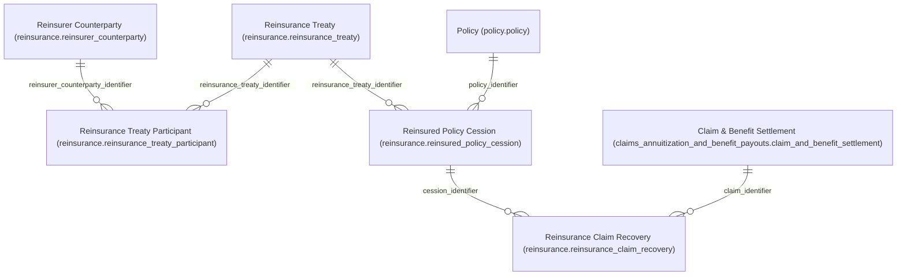

# L&A Ontology Knowledge Framework (OKF) -- Domain 6: Reinsurance (Counterparties, Treaties, Cessions & Recoveries)

| OKF Metadata Attribute | Value |
| :--- | :--- |
| **OKF Catalog Document** | `L&A OKF/06 - OKF - Reinsurance.MD` |
| **Enterprise Data Domain** | **Domain 6: Reinsurance (Counterparties, Treaties, Cessions & Recoveries)** |
| **Target Physical Database Engine** | Amazon RDS Aurora PostgreSQL (PostgreSQL 15/16 Compatible) |
| **Physical Database Schema** | `reinsurance` |
| **Domain Table Count** | **5 Physical Tables / Logical Entities** |
| **Outbound Foreign Key Joins** | **6 Foreign Key Relationships** (Intra-Domain & Cross-Domain) |
| **Inbound Foreign Key Joins** | **0 Cross-Domain Referencing Relationships** |
| **Performance Indexes** | **6 B-Tree & Composite Indexes** |
| **Inherited Business Context Rules** | **`BC-104` through `BC-120` (17 Rules)** |
| **Source Knowledge Layer Artifacts** | `L&A - Ontology.MD`, `L&A Data Model - Logical.MD`, `L&A Data Model - Physical DDL.sql`, `L&A Data Model - Conceptual.MD` |

---

## 1. Domain Executive Ontology & Business Context Overview

The **Reinsurance** domain governs the transfer of mortality, longevity, morbidity, and capital-market tail risks from the direct writing insurance carrier (the ceding company) to external third-party professional reinsurers (such as RGA, Swiss Re, Munich Re, SCOR, and Hannover Re) or affiliated offshore/onshore captive and sidecar reinsurers (such as Athene Co-Invest Reinsurance Affiliate [ACRA], Prismic Life Re, or Martello Re). In the capital-intensive US Life and Annuity industry, reinsurance is a vital strategic lever used to protect statutory surplus against catastrophic or large-case mortality claims, manage longevity risk on institutional payout annuity blocks, finance new business strain (XXX/AXXX and PBR reserves), and optimize Risk-Based Capital (RBC). The domain is structured across five logical entities: `Reinsurer Counterparty`, `Reinsurance Treaty`, `Reinsurance Treaty Participant`, `Reinsured Policy Cession`, and `Reinsurance Claim Recovery`.

`Reinsurer Counterparty` (`Reinsurer Counterparty Identifier`) maintains the legal, regulatory, and credit risk profile of each assuming company, including its five-digit `NAIC Company Code` (required for NAIC Annual Statement Schedule S filings), `Federal Tax Identification Number`, `Credit Rating (AM Best / S&P)`, `Domicile Country`, and critical statutory authorization status (`Authorized vs Unauthorized Reinsurer Status` and `Collateral Trust Required Indicator`). Under US state statutory accounting principles (SAP), if a reinsurer is unauthorized and not a Certified Reciprocal Jurisdiction Reinsurer in the ceding company's state of domicile (e.g., New York Regulation 20 / Regulation 114), the ceding carrier cannot take a statutory reserve credit on its balance sheet unless the reinsurer posts qualifying collateral via a Regulation 114 trust, clean irrevocable Letter of Credit (LOC), or Funds Withheld structure.

`Reinsurance Treaty` (`Reinsurance Treaty Identifier`, `Treaty Number`, `Treaty Name`) codifies the formal risk-transfer contract, specifying the `Treaty Structure Type`: `Yearly Renewable Term (YRT - Mortality Only)`, where only the Net Amount at Risk (NAR) is ceded on an annual mortality rate scale; `Coinsurance`, where the reinsurer assumes a proportional quota share of premiums, benefits, and statutory reserves; `Modified Coinsurance (ModCo)` or `Funds Withheld Coinsurance`, where the ceding carrier retains physical custody of the backing assets and reserves to avoid collateral friction while transferring economic investment and insurance performance; or `Longevity Risk Swap` treaties on payout annuities. It defines `Automatic vs Facultative Indicator` underwriting rules, `Carrier Retention Limit Amount` (e.g., retaining up to $2.5M per life), and `Cession Percentage`, while `Reinsurance Treaty Participant` resolves multi-reinsurer syndicate shares (`Reinsurer Share Percentage`). At the policy level, `Reinsured Policy Cession` tracks monthly/quarterly bordereau exposures (`Direct Face Amount`, `Retained Risk Amount`, `Ceded Net Amount at Risk (NAR)`, `Ceded Reserve Amount`, `Reinsurance Premium Due Amount`, `Expense Allowance Amount`), and `Reinsurance Claim Recovery` manages the billing and cash collection (`Reinsurance Recoverable Amount`, `Recovery Settlement Status`) when a reinsured policy incurs a claim, monitoring statutory 90-day aging rules for overdue recoverables.

---

## 2. Physical Schema & Logical Entity Architecture Catalog (Schema: `reinsurance`)

| # | Logical Entity Name | Physical Table Name (`schema.table`) | Primary Key Column (`PK`) | Business Cols | Audit Cols | Constraints (`PK`/`UQ`/`CHK`) | Logical Entity & Physical Table Definition |
| :--- | :--- | :--- | :--- | :--- | :--- | :--- | :--- |
| **6.1** | **Reinsurer Counterparty** | `reinsurance.reinsurer_counterparty` | `reinsurer_counterparty_identifier` | 8 | 2 | `pk_reinsurer_counterparty`, `uq_reinsurer_naic_code` | Reinsurer Counterparty entity stores master legal, regulatory, NAIC identification, and creditworthiness information for external third-party and affiliated captive reinsurance companies that assume mortality, longevity, or market risk from the carrier. |
| **6.2** | **Reinsurance Treaty** | `reinsurance.reinsurance_treaty` | `reinsurance_treaty_identifier` | 10 | 2 | `pk_reinsurance_treaty`, `uq_reinsurance_treaty_number`, `chk_treaty_cession_pct` | Reinsurance Treaty entity defines the formal contractual agreement between the insurance carrier and a Reinsurer Counterparty (such as Yearly Renewable Term, Coinsurance, Modified Coinsurance, or Longevity Swap treaties), specifying retention limits, cession percentages, and experience refund rules. |
| **6.3** | **Reinsurance Treaty Participant** | `reinsurance.reinsurance_treaty_participant` | `treaty_participant_identifier` | 4 | 2 | `pk_reinsurance_treaty_participant`, `uq_treaty_participant_pair`, `chk_reinsurer_share_pct` | Reinsurance Treaty Participant entity resolves the associative relationship between a Reinsurance Treaty and one or more participating Reinsurer Counterparties (for multi-reinsurer quota share syndicates), recording each reinsurer's share percentage and role. |
| **6.4** | **Reinsured Policy Cession** | `reinsurance.reinsured_policy_cession` | `cession_identifier` | 10 | 2 | `pk_reinsured_policy_cession`, `uq_policy_treaty_cession_date` | Reinsured Policy Cession entity tracks the policy-level risk ceded under a Reinsurance Treaty for a specific Policy and valuation period, recording direct face amount, retained risk, ceded Net Amount at Risk (NAR), ceded statutory reserves, and reinsurance premiums due. |
| **6.5** | **Reinsurance Claim Recovery** | `reinsurance.reinsurance_claim_recovery` | `reinsurance_recovery_identifier` | 8 | 2 | `pk_reinsurance_claim_recovery`, `uq_recovery_claim_number` | Reinsurance Claim Recovery entity manages the billing, tracking, and cash collection of reinsured benefit amounts recoverable from a Reinsurer Counterparty when a covered Policy experiences a death, disability, or annuity payout claim. |

---

## 3. Relational Join Mining & Foreign Key Topology

### 3.1 Entity-Relationship & Foreign Key Join Diagram (Mermaid)



### 3.2 Outbound Foreign Key Join Matrix (Tables in `reinsurance` Referencing Parent Entities)

| FK Constraint Name | Child Table (`reinsurance`) | Child FK Column | Join Scope | Parent Referenced Table | Parent PK Column | Referential Action | Exact SQL Join Predicate |
| :--- | :--- | :--- | :--- | :--- | :--- | :--- | :--- |
| `fk_rtp_treaty` | `reinsurance.reinsurance_treaty_participant` | `reinsurance_treaty_identifier` | Intra-Domain | `reinsurance.reinsurance_treaty` | `reinsurance_treaty_identifier` | `ON UPDATE CASCADE ON DELETE CASCADE` | `reinsurance.reinsurance_treaty_participant.reinsurance_treaty_identifier = reinsurance.reinsurance_treaty.reinsurance_treaty_identifier` |
| `fk_rtp_counterparty` | `reinsurance.reinsurance_treaty_participant` | `reinsurer_counterparty_identifier` | Intra-Domain | `reinsurance.reinsurer_counterparty` | `reinsurer_counterparty_identifier` | `ON UPDATE CASCADE ON DELETE RESTRICT` | `reinsurance.reinsurance_treaty_participant.reinsurer_counterparty_identifier = reinsurance.reinsurer_counterparty.reinsurer_counterparty_identifier` |
| `fk_rpc_policy` | `reinsurance.reinsured_policy_cession` | `policy_identifier` | Cross-Domain (`policy`) | `policy.policy` | `policy_identifier` | `ON UPDATE CASCADE ON DELETE RESTRICT` | `reinsurance.reinsured_policy_cession.policy_identifier = policy.policy.policy_identifier` |
| `fk_rpc_treaty` | `reinsurance.reinsured_policy_cession` | `reinsurance_treaty_identifier` | Intra-Domain | `reinsurance.reinsurance_treaty` | `reinsurance_treaty_identifier` | `ON UPDATE CASCADE ON DELETE RESTRICT` | `reinsurance.reinsured_policy_cession.reinsurance_treaty_identifier = reinsurance.reinsurance_treaty.reinsurance_treaty_identifier` |
| `fk_rcr_cession` | `reinsurance.reinsurance_claim_recovery` | `cession_identifier` | Intra-Domain | `reinsurance.reinsured_policy_cession` | `cession_identifier` | `ON UPDATE CASCADE ON DELETE RESTRICT` | `reinsurance.reinsurance_claim_recovery.cession_identifier = reinsurance.reinsured_policy_cession.cession_identifier` |
| `fk_rcr_claim` | `reinsurance.reinsurance_claim_recovery` | `claim_identifier` | Cross-Domain (`claims_annuitization_and_benefit_payouts`) | `claims_annuitization_and_benefit_payouts.claim_and_benefit_settlement` | `claim_identifier` | `ON UPDATE CASCADE ON DELETE RESTRICT` | `reinsurance.reinsurance_claim_recovery.claim_identifier = claims_annuitization_and_benefit_payouts.claim_and_benefit_settlement.claim_identifier` |

### 3.3 Inbound Cross-Domain Foreign Key Join Matrix (External Schemas Referencing `reinsurance`)

_No external cross-domain schemas hold direct inbound foreign keys to `reinsurance` (tables in this domain act as child/analytical fact or associative tables)._

---

## 4. Detailed Table-by-Table Schema, Column Dictionary & DDL Constraints

### 4.1 Logical Entity: `Reinsurer Counterparty` <-> Physical Table: `reinsurance.reinsurer_counterparty`

- **Business & Technical Purpose**: Reinsurer Counterparty entity stores master legal, regulatory, NAIC identification, and creditworthiness information for external third-party and affiliated captive reinsurance companies that assume mortality, longevity, or market risk from the carrier.
- **PostgreSQL Catalog Comment**: _""_
- **Primary Key**: `reinsurer_counterparty_identifier`

#### Attribute-to-Column Schema Mapping & Business Dictionary

| Ord | Logical Attribute Name | Physical Column Name | Logical Type | Physical PostgreSQL Type | Key | Column Modifiers / Default | Business Definition, Domain Semantics & Sample Values |
| :--- | :--- | :--- | :--- | :--- | :--- | :--- | :--- |
| **1** | **Reinsurer Counterparty Identifier** | `reinsurer_counterparty_identifier` | String | `VARCHAR(64)` | **PK** | `NOT NULL` | Unique primary key identifying an external or affiliated captive reinsurance company in the counterparty master table. Sample values: `REIN-CP-001`, `REIN-CP-002`. |
| **2** | **NAIC Company Code** | `naic_company_code` | String | `VARCHAR(20)` | **NK** | `NOT NULL` | Five-digit National Association of Insurance Commissioners (NAIC) code uniquely identifying the reinsurer for statutory Schedule S reporting. Sample values: `82627` (Swiss Re Life & Health), `93572` (RGA Reinsurance), `66346` (Munich American Reassurance). |
| **3** | **Reinsurer Legal Name** | `reinsurer_legal_name` | String | `VARCHAR(200)` | **NK** | `NOT NULL` | Full registered corporate name of the asumirng reinsurance company. Sample values: `RGA Reinsurance Company`, `Swiss Re Life & Health America Inc.`, `Munich American Reassurance Company`, `Hannover Life Reassurance Company of America`. |
| **4** | **Federal Tax Identification Number** | `federal_tax_identification_number` | String | `VARCHAR(32)` | **NK** | `NOT NULL` | Nine-digit IRS Employer Identification Number (EIN) or foreign tax identifier of the reinsurer for FATCA and federal excise tax compliance. Sample values: `43-1234567`, `13-9876543`. |
| **5** | **Credit Rating (AM Best / S&P)** | `credit_rating_am_best_or_sp` | String | `VARCHAR(64)` | **NK** | `NOT NULL` | Current financial strength rating of the reinsurer used by Enterprise Risk Management to monitor counterparty credit risk and RBC charges. Sample values: `A++ (Superior) / AA-`, `A+ (Superior) / AA-`, `A (Excellent) / A+`. |
| **6** | **Authorized vs Unauthorized Reinsurer Status** | `authorized_vs_unauthorized_status` | String | `VARCHAR(100)` | **NK** | `NOT NULL` | Statutory regulatory classification in the ceding carrier's state of domicile determining whether reserve credit requires collateral (letters of credit or trust assets). Sample values: `Authorized / Licensed Reinsurer`, `Certified Reciprocal Jurisdiction Reinsurer`, `Unauthorized Reinsurer (Collateral Required)`. |
| **7** | **Domicile Country** | `domicile_country` | String | `VARCHAR(100)` | **NK** | `NOT NULL` | Country or jurisdiction where the reinsurance legal entity is domiciled and regulated. Sample values: `United States`, `Bermuda`, `Switzerland`, `Germany`, `Cayman Islands`. |
| **8** | **Collateral Trust Required Indicator** | `collateral_trust_required_indicator` | String | `VARCHAR(100)` | **NK** | `NOT NULL` | Indicates whether the reinsurer is contractually or regulatorily required to maintain a Reg 114 reserve credit trust or letter of credit backing ceded liabilities. Sample values: `False (Authorized - No Collateral Needed)`, `True (Reg 114 Qualifying Trust Required)`, `True (Funds Withheld by Ceding Carrier)`. |
| **9** | **Record Created Timestamp (Audit)** | `created_at` | Timestamp | `TIMESTAMPTZ` | **AUDIT** | `NOT NULL DEFAULT CURRENT_TIMESTAMP` | System audit timestamp recording when the physical row was initially inserted into the Aurora PostgreSQL table. |
| **10** | **Record Updated Timestamp (Audit)** | `updated_at` | Timestamp | `TIMESTAMPTZ` | **AUDIT** | `NOT NULL DEFAULT CURRENT_TIMESTAMP` | System audit timestamp recording when the physical row was last modified in the Aurora PostgreSQL table. |

#### Declarative DDL Constraints & Indexes on `reinsurance.reinsurer_counterparty`

| Constraint / Index Category | Identifier Name | Definition / Target Columns & Referential Integrity Rule |
| :--- | :--- | :--- |
| **PRIMARY KEY** | `pk_reinsurer_counterparty` | `PRIMARY KEY (reinsurer_counterparty_identifier)` |
| **UNIQUE** | `uq_reinsurer_naic_code` | `UNIQUE (naic_company_code)` |

### 4.2 Logical Entity: `Reinsurance Treaty` <-> Physical Table: `reinsurance.reinsurance_treaty`

- **Business & Technical Purpose**: Reinsurance Treaty entity defines the formal contractual agreement between the insurance carrier and a Reinsurer Counterparty (such as Yearly Renewable Term, Coinsurance, Modified Coinsurance, or Longevity Swap treaties), specifying retention limits, cession percentages, and experience refund rules.
- **PostgreSQL Catalog Comment**: _""_
- **Primary Key**: `reinsurance_treaty_identifier`

#### Attribute-to-Column Schema Mapping & Business Dictionary

| Ord | Logical Attribute Name | Physical Column Name | Logical Type | Physical PostgreSQL Type | Key | Column Modifiers / Default | Business Definition, Domain Semantics & Sample Values |
| :--- | :--- | :--- | :--- | :--- | :--- | :--- | :--- |
| **1** | **Reinsurance Treaty Identifier** | `reinsurance_treaty_identifier` | String | `VARCHAR(64)` | **PK** | `NOT NULL` | Unique primary key identifying a formal reinsurance contract treaty in the reinsurance administration system. Sample values: `TRT-YRT-2020-01`, `TRT-COIN-2023-04`. |
| **2** | **Treaty Number** | `treaty_number` | String | `VARCHAR(64)` | **NK** | `NOT NULL` | Business-facing alphanumeric treaty reference code used across actuarial valuation, Schedule S, and reinsurer bordereaux settlements. Sample values: `TY-2020-LIFE-YRT-01`, `TY-2023-ANN-MODCO-02`, `TY-2024-LONG-SWAP-01`. |
| **3** | **Treaty Name** | `treaty_name` | String | `VARCHAR(200)` | **NK** | `NOT NULL` | Descriptive business title of the reinsurance treaty specifying the covered product block and structure. Sample values: `2020 Term & Universal Life 90% Quota Share YRT Treaty`, `Legacy Fixed Annuity Block 50% Funds Withheld Coinsurance`, `Payout Annuity Longevity Swap Treaty`. |
| **4** | **Treaty Structure Type** | `treaty_structure_type` | String | `VARCHAR(120)` | **NK** | `NOT NULL` | Defines the financial and actuarial risk transfer mechanics of the treaty. Sample values: `Yearly Renewable Term (YRT - Mortality Only)`, `Coinsurance`, `Modified Coinsurance (ModCo)`, `Funds Withheld Coinsurance`, `Longevity Risk Swap`, `Catastrophe Excess of Loss (Stop Loss)`. |
| **5** | **Automatic vs Facultative Indicator** | `automatic_vs_facultative_indicator` | String | `VARCHAR(100)` | **NK** | `NOT NULL` | Indicates whether policies meeting treaty underwriting criteria are ceded automatically at issue or require individual case-by-case underwriting approval from the reinsurer. Sample values: `Automatic Cession`, `Facultative Only`, `Automatic with Facultative Facility above Retention`. |
| **6** | **Treaty Effective Date** | `treaty_effective_date` | Date | `DATE` | **NK** | `NOT NULL` | Calendar date from which new or in-force policies in the covered block begin ceding risk under this treaty. Sample values: `2020-01-01`, `2023-07-01`. |
| **7** | **Treaty Termination Date** | `treaty_termination_date` | Date | `DATE` | **NK** | `NULL` | Date on which the treaty was closed to new cessions (run-off) or recaptured in full by the ceding company. Sample values: `2025-12-31`, `Null (Open to New Business)`. |
| **8** | **Carrier Retention Limit Amount** | `carrier_retention_limit_amount` | Decimal | `NUMERIC(18,2)` | **NK** | `NOT NULL DEFAULT 0.00` | Maximum dollar amount of mortality risk per insured life retained by the direct carrier before excess risk is ceded under the treaty. Sample values: `1000000.00`, `2500000.00`, `5000000.00`, `100000.00`. |
| **9** | **Cession Percentage** | `cession_percentage` | Decimal | `NUMERIC(9,6)` | **NK** | `NOT NULL` | Quota-share percentage of eligible risk (or risk above retention) ceded to the participating reinsurers under the treaty. Sample values: `0.9000` (90.00%), `0.5000` (50.00%), `0.7500` (75.00%). |
| **10** | **Experience Refund Eligible Indicator** | `experience_refund_eligible_indicator` | String | `VARCHAR(100)` | **NK** | `NOT NULL` | Indicates whether the ceding carrier is entitled to receive a profit-sharing experience refund when actual claims are favorably below a contractual threshold. Sample values: `True (Annual Experience Refund Formula)`, `False (Non-Refund Treaty)`. |
| **11** | **Record Created Timestamp (Audit)** | `created_at` | Timestamp | `TIMESTAMPTZ` | **AUDIT** | `NOT NULL DEFAULT CURRENT_TIMESTAMP` | System audit timestamp recording when the physical row was initially inserted into the Aurora PostgreSQL table. |
| **12** | **Record Updated Timestamp (Audit)** | `updated_at` | Timestamp | `TIMESTAMPTZ` | **AUDIT** | `NOT NULL DEFAULT CURRENT_TIMESTAMP` | System audit timestamp recording when the physical row was last modified in the Aurora PostgreSQL table. |

#### Declarative DDL Constraints & Indexes on `reinsurance.reinsurance_treaty`

| Constraint / Index Category | Identifier Name | Definition / Target Columns & Referential Integrity Rule |
| :--- | :--- | :--- |
| **PRIMARY KEY** | `pk_reinsurance_treaty` | `PRIMARY KEY (reinsurance_treaty_identifier)` |
| **UNIQUE** | `uq_reinsurance_treaty_number` | `UNIQUE (treaty_number)` |
| **CHECK** | `chk_treaty_cession_pct` | `CHECK (cession_percentage >= 0 AND cession_percentage <= 1)` |

### 4.3 Logical Entity: `Reinsurance Treaty Participant` <-> Physical Table: `reinsurance.reinsurance_treaty_participant`

- **Business & Technical Purpose**: Reinsurance Treaty Participant entity resolves the associative relationship between a Reinsurance Treaty and one or more participating Reinsurer Counterparties (for multi-reinsurer quota share syndicates), recording each reinsurer's share percentage and role.
- **PostgreSQL Catalog Comment**: _""_
- **Primary Key**: `treaty_participant_identifier`

#### Attribute-to-Column Schema Mapping & Business Dictionary

| Ord | Logical Attribute Name | Physical Column Name | Logical Type | Physical PostgreSQL Type | Key | Column Modifiers / Default | Business Definition, Domain Semantics & Sample Values |
| :--- | :--- | :--- | :--- | :--- | :--- | :--- | :--- |
| **1** | **Treaty Participant Identifier** | `treaty_participant_identifier` | String | `VARCHAR(64)` | **PK** | `NOT NULL` | Unique primary key for the associative record linking a Reinsurance Treaty to a participating Reinsurer Counterparty. Sample values: `RTP-101`, `RTP-102`. |
| **2** | **Reinsurance Treaty Identifier** | `reinsurance_treaty_identifier` | String | `VARCHAR(64)` | **FK** | `NOT NULL` | Foreign key referencing the parent Reinsurance Treaty. Sample values: `TRT-YRT-2020-01`. |
| **3** | **Reinsurer Counterparty Identifier** | `reinsurer_counterparty_identifier` | String | `VARCHAR(64)` | **FK** | `NOT NULL` | Foreign key referencing the participating Reinsurer Counterparty assuming a share of the treaty. Sample values: `REIN-CP-001`, `REIN-CP-002`. |
| **4** | **Reinsurer Share Percentage** | `reinsurer_share_percentage` | Decimal | `NUMERIC(9,6)` | **NK** | `NOT NULL` | Percentage of the total ceded treaty risk assumed by this specific Reinsurer Counterparty (sums to 100% across all participants on a treaty). Sample values: `0.5000` (50.00% Pool Share), `0.3000` (30.00%), `1.0000` (100.00% Sole Reinsurer). |
| **5** | **Record Created Timestamp (Audit)** | `created_at` | Timestamp | `TIMESTAMPTZ` | **AUDIT** | `NOT NULL DEFAULT CURRENT_TIMESTAMP` | System audit timestamp recording when the physical row was initially inserted into the Aurora PostgreSQL table. |
| **6** | **Record Updated Timestamp (Audit)** | `updated_at` | Timestamp | `TIMESTAMPTZ` | **AUDIT** | `NOT NULL DEFAULT CURRENT_TIMESTAMP` | System audit timestamp recording when the physical row was last modified in the Aurora PostgreSQL table. |

#### Declarative DDL Constraints & Indexes on `reinsurance.reinsurance_treaty_participant`

| Constraint / Index Category | Identifier Name | Definition / Target Columns & Referential Integrity Rule |
| :--- | :--- | :--- |
| **PRIMARY KEY** | `pk_reinsurance_treaty_participant` | `PRIMARY KEY (treaty_participant_identifier)` |
| **UNIQUE** | `uq_treaty_participant_pair` | `UNIQUE (reinsurance_treaty_identifier, reinsurer_counterparty_identifier)` |
| **CHECK** | `chk_reinsurer_share_pct` | `CHECK (reinsurer_share_percentage > 0 AND reinsurer_share_percentage <= 1)` |
| **FOREIGN KEY** | `fk_rtp_treaty` | `FOREIGN KEY (reinsurance_treaty_identifier) REFERENCES reinsurance.reinsurance_treaty (reinsurance_treaty_identifier) ON UPDATE CASCADE ON DELETE CASCADE` |
| **FOREIGN KEY** | `fk_rtp_counterparty` | `FOREIGN KEY (reinsurer_counterparty_identifier) REFERENCES reinsurance.reinsurer_counterparty (reinsurer_counterparty_identifier) ON UPDATE CASCADE ON DELETE RESTRICT` |
| **B-TREE INDEX** | `idx_rtp_treaty_id` | `ON reinsurance.reinsurance_treaty_participant (reinsurance_treaty_identifier)` |
| **B-TREE INDEX** | `idx_rtp_counterparty_id` | `ON reinsurance.reinsurance_treaty_participant (reinsurer_counterparty_identifier)` |

### 4.4 Logical Entity: `Reinsured Policy Cession` <-> Physical Table: `reinsurance.reinsured_policy_cession`

- **Business & Technical Purpose**: Reinsured Policy Cession entity tracks the policy-level risk ceded under a Reinsurance Treaty for a specific Policy and valuation period, recording direct face amount, retained risk, ceded Net Amount at Risk (NAR), ceded statutory reserves, and reinsurance premiums due.
- **PostgreSQL Catalog Comment**: _""_
- **Primary Key**: `cession_identifier`

#### Attribute-to-Column Schema Mapping & Business Dictionary

| Ord | Logical Attribute Name | Physical Column Name | Logical Type | Physical PostgreSQL Type | Key | Column Modifiers / Default | Business Definition, Domain Semantics & Sample Values |
| :--- | :--- | :--- | :--- | :--- | :--- | :--- | :--- |
| **1** | **Cession Identifier** | `cession_identifier` | String | `VARCHAR(64)` | **PK** | `NOT NULL` | Unique primary key identifying a policy-level reinsurance cession and periodic bordereau record. Sample values: `CES-202609-00491`, `CES-202609-00492`. |
| **2** | **Policy Identifier** | `policy_identifier` | String | `VARCHAR(64)` | **FK** | `NOT NULL` | Foreign key linking the reinsurance cession record to the underlying direct Policy. Sample values: `POL-UUID-90001421`. |
| **3** | **Reinsurance Treaty Identifier** | `reinsurance_treaty_identifier` | String | `VARCHAR(64)` | **FK** | `NOT NULL` | Foreign key linking the policy cession to the governing Reinsurance Treaty. Sample values: `TRT-YRT-2020-01`. |
| **4** | **Cession Effective Date** | `cession_effective_date` | Date | `DATE` | **NK** | `NOT NULL` | Effective valuation or coverage date of the policy cession record. Sample values: `2026-09-30`, `2026-10-01`. |
| **5** | **Direct Face Amount** | `direct_face_amount` | Decimal | `NUMERIC(18,2)` | **NK** | `NOT NULL DEFAULT 0.00` | Total gross death benefit or annuity guarantee amount in force on the direct Policy prior to reinsurance. Sample values: `2000000.00`, `500000.00`. |
| **6** | **Retained Risk Amount** | `retained_risk_amount` | Decimal | `NUMERIC(18,2)` | **NK** | `NOT NULL DEFAULT 0.00` | Dollar portion of the policy's Net Amount at Risk kept on the direct insurance carrier's own balance sheet. Sample values: `200000.00`, `50000.00`. |
| **7** | **Ceded Net Amount at Risk (NAR)** | `ceded_net_amount_at_risk_nar` | Decimal | `NUMERIC(18,2)` | **NK** | `NOT NULL DEFAULT 0.00` | Dollar amount of mortality or longevity risk (Face Amount minus Cash Value/Reserve) transferred to the reinsurer under the treaty. Sample values: `1800000.00`, `450000.00`. |
| **8** | **Ceded Reserve Amount** | `ceded_reserve_amount` | Decimal | `NUMERIC(18,2)` | **NK** | `NOT NULL DEFAULT 0.00` | Statutory reserve credit dollar amount attributable to the ceded coverage, reducing the direct carrier's net statutory liability on NAIC Schedule S. Sample values: `42500.00`, `185000.00`, `3200.00`. |
| **9** | **Reinsurance Premium Due Amount** | `reinsurance_premium_due_amount` | Decimal | `NUMERIC(18,2)` | **NK** | `NOT NULL DEFAULT 0.00` | Periodic YRT or coinsurance premium dollar amount payable by the direct carrier to the reinsurer for the coverage period. Sample values: `1450.00`, `12400.00`. |
| **10** | **Expense Allowance Amount** | `expense_allowance_amount` | Decimal | `NUMERIC(18,2)` | **NK** | `NOT NULL DEFAULT 0.00` | Ceding commission or expense allowance dollar amount reimbursed by the reinsurer to the direct carrier to offset acquisition and maintenance costs. Sample values: `290.00`, `1860.00`, `0.00` (First-Year Zero YRT). |
| **11** | **Record Created Timestamp (Audit)** | `created_at` | Timestamp | `TIMESTAMPTZ` | **AUDIT** | `NOT NULL DEFAULT CURRENT_TIMESTAMP` | System audit timestamp recording when the physical row was initially inserted into the Aurora PostgreSQL table. |
| **12** | **Record Updated Timestamp (Audit)** | `updated_at` | Timestamp | `TIMESTAMPTZ` | **AUDIT** | `NOT NULL DEFAULT CURRENT_TIMESTAMP` | System audit timestamp recording when the physical row was last modified in the Aurora PostgreSQL table. |

#### Declarative DDL Constraints & Indexes on `reinsurance.reinsured_policy_cession`

| Constraint / Index Category | Identifier Name | Definition / Target Columns & Referential Integrity Rule |
| :--- | :--- | :--- |
| **PRIMARY KEY** | `pk_reinsured_policy_cession` | `PRIMARY KEY (cession_identifier)` |
| **UNIQUE** | `uq_policy_treaty_cession_date` | `UNIQUE (policy_identifier, reinsurance_treaty_identifier, cession_effective_date)` |
| **FOREIGN KEY** | `fk_rpc_policy` | `FOREIGN KEY (policy_identifier) REFERENCES policy.policy (policy_identifier) ON UPDATE CASCADE ON DELETE RESTRICT` |
| **FOREIGN KEY** | `fk_rpc_treaty` | `FOREIGN KEY (reinsurance_treaty_identifier) REFERENCES reinsurance.reinsurance_treaty (reinsurance_treaty_identifier) ON UPDATE CASCADE ON DELETE RESTRICT` |
| **B-TREE INDEX** | `idx_rpc_policy_eff_date` | `ON reinsurance.reinsured_policy_cession (policy_identifier, cession_effective_date DESC)` |
| **B-TREE INDEX** | `idx_rpc_treaty_id` | `ON reinsurance.reinsured_policy_cession (reinsurance_treaty_identifier)` |

### 4.5 Logical Entity: `Reinsurance Claim Recovery` <-> Physical Table: `reinsurance.reinsurance_claim_recovery`

- **Business & Technical Purpose**: Reinsurance Claim Recovery entity manages the billing, tracking, and cash collection of reinsured benefit amounts recoverable from a Reinsurer Counterparty when a covered Policy experiences a death, disability, or annuity payout claim.
- **PostgreSQL Catalog Comment**: _""_
- **Primary Key**: `reinsurance_recovery_identifier`

#### Attribute-to-Column Schema Mapping & Business Dictionary

| Ord | Logical Attribute Name | Physical Column Name | Logical Type | Physical PostgreSQL Type | Key | Column Modifiers / Default | Business Definition, Domain Semantics & Sample Values |
| :--- | :--- | :--- | :--- | :--- | :--- | :--- | :--- |
| **1** | **Reinsurance Recovery Identifier** | `reinsurance_recovery_identifier` | String | `VARCHAR(64)` | **PK** | `NOT NULL` | Unique primary key identifying a reinsurance claim recovery billing record. Sample values: `RCR-8001`, `RCR-8002`. |
| **2** | **Cession Identifier** | `cession_identifier` | String | `VARCHAR(64)` | **FK** | `NOT NULL` | Foreign key linking the claim recovery to the active Reinsured Policy Cession record. Sample values: `CES-202609-00491`. |
| **3** | **Claim Identifier** | `claim_identifier` | String | `VARCHAR(64)` | **FK** | `NOT NULL` | Foreign key linking the reinsurance recovery to the direct Claim & Benefit Settlement that triggered the loss. Sample values: `CLM-2026-00912`. |
| **4** | **Recovery Claim Number** | `recovery_claim_number` | String | `VARCHAR(64)` | **NK** | `NOT NULL` | Business-facing claim recovery invoice or reference number submitted to the reinsurer. Sample values: `REC-INV-2026-0419`, `REC-INV-2026-0420`. |
| **5** | **Direct Claim Paid Amount** | `direct_claim_paid_amount` | Decimal | `NUMERIC(18,2)` | **NK** | `NOT NULL` | Total gross benefit dollar amount paid by the direct carrier to the policy beneficiaries on the underlying claim. Sample values: `2000000.00`, `500000.00`. |
| **6** | **Reinsurance Recoverable Amount** | `reinsurance_recoverable_amount` | Decimal | `NUMERIC(18,2)` | **NK** | `NOT NULL` | Contractual dollar share of the paid claim (plus delayed settlement interest share) owed by the reinsurer to the direct carrier. Sample values: `1800000.00`, `450000.00`. |
| **7** | **Recovery Settlement Status** | `recovery_settlement_status` | String | `VARCHAR(100)` | **NK** | `NOT NULL` | Tracks the collection lifecycle of the reinsurance recoverable asset (critical for statutory aging of recoverables over 90 days). Sample values: `Pending Bordereau Billing`, `Billed to Reinsurer`, `Under Reinsurer Audit`, `Settled via Wire / Netting Offset`, `Disputed`. |
| **8** | **Recovery Received Date** | `recovery_received_date` | Date | `DATE` | **NK** | `NULL` | Calendar date on which the reinsurer's cash reimbursement or quarterly bordereau net settlement was received. Sample values: `2026-10-15`, `Null (Pending Collection)`. |
| **9** | **Record Created Timestamp (Audit)** | `created_at` | Timestamp | `TIMESTAMPTZ` | **AUDIT** | `NOT NULL DEFAULT CURRENT_TIMESTAMP` | System audit timestamp recording when the physical row was initially inserted into the Aurora PostgreSQL table. |
| **10** | **Record Updated Timestamp (Audit)** | `updated_at` | Timestamp | `TIMESTAMPTZ` | **AUDIT** | `NOT NULL DEFAULT CURRENT_TIMESTAMP` | System audit timestamp recording when the physical row was last modified in the Aurora PostgreSQL table. |

#### Declarative DDL Constraints & Indexes on `reinsurance.reinsurance_claim_recovery`

| Constraint / Index Category | Identifier Name | Definition / Target Columns & Referential Integrity Rule |
| :--- | :--- | :--- |
| **PRIMARY KEY** | `pk_reinsurance_claim_recovery` | `PRIMARY KEY (reinsurance_recovery_identifier)` |
| **UNIQUE** | `uq_recovery_claim_number` | `UNIQUE (recovery_claim_number)` |
| **FOREIGN KEY** | `fk_rcr_cession` | `FOREIGN KEY (cession_identifier) REFERENCES reinsurance.reinsured_policy_cession (cession_identifier) ON UPDATE CASCADE ON DELETE RESTRICT` |
| **FOREIGN KEY** | `fk_rcr_claim` | `FOREIGN KEY (claim_identifier) REFERENCES claims_annuitization_and_benefit_payouts.claim_and_benefit_settlement (claim_identifier) ON UPDATE CASCADE ON DELETE RESTRICT` |
| **B-TREE INDEX** | `idx_rcr_cession_id` | `ON reinsurance.reinsurance_claim_recovery (cession_identifier)` |
| **B-TREE INDEX** | `idx_rcr_claim_status` | `ON reinsurance.reinsurance_claim_recovery (claim_identifier, recovery_settlement_status)` |

---

## 5. Inherited Business Context Ontology Rules (`BC-104` to `BC-120`)

> **Semantic Inheritance Notice**: The following **17 Business Context rules** are inherited verbatim from `L&A Data Domain/L&A - Ontology.MD` to provide autonomous AI agents, data engineers, and actuaries with complete domain rules, accounting identities, statutory compliance mandates, and SQL join guardrails for the **Reinsurance** domain.

#### BC-104: Proportional Coinsurance (`Coinsurance`) Full Reserve and Cash Value Transfer Mechanics

**Domains**: Reinsurance, Actuarial, Finance | **Entities**: `Reinsurance Treaty`, `Reinsured Policy Cession`, `Actuarial Valuation Reserve`, `Sub-Ledger Journal Entry` | **Key Attributes**: `Treaty Structure Type`, `Cession Percentage`, `Ceded Net Amount at Risk (NAR)`, `Ceded Reserve Amount`, `Reinsurance Premium Due Amount`, `Expense Allowance Amount`

When a direct insurance carrier seeks to transfer not only mortality risk but also investment yield risk, surrender/lapse risk, and statutory capital strain (Risk-Based Capital `Required Risk-Based Capital (RBC) Amount`), it utilizes a **Proportional Coinsurance (**`Coinsurance`**)** structure in `Reinsurance Treaty`.`Treaty Structure Type`. Under a traditional `Coinsurance` treaty (common across level-term life blocks, fixed deferred annuities, and payout annuity blocks ceded to reinsurers like RGA, Munich Re, or Athene Re), the reinsurer steps into the exact contractual shoes of the direct insurer for a fixed `Cession Percentage` (e.g., `0.5000` for 50% or `0.7500` for 75%) of every cash flow on the covered policies. Specifically, rather than paying a separate YRT rate schedule, the direct carrier passes through the exact `Cession Percentage` share of the policyholder's actual gross premiums collected (`Reinsurance Premium Due Amount` = $\text{Direct Gross Premium} \times \text{Cession Percentage}$). In return, the reinsurer:

1. Reimburses the direct carrier for its share of acquisition commissions, underwriting expenses, premium taxes, and ongoing policy maintenance costs via a substantial `Reinsured Policy Cession`.`Expense Allowance Amount` (for example, `1860.00` on a `12400.00` ceded premium).
2. Establishes and holds its full proportional share of the statutory and GAAP policy reserves on the reinsurer's own balance sheet, granting the direct carrier a dollar-for-dollar statutory reserve reduction in `Reinsured Policy Cession`.`Ceded Reserve Amount` equal to $\text{Future Policy Benefit Reserve Amount} \times \text{Cession Percentage}$ (e.g., `185000.00` or `42500.00`).
3. Reimburses the direct carrier (`Reinsurance Claim Recovery`) not only for death claims, but also for the `Cession Percentage` share of cash surrenders, partial withdrawals, policy dividends, and annuity income payments. Because the reinsurer physically receives the net cash premiums and invests the backing assets on its own books, traditional `Coinsurance` transfers both asset risk (`C-1`) and insurance/interest rate risk (`C-2` / `C-3`). AI agents analyzing statutory balance sheet relief (`NAIC Schedule S`) will observe that `Coinsurance` treaties generate orders-of-magnitude larger `Ceded Reserve Amount` values per policy than `Yearly Renewable Term (YRT - Mortality Only)` treaties.

#### BC-105: Modified Coinsurance (`Modified Coinsurance (ModCo)`) and `Funds Withheld Coinsurance` Balance Sheet Retention Structures

**Domains**: Reinsurance, Finance, Actuarial | **Entities**: `Reinsurance Treaty`, `Reinsurer Counterparty`, `Reinsured Policy Cession`, `General Ledger Account` | **Key Attributes**: `Treaty Structure Type`, `Treaty Name`, `Authorized vs Unauthorized Reinsurer Status`, `Collateral Trust Required Indicator`, `Ceded Reserve Amount`, `Reinsurance Premium Due Amount`

In large-scale annuity and life block transactions—such as ceding a multi-billion-dollar Fixed Annuity (`PROD-FIA-05`) or General Account block (`Legacy Fixed Annuity Block 50% Funds Withheld Coinsurance`, `TY-2023-ANN-MODCO-02`) to institutional reinsurers in the United States, Bermuda, or Cayman Islands—transferring billions of dollars of physical bond and commercial mortgage assets out of the direct carrier's General Account can trigger undesirable capital gains taxes, disrupt asset-management custody, or create counterparty credit risk if the reinsurer is an `Unauthorized Reinsurer (Collateral Required)`. To solve this, the industry relies on two specialized coinsurance variants in `Reinsurance Treaty`.`Treaty Structure Type`: `Modified Coinsurance (ModCo)` and `Funds Withheld Coinsurance`.

1. **Modified Coinsurance (**`Modified Coinsurance (ModCo)`**)**: Economically identical to proportional coinsurance in sharing mortality, lapse, and investment spread profits/losses, except the **direct ceding carrier retains both the physical investment assets AND the statutory policy reserves** on its own balance sheet (`Ceded Reserve Amount` is settled via a ModCo reserve adjustment rather than a direct liability deduction). Each accounting period, the direct carrier pays the reinsurer the ceded premium less expense allowances and claims, and transfers the net change in reserves plus a **ModCo Interest Adjustment** equal to the actual investment yield earned on the segregated ModCo asset portfolio backing the block.
2. **Funds Withheld Coinsurance (**`Funds Withheld Coinsurance`**)**: The direct carrier takes full statutory reserve credit (`Ceded Reserve Amount`) on its balance sheet, reducing net liabilities, **but withholds the net reinsurance premiums** instead of wiring the cash to the reinsurer (`Reinsurer Counterparty`.`Collateral Trust Required Indicator` = `True (Funds Withheld by Ceding Carrier)`). The direct carrier retains the physical assets in a dedicated Funds Withheld sub-account and records an offsetting "Funds Withheld Payable to Reinsurer" liability in `General Ledger Account`. This structure eliminates offshore counterparty collateral friction while transferring full economic risk and capital requirements to the reinsurer. AI agents building statutory vs. GAAP balance sheet reconciliations must distinguish `Coinsurance` (where cash and assets leave the carrier) from `Modified Coinsurance (ModCo)` and `Funds Withheld Coinsurance` (where invested assets remain on the ceding carrier's balance sheet).

#### BC-106: Payout Annuity `Longevity Risk Swap` and Catastrophe Stop-Loss Treaty Structures

**Domains**: Reinsurance, Claims, Annuitization & Benefit Payouts, Experience Studies | **Entities**: `Reinsurance Treaty`, `Reinsured Policy Cession`, `Annuitization Payout Schedule`, `Experience Study` | **Key Attributes**: `Treaty Structure Type`, `Treaty Number`, `Treaty Name`, `Ceded Net Amount at Risk (NAR)`, `Reinsurance Premium Due Amount`, `Direct Claim Paid Amount`, `Reinsurance Recoverable Amount`

While life insurance carriers fear premature mortality (insureds dying earlier than expected), retirement annuity leaders like Corebridge, Prudential, Athene, and Pacific Life face the exact opposite biometric risk on their massive blocks of annuitized lifetime payout contracts (`Annuitization Payout Schedule`): **longevity risk**, the risk that university professors, healthcare retirees, and pension annuitants live significantly longer than predicted by the `Base Mortality or Longevity Table` (`Pri-2012 Higher Ed Retiree Table`) and `Mortality Improvement Scale` (`SOA Scale MP-2021`). To hedge this tail risk without surrendering management of their General Account bond portfolios, carriers execute a `Longevity Risk Swap` treaty (`Reinsurance Treaty`.`Treaty Structure Type` = `Longevity Risk Swap`, e.g., `Payout Annuity Longevity Swap Treaty`, `TY-2024-LONG-SWAP-01`) with global longevity reinsurers like RGA, Swiss Re, Munich Re, or PartnerRe. Under a `Longevity Risk Swap`, no principal assets or reserves change hands at inception. Instead, for a closed cohort of `Annuitization Payout Schedule` contracts, the direct carrier agrees to pay the reinsurer a predetermined, fixed scheduled stream of monthly or quarterly payments (`Reinsurance Premium Due Amount`, calculated from expected baseline mortality assumptions plus a longevity risk fee), and the reinsurer agrees to pay the direct carrier the **actual floating annuity income payments** (`Reinsurance Recoverable Amount`) paid to surviving annuitants in that cohort for as long as they live. If actual annuitant deaths are lower than expected (`Experience Exposure & Decrement Cohort`.`Actual-to-Expected (A/E) Ratio` < `1.0000` on an `Annuitant Longevity / Mortality Study`), surviving annuitants collect income longer than projected, and the net swap settlement flows from the reinsurer to the direct carrier. Conversely, `Treaty Structure Type` = `Catastrophe Excess of Loss (Stop Loss)` protects the carrier's life block against extreme tail mortality events (such as a pandemic or mass casualty disaster) where aggregate claims or multi-life losses in a single event exceed an attachment point (e.g., 125% of expected annual mortality). AI agents must recognize that for a `Longevity Risk Swap`, the "claim" trigger is continued annuitant survival rather than death.

#### BC-107: Carrier Retention Limit (`Carrier Retention Limit Amount`) and Quota-Share `Cession Percentage` Interaction (Excess-of-Retention vs. First-Dollar Quota Share)

**Domains**: Reinsurance, Policy | **Entities**: `Reinsurance Treaty`, `Reinsured Policy Cession`, `Policy` | **Key Attributes**: `Carrier Retention Limit Amount`, `Cession Percentage`, `Direct Face Amount`, `Retained Risk Amount`, `Ceded Net Amount at Risk (NAR)`

Every record in `Reinsurance Treaty` specifies two core quantitative risk-sharing parameters: `Carrier Retention Limit Amount` (e.g., `1000000.00` [$1M], `2500000.00` [$2.5M], `5000000.00` [$5M], or `100000.00`) and `Cession Percentage` (e.g., `0.9000` [90%], `0.7500` [75%], or `0.5000` [50%]). Understanding how these two attributes interact to compute `Reinsured Policy Cession`.`Retained Risk Amount` and `Ceded Net Amount at Risk (NAR)` is critical for AI agents building reinsurance administration and audit logic. In the US Life and Annuity market, treaties combine these two parameters in one of two standard structures:

1. **First-Dollar Quota Share with a Per-Life Retention Cap (Most Common Modern YRT/Coinsurance Structure)**: Under a treaty such as `2020 Term & Universal Life 90% Quota Share YRT Treaty` (`Cession Percentage` = `0.9000`, `Carrier Retention Limit Amount` = `1000000.00`), the direct carrier cedes 90% (`Cession Percentage`) of the policy's Net Amount at Risk from the very first dollar, and retains the remaining $1 - 0.9000 = 10$ (`Retained Risk Amount`), **up to** the maximum dollar ceiling of `Carrier Retention Limit Amount` (`$1,000,000.00`). If a policy has a `$2,000,000.00` `Direct Face Amount` (and zero cash value), a 10% retention share equals `$200,000.00`, which is well below the `$1,000,000.00` `Carrier Retention Limit Amount`; therefore, `Retained Risk Amount` = `$200,000.00` (10%) and `Ceded Net Amount at Risk (NAR)` = `$1,800,000.00` (90%). However, if an ultra-high-net-worth client purchases a `$15,000,000.00` policy, 10% would be `$1,500,000.00`, which exceeds the carrier's `$1,000,000.00` retention limit; therefore, `Retained Risk Amount` is capped at exactly `Carrier Retention Limit Amount` (`$1,000,000.00`), and 100% of the excess above that cap is ceded, yielding `Ceded Net Amount at Risk (NAR)` = $15,000,000.00 - 1,000,000.00 = 14,000,000.00$.
2. **Pure Excess-of-Retention Structure**: The direct carrier retains 100% of the risk up to `Carrier Retention Limit Amount` and cedes `Cession Percentage` (typically 100%) of the risk exceeding `Carrier Retention Limit Amount`. Moreover, corporate risk management enforces `Carrier Retention Limit Amount` on a **per-insured-life (**`Party Identifier`**) aggregate basis** across all active policies covering that same `Primary Insured`.

#### BC-108: Automatic Cession Eligibility vs. Facultative Underwriting Referral Governance (`Automatic vs Facultative Indicator`)

**Domains**: Reinsurance, Underwriting & New Business, Policy | **Entities**: `Reinsurance Treaty`, `Reinsured Policy Cession`, `Application`, `Underwriting Case & Risk Decision`, `Policy` | **Key Attributes**: `Automatic vs Facultative Indicator`, `Carrier Retention Limit Amount`, `Requested Face Amount`, `Assigned Mortality Risk Classification`, `Substandard Table Rating Factor`, `Final Underwriting Decision`

The `Automatic vs Facultative Indicator` attribute on `Reinsurance Treaty` governs the legal binding authority between the direct insurance carrier's new business underwriting department (Domain 13: `Underwriting Case & Risk Decision`) and the participating reinsurers (`Reinsurer Counterparty`), taking values `Automatic Cession`, `Facultative Only`, and `Automatic with Facultative Facility above Retention`.

1. **Automatic Cession (**`Automatic Cession`**)**: When a treaty is structured as `Automatic Cession`, the reinsurers grant delegated underwriting authority to the direct carrier's home office underwriters (`Underwriter Assigned Name`) and algorithmic rules engine (`Automated Accelerated Rules Engine v4.2`). So long as a new life insurance `Application` meets the treaty's pre-agreed automatic binding parameters—specifically, the insured's issue age is within limits, the policy is underwritten using the carrier's approved guidelines, the `Substandard Table Rating Factor` does not exceed the treaty cap (e.g., Table H / 300% mortality), total coverage on the insured's life does not exceed the treaty's **Automatic Binding Limit** (e.g., $15M or $20M), and the total coverage in force across all insurers does not exceed the **Jumbo Limit** (e.g., $35M to $65M)—the direct carrier can approve and issue the `Policy` immediately, and the reinsurer is legally obligated to accept the `Reinsured Policy Cession` automatically without reviewing the case file.
2. **Facultative Reinsurance (**`Facultative Only` **or** `Automatic with Facultative Facility above Retention`**)**: If an application breaches the Automatic Binding Limit or Jumbo Limit, involves a complex medical impairment or foreign residence risk outside automatic guidelines, or if the carrier wants competitive substandard shopping (`Approved with Substandard Rating / Counteroffer`), the case must be submitted **facultatively** to one or more reinsurers (such as RGA, Swiss Re, or Munich Re). In a facultative submission, the direct carrier transmits the `Underwriting Case & Risk Decision` dossier and `Medical & Mortality Requirement` files (`Attending Physician Statement (APS)`, labs, EKG) to the reinsurer's own medical underwriters, who evaluate the individual risk and return a facultative offer (or decline). The direct carrier can only cede a facultative case after receiving and accepting the reinsurer's formal facultative binding offer prior to `Policy`.`Contract Issue Date`.

#### BC-109: Multi-Reinsurer Syndicate Pool Participation Invariant (`Reinsurance Treaty Participant`.`Reinsurer Share Percentage` = 100%)

**Domains**: Reinsurance | **Entities**: `Reinsurance Treaty`, `Reinsurance Treaty Participant`, `Reinsurer Counterparty`, `Reinsured Policy Cession`, `Reinsurance Claim Recovery` | **Key Attributes**: `Treaty Participant Identifier`, `Reinsurance Treaty Identifier`, `Reinsurer Counterparty Identifier`, `Reinsurer Share Percentage`, `Ceded Net Amount at Risk (NAR)`, `Reinsurance Premium Due Amount`, `Reinsurance Recoverable Amount`

To avoid concentrating counterparty credit risk in a single external reinsurance company, direct life and annuity carriers frequently structure their primary automatic treaties (`Reinsurance Treaty`) as **multi-reinsurer quota-share pools (syndicates)** rather than single-counterparty bilateral agreements. In our Logical Data Model, the many-to-many associative entity `Reinsurance Treaty Participant` resolves the relationship between a parent `Reinsurance Treaty` (`Reinsurance Treaty Identifier`) and the one or more `Reinsurer Counterparty` organizations (`Reinsurer Counterparty Identifier`) that subscribe to a slice of that treaty's ceded risk. The exact proportion of the treaty pool assumed by each participating reinsurer is stored in `Reinsurance Treaty Participant`.`Reinsurer Share Percentage` (e.g., `0.5000` [50% pool share] to `RGA Reinsurance Company`, `0.3000` [30% pool share] to `Swiss Re Life & Health America Inc.`, and `0.2000` [20% pool share] to `Munich American Reassurance Company`, or `1.0000` [100% sole reinsurer] on a bilateral treaty). Every `Reinsurance Treaty` in the enterprise catalog must obey the **100% Treaty Pool Participation Invariant**:
$$\sum_{p \in \text{Participants}(\text{Treaty})} \text{Reinsurance Treaty Participant}_{p}.\text{Reinsurer Share Percentage} = 1.0000 \text{ (100.00)}$$
Because `Reinsured Policy Cession` and `Reinsurance Claim Recovery` store ceded values at the **treaty cession level** (linked to `Reinsurance Treaty Identifier` via `Reinsured Policy Cession`), calculating the exact dollar exposure, statutory Schedule S reserve credit, bordereau premium payable, or claim recovery receivable attributable to a specific `Reinsurer Counterparty` requires multiplying the treaty-level cession or recovery measure by `Reinsurance Treaty Participant`.`Reinsurer Share Percentage`:

- $\text{Counterparty Ceded NAR} = \text{Reinsured Policy Cession}.\text{Ceded Net Amount at Risk (NAR)} \times \text{Reinsurer Share Percentage}$
- $\text{Counterparty Ceded Reserve} = \text{Reinsured Policy Cession}.\text{Ceded Reserve Amount} \times \text{Reinsurer Share Percentage}$
- $\text{Counterparty Net Premium Due} = \left(\text{Reinsurance Premium Due Amount} - \text{Expense Allowance Amount}\right) \times \text{Reinsurer Share Percentage}$
- $\text{Counterparty Claim Recoverable} = \text{Reinsurance Claim Recovery}.\text{Reinsurance Recoverable Amount} \times \text{Reinsurer Share Percentage}$
AI agents must always multiply by `Reinsurer Share Percentage` when joining `Reinsured Policy Cession` or `Reinsurance Claim Recovery` through `Reinsurance Treaty` to `Reinsurance Treaty Participant` and `Reinsurer Counterparty`; omitting that multiplication will overstate counterparty-level risk by $N\times$ on a pooled treaty!

#### BC-110: Statutory Schedule S Reserve Credit Eligibility: `Authorized vs Unauthorized Reinsurer Status` and Certified Reciprocal Reinsurers

**Domains**: Reinsurance, Finance, Actuarial | **Entities**: `Reinsurer Counterparty`, `Reinsured Policy Cession`, `Journal Entry Line` | **Key Attributes**: `Authorized vs Unauthorized Reinsurer Status`, `Domicile Country`, `NAIC Company Code`, `Collateral Trust Required Indicator`, `Ceded Reserve Amount`, `Statutory Annual Statement Line Reference`

Under US Statutory Accounting Principles (SAP — Statement of Statutory Accounting Principles No. 61R, *Life, Deposit-Type and Accident and Health Reinsurance*) and state insurance laws (such as New York Department of Financial Services Insurance Regulation 17, 20, and 114), a direct insurance carrier cannot simply reduce its statutory balance sheet liabilities by `Reinsured Policy Cession`.`Ceded Reserve Amount` merely because it signed a reinsurance treaty. Whether the direct carrier is legally permitted to take an uncollateralized **Reserve Credit on NAIC Annual Statement Schedule S** depends directly on `Reinsurer Counterparty`.`Authorized vs Unauthorized Reinsurer Status`:

1. `Authorized / Licensed Reinsurer`: The reinsurer (such as `RGA Reinsurance Company` [`NAIC Company Code` = `93572`], `Swiss Re Life & Health America Inc.` [`82627`], or `Munich American Reassurance Company` [`66346`]) is domiciled (`Domicile Country` = `United States`) and licensed/accredited in the ceding carrier's state of domicile (e.g., New York for the carrier). Because the state insurance commissioner has direct regulatory examination oversight and statutory capital jurisdiction over an authorized reinsurer, the ceding carrier can take 100% of `Ceded Reserve Amount` as an immediate statutory reserve credit on Schedule S without requiring any collateral (`Collateral Trust Required Indicator` = `False (Authorized - No Collateral Needed)`).
2. `Certified Reciprocal Jurisdiction Reinsurer`: Under the modernized NAIC Credit for Reinsurance Model Law (#785) and the US-EU / US-UK Covered Agreements, highly rated non-US reinsurers domiciled in qualified reciprocal jurisdictions (`Domicile Country` in `Switzerland`, `Germany`, `Bermuda`, UK, Japan) that maintain minimum capital, financial strength ratings, and prompt claim payment records are granted Certified/Reciprocal status, eliminating or reducing collateral requirements.
3. `Unauthorized Reinsurer (Collateral Required)`: If a reinsurer is unlicensed and not certified in the ceding carrier's state of domicile (such as an unrated offshore reinsurer or uncertified captive in `Cayman Islands` or `Bermuda`), the ceding carrier is prohibited from taking statutory reserve credit (`Ceded Reserve Amount`) unless the liability is 100% backed by qualifying collateral (`BC-111`). If uncollateralized, the carrier must record a punitive statutory "Liability for Reinsurance in Unauthorized Companies" that directly reduces Policyholder Surplus.

#### BC-111: Regulation 114 Qualifying Collateral Trusts and Letters of Credit (`Collateral Trust Required Indicator`) for Offshore/Unauthorized Reinsurers

**Domains**: Reinsurance, Finance | **Entities**: `Reinsurer Counterparty`, `Reinsured Policy Cession`, `Reinsurance Claim Recovery` | **Key Attributes**: `Authorized vs Unauthorized Reinsurer Status`, `Collateral Trust Required Indicator`, `Domicile Country`, `Ceded Reserve Amount`, `Reinsurance Recoverable Amount`

When a direct carrier cedes life or annuity liabilities to an `Unauthorized Reinsurer (Collateral Required)`—or enters into an institutional block coinsurance treaty where the direct carrier's Enterprise Risk Management committee demands bankruptcy-remote asset protection regardless of statutory licensing—the `Reinsurer Counterparty`.`Collateral Trust Required Indicator` attribute is set to `True (Reg 114 Qualifying Trust Required)` or `True (Funds Withheld by Ceding Carrier)`. In US insurance regulation, the gold standard for collateralizing ceded reserves and unpaid claim recoverables is a **New York Regulation 114 Trust** (11 NYCRR Part 126, adopted across NAIC Credit for Reinsurance Model Regulation #786 states). Under a Reg 114 Qualifying Reserve Credit Trust, the unauthorized reinsurer deposits cash and SVO-approved investment-grade securities into a tri-party trust account held at a qualified US bank trustee (member of the Federal Reserve System) for the sole, exclusive benefit of the ceding carrier. Alternatively, the unauthorized reinsurer may post a clean, irrevocable, unconditional, and evergreen **Letter of Credit (LOC)** issued or confirmed by an NAIC-approved Qualified US Financial Institution, or utilize a `Funds Withheld Coinsurance` structure (`True (Funds Withheld by Ceding Carrier)`). To avoid any statutory surplus penalty on NAIC Schedule S at quarter-end and year-end valuation dates, the fair market value of assets held inside the Reg 114 Trust (plus any qualifying LOCs or Funds Withheld balances) must be at least 100% (and contractually often 102% to 105% over-collateralized) of the sum of the reinsurer's share of `Reinsured Policy Cession`.`Ceded Reserve Amount` plus unpaid `Reinsurance Claim Recovery`.`Reinsurance Recoverable Amount`:
$$\text{Qualifying Collateral Value (Reg 114 Trust + LOC + Funds Withheld)} \ge \sum \text{Ceded Reserve Amount} + \sum \text{Unpaid Reinsurance Recoverable Amount}$$
AI agents building statutory compliance and counterparty risk dashboards must flag any `Reinsurer Counterparty` where `Authorized vs Unauthorized Reinsurer Status` = `Unauthorized Reinsurer (Collateral Required)` and `Collateral Trust Required Indicator` is false, as this represents a severe statutory reserve-credit disallowance risk.

#### BC-112: Counterparty Credit Risk Monitoring, NAIC Company Codes, and AM Best / S&P Rating Thresholds (`Reinsurer Counterparty`)

**Domains**: Reinsurance, Actuarial | **Entities**: `Reinsurer Counterparty`, `Reinsurance Treaty Participant`, `Reinsured Policy Cession`, `Actuarial Valuation Reserve` | **Key Attributes**: `Reinsurer Counterparty Identifier`, `NAIC Company Code`, `Federal Tax Identification Number`, `Credit Rating (AM Best / S&P)`, `Required Risk-Based Capital (RBC) Amount`

Because life insurance policies and annuity contracts remain in force for 30 to 70 years, ceding risk to a reinsurer converts immediate biometric/market risk into long-term **counterparty credit risk**—the risk that a reinsurer could suffer financial distress or rating downgrades decades after a treaty is signed. The `Reinsurer Counterparty` entity serves as the enterprise counterparty master table for tracking legal, regulatory, and creditworthiness identifiers across every external and affiliated reinsurer. Each domestic US reinsurer is uniquely identified for regulatory Schedule S cross-referencing by its five-digit `NAIC Company Code` (e.g., `82627` for `Swiss Re Life & Health America Inc.`, `93572` for `RGA Reinsurance Company`, `66346` for `Munich American Reassurance Company`) and nine-digit `Federal Tax Identification Number` (EIN), while alien (non-US) reinsurers carry an NAIC Alien Identification Number (AA-code) and foreign TIN. Enterprise Risk Management (ERM) continuously monitors `Credit Rating (AM Best / S&P)` (with sample values such as `A++ (Superior) / AA-`, `A+ (Superior) / AA-`, and `A (Excellent) / A+`). In the US Life and Annuity industry, two critical automated risk rules depend on `Credit Rating (AM Best / S&P)`:

1. **Treaty Rating Downgrade Recapture & Collateral Triggers**: Reinsurance treaties include a "Ratings Downgrade Clause" stipulating that if a participating reinsurer's AM Best rating falls below `A-` (or S&P rating falls below `A-` / `BBB+`), the ceding carrier acquires the unilateral contractual right either to demand immediate 100% Reg 114 trust collateralization or to execute a penalty-free **Recapture** of the ceded block.
2. **NAIC Risk-Based Capital (**`RBC`**) Credit Risk Charge**: Under the NAIC Life RBC formula (`Actuarial Valuation Reserve`.`Required Risk-Based Capital (RBC) Amount`), the ceding carrier is assessed an explicit `C-0` / `C-1` counterparty credit risk capital charge against its uncollateralized `Ceded Reserve Amount` and `Reinsurance Recoverable Amount`, which scales based on the reinsurer's financial strength rating and collateral status. AI agents generating ERM concentration reports must aggregate total `Ceded Net Amount at Risk (NAR)` and `Ceded Reserve Amount` grouped by `Reinsurer Counterparty` and `Credit Rating (AM Best / S&P)`.

#### BC-113: Periodic Reinsurance Bordereau Administration: `Reinsurance Premium Due Amount` and Ceding `Expense Allowance Amount` Netting

**Domains**: Reinsurance, Finance | **Entities**: `Reinsured Policy Cession`, `Reinsurance Treaty`, `Reinsurance Treaty Participant`, `Sub-Ledger Journal Entry` | **Key Attributes**: `Cession Identifier`, `Cession Effective Date`, `Reinsurance Premium Due Amount`, `Expense Allowance Amount`, `Reinsurer Share Percentage`

In reinsurance operations, the periodic (monthly or quarterly) policy-by-policy data transmission and financial statement sent by the direct ceding carrier to its reinsurers is called the **Reinsurance Bordereau**, represented at the granular policy-period grain by the `Reinsured Policy Cession` entity (`Cession Identifier`, e.g., `CES-202609-00491`). For every active policy covered under a `Reinsurance Treaty` as of `Cession Effective Date`, the bordereau record calculates both the gross reinsurance premium payable to the treaty (`Reinsurance Premium Due Amount`) and the contractual ceding commission or expense reimbursement owed by the reinsurer back to the direct carrier (`Expense Allowance Amount`). Rather than wiring gross premiums to the reinsurer and having the reinsurer wire expense allowances back, reinsurance treaties universally operate under a **Contractual Offset and Netting Clause**. For a given treaty settlement period ($T$), the net bordereau cash settlement before claim recoveries is:
$$\text{Net Treaty Bordereau Premium Payable}*{T} = \sum*{c \in \text{Cessions}(T)} \left(\text{Reinsurance Premium Due Amount}*{c} - \text{Expense Allowance Amount}*{c}\right)$$
For example, on a single policy cession record where `Reinsurance Premium Due Amount` is `1450.00` and `Expense Allowance Amount` is `290.00` (a 20% renewal ceding allowance), the net premium owed for that policy is $1450.00 - 290.00 = 1160.00$. In many first-year coinsurance treaties where the reinsurer reimburses 100%+ of first-year commissions and issue expenses, `Expense Allowance Amount` in Policy Year 1 can exceed `Reinsurance Premium Due Amount`, resulting in a net cash flow from the reinsurer to the direct carrier. Importantly, while cash settlement is netted on the quarterly bordereau wire, `Sub-Ledger Journal Entry` and NAIC Annual Statement Summary of Operations require **gross reporting**: `Reinsurance Premium Due Amount` is recorded as a reduction of Net Premiums (Ceded Premiums), while `Expense Allowance Amount` is recorded separately on the statutory income statement as "Commissions and Expense Allowances on Reinsurance Ceded" revenue. AI agents building statutory income statement feeds must never net `Expense Allowance Amount` directly into Ceded Premium revenue accounts without preserving both gross columns.

#### BC-114: Ceded Statutory Reserve Credit (`Ceded Reserve Amount`) Reconciliation with Actuarial Valuation Reserves (`Actuarial Valuation Reserve`)

**Domains**: Reinsurance, Actuarial, Finance | **Entities**: `Reinsured Policy Cession`, `Actuarial Valuation Reserve`, `Reinsurance Treaty`, `Journal Entry Line` | **Key Attributes**: `Ceded Reserve Amount`, `Cession Effective Date`, `Valuation Date`, `Valuation Basis`, `Future Policy Benefit Reserve Amount`, `Cession Percentage`, `Treaty Structure Type`

A cornerstone of quarter-end and year-end insurance financial close (linking Domain 6: Reinsurance, Domain 9: Actuarial, and Domain 7: Finance) is the reconciliation between the direct policy reserves calculated in `Actuarial Valuation Reserve` and the ceded statutory reserve credits recorded in `Reinsured Policy Cession`.`Ceded Reserve Amount`. In `Actuarial Valuation Reserve`, the actuarial modeling engine (Prophet, AXIS, or Alfa) calculates `Future Policy Benefit Reserve Amount` on a **gross direct basis** (prior to reinsurance) for each `Policy Identifier` and `Valuation Date` across each `Valuation Basis` (`Statutory VM-20 (PBR Life)`, `Statutory VM-21 (PBR Variable Annuity)`, `Statutory VM-22 (Fixed & Payout Annuity)`, `Statutory CRVM / CARVM Legacy`, and `US GAAP LDTI (ASC 944)`). When joining `Reinsured Policy Cession` (`Cession Effective Date` = `Actuarial Valuation Reserve`.`Valuation Date`) to a policy's statutory `Actuarial Valuation Reserve` record, two critical rules govern `Ceded Reserve Amount`:

1. **Reserve Credit Ceiling Invariant**: For any given `Policy Identifier` and `Valuation Date`, the sum of `Reinsured Policy Cession`.`Ceded Reserve Amount` across all treaties covering that policy can never exceed the policy's gross statutory `Future Policy Benefit Reserve Amount` (unless a distinct treaty-level deficiency reserve applies):

$$\text{Net Retained Statutory Reserve} = \text{Actuarial Valuation Reserve}.\text{Future Policy Benefit Reserve Amount} - \sum \text{Reinsured Policy Cession}.\text{Ceded Reserve Amount} \ge 0$$
2. **Statutory SAP vs. US GAAP Balance Sheet Treatment**: Under Statutory Accounting Principles (`Statutory NAIC (SAP)`), `Ceded Reserve Amount` (for authorized or properly collateralized reinsurers) is deducted **directly** from the gross aggregate reserve liability on Exhibit 5 of the NAIC Annual Statement (`Journal Entry Line`.`Statutory Annual Statement Line Reference` = `Exhibit 5 - Aggregate Reserve for Life Contracts`), so the statutory balance sheet reports **Net Reserves**. Conversely, under **US GAAP (**`US GAAP (LDTI)` **/ ASC 944)**, offsetting (netting) ceded reserves against direct liabilities is strictly forbidden! On the GAAP balance sheet, the carrier must report the full gross `Future Policy Benefit Reserve Amount` as a Liability, and report the ceded reserve (`Ceded Reserve Amount` / GAAP Reinsurance Recoverable) on the Asset side of the balance sheet as a separate "Reinsurance Recoverable Asset." AI agents generating GAAP vs. Statutory balance sheets must strictly enforce this gross-up vs. net-down distinction.

#### BC-115: Reinsurance Claim Recovery (`Reinsurance Claim Recovery`) Triggering and Linkage to Direct `Claim & Benefit Settlement`

**Domains**: Reinsurance, Claims, Annuitization & Benefit Payouts, Policy | **Entities**: `Reinsurance Claim Recovery`, `Reinsured Policy Cession`, `Claim & Benefit Settlement`, `Reinsurance Treaty`, `Policy` | **Key Attributes**: `Reinsurance Recovery Identifier`, `Cession Identifier`, `Claim Identifier`, `Recovery Claim Number`, `Direct Claim Paid Amount`, `Reinsurance Recoverable Amount`, `Net Payable Claim Benefit Amount`

When an insured or annuitant on a reinsured `Policy` dies, becomes disabled, or triggers a reinsured living benefit guarantee, the direct carrier adjudicates and pays the full contractual benefit to the policy's beneficiaries in `Claim & Benefit Settlement` (`Claim Identifier`, e.g., `CLM-2026-00912`). Because a reinsurance treaty (`Reinsurance Treaty`) is a contract of indemnity solely between the direct insurance company and the `Reinsurer Counterparty`, the policyholder's beneficiaries have no legal privity with the reinsurer; the direct carrier is 100% legally obligated to pay the beneficiaries the full `Claim & Benefit Settlement`.`Net Payable Claim Benefit Amount` regardless of whether or when the reinsurer reimburses the carrier. Once `Claim & Benefit Settlement`.`Claim Status` reaches `Approved for Payment` or `Fully Paid & Closed`, the reinsurance administration engine inspects `Reinsured Policy Cession` to identify all active cessions (`Cession Identifier`) in force on that `Policy Identifier` as of `Claim & Benefit Settlement`.`Date of Loss or Death`. For each active cession, the system automatically creates a `Reinsurance Claim Recovery` billing record (`Reinsurance Recovery Identifier`, business invoice `Recovery Claim Number` = `REC-INV-2026-0419`) linked via foreign keys to both `Cession Identifier` and `Claim Identifier`. On this record, `Direct Claim Paid Amount` mirrors the gross benefit paid on the direct claim (`Claim & Benefit Settlement`.`Base Contract Benefit Amount` + `Guaranteed Minimum Death Benefit (GMDB) Step-Up Amount`), and `Reinsurance Recoverable Amount` is calculated according to the treaty's risk-sharing formula (for example, on a `$2,000,000.00` `Direct Claim Paid Amount` under a 90% YRT or Coinsurance treaty where `Ceded Net Amount at Risk (NAR)` is `$1,800,000.00`, `Reinsurance Recoverable Amount` equals `$1,800,000.00`). AI agents auditing claim leakage must verify that **every** `Claim & Benefit Settlement` with `Claim Status = 'Fully Paid & Closed'` on a policy that had an active `Reinsured Policy Cession` on `Date of Loss or Death` has a corresponding `Reinsurance Claim Recovery` record; any missing `Reinsurance Claim Recovery` represents unbilled reinsurance cash leakage.

#### BC-116: Statutory Aging of Reinsurance Recoverables (`Recovery Settlement Status`) and the NAIC 90-Day Overdue Surplus Penalty

**Domains**: Reinsurance, Claims, Annuitization & Benefit Payouts, Finance | **Entities**: `Reinsurance Claim Recovery`, `Claim & Benefit Settlement`, `Reinsurer Counterparty`, `General Ledger Account` | **Key Attributes**: `Recovery Settlement Status`, `Recovery Received Date`, `Reinsurance Recoverable Amount`, `Recovery Claim Number`, `Authorized vs Unauthorized Reinsurer Status`

In the `Reinsurance Claim Recovery` entity, the collection lifecycle of every billed claim reimbursement is tracked via `Recovery Settlement Status` (with values `Pending Bordereau Billing`, `Billed to Reinsurer`, `Under Reinsurer Audit`, `Settled via Wire / Netting Offset`, and `Disputed`) and `Recovery Received Date` (which remains `Null (Pending Collection)` until cash wire receipt or quarterly bordereau offset settlement). In statutory insurance accounting (NAIC Annual Statement **Schedule S, Part 2 — Reinsurance Recoverable on Paid and Unpaid Losses** and SSAP No. 61R), the elapsed calendar time between the date a paid claim recovery is billed (`Billed to Reinsurer` / direct claim disbursement date) and the current balance sheet valuation date is heavily scrutinized by regulators and rating agencies. Specifically, NAIC statutory rules enforce the **90-Day Overdue Reinsurance Recoverable Rule**:

1. **Aging Tracking**: Any `Reinsurance Claim Recovery` where `Recovery Received Date` is null (and `Recovery Settlement Status` is `Billed to Reinsurer`, `Under Reinsurer Audit`, or `Disputed`) for **more than 90 calendar days** past the billing/disbursement date is classified on Schedule S Part 2 as an **Overdue Authorized/Unauthorized Reinsurance Recoverable**.
2. **Non-Admitted Asset & Surplus Penalty**: If a `Reinsurance Claim Recovery` is marked `Disputed`, or if the percentage of a reinsurer's overdue recoverables (> 90 days) exceeds statutory thresholds (or is owed by an `Unauthorized Reinsurer` without sufficient Reg 114 collateral), the statutory accounting engine must reclassify the unpaid `Reinsurance Recoverable Amount` as a **Non-Admitted Asset** or establish a mandatory "Provision for Reinsurance" liability charge directly against the carrier's Statutory Policyholder Surplus.

Furthermore, for large individual claims exceeding the treaty's "Cash Call Threshold" (typically $1,000,000 or $2,500,000), the direct carrier does not wait for the quarterly bordereau netting cycle (`Pending Bordereau Billing`); instead, it issues an immediate "Cash Call" invoice (`Recovery Claim Number`) requiring the reinsurer to wire `Reinsurance Recoverable Amount` within 5 to 10 business days (`Settled via Wire / Netting Offset`). AI agents building CFO/Actuarial close dashboards must monitor all `Reinsurance Claim Recovery` records where `Recovery Received Date` is null and age > 60 days so collections teams can resolve items before the 90-day statutory penalty cliff.

#### BC-117: Delayed Claim Settlement Interest Sharing and Contestable Claim Investigation Coordination with Reinsurers

**Domains**: Reinsurance, Claims, Annuitization & Benefit Payouts | **Entities**: `Reinsurance Claim Recovery`, `Claim & Benefit Settlement`, `Reinsurance Treaty`, `Reinsured Policy Cession` | **Key Attributes**: `Direct Claim Paid Amount`, `Reinsurance Recoverable Amount`, `Delayed Settlement Interest Credited Amount`, `Claim Status`, `Date of Loss or Death`, `Contract Issue Date`

When a direct carrier settles a death benefit claim in `Claim & Benefit Settlement`, state insurance statutes mandate that the carrier pay the beneficiary not only the contractual death benefit (`Base Contract Benefit Amount` + `Guaranteed Minimum Death Benefit (GMDB) Step-Up Amount` - `Less Outstanding Policy Loan Balance`), but also statutory interest (`Delayed Settlement Interest Credited Amount`, e.g., `1842.60`) accrued from `Date of Loss or Death` until the date of claim payment. Standard YRT and Coinsurance treaties (`Reinsurance Treaty`) follow the **"Follow the Fortunes" and Proportional Interest Sharing Doctrine**, under which `Reinsurance Claim Recovery`.`Reinsurance Recoverable Amount` includes the reinsurer's proportional `Cession Percentage` share of `Delayed Settlement Interest Credited Amount` (up to a contractual number of days or unless delay was caused by the direct carrier's bad-faith negligence). Additionally, a vital operational rule applies when an insured dies within the **Two-Year Statutory Contestability Period**—that is, when `Claim & Benefit Settlement`.`Date of Loss or Death` is within 24 months of `Policy`.`Contract Issue Date` (or a policy reinstatement date), placing the claim into `Claim Status` = `In 2-Year Contestability Investigation`. During a contestable claim investigation, the direct carrier orders historical medical records (`Attending Physician Statement (APS)`) and prescription histories to verify that the insured did not commit material misrepresentation on the original `Application` (e.g., concealing a terminal diagnosis or smoking habit). Under reinsurance treaty terms:

1. If a contestable claim involves a facultative cession or exceeds a treaty notification threshold, the direct carrier must notify and share the investigative file with the participating reinsurers (`Reinsurance Treaty Participant`) before deciding whether to pay or deny (`Denied`) the claim.
2. If the direct carrier and reinsurers jointly agree to contest and rescind the policy for material misrepresentation, the reinsurers share pro-rata in the extraordinary legal and investigative expenses (and the direct carrier refunds historical `Reinsurance Premium Due Amount` to the reinsurer upon policy rescission). However, if the direct carrier chooses to make an *ex gratia* (goodwill) payment on a claim that is clearly excluded or rescindable without obtaining the reinsurer's prior written consent, the reinsurer is not obligated to pay `Reinsurance Recoverable Amount`.

#### BC-118: Treaty Experience Refund (`Experience Refund Eligible Indicator`) Profit-Sharing Formulas and Loss Carryforward Accounting

**Domains**: Reinsurance, Finance, Experience Studies | **Entities**: `Reinsurance Treaty`, `Reinsured Policy Cession`, `Reinsurance Claim Recovery`, `Sub-Ledger Journal Entry` | **Key Attributes**: `Experience Refund Eligible Indicator`, `Reinsurance Premium Due Amount`, `Expense Allowance Amount`, `Reinsurance Recoverable Amount`, `Treaty Number`

In institutional group life, corporate-owned life insurance, and certain quota-share YRT and coinsurance treaties, the ceding carrier negotiates a profit-sharing mechanism with the reinsurer governed by `Reinsurance Treaty`.`Experience Refund Eligible Indicator` (`True (Annual Experience Refund Formula)` vs. `False (Non-Refund Treaty)`). When `Experience Refund Eligible Indicator` is `True (Annual Experience Refund Formula)`, if the actual claims (`Reinsurance Claim Recovery`.`Reinsurance Recoverable Amount`) incurred on the treaty during the accounting year are favorably lower than the reinsurance premiums paid, the reinsurer rebates a contractual percentage (typically 50% to 80%) of the net underwriting profit back to the direct ceding carrier at year-end as an **Experience Refund**. Specifically, for an experience-rated treaty ($T$) over an annual calculation period, the treaty's **Net Experience Account Profit** is computed by joining `Reinsured Policy Cession` and `Reinsurance Claim Recovery`:
$$\text{Treaty Experience Profit}*{T} = \sum \text{Reinsurance Premium Due Amount} - \sum \text{Expense Allowance Amount} - \text{Reinsurer Risk & Admin Charge} - \sum \text{Incurred Reinsurance Recoverable Amount} - \Delta \text{Ceded Reserves} - \text{Prior Deficit Carryforward}$$
If $\text{Treaty Experience Profit}*{T} > 0$, the reinsurer pays the direct carrier $\text{Experience Refund} = k \times \text{Treaty Experience Profit}*{T}$ (where $k$ is the refund share percentage). Crucially, if actual mortality is adverse in a given year (such as during a spike in mortality claims) so that $\text{Treaty Experience Profit}*{T} < 0$, the direct carrier does **not** have to pay an additional penalty premium to the reinsurer (preserving true downside risk transfer required by SSAP No. 61R and GAAP ASC 944 risk-transfer testing); instead, the negative balance becomes a **Deficit / Loss Carryforward** (often accruing interest at a treaty hurdle rate) that must be fully earned back by future positive underwriting years before any new experience refunds are paid out. AI agents calculating net reinsurance cost for treaties where `Experience Refund Eligible Indicator = 'True (Annual Experience Refund Formula)'` must check for accrued experience refund receivables in `Sub-Ledger Journal Entry` and account for multi-year loss carryforward deficits.

#### BC-119: Treaty Termination, Run-Off Administration, and Full Recapture Mechanics (`Treaty Termination Date`)

**Domains**: Reinsurance, Policy | **Entities**: `Reinsurance Treaty`, `Reinsured Policy Cession`, `Policy` | **Key Attributes**: `Reinsurance Treaty Identifier`, `Treaty Effective Date`, `Treaty Termination Date`, `Cession Effective Date`, `Contract Issue Date`, `Ceded Net Amount at Risk (NAR)`

On the `Reinsurance Treaty` entity, `Treaty Effective Date` and `Treaty Termination Date` (`Null (Open to New Business)` vs. a closed date like `2025-12-31`) govern which policies can be ceded to the treaty and how existing ceded policies are administered over time. A critical domain distinction that AI agents must master in life and annuity reinsurance is the difference between a treaty being **Closed to New Business (In Run-Off)** versus being **Recaptured**:

1. **Closed to New Business / Run-Off (**`Treaty Termination Date` **populated, e.g.,** `2025-12-31`**)**: In the vast majority of life and annuity reinsurance agreements, "terminating" a treaty on `Treaty Termination Date` = `2025-12-31` means the treaty is **closed to new policy issues** (any new `Policy` with `Contract Issue Date` > `2025-12-31` will be ceded to a newer replacement treaty, such as a 2026 treaty). However, because life and annuity reinsurance is written on a "continuous until policy termination" basis, **all existing policies that were already ceded under that treaty prior to** `2025-12-31` **remain active and reinsured in "Run-Off" under that treaty for decades** until the underlying policies naturally lapse, surrender, mature, or pay a death claim! Therefore, AI agents will legitimately see active `Reinsured Policy Cession` records with `Cession Effective Date` = `2026-09-30` and active `Reinsurance Claim Recovery` records in 2026+ linked to a `Reinsurance Treaty` whose `Treaty Termination Date` is `2025-12-31` (provided `Policy`.`Contract Issue Date` was between `Treaty Effective Date` and `Treaty Termination Date`).
2. **Treaty Recapture**: Conversely, if the direct carrier exercises a contractual **Recapture Option** (for example, after a 10-year or 20-year recapture eligibility period when the carrier increases its corporate `Carrier Retention Limit Amount`, or immediately upon a reinsurer credit rating downgrade), the direct carrier takes back the ceded risk on existing in-force policies. Upon recapture, `Ceded Net Amount at Risk (NAR)` and `Ceded Reserve Amount` on future `Reinsured Policy Cession` periods drop to `0.00`, and `Retained Risk Amount` steps up to 100% of the policy's risk. AI agents must never treat `Treaty Termination Date < CURRENT_DATE` as meaning a treaty has zero active in-force cessions!

#### BC-120: Affiliated Captive Reinsurance and Sidecar Structures (Bermuda / Cayman Islands Domiciles) and Federal Excise Tax Compliance

**Domains**: Reinsurance, Finance, Actuarial | **Entities**: `Reinsurer Counterparty`, `Reinsurance Treaty`, `Reinsured Policy Cession`, `Sub-Ledger Journal Entry`, `Actuarial Valuation Reserve` | **Key Attributes**: `Reinsurer Counterparty Identifier`, `Reinsurer Legal Name`, `Domicile Country`, `Federal Tax Identification Number`, `Authorized vs Unauthorized Reinsurer Status`, `Collateral Trust Required Indicator`, `Ceded Reserve Amount`

In modern US Life and Annuity capital management, major insurance groups (such as the carrier, Lincoln Financial, Athene, Prudential, Pacific Life, and MassMutual) utilize both third-party commercial reinsurers (`RGA Reinsurance Company`, `Swiss Re`, `Munich Re`, `Hannover Re`) and **affiliated captive reinsurance companies or institutional reinsurance sidecars** recorded in `Reinsurer Counterparty`. As noted in the Logical Entity Catalog definition for `Reinsurer Counterparty`, this entity stores master information for both external third-party and affiliated captive reinsurance companies, including entities whose `Domicile Country` is `United States` (e.g., Vermont, Arizona, Delaware, or South Carolina special purpose financial captives), `Bermuda`, `Switzerland`, `Germany`, or `Cayman Islands`. Historically, US life insurers established domestic captives (under NAIC Actuarial Guideline 48 / XXX and AXXX reserve financing rules prior to VM-20 Principles-Based Reserving) and offshore Bermuda/Cayman affiliated reinsurers to manage redundant statutory reserve strain and optimize economic capital under regimes like the Bermuda Monetary Authority's (BMA) Economic Balance Sheet (EBS) framework. When analyzing cessions to non-US reinsurers (`Domicile Country` $\neq$ `United States`), AI agents and financial data products must account for three critical regulatory and tax rules:

1. **IRC Section 4371 Federal Excise Tax (FET)**: Under Internal Revenue Code Section 4371, reinsurance premiums (`Reinsurance Premium Due Amount`) paid by a US insurance carrier to a foreign (alien) reinsurer (`Domicile Country` in `Bermuda`, `Cayman Islands`, etc.) are subject to a **1% US Federal Excise Tax** on life, sickness, and accident reinsurance and annuity contracts, unless exempted by a bilateral US Income Tax Treaty (such as the US-Switzerland or US-Germany tax treaties, verified via the reinsurer's `Federal Tax Identification Number` and IRS Form W-8BEN-E closing agreement).
2. **Collateral and Reciprocal Status**: Offshore captives and sidecars in `Bermuda` or `Cayman Islands` typically execute `Modified Coinsurance (ModCo)`, `Funds Withheld Coinsurance`, or `Reg 114 Qualifying Trust` structures (`Collateral Trust Required Indicator` = `True`) so the US operating company (`Primary Life & Annuity Insurance Company` or `Companion Life Insurance Company`) retains full NAIC Schedule S reserve credit (`Ceded Reserve Amount`).
3. **Consolidated GAAP Elimination**: While cessions to an affiliated captive reduce statutory reserves on the standalone legal entity's `Statutory NAIC (SAP)` books, intercompany reinsurance cessions to a 100%-owned affiliated captive are **eliminated in consolidation** on the parent holding group's consolidated `US GAAP (LDTI)` financial statements. AI agents reporting consolidated enterprise risk exposure must distinguish external third-party reinsurance from intercompany captive cessions.

---

## 6. Canonical AI Agent SQL Query Patterns & Join Recipes (`reinsurance`)

When generating SQL queries or building enterprise data products against the `reinsurance` schema, AI agents must use explicit schema-qualified table names, enforce active status / point-in-time `valuation_date` filters, and pre-aggregate `1:M` child tables in Common Table Expressions (`CTE`s) prior to joining to avoid Cartesian fan-out:

```sql
-- Canonical Verified Join Pattern for Domain 6: Reinsurance (Counterparties, Treaties, Cessions & Recoveries)
SELECT
    t0.reinsurer_counterparty_identifier,
    t0.naic_company_code,
    t0.reinsurer_legal_name,
    t0.federal_tax_identification_number,
    t0.credit_rating_am_best_or_sp,
    t0.created_at
FROM reinsurance.reinsurer_counterparty t0
ORDER BY t0.reinsurer_counterparty_identifier
LIMIT 100;
```
