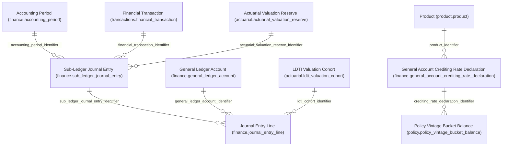

# L&A Ontology Knowledge Framework (OKF) -- Domain 7: Finance (Insurance Sub-Ledger, General Ledger & Crediting Declarations)

| OKF Metadata Attribute | Value |
| :--- | :--- |
| **OKF Catalog Document** | `L&A OKF/07 - OKF - Finance.MD` |
| **Enterprise Data Domain** | **Domain 7: Finance (Insurance Sub-Ledger, General Ledger & Crediting Declarations)** |
| **Target Physical Database Engine** | Amazon RDS Aurora PostgreSQL (PostgreSQL 15/16 Compatible) |
| **Physical Database Schema** | `finance` |
| **Domain Table Count** | **5 Physical Tables / Logical Entities** |
| **Outbound Foreign Key Joins** | **7 Foreign Key Relationships** (Intra-Domain & Cross-Domain) |
| **Inbound Foreign Key Joins** | **10 Cross-Domain Referencing Relationships** |
| **Performance Indexes** | **7 B-Tree & Composite Indexes** |
| **Inherited Business Context Rules** | **`BC-121` through `BC-140` (20 Rules)** |
| **Source Knowledge Layer Artifacts** | `L&A - Ontology.MD`, `L&A Data Model - Logical.MD`, `L&A Data Model - Physical DDL.sql`, `L&A Data Model - Conceptual.MD` |

---

## 1. Domain Executive Ontology & Business Context Overview

The **Finance** domain serves as the enterprise accounting backbone and multi-basis financial reporting engine for the Life and Annuity organization, bridging granular policy administration transactions, actuarial reserve movements, reinsurance settlements, and general account investment returns into auditable financial statements. Unlike standard corporate enterprises that maintain a single accounting book, a US Life and Annuity insurance group must simultaneously maintain and reconcile three distinct regulatory accounting bases (`Accounting Basis`): **US GAAP** (governed by FASB ASC 944, including Long-Duration Targeted Improvements [LDTI] for public/GAAP filers), **Statutory Accounting Principles (SAP)** (governed by the NAIC Accounting Practices and Procedures Manual and reported on the quarterly/annual NAIC "Blue Book" statement to state insurance commissioners, with major New York-domiciled carriers publishing audited statutory financial statements under NY DFS oversight), and **US Federal Income Tax Accounting** (governed by Internal Revenue Code Subchapter L, Sections 801–818). The Finance domain is modeled across five core entities: `General Ledger Account`, `Accounting Period`, `Sub-Ledger Journal Entry`, `Journal Entry Line`, and `General Account Crediting Rate Declaration`.

`General Ledger Account` (`General Ledger Account Identifier`, `GL Account Number`, `GL Account Name`) defines the enterprise Chart of Accounts across `Account Classification` (`Asset`, `Liability`, `Policyholder Surplus / Equity`, `Revenue`, `Expense`, `Contra-Asset / Valuation Allowance`), while strictly segregating balance sheets via `Separate vs General Account Ledger Code` (`General Account Ledger`, `Separate Account Ledger`, `Corporate Holding Ledger`) so that insulated Separate Account assets and liabilities (e.g., CREF or variable sub-accounts) are never commingled with the carrier's General Account backing fixed guarantees. `Accounting Period` (`Accounting Period Identifier`, `Fiscal Year`, `Fiscal Month or Quarter`, `Period Close Status`) enforces SOX financial close cutoffs across open, soft-close (actuarial adjustment only), and hard-closed periods.

Whenever a policy transaction occurs in `Financial Transaction` or a valuation run completes in `Actuarial Valuation Reserve`, the insurance sub-ledger accounting rules engine generates a `Sub-Ledger Journal Entry` (`Sub-Ledger Journal Entry Identifier`, `Journal Entry Number`, `Accounting Event Type`) containing balanced debit and credit rows in `Journal Entry Line` (`Debit Amount`, `Credit Amount`). Each journal line maps directly to a `General Ledger Account Identifier`, an optional GAAP `LDTI Cohort Identifier` for ASC 944 roll-forward disclosures, and a `Statutory Annual Statement Line Reference` (e.g., Summary of Operations Page 4 Line 1, Exhibit 5 Aggregate Reserves, or Exhibit 8 Claim Liabilities). Additionally, `General Account Crediting Rate Declaration` records Board-approved interest crediting schedules (`Guaranteed Base Interest Rate` plus `Additional Declared Dividend or Excess Interest Rate` equaling `Total Effective Crediting Rate`) for each product and vintage period, governing how general account portfolio investment income is shared with policyholders. AI agents building financial P&L, balance sheet, or statutory audit products must always filter by `Accounting Basis` and ensure total debits equal total credits across every journal entry.

---

## 2. Physical Schema & Logical Entity Architecture Catalog (Schema: `finance`)

| # | Logical Entity Name | Physical Table Name (`schema.table`) | Primary Key Column (`PK`) | Business Cols | Audit Cols | Constraints (`PK`/`UQ`/`CHK`) | Logical Entity & Physical Table Definition |
| :--- | :--- | :--- | :--- | :--- | :--- | :--- | :--- |
| **7.1** | **General Ledger Account** | `finance.general_ledger_account` | `general_ledger_account_identifier` | 6 | 2 | `pk_general_ledger_account`, `uq_gl_account_number` | General Ledger Account entity defines the enterprise insurance Chart of Accounts used to classify assets, liabilities, policyholder surplus, revenues, and expenses across US GAAP, Statutory (NAIC Blue Book), and Tax accounting bases for both the General Account and Separate Accounts. |
| **7.2** | **Accounting Period** | `finance.accounting_period` | `accounting_period_identifier` | 6 | 2 | `pk_accounting_period`, `uq_accounting_period_year_month`, `chk_accounting_period_dates` | Accounting Period entity controls the financial reporting calendar (fiscal months, quarters, and years) and ledger close lifecycle across GAAP and Statutory books, ensuring sub-ledger entries are posted to open and auditable valuation periods. |
| **7.3** | **Sub-Ledger Journal Entry** | `finance.sub_ledger_journal_entry` | `sub_ledger_journal_entry_identifier` | 10 | 2 | `pk_sub_ledger_journal_entry`, `uq_sub_ledger_je_number` | Sub-Ledger Journal Entry entity captures the accounting header generated by policy administration transactions, actuarial reserve movements, reinsurance settlements, or investment income accruals prior to summarization and posting into the enterprise General Ledger. |
| **7.4** | **Journal Entry Line** | `finance.journal_entry_line` | `journal_entry_line_identifier` | 9 | 2 | `pk_journal_entry_line`, `uq_je_line_seq`, `chk_je_debit_credit_non_neg` | Journal Entry Line entity holds the individual balanced debit and credit monetary lines belonging to a Sub-Ledger Journal Entry, linking each line to a specific General Ledger Account, Statutory Annual Statement line reference, and GAAP LDTI valuation cohort. |
| **7.5** | **General Account Crediting Rate Declaration** | `finance.general_account_crediting_rate_declaration` | `crediting_rate_declaration_identifier` | 9 | 2 | `pk_ga_crediting_rate_declaration`, `uq_ga_crd_prod_vintage_date` | General Account Crediting Rate Declaration entity records the Board-approved interest rates declared for fixed and general account products (such as general account contribution vintages), separating the contractual guaranteed floor rate from additional declared dividend or excess interest rates. |

---

## 3. Relational Join Mining & Foreign Key Topology

### 3.1 Entity-Relationship & Foreign Key Join Diagram (Mermaid)



### 3.2 Outbound Foreign Key Join Matrix (Tables in `finance` Referencing Parent Entities)

| FK Constraint Name | Child Table (`finance`) | Child FK Column | Join Scope | Parent Referenced Table | Parent PK Column | Referential Action | Exact SQL Join Predicate |
| :--- | :--- | :--- | :--- | :--- | :--- | :--- | :--- |
| `fk_slje_accounting_period` | `finance.sub_ledger_journal_entry` | `accounting_period_identifier` | Intra-Domain | `finance.accounting_period` | `accounting_period_identifier` | `ON UPDATE CASCADE ON DELETE RESTRICT` | `finance.sub_ledger_journal_entry.accounting_period_identifier = finance.accounting_period.accounting_period_identifier` |
| `fk_slje_financial_transaction` | `finance.sub_ledger_journal_entry` | `financial_transaction_identifier` | Cross-Domain (`transactions`) | `transactions.financial_transaction` | `financial_transaction_identifier` | `ON UPDATE CASCADE ON DELETE SET NULL` | `finance.sub_ledger_journal_entry.financial_transaction_identifier = transactions.financial_transaction.financial_transaction_identifier` |
| `fk_slje_actuarial_reserve` | `finance.sub_ledger_journal_entry` | `actuarial_valuation_reserve_identifier` | Cross-Domain (`actuarial`) | `actuarial.actuarial_valuation_reserve` | `actuarial_valuation_reserve_identifier` | `ON UPDATE CASCADE ON DELETE SET NULL` | `finance.sub_ledger_journal_entry.actuarial_valuation_reserve_identifier = actuarial.actuarial_valuation_reserve.actuarial_valuation_reserve_identifier` |
| `fk_jel_journal_entry` | `finance.journal_entry_line` | `sub_ledger_journal_entry_identifier` | Intra-Domain | `finance.sub_ledger_journal_entry` | `sub_ledger_journal_entry_identifier` | `ON UPDATE CASCADE ON DELETE CASCADE` | `finance.journal_entry_line.sub_ledger_journal_entry_identifier = finance.sub_ledger_journal_entry.sub_ledger_journal_entry_identifier` |
| `fk_jel_gl_account` | `finance.journal_entry_line` | `general_ledger_account_identifier` | Intra-Domain | `finance.general_ledger_account` | `general_ledger_account_identifier` | `ON UPDATE CASCADE ON DELETE RESTRICT` | `finance.journal_entry_line.general_ledger_account_identifier = finance.general_ledger_account.general_ledger_account_identifier` |
| `fk_jel_ldti_cohort` | `finance.journal_entry_line` | `ldti_cohort_identifier` | Cross-Domain (`actuarial`) | `actuarial.ldti_valuation_cohort` | `ldti_cohort_identifier` | `ON UPDATE CASCADE ON DELETE SET NULL` | `finance.journal_entry_line.ldti_cohort_identifier = actuarial.ldti_valuation_cohort.ldti_cohort_identifier` |
| `fk_gacrd_product` | `finance.general_account_crediting_rate_declaration` | `product_identifier` | Cross-Domain (`product`) | `product.product` | `product_identifier` | `ON UPDATE CASCADE ON DELETE RESTRICT` | `finance.general_account_crediting_rate_declaration.product_identifier = product.product.product_identifier` |

### 3.3 Inbound Cross-Domain Foreign Key Join Matrix (External Schemas Referencing `finance`)

| FK Constraint Name | Referencing Child Schema | Referencing Child Table | Child FK Column | Referenced Target Table (`finance`) | Target PK Column | Referential Action | Exact SQL Join Predicate |
| :--- | :--- | :--- | :--- | :--- | :--- | :--- | :--- |
| `fk_vintage_bucket_crediting_decl` | `policy` | `policy.policy_vintage_bucket_balance` | `crediting_rate_declaration_identifier` | `finance.general_account_crediting_rate_declaration` | `crediting_rate_declaration_identifier` | `ON UPDATE CASCADE ON DELETE SET NULL` | `policy.policy_vintage_bucket_balance.crediting_rate_declaration_identifier = finance.general_account_crediting_rate_declaration.crediting_rate_declaration_identifier` |

---

## 4. Detailed Table-by-Table Schema, Column Dictionary & DDL Constraints

### 4.1 Logical Entity: `General Ledger Account` <-> Physical Table: `finance.general_ledger_account`

- **Business & Technical Purpose**: General Ledger Account entity defines the enterprise insurance Chart of Accounts used to classify assets, liabilities, policyholder surplus, revenues, and expenses across US GAAP, Statutory (NAIC Blue Book), and Tax accounting bases for both the General Account and Separate Accounts.
- **PostgreSQL Catalog Comment**: _""_
- **Primary Key**: `general_ledger_account_identifier`

#### Attribute-to-Column Schema Mapping & Business Dictionary

| Ord | Logical Attribute Name | Physical Column Name | Logical Type | Physical PostgreSQL Type | Key | Column Modifiers / Default | Business Definition, Domain Semantics & Sample Values |
| :--- | :--- | :--- | :--- | :--- | :--- | :--- | :--- |
| **1** | **General Ledger Account Identifier** | `general_ledger_account_identifier` | String | `VARCHAR(64)` | **PK** | `NOT NULL` | Unique surrogate primary key identifying an account in the enterprise insurance Chart of Accounts. Sample values: `GLA-10100`, `GLA-21400`, `GLA-40100`. |
| **2** | **GL Account Number** | `gl_account_number` | String | `VARCHAR(50)` | **NK** | `NOT NULL` | Standardized numeric or alphanumeric general ledger account code used across ERP and financial reporting systems. Sample values: `101000-GA`, `214500-RES`, `401100-PREM`, `502300-SURR`, `290100-SEP`. |
| **3** | **GL Account Name** | `gl_account_name` | String | `VARCHAR(200)` | **NK** | `NOT NULL` | Business-friendly descriptive title of the general ledger account. Sample values: `Cash and Short-Term Investments - General Account`, `Future Policy Benefits Reserve - Annuity`, `Direct Premium & Annuity Considerations Revenue`, `Surrender Benefits Paid Expense`, `Separate Account Assets at Fair Value`. |
| **4** | **Account Classification** | `account_classification` | String | `VARCHAR(100)` | **NK** | `NOT NULL` | Fundamental financial statement classification of the ledger account. Sample values: `Asset`, `Liability`, `Policyholder Surplus / Equity`, `Revenue`, `Expense`, `Contra-Asset / Valuation Allowance`. |
| **5** | **Accounting Basis** | `accounting_basis` | String | `VARCHAR(100)` | **NK** | `NOT NULL` | Specifies which regulatory or financial accounting book this account belongs to (or whether it is shared across multi-book ledgers). Sample values: `Multi-Basis Core`, `US GAAP Only (ASC 944 / LDTI)`, `Statutory NAIC Only (SAP)`, `US Federal Tax Only`. |
| **6** | **Separate vs General Account Ledger Code** | `separate_vs_general_account_ledger_code` | String | `VARCHAR(100)` | **NK** | `NOT NULL` | Segregates general account balance sheet accounts from insulated Separate Account (e.g., CREF or variable sub-account) ledger accounts. Sample values: `General Account Ledger`, `Separate Account Ledger`, `Corporate Holding Ledger`. |
| **7** | **Record Created Timestamp (Audit)** | `created_at` | Timestamp | `TIMESTAMPTZ` | **AUDIT** | `NOT NULL DEFAULT CURRENT_TIMESTAMP` | System audit timestamp recording when the physical row was initially inserted into the Aurora PostgreSQL table. |
| **8** | **Record Updated Timestamp (Audit)** | `updated_at` | Timestamp | `TIMESTAMPTZ` | **AUDIT** | `NOT NULL DEFAULT CURRENT_TIMESTAMP` | System audit timestamp recording when the physical row was last modified in the Aurora PostgreSQL table. |

#### Declarative DDL Constraints & Indexes on `finance.general_ledger_account`

| Constraint / Index Category | Identifier Name | Definition / Target Columns & Referential Integrity Rule |
| :--- | :--- | :--- |
| **PRIMARY KEY** | `pk_general_ledger_account` | `PRIMARY KEY (general_ledger_account_identifier)` |
| **UNIQUE** | `uq_gl_account_number` | `UNIQUE (gl_account_number)` |

### 4.2 Logical Entity: `Accounting Period` <-> Physical Table: `finance.accounting_period`

- **Business & Technical Purpose**: Accounting Period entity controls the financial reporting calendar (fiscal months, quarters, and years) and ledger close lifecycle across GAAP and Statutory books, ensuring sub-ledger entries are posted to open and auditable valuation periods.
- **PostgreSQL Catalog Comment**: _""_
- **Primary Key**: `accounting_period_identifier`

#### Attribute-to-Column Schema Mapping & Business Dictionary

| Ord | Logical Attribute Name | Physical Column Name | Logical Type | Physical PostgreSQL Type | Key | Column Modifiers / Default | Business Definition, Domain Semantics & Sample Values |
| :--- | :--- | :--- | :--- | :--- | :--- | :--- | :--- |
| **1** | **Accounting Period Identifier** | `accounting_period_identifier` | String | `VARCHAR(64)` | **PK** | `NOT NULL` | Unique primary key identifying a specific fiscal month or reporting period in the financial calendar. Sample values: `PER-2026-M09`, `PER-2026-M10`. |
| **2** | **Fiscal Year** | `fiscal_year` | Integer | `INTEGER` | **NK** | `NOT NULL` | Four-digit calendar or fiscal year of the financial reporting period. Sample values: `2024`, `2025`, `2026`. |
| **3** | **Fiscal Month or Quarter** | `fiscal_month_or_quarter` | String | `VARCHAR(50)` | **NK** | `NOT NULL` | Standardized code identifying the specific month and quarter within the fiscal year. Sample values: `M09 / Q3`, `M10 / Q4`, `M12 / Q4 Year-End`. |
| **4** | **Period Start Date** | `period_start_date` | Date | `DATE` | **NK** | `NOT NULL` | First calendar date of the accounting period. Sample values: `2026-10-01`, `2026-09-01`. |
| **5** | **Period End Date** | `period_end_date` | Date | `DATE` | **NK** | `NOT NULL` | Last calendar date (balance sheet cutoff date) of the accounting period. Sample values: `2026-10-31`, `2026-09-30`. |
| **6** | **Period Close Status** | `period_close_status` | String | `VARCHAR(100)` | **NK** | `NOT NULL` | Controls whether automated sub-ledger feeds and manual journal adjustments can be posted to this period. Sample values: `Open for Posting`, `Soft Close - Actuarial & Adjustment Only`, `Hard Closed / Audited`, `Future Unopened Period`. |
| **7** | **Record Created Timestamp (Audit)** | `created_at` | Timestamp | `TIMESTAMPTZ` | **AUDIT** | `NOT NULL DEFAULT CURRENT_TIMESTAMP` | System audit timestamp recording when the physical row was initially inserted into the Aurora PostgreSQL table. |
| **8** | **Record Updated Timestamp (Audit)** | `updated_at` | Timestamp | `TIMESTAMPTZ` | **AUDIT** | `NOT NULL DEFAULT CURRENT_TIMESTAMP` | System audit timestamp recording when the physical row was last modified in the Aurora PostgreSQL table. |

#### Declarative DDL Constraints & Indexes on `finance.accounting_period`

| Constraint / Index Category | Identifier Name | Definition / Target Columns & Referential Integrity Rule |
| :--- | :--- | :--- |
| **PRIMARY KEY** | `pk_accounting_period` | `PRIMARY KEY (accounting_period_identifier)` |
| **UNIQUE** | `uq_accounting_period_year_month` | `UNIQUE (fiscal_year, fiscal_month_or_quarter)` |
| **CHECK** | `chk_accounting_period_dates` | `CHECK (period_end_date >= period_start_date)` |

### 4.3 Logical Entity: `Sub-Ledger Journal Entry` <-> Physical Table: `finance.sub_ledger_journal_entry`

- **Business & Technical Purpose**: Sub-Ledger Journal Entry entity captures the accounting header generated by policy administration transactions, actuarial reserve movements, reinsurance settlements, or investment income accruals prior to summarization and posting into the enterprise General Ledger.
- **PostgreSQL Catalog Comment**: _""_
- **Primary Key**: `sub_ledger_journal_entry_identifier`

#### Attribute-to-Column Schema Mapping & Business Dictionary

| Ord | Logical Attribute Name | Physical Column Name | Logical Type | Physical PostgreSQL Type | Key | Column Modifiers / Default | Business Definition, Domain Semantics & Sample Values |
| :--- | :--- | :--- | :--- | :--- | :--- | :--- | :--- |
| **1** | **Sub-Ledger Journal Entry Identifier** | `sub_ledger_journal_entry_identifier` | String | `VARCHAR(64)` | **PK** | `NOT NULL` | Unique primary key identifying an insurance sub-ledger accounting journal header. Sample values: `SLJE-20261021-884910`, `SLJE-20260930-991024`. |
| **2** | **Accounting Period Identifier** | `accounting_period_identifier` | String | `VARCHAR(64)` | **FK** | `NOT NULL` | Foreign key linking the journal entry to the open Accounting Period in which it is recognized. Sample values: `PER-2026-M10`. |
| **3** | **Financial Transaction Identifier** | `financial_transaction_identifier` | String | `VARCHAR(64)` | **FK** | `NULL` | Optional foreign key linking the sub-ledger journal entry back to the originating policy Financial Transaction (null if generated by an actuarial reserve valuation run). Sample values: `FTX-99000101`, `Null (Actuarial Reserve Valuation Entry)`. |
| **4** | **Actuarial Valuation Reserve Identifier** | `actuarial_valuation_reserve_identifier` | String | `VARCHAR(64)` | **FK** | `NULL` | Optional foreign key linking reserve-change journal entries to the originating Actuarial Valuation Reserve record. Sample values: `AVR-202609-00192`, `Null (Policy Cash Transaction Entry)`. |
| **5** | **Journal Entry Number** | `journal_entry_number` | String | `VARCHAR(64)` | **NK** | `NOT NULL` | Business-facing document reference number used by insurance accounting and external auditors to trace the journal entry. Sample values: `JE-PAS-202610-049182`, `JE-ACT-202609-001042`. |
| **6** | **Accounting Event Type** | `accounting_event_type` | String | `VARCHAR(120)` | **NK** | `NOT NULL` | Classifies the business event that triggered the accounting entry rules. Sample values: `Premium & Contribution Recognition`, `Surrender Benefit Expense`, `Annuity Income Benefit Payout`, `Death Claim Incurred Expense`, `Actuarial Reserve Change Movement`, `General Account Interest Credited`, `Producer Commission Expense Accrual`, `Rider Fee & M&E Revenue Recognition`, `DAC Capitalization & Amortization`. |
| **7** | **Posting Date** | `posting_date` | Date | `DATE` | **NK** | `NOT NULL` | System date on which the sub-ledger journal entry was posted and transmitted to the General Ledger. Sample values: `2026-10-21`, `2026-09-30`. |
| **8** | **Effective Accounting Date** | `effective_accounting_date` | Date | `DATE` | **NK** | `NOT NULL` | Economic effective date of the underlying transaction or valuation event for accrual accounting purposes. Sample values: `2026-10-15`, `2026-09-30`. |
| **9** | **Accounting Basis** | `accounting_basis` | String | `VARCHAR(64)` | **NK** | `NOT NULL` | Specifies the accounting book to which this specific journal entry applies. Sample values: `US GAAP (LDTI)`, `Statutory NAIC (SAP)`, `US Tax`. |
| **10** | **Legal Entity Name** | `legal_entity_name` | String | `VARCHAR(200)` | **NK** | `NOT NULL` | Statutory legal insurance company entity on whose books the journal entry is recorded. Sample values: `Primary Life & Annuity Insurance Company`, `Institutional Variable Annuity Separate Account Corp`, `Companion Life Insurance Company`. |
| **11** | **Record Created Timestamp (Audit)** | `created_at` | Timestamp | `TIMESTAMPTZ` | **AUDIT** | `NOT NULL DEFAULT CURRENT_TIMESTAMP` | System audit timestamp recording when the physical row was initially inserted into the Aurora PostgreSQL table. |
| **12** | **Record Updated Timestamp (Audit)** | `updated_at` | Timestamp | `TIMESTAMPTZ` | **AUDIT** | `NOT NULL DEFAULT CURRENT_TIMESTAMP` | System audit timestamp recording when the physical row was last modified in the Aurora PostgreSQL table. |

#### Declarative DDL Constraints & Indexes on `finance.sub_ledger_journal_entry`

| Constraint / Index Category | Identifier Name | Definition / Target Columns & Referential Integrity Rule |
| :--- | :--- | :--- |
| **PRIMARY KEY** | `pk_sub_ledger_journal_entry` | `PRIMARY KEY (sub_ledger_journal_entry_identifier)` |
| **UNIQUE** | `uq_sub_ledger_je_number` | `UNIQUE (journal_entry_number)` |
| **FOREIGN KEY** | `fk_slje_accounting_period` | `FOREIGN KEY (accounting_period_identifier) REFERENCES finance.accounting_period (accounting_period_identifier) ON UPDATE CASCADE ON DELETE RESTRICT` |
| **FOREIGN KEY** | `fk_slje_financial_transaction` | `FOREIGN KEY (financial_transaction_identifier) REFERENCES transactions.financial_transaction (financial_transaction_identifier) ON UPDATE CASCADE ON DELETE SET NULL` |
| **FOREIGN KEY** | `fk_slje_actuarial_reserve` | `FOREIGN KEY (actuarial_valuation_reserve_identifier) REFERENCES actuarial.actuarial_valuation_reserve (actuarial_valuation_reserve_identifier) ON UPDATE CASCADE ON DELETE SET NULL` |
| **B-TREE INDEX** | `idx_slje_period_basis` | `ON finance.sub_ledger_journal_entry (accounting_period_identifier, accounting_basis)` |
| **B-TREE INDEX** | `idx_slje_fin_tx_id` | `ON finance.sub_ledger_journal_entry (financial_transaction_identifier)` |
| **B-TREE INDEX** | `idx_slje_act_res_id` | `ON finance.sub_ledger_journal_entry (actuarial_valuation_reserve_identifier)` |

### 4.4 Logical Entity: `Journal Entry Line` <-> Physical Table: `finance.journal_entry_line`

- **Business & Technical Purpose**: Journal Entry Line entity holds the individual balanced debit and credit monetary lines belonging to a Sub-Ledger Journal Entry, linking each line to a specific General Ledger Account, Statutory Annual Statement line reference, and GAAP LDTI valuation cohort.
- **PostgreSQL Catalog Comment**: _""_
- **Primary Key**: `journal_entry_line_identifier`

#### Attribute-to-Column Schema Mapping & Business Dictionary

| Ord | Logical Attribute Name | Physical Column Name | Logical Type | Physical PostgreSQL Type | Key | Column Modifiers / Default | Business Definition, Domain Semantics & Sample Values |
| :--- | :--- | :--- | :--- | :--- | :--- | :--- | :--- |
| **1** | **Journal Entry Line Identifier** | `journal_entry_line_identifier` | String | `VARCHAR(64)` | **PK** | `NOT NULL` | Unique primary key identifying an individual debit or credit line item within a Sub-Ledger Journal Entry. Sample values: `JEL-50000101`, `JEL-50000102`. |
| **2** | **Sub-Ledger Journal Entry Identifier** | `sub_ledger_journal_entry_identifier` | String | `VARCHAR(64)` | **FK** | `NOT NULL` | Foreign key linking the debit/credit line item to its parent Sub-Ledger Journal Entry header. Sample values: `SLJE-20261021-884910`. |
| **3** | **General Ledger Account Identifier** | `general_ledger_account_identifier` | String | `VARCHAR(64)` | **FK** | `NOT NULL` | Foreign key linking the journal line to the target General Ledger Account being debited or credited. Sample values: `GLA-10100`, `GLA-40100`. |
| **4** | **LDTI Cohort Identifier** | `ldti_cohort_identifier` | String | `VARCHAR(64)` | **FK** | `NULL` | Optional foreign key linking US GAAP journal lines to the specific LDTI Valuation Cohort for ASC 944 roll-forward disclosures. Sample values: `LDTI-VA-2022`, `LDTI-FA-2019`, `Null (Non-LDTI Line)`. |
| **5** | **Line Sequence Number** | `line_sequence_number` | Integer | `INTEGER` | **NK** | `NOT NULL` | Sequential integer numbering the lines within a single journal entry (1, 2, 3, etc.). Sample values: `1`, `2`, `3`, `4`. |
| **6** | **Debit Amount** | `debit_amount` | Decimal | `NUMERIC(18,2)` | **NK** | `NOT NULL DEFAULT 0.00` | Dollar amount debited to the specified General Ledger Account on this line (0.00 if the line is a credit). Sample values: `1500.00`, `50000.00`, `0.00`. |
| **7** | **Credit Amount** | `credit_amount` | Decimal | `NUMERIC(18,2)` | **NK** | `NOT NULL DEFAULT 0.00` | Dollar amount credited to the specified General Ledger Account on this line (0.00 if the line is a debit; total debits must equal total credits per journal entry). Sample values: `0.00`, `1500.00`, `50000.00`. |
| **8** | **Currency Code** | `currency_code` | String | `CHAR(3)` | **NK** | `NOT NULL DEFAULT 'USD'` | Three-letter ISO 4217 currency code of the monetary amounts on the journal line. Sample values: `USD`, `CAD`. |
| **9** | **Statutory Annual Statement Line Reference** | `statutory_annual_statement_line_reference` | String | `VARCHAR(200)` | **NK** | `NULL` | Maps the journal line directly to the NAIC Life & Accident & Health Annual Statement ("Blue Book") Exhibit, Page, and Line number for automated statutory reporting. Sample values: `Summary of Operations - Page 4, Line 1 (Premiums and Annuity Considerations)`, `Exhibit 5 - Aggregate Reserve for Life Contracts`, `Exhibit 8 - Claim Liabilities`. |
| **10** | **Record Created Timestamp (Audit)** | `created_at` | Timestamp | `TIMESTAMPTZ` | **AUDIT** | `NOT NULL DEFAULT CURRENT_TIMESTAMP` | System audit timestamp recording when the physical row was initially inserted into the Aurora PostgreSQL table. |
| **11** | **Record Updated Timestamp (Audit)** | `updated_at` | Timestamp | `TIMESTAMPTZ` | **AUDIT** | `NOT NULL DEFAULT CURRENT_TIMESTAMP` | System audit timestamp recording when the physical row was last modified in the Aurora PostgreSQL table. |

#### Declarative DDL Constraints & Indexes on `finance.journal_entry_line`

| Constraint / Index Category | Identifier Name | Definition / Target Columns & Referential Integrity Rule |
| :--- | :--- | :--- |
| **PRIMARY KEY** | `pk_journal_entry_line` | `PRIMARY KEY (journal_entry_line_identifier)` |
| **UNIQUE** | `uq_je_line_seq` | `UNIQUE (sub_ledger_journal_entry_identifier, line_sequence_number)` |
| **CHECK** | `chk_je_debit_credit_non_neg` | `CHECK (debit_amount >= 0 AND credit_amount >= 0)` |
| **FOREIGN KEY** | `fk_jel_journal_entry` | `FOREIGN KEY (sub_ledger_journal_entry_identifier) REFERENCES finance.sub_ledger_journal_entry (sub_ledger_journal_entry_identifier) ON UPDATE CASCADE ON DELETE CASCADE` |
| **FOREIGN KEY** | `fk_jel_gl_account` | `FOREIGN KEY (general_ledger_account_identifier) REFERENCES finance.general_ledger_account (general_ledger_account_identifier) ON UPDATE CASCADE ON DELETE RESTRICT` |
| **FOREIGN KEY** | `fk_jel_ldti_cohort` | `FOREIGN KEY (ldti_cohort_identifier) REFERENCES actuarial.ldti_valuation_cohort (ldti_cohort_identifier) ON UPDATE CASCADE ON DELETE SET NULL` |
| **B-TREE INDEX** | `idx_jel_slje_id` | `ON finance.journal_entry_line (sub_ledger_journal_entry_identifier)` |
| **B-TREE INDEX** | `idx_jel_gl_acct_id` | `ON finance.journal_entry_line (general_ledger_account_identifier)` |
| **B-TREE INDEX** | `idx_jel_ldti_cohort_id` | `ON finance.journal_entry_line (ldti_cohort_identifier)` |

### 4.5 Logical Entity: `General Account Crediting Rate Declaration` <-> Physical Table: `finance.general_account_crediting_rate_declaration`

- **Business & Technical Purpose**: General Account Crediting Rate Declaration entity records the Board-approved interest rates declared for fixed and general account products (such as general account contribution vintages), separating the contractual guaranteed floor rate from additional declared dividend or excess interest rates.
- **PostgreSQL Catalog Comment**: _""_
- **Primary Key**: `crediting_rate_declaration_identifier`

#### Attribute-to-Column Schema Mapping & Business Dictionary

| Ord | Logical Attribute Name | Physical Column Name | Logical Type | Physical PostgreSQL Type | Key | Column Modifiers / Default | Business Definition, Domain Semantics & Sample Values |
| :--- | :--- | :--- | :--- | :--- | :--- | :--- | :--- |
| **1** | **Crediting Rate Declaration Identifier** | `crediting_rate_declaration_identifier` | String | `VARCHAR(64)` | **PK** | `NOT NULL` | Unique primary key identifying a Board-approved interest crediting rate schedule for a general account product and vintage. Sample values: `CRD-2026-V2024Q1`, `CRD-2026-V2026M03`. |
| **2** | **Product Identifier** | `product_identifier` | String | `VARCHAR(64)` | **FK** | `NOT NULL` | Foreign key linking the declared crediting rate to the specific fixed or general account Product (such as participating general account fixed contracts RA, GRA, or RC). Sample values: `PROD-GA-RA-01`, `PROD-GA-GRA-01`. |
| **3** | **Declaration Effective Date** | `declaration_effective_date` | Date | `DATE` | **NK** | `NOT NULL` | Calendar date on which the declared crediting rate takes effect for policy interest accruals (e.g., March 1 annual dividend year start or monthly new-money reset). Sample values: `2026-03-01`, `2026-10-01`. |
| **4** | **Product Code** | `product_code` | String | `VARCHAR(32)` | **NK** | `NOT NULL` | Business-facing product code to which the crediting rate schedule applies. Sample values: `GA-RA`, `GA-GRA`, `GA-RC`, `GA-GSRA`. |
| **5** | **Vintage Period Identifier** | `vintage_period_identifier` | String | `VARCHAR(64)` | **NK** | `NOT NULL` | Identifies the specific contribution vintage bucket to which this declared rate applies. Sample values: `VINT-2024-Q1`, `VINT-2026-M03`, `VINT-LEGACY-PRE1995`. |
| **6** | **Guaranteed Base Interest Rate** | `guaranteed_base_interest_rate` | Decimal | `NUMERIC(9,6)` | **NK** | `NOT NULL` | Contractual minimum guaranteed annual interest rate component for that product and vintage. Sample values: `0.0300` (3.00%), `0.0200` (2.00%), `0.0100` (1.00%). |
| **7** | **Additional Declared Dividend or Excess Interest Rate** | `additional_declared_dividend_or_excess_rate` | Decimal | `NUMERIC(9,6)` | **NK** | `NOT NULL DEFAULT 0.000000` | Discretionary additional annual interest rate declared by the Board of Trustees above the contractual guaranteed base rate based on General Account investment portfolio yields. Sample values: `0.0225` (2.25%), `0.0325` (3.25%), `0.0150` (1.50%). |
| **8** | **Total Effective Crediting Rate** | `total_effective_crediting_rate` | Decimal | `NUMERIC(9,6)` | **NK** | `NOT NULL` | Combined annual effective interest rate credited to policyholder vintage balances (Guaranteed Base Rate plus Additional Declared Rate). Sample values: `0.0525` (5.25%), `0.0550` (5.50%), `0.0450` (4.50%). |
| **9** | **Board Approval Date** | `board_approval_date` | Date | `DATE` | **NK** | `NOT NULL` | Date on which the Board of Trustees or Asset-Liability Management (ALM) Committee formally approved the crediting rate declaration. Sample values: `2026-02-15`, `2026-09-20`. |
| **10** | **Record Created Timestamp (Audit)** | `created_at` | Timestamp | `TIMESTAMPTZ` | **AUDIT** | `NOT NULL DEFAULT CURRENT_TIMESTAMP` | System audit timestamp recording when the physical row was initially inserted into the Aurora PostgreSQL table. |
| **11** | **Record Updated Timestamp (Audit)** | `updated_at` | Timestamp | `TIMESTAMPTZ` | **AUDIT** | `NOT NULL DEFAULT CURRENT_TIMESTAMP` | System audit timestamp recording when the physical row was last modified in the Aurora PostgreSQL table. |

#### Declarative DDL Constraints & Indexes on `finance.general_account_crediting_rate_declaration`

| Constraint / Index Category | Identifier Name | Definition / Target Columns & Referential Integrity Rule |
| :--- | :--- | :--- |
| **PRIMARY KEY** | `pk_ga_crediting_rate_declaration` | `PRIMARY KEY (crediting_rate_declaration_identifier)` |
| **UNIQUE** | `uq_ga_crd_prod_vintage_date` | `UNIQUE (product_identifier, vintage_period_identifier, declaration_effective_date)` |
| **FOREIGN KEY** | `fk_gacrd_product` | `FOREIGN KEY (product_identifier) REFERENCES product.product (product_identifier) ON UPDATE CASCADE ON DELETE RESTRICT` |
| **B-TREE INDEX** | `idx_gacrd_product_vintage` | `ON finance.general_account_crediting_rate_declaration (product_identifier, vintage_period_identifier, declaration_effective_date DESC)` |

---

## 5. Inherited Business Context Ontology Rules (`BC-121` to `BC-140`)

> **Semantic Inheritance Notice**: The following **20 Business Context rules** are inherited verbatim from `L&A Data Domain/L&A - Ontology.MD` to provide autonomous AI agents, data engineers, and actuaries with complete domain rules, accounting identities, statutory compliance mandates, and SQL join guardrails for the **Finance** domain.

#### BC-121: Multi-Basis Insurance Accounting Segregation and Parallel Ledger Architecture

**Domains**: Finance | **Entities**: `General Ledger Account`, `Sub-Ledger Journal Entry`, `Journal Entry Line` | **Key Attributes**: `Accounting Basis`, `Debit Amount`, `Credit Amount`, `General Ledger Account Identifier`, `Sub-Ledger Journal Entry Identifier`

Life and annuity insurance carriers operate under a simultaneous multi-book accounting paradigm in which the exact same economic event—such as receiving a `$100,000` fixed annuity contribution, paying a death claim, or revaluing policy reserves—generates fundamentally different accounting entries depending on the regulatory regime. Within the Finance domain, both `General Ledger Account` and `Sub-Ledger Journal Entry` carry an explicit `Accounting Basis` attribute. On `Sub-Ledger Journal Entry`, `Accounting Basis` identifies the specific valuation book of the entry: `US GAAP (LDTI)` for public financial reporting under FASB ASC 944 Long-Duration Targeted Improvements, `Statutory NAIC (SAP)` for state Department of Insurance solvency reporting under Statutory Accounting Principles, or `US Tax` for federal income tax returns under Internal Revenue Code Subchapter L (Sections 801–818). On `General Ledger Account`, `Accounting Basis` indicates whether an account is shared across books (`Multi-Basis Core`, such as cash clearing accounts) or restricted to a single regime (`US GAAP Only (ASC 944 / LDTI)`, `Statutory NAIC Only (SAP)`, or `US Federal Tax Only`).

Because every policy transaction or reserve movement is posted concurrently to each applicable book, summing `Debit Amount` or `Credit Amount` across `Journal Entry Line` records without filtering on `Sub-Ledger Journal Entry.Accounting Basis` results in catastrophic double- or triple-counting of financial activity. For example, a single annuity reserve valuation run creates one `Sub-Ledger Journal Entry` for `US GAAP (LDTI)`, a second for `Statutory NAIC (SAP)`, and a third for `US Tax`, each holding hundreds of millions of dollars in reserve adjustments.

AI agents and semantic data products querying `Sub-Ledger Journal Entry` and `Journal Entry Line` must treat `Sub-Ledger Journal Entry.Accounting Basis` as a mandatory partition key on every aggregation, trial balance, income statement, or balance sheet query. No SQL query, metric view, or BI visualization may ever aggregate `Debit Amount` or `Credit Amount` across multiple `Accounting Basis` values unless it is explicitly pivoted side-by-side by `Accounting Basis` for cross-book GAAP-to-Statutory reconciliation.

#### BC-122: Double-Entry Balanced Journal Invariant and Line-Level Sign Convention

**Domains**: Finance | **Entities**: `Sub-Ledger Journal Entry`, `Journal Entry Line`, `General Ledger Account` | **Key Attributes**: `Sub-Ledger Journal Entry Identifier`, `Journal Entry Line Identifier`, `Line Sequence Number`, `Debit Amount`, `Credit Amount`, `Account Classification`

The foundational mathematical law of the insurance sub-ledger is the double-entry balance invariant: for every parent `Sub-Ledger Journal Entry` record (identified by `Sub-Ledger Journal Entry Identifier`), the sum of `Debit Amount` across all child `Journal Entry Line` records must equal the sum of `Credit Amount` to the exact cent ($\sum \text{Debit Amount} = \sum \text{Credit Amount}$), partitioned by `Currency Code`. Furthermore, each individual `Journal Entry Line` (ordered by `Line Sequence Number` $1, 2, \dots, n$) is strictly one-sided and non-negative: if a line is a debit entry, `Debit Amount` $> 0.00$ and `Credit Amount` $= 0.00$; if a line is a credit entry, `Credit Amount` $> 0.00$ and `Debit Amount` $= 0.00$ (with reversal adjustments represented by swapping the debit and credit lines rather than posting negative numbers).

Understanding how `Debit Amount` and `Credit Amount` affect financial statement balances requires inspecting `Account Classification` on the linked `General Ledger Account`. In insurance accounting, accounts classified as `Asset` (e.g., `Cash and Short-Term Investments - General Account`, `Separate Account Assets at Fair Value`) or `Expense` (e.g., `Surrender Benefits Paid Expense`, `Death Claim Incurred Expense`) have a normal debit balance, meaning their net balance equals $\sum \text{Debit Amount} - \sum \text{Credit Amount}$. Conversely, accounts classified as `Liability` (e.g., `Future Policy Benefits Reserve - Annuity`), `Policyholder Surplus / Equity`, `Revenue` (e.g., `Direct Premium & Annuity Considerations Revenue`), or `Contra-Asset / Valuation Allowance` have a normal credit balance, meaning their net balance equals $\sum \text{Credit Amount} - \sum \text{Debit Amount}$.

When building financial reporting pipelines or answering executive queries about account balances, AI agents must first verify the normal balance polarity via `General Ledger Account.Account Classification` before computing net activity. Additionally, automated data quality checks generated by AI engineering agents must assert $\sum \text{Debit Amount} - \sum \text{Credit Amount} = 0.00$ grouped by `Sub-Ledger Journal Entry Identifier` and reject any unbalanced header before General Ledger transmission.

#### BC-123: Dual-Trigger Sub-Ledger Architecture: Policy Cash Events vs. Actuarial Reserve Movement Valuation Entries

**Domains**: Finance, Operations, Actuarial | **Entities**: `Sub-Ledger Journal Entry`, `Financial Transaction`, `Actuarial Valuation Reserve` | **Key Attributes**: `Sub-Ledger Journal Entry Identifier`, `Financial Transaction Identifier`, `Actuarial Valuation Reserve Identifier`, `Accounting Event Type`, `Journal Entry Number`

An enterprise Life & Annuity insurance sub-ledger receives accounting events from two distinct operational engines, reflected in the mutually exclusive foreign key design on `Sub-Ledger Journal Entry`: `Financial Transaction Identifier` and `Actuarial Valuation Reserve Identifier`. The first trigger source is the Policy Administration System (PAS) and Claims engine (Domain 4), which generates daily policy-level cash and benefit events such as premium collections, partial withdrawals, full surrenders, annuity income payouts, death claim settlements, and daily interest crediting. For these operational events, `Sub-Ledger Journal Entry.Financial Transaction Identifier` is populated with the originating `Financial Transaction` key (e.g., `FTX-99000101`), `Journal Entry Number` carries a PAS prefix (e.g., `JE-PAS-202610-049182`), and `Actuarial Valuation Reserve Identifier` is `Null (Policy Cash Transaction Entry)`.

The second trigger source is the quarterly or monthly Actuarial Valuation engine (Domain 9), which computes period-end balance sheet liabilities (`Future Policy Benefit Reserve Amount`, `Additional Actuarial Reserve (AAR) Amount`, and `Market Risk Benefit (MRB) Fair Value`) and posts the net reserve change movement ($\Delta \text{Reserve} = \text{Ending Reserve} - \text{Beginning Reserve}$) to the income statement and balance sheet. For these valuation entries, `Actuarial Valuation Reserve Identifier` is populated with the originating `Actuarial Valuation Reserve` key (e.g., `AVR-202609-00192`), `Journal Entry Number` carries an actuarial prefix (e.g., `JE-ACT-202609-001042`), `Accounting Event Type` is set to `Actuarial Reserve Change Movement` or `DAC Capitalization & Amortization`, and `Financial Transaction Identifier` is `Null (Actuarial Reserve Valuation Entry)`.

AI agents performing drill-down lineage from the General Ledger back to policy-level drivers must never use an `INNER JOIN` between `Sub-Ledger Journal Entry` and `Financial Transaction`, as doing so silently drops 100% of actuarial reserve movement and DAC valuation entries—which often represent the largest single items on an insurer's income statement and balance sheet. Agents must always use `LEFT OUTER JOIN` to both `Financial Transaction` and `Actuarial Valuation Reserve` and branch drill-through logic based on `Accounting Event Type`.

#### BC-124: Structural Insulation Between General Account Ledger and Separate Account Ledger

**Domains**: Finance, Product | **Entities**: `General Ledger Account`, `Sub-Ledger Journal Entry`, `Journal Entry Line` | **Key Attributes**: `Separate vs General Account Ledger Code`, `GL Account Number`, `GL Account Name`, `Account Classification`

In US life and annuity insurance, assets backing fixed guarantees are held in the carrier's General Account, whereas assets backing variable annuities, variable universal life, and institutional variable retirement annuities (such as CREF variable equity and bond sub-accounts) are held in legally insulated Separate Accounts under state insurance law and the Investment Company Act of 1940. On `General Ledger Account`, the attribute `Separate vs General Account Ledger Code` enforces this legal boundary by classifying every account into `General Account Ledger`, `Separate Account Ledger`, or `Corporate Holding Ledger`.

In the `General Account Ledger` (indicated by `GL Account Number` suffixes like `-GA` or `-RES`), the insurance company bears the investment and credit risk; assets are carried primarily at amortized cost under Statutory SAP or fair value/amortized cost under GAAP, and liabilities represent contractual reserves (`Future Policy Benefits Reserve - Annuity`). In contrast, in the `Separate Account Ledger` (indicated by `GL Account Number` suffixes like `-SEP`, such as `290100-SEP` for `Separate Account Assets at Fair Value`), the policyholder bears 100% of the market investment risk, and Separate Account assets are legally insulated from the general creditors of the insurance carrier in the event of insolvency. Consequently, Separate Account assets and Separate Account liabilities always balance independently at fair market value, except for seed money or accrued Mortality & Expense (M&E) and rider fee transfers due to the General Account.

When an AI agent generates balance sheet reports, investment yield analyses, or statutory solvency metrics, it must filter or group `General Ledger Account` by `Separate vs General Account Ledger Code`. Mixing `Separate Account Ledger` fair-value market fluctuations into `General Account Ledger` net investment income or general account reserve leverage ratios corrupts Asset-Liability Management (ALM) spread metrics and misstates the carrier's general account credit exposure.

#### BC-125: Multi-Company Statutory Legal Entity Segregation Across the carrier, CREF, and Subsidiary Insurers

**Domains**: Finance, Product | **Entities**: `Sub-Ledger Journal Entry`, `Journal Entry Line`, `General Ledger Account` | **Key Attributes**: `Legal Entity Name`, `Accounting Basis`, `Sub-Ledger Journal Entry Identifier`, `Separate vs General Account Ledger Code`

Large retirement and life insurance groups execute customer transactions across multiple distinct legal entities that share a unified customer experience and Policy Administration System. For example, a higher-education faculty member's retirement portfolio may allocate 50% of monthly contributions to a Participating General Account Fixed fixed annuity and 50% to a CREF Stock variable annuity, while the same customer also owns a retail term life policy. In the Finance domain, `Sub-Ledger Journal Entry.Legal Entity Name` explicitly identifies the statutory legal corporation on whose books the journal entry is recorded—such as `Primary Life & Annuity Insurance Company` (a New York-domiciled stock life insurance company), `College Retirement Equities Fund (CREF)` (a companion New York special-act nonprofit corporation registered with the SEC as an open-end management investment company), or `Companion Life Insurance Company` (a wholly owned subsidiary life insurer).

While consolidated US GAAP management reporting may combine parent and wholly owned insurance subsidiaries (with intercompany eliminations), CREF is legally distinct from the carrier, and state insurance regulators require separate NAIC Statutory Annual Statements ("Blue Books") for every licensed insurance company legal entity. Furthermore, inter-entity transfers—such as when a participant transfers `$50,000` from a CREF variable sub-account into Participating General Account Fixed under an institutional retirement plan—must generate balanced, offsetting `Sub-Ledger Journal Entry` records on both `College Retirement Equities Fund (CREF)` (recording a participant transfer-out disbursement) and `Primary Life & Annuity Insurance Company` (recording an internal transfer-in annuity consideration receipt).

AI agents constructing statutory financial statements, tax provisions, or legal-entity trial balances must always include `Sub-Ledger Journal Entry.Legal Entity Name` in their `WHERE` or `GROUP BY` clauses. Never aggregate statutory surplus, reserves, or premium revenue across different `Legal Entity Name` values without explicit intercompany elimination rules and user confirmation.

#### BC-126: NAIC Annual Statement ("Blue Book") Exhibit and Page Mapping via Statutory Line Reference

**Domains**: Finance, Actuarial | **Entities**: `Journal Entry Line`, `Sub-Ledger Journal Entry`, `General Ledger Account` | **Key Attributes**: `Statutory Annual Statement Line Reference`, `Accounting Basis`, `Legal Entity Name`, `Debit Amount`, `Credit Amount`

Every US life and annuity insurance company must file quarterly and annual statutory financial statements with the National Association of Insurance Commissioners (NAIC) and its state of domicile (such as the New York State Department of Financial Services for the carrier) using the standardized NAIC Life, Accident & Health Annual Statement format—universally known in the industry as the "Blue Book." To automate statutory financial reporting and eliminate manual spreadsheet re-mappings, the `Journal Entry Line` entity includes the attribute `Statutory Annual Statement Line Reference`.

When `Sub-Ledger Journal Entry.Accounting Basis` equals `Statutory NAIC (SAP)`, each `Journal Entry Line` is tagged with its exact Blue Book destination schedule, page, and line item. For example, premium inflows on life and annuity contracts map to `Summary of Operations - Page 4, Line 1 (Premiums and Annuity Considerations)`; life and annuity policy reserve movements map to `Exhibit 5 - Aggregate Reserve for Life Contracts` (and flow to Page 3 Liabilities, Line 1); deposit-type contract liabilities (such as Funding Agreements or Supplemental Contracts Without Life Contingencies) map to `Exhibit 7 - Deposit-Type Contracts`; and pending or incurred death claims map to `Exhibit 8 - Claim Liabilities`.

This attribute provides deterministic lineage from high-level regulatory filings all the way down to individual `Policy Identifier`, `Financial Transaction Identifier`, and `Actuarial Valuation Reserve Identifier` records. When an AI agent is asked to explain a variance on an NAIC Blue Book line item—such as why `Exhibit 5 - Aggregate Reserve for Life Contracts` increased by `$420M` in Q3—the agent must filter `Sub-Ledger Journal Entry` to `Accounting Basis = 'Statutory NAIC (SAP)'`, filter `Journal Entry Line` by `Statutory Annual Statement Line Reference`, and group the underlying lines by `Accounting Event Type` and product category to provide an audit-ready statutory variance attribution.

#### BC-127: Accounting Period Close Lifecycle and Cutoff Controls

**Domains**: Finance | **Entities**: `Accounting Period`, `Sub-Ledger Journal Entry` | **Key Attributes**: `Accounting Period Identifier`, `Fiscal Year`, `Fiscal Month or Quarter`, `Period Start Date`, `Period End Date`, `Period Close Status`

Financial reporting integrity in an insurance enterprise depends on strict calendar cutoff governance managed through the `Accounting Period` entity. Each reporting window (identified by `Accounting Period Identifier`, such as `PER-2026-M09` for September 2026 / Q3 or `PER-2026-M10` for October 2026) defines an explicit `Period Start Date` (e.g., `2026-09-01`), `Period End Date` (e.g., `2026-09-30`), `Fiscal Year`, and `Fiscal Month or Quarter`. Crucially, the `Period Close Status` attribute governs what types of `Sub-Ledger Journal Entry` records are permitted to post into that period at any point in time during the financial close cycle.

During the active calendar month (`Period Close Status = 'Open for Posting'`), automated daily feeds from the Policy Administration System (PAS), Claims, and Commission engines freely post cash and policy transaction journals (`Financial Transaction Identifier IS NOT NULL`). Once the calendar month ends and the PAS cutoff closes (typically Business Day 1 or 2 of the following month), finance controllers transition `Period Close Status` to `'Soft Close - Actuarial & Adjustment Only'`. During this soft-close window (typically Business Days 2 through 8), operational PAS feeds are blocked from posting into the prior month (and roll forward into the next open period), while the Actuarial Valuation engine and Finance controllers are permitted to post period-end `Actuarial Reserve Change Movement`, `DAC Capitalization & Amortization`, and tax accrual journals (`Actuarial Valuation Reserve Identifier IS NOT NULL`). Once external auditors and the Audit Committee sign off on the quarterly or annual results, `Period Close Status` transitions permanently to `'Hard Closed / Audited'`, locking the period against any further inserts or updates.

AI agents building automated accounting pipelines or anomaly detection tools must validate `Period Close Status` before proposing or executing journal postings, and must recognize that during a `'Soft Close - Actuarial & Adjustment Only'` status, PAS cash activity is final while actuarial reserve and DAC balances are still actively updating.

#### BC-128: Temporal Dual-Dating in Insurance Sub-Ledgers: Effective Accounting Date vs. Posting Date

**Domains**: Finance, Operations | **Entities**: `Sub-Ledger Journal Entry`, `Accounting Period`, `Financial Transaction` | **Key Attributes**: `Effective Accounting Date`, `Posting Date`, `Accounting Period Identifier`, `Period Start Date`, `Period End Date`, `Period Close Status`

In life and annuity operations, the calendar date on which an economic event legally takes effect frequently differs from the system date on which the transaction is processed and transmitted to the sub-ledger. To preserve both economic accrual accuracy and immutable audit trails, `Sub-Ledger Journal Entry` maintains two distinct date attributes: `Effective Accounting Date` and `Posting Date`, alongside the foreign key `Accounting Period Identifier`.

`Effective Accounting Date` represents the true contractual or economic effective date of the underlying event—such as the date a death occurred, the date an institutional payroll contribution wire was received in good order, or the quarter-end balance sheet date (`2026-09-30`) of an actuarial reserve valuation. `Posting Date` represents the physical system timestamp date on which the sub-ledger accounting engine created and transmitted the journal entry to the General Ledger. When the period covering the `Effective Accounting Date` is still `'Open for Posting'` (or in `'Soft Close - Actuarial & Adjustment Only'` for reserve runs), the journal entry is assigned to the `Accounting Period Identifier` containing `Effective Accounting Date`—for example, a Q3 actuarial reserve journal with `Effective Accounting Date = '2026-09-30'` processed on `Posting Date = '2026-10-05'` posts into `PER-2026-M09`.

However, if a backdated policy adjustment or late-reported September death claim is processed on `Posting Date = '2026-10-21'` after `PER-2026-M09` is already `'Hard Closed / Audited'`, the sub-ledger cannot alter the closed September ledger. Instead, the entry retains `Effective Accounting Date = '2026-09-15'` for economic interest and retroactive calculation lineage, records `Posting Date = '2026-10-21'`, and links to the currently open `Accounting Period Identifier = 'PER-2026-M10'`. Therefore, AI agents reproducing official published financial statements must always filter and group `Sub-Ledger Journal Entry` by `Accounting Period Identifier` (never by raw `Effective Accounting Date` alone), while using the gap between `Posting Date` and `Effective Accounting Date` to measure operational processing lag and prior-period adjustment volume.

#### BC-129: Statutory Premium & Annuity Consideration Revenue vs. US GAAP Deposit-Type Accounting Treatment

**Domains**: Finance, Operations | **Entities**: `Sub-Ledger Journal Entry`, `Journal Entry Line`, `General Ledger Account` | **Key Attributes**: `Accounting Basis`, `Accounting Event Type`, `Account Classification`, `GL Account Name`, `Debit Amount`, `Credit Amount`

One of the most profound conceptual differences between `Statutory NAIC (SAP)` and `US GAAP (LDTI)` lies in how customer inflows (`Accounting Event Type = 'Premium & Contribution Recognition'`) are classified on the financial statements for deferred annuities, universal life, and institutional retirement contracts. Under `Statutory NAIC (SAP)`, virtually all inflows on life policies and annuities with life contingencies are recognized immediately as top-line revenue on the Summary of Operations by crediting a `Revenue` account (`GL Account Name = 'Direct Premium & Annuity Considerations Revenue'`, mapped to `Summary of Operations - Page 4, Line 1`), accompanied by an offsetting expense for the increase in statutory policy reserves.

Under `US GAAP (LDTI)` (FASB ASC 944), however, deferred fixed annuities (such as Participating General Account Fixed during the accumulation phase), variable annuities (such as CREF), universal life policies, and funding agreements are classified as universal-life-type or investment/deposit-type contracts. Under GAAP deposit accounting, customer contributions are **not** recognized as revenue on the GAAP income statement! Instead, when a customer contributes `$50,000` into a deferred annuity, the `US GAAP (LDTI)` sub-ledger entry debits `Cash and Short-Term Investments - General Account` (`Asset`) and credits Policyholder Account Balances / Contractholder Deposit Funds (`Liability`) directly on the balance sheet. Under GAAP, top-line revenue for these contracts consists only of policy charges assessed against the account value (`Accounting Event Type = 'Rider Fee & M&E Revenue Recognition'`, cost of insurance charges, and surrender charges) plus general account net investment income.

AI agents answering executive questions about "total revenue" or "premium growth" must never conflate Statutory Premium & Annuity Considerations with GAAP Revenue. When querying `Sub-Ledger Journal Entry`, agents must distinguish `Statutory NAIC (SAP)` top-line premium inflows from `US GAAP (LDTI)` deposit liability inflows and fee revenue.

#### BC-130: General Account Crediting Rate Declaration Mechanics and the the carrier March 1 Dividend Year Cycle

**Domains**: Finance, Product | **Entities**: `General Account Crediting Rate Declaration`, `Product`, `Policy Vintage Bucket` | **Key Attributes**: `Crediting Rate Declaration Identifier`, `Product Identifier`, `Product Code`, `Declaration Effective Date`, `Vintage Period Identifier`, `Board Approval Date`

General account retirement annuities—most notably Participating General Account Fixed annuities offered under institutional retirement plans (`GA-RA` Retirement Annuity, `GA-GRA` Group Retirement Annuity, `GA-RC` Retirement Choice, and `GA-GSRA` Group Supplemental Retirement Annuity)—credit interest to participant accumulation balances using a vintage-based ("new money") portfolio crediting architecture modeled in the `General Account Crediting Rate Declaration` entity. Unlike bank certificates of deposit or simple fixed-rate contracts that apply a single uniform rate to an entire policy, the carrier groups contributions by the calendar period (`Vintage Period Identifier`, such as `VINT-2024-Q1`, `VINT-2026-M03`, or `VINT-LEGACY-PRE1995`) in which the premium dollars were originally contributed and invested into the General Account bond and commercial mortgage portfolio.

Each `General Account Crediting Rate Declaration` record (identified by `Crediting Rate Declaration Identifier`) defines the Board-approved crediting rate schedule for a specific combination of `Product Identifier` (`Product Code`), `Vintage Period Identifier`, and `Declaration Effective Date`. For new contributions received during the current month, rates may be declared on a monthly reset cycle (`Declaration Effective Date = '2026-10-01'`). For existing in-force accumulation vintages, the carrier operates on an annual dividend year cycle beginning every March 1 (`Declaration Effective Date = '2026-03-01'`), following formal approval by the Board of Trustees in February (`Board Approval Date = '2026-02-15'`), locking in the declared crediting rate for that vintage from March 1 through the following February 28/29.

When AI agents build data products that calculate or project policyholder interest accruals, or explain why two participants in the same `GA-RA` product earn different effective interest rates, they must join `Policy Vintage Bucket` (Domain 2) to `General Account Crediting Rate Declaration` on both `Product Identifier` (or `Product Code`) and `Vintage Period Identifier`, filtering for the active `Declaration Effective Date`.

#### BC-131: Mathematical Decomposition of General Account Crediting Rates: Guaranteed Base Plus Declared Excess Rate

**Domains**: Finance, Product | **Entities**: `General Account Crediting Rate Declaration` | **Key Attributes**: `Crediting Rate Declaration Identifier`, `Product Code`, `Vintage Period Identifier`, `Guaranteed Base Interest Rate`, `Additional Declared Dividend or Excess Interest Rate`, `Total Effective Crediting Rate`

Every `General Account Crediting Rate Declaration` record decomposes the interest rate credited to a general account vintage into two distinct contractual and discretionary components that obey a strict additive identity:
$$\text{Total Effective Crediting Rate} = \text{Guaranteed Base Interest Rate} + \text{Additional Declared Dividend or Excess Interest Rate}$$

The first component, `Guaranteed Base Interest Rate`, is the contractual minimum annual interest rate promised in the policy contract for that product and contribution vintage, backed by the insurer's general account reserves and surplus. For legacy Participating General Account Fixed Retirement Annuity (`GA-RA` and `GA-GRA`) contracts, the `Guaranteed Base Interest Rate` during accumulation is typically `0.0300` (3.00%), whereas for newer Retirement Choice (`GA-RC`) contracts, the contractual minimum base rate floats annually between `0.0100` (1.00%) and `0.0300` (3.00%) based on an external Treasury-linked formula. This base rate can never be reduced below the contractual floor for existing contributions in that vintage.

The second component, `Additional Declared Dividend or Excess Interest Rate` (e.g., `0.0225` for 2.25% or `0.0325` for 3.25%), represents discretionary additional interest (historically termed "additional amounts" or "dividends" on the carrier contracts) declared annually by the Board of Trustees when the General Account's long-term fixed-income, private placement, and real estate portfolio yields exceed the guaranteed base rate plus required capital and expense margins. While `Additional Declared Dividend or Excess Interest Rate` is not guaranteed beyond the current dividend year, it must always be $\ge 0.0000$ (it can never be negative to erode the `Guaranteed Base Interest Rate`).

AI agents analyzing interest margin compression, statutory minimum guarantee exposure, or Asset-Liability Management (ALM) spread cushions must evaluate `Guaranteed Base Interest Rate` and `Additional Declared Dividend or Excess Interest Rate` separately: the base rate represents an inflexible contractual liability floor, whereas the additional declared rate represents adjustable risk-sharing buffer capacity.

#### BC-132: Vintage-Level Interest Crediting Lineage From Rate Declaration to Sub-Ledger Journal Posting

**Domains**: Finance, Policy, Operations | **Entities**: `General Account Crediting Rate Declaration`, `Policy Vintage Bucket`, `Financial Transaction`, `Sub-Ledger Journal Entry`, `Journal Entry Line` | **Key Attributes**: `Crediting Rate Declaration Identifier`, `Vintage Period Identifier`, `Total Effective Crediting Rate`, `Accounting Event Type`, `Debit Amount`, `Credit Amount`

End-to-end financial transparency in a general account retirement platform requires tracing every dollar of interest credited to a participant's policy from the Board-approved `General Account Crediting Rate Declaration` through the Policy Administration System's vintage balances and into the General Ledger. In the Policy domain (Domain 2), a participant's general account accumulation value is partitioned across one or more `Policy Vintage Bucket` records, each tagged with a `Vintage Period Identifier` (e.g., `VINT-2024-Q1`) that matches `General Account Crediting Rate Declaration.Vintage Period Identifier` for the policy's `Product Identifier`.

During daily or monthly interest accrual processing in the PAS, the administration engine applies the compound daily equivalent of `Total Effective Crediting Rate` ($\left(1 + \text{Total Effective Crediting Rate}\right)^{1/365} - 1$) to each `Policy Vintage Bucket` balance. This generates a `Financial Transaction` record in Domain 4, which in turn triggers a `Sub-Ledger Journal Entry` in Domain 7 with `Accounting Event Type = 'General Account Interest Credited'` and `Financial Transaction Identifier` populated. On the child `Journal Entry Line` records, the sub-ledger debits an Interest Credited / Policyholder Dividend Expense account (`Account Classification = 'Expense'`) by `Debit Amount` and credits the Policyholder Account Balance / Reserve Liability account (`Account Classification = 'Liability'`) by `Credit Amount`.

Furthermore, for financial reporting and statutory Exhibit 5 / Exhibit 7 reconciliation, accounting rules often split the `Journal Entry Line` interest accrual into two lines: one line recording the contractual `Guaranteed Base Interest Rate` portion and a second line recording the `Additional Declared Dividend or Excess Interest Rate` portion. AI agents auditing interest credited expenses must trace this exact lineage across `General Account Crediting Rate Declaration` $\rightarrow$ `Policy Vintage Bucket` $\rightarrow$ `Financial Transaction` $\rightarrow$ `Sub-Ledger Journal Entry` to verify that general ledger interest expense matches vintage-weighted crediting rates.

#### BC-133: Board of Trustees Governance and Pre-Effective Rate Lock Validation

**Domains**: Finance, Product | **Entities**: `General Account Crediting Rate Declaration` | **Key Attributes**: `Crediting Rate Declaration Identifier`, `Declaration Effective Date`, `Board Approval Date`, `Product Code`, `Vintage Period Identifier`, `Total Effective Crediting Rate`

Because declaring general account crediting rates commits a life and annuity insurer to billions of dollars in irrevocable policyholder interest credits, strict corporate governance and state insurance regulatory controls govern the timing and authorization of every record in `General Account Crediting Rate Declaration`. Specifically, under New York Insurance Law and NAIC governance standards, an insurer cannot retroactively declare or modify discretionary excess interest or dividend scales after the crediting period has already begun, nor can the Policy Administration System apply an unapproved rate schedule to live customer policies.

This governance invariant is enforced through the temporal relationship between `Board Approval Date` and `Declaration Effective Date` on `General Account Crediting Rate Declaration`. The `Board Approval Date`—the calendar date on which the Board of Trustees or its delegated Asset-Liability Management (ALM) Committee formally approves the crediting rate resolution—must strictly precede or equal the `Declaration Effective Date` ($\text{Board Approval Date} \le \text{Declaration Effective Date}$). For example, for the annual Participating General Account Fixed in-force dividend year taking effect on `Declaration Effective Date = '2026-03-01'`, the Board of Trustees approves the declaration in mid-February (`Board Approval Date = '2026-02-15'`). Similarly, for a new-money monthly rate taking effect on `Declaration Effective Date = '2026-10-01'`, the ALM committee approves the rate in late September (`Board Approval Date = '2026-09-20'`).

AI agents building SOX compliance checks, data quality monitors, or rate lookup services must validate two rules: first, `Board Approval Date` must never be `Null` and must satisfy $\text{Board Approval Date} \le \text{Declaration Effective Date}$ for any active rate schedule; second, there must be a unique uniqueness constraint on `(Product Identifier, Vintage Period Identifier, Declaration Effective Date)` so that no vintage bucket ever resolves to ambiguous or conflicting crediting rates on the same effective date.

#### BC-134: Sub-Ledger Journal Line Traceability to US GAAP ASC 944 Cohorts via LDTI Cohort Identifier

**Domains**: Finance, Actuarial | **Entities**: `Journal Entry Line`, `Sub-Ledger Journal Entry`, `LDTI Valuation Cohort`, `General Ledger Account` | **Key Attributes**: `Journal Entry Line Identifier`, `LDTI Cohort Identifier`, `Accounting Basis`, `Accounting Event Type`, `Debit Amount`, `Credit Amount`

Under FASB ASC 944 Long-Duration Targeted Improvements (LDTI), public and GAAP-reporting life and annuity insurers are required to publish detailed quarterly and annual roll-forward tables in their financial statement footnotes for the Liability for Future Policy Benefits (LFPB), Policyholder Account Balances (PAB), Market Risk Benefits (MRB), and Deferred Acquisition Costs (DAC), disaggregated by product grouping and issue-year cohort. To support automated GAAP footnote compilation directly from the sub-ledger, the `Journal Entry Line` entity includes the optional foreign key `LDTI Cohort Identifier`, which links directly to `LDTI Valuation Cohort` in the Actuarial domain (Domain 9).

When `Sub-Ledger Journal Entry.Accounting Basis` equals `'US GAAP (LDTI)'` and the journal line impacts a cohort-tracked balance sheet or income statement account—such as `Actuarial Reserve Change Movement`, `DAC Capitalization & Amortization`, `Death Claim Incurred Expense`, `Annuity Income Benefit Payout`, or `Surrender Benefit Expense`—the `Journal Entry Line.LDTI Cohort Identifier` attribute is populated with the governing cohort key (e.g., `LDTI-VA-2022`, `LDTI-FA-2019`, or `LDTI-TRAD-2020`). Conversely, for non-cohort corporate accounts (such as general corporate cash or overhead expenses) or when `Sub-Ledger Journal Entry.Accounting Basis` is `'Statutory NAIC (SAP)'` or `'US Tax'` (where GAAP LDTI cohorts do not apply), `LDTI Cohort Identifier` is populated as `'Null (Non-LDTI Line)'`.

AI agents generating US GAAP LDTI footnote disclosures or analyzing cohort-level profitability must join `Journal Entry Line` to `LDTI Valuation Cohort` via `LDTI Cohort Identifier` while filtering `Sub-Ledger Journal Entry.Accounting Basis = 'US GAAP (LDTI)'`. Agents must also verify that every GAAP reserve, Market Risk Benefit, or DAC journal line has a valid, non-null `LDTI Cohort Identifier` so that sub-ledger roll-forwards reconcile 100% to the Actuarial valuation engine across every `Product Grouping Name` and `Product Issue Year`.

#### BC-135: Chart of Accounts Classification and Normal Balance Sign Rules

**Domains**: Finance | **Entities**: `General Ledger Account`, `Journal Entry Line`, `Sub-Ledger Journal Entry` | **Key Attributes**: `General Ledger Account Identifier`, `GL Account Number`, `GL Account Name`, `Account Classification`, `Debit Amount`, `Credit Amount`

The `General Ledger Account` entity defines the enterprise insurance Chart of Accounts, categorizing every account via `Account Classification` into one of six fundamental financial statement buckets: `Asset`, `Liability`, `Policyholder Surplus / Equity`, `Revenue`, `Expense`, or `Contra-Asset / Valuation Allowance`. In insurance accounting, terminology and account structures differ significantly from standard commercial or retail enterprises, and AI agents must understand how each `Account Classification` behaves mathematically and economically.

Specifically, policy reserves—such as `Future Policy Benefits Reserve - Annuity` (`GL Account Number = '214500-RES'`), Claim Liabilities, and Policyholder Account Balances—are classified as `Liability` accounts with a normal credit balance. When the actuarial reserve for an annuity block increases at quarter-end, the `Sub-Ledger Journal Entry` (`Accounting Event Type = 'Actuarial Reserve Change Movement'`) **credits** the `Liability` reserve account (increasing the balance sheet liability) and **debits** an `Expense` account ("Increase in Future Policy Benefit Reserves"), reducing net income. Conversely, when in-force policies run off and total required reserves decrease, the reserve `Liability` account is debited and the reserve change `Expense` account is credited (producing a benefit/reduction of expense on the income statement). Similarly, under Statutory NAIC accounting, capitalized software or non-admitted receivables are offset using `Contra-Asset / Valuation Allowance` accounts (normal credit balance) or charged directly against `Policyholder Surplus / Equity`.

AI agents translating natural-language financial questions into SQL queries over `Journal Entry Line` and `General Ledger Account` must never assume that "positive net debit equals positive balance" across all accounts. Instead, agents must apply a conditional sign multiplier based on `Account Classification`:
$$\text{Signed Account Activity} = \begin{cases} \text{Debit Amount} - \text{Credit Amount} & \text{if Account Classification} \in \text{'Asset'}, \text{'Expense'}  \text{Credit Amount} - \text{Debit Amount} & \text{if Account Classification} \in \text{'Liability'}, \text{'Policyholder Surplus / Equity'}, \text{'Revenue'}, \text{'Contra-Asset / Valuation Allowance'} \end{cases}$$

#### BC-136: Accounting Event Type Taxonomy and Automated Sub-Ledger Posting Rule Engines

**Domains**: Finance, Operations, Actuarial, Agent & Agency | **Entities**: `Sub-Ledger Journal Entry`, `Journal Entry Line`, `General Ledger Account` | **Key Attributes**: `Accounting Event Type`, `Sub-Ledger Journal Entry Identifier`, `Financial Transaction Identifier`, `Actuarial Valuation Reserve Identifier`, `GL Account Number`

In modern insurance accounting architecture, operational source systems (PAS, Claims, Commissions, and Actuarial Valuation engines) do not hard-code general ledger account numbers. Instead, they emit standardized business events classified on `Sub-Ledger Journal Entry` by the `Accounting Event Type` attribute, and the sub-ledger rules engine deterministically maps each event type to its corresponding debit and credit `General Ledger Account` pairs for each `Accounting Basis`.

The canonical values of `Accounting Event Type` span the complete lifecycle of a life or annuity contract:

1. `Premium & Contribution Recognition`: Triggered by participant payroll deferrals, employer matches, 1035 exchanges, or rollover receipts.
2. `General Account Interest Credited`: Triggered by daily or monthly interest accrual on fixed/general account vintages.
3. `Rider Fee & M&E Revenue Recognition`: Triggered by Mortality & Expense (M&E) risk charges, administrative fees, and living/death benefit rider fee deductions from account value.
4. `Surrender Benefit Expense`: Triggered by partial withdrawals, RMD distributions, or full cash surrenders (net of surrender charges).
5. `Annuity Income Benefit Payout`: Triggered by recurring life-contingent or period-certain annuity income checks/EFTs during the payout phase.
6. `Death Claim Incurred Expense`: Triggered by verified insured or annuitant death claim notifications and benefit settlements.
7. `Producer Commission Expense Accrual`: Triggered by upfront, renewal, or asset-based trail commission calculations from Domain 10.
8. `Actuarial Reserve Change Movement`: Triggered by period-end actuarial reserve revaluations from Domain 9.
9. `DAC Capitalization & Amortization`: Triggered by deferring acquisition expenses and amortizing `Deferred Acquisition Cost (DAC) Balance` under US GAAP.

When AI agents build income statement attribution models or investigate unexpected general ledger movements, grouping `Sub-Ledger Journal Entry` by `Accounting Event Type` provides an immediate, business-readable decomposition of why an account balance changed without requiring manual deciphering of thousands of raw `GL Account Number` combinations.

#### BC-137: Deferred Acquisition Cost (DAC) Sub-Ledger Mechanics vs. Statutory Immediate Commission Expensing

**Domains**: Finance, Actuarial, Agent & Agency | **Entities**: `Sub-Ledger Journal Entry`, `Journal Entry Line`, `General Ledger Account`, `LDTI Valuation Cohort`, `Compensation Schedule & Commission Statement` | **Key Attributes**: `Accounting Basis`, `Accounting Event Type`, `LDTI Cohort Identifier`, `Deferred Acquisition Cost (DAC) Balance`, `Debit Amount`, `Credit Amount`

The accounting treatment of policy acquisition expenses—primarily first-year producer commissions (`First-Year Upfront Premium Commission` from Domain 10) and direct underwriting/issue costs—creates one of the largest recurring divergences between `Statutory NAIC (SAP)` and `US GAAP (LDTI)` in the insurance sub-ledger. Under conservative `Statutory NAIC (SAP)` rules, which prioritize immediate liquid solvency over matching revenue and expenses, 100% of producer commissions and acquisition costs are expensed immediately on the Summary of Operations in the period incurred (`Accounting Event Type = 'Producer Commission Expense Accrual'`). This immediate statutory expense creates what actuaries call "statutory strain" (or surplus strain) on new business growth.

Under `US GAAP (LDTI)` (ASC 944), however, acquisition costs that are "directly related to the successful acquisition of new or renewal insurance contracts" are capitalized as an `Asset` on the GAAP balance sheet (`Deferred Acquisition Cost (DAC) Balance` tracked on `LDTI Valuation Cohort`). In the GAAP sub-ledger, after the initial commission expense is recorded, a companion entry with `Accounting Event Type = 'DAC Capitalization & Amortization'` and `Accounting Basis = 'US GAAP (LDTI)'` credits an Acquisition Expense Deferral offset account and debits the DAC Asset account, tagged with the corresponding `LDTI Cohort Identifier`. Subsequently, at each reporting period end, the actuarial engine calculates constant-level amortization of the `Deferred Acquisition Cost (DAC) Balance` over the expected life of the `LDTI Valuation Cohort` and posts a GAAP journal entry debiting DAC Amortization Expense and crediting the DAC Asset.

AI agents comparing distribution expenses or new-business profitability between Statutory SAP and US GAAP must explicitly account for `DAC Capitalization & Amortization`: under Statutory SAP, high new sales depress current-period net income due to immediate commission write-off, whereas under US GAAP, those acquisition costs are capitalized into `Deferred Acquisition Cost (DAC) Balance` and amortized smoothly over decades.

#### BC-138: Separate Account Daily Net Asset Value Transfer and M&E / Rider Fee Skim Accounting

**Domains**: Finance, Policy, Operations | **Entities**: `General Ledger Account`, `Sub-Ledger Journal Entry`, `Journal Entry Line`, `Financial Transaction` | **Key Attributes**: `Separate vs General Account Ledger Code`, `Accounting Event Type`, `GL Account Number`, `Debit Amount`, `Credit Amount`

Variable annuities (such as retail variable annuities and CREF variable retirement accounts) require specialized cross-ledger accounting between the `Separate Account Ledger` and the `General Account Ledger` whenever fees are assessed or benefits are guaranteed. Customer funds invested in variable sub-accounts reside in accounts where `General Ledger Account.Separate vs General Account Ledger Code = 'Separate Account Ledger'` (e.g., `GL Account Number = '290100-SEP'`, `GL Account Name = 'Separate Account Assets at Fair Value'`). Daily market gains and losses on the underlying mutual funds or variable portfolios increase or decrease both `Separate Account Assets at Fair Value` and the offsetting Separate Account Policyholder Liability equally, producing zero net spread to the insurance company's General Account.

How, then, does the insurance carrier earn revenue on Separate Account balances and fund guarantees such as Guaranteed Minimum Withdrawal Benefits (GMWB) or Guaranteed Minimum Death Benefits (GMDB)? Through periodic fee deductions mapped to `Accounting Event Type = 'Rider Fee & M&E Revenue Recognition'`. Daily or monthly, Mortality & Expense (M&E) risk charges, administrative charges, and living/death benefit rider fees are deducted from participant sub-account units in the Separate Account and transferred into the carrier's General Account. In the sub-ledger, this generates linked entries across both ledgers: in the `Separate Account Ledger`, the Separate Account Policyholder Liability is debited and Separate Account Cash/Assets are credited (transferred out); simultaneously, in the `General Account Ledger`, `Cash and Short-Term Investments - General Account` (or Due From Separate Account) is debited (`Debit Amount`) and Fee & M&E Revenue (`Account Classification = 'Revenue'`) is credited (`Credit Amount`).

AI agents analyzing variable annuity fee revenue or reconciling Separate Account-to-General Account inter-fund transfers must track `Accounting Event Type = 'Rider Fee & M&E Revenue Recognition'` across both `Separate Account Ledger` and `General Account Ledger` accounts to ensure inter-ledger transfers net to zero across the consolidated balance sheet.

#### BC-139: Death Claim and Living Benefit Settlement Accrual vs. Cash Disbursement Clearing in the Sub-Ledger

**Domains**: Finance, Operations | **Entities**: `Sub-Ledger Journal Entry`, `Journal Entry Line`, `General Ledger Account`, `Financial Transaction`, `Claim & Benefit Settlement` | **Key Attributes**: `Accounting Event Type`, `Statutory Annual Statement Line Reference`, `Financial Transaction Identifier`, `Effective Accounting Date`, `Posting Date`

Under both `US GAAP (LDTI)` and `Statutory NAIC (SAP)`, insurance claims and benefit obligations are accounted for on an incurred accrual basis rather than a simple cash-paid basis. When an insured or annuitant dies (`Accounting Event Type = 'Death Claim Incurred Expense'`) or elects a full surrender (`Accounting Event Type = 'Surrender Benefit Expense'`), there is frequently a multi-week operational window between the date the claim is reported/verified and the date the settlement check or EFT wire is disbursed to the beneficiary (after collecting certified death certificates, beneficiary W-9 tax forms, and OFAC clearances in Domain 4).

To ensure accurate balance sheet cutoff at quarter-end or year-end, the sub-ledger splits benefit accounting into two stages. First, upon claim notification and verification (anchored to `Effective Accounting Date`), the sub-ledger posts an accrual `Sub-Ledger Journal Entry` debiting `Death Claim Incurred Expense` (`Account Classification = 'Expense'`) and crediting a Pending Claim Liability account (`Account Classification = 'Liability'`, mapped on `Journal Entry Line.Statutory Annual Statement Line Reference` to `Exhibit 8 - Claim Liabilities`). Simultaneously, the actuarial reserve previously held for that terminated policy is released via `Accounting Event Type = 'Actuarial Reserve Change Movement'`. Second, when the claim is approved and settled via EFT or check (linked via `Financial Transaction Identifier` to the settlement `Financial Transaction`), a clearing `Sub-Ledger Journal Entry` debits the `Exhibit 8 - Claim Liabilities` account (Plus Delayed Settlement Interest Expense accrued between date of death and payout) and credits `Cash and Short-Term Investments - General Account`.

AI agents querying total incurred claims for an accounting period must sum the expense accounts triggered by `Death Claim Incurred Expense` (including pending `Exhibit 8 - Claim Liabilities` accruals), rather than looking solely at cash disbursements, which would understate incurred claims for recently reported deaths awaiting beneficiary paperwork.

#### BC-140: Multi-Currency Sub-Ledger Translation and Functional Currency Normalization

**Domains**: Finance | **Entities**: `Journal Entry Line`, `Sub-Ledger Journal Entry`, `General Ledger Account`, `Accounting Period` | **Key Attributes**: `Currency Code`, `Debit Amount`, `Credit Amount`, `Accounting Basis`, `Period End Date`

While the vast majority of US life and annuity policies are denominated in United States Dollars (`Currency Code = 'USD'`), large institutional retirement and life insurance carriers frequently hold cross-border exposures—such as Canadian dollar (`Currency Code = 'CAD'`) policies covering cross-border university faculty, Canadian private-placement general account investments, or legacy international reinsurance treaties. On `Journal Entry Line`, every monetary entry (`Debit Amount` and `Credit Amount`) is explicitly tagged with its three-letter ISO 4217 `Currency Code`.

Within any single `Sub-Ledger Journal Entry`, all child `Journal Entry Line` records sharing a transaction currency must balance ($\sum \text{Debit Amount} = \sum \text{Credit Amount}$ per `Currency Code`). However, a raw SQL `SUM(Debit Amount)` or `SUM(Credit Amount)` across `Journal Entry Line` records that mix `USD` and `CAD` without currency filtering or foreign exchange (FX) translation is mathematically invalid—adding `1,000.00 CAD` directly to `1,000.00 USD` misstates the USD functional balance sheet by the prevailing exchange rate differential. Furthermore, under both `US GAAP (LDTI)` (ASC 830 Foreign Currency Matters) and `Statutory NAIC (SAP)` (SSAP No. 23), monetary asset and liability accounts denominated in non-USD currencies (such as `CAD` policy reserves) must be remeasured into `USD` functional reporting currency at the spot exchange rate as of `Accounting Period.Period End Date`, while income statement revenue and expense lines are translated at the daily transaction spot rate (on `Effective Accounting Date`) or weighted-average period rate.

AI agents building financial aggregations over `Journal Entry Line` must always inspect or group by `Currency Code`. If multiple currencies are present in the query scope, the agent must either filter to `Currency Code = 'USD'` or apply the appropriate period-end or daily FX conversion rate before summing `Debit Amount` and `Credit Amount`.

---

## 6. Canonical AI Agent SQL Query Patterns & Join Recipes (`finance`)

When generating SQL queries or building enterprise data products against the `finance` schema, AI agents must use explicit schema-qualified table names, enforce active status / point-in-time `valuation_date` filters, and pre-aggregate `1:M` child tables in Common Table Expressions (`CTE`s) prior to joining to avoid Cartesian fan-out:

```sql
-- Canonical Verified Join Pattern for Domain 7: Finance (Insurance Sub-Ledger, General Ledger & Crediting Declarations)
SELECT
    t0.general_ledger_account_identifier,
    t0.gl_account_number,
    t0.gl_account_name,
    t0.account_classification,
    t0.accounting_basis,
    t0.created_at
FROM finance.general_ledger_account t0
ORDER BY t0.general_ledger_account_identifier
LIMIT 100;
```
