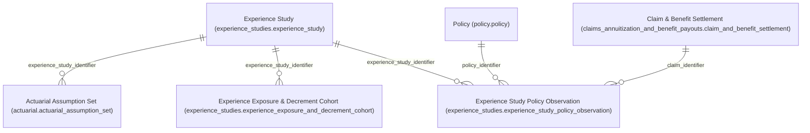

# L&A Ontology Knowledge Framework (OKF) -- Domain 8: Experience Studies (Historical Behavioral & Biometric Analytics)

| OKF Metadata Attribute | Value |
| :--- | :--- |
| **OKF Catalog Document** | `L&A OKF/08 - OKF - Experience Studies.MD` |
| **Enterprise Data Domain** | **Domain 8: Experience Studies (Historical Behavioral & Biometric Analytics)** |
| **Target Physical Database Engine** | Amazon RDS Aurora PostgreSQL (PostgreSQL 15/16 Compatible) |
| **Physical Database Schema** | `experience_studies` |
| **Domain Table Count** | **3 Physical Tables / Logical Entities** |
| **Outbound Foreign Key Joins** | **4 Foreign Key Relationships** (Intra-Domain & Cross-Domain) |
| **Inbound Foreign Key Joins** | **10 Cross-Domain Referencing Relationships** |
| **Performance Indexes** | **3 B-Tree & Composite Indexes** |
| **Inherited Business Context Rules** | **`BC-141` through `BC-158` (18 Rules)** |
| **Source Knowledge Layer Artifacts** | `L&A - Ontology.MD`, `L&A Data Model - Logical.MD`, `L&A Data Model - Physical DDL.sql`, `L&A Data Model - Conceptual.MD` |

---

## 1. Domain Executive Ontology & Business Context Overview

The **Experience Studies** domain provides the empirical actuarial feedback loop that transforms historical policy administration, transaction, and claim records into statistically credible biometric and policyholder behavioral insights. In a Life and Annuity insurance carrier, product pricing, statutory Principles-Based Reserving (PBR under VM-20, VM-21, and VM-22), and US GAAP LDTI annual assumption unlocking depend entirely on accurately measuring how actual policyholder mortality, longevity, lapse, and benefit utilization compare against industry benchmark tables and current valuation assumptions. This domain is structured across three core logical entities: `Experience Study`, `Experience Exposure & Decrement Cohort`, and the associative policy-year observation entity `Experience Study Policy Observation`.

`Experience Study` (`Experience Study Identifier`, `Study Name`, `Study Type`) catalogs formal actuarial investigations conducted over a multi-year historical observation window (`Observation Start Date` to `Observation End Date`, typically excluding a recent 3-to-6-month lag buffer to prevent distortion from Incurred But Not Reported [IBNR] claims). Across US L&A carriers like New York Life, Prudential, Corebridge, and Lincoln Financial, experience studies cover six primary decrement types: `Life Mortality Study` (measuring death rates $q_x$ on life insurance blocks against benchmarks like the `2015 Valuation Basic Table (2015 VBT)`), `Annuitant Longevity / Mortality Study` (measuring survival and mortality of payout annuitants against benchmarks like the `2012 Individual Annuity Mortality (2012 IAM) Basic` table or the `Pri-2012 Higher Education Retiree Mortality Table`, where university faculty exhibit significantly longer life expectancy than the general population), `Voluntary Lapse & Surrender Study` (measuring baseline surrenders and shock lapses at the end of surrender charge periods), `Deferred-to-Payout Annuitization Election Rate Study` (crucial for valuing Participating General Account Fixed vintage guarantees), `GMWB / GMIB Living Benefit Rider Utilization Study`, and `Maintenance Expense Unit Cost Study`.

At the granular policy-year level, `Experience Study Policy Observation` (`Policy Observation Identifier`) links each historical `Policy Identifier` (and any resulting `Claim Identifier`) to the study, calculating the exact `Exposure Fraction Years` (between `0.0000` and `1.0000`) that the contract was active and exposed to the studied risk during the observation year, along with the binary `Decrement Indicator` (`1` if the event occurred, `0` if the policy survived/persisted). These policy-year observations are rolled up into `Experience Exposure & Decrement Cohort` (`Experience Cohort Identifier`), which segments the experience across key actuarial risk dimensions: `Product Category`, `Attained Age Band`, `Policy Duration Year`, `Gender`, `Smoker Status`, `Tax Qualification Type`, and living benefit `In-The-Moneyness Band` ($Benefit\ Base / Account\ Value$). For each cell, the cohort stores `Total Policies Exposed Count`, `Total Face or Account Value Exposed Amount`, `Actual Decrement Count`, `Actual Decrement Dollar Amount`, `Expected Decrement Count`, and the critical `Actual-to-Expected (A/E) Ratio`. AI agents querying experience studies must never average cohort-level `Actual-to-Expected (A/E) Ratio` values using a simple unweighted average; they must always compute weighted A/E ratios as $\sum \text{Actual Decrements} / \sum \text{Expected Decrements}$ by count or dollar amount.

---

## 2. Physical Schema & Logical Entity Architecture Catalog (Schema: `experience_studies`)

| # | Logical Entity Name | Physical Table Name (`schema.table`) | Primary Key Column (`PK`) | Business Cols | Audit Cols | Constraints (`PK`/`UQ`/`CHK`) | Logical Entity & Physical Table Definition |
| :--- | :--- | :--- | :--- | :--- | :--- | :--- | :--- |
| **8.1** | **Experience Study** | `experience_studies.experience_study` | `experience_study_identifier` | 7 | 2 | `pk_experience_study`, `chk_exp_study_dates` | Experience Study entity catalogs formal historical actuarial investigations into policyholder biometric and behavioral events (mortality, annuitant longevity, voluntary lapse, annuitization election, and GMWB rider utilization) over a defined observation window against industry benchmark tables. |
| **8.2** | **Experience Exposure & Decrement Cohort** | `experience_studies.experience_exposure_and_decrement_cohort` | `experience_cohort_identifier` | 15 | 2 | `pk_experience_exposure_decrement_cohort` | Experience Exposure & Decrement Cohort entity stores the aggregated exposure counts, face/account values exposed, actual decrements (deaths, surrenders, annuitizations), expected decrements, and Actual-to-Expected (A/E) ratios segmented by age, duration, gender, and rider in-the-moneyness. |
| **8.3** | **Experience Study Policy Observation** | `experience_studies.experience_study_policy_observation` | `policy_observation_identifier` | 6 | 2 | `pk_experience_study_policy_observation`, `chk_espo_exposure_fraction`, `chk_espo_decrement_flag` | Experience Study Policy Observation entity serves as the associative policy-year observation record linking an Experience Study to individual historical Policies, Financial Transactions, and Claims so each policy's exact exposure fraction and decrement outcome can be audited and aggregated into cohorts. |

---

## 3. Relational Join Mining & Foreign Key Topology

### 3.1 Entity-Relationship & Foreign Key Join Diagram (Mermaid)



### 3.2 Outbound Foreign Key Join Matrix (Tables in `experience_studies` Referencing Parent Entities)

| FK Constraint Name | Child Table (`experience_studies`) | Child FK Column | Join Scope | Parent Referenced Table | Parent PK Column | Referential Action | Exact SQL Join Predicate |
| :--- | :--- | :--- | :--- | :--- | :--- | :--- | :--- |
| `fk_eedc_experience_study` | `experience_studies.experience_exposure_and_decrement_cohort` | `experience_study_identifier` | Intra-Domain | `experience_studies.experience_study` | `experience_study_identifier` | `ON UPDATE CASCADE ON DELETE CASCADE` | `experience_studies.experience_exposure_and_decrement_cohort.experience_study_identifier = experience_studies.experience_study.experience_study_identifier` |
| `fk_espo_experience_study` | `experience_studies.experience_study_policy_observation` | `experience_study_identifier` | Intra-Domain | `experience_studies.experience_study` | `experience_study_identifier` | `ON UPDATE CASCADE ON DELETE CASCADE` | `experience_studies.experience_study_policy_observation.experience_study_identifier = experience_studies.experience_study.experience_study_identifier` |
| `fk_espo_policy` | `experience_studies.experience_study_policy_observation` | `policy_identifier` | Cross-Domain (`policy`) | `policy.policy` | `policy_identifier` | `ON UPDATE CASCADE ON DELETE RESTRICT` | `experience_studies.experience_study_policy_observation.policy_identifier = policy.policy.policy_identifier` |
| `fk_espo_claim` | `experience_studies.experience_study_policy_observation` | `claim_identifier` | Cross-Domain (`claims_annuitization_and_benefit_payouts`) | `claims_annuitization_and_benefit_payouts.claim_and_benefit_settlement` | `claim_identifier` | `ON UPDATE CASCADE ON DELETE SET NULL` | `experience_studies.experience_study_policy_observation.claim_identifier = claims_annuitization_and_benefit_payouts.claim_and_benefit_settlement.claim_identifier` |

### 3.3 Inbound Cross-Domain Foreign Key Join Matrix (External Schemas Referencing `experience_studies`)

| FK Constraint Name | Referencing Child Schema | Referencing Child Table | Child FK Column | Referenced Target Table (`experience_studies`) | Target PK Column | Referential Action | Exact SQL Join Predicate |
| :--- | :--- | :--- | :--- | :--- | :--- | :--- | :--- |
| `fk_aas_experience_study` | `actuarial` | `actuarial.actuarial_assumption_set` | `experience_study_identifier` | `experience_studies.experience_study` | `experience_study_identifier` | `ON UPDATE CASCADE ON DELETE SET NULL` | `actuarial.actuarial_assumption_set.experience_study_identifier = experience_studies.experience_study.experience_study_identifier` |

---

## 4. Detailed Table-by-Table Schema, Column Dictionary & DDL Constraints

### 4.1 Logical Entity: `Experience Study` <-> Physical Table: `experience_studies.experience_study`

- **Business & Technical Purpose**: Experience Study entity catalogs formal historical actuarial investigations into policyholder biometric and behavioral events (mortality, annuitant longevity, voluntary lapse, annuitization election, and GMWB rider utilization) over a defined observation window against industry benchmark tables.
- **PostgreSQL Catalog Comment**: _""_
- **Primary Key**: `experience_study_identifier`

#### Attribute-to-Column Schema Mapping & Business Dictionary

| Ord | Logical Attribute Name | Physical Column Name | Logical Type | Physical PostgreSQL Type | Key | Column Modifiers / Default | Business Definition, Domain Semantics & Sample Values |
| :--- | :--- | :--- | :--- | :--- | :--- | :--- | :--- |
| **1** | **Experience Study Identifier** | `experience_study_identifier` | String | `VARCHAR(64)` | **PK** | `NOT NULL` | Unique primary key identifying an actuarial experience study investigation. Sample values: `EXP-STD-2026-MORT`, `EXP-STD-2026-LAPSE`, `EXP-STD-2026-ANN`. |
| **2** | **Study Name** | `study_name` | String | `VARCHAR(200)` | **NK** | `NOT NULL` | Business-friendly title of the experience study describing the risk behavior, product block, and observation period analyzed. Sample values: `2021-2025 Institutional Payout Annuitant Longevity Study`, `2022-2025 Variable Annuity Dynamic Lapse & GMWB Utilization Study`, `Individual Life Mortality Experience Study`. |
| **3** | **Study Type** | `study_type` | String | `VARCHAR(120)` | **NK** | `NOT NULL` | Classifies the specific biometric or policyholder behavioral decrement analyzed by the study. Sample values: `Life Mortality Study`, `Annuitant Longevity / Mortality Study`, `Voluntary Lapse & Surrender Study`, `Deferred-to-Payout Annuitization Election Rate Study`, `GMWB / GMIB Living Benefit Rider Utilization Study`, `Maintenance Expense Unit Cost Study`. |
| **4** | **Observation Start Date** | `observation_start_date` | Date | `DATE` | **NK** | `NOT NULL` | Beginning calendar date of the historical policy exposure window included in the experience study. Sample values: `2021-01-01`, `2022-01-01`. |
| **5** | **Observation End Date** | `observation_end_date` | Date | `DATE` | **NK** | `NOT NULL` | Ending cutoff calendar date of the historical policy exposure window (typically excluding a lag buffer for Incurred But Not Reported [IBNR] claims). Sample values: `2025-12-31`, `2026-06-30`. |
| **6** | **Industry Benchmark Table Name** | `industry_benchmark_table_name` | String | `VARCHAR(150)` | **NK** | `NOT NULL` | Standard Society of Actuaries (SOA) or NAIC valuation table used to compute "Expected" decrements for Actual-to-Expected (A/E) comparison. Sample values: `2015 Valuation Basic Table (2015 VBT)`, `2012 Individual Annuity Mortality (2012 IAM) Basic`, `Pri-2012 Higher Education Retiree Mortality Table`, `2001 CSO`. |
| **7** | **Study Completion Status** | `study_completion_status` | String | `VARCHAR(100)` | **NK** | `NOT NULL` | Current workflow and actuarial peer-review status of the experience study. Sample values: `Data Extraction & Cleansing`, `In Actuarial Analysis`, `Peer Review Pending`, `Approved by Assumption Governance Committee`, `Archived`. |
| **8** | **Record Created Timestamp (Audit)** | `created_at` | Timestamp | `TIMESTAMPTZ` | **AUDIT** | `NOT NULL DEFAULT CURRENT_TIMESTAMP` | System audit timestamp recording when the physical row was initially inserted into the Aurora PostgreSQL table. |
| **9** | **Record Updated Timestamp (Audit)** | `updated_at` | Timestamp | `TIMESTAMPTZ` | **AUDIT** | `NOT NULL DEFAULT CURRENT_TIMESTAMP` | System audit timestamp recording when the physical row was last modified in the Aurora PostgreSQL table. |

#### Declarative DDL Constraints & Indexes on `experience_studies.experience_study`

| Constraint / Index Category | Identifier Name | Definition / Target Columns & Referential Integrity Rule |
| :--- | :--- | :--- |
| **PRIMARY KEY** | `pk_experience_study` | `PRIMARY KEY (experience_study_identifier)` |
| **CHECK** | `chk_exp_study_dates` | `CHECK (observation_end_date >= observation_start_date)` |

### 4.2 Logical Entity: `Experience Exposure & Decrement Cohort` <-> Physical Table: `experience_studies.experience_exposure_and_decrement_cohort`

- **Business & Technical Purpose**: Experience Exposure & Decrement Cohort entity stores the aggregated exposure counts, face/account values exposed, actual decrements (deaths, surrenders, annuitizations), expected decrements, and Actual-to-Expected (A/E) ratios segmented by age, duration, gender, and rider in-the-moneyness.
- **PostgreSQL Catalog Comment**: _""_
- **Primary Key**: `experience_cohort_identifier`

#### Attribute-to-Column Schema Mapping & Business Dictionary

| Ord | Logical Attribute Name | Physical Column Name | Logical Type | Physical PostgreSQL Type | Key | Column Modifiers / Default | Business Definition, Domain Semantics & Sample Values |
| :--- | :--- | :--- | :--- | :--- | :--- | :--- | :--- |
| **1** | **Experience Cohort Identifier** | `experience_cohort_identifier` | String | `VARCHAR(64)` | **PK** | `NOT NULL` | Unique primary key identifying an aggregated multi-dimensional cell (cohort) within an Experience Study. Sample values: `EXPC-10001`, `EXPC-10002`. |
| **2** | **Experience Study Identifier** | `experience_study_identifier` | String | `VARCHAR(64)` | **FK** | `NOT NULL` | Foreign key linking the exposure and decrement cohort cell to its parent Experience Study. Sample values: `EXP-STD-2026-ANN`, `EXP-STD-2026-MORT`. |
| **3** | **Product Category** | `product_category` | String | `VARCHAR(100)` | **NK** | `NOT NULL` | Product category dimension grouping the policies in this study cell. Sample values: `General Account Fixed Annuity`, `Variable Annuity`, `Payout Life Annuity`, `Term Life`, `Universal Life`. |
| **4** | **Attained Age Band** | `attained_age_band` | String | `VARCHAR(50)` | **NK** | `NOT NULL` | Five-year or single-year attained age bracket of the insureds or annuitants in this cohort cell. Sample values: `Ages 55-59`, `Ages 60-64`, `Ages 65-69`, `Ages 70-74`, `Ages 80-84`, `Ages 90+`. |
| **5** | **Policy Duration Year** | `policy_duration_year` | Integer | `INTEGER` | **NK** | `NOT NULL` | Contract year elapsed since policy issue (1 = first policy year, 2 = second policy year, etc.), critical for select-and-ultimate mortality and surrender charge cliff analysis. Sample values: `1`, `2`, `5`, `7`, `8 (First Post-Surrender Charge Year)`, `15`. |
| **6** | **Gender** | `gender` | String | `VARCHAR(32)` | **NK** | `NOT NULL` | Biological or administrative sex code used for sex-distinct mortality and longevity analysis (or Unisex for ERISA/Montana institutional plans). Sample values: `Male`, `Female`, `Unisex Institutional`. |
| **7** | **Smoker Status** | `smoker_status` | String | `VARCHAR(50)` | **NK** | `NOT NULL` | Tobacco usage classification of the cohort cell. Sample values: `Non-Tobacco`, `Tobacco / Smoker`, `Aggregate / Unknown (Annuity)`. |
| **8** | **Tax Qualification Type** | `tax_qualification_type` | String | `VARCHAR(100)` | **NK** | `NOT NULL` | Tax qualification dimension (since qualified 403(b)/IRA plans exhibit different RMD and lapse behavior than non-qualified contracts). Sample values: `Qualified 403(b) / 401(a)`, `Traditional IRA`, `Roth IRA`, `Non-Qualified`. |
| **9** | **In-The-Moneyness Band** | `in_the_moneyness_band` | String | `VARCHAR(100)` | **NK** | `NOT NULL` | Ratio band comparing a rider's Guaranteed Benefit Base to the policy's Current Market Value ($Benefit\ Base / Account\ Value$), driving dynamic lapse and GMWB utilization behavior. Sample values: `Out of the Money (< 100%)`, `At the Money (100% - 110%)`, `Moderately In the Money (110% - 130%)`, `Deeply In the Money (> 130%)`, `Not Applicable (No Living Benefit Rider)`. |
| **10** | **Total Policies Exposed Count** | `total_policies_exposed_count` | Decimal | `NUMERIC(18,4)` | **NK** | `NOT NULL DEFAULT 0.0000` | Exact sum of policy-years exposed to risk within this cohort cell during the study observation window. Sample values: `14520.50`, `84120.75`, `3210.00`. |
| **11** | **Total Face or Account Value Exposed Amount** | `total_face_or_account_value_exposed_amount` | Decimal | `NUMERIC(20,2)` | **NK** | `NOT NULL DEFAULT 0.00` | Total dollar amount of face coverage, account value, or annualized annuity income exposed to risk in this cohort cell. Sample values: `2450000000.00`, `890500000.00`. |
| **12** | **Actual Decrement Count** | `actual_decrement_count` | Integer | `INTEGER` | **NK** | `NOT NULL DEFAULT 0` | Observed number of policies in the cohort that experienced the studied event (deaths, full surrenders, or annuitizations) during the observation window. Sample values: `142`, `1845`, `64`. |
| **13** | **Actual Decrement Dollar Amount** | `actual_decrement_dollar_amount` | Decimal | `NUMERIC(20,2)` | **NK** | `NOT NULL DEFAULT 0.00` | Total dollar face amount, surrendered account value, or annuitized balance associated with the observed decrements in this cohort. Sample values: `28400000.00`, `112500000.00`. |
| **14** | **Expected Decrement Count** | `expected_decrement_count` | Decimal | `NUMERIC(18,4)` | **NK** | `NOT NULL DEFAULT 0.0000` | Number of decrements mathematically predicted for this cohort by applying the Industry Benchmark Table or current valuation assumption rates to the Total Policies Exposed. Sample values: `155.40`, `1790.25`, `70.10`. |
| **15** | **Actual-to-Expected (A/E) Ratio** | `actual_to_expected_ae_ratio` | Decimal | `NUMERIC(12,6)` | **NK** | `NOT NULL DEFAULT 0.000000` | Key actuarial performance ratio equal to Actual Decrements divided by Expected Decrements (e.g., 0.9138 means actual events were 91.38% of expected benchmark). Sample values: `0.9138` (91.38%), `1.0306` (103.06%), `0.8520` (85.20%). |
| **16** | **Record Created Timestamp (Audit)** | `created_at` | Timestamp | `TIMESTAMPTZ` | **AUDIT** | `NOT NULL DEFAULT CURRENT_TIMESTAMP` | System audit timestamp recording when the physical row was initially inserted into the Aurora PostgreSQL table. |
| **17** | **Record Updated Timestamp (Audit)** | `updated_at` | Timestamp | `TIMESTAMPTZ` | **AUDIT** | `NOT NULL DEFAULT CURRENT_TIMESTAMP` | System audit timestamp recording when the physical row was last modified in the Aurora PostgreSQL table. |

#### Declarative DDL Constraints & Indexes on `experience_studies.experience_exposure_and_decrement_cohort`

| Constraint / Index Category | Identifier Name | Definition / Target Columns & Referential Integrity Rule |
| :--- | :--- | :--- |
| **PRIMARY KEY** | `pk_experience_exposure_decrement_cohort` | `PRIMARY KEY (experience_cohort_identifier)` |
| **FOREIGN KEY** | `fk_eedc_experience_study` | `FOREIGN KEY (experience_study_identifier) REFERENCES experience_studies.experience_study (experience_study_identifier) ON UPDATE CASCADE ON DELETE CASCADE` |
| **B-TREE INDEX** | `idx_eedc_study_category` | `ON experience_studies.experience_exposure_and_decrement_cohort (experience_study_identifier, product_category, attained_age_band)` |

### 4.3 Logical Entity: `Experience Study Policy Observation` <-> Physical Table: `experience_studies.experience_study_policy_observation`

- **Business & Technical Purpose**: Experience Study Policy Observation entity serves as the associative policy-year observation record linking an Experience Study to individual historical Policies, Financial Transactions, and Claims so each policy's exact exposure fraction and decrement outcome can be audited and aggregated into cohorts.
- **PostgreSQL Catalog Comment**: _""_
- **Primary Key**: `policy_observation_identifier`

#### Attribute-to-Column Schema Mapping & Business Dictionary

| Ord | Logical Attribute Name | Physical Column Name | Logical Type | Physical PostgreSQL Type | Key | Column Modifiers / Default | Business Definition, Domain Semantics & Sample Values |
| :--- | :--- | :--- | :--- | :--- | :--- | :--- | :--- |
| **1** | **Policy Observation Identifier** | `policy_observation_identifier` | String | `VARCHAR(64)` | **PK** | `NOT NULL` | Unique primary key for the policy-year observation record linking a Policy to an Experience Study. Sample values: `ESPO-900101`, `ESPO-900102`. |
| **2** | **Experience Study Identifier** | `experience_study_identifier` | String | `VARCHAR(64)` | **FK** | `NOT NULL` | Foreign key referencing the parent Experience Study. Sample values: `EXP-STD-2026-ANN`. |
| **3** | **Policy Identifier** | `policy_identifier` | String | `VARCHAR(64)` | **FK** | `NOT NULL` | Foreign key referencing the individual historical Policy contributing exposure to the study. Sample values: `POL-UUID-90001421`. |
| **4** | **Claim Identifier** | `claim_identifier` | String | `VARCHAR(64)` | **FK** | `NULL` | Optional foreign key referencing the Claim & Benefit Settlement record if a death or disability decrement occurred during the policy year. Sample values: `CLM-2026-00912`, `Null (Survived / No Claim)`. |
| **5** | **Exposure Fraction Years** | `exposure_fraction_years` | Decimal | `NUMERIC(9,6)` | **NK** | `NOT NULL DEFAULT 1.000000` | Fraction of a full policy year (between 0.0000 and 1.0000) that the policy was active and exposed to the studied risk during the observation year. Sample values: `1.0000`, `0.5000`, `0.7534`. |
| **6** | **Decrement Indicator** | `decrement_indicator` | Integer | `INTEGER` | **NK** | `NOT NULL DEFAULT 0` | Indicates whether the studied decrement event occurred on this policy during the observation year (`1` = event occurred, `0` = policy survived/persisted). Sample values: `0`, `1`. |
| **7** | **Record Created Timestamp (Audit)** | `created_at` | Timestamp | `TIMESTAMPTZ` | **AUDIT** | `NOT NULL DEFAULT CURRENT_TIMESTAMP` | System audit timestamp recording when the physical row was initially inserted into the Aurora PostgreSQL table. |
| **8** | **Record Updated Timestamp (Audit)** | `updated_at` | Timestamp | `TIMESTAMPTZ` | **AUDIT** | `NOT NULL DEFAULT CURRENT_TIMESTAMP` | System audit timestamp recording when the physical row was last modified in the Aurora PostgreSQL table. |

#### Declarative DDL Constraints & Indexes on `experience_studies.experience_study_policy_observation`

| Constraint / Index Category | Identifier Name | Definition / Target Columns & Referential Integrity Rule |
| :--- | :--- | :--- |
| **PRIMARY KEY** | `pk_experience_study_policy_observation` | `PRIMARY KEY (policy_observation_identifier)` |
| **CHECK** | `chk_espo_exposure_fraction` | `CHECK (exposure_fraction_years >= 0 AND exposure_fraction_years <= 1)` |
| **CHECK** | `chk_espo_decrement_flag` | `CHECK (decrement_indicator IN (0, 1))` |
| **FOREIGN KEY** | `fk_espo_experience_study` | `FOREIGN KEY (experience_study_identifier) REFERENCES experience_studies.experience_study (experience_study_identifier) ON UPDATE CASCADE ON DELETE CASCADE` |
| **FOREIGN KEY** | `fk_espo_policy` | `FOREIGN KEY (policy_identifier) REFERENCES policy.policy (policy_identifier) ON UPDATE CASCADE ON DELETE RESTRICT` |
| **FOREIGN KEY** | `fk_espo_claim` | `FOREIGN KEY (claim_identifier) REFERENCES claims_annuitization_and_benefit_payouts.claim_and_benefit_settlement (claim_identifier) ON UPDATE CASCADE ON DELETE SET NULL` |
| **B-TREE INDEX** | `idx_espo_study_policy` | `ON experience_studies.experience_study_policy_observation (experience_study_identifier, policy_identifier)` |
| **B-TREE INDEX** | `idx_espo_claim_id` | `ON experience_studies.experience_study_policy_observation (claim_identifier)` |

---

## 5. Inherited Business Context Ontology Rules (`BC-141` to `BC-158`)

> **Semantic Inheritance Notice**: The following **18 Business Context rules** are inherited verbatim from `L&A Data Domain/L&A - Ontology.MD` to provide autonomous AI agents, data engineers, and actuaries with complete domain rules, accounting identities, statutory compliance mandates, and SQL join guardrails for the **Experience Studies** domain.

#### BC-141: Closed-Loop Actuarial Feedback Architecture: Calibrating Actuarial Assumption Sets from Experience Studies

**Domains**: Experience Studies, Actuarial | **Entities**: `Experience Study`, `Experience Exposure & Decrement Cohort`, `Actuarial Assumption Set` | **Key Attributes**: `Experience Study Identifier`, `Study Name`, `Study Type`, `Study Completion Status`, `Actuarial Assumption Set Identifier`, `Actual-to-Expected (A/E) Ratio`

In a life and annuity insurance enterprise, Domain 8 (`Experience Studies`) and Domain 9 (`Actuarial`) form a closed-loop scientific feedback system that bridges historical policyholder behavior with forward-looking balance sheet valuation and product pricing. Every reserve liability (`Actuarial Valuation Reserve`) and cash flow simulation (`Actuarial Cash Flow Projection`) in Domain 9 relies on a set of mathematical assumptions stored in `Actuarial Assumption Set`—such as mortality rates ($q_x$), annuitant longevity tables, voluntary lapse and surrender rates ($w_x$), deferred-to-payout annuitization election rates, and living benefit rider utilization curves. Under both US GAAP LDTI (ASC 944, which requires at least annual review and updating of best-estimate cash flow assumptions) and NAIC Statutory Principles-Based Reserving (VM-20, VM-21, VM-22, and VM-31 Actuarial Report requirements), actuaries cannot invent assumptions arbitrarily; every assumption must be empirically grounded in historical policy experience analyzed through a formal `Experience Study`.

This lineage is enforced via the foreign key `Actuarial Assumption Set.Experience Study Identifier`, which links each approved `Actuarial Assumption Set` back to the primary `Experience Study` (e.g., `EXP-STD-2026-ANN` for the `2021-2025 Institutional Payout Annuitant Longevity Study` or `EXP-STD-2026-LAPSE` for the `2022-2025 Variable Annuity Dynamic Lapse & GMWB Utilization Study`) that calibrated its baseline rates. Within the `Experience Study`, historical policy exposures and actual decrements are aggregated into multi-dimensional `Experience Exposure & Decrement Cohort` cells and compared against an `Industry Benchmark Table Name` via the `Actual-to-Expected (A/E) Ratio`. When a study attains `Study Completion Status = 'Approved by Assumption Governance Committee'`, its empirical A/E ratios directly determine the credibility-weighted adjustment multipliers applied in `Actuarial Assumption Set.Base Mortality or Longevity Table` (for example, setting the valuation assumption to `92% of Pri-2012 Higher Ed Retiree Table`).

AI agents assisting actuaries or auditors with assumption governance must traverse `Actuarial Valuation Reserve` $\rightarrow$ `Actuarial Assumption Set` $\rightarrow$ `Experience Study` $\rightarrow$ `Experience Exposure & Decrement Cohort` to provide complete empirical justification for why any mortality, longevity, or lapse assumption was unlocked or modified.

#### BC-142: Exact Policy-Year Exposure Calculation and Fractional Weighting for Mid-Year Policy Events

**Domains**: Experience Studies, Policy, Operations | **Entities**: `Experience Study Policy Observation`, `Experience Exposure & Decrement Cohort`, `Policy`, `Claim & Benefit Settlement` | **Key Attributes**: `Policy Observation Identifier`, `Exposure Fraction Years`, `Decrement Indicator`, `Total Policies Exposed Count`, `Actual Decrement Count`

Accurate calculation of empirical decrement rates ($q_x = \frac{\text{Actual Decrements}}{\text{Total Exposure}}$) requires precise measurement of how long each policy was exposed to risk during an observation year, captured on `Experience Study Policy Observation` by `Exposure Fraction Years` and `Decrement Indicator`. If a policy was active in force on the start of its policy anniversary year and remained active through the entire year without lapsing or dying, it contributes exactly one full policy-year of exposure (`Exposure Fraction Years = 1.0000`) and `Decrement Indicator = 0` (`Survived / Persisted`).

However, when a policy enters the study window mid-year, or exits mid-year due to a competing risk (for example, a policy that voluntarily surrenders 9 months into the year during a `Life Mortality Study`), it was only exposed to the risk of death for three-quarters of the year and therefore contributes `Exposure Fraction Years = 0.7534` (275 days divided by 365 days) with `Decrement Indicator = 0` for mortality. Conversely, what happens when the **studied decrement itself** occurs mid-year—for instance, when an insured dies 6 months into the policy year during a `Life Mortality Study` (`Decrement Indicator = 1` and `Claim Identifier` populated)? Under standard Society of Actuaries (SOA) exact-to-the-event actuarial exposure methodology (consistent with the Balducci hypothesis required to estimate an annual probability $q_x$ rather than a central death rate $m_x$), a policy that experiences the studied decrement during the policy year must be given credit for exposure through the **end** of that policy year (`Exposure Fraction Years = 1.0000`), whereas competing decrements (such as lapses during a mortality study, or deaths during a lapse study) are truncated at the exact fraction of the year elapsed at exit.

When `Experience Study Policy Observation` records are rolled up into `Experience Exposure & Decrement Cohort`, `Total Policies Exposed Count` equals $\sum \text{Exposure Fraction Years}$ (e.g., `14520.50` policy-years) and `Actual Decrement Count` equals $\sum \text{Decrement Indicator}$ (e.g., `142` deaths). AI agents computing empirical decrement rates must always divide `Actual Decrement Count` by `Total Policies Exposed Count` (fractional policy-years), never by a naive `COUNT(DISTINCT Policy Identifier)`, which would severely bias annual mortality and lapse rates.

#### BC-143: Directional Polarity of the Actual-to-Expected (A/E) Ratio: Life Mortality vs. Payout Annuity Longevity

**Domains**: Experience Studies, Actuarial | **Entities**: `Experience Study`, `Experience Exposure & Decrement Cohort` | **Key Attributes**: `Study Type`, `Actual Decrement Count`, `Expected Decrement Count`, `Actual-to-Expected (A/E) Ratio`, `Product Category`

The `Actual-to-Expected (A/E) Ratio` on `Experience Exposure & Decrement Cohort`—defined mathematically as $\frac{\text{Actual Decrement Count}}{\text{Expected Decrement Count}}$ (or its dollar-weighted equivalent)—is the primary diagnostic metric in actuarial science. An `Actual-to-Expected (A/E) Ratio` of `1.0000` (100.00%) indicates that observed historical events matched the `Industry Benchmark Table Name` or baseline valuation assumption exactly. However, whether an A/E ratio below `1.0000` (e.g., `0.9138` or 91.38%) is financially **favorable** (generating underwriting profit and reserve release) or **unfavorable** (generating longevity losses and requiring reserve strengthening) depends entirely on the risk direction of `Study Type` and `Product Category`!

In a `Life Mortality Study` (`Product Category` in `Term Life`, `Universal Life`, or Whole Life), the insurer pays a lump-sum death benefit upon the death of the insured. Therefore, fewer deaths than expected ($\text{A/E Ratio} < 1.0000$, such as `0.8520` / 85.20%) is **favorable** to the insurer: insureds are living longer than assumed, delaying death benefit outflows and extending premium inflows. Conversely, an $\text{A/E Ratio} > 1.0000$ (e.g., `1.0800` during a pandemic spike) on life insurance represents unfavorable excess mortality loss.

In an `Annuitant Longevity / Mortality Study` (`Product Category = 'Payout Life Annuity'`, such as Institutional general account lifetime payout annuities), the economic polarity is completely inverted! Because the carrier is contractually obligated to pay monthly income for as long as the annuitant lives, an annuitant death terminates the liability and releases the remaining reserve ("mortality credit"). Consequently, for payout annuities, an $\text{A/E Ratio} < 1.0000$ (e.g., `0.9138` / 91.38% actual deaths vs. expected deaths) means fewer annuitants died than expected—annuitants are living longer than modeled (**unfavorable longevity risk**), forcing the carrier to pay lifetime income for more years and strengthen reserves! AI agents generating executive commentary or automated alerts on `Experience Exposure & Decrement Cohort` must never hard-code "low A/E = good"; they must condition financial interpretation on `Study Type` and `Product Category`.

#### BC-144: Count-Weighted vs. Amount-Weighted Actual-to-Expected Analysis and Anti-Selection Detection

**Domains**: Experience Studies, Actuarial | **Entities**: `Experience Exposure & Decrement Cohort` | **Key Attributes**: `Total Policies Exposed Count`, `Total Face or Account Value Exposed Amount`, `Actual Decrement Count`, `Actual Decrement Dollar Amount`, `Expected Decrement Count`, `Actual-to-Expected (A/E) Ratio`

Every `Experience Exposure & Decrement Cohort` cell captures both policy-count metrics (`Total Policies Exposed Count` and `Actual Decrement Count`) and dollar-weighted metrics (`Total Face or Account Value Exposed Amount` and `Actual Decrement Dollar Amount`). In life and annuity insurance, policyholder behavior and biometric mortality are rarely uniform across policy size bands; instead, higher-net-worth customers with larger face amounts or larger annuity account balances exhibit distinct socioeconomic longevity and heightened financial sophistication ("anti-selection" or "adverse selection").

Consider two examples of why comparing the count-weighted decrement rate ($\frac{\text{Actual Decrement Count}}{\text{Total Policies Exposed Count}}$) against the amount-weighted decrement rate ($\frac{\text{Actual Decrement Dollar Amount}}{\text{Total Face or Account Value Exposed Amount}}$) is essential:

1. **Payout Annuity Longevity**: University tenured faculty and physicians with `$2,000,000` the carrier payout annuity balances typically have higher socioeconomic status and superior healthcare access compared to participants with `$25,000` balances. As a result, in an `Annuitant Longevity / Mortality Study`, the amount-weighted mortality rate is almost always significantly lower than the count-weighted mortality rate. If an actuary calibrated annuity reserves using count-weighted mortality, the carrier would severely under-reserve its largest dollar liabilities.
2. **Voluntary Lapse & Surrender Studies**: When market interest rates rise sharply above an annuity's credited rate, sophisticated policyholders with `$500,000+` balances move their money to higher-yielding alternatives at much higher rates than small `$10,000` accounts. Thus, in a `Voluntary Lapse & Surrender Study`, the amount-weighted lapse rate (`Actual Decrement Dollar Amount / Total Face or Account Value Exposed Amount`) frequently exceeds the count-weighted lapse rate by 20% to 50%.

Because balance sheet reserves (`Actuarial Valuation Reserve`) and cash flows are measured in dollars, AI agents assisting actuaries with assumption calibration must prioritize amount-weighted decrement rates and amount-weighted A/E ratios for financial reserve modeling, while comparing amount-weighted vs. count-weighted rates to flag anti-selection skew across wealth tiers.

#### BC-145: Select-and-Ultimate Mortality Dynamics Across Policy Duration Year and Underwriting Wear-Off

**Domains**: Experience Studies, Actuarial, Underwriting | **Entities**: `Experience Exposure & Decrement Cohort`, `Experience Study`, `Actuarial Assumption Set` | **Key Attributes**: `Policy Duration Year`, `Attained Age Band`, `Study Type`, `Industry Benchmark Table Name`, `Actual-to-Expected (A/E) Ratio`

In a `Life Mortality Study`, two insureds who are both currently age 65 (`Attained Age Band = 'Ages 65-69'`), same `Gender`, and same `Smoker Status` will have dramatically different expected mortality rates depending on how many years ago their policy was issued—a dimension captured on `Experience Exposure & Decrement Cohort` by `Policy Duration Year` (where `1` represents the first contract year after issue, `2` the second year, and so on). This phenomenon is known in actuarial science as the **Select-and-Ultimate** mortality effect.

When an individual applies for an underwritten life insurance policy in Domain 3 (`Underwriting`), the carrier performs medical screening, blood/fluid panels, prescription database checks, and MIB reviews, declining or sub-standard rating applicants with active life-threatening conditions. Consequently, in `Policy Duration Year = 1` and `2`, the cohort of newly approved insureds exhibits extraordinarily low mortality compared to the general population of the same attained age—the "select period" benefit of underwriting. Over time, however, healthy individuals may develop illnesses, and the protective screening effect of initial underwriting gradually wears off over a 15- to 25-year select period (as reflected in standard tables like `2015 Valuation Basic Table (2015 VBT)`, where mortality is indexed by both Issue Age `[x]` and Duration `t` as $q_{[x]+t-1}$). Once `Policy Duration Year` exceeds the select period (e.g., Year 20+), mortality converges to the "ultimate" table rate ($q_x$), which depends only on attained age.

AI agents analyzing mortality experience in `Experience Exposure & Decrement Cohort` must never aggregate life mortality across all `Policy Duration Year` values without controlling for duration or using a select-and-ultimate `Expected Decrement Count` benchmark (`85% of 2015 VBT Select & Ultimate`). Mixing a mature block (`Policy Duration Year = 15`) with a newly issued block (`Policy Duration Year = 1`) on an aggregate attained-age basis creates severe Simpson's Paradox distortion.

#### BC-146: Surrender Charge Cliff Behavior and Shock Lapse Spikes at Post-Surrender Policy Duration Year

**Domains**: Experience Studies, Actuarial, Product | **Entities**: `Experience Exposure & Decrement Cohort`, `Experience Study`, `Product` | **Key Attributes**: `Study Type`, `Policy Duration Year`, `Product Category`, `Actual Decrement Count`, `Actual Decrement Dollar Amount`, `Actual-to-Expected (A/E) Ratio`

In a `Voluntary Lapse & Surrender Study` covering deferred fixed annuities (`General Account Fixed Annuity`), retail `Variable Annuity` contracts, or `Universal Life` policies, `Policy Duration Year` is the single most powerful structural driver of policyholder surrender behavior due to contractual surrender charge schedules. Most retail deferred annuities and fixed indexed annuities impose a declining surrender charge schedule during the initial contract years—for example, a 7-year surrender charge schedule of 7%, 6%, 5%, 4%, 3%, 2%, 1% in `Policy Duration Year` `1` through `7`, dropping to 0% at the start of `Policy Duration Year = 8 (First Post-Surrender Charge Year)`.

While the surrender penalty is in effect (`Policy Duration Year` `1` through `7`), voluntary full surrenders are strongly suppressed (often 1.5% to 4.0% per year), as policyholders and their financial advisors avoid triggering a contractual penalty on the account balance. However, the moment the surrender charge expires at the anniversary transition into `Policy Duration Year = 8 (First Post-Surrender Charge Year)`, the block experiences an acute behavioral spike known as a **"shock lapse"** or **"surrender charge cliff"**, where annual surrender rates can jump 3x to 8x higher (often 15% to 35% of exposed account value in Year 8 alone) as advisors execute 1035 exchanges or reallocate free funds, before settling back down to a moderate ultimate lapse rate in `Policy Duration Year` `9` and beyond.

In contrast, institutional retirement annuities with no lump-sum cashability (such as legacy `GA-RA` contracts) or contracts subject to 10-year Transfer Payout Annuity (TPA) installment rules exhibit vastly different durational withdrawal curves. Therefore, AI agents querying `Experience Exposure & Decrement Cohort` for lapse modeling must always preserve `Policy Duration Year` granularity—especially around the surrender charge expiration cliff—and must never smooth or average shock-lapse duration years into surrounding policy durations.

#### BC-147: Living Benefit Rider In-The-Moneyness Band and Dynamic Lapse Suppression

**Domains**: Experience Studies, Actuarial, Policy | **Entities**: `Experience Exposure & Decrement Cohort`, `Actuarial Assumption Set`, `Policy Rider & Benefit` | **Key Attributes**: `In-The-Moneyness Band`, `Study Type`, `Product Category`, `Actual Decrement Count`, `Actual-to-Expected (A/E) Ratio`, `Dynamic Lapse Formula Type`

For variable annuities and fixed indexed annuities carrying guaranteed living benefit riders—such as Guaranteed Minimum Withdrawal Benefits (GMWB / GLWB) or Guaranteed Minimum Income Benefits (GMIB)—policyholder surrender behavior is governed not merely by `Policy Duration Year`, but by the economic value of the embedded guarantee relative to the underlying investment account. In `Experience Exposure & Decrement Cohort`, this relationship is captured by the `In-The-Moneyness Band` attribute, which segments exposures based on the ratio of the rider's Guaranteed Benefit Base to the policy's Current Market Account Value:
$$\text{In-The-Moneyness (ITM) Ratio} = \frac{\text{Guaranteed Benefit Base}}{\text{Current Account Value}}$$

The `In-The-Moneyness Band` stratifies the cohort into distinct behavioral regimes:

- `Out of the Money (< 100%)`: The policy's market account value exceeds the guaranteed benefit base (e.g., after a strong equity bull market). Because the policyholder can surrender or 1035-exchange the contract for its full cash market value without sacrificing any net guarantee value, voluntary lapse rates are high.
- `At the Money (100% - 110%)`: The guarantee base roughly equals the account value; baseline durational lapse rates apply.
- `Moderately In the Money (110% - 130%)` and `Deeply In the Money (> 130%)`: Following an equity market downturn or prolonged 5%–7% annual benefit-base roll-ups, the guaranteed benefit base vastly exceeds the remaining cash surrender value. Surrendering a policy that is `Deeply In the Money (> 130%)` destroys valuable guaranteed lifetime income rights that cannot be replicated in the market. Consequently, rational policyholders hold onto their contracts tightly, and voluntary surrender rates drop dramatically toward zero ("dynamic lapse suppression").

Because low lapses on `Deeply In the Money (> 130%)` policies force the insurer to fund the underwater guarantee, AI agents calibrating `Actuarial Assumption Set.Dynamic Lapse Formula Type` (`VM-21 Prescribed Dynamic Lapse Formula` or `Two-Sided Interest Rate & ITM Dynamic Skew`) must segment `Voluntary Lapse & Surrender Study` and `GMWB / GMIB Living Benefit Rider Utilization Study` cohorts by `In-The-Moneyness Band`. For contracts without riders, agents must filter to `Not Applicable (No Living Benefit Rider)`.

#### BC-148: Industry Benchmark Mortality and Longevity Table Selection Across Customer Populations

**Domains**: Experience Studies, Actuarial | **Entities**: `Experience Study`, `Experience Exposure & Decrement Cohort`, `Actuarial Assumption Set` | **Key Attributes**: `Industry Benchmark Table Name`, `Study Type`, `Product Category`, `Expected Decrement Count`, `Base Mortality or Longevity Table`

To calculate `Expected Decrement Count` and the resulting `Actual-to-Expected (A/E) Ratio` on `Experience Exposure & Decrement Cohort`, every `Experience Study` must specify an authoritative baseline reference table in `Industry Benchmark Table Name`. Selecting the correct industry benchmark table is paramount because mortality rates differ by more than 40% across general population, individual life insurance, retail annuity, and institutional higher-education retiree populations of the exact same age and gender.

In the L&A Knowledge Layer, three primary benchmark families appear in `Industry Benchmark Table Name`:

1. `Pri-2012 Higher Education Retiree Mortality Table`: Developed by the Society of Actuaries (SOA) Retirement Plans Experience Committee (RPEC) specifically for university faculty, academic researchers, and higher-education staff (the carrier's core institutional demographic). Higher-education professionals exhibit significantly lower mortality (longer life expectancy) at ages 65–95 than general corporate pension retirees or retail annuitants. Using a general corporate pension table to benchmark the carrier institutional annuitants would produce artificially low A/E ratios and mask baseline longevity trends.
2. `2012 Individual Annuity Mortality (2012 IAM) Basic`: The standard SOA/NAIC baseline table for individual retail payout and deferred annuities, reflecting self-selection by healthier individuals who voluntarily purchase lifetime income contracts.
3. `2015 Valuation Basic Table (2015 VBT)` **and** `2001 CSO` **(Commissioners Standard Ordinary)**: Standard SOA and NAIC benchmark tables for individual medically underwritten life insurance (`Term Life`, `Universal Life`), structured with select-and-ultimate issue-age and duration dimensions and distinct smoker/non-smoker splits.

When AI agents compare `Actual-to-Expected (A/E) Ratio` values across multiple `Experience Study` records, they must always check `Industry Benchmark Table Name` first: an A/E ratio of `0.9500` measured against `Pri-2012 Higher Education Retiree Mortality Table` represents much longer absolute life expectancy than an A/E ratio of `0.9500` measured against `2001 CSO`!

#### BC-149: Incurred But Not Reported (IBNR) Claim Lag Buffers and Observation End Date Cutoff Integrity

**Domains**: Experience Studies, Operations | **Entities**: `Experience Study`, `Experience Study Policy Observation`, `Claim & Benefit Settlement` | **Key Attributes**: `Observation Start Date`, `Observation End Date`, `Study Type`, `Decrement Indicator`, `Claim Identifier`

When designing a `Life Mortality Study` or `Annuitant Longevity / Mortality Study`, one of the most dangerous data engineering pitfalls is setting `Experience Study.Observation End Date` equal to the current extraction date without accounting for **Incurred But Not Reported (IBNR)** death reporting lag. In real-world insurance operations, when an insured or annuitant passes away, it typically takes anywhere from 2 weeks to 6 months for family members, institutional plan sponsors, or Social Security Death Master File (SSDMF) sweeps to notify the insurance carrier and establish a `Claim & Benefit Settlement` record in Domain 4.

Suppose an actuary runs a mortality study in July 2026 and naively sets `Observation End Date = '2026-06-30'` using data extracted on July 5, 2026. Dozens of policyholders who actually died in May and June 2026 have not yet been reported to the Claims system; in the PAS snapshot, those deceased individuals still appear "Active in Force." Consequently, their `Experience Study Policy Observation` records would be falsely coded with `Decrement Indicator = 0` (`Survived`) and `Exposure Fraction Years = 1.0000`, artificially depressing `Actual Decrement Count` and biasing the `Actual-to-Expected (A/E) Ratio` downward in the final months of the study!

To prevent IBNR truncation bias, actuarial governance enforces two rules on `Observation Start Date` and `Observation End Date`: either (a) `Observation End Date` (e.g., `'2025-12-31'`) must precede the data extraction run-out date by at least a 6-month IBNR lag buffer so that virtually all deaths occurring prior to `Observation End Date` have been reported and linked via `Claim Identifier`, or (b) an explicit IBNR completion factor must be applied to the final observation quarter. AI agents building or validating experience study pipelines must verify that at least 180 days of claim run-out elapsed after `Observation End Date` before marking a mortality or longevity study as complete.

#### BC-150: Tax Qualification Segmentation and Required Minimum Distribution (RMD) Driven Withdrawal Behavior

**Domains**: Experience Studies, Policy, Actuarial | **Entities**: `Experience Exposure & Decrement Cohort`, `Policy` | **Key Attributes**: `Tax Qualification Type`, `Attained Age Band`, `Study Type`, `Actual Decrement Count`, `Actual Decrement Dollar Amount`

In a `Voluntary Lapse & Surrender Study` or `GMWB / GMIB Living Benefit Rider Utilization Study`, grouping all annuity contracts together regardless of their IRS tax status obscures fundamental legal differences in how customers withdraw money. To prevent this distortion, `Experience Exposure & Decrement Cohort` includes the dimension `Tax Qualification Type`, which partitions exposures into `Qualified 403(b) / 401(a)`, `Traditional IRA`, `Roth IRA`, and `Non-Qualified` contracts.

Tax qualification creates two sharp age-based behavioral cliffs across `Attained Age Band`:

1. **The Pre-Age 59½ Early Withdrawal Penalty Barrier**: Under Internal Revenue Code Section 72(t), distributions prior to age 59½ (or age 55 upon separation from service in qualified plans) generally incur a 10% federal early withdrawal penalty tax. Consequently, for `Attained Age Band = 'Ages 55-59'`, cash withdrawal rates on tax-qualified accounts remain tightly constrained compared to after-tax principal withdrawals on `Non-Qualified` contracts.
2. **The Post-Age 73/75 Required Minimum Distribution (RMD) Mandate**: Under IRC Section 401(a)(9) (as updated by the SECURE 2.0 Act, setting RMD start ages at 73 and transitioning to 75), owners of `Qualified 403(b) / 401(a)` and `Traditional IRA` contracts **must** withdraw an IRS life-expectancy-factor percentage of their account balance every calendar year starting in `Attained Age Band = 'Ages 70-74'` and `'Ages 75-79'` or face heavy IRS excise taxes. In contrast, `Roth IRA` and `Non-Qualified` deferred annuities have **no** lifetime RMD mandate during the original owner's life!

If an AI agent analyzes partial withdrawal or lapse cohorts across `Attained Age Band = 'Ages 70-74'` and `'Ages 80-84'` without segmenting by `Tax Qualification Type`, mandatory IRS RMD withdrawals on `Qualified 403(b) / 401(a)` and `Traditional IRA` contracts will be misdiagnosed as voluntary dissatisfaction surrenders, corrupting dynamic lapse formulas for `Non-Qualified` and `Roth IRA` blocks.

#### BC-151: Deferred-to-Payout Annuitization Election Rate Studies and Institutional Income Conversion Behavior

**Domains**: Experience Studies, Actuarial, Policy | **Entities**: `Experience Study`, `Experience Exposure & Decrement Cohort`, `Actuarial Assumption Set` | **Key Attributes**: `Study Type`, `Product Category`, `Attained Age Band`, `Tax Qualification Type`, `Actual-to-Expected (A/E) Ratio`, `Assumed Annuitization Utilization Rate`

For a retirement-focused insurer like the carrier, one of the most financially consequential policyholder behaviors is the **annuitization election rate**—captured by `Experience Study` records with `Study Type = 'Deferred-to-Payout Annuitization Election Rate Study'`. During a participant's working career, contributions accumulate in deferred annuity contracts (`Product Category = 'General Account Fixed Annuity'` or `'Variable Annuity'`). Upon retirement (typically concentrated in `Attained Age Band` `'Ages 60-64'`, `'Ages 65-69'`, and `'Ages 70-74'`), the participant can elect to convert their accumulation balance into guaranteed lifetime monthly income (`Product Category = 'Payout Life Annuity'`).

Why does this election rate matter so intensely to actuarial valuation? Because legacy Participating General Account Fixed deferred contracts (`GA-RA` and `GA-GRA`) contain contractual minimum annuitization purchase rate guarantees—often promising a minimum guaranteed payout interest rate and legacy mortality table that are "in the money" (more generous to the participant than current market annuity purchase rates). When a participant elects to annuitize (`Actual Decrement Count` and `Actual Decrement Dollar Amount` in a `Deferred-to-Payout Annuitization Election Rate Study`), the carrier must convert the accumulation balance into a lifetime payout reserve funded at those guaranteed terms. Conversely, in retail deferred annuities outside institutional higher-education plans, fewer than 2% of policyholders ever formally annuitize (preferring systematic withdrawals or GMWB riders instead).

The empirical conversion rates measured in a `Deferred-to-Payout Annuitization Election Rate Study` across `Product Category`, `Attained Age Band`, and `In-The-Moneyness Band` directly calibrate `Actuarial Assumption Set.Assumed Annuitization Utilization Rate` (e.g., `Age-Graded 4.5% to 18.0% Institutional Election Curve` vs. `2.0% Retail Annuitization Assumption`), which in turn drives the `Additional Actuarial Reserve (AAR) Amount` held on the statutory balance sheet. AI agents analyzing annuitization studies must always segment institutional (`GA-RA`/`GA-GRA`) vs. retail contracts and weight conversion rates by `Total Face or Account Value Exposed Amount`.

#### BC-152: GMWB and GMIB Living Benefit Rider Utilization Studies: Withdrawal Timing and Efficiency

**Domains**: Experience Studies, Actuarial, Policy | **Entities**: `Experience Study`, `Experience Exposure & Decrement Cohort`, `Actuarial Assumption Set`, `Policy Rider & Benefit` | **Key Attributes**: `Study Type`, `In-The-Moneyness Band`, `Attained Age Band`, `Policy Duration Year`, `Tax Qualification Type`, `Actual-to-Expected (A/E) Ratio`

Variable and fixed indexed annuities sold with living benefit riders—such as Guaranteed Minimum Withdrawal Benefits (GMWB / GLWB) and Guaranteed Minimum Income Benefits (GMIB)—expose the insurer to complex multi-stage behavioral risk analyzed in `Experience Study` records with `Study Type = 'GMWB / GMIB Living Benefit Rider Utilization Study'`. Unlike a traditional life insurance policy where the insured does not voluntarily choose when to die, a GMWB policyholder controls two critical financial levers:

1. **Withdrawal Commencement Timing (When to turn on the income stream)**: Most GMWB riders offer an annual "roll-up" credit (e.g., 5% or 6% simple or compound growth on the Guaranteed Benefit Base) for every year the policyholder delays taking withdrawals during the deferral period (`Policy Duration Year` `1` through `10`). A utilization study measures the exact fraction of exposed policyholders in each `Attained Age Band` and `Policy Duration Year` who transition from Deferral (0% withdrawal) to Active Withdrawal status.
2. **Withdrawal Utilization Efficiency (How much of the Maximum Annual Withdrawal Amount is taken)**: Once a policyholder activates lifetime GMWB withdrawals, do they withdraw 100% of their contractual Maximum Annual Withdrawal Amount (MAWA) every year, do they take less (under-utilization, which reduces liability cost), or do they accidentally withdraw *more* than the MAWA ("excess withdrawal," which triggers a pro-rata reduction in their guaranteed benefit base)?

In `Experience Exposure & Decrement Cohort`, GMWB utilization efficiency is cross-tabulated by `In-The-Moneyness Band`, `Attained Age Band`, and `Tax Qualification Type`. Empirical studies consistently show that policyholders whose riders are `Deeply In the Money (> 130%)` utilize their maximum guaranteed withdrawal allowance at far higher efficiency than `Out of the Money (< 100%)` contracts. AI agents building GMWB cash flow models or querying `Experience Exposure & Decrement Cohort` for `Study Type = 'GMWB / GMIB Living Benefit Rider Utilization Study'` must always include `In-The-Moneyness Band` and `Attained Age Band` as primary explanatory dimensions.

#### BC-153: Gender vs. Unisex Institutional Exposure Segmentation Under ERISA and Regulatory Mandates

**Domains**: Experience Studies, Actuarial, Party, Customer & Household | **Entities**: `Experience Exposure & Decrement Cohort`, `Party` | **Key Attributes**: `Gender`, `Product Category`, `Tax Qualification Type`, `Actual-to-Expected (A/E) Ratio`, `Total Policies Exposed Count`

In biometric mortality and longevity analysis, biological sex (`Gender` on `Experience Exposure & Decrement Cohort` and `Party`) is a major statistical determinant: across all adult `Attained Age Band` brackets, females exhibit significantly lower mortality rates and longer life expectancy (typically 3 to 5 years longer at age 65) than males of the same age and smoking status. Accordingly, for individual retail life insurance (`Term Life`, `Universal Life`) and individual retail non-qualified annuities (`Tax Qualification Type = 'Non-Qualified'` or `'Traditional IRA'`), actuarial experience studies and pricing/valuation tables are stratified into sex-distinct `Gender = 'Male'` and `Gender = 'Female'` cohorts (except in the state of Montana, which mandates unisex insurance pricing across retail lines).

However, for employer-sponsored institutional retirement plans governed by ERISA or Title VII of the Civil Rights Act of 1964 (`Tax Qualification Type = 'Qualified 403(b) / 401(a)'`), the US Supreme Court's landmark ruling in *Arizona Governing Committee v. Norris* (1983) and *City of Los Angeles Department of Water & Power v. Manhart* (1978) strictly prohibits employer-sponsored pension and 403(b)/401(a) plans from using sex-distinct mortality tables to calculate participant contributions or lifetime annuity payout benefits! Consequently, institutional payout annuity purchase rates must be calculated on a blended `Unisex Institutional` basis (e.g., a 50%/50% or plan-specific male/female blend).

Wait—while participant *pricing and benefit factors* in institutional plans must be `Unisex Institutional`, statutory balance sheet *reserve valuation* (`Actuarial Valuation Reserve`) must still reflect the true biological `Male` and `Female` mix of the in-force annuitant population so that a plan with 70% female retirees is not under-reserved! Therefore, `Experience Exposure & Decrement Cohort.Gender` supports `Male`, `Female`, and `Unisex Institutional` (used when benchmarking blended pricing assumptions or when administrative gender was unrecorded on legacy institutional certificates). AI agents must distinguish sex-distinct valuation cohorts (`Male`, `Female`) from blended pricing cohorts (`Unisex Institutional`).

#### BC-154: Tobacco and Smoker Status Stratification in Life Mortality vs. Annuity Longevity Studies

**Domains**: Experience Studies, Actuarial, Party, Customer & Household | **Entities**: `Experience Exposure & Decrement Cohort`, `Party` | **Key Attributes**: `Smoker Status`, `Study Type`, `Product Category`, `Actual-to-Expected (A/E) Ratio`, `Industry Benchmark Table Name`

On `Experience Exposure & Decrement Cohort`, the `Smoker Status` attribute classifies exposure cells into `Non-Tobacco`, `Tobacco / Smoker`, or `Aggregate / Unknown (Annuity)`. Understanding when `Smoker Status` is populated with distinct tobacco classifications versus `Aggregate / Unknown (Annuity)` requires understanding how underwriting incentives differ between life insurance and annuities.

In individual life insurance (`Product Category` in `Term Life` or `Universal Life`, analyzed under `Study Type = 'Life Mortality Study'`), tobacco usage is one of the largest mortality risk multipliers: a current cigarette smoker (`Tobacco / Smoker`) typically experiences 2.0x to 3.0x the annual mortality rate ($q_x$) of a similarly aged `Non-Tobacco` insured. Because non-smokers qualify for substantially lower life insurance premiums, applicants have a strong financial incentive to prove they are tobacco-free, and the carrier verifies `Party.Smoking or Tobacco Status` at issue via cotinine blood/urine testing. Consequently, life mortality cohorts and benchmark tables (`2015 Valuation Basic Table (2015 VBT)` and `2001 CSO`) are always strictly partitioned into `Non-Tobacco` and `Tobacco / Smoker`.

In standard deferred and payout annuities (`Product Category` in `General Account Fixed Annuity`, `Variable Annuity`, and `Payout Life Annuity`), however, standard contracts are issued without medical or fluid underwriting, and tobacco usage is not collected on institutional 403(b) enrollment forms (nor would standard annuitants have an incentive to self-report smoking unless applying for a specialized substandard/impaired-risk medically underwritten immediate annuity). Therefore, for annuity experience studies (`Annuitant Longevity / Mortality Study`, `Voluntary Lapse & Surrender Study`, `Deferred-to-Payout Annuitization Election Rate Study`), `Smoker Status` on `Experience Exposure & Decrement Cohort` is populated as `'Aggregate / Unknown (Annuity)'`, and the benchmark tables (`2012 IAM` and `Pri-2012 Higher Education Retiree Mortality Table`) are aggregate composite tables. AI agents querying annuity experience cohorts must never filter for `Smoker Status = 'Non-Tobacco'`, as doing so would return zero rows for standard annuity blocks!

#### BC-155: Granular Policy-Year Traceability From Experience Study Policy Observation to Policy and Claims

**Domains**: Experience Studies, Policy, Operations | **Entities**: `Experience Study`, `Experience Exposure & Decrement Cohort`, `Experience Study Policy Observation`, `Policy`, `Claim & Benefit Settlement` | **Key Attributes**: `Policy Observation Identifier`, `Experience Study Identifier`, `Policy Identifier`, `Claim Identifier`, `Exposure Fraction Years`, `Decrement Indicator`

Under NAIC Valuation Manual Section VM-31 (PBR Actuarial Report Requirements) and Actuarial Standard of Practice No. 23 (*Data Quality*), external auditors and state insurance department examiners frequently require actuaries to prove that the aggregated exposure cells in `Experience Exposure & Decrement Cohort` reconcile 100% back to seriatim policy-level administration records and verified claim files. The `Experience Study Policy Observation` entity provides this exact granular audit bridge.

Each record in `Experience Study Policy Observation` (identified by `Policy Observation Identifier`) represents a single policy-year observation for a specific `Policy Identifier` within a specific `Experience Study Identifier`. If the policy survived and persisted through that observation year without experiencing the studied decrement, `Decrement Indicator = 0`, `Exposure Fraction Years` holds the active exposure fraction (between `0.0000` and `1.0000`), and `Claim Identifier` is `'Null (Survived / No Claim)'`. If the studied decrement occurred during that policy year, `Decrement Indicator = 1`, and—for mortality or disability studies—`Claim Identifier` links directly to the verified `Claim & Benefit Settlement` record (e.g., `CLM-2026-00912`) in Domain 4.

This design guarantees a strict two-level reconciliation invariant across Domain 8: for any given `Experience Study Identifier`, the sum of `Experience Study Policy Observation.Exposure Fraction Years` across all seriatim observation rows must equal the sum of `Experience Exposure & Decrement Cohort.Total Policies Exposed Count` across all cohort cells, and the sum of `Experience Study Policy Observation.Decrement Indicator` must equal the sum of `Experience Exposure & Decrement Cohort.Actual Decrement Count`. AI agents building actuarial data quality pipelines or drill-through analytics must validate this seriatim-to-cohort roll-up invariant and use `Experience Study Policy Observation.Claim Identifier` to verify that every mortality decrement (`Decrement Indicator = 1`) corresponds to a valid, non-fraudulent death claim in Domain 4.

#### BC-156: Statistical Credibility Theory in Experience Cohort Aggregation and Assumption Setting

**Domains**: Experience Studies, Actuarial | **Entities**: `Experience Exposure & Decrement Cohort`, `Actuarial Assumption Set` | **Key Attributes**: `Experience Cohort Identifier`, `Total Policies Exposed Count`, `Actual Decrement Count`, `Expected Decrement Count`, `Actual-to-Expected (A/E) Ratio`, `Base Mortality or Longevity Table`

When actuaries partition historical experience across seven simultaneous dimensions on `Experience Exposure & Decrement Cohort` (`Product Category`, `Attained Age Band`, `Policy Duration Year`, `Gender`, `Smoker Status`, `Tax Qualification Type`, and `In-The-Moneyness Band`), some individual cohort cells (`Experience Cohort Identifier`) contain tens of thousands of policy-years (`Total Policies Exposed Count = 84120.75` and `Actual Decrement Count = 1845`), while narrow edge-case cells (such as `Ages 90+` in `Policy Duration Year = 1`) may contain only a handful of exposures (`actual decrements < 30`). In actuarial science (governed by Actuarial Standard of Practice No. 25, *Credibility Procedures*, and NAIC VM-20 / VM-21 rules), an empirical `Actual-to-Expected (A/E) Ratio` cannot be taken at face value unless the cell possesses sufficient **statistical credibility** ($Z \in [0, 1]$).

Under Classical Limited Fluctuation Credibility theory (often used in life and annuity studies), achieving "full credibility" ($Z = 1.00$, meaning 90% probability that the observed rate is within $\pm 5$ of the true underlying mean under a Poisson decrement distribution) requires at least $1,082$ observed decrements ($\text{Actual Decrement Count} \ge 1082$), or $384$ decrements for a $\pm 5$ margin at 95% confidence under looser thresholds, with partial credibility calculated via the square-root rule:
$$Z = \min\left(1.0, \sqrt{\frac{\text{Actual Decrement Count}}{N_{\text{Full}}}}\right)$$
The credibility-blended assumption rate loaded into `Actuarial Assumption Set.Base Mortality or Longevity Table` is then computed as:
$$\text{Blended Rate} = Z \times (\text{Company Empirical Rate}) + (1 - Z) \times (\text{Industry Benchmark Rate})$$

Consequently, AI agents analyzing `Experience Exposure & Decrement Cohort` must never flag a cell with `Actual-to-Expected (A/E) Ratio = 2.5000` as a genuine behavioral anomaly if `Actual Decrement Count` is only `2` or `5` events! Agents must always inspect `Actual Decrement Count` and `Total Policies Exposed Count` alongside `Actual-to-Expected (A/E) Ratio` and apply credibility weighting or rollup across adjacent dimensions when cell counts are sparse.

#### BC-157: Maintenance Expense Unit Cost Experience Studies and Per-Policy Inflation Calibration

**Domains**: Experience Studies, Actuarial, Finance | **Entities**: `Experience Study`, `Experience Exposure & Decrement Cohort`, `Actuarial Assumption Set`, `General Ledger Account` | **Key Attributes**: `Study Type`, `Study Name`, `Total Policies Exposed Count`, `Total Face or Account Value Exposed Amount`, `Valuation Purpose`

While biometric mortality and policyholder lapse studies receive the most attention, every actuarial valuation (`Actuarial Valuation Reserve` under Statutory PBR VM-20/VM-21/VM-22 and US GAAP LDTI) also requires projecting the future administrative cost of servicing in-force contracts over the next 40 to 60 years. These unit cost assumptions are calibrated by `Experience Study` records where `Study Type = 'Maintenance Expense Unit Cost Study'`.

In a `Maintenance Expense Unit Cost Study`, actuaries extract total operating expenses from the `General Ledger Account` and `Journal Entry Line` tables in Domain 7 (`Account Classification = 'Expense'`), strip out one-time acquisition expenses (which are capitalized into `Deferred Acquisition Cost (DAC) Balance` or modeled separately as issue costs) and investment management expenses (which are netted against `Projected Net Investment Income`), and isolate recurring policy maintenance, billing, call-center servicing, claim handling, and IT administration expenses. Those total maintenance dollars are then divided by the in-force exposure metrics in `Experience Exposure & Decrement Cohort` across `Product Category`—yielding both a **per-policy annual maintenance cost** (total maintenance expense divided by `Total Policies Exposed Count`, e.g., `$75.00` per active policy-year) and an **asset-based maintenance basis-point cost** (divided by `Total Face or Account Value Exposed Amount`, e.g., `8 bps` of account value).

These empirically derived unit costs, combined with an assumed future inflation rate, are locked into `Actuarial Assumption Set` and projected forward in `Actuarial Cash Flow Projection`. AI agents supporting expense study analytics must understand that for `Study Type = 'Maintenance Expense Unit Cost Study'`, `Actual Decrement Dollar Amount` and `Expected Decrement Count` represent actual vs. budgeted maintenance expense dollars rather than policy terminations, linking General Ledger cost center efficiency directly to actuarial reserve adequacy.

#### BC-158: Experience Study Governance Lifecycle and Peer Review Controls

**Domains**: Experience Studies, Actuarial | **Entities**: `Experience Study`, `Actuarial Assumption Set` | **Key Attributes**: `Experience Study Identifier`, `Study Name`, `Study Completion Status`, `Governance Approval Status`, `Actuarial Assumption Set Identifier`

Because modifying a mortality, longevity, or dynamic lapse assumption based on an `Experience Study` can move an insurer's balance sheet reserves (`Future Policy Benefit Reserve Amount`) and GAAP net income by hundreds of millions of dollars in a single quarter, experience studies are subject to rigorous Sarbanes-Oxley (SOX) internal controls and NAIC Model Audit Rule governance. On `Experience Study`, this lifecycle is tracked through the `Study Completion Status` attribute, which progresses sequentially through five controlled states:

1. `'Data Extraction & Cleansing'`: Seriatim policy snapshots and claim histories are extracted into `Experience Study Policy Observation` and reconciled against PAS control totals and IBNR cutoffs.
2. `'In Actuarial Analysis'`: Experience actuaries aggregate observations into `Experience Exposure & Decrement Cohort` cells, compute count- and amount-weighted `Actual-to-Expected (A/E) Ratio` metrics against `Industry Benchmark Table Name`, and formulate credibility-weighted assumption recommendations.
3. `'Peer Review Pending'`: An independent qualified actuary (Fellow of the Society of Actuaries, FSA) reviews the exposure logic, IBNR cutoffs, and credibility blending under Actuarial Standard of Practice No. 41 (*Actuarial Communications*).
4. `'Approved by Assumption Governance Committee'`: The Chief Actuary, Appointed Actuary, and Assumption Governance Committee formally sign off on the study findings, authorizing them to calibrate production `Actuarial Assumption Set` records.
5. `'Archived'`: Historical study superseded by a newer multi-year study cycle.

A strict referential governance rule bridges Domain 8 and Domain 9: no `Actuarial Assumption Set` with `Governance Approval Status = 'Approved & Locked for Production Valuation'` may reference an `Experience Study Identifier` whose `Study Completion Status` is still `'Data Extraction & Cleansing'` or `'In Actuarial Analysis'`. AI agents building production valuation pipelines or SOX audit checks must verify that `Experience Study.Study Completion Status = 'Approved by Assumption Governance Committee'` before allowing its derived rates to feed production reserve runs.

---

## 6. Canonical AI Agent SQL Query Patterns & Join Recipes (`experience_studies`)

When generating SQL queries or building enterprise data products against the `experience_studies` schema, AI agents must use explicit schema-qualified table names, enforce active status / point-in-time `valuation_date` filters, and pre-aggregate `1:M` child tables in Common Table Expressions (`CTE`s) prior to joining to avoid Cartesian fan-out:

```sql
-- Canonical Verified Join Pattern for Domain 8: Experience Studies (Historical Behavioral & Biometric Analytics)
SELECT
    t0.experience_study_identifier,
    t0.study_name,
    t0.study_type,
    t0.observation_start_date,
    t0.observation_end_date,
    t0.created_at
FROM experience_studies.experience_study t0
ORDER BY t0.experience_study_identifier
LIMIT 100;
```
