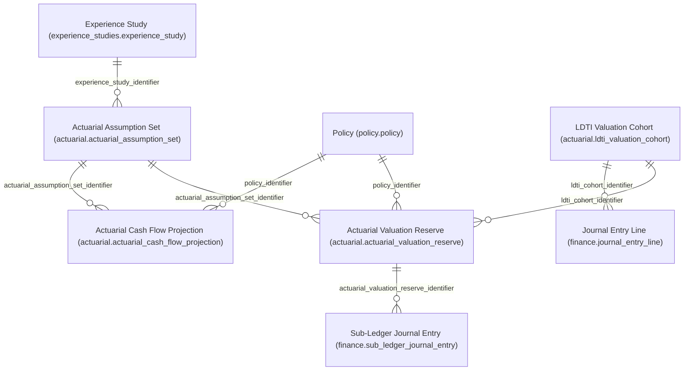

# L&A Ontology Knowledge Framework (OKF) -- Domain 9: Actuarial (Assumptions, LDTI Cohorts, Reserves & Cash Flow Projections)

| OKF Metadata Attribute | Value |
| :--- | :--- |
| **OKF Catalog Document** | `L&A OKF/09 - OKF - Actuarial.MD` |
| **Enterprise Data Domain** | **Domain 9: Actuarial (Assumptions, LDTI Cohorts, Reserves & Cash Flow Projections)** |
| **Target Physical Database Engine** | Amazon RDS Aurora PostgreSQL (PostgreSQL 15/16 Compatible) |
| **Physical Database Schema** | `actuarial` |
| **Domain Table Count** | **4 Physical Tables / Logical Entities** |
| **Outbound Foreign Key Joins** | **6 Foreign Key Relationships** (Intra-Domain & Cross-Domain) |
| **Inbound Foreign Key Joins** | **2 Cross-Domain Referencing Relationships** |
| **Performance Indexes** | **6 B-Tree & Composite Indexes** |
| **Inherited Business Context Rules** | **`BC-159` through `BC-178` (20 Rules)** |
| **Source Knowledge Layer Artifacts** | `L&A - Ontology.MD`, `L&A Data Model - Logical.MD`, `L&A Data Model - Physical DDL.sql`, `L&A Data Model - Conceptual.MD` |

---

## 1. Domain Executive Ontology & Business Context Overview

The **Actuarial** domain encompasses the mathematical valuation models, governance-locked assumption sets, statutory and GAAP reserve liabilities, Long-Duration Targeted Improvements (LDTI) cohorts, Risk-Based Capital (RBC) requirements, and stochastic cash flow projections that quantify the insurer's long-term contractual obligations. Because Life Insurance policies and Annuity contracts represent multi-decade promises—often spanning 30 to 60 years from a participant's first 403(b) payroll contribution at age 25 through lifetime annuity payouts past age 95—policy benefit reserves constitute the single largest liability on a Life & Annuity carrier's balance sheet. This domain is organized across four core logical entities: `Actuarial Assumption Set`, `LDTI Valuation Cohort`, `Actuarial Valuation Reserve`, and `Actuarial Cash Flow Projection`.

`Actuarial Assumption Set` (`Actuarial Assumption Set Identifier`, `Assumption Set Name`, `Assumption Version Number`) stores the SOX-controlled, Appointed-Actuary-approved (`Governance Approval Status`) parameters feeding actuarial modeling engines (such as FIS Prophet, Moody's AXIS, or Milliman Integrate/MG-Alfa). Linked directly to the calibrating `Experience Study Identifier`, each assumption set specifies its `Valuation Purpose` (`US GAAP LDTI (ASC 944 Best Estimate)`, `Statutory Principles-Based Reserving (VM-20 / VM-21 / VM-22)`, `Asset Adequacy Analysis / Cash Flow Testing (CFT)`, or `New Product Pricing & Profitability`), alongside the `Base Mortality or Longevity Table`, two-dimensional `Mortality Improvement Scale` (e.g., `SOA Scale MP-2021` or `NAIC Scale G2`), `Dynamic Lapse Formula Type` (which dynamically lowers lapse rates when a GMWB rider is deeply in-the-money and raises lapse rates when market interest rates spike above fixed crediting rates), `Discount Rate Curve Reference`, and `Assumed Annuitization Utilization Rate`.

For US GAAP reporting under FASB ASC 944, `LDTI Valuation Cohort` (`LDTI Cohort Identifier`, `Product Issue Year`, `Product Grouping Name`) aggregates long-duration contracts into annual issue-year cohorts to track the Liability for Future Policy Benefits (LFPB) using both the `Locked-In Discount Rate` (for net income recognition) and the `Current Market Discount Rate` (Single-A corporate bond yield for balance sheet remeasurement through Other Comprehensive Income [OCI]), alongside constant-level `Deferred Acquisition Cost (DAC) Balance` amortization and fair-value `Market Risk Benefit (MRB) Fair Value` measurements for GMxB riders. At the individual policy or model-point level, `Actuarial Valuation Reserve` (`Actuarial Valuation Reserve Identifier`) stores period-end reserve calculations by `Valuation Basis`—capturing Statutory PBR components (`Net Premium Reserve Amount`, `Deterministic Reserve Amount`, `Stochastic Reserve Amount` at CTE 70, `Future Policy Benefit Reserve Amount`, and `Additional Actuarial Reserve (AAR) Amount` held to prefund high guaranteed Participating General Account Fixed vintage payout rates), plus `Net Amount at Risk (NAR)` and `Required Risk-Based Capital (RBC) Amount` across C-1, C-2, and C-3 risks. Finally, `Actuarial Cash Flow Projection` stores period-by-period deterministic and stochastic cash flow vectors (`Projected Premium Inflow Amount`, `Projected Death Benefit Outflow`, `Projected Annuity Income Outflow`, `Projected Surrender Outflow`, `Projected Net Investment Income`) across economic scenarios (`Economic Scenario Number`) for Asset-Liability Management (ALM).

---

## 2. Physical Schema & Logical Entity Architecture Catalog (Schema: `actuarial`)

| # | Logical Entity Name | Physical Table Name (`schema.table`) | Primary Key Column (`PK`) | Business Cols | Audit Cols | Constraints (`PK`/`UQ`/`CHK`) | Logical Entity & Physical Table Definition |
| :--- | :--- | :--- | :--- | :--- | :--- | :--- | :--- |
| **9.1** | **Actuarial Assumption Set** | `actuarial.actuarial_assumption_set` | `actuarial_assumption_set_identifier` | 12 | 2 | `pk_actuarial_assumption_set`, `uq_assumption_set_name_ver` | Actuarial Assumption Set entity holds version-controlled, governance-approved mortality tables, longevity improvement scales, dynamic lapse formulas, expense assumptions, and discount rate curves used to drive GAAP LDTI, Statutory Principles-Based Reserving (PBR), and pricing runs. |
| **9.2** | **LDTI Valuation Cohort** | `actuarial.ldti_valuation_cohort` | `ldti_cohort_identifier` | 7 | 2 | `pk_ldti_valuation_cohort`, `uq_ldti_grouping_year` | LDTI Valuation Cohort entity represents the US GAAP Long-Duration Targeted Improvements (ASC 944) aggregation unit grouping policies by product and issue year cohort to track locked-in discount rates, current market discount rates, Deferred Acquisition Costs (DAC), and Market Risk Benefits (MRB). |
| **9.3** | **Actuarial Valuation Reserve** | `actuarial.actuarial_valuation_reserve` | `actuarial_valuation_reserve_identifier` | 13 | 2 | `pk_actuarial_valuation_reserve`, `uq_policy_val_date_basis` | Actuarial Valuation Reserve entity stores the calculated policy-level or model-point-level liability reserves across Statutory (VM-20, VM-21, VM-22, Additional Actuarial Reserves), US GAAP LDTI, and Tax bases, alongside Net Amount at Risk and Risk-Based Capital (RBC) requirements. |
| **9.4** | **Actuarial Cash Flow Projection** | `actuarial.actuarial_cash_flow_projection` | `cash_flow_projection_identifier` | 11 | 2 | `pk_actuarial_cash_flow_projection` | Actuarial Cash Flow Projection entity captures period-by-period deterministic and stochastic projected inflows (premiums, investment income) and outflows (death benefits, surrenders, annuity income payments, expenses) across economic scenarios for Asset-Liability Management (ALM) and Cash Flow Testing. |

---

## 3. Relational Join Mining & Foreign Key Topology

### 3.1 Entity-Relationship & Foreign Key Join Diagram (Mermaid)



### 3.2 Outbound Foreign Key Join Matrix (Tables in `actuarial` Referencing Parent Entities)

| FK Constraint Name | Child Table (`actuarial`) | Child FK Column | Join Scope | Parent Referenced Table | Parent PK Column | Referential Action | Exact SQL Join Predicate |
| :--- | :--- | :--- | :--- | :--- | :--- | :--- | :--- |
| `fk_aas_experience_study` | `actuarial.actuarial_assumption_set` | `experience_study_identifier` | Cross-Domain (`experience_studies`) | `experience_studies.experience_study` | `experience_study_identifier` | `ON UPDATE CASCADE ON DELETE SET NULL` | `actuarial.actuarial_assumption_set.experience_study_identifier = experience_studies.experience_study.experience_study_identifier` |
| `fk_avr_policy` | `actuarial.actuarial_valuation_reserve` | `policy_identifier` | Cross-Domain (`policy`) | `policy.policy` | `policy_identifier` | `ON UPDATE CASCADE ON DELETE RESTRICT` | `actuarial.actuarial_valuation_reserve.policy_identifier = policy.policy.policy_identifier` |
| `fk_avr_assumption_set` | `actuarial.actuarial_valuation_reserve` | `actuarial_assumption_set_identifier` | Intra-Domain | `actuarial.actuarial_assumption_set` | `actuarial_assumption_set_identifier` | `ON UPDATE CASCADE ON DELETE RESTRICT` | `actuarial.actuarial_valuation_reserve.actuarial_assumption_set_identifier = actuarial.actuarial_assumption_set.actuarial_assumption_set_identifier` |
| `fk_avr_ldti_cohort` | `actuarial.actuarial_valuation_reserve` | `ldti_cohort_identifier` | Intra-Domain | `actuarial.ldti_valuation_cohort` | `ldti_cohort_identifier` | `ON UPDATE CASCADE ON DELETE SET NULL` | `actuarial.actuarial_valuation_reserve.ldti_cohort_identifier = actuarial.ldti_valuation_cohort.ldti_cohort_identifier` |
| `fk_acfp_assumption_set` | `actuarial.actuarial_cash_flow_projection` | `actuarial_assumption_set_identifier` | Intra-Domain | `actuarial.actuarial_assumption_set` | `actuarial_assumption_set_identifier` | `ON UPDATE CASCADE ON DELETE RESTRICT` | `actuarial.actuarial_cash_flow_projection.actuarial_assumption_set_identifier = actuarial.actuarial_assumption_set.actuarial_assumption_set_identifier` |
| `fk_acfp_policy` | `actuarial.actuarial_cash_flow_projection` | `policy_identifier` | Cross-Domain (`policy`) | `policy.policy` | `policy_identifier` | `ON UPDATE CASCADE ON DELETE SET NULL` | `actuarial.actuarial_cash_flow_projection.policy_identifier = policy.policy.policy_identifier` |

### 3.3 Inbound Cross-Domain Foreign Key Join Matrix (External Schemas Referencing `actuarial`)

| FK Constraint Name | Referencing Child Schema | Referencing Child Table | Child FK Column | Referenced Target Table (`actuarial`) | Target PK Column | Referential Action | Exact SQL Join Predicate |
| :--- | :--- | :--- | :--- | :--- | :--- | :--- | :--- |
| `fk_slje_actuarial_reserve` | `finance` | `finance.sub_ledger_journal_entry` | `actuarial_valuation_reserve_identifier` | `actuarial.actuarial_valuation_reserve` | `actuarial_valuation_reserve_identifier` | `ON UPDATE CASCADE ON DELETE SET NULL` | `finance.sub_ledger_journal_entry.actuarial_valuation_reserve_identifier = actuarial.actuarial_valuation_reserve.actuarial_valuation_reserve_identifier` |
| `fk_jel_ldti_cohort` | `finance` | `finance.journal_entry_line` | `ldti_cohort_identifier` | `actuarial.ldti_valuation_cohort` | `ldti_cohort_identifier` | `ON UPDATE CASCADE ON DELETE SET NULL` | `finance.journal_entry_line.ldti_cohort_identifier = actuarial.ldti_valuation_cohort.ldti_cohort_identifier` |

---

## 4. Detailed Table-by-Table Schema, Column Dictionary & DDL Constraints

### 4.1 Logical Entity: `Actuarial Assumption Set` <-> Physical Table: `actuarial.actuarial_assumption_set`

- **Business & Technical Purpose**: Actuarial Assumption Set entity holds version-controlled, governance-approved mortality tables, longevity improvement scales, dynamic lapse formulas, expense assumptions, and discount rate curves used to drive GAAP LDTI, Statutory Principles-Based Reserving (PBR), and pricing runs.
- **PostgreSQL Catalog Comment**: _""_
- **Primary Key**: `actuarial_assumption_set_identifier`

#### Attribute-to-Column Schema Mapping & Business Dictionary

| Ord | Logical Attribute Name | Physical Column Name | Logical Type | Physical PostgreSQL Type | Key | Column Modifiers / Default | Business Definition, Domain Semantics & Sample Values |
| :--- | :--- | :--- | :--- | :--- | :--- | :--- | :--- |
| **1** | **Actuarial Assumption Set Identifier** | `actuarial_assumption_set_identifier` | String | `VARCHAR(64)` | **PK** | `NOT NULL` | Unique primary key identifying a locked, governance-approved set of actuarial valuation assumptions. Sample values: `AAS-2026Q3-GAAP`, `AAS-2026Q3-STAT-VM21`. |
| **2** | **Experience Study Identifier** | `experience_study_identifier` | String | `VARCHAR(64)` | **FK** | `NULL` | Foreign key linking the assumption set back to the primary Experience Study that calibrated its mortality, longevity, or behavioral rates. Sample values: `EXP-STD-2026-ANN`, `EXP-STD-2026-LAPSE`. |
| **3** | **Assumption Set Name** | `assumption_set_name` | String | `VARCHAR(200)` | **NK** | `NOT NULL` | Business-friendly name describing the valuation regime, product block, and quarter of the assumption set. Sample values: `Q3 2026 US GAAP LDTI Best Estimate Assumptions - Annuities`, `2026 Year-End Statutory VM-20 / VM-21 PBR Assumptions`. |
| **4** | **Assumption Version Number** | `assumption_version_number` | String | `VARCHAR(32)` | **NK** | `NOT NULL` | Semantic version identifier tracking annual assumption unlocking updates and model changes. Sample values: `v2026.3.0`, `v2025.4.1`. |
| **5** | **Valuation Purpose** | `valuation_purpose` | String | `VARCHAR(120)` | **NK** | `NOT NULL` | Defines the regulatory or management modeling framework for which this assumption set is authorized. Sample values: `US GAAP LDTI (ASC 944 Best Estimate)`, `Statutory Principles-Based Reserving (VM-20 / VM-21 / VM-22)`, `Asset Adequacy Analysis / Cash Flow Testing (CFT)`, `New Product Pricing & Profitability`, `Economic Capital / Embedded Value`. |
| **6** | **Effective Valuation Date** | `effective_valuation_date` | Date | `DATE` | **NK** | `NOT NULL` | Balance sheet valuation date from which these assumptions are effective. Sample values: `2026-09-30`, `2026-12-31`. |
| **7** | **Base Mortality or Longevity Table** | `base_mortality_or_longevity_table` | String | `VARCHAR(150)` | **NK** | `NOT NULL` | Identifier of the base mortality or annuitant longevity rate table (plus company credibility multipliers) used in the model. Sample values: `92% of Pri-2012 Higher Ed Retiree Table`, `2012 IAM Basic with Carrier Credibility Factors`, `85% of 2015 VBT Select & Ultimate`. |
| **8** | **Mortality Improvement Scale** | `mortality_improvement_scale` | String | `VARCHAR(120)` | **NK** | `NOT NULL` | Two-dimensional projection scale applied to base mortality rates to account for future medical and longevity improvements over time. Sample values: `SOA Scale MP-2021`, `NAIC Scale G2`, `Company Custom Higher-Ed Longevity Scale`. |
| **9** | **Dynamic Lapse Formula Type** | `dynamic_lapse_formula_type` | String | `VARCHAR(150)` | **NK** | `NOT NULL` | Specifies the mathematical function adjusting base surrender rates upward or downward based on market interest rates and rider In-The-Moneyness. Sample values: `VM-21 Prescribed Dynamic Lapse Formula`, `Two-Sided Interest Rate & ITM Dynamic Skew`, `Static Durational Lapse Table Only`. |
| **10** | **Discount Rate Curve Reference** | `discount_rate_curve_reference` | String | `VARCHAR(150)` | **NK** | `NOT NULL` | Identifies the yield curve used to discount projected future liability cash flows to present value. Sample values: `GAAP Upper-Medium Grade (Single-A) Corporate Bond Yield Curve`, `Statutory Valuation Interest Rate (SVIR 3.50%)`, `US Treasury Spot Curve + 100 bps`. |
| **11** | **Assumed Annuitization Utilization Rate** | `assumed_annuitization_utilization_rate` | String | `VARCHAR(150)` | **NK** | `NOT NULL` | Assumed annual percentage of deferred annuity policyholders who elect to convert their accumulation balance into lifetime payout income at each attained age. Sample values: `Age-Graded 4.5% to 18.0% Institutional Election Curve`, `2.0% Retail Annuitization Assumption`. |
| **12** | **Governance Approval Status** | `governance_approval_status` | String | `VARCHAR(100)` | **NK** | `NOT NULL` | Tracks formal sign-off by the Appointed Actuary and Actuarial Assumption Governance Committee (required for SOX controls). Sample values: `Draft / Sensitivity Testing`, `Pending Appointed Actuary Sign-Off`, `Approved & Locked for Production Valuation`, `Superseded`. |
| **13** | **Record Created Timestamp (Audit)** | `created_at` | Timestamp | `TIMESTAMPTZ` | **AUDIT** | `NOT NULL DEFAULT CURRENT_TIMESTAMP` | System audit timestamp recording when the physical row was initially inserted into the Aurora PostgreSQL table. |
| **14** | **Record Updated Timestamp (Audit)** | `updated_at` | Timestamp | `TIMESTAMPTZ` | **AUDIT** | `NOT NULL DEFAULT CURRENT_TIMESTAMP` | System audit timestamp recording when the physical row was last modified in the Aurora PostgreSQL table. |

#### Declarative DDL Constraints & Indexes on `actuarial.actuarial_assumption_set`

| Constraint / Index Category | Identifier Name | Definition / Target Columns & Referential Integrity Rule |
| :--- | :--- | :--- |
| **PRIMARY KEY** | `pk_actuarial_assumption_set` | `PRIMARY KEY (actuarial_assumption_set_identifier)` |
| **UNIQUE** | `uq_assumption_set_name_ver` | `UNIQUE (assumption_set_name, assumption_version_number)` |
| **FOREIGN KEY** | `fk_aas_experience_study` | `FOREIGN KEY (experience_study_identifier) REFERENCES experience_studies.experience_study (experience_study_identifier) ON UPDATE CASCADE ON DELETE SET NULL` |
| **B-TREE INDEX** | `idx_aas_exp_study_id` | `ON actuarial.actuarial_assumption_set (experience_study_identifier)` |

### 4.2 Logical Entity: `LDTI Valuation Cohort` <-> Physical Table: `actuarial.ldti_valuation_cohort`

- **Business & Technical Purpose**: LDTI Valuation Cohort entity represents the US GAAP Long-Duration Targeted Improvements (ASC 944) aggregation unit grouping policies by product and issue year cohort to track locked-in discount rates, current market discount rates, Deferred Acquisition Costs (DAC), and Market Risk Benefits (MRB).
- **PostgreSQL Catalog Comment**: _""_
- **Primary Key**: `ldti_cohort_identifier`

#### Attribute-to-Column Schema Mapping & Business Dictionary

| Ord | Logical Attribute Name | Physical Column Name | Logical Type | Physical PostgreSQL Type | Key | Column Modifiers / Default | Business Definition, Domain Semantics & Sample Values |
| :--- | :--- | :--- | :--- | :--- | :--- | :--- | :--- |
| **1** | **LDTI Cohort Identifier** | `ldti_cohort_identifier` | String | `VARCHAR(64)` | **PK** | `NOT NULL` | Unique primary key identifying a US GAAP Long-Duration Targeted Improvements (ASC 944) valuation cohort. Sample values: `LDTI-TRAD-2020`, `LDTI-VA-2023`, `LDTI-UL-2024`. |
| **2** | **Product Issue Year** | `product_issue_year` | Integer | `INTEGER` | **NK** | `NOT NULL` | Four-digit calendar year in which the policies grouped into this LDTI cohort were originally issued (or grouped pre-transition vintage). Sample values: `2021`, `2022`, `2023`, `2024`, `2025`. |
| **3** | **Product Grouping Name** | `product_grouping_name` | String | `VARCHAR(200)` | **NK** | `NOT NULL` | GAAP ASC 944 aggregation portfolio name combining contracts with similar insurance risk and duration profiles. Sample values: `Institutional General Account Payout Annuities`, `CREF & Retail Variable Annuities with GLWB`, `Individual Term Life Insurance`. |
| **4** | **Locked-In Discount Rate** | `locked_in_discount_rate` | Decimal | `NUMERIC(9,6)` | **NK** | `NOT NULL` | Original upper-medium grade (Single-A) fixed-income yield rate established at cohort inception used to measure the Liability for Future Policy Benefits on the GAAP income statement. Sample values: `0.0325` (3.25%), `0.0485` (4.85%), `0.0510` (5.10%). |
| **5** | **Current Market Discount Rate** | `current_market_discount_rate` | Decimal | `NUMERIC(9,6)` | **NK** | `NOT NULL` | Current period-end Single-A corporate bond yield rate used to remeasure the Liability for Future Policy Benefits on the GAAP balance sheet (with the difference recorded in Other Comprehensive Income [OCI]). Sample values: `0.0495` (4.95%), `0.0515` (5.15%). |
| **6** | **Deferred Acquisition Cost (DAC) Balance** | `deferred_acquisition_cost_dac_balance` | Decimal | `NUMERIC(20,2)` | **NK** | `NOT NULL DEFAULT 0.00` | Unamortized balance of capitalized policy acquisition expenses (commissions, underwriting costs) for this cohort, amortized on a constant-level basis over the expected life of the cohort under LDTI. Sample values: `18450200.00`, `42100000.00`. |
| **7** | **Market Risk Benefit (MRB) Fair Value** | `market_risk_benefit_mrb_fair_value` | Decimal | `NUMERIC(20,2)` | **NK** | `NOT NULL DEFAULT 0.00` | Fair-value liability (or asset) measured under ASC 944 for capital-market-sensitive guarantees such as GMWB, GMIB, and GMDB riders attached to policies in this cohort. Sample values: `64200000.00`, `12850000.00`, `0.00`. |
| **8** | **Record Created Timestamp (Audit)** | `created_at` | Timestamp | `TIMESTAMPTZ` | **AUDIT** | `NOT NULL DEFAULT CURRENT_TIMESTAMP` | System audit timestamp recording when the physical row was initially inserted into the Aurora PostgreSQL table. |
| **9** | **Record Updated Timestamp (Audit)** | `updated_at` | Timestamp | `TIMESTAMPTZ` | **AUDIT** | `NOT NULL DEFAULT CURRENT_TIMESTAMP` | System audit timestamp recording when the physical row was last modified in the Aurora PostgreSQL table. |

#### Declarative DDL Constraints & Indexes on `actuarial.ldti_valuation_cohort`

| Constraint / Index Category | Identifier Name | Definition / Target Columns & Referential Integrity Rule |
| :--- | :--- | :--- |
| **PRIMARY KEY** | `pk_ldti_valuation_cohort` | `PRIMARY KEY (ldti_cohort_identifier)` |
| **UNIQUE** | `uq_ldti_grouping_year` | `UNIQUE (product_grouping_name, product_issue_year)` |

### 4.3 Logical Entity: `Actuarial Valuation Reserve` <-> Physical Table: `actuarial.actuarial_valuation_reserve`

- **Business & Technical Purpose**: Actuarial Valuation Reserve entity stores the calculated policy-level or model-point-level liability reserves across Statutory (VM-20, VM-21, VM-22, Additional Actuarial Reserves), US GAAP LDTI, and Tax bases, alongside Net Amount at Risk and Risk-Based Capital (RBC) requirements.
- **PostgreSQL Catalog Comment**: _""_
- **Primary Key**: `actuarial_valuation_reserve_identifier`

#### Attribute-to-Column Schema Mapping & Business Dictionary

| Ord | Logical Attribute Name | Physical Column Name | Logical Type | Physical PostgreSQL Type | Key | Column Modifiers / Default | Business Definition, Domain Semantics & Sample Values |
| :--- | :--- | :--- | :--- | :--- | :--- | :--- | :--- |
| **1** | **Actuarial Valuation Reserve Identifier** | `actuarial_valuation_reserve_identifier` | String | `VARCHAR(64)` | **PK** | `NOT NULL` | Unique primary key identifying a policy-level or model-point-level reserve valuation record for a specific reporting date and accounting basis. Sample values: `AVR-202609-00192`, `AVR-202609-00193`. |
| **2** | **Policy Identifier** | `policy_identifier` | String | `VARCHAR(64)` | **FK** | `NOT NULL` | Foreign key linking the calculated reserve liability to the individual Policy. Sample values: `POL-UUID-90001421`. |
| **3** | **Actuarial Assumption Set Identifier** | `actuarial_assumption_set_identifier` | String | `VARCHAR(64)` | **FK** | `NOT NULL` | Foreign key linking the reserve record to the exact Actuarial Assumption Set version that produced the calculation. Sample values: `AAS-2026Q3-STAT-VM21`, `AAS-2026Q3-GAAP`. |
| **4** | **LDTI Cohort Identifier** | `ldti_cohort_identifier` | String | `VARCHAR(64)` | **FK** | `NULL` | Optional foreign key linking the policy reserve record to its parent GAAP LDTI Valuation Cohort. Sample values: `LDTI-TRAD-2020`, `LDTI-VA-2023`. |
| **5** | **Valuation Date** | `valuation_date` | Date | `DATE` | **NK** | `NOT NULL` | Balance sheet cutoff date as of which the actuarial reserve liability is calculated. Sample values: `2026-09-30`, `2026-12-31`. |
| **6** | **Valuation Basis** | `valuation_basis` | String | `VARCHAR(100)` | **NK** | `NOT NULL` | Specifies the regulatory or accounting reserve methodology applied. Sample values: `US GAAP LDTI (ASC 944)`, `Statutory VM-20 (PBR Life)`, `Statutory VM-21 (PBR Variable Annuity)`, `Statutory VM-22 (Fixed & Payout Annuity)`, `Statutory CRVM / CARVM Legacy`, `US Federal Tax Reserve (IRC 807)`. |
| **7** | **Net Premium Reserve Amount** | `net_premium_reserve_amount` | Decimal | `NUMERIC(18,2)` | **NK** | `NOT NULL DEFAULT 0.00` | Formulaic floor reserve calculated under statutory Principles-Based Reserving (VM-20) or traditional net level / CRVM methods. Sample values: `142500.00`, `18400.00`. |
| **8** | **Deterministic Reserve Amount** | `deterministic_reserve_amount` | Decimal | `NUMERIC(18,2)` | **NK** | `NOT NULL DEFAULT 0.00` | Present value of future benefits and expenses less present value of future net premiums calculated along a single prescribed deterministic economic scenario. Sample values: `146800.00`, `19200.00`, `0.00`. |
| **9** | **Stochastic Reserve Amount** | `stochastic_reserve_amount` | Decimal | `NUMERIC(18,2)` | **NK** | `NOT NULL DEFAULT 0.00` | Tail conditional expectation (CTE 70) reserve calculated across 1,000+ stochastic interest rate and equity return scenarios for policies with asymmetric guarantees (VM-20 / VM-21). Sample values: `154200.00`, `0.00`. |
| **10** | **Future Policy Benefit Reserve Amount** | `future_policy_benefit_reserve_amount` | Decimal | `NUMERIC(18,2)` | **NK** | `NOT NULL DEFAULT 0.00` | Final reported balance sheet reserve liability for the policy on the specified Valuation Basis (e.g., max of NPR, Deterministic, and Stochastic Reserve for PBR, or GAAP LFPB + MRB). Sample values: `154200.00`, `148900.00`. |
| **11** | **Additional Actuarial Reserve (AAR) Amount** | `additional_actuarial_reserve_aar_amount` | Decimal | `NUMERIC(18,2)` | **NK** | `NOT NULL DEFAULT 0.00` | Supplemental statutory reserve held above formulaic minimums based on Asset Adequacy Analysis / Cash Flow Testing or to prefund future general account annuitization mortality guarantees. Sample values: `8500.00`, `24000.00`, `0.00`. |
| **12** | **Net Amount at Risk (NAR)** | `net_amount_at_risk_nar` | Decimal | `NUMERIC(18,2)` | **NK** | `NOT NULL DEFAULT 0.00` | Current mortality or living benefit risk exposure on the policy, equal to Guaranteed Death/Living Benefit Base minus the current Account Value or Reserve. Sample values: `354769.15`, `50000.00`, `0.00`. |
| **13** | **Required Risk-Based Capital (RBC) Amount** | `required_risk_based_capital_rbc_amount` | Decimal | `NUMERIC(18,2)` | **NK** | `NOT NULL DEFAULT 0.00` | Total NAIC Risk-Based Capital requirement allocated to this policy across C-1 (Asset Risk), C-2 (Mortality/Longevity Insurance Risk), and C-3 (Interest Rate & Market Risk) components. Sample values: `4820.50`, `1210.00`. |
| **14** | **Record Created Timestamp (Audit)** | `created_at` | Timestamp | `TIMESTAMPTZ` | **AUDIT** | `NOT NULL DEFAULT CURRENT_TIMESTAMP` | System audit timestamp recording when the physical row was initially inserted into the Aurora PostgreSQL table. |
| **15** | **Record Updated Timestamp (Audit)** | `updated_at` | Timestamp | `TIMESTAMPTZ` | **AUDIT** | `NOT NULL DEFAULT CURRENT_TIMESTAMP` | System audit timestamp recording when the physical row was last modified in the Aurora PostgreSQL table. |

#### Declarative DDL Constraints & Indexes on `actuarial.actuarial_valuation_reserve`

| Constraint / Index Category | Identifier Name | Definition / Target Columns & Referential Integrity Rule |
| :--- | :--- | :--- |
| **PRIMARY KEY** | `pk_actuarial_valuation_reserve` | `PRIMARY KEY (actuarial_valuation_reserve_identifier)` |
| **UNIQUE** | `uq_policy_val_date_basis` | `UNIQUE (policy_identifier, valuation_date, valuation_basis)` |
| **FOREIGN KEY** | `fk_avr_policy` | `FOREIGN KEY (policy_identifier) REFERENCES policy.policy (policy_identifier) ON UPDATE CASCADE ON DELETE RESTRICT` |
| **FOREIGN KEY** | `fk_avr_assumption_set` | `FOREIGN KEY (actuarial_assumption_set_identifier) REFERENCES actuarial.actuarial_assumption_set (actuarial_assumption_set_identifier) ON UPDATE CASCADE ON DELETE RESTRICT` |
| **FOREIGN KEY** | `fk_avr_ldti_cohort` | `FOREIGN KEY (ldti_cohort_identifier) REFERENCES actuarial.ldti_valuation_cohort (ldti_cohort_identifier) ON UPDATE CASCADE ON DELETE SET NULL` |
| **B-TREE INDEX** | `idx_avr_policy_val_date` | `ON actuarial.actuarial_valuation_reserve (policy_identifier, valuation_date DESC)` |
| **B-TREE INDEX** | `idx_avr_assumption_set_id` | `ON actuarial.actuarial_valuation_reserve (actuarial_assumption_set_identifier)` |
| **B-TREE INDEX** | `idx_avr_ldti_cohort_id` | `ON actuarial.actuarial_valuation_reserve (ldti_cohort_identifier)` |

### 4.4 Logical Entity: `Actuarial Cash Flow Projection` <-> Physical Table: `actuarial.actuarial_cash_flow_projection`

- **Business & Technical Purpose**: Actuarial Cash Flow Projection entity captures period-by-period deterministic and stochastic projected inflows (premiums, investment income) and outflows (death benefits, surrenders, annuity income payments, expenses) across economic scenarios for Asset-Liability Management (ALM) and Cash Flow Testing.
- **PostgreSQL Catalog Comment**: _""_
- **Primary Key**: `cash_flow_projection_identifier`

#### Attribute-to-Column Schema Mapping & Business Dictionary

| Ord | Logical Attribute Name | Physical Column Name | Logical Type | Physical PostgreSQL Type | Key | Column Modifiers / Default | Business Definition, Domain Semantics & Sample Values |
| :--- | :--- | :--- | :--- | :--- | :--- | :--- | :--- |
| **1** | **Cash Flow Projection Identifier** | `cash_flow_projection_identifier` | String | `VARCHAR(64)` | **PK** | `NOT NULL` | Unique primary key identifying a projected future period cash flow record from an actuarial modeling run (e.g., Prophet, AXIS, or Alfa). Sample values: `CFP-RUN2026Q3-S001-M001`, `CFP-RUN2026Q3-S001-M002`. |
| **2** | **Actuarial Assumption Set Identifier** | `actuarial_assumption_set_identifier` | String | `VARCHAR(64)` | **FK** | `NOT NULL` | Foreign key linking the projection output to the Actuarial Assumption Set used in the simulation run. Sample values: `AAS-2026Q3-STAT-VM21`. |
| **3** | **Policy Identifier** | `policy_identifier` | String | `VARCHAR(64)` | **FK** | `NULL` | Optional foreign key linking the projected cash flows to a specific Policy or representative model point. Sample values: `POL-UUID-90001421`. |
| **4** | **Projection Run Identifier** | `projection_run_identifier` | String | `VARCHAR(64)` | **NK** | `NOT NULL` | Batch execution identifier of the actuarial valuation or Asset-Liability Management (ALM) simulation run. Sample values: `ALM-CFT-2026Q3-PROD-01`, `VM21-STOCH-2026Q3-04`. |
| **5** | **Economic Scenario Number** | `economic_scenario_number` | Integer | `INTEGER` | **NK** | `NOT NULL` | Identifies the specific economic scenario path (e.g., NY7 deterministic rate shock or Academy Interest Rate Generator stochastic scenario 1 through 1,000). Sample values: `1` (Base Level), `2` (NY7 +300 bps Up), `412` (Stochastic Path 412). |
| **6** | **Projection Month or Year** | `projection_month_or_year` | String | `VARCHAR(50)` | **NK** | `NOT NULL` | Future time step offset from the Valuation Date (e.g., Month 1 to Month 720 / 60 years). Sample values: `Month 1 (2026-10)`, `Month 12 (2027-09)`, `Month 120 (2036-09)`. |
| **7** | **Projected Premium Inflow Amount** | `projected_premium_inflow_amount` | Decimal | `NUMERIC(18,2)` | **NK** | `NOT NULL DEFAULT 0.00` | Expected future gross premium contributions and employer matches modeled to be received during the projection time step. Sample values: `1500.00`, `18000.00`, `0.00`. |
| **8** | **Projected Death Benefit Outflow** | `projected_death_benefit_outflow` | Decimal | `NUMERIC(18,2)` | **NK** | `NOT NULL DEFAULT 0.00` | Expected mortality claim dollar outflow modeled for the projection time step (Death Benefit times projected mortality rate $q_x$). Sample values: `420.15`, `1250.80`. |
| **9** | **Projected Annuity Income Outflow** | `projected_annuity_income_outflow` | Decimal | `NUMERIC(18,2)` | **NK** | `NOT NULL DEFAULT 0.00` | Expected lifetime or period-certain annuity income payment outflow modeled for the projection time step. Sample values: `0.00`, `2850.00`, `34200.00`. |
| **10** | **Projected Surrender Outflow** | `projected_surrender_outflow` | Decimal | `NUMERIC(18,2)` | **NK** | `NOT NULL DEFAULT 0.00` | Expected cash surrender and partial withdrawal dollar outflow modeled for the projection time step (Account Value times dynamic lapse rate $w_x$). Sample values: `610.40`, `4520.00`. |
| **11** | **Projected Net Investment Income** | `projected_net_investment_income` | Decimal | `NUMERIC(18,2)` | **NK** | `NOT NULL DEFAULT 0.00` | Expected general account portfolio earned interest and dividend income allocated to the liability block during the projection time step. Sample values: `645.20`, `7810.50`. |
| **12** | **Record Created Timestamp (Audit)** | `created_at` | Timestamp | `TIMESTAMPTZ` | **AUDIT** | `NOT NULL DEFAULT CURRENT_TIMESTAMP` | System audit timestamp recording when the physical row was initially inserted into the Aurora PostgreSQL table. |
| **13** | **Record Updated Timestamp (Audit)** | `updated_at` | Timestamp | `TIMESTAMPTZ` | **AUDIT** | `NOT NULL DEFAULT CURRENT_TIMESTAMP` | System audit timestamp recording when the physical row was last modified in the Aurora PostgreSQL table. |

#### Declarative DDL Constraints & Indexes on `actuarial.actuarial_cash_flow_projection`

| Constraint / Index Category | Identifier Name | Definition / Target Columns & Referential Integrity Rule |
| :--- | :--- | :--- |
| **PRIMARY KEY** | `pk_actuarial_cash_flow_projection` | `PRIMARY KEY (cash_flow_projection_identifier)` |
| **FOREIGN KEY** | `fk_acfp_assumption_set` | `FOREIGN KEY (actuarial_assumption_set_identifier) REFERENCES actuarial.actuarial_assumption_set (actuarial_assumption_set_identifier) ON UPDATE CASCADE ON DELETE RESTRICT` |
| **FOREIGN KEY** | `fk_acfp_policy` | `FOREIGN KEY (policy_identifier) REFERENCES policy.policy (policy_identifier) ON UPDATE CASCADE ON DELETE SET NULL` |
| **B-TREE INDEX** | `idx_acfp_run_scenario` | `ON actuarial.actuarial_cash_flow_projection (projection_run_identifier, economic_scenario_number)` |
| **B-TREE INDEX** | `idx_acfp_policy_id` | `ON actuarial.actuarial_cash_flow_projection (policy_identifier)` |

---

## 5. Inherited Business Context Ontology Rules (`BC-159` to `BC-178`)

> **Semantic Inheritance Notice**: The following **20 Business Context rules** are inherited verbatim from `L&A Data Domain/L&A - Ontology.MD` to provide autonomous AI agents, data engineers, and actuaries with complete domain rules, accounting identities, statutory compliance mandates, and SQL join guardrails for the **Actuarial** domain.

#### BC-159: Statutory Principles-Based Reserving (PBR) Framework Across VM-20, VM-21, and VM-22

**Domains**: Actuarial, Policy, Product | **Entities**: `Actuarial Valuation Reserve`, `Actuarial Assumption Set`, `Policy` | **Key Attributes**: `Valuation Basis`, `Valuation Purpose`, `Net Premium Reserve Amount`, `Deterministic Reserve Amount`, `Stochastic Reserve Amount`, `Future Policy Benefit Reserve Amount`

Over the past decade, the National Association of Insurance Commissioners (NAIC) transformed US statutory reserve valuation from rigid, static 19th-century formulaic tables (`Statutory CRVM / CARVM Legacy`) to **Principles-Based Reserving (PBR)** governed by the NAIC Valuation Manual. Under PBR, rather than applying a single locked-in statutory interest rate and mortality table regardless of company experience or complex embedded guarantees, insurers must project cash flows across multiple economic scenarios using prudent estimate assumptions (company experience from Domain 8 plus prescribed regulatory margins). On `Actuarial Valuation Reserve`, the specific PBR regime is identified by `Valuation Basis`:

1. `Statutory VM-20 (PBR Life)`: Applies to individual life insurance policies (`Term Life`, `Universal Life`, Variable Life, and Whole Life) issued on or after the PBR operative date (January 1, 2017–2020). VM-20 requires evaluating up to three reserve components—the formulaic `Net Premium Reserve Amount` (NPR), the single-scenario `Deterministic Reserve Amount` (DR), and the multi-scenario `Stochastic Reserve Amount` (SR)—to capture asymmetric universal life secondary guarantees.
2. `Statutory VM-21 (PBR Variable Annuity)`: Applies to variable annuities (`Variable Annuity` contracts, including retail VA with GMWB/GMIB/GMDB riders), integrated with the NAIC C-3 Phase II Risk-Based Capital framework. Because equity market crashes and interest rate drops simultaneously inflate variable annuity living benefit guarantees, VM-21 relies primarily on `Stochastic Reserve Amount` (CTE 70 tail conditional expectation across 1,000+ economic paths) over a standard projection floor (`Net Premium Reserve Amount` / Standard Projection Amount).
3. `Statutory VM-22 (Fixed & Payout Annuity)`: Governs non-variable annuities—including general account fixed deferred annuities (`Participating General Account Fixed`), fixed indexed annuities (FIAs), pension risk transfer (PRT) group annuities, and lifetime payout annuities—combining prescribed statutory valuation interest rates with PBR stochastic/deterministic reserve floors.

AI agents querying `Actuarial Valuation Reserve` for statutory solvency reporting must inspect `Valuation Basis` to understand which PBR chapter governs each policy block and why certain policies populate all three reserve columns (`Net Premium Reserve Amount`, `Deterministic Reserve Amount`, `Stochastic Reserve Amount`) while legacy blocks populate only `Net Premium Reserve Amount`.

#### BC-160: The Statutory PBR "Greater Of" Reserve Rule and CTE 70 Tail Conditional Expectation

**Domains**: Actuarial | **Entities**: `Actuarial Valuation Reserve` | **Key Attributes**: `Actuarial Valuation Reserve Identifier`, `Valuation Basis`, `Net Premium Reserve Amount`, `Deterministic Reserve Amount`, `Stochastic Reserve Amount`, `Future Policy Benefit Reserve Amount`

A critical mathematical relationship on `Actuarial Valuation Reserve` governs how the three component reserve columns—`Net Premium Reserve Amount`, `Deterministic Reserve Amount`, and `Stochastic Reserve Amount`—combine to determine the final balance sheet liability stored in `Future Policy Benefit Reserve Amount` when `Valuation Basis` is a Statutory PBR method (`Statutory VM-20 (PBR Life)`, `Statutory VM-21 (PBR Variable Annuity)`, or `Statutory VM-22 (Fixed & Payout Annuity)`).

Under NAIC VM-20 and related PBR rules, the three columns are **not** additive components that get summed together! Instead, they represent three alternative reserve calculations of increasing sophistication, and the reported statutory reserve (`Future Policy Benefit Reserve Amount`) is determined by the **"Greater Of" (Maximum) Rule**:
$$\text{Future Policy Benefit Reserve Amount}_{\text{PBR}} = \max\left(\text{Net Premium Reserve Amount},\ \text{Deterministic Reserve Amount},\ \text{Stochastic Reserve Amount}\right)$$

Specifically:

- `Net Premium Reserve Amount` **(NPR)**: A prescribed formulaic floor reserve calculated per policy so that no insurer can use overly optimistic internal assumptions to hold a reserve below the regulatory minimum floor (e.g., `$142,500.00`).
- `Deterministic Reserve Amount` **(DR)**: A gross premium valuation (Present Value of Future Benefits and Expenses minus Present Value of Future Gross Premiums) calculated along a single prescribed deterministic economic path using prudent estimate assumptions (e.g., `$146,800.00`).
- `Stochastic Reserve Amount` **(SR)**: Calculated by running the policy block through $1,000$ or more stochastic interest rate and equity return scenarios, ranking the scenario greatest present value of accumulated deficiencies from best to worst, and taking the **CTE 70 (Conditional Tail Expectation at the 70th percentile)**—which is the arithmetic average of the **worst 30%** (top 300 out of 1,000) most adverse economic scenarios (e.g., `$154,200.00`).

In this example, `Future Policy Benefit Reserve Amount` equals `154200.00` ($\max(142500, 146800, 154200)$). AI agents must **never** add `Net Premium Reserve Amount + Deterministic Reserve Amount + Stochastic Reserve Amount` together—doing so would triple-count the statutory reserve! Instead, agents should use `Future Policy Benefit Reserve Amount` as the authoritative balance sheet reserve and calculate the excess of `Stochastic Reserve Amount` over `Net Premium Reserve Amount` ($\max(0, \text{SR} - \text{NPR})$) to measure the tail-risk PBR reserve load.

#### BC-161: US GAAP ASC 944 Long-Duration Targeted Improvements (LDTI) Annual Issue-Year Cohort Locking

**Domains**: Actuarial, Finance | **Entities**: `LDTI Valuation Cohort`, `Actuarial Valuation Reserve`, `Journal Entry Line` | **Key Attributes**: `LDTI Cohort Identifier`, `Product Issue Year`, `Product Grouping Name`, `Future Policy Benefit Reserve Amount`, `Valuation Basis`

Under FASB Accounting Standards Update 2018-12 (codified in **ASC 944, Financial Services—Insurance**, universally known as **Long-Duration Targeted Improvements or LDTI**), US GAAP accounting for traditional and limited-payment long-duration contracts—such as payout life annuities (`Institutional General Account Payout Annuities`), term life (`Individual Term Life Insurance`), and whole life—is organized around the `LDTI Valuation Cohort` entity. Every policy valued under `Valuation Basis = 'US GAAP LDTI (ASC 944)'` on `Actuarial Valuation Reserve` links via `LDTI Cohort Identifier` to its parent `LDTI Valuation Cohort`.

ASC 944 enforces two strict structural rules on `LDTI Valuation Cohort` via `Product Issue Year` and `Product Grouping Name`:

1. **No Cross-Year Grouping (Annual Issue-Year Locking)**: Contracts issued in different calendar years (`Product Issue Year`, e.g., `2021`, `2022`, `2023`, `2024`, `2025`) may **never** be combined into the same `LDTI Valuation Cohort` (except for legacy pre-transition cohorts grouped at initial LDTI adoption). Each calendar issue year within a `Product Grouping Name` forms a permanently closed annual cohort (such as `LDTI-TRAD-2020`, `LDTI-VA-2023`, or `LDTI-UL-2024`).
2. **The 100% Net Premium Ratio Cap and Anti-Netting Rule**: Under LDTI, the Liability for Future Policy Benefits (LFPB) is calculated using a cohort-level Net Premium Ratio ($\text{NPR} = \frac{\text{PV of Future Benefits & Expenses}}{\text{PV of Future Gross Premiums}}$). If unfavorable mortality, longevity, or lapse unlocking causes a cohort's present value of benefits to exceed 100% of gross premiums ($\text{NPR} > 100$), the excess loss ("loss recognition" / onerous cohort charge) must be recognized **immediately** in current-period GAAP Net Income! Because annual issue years are locked in separate `LDTI Valuation Cohort` records, a carrier cannot offset a loss-making `2022` cohort against a highly profitable `2024` cohort.

AI agents analyzing US GAAP LDTI reserves or income statement volatility must always group and evaluate `Actuarial Valuation Reserve` and `Journal Entry Line` at the `LDTI Cohort Identifier` (`Product Grouping Name` + `Product Issue Year`) level, never netting reserve unlocking impacts across different issue years before checking for cohort-level 100% net premium ratio capping.

#### BC-162: Dual Discount Rate Remeasurement Under LDTI: Locked-In Rate (Net Income) vs. Current Market Rate (OCI)

**Domains**: Actuarial, Finance | **Entities**: `LDTI Valuation Cohort`, `Actuarial Valuation Reserve`, `Actuarial Assumption Set` | **Key Attributes**: `LDTI Cohort Identifier`, `Locked-In Discount Rate`, `Current Market Discount Rate`, `Discount Rate Curve Reference`, `Future Policy Benefit Reserve Amount`

One of the defining innovations of US GAAP LDTI (ASC 944) for traditional and payout annuity contracts is its **dual discount rate architecture**, modeled on `LDTI Valuation Cohort` through two distinct interest rate attributes: `Locked-In Discount Rate` and `Current Market Discount Rate`. Under LDTI, FASB prohibited insurers from using their own expected general account portfolio asset earned rate (which previously allowed insurers holding riskier high-yield assets to report artificially lower GAAP liabilities). Instead, LDTI mandates that the Liability for Future Policy Benefits (LFPB) be discounted using an objective, observable **Upper-Medium Grade (Single-A) Fixed-Income Instrument Yield** (`Discount Rate Curve Reference = 'GAAP Upper-Medium Grade (Single-A) Corporate Bond Yield Curve'`).

To prevent quarter-to-quarter market interest rate swings from whipsawing GAAP Net Income while still reflecting current market interest rates on the GAAP Balance Sheet, LDTI requires every `LDTI Valuation Cohort` to be valued twice at each `Valuation Date`:

1. **Income Statement Measurement (**`Locked-In Discount Rate`**)**: Established once when the `LDTI Valuation Cohort` is originally issued (e.g., `0.0325` / 3.25% for a 2020 cohort, or `0.0510` / 5.10% for a 2024 cohort) and permanently locked in for the life of the cohort. Interest accretion expense and cash-flow assumption unlocking remeasurements flowing through **GAAP Net Income (P&L)** are always calculated using this `Locked-In Discount Rate`.
2. **Balance Sheet Measurement (**`Current Market Discount Rate`**)**: Updated at every period-end `Valuation Date` to reflect the current Single-A corporate bond yield curve (e.g., `0.0495` / 4.95% as of Q3 2026). The Liability for Future Policy Benefits reported on the **GAAP Balance Sheet** (`Future Policy Benefit Reserve Amount`) is discounted at `Current Market Discount Rate`.

The dollar difference between the liability discounted at `Current Market Discount Rate` and the liability discounted at `Locked-In Discount Rate` is recorded exclusively in **Accumulated Other Comprehensive Income (AOCI / OCI)** on the balance sheet, bypassing Net Income! Notice that when `Current Market Discount Rate` (`4.95%`) is higher than `Locked-In Discount Rate` (`3.25%`), the balance sheet reserve is *lower* than the locked-in reserve (creating a positive OCI unrealized gain on liabilities). AI agents explaining GAAP LDTI reserve movements must always separate cash-flow unlocking at `Locked-In Discount Rate` (Net Income impact) from discount rate remeasurement to `Current Market Discount Rate` (OCI impact).

#### BC-163: Market Risk Benefit (MRB) Fair Value Valuation for Capital-Market-Sensitive Riders

**Domains**: Actuarial, Policy, Finance | **Entities**: `LDTI Valuation Cohort`, `Actuarial Valuation Reserve`, `Policy Rider & Benefit` | **Key Attributes**: `LDTI Cohort Identifier`, `Market Risk Benefit (MRB) Fair Value`, `Future Policy Benefit Reserve Amount`, `Valuation Basis`, `Product Grouping Name`

Many variable annuities (`CREF & Retail Variable Annuities with GLWB`), fixed indexed annuities, and universal life contracts include riders that protect the policyholder against adverse capital market performance—such as Guaranteed Minimum Withdrawal Benefits (GMWB / GLWB), Guaranteed Minimum Income Benefits (GMIB), Guaranteed Minimum Accumulation Benefits (GMAB), and return-of-premium or roll-up Guaranteed Minimum Death Benefits (GMDB). Under US GAAP LDTI (ASC 944), FASB created a unified accounting category for all such contract features that expose the insurer to "other-than-nominal capital market risk": **Market Risk Benefits (MRBs)**, tracked on `LDTI Valuation Cohort` by the attribute `Market Risk Benefit (MRB) Fair Value`.

Prior to LDTI, GMIB and GMDB riders were valued under an inconsistent "SOP 03-1 benefit ratio" accrual model while GMWB riders were valued as embedded derivatives under ASC 815. Under LDTI, **all** Market Risk Benefits must be measured at **full Fair Value** on the GAAP balance sheet (`Market Risk Benefit (MRB) Fair Value`, e.g., `$64,200,000.00` for cohort `LDTI-VA-2023`) using risk-neutral stochastic option-pricing valuation principles. At contract inception, a portion of total contract fees equal to the "attributed fee" is calibrated so that the initial MRB fair value equals zero. At every subsequent `Valuation Date`, `Market Risk Benefit (MRB) Fair Value` is remeasured to current fair value based on equity market levels, risk-free interest rates, implied volatility, and policyholder dynamic lapse/utilization assumptions.

Crucially, under ASC 944, all period-to-period changes in `Market Risk Benefit (MRB) Fair Value` flow directly through **GAAP Net Income** (where they can be economically hedged using equity options and interest rate swaps), **except** for the portion of the fair value change attributable to changes in the insurance carrier's **own credit risk (instrument-specific credit risk / own-credit spread)**, which must be isolated and recorded in **Other Comprehensive Income (OCI)**. For traditional term life cohorts without capital market riders (`Individual Term Life Insurance`), `Market Risk Benefit (MRB) Fair Value` equals `0.00`. AI agents querying total GAAP contract liabilities for variable annuities must combine base account balances with `Market Risk Benefit (MRB) Fair Value`.

#### BC-164: Deferred Acquisition Cost (DAC) Constant-Level Amortization and Elimination of Shadow DAC Under LDTI

**Domains**: Actuarial, Finance | **Entities**: `LDTI Valuation Cohort`, `Sub-Ledger Journal Entry`, `Journal Entry Line` | **Key Attributes**: `LDTI Cohort Identifier`, `Deferred Acquisition Cost (DAC) Balance`, `Product Issue Year`, `Product Grouping Name`, `Accounting Event Type`

On `LDTI Valuation Cohort`, the attribute `Deferred Acquisition Cost (DAC) Balance` (e.g., `$18,450,200.00` or `$42,100,000.00`) stores the unamortized GAAP asset balance of capitalized policy acquisition expenses—such as upfront sales commissions paid to producers (`First-Year Upfront Premium Commission`) and direct medical underwriting expenses—associated with policies in that cohort. Under US GAAP LDTI (ASC 944), the methodology for amortizing `Deferred Acquisition Cost (DAC) Balance` was fundamentally simplified compared to legacy FAS 60 / FAS 97 accounting, and AI agents must never apply legacy GAAP DAC rules when analyzing this model.

Historically under legacy FAS 97, DAC for annuities and universal life was amortized in proportion to Estimated Gross Profits (EGPs), included an interest accretion rate on the DAC balance, required complex "Shadow DAC" adjustments in Other Comprehensive Income (OCI) whenever unrealized investment gains/losses changed, and was subject to sudden balance sheet impairment write-offs ("DAC unlockings") during equity market downturns.

Under current **US GAAP LDTI (ASC 944)**, FASB abolished EGP-based amortization, abolished interest accretion on DAC, abolished Shadow DAC in OCI, and abolished DAC impairment testing! Instead, `Deferred Acquisition Cost (DAC) Balance` on `LDTI Valuation Cohort` is amortized on a **constant-level basis** over the expected life of the cohort:

1. For an individual contract or uniform cohort, DAC is amortized straight-line over the expected life of the contract.
2. Across an `LDTI Valuation Cohort` (grouped by `Product Grouping Name` and `Product Issue Year`), constant-level amortization is scaled by the driver of in-force volume (such as face amount in force for `Individual Term Life Insurance` or contract count / initial deposit units for annuities) so that a constant amount of DAC is expensed per unit of in-force coverage in every period (`Accounting Event Type = 'DAC Capitalization & Amortization'`).
3. If actual policy lapses/terminations in the current period exceed expected lapses, the unamortized `Deferred Acquisition Cost (DAC) Balance` attributable to those terminated contracts is written off immediately as an experience adjustment, and future amortization schedules are updated prospectively based on revised expected persistency (`Actuarial Assumption Set`).

AI agents forecasting GAAP earnings or auditing `Deferred Acquisition Cost (DAC) Balance` roll-forwards must model DAC amortization purely as a function of cohort persistency and expected contract life—never linking DAC amortization to equity market returns, investment yields, or OCI unrealized gains.

#### BC-165: Additional Actuarial Reserves (AAR) for Asset Adequacy Cash Flow Testing and Participating General Account Fixed Mortality Guarantees

**Domains**: Actuarial, Finance, Policy | **Entities**: `Actuarial Valuation Reserve`, `Actuarial Assumption Set`, `Actuarial Cash Flow Projection` | **Key Attributes**: `Additional Actuarial Reserve (AAR) Amount`, `Future Policy Benefit Reserve Amount`, `Valuation Basis`, `Valuation Purpose`, `Assumed Annuitization Utilization Rate`

On `Actuarial Valuation Reserve`, alongside the base `Future Policy Benefit Reserve Amount`, the entity maintains `Additional Actuarial Reserve (AAR) Amount` (e.g., `$8,500.00` or `$24,000.00` per policy, aggregating to billions of dollars across an institutional retirement carrier's statutory balance sheet). Under NAIC Statutory Accounting Principles (`Statutory NAIC (SAP)`) and New York Insurance Law Section 4217 / Regulation 126, formulaic statutory minimum reserves (`Net Premium Reserve Amount` or account value during accumulation) are sometimes insufficient to cover long-dated tail guarantees embedded in a contract. When that occurs, the Appointed Actuary establishes an `Additional Actuarial Reserve (AAR) Amount` reported in `Exhibit 5 - Aggregate Reserve for Life Contracts` of the NAIC Annual Statement.

In a retirement and life insurance carrier like the carrier, `Additional Actuarial Reserve (AAR) Amount` serves two vital statutory roles:

1. **Prefunding Participating General Account Fixed Deferred-to-Payout Annuitization Guarantees**: During the accumulation phase of a legacy `GA-RA` or `GA-GRA` contract, the base statutory reserve equals the participant's current Accumulation Account Value. However, the contract grants the participant the guaranteed right upon retirement to convert that accumulation balance into a lifetime payout annuity at contractual minimum purchase rates (e.g., a 2.5% or 3.0% interest floor and a guaranteed vintage mortality table). Because Higher Education retirees live significantly longer (`Pri-2012 Higher Ed Retiree Table` plus generational improvement `SOA Scale MP-2021`) than the legacy mortality table embedded in the contract's guaranteed purchase factor, every dollar converted into lifetime income at retirement requires a payout reserve greater than `$1.00` per `$1.00` of accumulation value! To prevent a sudden statutory surplus cliff at retirement, the carrier voluntarily and regulatorily prefunds this future conversion cost during the accumulation phase by holding `Additional Actuarial Reserve (AAR) Amount`, calibrated using `Actuarial Assumption Set.Assumed Annuitization Utilization Rate`.
2. **Asset Adequacy Analysis / Cash Flow Testing (CFT) Reserves**: When `Valuation Purpose = 'Asset Adequacy Analysis / Cash Flow Testing (CFT)'` reveals that existing general account assets plus formulaic reserves are inadequate under moderately adverse interest rate scenarios (such as the NY7 rate shocks), the Appointed Actuary must post an `Additional Actuarial Reserve (AAR) Amount` to eliminate the deficiency.

When AI agents compute the **total statutory reserve liability** for a policy or block on `Actuarial Valuation Reserve`, they must evaluate whether `Future Policy Benefit Reserve Amount` already includes or is supplemented by `Additional Actuarial Reserve (AAR) Amount`, and must always report `Additional Actuarial Reserve (AAR) Amount` separately when explaining statutory surplus resilience and deferred-to-payout guarantee prefunding.

#### BC-166: Policy-Level Net Amount at Risk (NAR) Calculation Across Life Insurance and Annuity Guarantees

**Domains**: Actuarial, Policy, Underwriting | **Entities**: `Actuarial Valuation Reserve`, `Policy`, `Policy Rider & Benefit` | **Key Attributes**: `Actuarial Valuation Reserve Identifier`, `Policy Identifier`, `Net Amount at Risk (NAR)`, `Future Policy Benefit Reserve Amount`, `Valuation Date`

The attribute `Net Amount at Risk (NAR)` on `Actuarial Valuation Reserve` (e.g., `$354,769.15`, `$50,000.00`, or `$0.00`) measures the insurer's pure unfunded economic exposure to an immediate insured event (death or living benefit utilization) above and beyond the policy's current accumulated value or reserve as of `Valuation Date`:
$$\text{Net Amount at Risk (NAR)} = \max\left(0.00,\ \text{Guaranteed Death or Living Benefit Base} - \text{Current Account Value or Reserve}\right)$$

Because the economic nature of the guarantee differs across product categories, `Net Amount at Risk (NAR)` has distinct physical meanings across the L&A portfolio:

1. **Individual Life Insurance (**`Term Life`**,** `Universal Life`**, Whole Life)**: `Net Amount at Risk (NAR)` equals the total Death Benefit Face Amount minus the policy's current Cash Value / `Future Policy Benefit Reserve Amount`. For a `$500,000` `Term Life` policy with `$18,400` of reserve, `Net Amount at Risk (NAR)` is `$481,600`. For a `$500,000` `Universal Life` policy with `$145,230.85` of Cash Account Value, `Net Amount at Risk (NAR)` is `$354,769.15`. If the insured dies tomorrow, the policy's existing account value/reserve covers the first `$145,230.85`, and the insurer's General Account (plus reinsurers) must fund the remaining `$354,769.15` `Net Amount at Risk (NAR)`. That is why monthly Cost of Insurance (COI) charges and C-2 mortality capital (`Required Risk-Based Capital (RBC) Amount`) are levied strictly on `Net Amount at Risk (NAR)`, not on gross face amount!
2. **Variable and Fixed Indexed Annuities with GMDB / GMWB Riders**: For an annuity with a Guaranteed Minimum Death Benefit (GMDB) or Guaranteed Minimum Withdrawal Benefit (GMWB), if the rider's Guaranteed Benefit Base is `$250,000` and an equity market correction drops the contract's Current Market Account Value to `$200,000`, the policy is "in the money" (`In-The-Moneyness Band = 'Moderately In the Money (110% - 130%)'`) and `Net Amount at Risk (NAR)` equals `$50,000.00` ($\max(0, 250000 - 200000)$). Conversely, if bull-market gains push the Account Value to `$280,000` above the `$250,000` benefit base, the guarantee is out of the money and `Net Amount at Risk (NAR)` equals `0.00` (since `Net Amount at Risk (NAR)` is floored at zero and can never be negative!).

AI agents quantifying mortality catastrophe exposure, reinsurance retention limits, or variable annuity guarantee tail risk must aggregate `Net Amount at Risk (NAR)` across in-force policies as of a single `Valuation Date` and `Valuation Basis`.

#### BC-167: NAIC Risk-Based Capital (RBC) Decomposition Across C-1, C-2, and C-3 Risk Categories

**Domains**: Actuarial, Finance | **Entities**: `Actuarial Valuation Reserve` | **Key Attributes**: `Actuarial Valuation Reserve Identifier`, `Policy Identifier`, `Required Risk-Based Capital (RBC) Amount`, `Future Policy Benefit Reserve Amount`, `Net Amount at Risk (NAR)`, `Valuation Basis`

In addition to holding statutory policy reserves (`Future Policy Benefit Reserve Amount` + `Additional Actuarial Reserve (AAR) Amount`) to cover moderately adverse expected obligations, every US life and annuity insurance company must hold statutory **Policyholder Surplus** above the National Association of Insurance Commissioners (NAIC) **Risk-Based Capital (RBC)** regulatory minimum to absorb extreme, unexpected tail shocks (at roughly the 95th to 99th percentile confidence level). On `Actuarial Valuation Reserve`, the capital requirement allocated to each individual policy is stored in `Required Risk-Based Capital (RBC) Amount` (e.g., `$4,820.50` or `$1,210.00`), computed on `Valuation Basis` records for statutory reporting.

Under the NAIC Life Risk-Based Capital formula, `Required Risk-Based Capital (RBC) Amount` synthesizes risk charges across four statutory "C-Risk" components (primarily C-1, C-2, and C-3 at the policy level, combined using a covariance square-root formula that recognizes that credit defaults, pandemics, and interest rate crashes rarely peak simultaneously):

1. **C-1 (Asset Default & Credit Risk)**: Capital required to absorb bond downgrades, corporate defaults, commercial mortgage foreclosures, and common stock/schedule BA private equity losses on the General Account investment portfolio backing the policy's `Future Policy Benefit Reserve Amount`. Note that pure `Separate Account Ledger` variable sub-accounts without guarantees carry zero C-1 charge because market risk is borne by the policyholder.
2. **C-2 (Insurance Pricing, Mortality & Longevity Risk)**: Capital required to absorb biometric shocks—specifically excess mortality (pandemics/catastrophes applied to life insurance `Net Amount at Risk (NAR)`) and longevity risk (annuitants living significantly longer than reserved on payout life annuities, introduced into the NAIC RBC formula via longevity risk factors applied to annuity reserves).
3. **C-3 (Interest Rate, Asset-Liability Mismatch & Market Risk)**: Capital required to absorb disintermediation and ALM mismatch when interest rates spike (causing policyholders to surrender general account annuities while backing bonds trade at unrealized losses, C-3 Phase I) or when equity markets and interest rates plunge on variable annuities with GMWB/GMDB riders (C-3 Phase II / VM-21 CTE 98 minus statutory reserve).

AI agents analyzing capital efficiency, Return on Equity (ROE), or product pricing hurdle rates must join `Actuarial Valuation Reserve.Required Risk-Based Capital (RBC) Amount` to policy profit metrics, recognizing that general account fixed products (`Participating General Account Fixed`) are C-1 and C-3 Phase I intensive, payout annuities are C-1 and C-2 Longevity intensive, and variable annuities with riders are C-3 Phase II market-risk intensive.

#### BC-168: Two-Dimensional Generational Mortality Improvement Scales in Longevity and Life Valuations

**Domains**: Actuarial, Experience Studies | **Entities**: `Actuarial Assumption Set`, `Actuarial Valuation Reserve`, `Actuarial Cash Flow Projection` | **Key Attributes**: `Actuarial Assumption Set Identifier`, `Base Mortality or Longevity Table`, `Mortality Improvement Scale`, `Valuation Purpose`, `Effective Valuation Date`

A critical error in modeling lifetime payout annuities (`Institutional General Account Payout Annuities`) and long-duration life insurance is assuming that mortality rates at a given age remain static over time. In reality, due to advances in cardiovascular medicine, oncology, and public health, a 70-year-old university professor in 2046 will have a significantly lower annual probability of death ($q_{70}$) than a 70-year-old professor in 2026. To prevent severe systematic under-reserving of longevity liabilities, every `Actuarial Assumption Set` pairs its `Base Mortality or Longevity Table` (e.g., `92% of Pri-2012 Higher Ed Retiree Table` or `2012 IAM Basic with Carrier Credibility Factors`) with a forward-looking `Mortality Improvement Scale` (e.g., `SOA Scale MP-2021`, `NAIC Scale G2`, or `Company Custom Higher-Ed Longevity Scale`).

In modern actuarial modeling (`Actuarial Cash Flow Projection`), a `Mortality Improvement Scale` such as `SOA Scale MP-2021` is a **two-dimensional generational matrix** $f(x, t)$ indexed by both attained age $x$ and calendar projection year $t$ (or birth cohort year $t - x$). Given a base mortality rate $q_x(t_0)$ in base table year $t_0$, the projected mortality rate for an annuitant at attained age $x$ in future calendar year $t > t_0$ is reduced compoundly across every elapsed calendar year:
$$q_x(t) = q_x(t_0) \times \prod_{s = t_0 + 1}^{t} \left(1 - f(x, s)\right)$$
For example, if the annual mortality improvement factor $f(x, s)$ is `1.0%` per year over 20 years, the mortality rate at age 85 twenty years from now will be roughly $18$ lower than the static base table rate, extending lifetime annuity payout streams (`Projected Annuity Income Outflow`) by years and increasing `Future Policy Benefit Reserve Amount` by 5% to 12%.

AI agents inspecting `Actuarial Assumption Set` records or explaining reserve changes after an annual assumption unlocking must always treat `Base Mortality or Longevity Table` and `Mortality Improvement Scale` as an inseparable pair: updating `Mortality Improvement Scale` from an older SOA scale to a newer MP scale (or `Company Custom Higher-Ed Longevity Scale`) directly alters `Future Policy Benefit Reserve Amount` even if `Base Mortality or Longevity Table` remains unchanged.

#### BC-169: Dynamic Policyholder Behavior Modeling: Dynamic Lapse Formulas and Annuitization Utilization Curves

**Domains**: Actuarial, Experience Studies | **Entities**: `Actuarial Assumption Set`, `Actuarial Cash Flow Projection`, `Actuarial Valuation Reserve` | **Key Attributes**: `Actuarial Assumption Set Identifier`, `Dynamic Lapse Formula Type`, `Assumed Annuitization Utilization Rate`, `Economic Scenario Number`, `Projected Surrender Outflow`, `Projected Annuity Income Outflow`

In stochastic and multi-scenario actuarial modeling (`Actuarial Cash Flow Projection`), policyholder behavior cannot be modeled as a static constant across all 1,000 `Economic Scenario Number` paths. Why? Because policyholders and their financial advisors react dynamically to external interest rates and equity market performance! On `Actuarial Assumption Set`, two attributes parameterize this path-dependent behavioral feedback loop: `Dynamic Lapse Formula Type` and `Assumed Annuitization Utilization Rate`.

`Dynamic Lapse Formula Type` defines the mathematical function that adjusts baseline durational surrender rates ($w_{\text{base}}(t)$) upward or downward at each `Projection Month or Year` based on the economic state of that specific `Economic Scenario Number`:

- `Two-Sided Interest Rate & ITM Dynamic Skew`: Used for fixed general account annuities and interest-sensitive universal life. When market interest rates in scenario $k$ spike 300 bps above the policy's credited interest rate (`General Account Crediting Rate Declaration.Total Effective Crediting Rate`), the dynamic multiplier increases lapse rates sharply, increasing `Projected Surrender Outflow` at the exact time when the carrier's backing bond portfolio has fallen in market value. Conversely, when market interest rates plunge below the policy's `Guaranteed Base Interest Rate` (e.g., 3.00% on legacy `GA-RA`), dynamic lapse rates drop toward floor levels as policyholders cling to their high guaranteed rate.
- `VM-21 Prescribed Dynamic Lapse Formula`: Used for variable annuities with living benefit riders under Statutory PBR (`Statutory VM-21 (PBR Variable Annuity)`). As equity returns in scenario $k$ drop and the policy's `In-The-Moneyness Band` ($Benefit\ Base / Account\ Value$) rises above `110%` and `130%`, the dynamic multiplier drives voluntary lapse rates down toward a minimum floor, locking in the insurer's guarantee obligation.
- `Static Durational Lapse Table Only`: Used only for non-interest-sensitive blocks such as pure level-term life insurance during the level period.

Similarly, `Assumed Annuitization Utilization Rate` (e.g., `Age-Graded 4.5% to 18.0% Institutional Election Curve` vs. `2.0% Retail Annuitization Assumption`) determines the fraction of deferred annuity accumulation value converted into `Projected Annuity Income Outflow` at each retirement age, often dynamically increasing when contractual payout guarantees are deeply in the money relative to current market annuity rates. AI agents analyzing `Actuarial Cash Flow Projection` across different `Economic Scenario Number` paths must recognize that `Projected Surrender Outflow` and `Projected Annuity Income Outflow` vary by scenario specifically because of `Dynamic Lapse Formula Type` and `Assumed Annuitization Utilization Rate`.

#### BC-170: Multi-Purpose Actuarial Assumption Governance, Semantic Versioning, and SOX Sign-Off Controls

**Domains**: Actuarial, Experience Studies | **Entities**: `Actuarial Assumption Set`, `Actuarial Valuation Reserve`, `Actuarial Cash Flow Projection` | **Key Attributes**: `Actuarial Assumption Set Identifier`, `Assumption Set Name`, `Assumption Version Number`, `Valuation Purpose`, `Effective Valuation Date`, `Governance Approval Status`

In an insurance enterprise, the same block of policies is modeled simultaneously for five distinct business and regulatory objectives, each imposing different legal rules on whether assumptions must be "best estimate" (zero margin) or "prudent estimate" (including explicit conservatism margins). On `Actuarial Assumption Set`, this distinction is governed by the `Valuation Purpose` attribute:

1. `US GAAP LDTI (ASC 944 Best Estimate)`: Requires unbiased **best-estimate** cash flow assumptions (mortality, longevity, lapse, expenses) reviewed at least annually with **no** provision for adverse deviation (PAD / conservatism margin).
2. `Statutory Principles-Based Reserving (VM-20 / VM-21 / VM-22)`: Requires **prudent estimate** assumptions—starting from company best-estimate experience (`Experience Study Identifier`) and adding prescribed or judgmental regulatory margins for parameter uncertainty so that statutory reserves are moderately conservative.
3. `Asset Adequacy Analysis / Cash Flow Testing (CFT)`: Used by the Appointed Actuary at year-end to test combined asset and liability cash flows (`Actuarial Cash Flow Projection`) under NY7 and stochastic rate scenarios for the Actuarial Opinion and Memorandum.
4. `New Product Pricing & Profitability` and `Economic Capital / Embedded Value`: Used by pricing and ERM actuaries to evaluate Internal Rate of Return (IRR) and Market Consistent Embedded Value (MCEV).

Because using a `'Draft / Sensitivity Testing'` assumption set—or accidentally feeding a best-estimate GAAP assumption set into a Statutory VM-20/VM-21 valuation—would constitute a material financial reporting control failure under Sarbanes-Oxley (SOX), `Actuarial Assumption Set` enforces strict version and approval tracking via `Assumption Version Number` (e.g., `v2026.3.0`) and `Governance Approval Status` (`'Draft / Sensitivity Testing'`, `'Pending Appointed Actuary Sign-Off'`, `'Approved & Locked for Production Valuation'`, `'Superseded'`).

Every production balance sheet record in `Actuarial Valuation Reserve` (that feeds `Sub-Ledger Journal Entry`) must link to an `Actuarial Assumption Set Identifier` whose `Governance Approval Status` equals `'Approved & Locked for Production Valuation'`, whose `Effective Valuation Date` matches or precedes `Actuarial Valuation Reserve.Valuation Date`, and whose `Valuation Purpose` aligns with `Actuarial Valuation Reserve.Valuation Basis`. AI agents building automated audit or reporting queries must always filter out any `Actuarial Valuation Reserve` or `Actuarial Cash Flow Projection` run linked to a `'Draft / Sensitivity Testing'` assumption set when reporting official financial metrics.

#### BC-171: Deterministic NY7 Interest Rate Shock Scenarios vs. Stochastic Economic Scenario Generators

**Domains**: Actuarial | **Entities**: `Actuarial Cash Flow Projection`, `Actuarial Assumption Set`, `Actuarial Valuation Reserve` | **Key Attributes**: `Projection Run Identifier`, `Economic Scenario Number`, `Projection Month or Year`, `Valuation Purpose`, `Stochastic Reserve Amount`, `Additional Actuarial Reserve (AAR) Amount`

The `Actuarial Cash Flow Projection` entity stores time-series cash flow outputs from enterprise actuarial modeling platforms (such as FIS Prophet, Moody's AXIS, or Milliman MG-ALFA), keyed by `Cash Flow Projection Identifier`, `Projection Run Identifier`, `Economic Scenario Number`, and `Projection Month or Year` (typically `Month 1` through `Month 720` / 60 years). Depending on the `Projection Run Identifier` and linked `Actuarial Assumption Set.Valuation Purpose`, `Economic Scenario Number` represents one of two distinct simulation paradigms: **Deterministic New York 7 (NY7) Interest Rate Scenarios** or **Stochastic Economic Scenario Generator (ESG) Paths**.

Under New York Insurance Regulation 126 and NAIC Asset Adequacy Analysis (`Projection Run Identifier = 'ALM-CFT-2026Q3-PROD-01'`), actuaries test general account asset and liability adequacy across the classic **New York 7 (NY7)** deterministic interest rate scenarios (`Economic Scenario Number` `1` through `7`):

- `Scenario 1`: Base Level interest rates (flat current yield curve for all future years).
- `Scenario 2`: Uniformly Increasing (`NY7 +300 bps Up`—rates rise 50 bps per year for 6 years up to +300 bps, then remain flat, testing disintermediation surrender spikes and bond market value loss).
- `Scenario 3`: Up-then-Down (+100 bps per year for 3 years to +300 bps, then -100 bps per year for 3 years back to baseline).
- `Scenario 4`: Pop-Up (immediate instantaneous +300 bps parallel shock in Month 1).
- `Scenario 5`: Uniformly Decreasing (-50 bps per year for 6 years down to -300 bps, subject to statutory floors, testing reinvestment compression against `Guaranteed Base Interest Rate` floors like 3.00% on `GA-RA`).
- `Scenario 6`: Down-then-Up (-100 bps per year for 3 years, then +100 bps per year for 3 years).
- `Scenario 7`: Pop-Down (immediate instantaneous -300 bps parallel shock in Month 1).

Conversely, for Statutory PBR (`Projection Run Identifier = 'VM21-STOCH-2026Q3-04'`) or GAAP MRB valuation, `Economic Scenario Number` ranges from `1` to `1,000` (or `10,000`), representing Monte Carlo paths from the Academy / Conning Interest Rate and Equity Generator. AI agents querying `Actuarial Cash Flow Projection` must never sum cash flows across different `Economic Scenario Number` values! Instead, agents must filter to a single `Economic Scenario Number` (such as `1` for Base Level) or compute scenario-level present values first and then take expectations (e.g., mean across all scenarios or CTE 70 across the worst 30% of scenarios) across `Economic Scenario Number`.

#### BC-172: Time-Step Cash Flow Equilibrium and Net Liability Cash Flow Mechanics in Projections

**Domains**: Actuarial, Finance | **Entities**: `Actuarial Cash Flow Projection` | **Key Attributes**: `Cash Flow Projection Identifier`, `Projection Run Identifier`, `Economic Scenario Number`, `Projection Month or Year`, `Projected Premium Inflow Amount`, `Projected Death Benefit Outflow`, `Projected Annuity Income Outflow`, `Projected Surrender Outflow`, `Projected Net Investment Income`

Within a single `Projection Run Identifier`, `Policy Identifier` (or model point), and `Economic Scenario Number`, the records in `Actuarial Cash Flow Projection` trace the month-by-month (`Projection Month or Year = 'Month 1 (2026-10)'` through `'Month 720'`) evolution of inflows and outflows over up to 60 future years. Each record captures five core dollar flows that govern the asset-liability cash flow equilibrium for that time step:

1. `Projected Premium Inflow Amount`: Expected recurring gross premiums, employee 403(b) salary deferrals, and employer matching contributions received from persisting policies during the time step.
2. `Projected Net Investment Income`: Expected coupon interest, commercial mortgage payments, and dividend income earned on the General Account assets backing the liability block during the time step (net of investment management expenses and default charges).
3. `Projected Death Benefit Outflow`: Expected mortality claim disbursements during the time step, equal to surviving exposure times the projected mortality rate $q_x(t)$ times the policy Death Benefit.
4. `Projected Annuity Income Outflow`: Expected monthly or annual lifetime and period-certain annuity income checks paid to annuitants in the payout phase (or after modeled deferred-to-payout conversions via `Assumed Annuitization Utilization Rate`).
5. `Projected Surrender Outflow`: Expected full cash surrenders, partial withdrawals, and RMD outflows during the time step, equal to surviving account value times the dynamic lapse/withdrawal rate $w_x(t)$.

From these five columns, AI agents and ALM analysts derive two fundamental metrics for every `Projection Month or Year`:
$$\text{Net Liability Cash Flow}(t) = \text{Projected Premium Inflow Amount}(t) - \left(\text{Projected Death Benefit Outflow}(t) + \text{Projected Annuity Income Outflow}(t) + \text{Projected Surrender Outflow}(t)\right)$$
$$\text{Total Net Portfolio Cash Flow}(t) = \text{Net Liability Cash Flow}(t) + \text{Projected Net Investment Income}(t)$$

When $\text{Total Net Portfolio Cash Flow}(t) > 0$, the block is in a **net reinvestment phase** (buying new bonds at scenario $k$'s current interest rates); when $\text{Total Net Portfolio Cash Flow}(t) < 0$ (as occurs in mature payout blocks or during a `NY7 +300 bps Up` surrender wave), the carrier must either use maturing asset principal or sell existing bonds to fund outflows. AI agents building ALM liquidity dashboards or Macaulay/effective duration metrics must discount these exact time-step net cash flows ordered chronologically by `Projection Month or Year`.

#### BC-173: US Federal Income Tax Reserve Valuation Under Internal Revenue Code Section 807

**Domains**: Actuarial, Finance | **Entities**: `Actuarial Valuation Reserve`, `Sub-Ledger Journal Entry` | **Key Attributes**: `Actuarial Valuation Reserve Identifier`, `Policy Identifier`, `Valuation Basis`, `Future Policy Benefit Reserve Amount`, `Net Premium Reserve Amount`, `Accounting Basis`

Life insurance and annuity companies are taxed under a specialized regime of the US Internal Revenue Code (**Subchapter L, IRC Sections 801–818**), in which the largest single deduction in computing life insurance company taxable income is the annual net increase in **Federally Prescribed Tax Reserves** under **IRC Section 807**. In the Actuarial domain, tax reserves are stored on `Actuarial Valuation Reserve` records where `Valuation Basis = 'US Federal Tax Reserve (IRC 807)'`, which in turn drive `Sub-Ledger Journal Entry` postings where `Accounting Basis = 'US Tax'`.

Why can't an insurance company simply deduct its full Statutory NAIC reserve (`Statutory VM-20 (PBR Life)` or `Statutory VM-21 (PBR Variable Annuity)`) on its federal corporate tax return? Because Statutory SAP reserves intentionally include prudent conservatism margins (`Additional Actuarial Reserve (AAR) Amount`, stochastic tail reserves, and conservative deficiency reserves) designed to protect policyholders against insolvency, and Congress does not allow insurers to shelter current taxable income behind discretionary or tail-risk statutory buffers!

Following the Tax Cuts and Jobs Act (TCJA) of 2017 amendments to **IRC Section 807(d)**, the `Future Policy Benefit Reserve Amount` for `Valuation Basis = 'US Federal Tax Reserve (IRC 807)'` is subject to three strict statutory caps and hair-cuts:

1. **The Haircut Rule (92.81% Factor)**: For life insurance and non-variable annuity reserves determined under NAIC CRVM/CARVM or PBR methods, the tax-deductible reserve generally equals **92.81%** of the statutory reserve (excluding deficiency and asset adequacy reserves), or the Net Premium Reserve (`Net Premium Reserve Amount`) plus 92.81% of any excess Deterministic/Stochastic PBR reserve.
2. **Exclusion of Deficiency and Asset Adequacy Reserves**: Any `Additional Actuarial Reserve (AAR) Amount` held for Cash Flow Testing (CFT) or voluntary mortality prefunding is **100% non-deductible** for federal tax purposes (`Additional Actuarial Reserve (AAR) Amount = 0.00` on the `'US Federal Tax Reserve (IRC 807)'` basis) until the benefit is actually paid or annuitized under the contract.
3. **The Cash Surrender Value Floor and Statutory Cap**: For any policy, the tax reserve can never be less than the contract's net cash surrender value and can never exceed the statutory reserve reported on the NAIC Annual Statement.

Consequently, for any given policy and `Valuation Date`, the tax reserve (`Valuation Basis = 'US Federal Tax Reserve (IRC 807)'`) is almost always lower than the Statutory NAIC reserve, creating a Deferred Tax Asset (DTA) under US GAAP. AI agents calculating tax reserve deductions or GAAP-to-Tax deferred tax timing differences must compare `Future Policy Benefit Reserve Amount` across `Valuation Basis = 'Statutory VM-20/VM-21/VM-22'` and `Valuation Basis = 'US Federal Tax Reserve (IRC 807)'` for the same `Policy Identifier` and `Valuation Date`.

#### BC-174: Valuation Basis and Valuation Date Filtering Mandate on Actuarial Valuation Reserve

**Domains**: Actuarial, Policy | **Entities**: `Actuarial Valuation Reserve`, `Policy` | **Key Attributes**: `Actuarial Valuation Reserve Identifier`, `Policy Identifier`, `Valuation Date`, `Valuation Basis`, `Future Policy Benefit Reserve Amount`, `Additional Actuarial Reserve (AAR) Amount`

The `Actuarial Valuation Reserve` entity is a multi-basis, multi-period snapshot fact table: for a single active `Policy Identifier` (e.g., `POL-UUID-90001421`) and a single quarter-end `Valuation Date` (e.g., `2026-09-30`), the table contains **three separate rows**—one row for `Valuation Basis = 'US GAAP LDTI (ASC 944)'`, a second row for the applicable statutory regime (`'Statutory VM-20 (PBR Life)'`, `'Statutory VM-21 (PBR Variable Annuity)'`, `'Statutory VM-22 (Fixed & Payout Annuity)'`, or `'Statutory CRVM / CARVM Legacy'`), and a third row for `'US Federal Tax Reserve (IRC 807)'`. Furthermore, across historical reporting quarters (`2026-03-31`, `2026-06-30`, `2026-09-30`, `2026-12-31`), each policy accumulates a new set of point-in-time balance sheet snapshots for every `Valuation Date`.

Because `Future Policy Benefit Reserve Amount`, `Additional Actuarial Reserve (AAR) Amount`, and `Net Amount at Risk (NAR)` are **point-in-time balance sheet stock metrics (semi-additive facts)** rather than additive transaction flows, an AI agent querying `Actuarial Valuation Reserve` faces two fatal aggregation traps if it writes a naive `SELECT SUM(Future Policy Benefit Reserve Amount) FROM Actuarial_Valuation_Reserve`:

1. **Cross-Basis Contamination**: Summing across `US GAAP LDTI (ASC 944)`, `Statutory VM-21`, and `US Federal Tax Reserve (IRC 807)` simultaneously triples the reported reserve liability by adding three incompatible accounting books together! Note that within Statutory reporting itself, a policy is assigned to *exactly one* statutory method (`Statutory VM-20`, `VM-21`, `VM-22`, or `CRVM/CARVM Legacy`) depending on its product and issue year, so summing across the statutory `Valuation Basis` values (`WHERE Valuation Basis LIKE 'Statutory%'`) yields the total company Statutory NAIC reserve, whereas GAAP (`WHERE Valuation Basis = 'US GAAP LDTI (ASC 944)'`) and Tax (`WHERE Valuation Basis = 'US Federal Tax Reserve (IRC 807)'`) must always be queried separately.
2. **Cross-Date Contamination**: Summing `Future Policy Benefit Reserve Amount` across Q1, Q2, Q3, and Q4 `Valuation Date` snapshots multiplies a balance sheet liability by 4x!

AI agents must enforce a strict query guardrail on `Actuarial Valuation Reserve`: every aggregation query must filter to a single `Valuation Date` (or `GROUP BY Valuation Date` for time-series trends) **and** filter or group by `Valuation Basis` (separating GAAP, Statutory, and Tax).

#### BC-175: Discount Rate Curve Selection Across Valuation Regimes: Single-A Corporate vs. SVIR vs. Treasury Plus Spread

**Domains**: Actuarial, Finance | **Entities**: `Actuarial Assumption Set`, `LDTI Valuation Cohort`, `Actuarial Valuation Reserve` | **Key Attributes**: `Discount Rate Curve Reference`, `Valuation Purpose`, `Locked-In Discount Rate`, `Current Market Discount Rate`, `Valuation Basis`

The present value of a 30-year lifetime payout annuity or universal life cash flow stream is extraordinarily sensitive to the discount rate: a 100-basis-point (1.00%) change in the discount rate alters the present value of a 15-year duration annuity reserve by roughly 14% to 16%! On `Actuarial Assumption Set`, the attribute `Discount Rate Curve Reference` specifies the exact regulatory or economic yield curve used to discount future liability cash flows, and its permitted values are strictly dictated by `Valuation Purpose`:

1. `GAAP Upper-Medium Grade (Single-A) Corporate Bond Yield Curve`: Mandated by FASB ASC 944 (`Valuation Purpose = 'US GAAP LDTI (ASC 944 Best Estimate)'`) for remeasuring the Liability for Future Policy Benefits at `LDTI Valuation Cohort.Current Market Discount Rate`. Under GAAP LDTI, the discount rate reflects the market yield of high-quality (Single-A rated) corporate fixed-income bonds matching the duration characteristics of the insurance liabilities, completely independent of the insurer's own asset portfolio allocation.
2. `Statutory Valuation Interest Rate (SVIR 3.50%)` (and NAIC VM-20 / VM-22 prescribed rates): Used for formulaic statutory reserves (`Net Premium Reserve Amount` and `Statutory CRVM / CARVM Legacy`). Under the NAIC Standard Valuation Law, formulaic statutory valuation interest rates are locked in at policy issue based on Moody's Corporate Bond Yield Averages weighted by product guarantee duration and cash-value availability (typically ranging from `3.00%` to `4.50%`), while PBR deterministic and stochastic reserves discount cash flows along scenario-specific **Net Asset Earned Rates (NAER)** derived from the insurer's actual general account portfolio yield plus reinvestment assumptions.
3. `US Treasury Spot Curve + 100 bps` (or swap/risk-neutral curves): Used for Market Risk Benefit fair-value option pricing (`Market Risk Benefit (MRB) Fair Value`) and `Economic Capital / Embedded Value` modeling, where risk-neutral valuation discounts stochastic guarantee payoffs along the risk-free US Treasury or SOFR curve plus an illiquidity/own-credit spread.

AI agents explaining why the `US GAAP LDTI (ASC 944)` reserve for a payout annuity block differs from its `Statutory VM-22 (Fixed & Payout Annuity)` reserve must highlight `Discount Rate Curve Reference`: GAAP discounts at the current market Single-A spot curve (`Current Market Discount Rate`), whereas Statutory reserves reflect locked-in SVIR floors and portfolio Net Asset Earned Rates.

#### BC-176: Reserve Movement Roll-Forward Reconciliation Between Consecutive Valuation Date Snapshots and Sub-Ledger Posting

**Domains**: Actuarial, Finance, Policy | **Entities**: `Actuarial Valuation Reserve`, `Sub-Ledger Journal Entry`, `Journal Entry Line`, `LDTI Valuation Cohort` | **Key Attributes**: `Actuarial Valuation Reserve Identifier`, `Policy Identifier`, `Valuation Date`, `Valuation Basis`, `Future Policy Benefit Reserve Amount`, `Additional Actuarial Reserve (AAR) Amount`, `Accounting Event Type`

A fundamental cross-domain reconciliation law connects the point-in-time reserve snapshots in Domain 9 (`Actuarial Valuation Reserve`) with the period accounting flows in Domain 7 (`Sub-Ledger Journal Entry` and `Journal Entry Line`). While `Actuarial Valuation Reserve` stores the total ending balance sheet liability (`Future Policy Benefit Reserve Amount` + `Additional Actuarial Reserve (AAR) Amount`) as of each `Valuation Date` ($t_0 = \text{'2026-06-30'}$ and $t_1 = \text{'2026-09-30'}$), the General Ledger and Income Statement require posting the **period-over-period change in reserves** ($\Delta \text{Reserve} = \text{Reserve}(t_1) - \text{Reserve}(t_0)$) via `Sub-Ledger Journal Entry` records with `Accounting Event Type = 'Actuarial Reserve Change Movement'` and `Actuarial Valuation Reserve Identifier` populated.

To pass external audit and Actuarial Standard of Practice (ASOP) review, actuaries and AI data products must decompose the total reserve change $\Delta \text{Reserve}$ between $t_0$ and $t_1$ into an explicit **Actuarial Reserve Roll-Forward (Source of Earnings / Attribution Walk)**:
$$\text{Reserve}(t_1) = \text{Reserve}(t_0) + \text{New Business Issued} + \text{Expected Interest Accretion} + \text{Net Premiums Added} - \text{Expected Benefit & Reserve Releases (Deaths, Surrenders, Annuity Payouts)} \pm \text{Experience Variance (Actual vs. Expected)} \pm \text{Assumption Unlocking} \pm \text{Discount Rate Change (OCI)}$$

Specifically:

- When a policy terminates due to death or full surrender during Q3, its reserve drops from $\text{Reserve}(t_0) > 0$ at `2026-06-30` to `0.00` at `2026-09-30`; that reserve release offsets the death or surrender benefit expense on the income statement.
- When the Assumption Governance Committee approves a new `Actuarial Assumption Set` in Q3 (e.g., annual GAAP LDTI unlocking or Statutory PBR assumption update), the change in `Future Policy Benefit Reserve Amount` caused by switching from the prior `Actuarial Assumption Set Identifier` to the new `Actuarial Assumption Set Identifier` on the exact same in-force data represents the **Assumption Unlocking** impact.

AI agents reconciling Domain 9 against Domain 7 must verify that for every `Accounting Basis` / `Valuation Basis` and `Accounting Period`, the net credit minus debit posted to balance sheet reserve accounts on `Journal Entry Line` (`Accounting Event Type = 'Actuarial Reserve Change Movement'`) equals the exact difference $\sum \text{Reserve}(t_1) - \sum \text{Reserve}(t_0)$ on `Actuarial Valuation Reserve`.

#### BC-177: Legacy Formulaic Statutory Valuation Methods (CRVM and CARVM) for Grandfathered Contract Blocks

**Domains**: Actuarial, Policy | **Entities**: `Actuarial Valuation Reserve`, `Policy` | **Key Attributes**: `Valuation Basis`, `Net Premium Reserve Amount`, `Deterministic Reserve Amount`, `Stochastic Reserve Amount`, `Future Policy Benefit Reserve Amount`

Because life insurance policies and retirement annuity contracts remain in force for 30 to 70 years, a large portion of an established carrier's in-force portfolio consists of contracts issued prior to the NAIC Principles-Based Reserving (PBR) operative dates. Under the NAIC Standard Valuation Law, statutory reserve methodologies are generally prospective by issue date rather than retroactive for individual life insurance (`VM-20`), meaning pre-PBR life and deferred annuity contracts continue to be valued under traditional formulaic statutory methods identified on `Actuarial Valuation Reserve` by `Valuation Basis = 'Statutory CRVM / CARVM Legacy'`.

This legacy statutory valuation basis encompasses two classic formulaic methodologies:

1. **CRVM (Commissioners Reserve Valuation Method)**: The statutory standard for pre-PBR individual life insurance policies (`Term Life`, `Universal Life`, Whole Life). Under CRVM, the statutory reserve equals the Present Value of Future Guaranteed Death Benefits minus the Present Value of Future Modified Net Valuation Premiums, discounted at a single locked-in statutory valuation interest rate (`3.50%` to `4.50%`) and statutory mortality table (`2001 CSO` or `1980 CSO`) established in the year of policy issue, with a first-year preliminary term allowance to partially offset first-year acquisition commissions.
2. **CARVM (Commissioners Annuity Reserve Valuation Method)**: The statutory standard for individual fixed deferred annuities. Under CARVM ("the greatest present value of integrated benefit streams"), the actuary projects the guaranteed cash surrender value and guaranteed annuity payout value at the end of every future contract year $t = 1, 2, \dots, N$ using guaranteed minimum crediting rates, discounts each future guaranteed value back to `Valuation Date` at the statutory valuation interest rate, and sets the reserve equal to the **maximum** present value across all possible future surrender/annuitization dates $t$.

For any `Actuarial Valuation Reserve` record with `Valuation Basis = 'Statutory CRVM / CARVM Legacy'`, the formulaic reserve is stored in `Net Premium Reserve Amount`, both `Deterministic Reserve Amount` and `Stochastic Reserve Amount` are `0.00`, and `Future Policy Benefit Reserve Amount` equals `Net Premium Reserve Amount`. AI agents querying `Actuarial Valuation Reserve` must never interpret `Deterministic Reserve Amount = 0.00` and `Stochastic Reserve Amount = 0.00` on a `'Statutory CRVM / CARVM Legacy'` record as missing data—those zero values are the expected mathematical representation of a formulaic CRVM/CARVM valuation!

#### BC-178: Seriatim Policy-Level Granularity vs. Model Point Compression in Actuarial Cash Flow Projections

**Domains**: Actuarial, Policy | **Entities**: `Actuarial Cash Flow Projection`, `Actuarial Valuation Reserve`, `Policy` | **Key Attributes**: `Cash Flow Projection Identifier`, `Projection Run Identifier`, `Policy Identifier`, `Economic Scenario Number`, `Projection Month or Year`

In `Actuarial Cash Flow Projection`, the foreign key `Policy Identifier` is intentionally defined as an **optional** foreign key linking the projected cash flow time series to a specific `Policy` (or representative model point). Understanding the computational trade-off between **seriatim (policy-by-policy) valuation** and **compressed model point grouping** is essential for AI agents querying `Actuarial Cash Flow Projection` and joining it to `Actuarial Valuation Reserve` or `Policy`.

Consider the computational scale of a large life and annuity insurer: suppose the carrier has $5,000,000$ in-force policies/certificates. For `Actuarial Valuation Reserve`—which stores a single point-in-time balance sheet row per policy per `Valuation Date` and `Valuation Basis`—storing $5,000,000$ seriatim rows is trivial, and every `Actuarial Valuation Reserve` record carries a non-null `Policy Identifier` so that reserves reconcile 100% to the Policy Administration System.

However, in `Actuarial Cash Flow Projection`, a stochastic PBR (`VM-20` / `VM-21`) or GAAP MRB simulation projects cash flows across $720$ monthly time steps (`Projection Month or Year = 'Month 1'` to `'Month 720'`) and $1,000$ stochastic economic scenarios (`Economic Scenario Number = 1` to `1000`). Multiplying $5,000,000$ policies $\times 1,000$ scenarios $\times 720$ months would generate $3.6 \text{ trillion}$ rows per valuation run! Therefore, in enterprise actuarial modeling systems (Prophet, AXIS, ALFA):

- **Seriatim Projection Runs**: For deterministic runs (`Economic Scenario Number = 1` to `7` NY7 scenarios) or high-net-worth individual life/payout blocks, the projection may run seriatim at the individual `Policy Identifier` level (`Policy Identifier` populated with `POL-UUID-90001421`), allowing direct 1-to-many joins from `Policy` to `Actuarial Cash Flow Projection`.
- **Model Point (Clustered) Projection Runs**: For large multi-scenario stochastic runs (`VM21-STOCH-2026Q3-04`), homogeneous policies sharing the same product, issue year (`LDTI Cohort Identifier`), attained age bracket, gender, and `In-The-Moneyness Band` are grouped into representative **model points** (or `Policy Identifier` is set to a representative model point key / `Null` when stored at the cohort/model-point level), and the resulting cash flows (`Projected Premium Inflow Amount`, `Projected Death Benefit Outflow`, `Projected Annuity Income Outflow`, `Projected Surrender Outflow`, `Projected Net Investment Income`) represent the scaled aggregate cash flows for that model point cell.

AI agents querying `Actuarial Cash Flow Projection` must always use a `LEFT OUTER JOIN` when joining to `Policy` on `Policy Identifier` (never an `INNER JOIN` when aggregating total block cash flows for a `Projection Run Identifier`), and must always scope queries by `Projection Run Identifier` and `Economic Scenario Number` to avoid Cartesian row explosions.

---

## 6. Canonical AI Agent SQL Query Patterns & Join Recipes (`actuarial`)

When generating SQL queries or building enterprise data products against the `actuarial` schema, AI agents must use explicit schema-qualified table names, enforce active status / point-in-time `valuation_date` filters, and pre-aggregate `1:M` child tables in Common Table Expressions (`CTE`s) prior to joining to avoid Cartesian fan-out:

```sql
-- Canonical Verified Join Pattern for Domain 9: Actuarial (Assumptions, LDTI Cohorts, Reserves & Cash Flow Projections)
SELECT
    t0.actuarial_assumption_set_identifier,
    t0.experience_study_identifier,
    t0.assumption_set_name,
    t0.assumption_version_number,
    t0.valuation_purpose,
    t0.created_at
FROM actuarial.actuarial_assumption_set t0
LEFT JOIN experience_studies.experience_study p1
    ON t0.experience_study_identifier = p1.experience_study_identifier
ORDER BY t0.actuarial_assumption_set_identifier
LIMIT 100;
```
