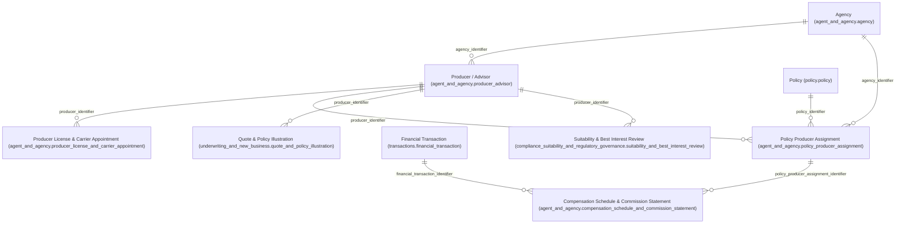

# L&A Ontology Knowledge Framework (OKF) -- Domain 10: Agent & Agency (Distribution, Licensing, Splits & Commissions)

| OKF Metadata Attribute | Value |
| :--- | :--- |
| **OKF Catalog Document** | `L&A OKF/10 - OKF - Agent and Agency.MD` |
| **Enterprise Data Domain** | **Domain 10: Agent & Agency (Distribution, Licensing, Splits & Commissions)** |
| **Target Physical Database Engine** | Amazon RDS Aurora PostgreSQL (PostgreSQL 15/16 Compatible) |
| **Physical Database Schema** | `agent_and_agency` |
| **Domain Table Count** | **5 Physical Tables / Logical Entities** |
| **Outbound Foreign Key Joins** | **7 Foreign Key Relationships** (Intra-Domain & Cross-Domain) |
| **Inbound Foreign Key Joins** | **2 Cross-Domain Referencing Relationships** |
| **Performance Indexes** | **7 B-Tree & Composite Indexes** |
| **Inherited Business Context Rules** | **`BC-179` through `BC-198` (20 Rules)** |
| **Source Knowledge Layer Artifacts** | `L&A - Ontology.MD`, `L&A Data Model - Logical.MD`, `L&A Data Model - Physical DDL.sql`, `L&A Data Model - Conceptual.MD` |

---

## 1. Domain Executive Ontology & Business Context Overview

The **Agent & Agency** domain manages the multi-channel distribution ecosystem, producer licensing and regulatory appointments, policy-to-advisor relationship assignments, and commission/compensation accounting across the enterprise. In the modern US Life and Annuity industry, distribution spans diverse channels: internal salaried and bonus-eligible wealth management and institutional relationship channels (such as Institutional Wealth Management Advisors, Workplace Retirement Consultants, and Institutional Relationship Managers serving university and hospital sponsors), independent Broker-Dealers (such as LPL Financial, Raymond James, Ameriprise, and Commonwealth), wirehouses and regional banks, Independent Marketing Organizations (IMOs) and Brokerage General Agencies (BGAs), and fee-only Registered Investment Advisors (RIAs). The domain is modeled across five core logical entities: `Agency`, `Producer / Advisor`, `Producer License & Carrier Appointment`, `Policy Producer Assignment`, and `Compensation Schedule & Commission Statement`.

`Agency` (`Agency Identifier`, `Agency Name`, `Agency Type`) represents the corporate distribution firm or internal advisory division, tracking its NAIC entity `National Producer Number (NPN) - Entity`, FINRA `Broker-Dealer CRD Number` (such as `CRD-6413` for LPL Financial LLC or `CRD-20472` for Institutional Wealth & Annuity Services, LLC), and `Selling Agreement Status` (`Active - New Business & Servicing`, `Servicing Only`, `Terminated`). Beneath each agency, `Producer / Advisor` (`Producer Identifier`, `Producer Full Name`, `Producer Role Type`) holds the master profile of each individual agent, wealth advisor, or institutional relationship manager, indexed by their unique NAIC `National Producer Number (NPN)` and individual `FINRA CRD Number`.

Before any producer can solicit or sign an application in a given state, `Producer License & Carrier Appointment` (`License & Appointment Identifier`) validates strict regulatory prerequisites: an active state Department of Insurance `License Number` in the `State Jurisdiction` prior to its `License Expiration Date`, the required statutory `Line of Authority` (`Life Insurance Only` vs. `Life and Variable Contracts`), an active `Carrier Appointment Status` (including Just-In-Time [JIT] appointment rules), appropriate `FINRA Series Qualification` (`Series 6`, `Series 7`, `Series 63`, `Series 65/66`) for variable or registered index-linked products, and a verified `Product Training and Reg BI Completion Date` proving completion of state NAIC Model #275 Best Interest 4-hour training and carrier-specific product training prior to the application signature date. `Policy Producer Assignment` (`Policy Producer Assignment Identifier`) links one or more producers and agencies to a `Policy Identifier`, distinguishing `Assignment Role` (`Primary Writing Agent`, `Joint Writing Agent`, `Current Servicing Advisor (Orphan Reassigned)`, `Institutional Relationship Manager`, `General Agency Override Recipient`) and `Commission Split Percentage`. Finally, `Compensation Schedule & Commission Statement` calculates and settles upfront commissions, renewal commissions, quarterly asset-based trails, RIA advisory fee deductions, and early surrender/free-look `Chargeback Recovery Amount` clawbacks via EFT or DTCC/NSCC Commission Settlement (COMS) feeds.

---

## 2. Physical Schema & Logical Entity Architecture Catalog (Schema: `agent_and_agency`)

| # | Logical Entity Name | Physical Table Name (`schema.table`) | Primary Key Column (`PK`) | Business Cols | Audit Cols | Constraints (`PK`/`UQ`/`CHK`) | Logical Entity & Physical Table Definition |
| :--- | :--- | :--- | :--- | :--- | :--- | :--- | :--- |
| **10.1** | **Agency** | `agent_and_agency.agency` | `agency_identifier` | 7 | 2 | `pk_agency`, `uq_agency_npn_entity` | Agency entity represents an internal wealth management division, external Broker-Dealer partner (such as LPL Financial), Independent Marketing Organization (IMO), or bank distribution firm authorized under a selling agreement to distribute and service the carrier's Life and Annuity products. |
| **10.2** | **Producer / Advisor** | `agent_and_agency.producer_advisor` | `producer_identifier` | 8 | 2 | `pk_producer_advisor`, `uq_producer_npn` | Producer / Advisor entity holds the master profile of an individual licensed insurance agent, wealth management advisor, or institutional relationship manager who solicits, sells, or services policies, tracking their National Producer Number (NPN) and FINRA CRD registration. |
| **10.3** | **Producer License & Carrier Appointment** | `agent_and_agency.producer_license_and_carrier_appointment` | `license_and_appointment_identifier` | 9 | 2 | `pk_producer_license_appointment`, `uq_producer_state_license` | Producer License & Carrier Appointment entity tracks each Producer's state insurance department licenses, lines of authority (Life, Variable Contracts), FINRA securities series registrations, state carrier appointments, and mandatory NAIC Best Interest / product training completions. |
| **10.4** | **Policy Producer Assignment** | `agent_and_agency.policy_producer_assignment` | `policy_producer_assignment_identifier` | 7 | 2 | `pk_policy_producer_assignment`, `chk_ppa_split_pct` | Policy Producer Assignment entity links one or more Producers and Agencies to a Policy, defining their role (Writing Agent, Servicing Advisor, Override Hierarchy) and their exact commission split percentage for upfront and trail compensation. |
| **10.5** | **Compensation Schedule & Commission Statement** | `agent_and_agency.compensation_schedule_and_commission_statement` | `commission_statement_line_identifier` | 9 | 2 | `pk_compensation_commission_statement` | Compensation Schedule & Commission Statement entity records the commission calculation rules and periodic commission payout statements for Producers and Agencies, detailing first-year commissions, renewal trails, advisory fees, and surrender chargebacks. |

---

## 3. Relational Join Mining & Foreign Key Topology

### 3.1 Entity-Relationship & Foreign Key Join Diagram (Mermaid)



### 3.2 Outbound Foreign Key Join Matrix (Tables in `agent_and_agency` Referencing Parent Entities)

| FK Constraint Name | Child Table (`agent_and_agency`) | Child FK Column | Join Scope | Parent Referenced Table | Parent PK Column | Referential Action | Exact SQL Join Predicate |
| :--- | :--- | :--- | :--- | :--- | :--- | :--- | :--- |
| `fk_producer_agency` | `agent_and_agency.producer_advisor` | `agency_identifier` | Intra-Domain | `agent_and_agency.agency` | `agency_identifier` | `ON UPDATE CASCADE ON DELETE RESTRICT` | `agent_and_agency.producer_advisor.agency_identifier = agent_and_agency.agency.agency_identifier` |
| `fk_plca_producer` | `agent_and_agency.producer_license_and_carrier_appointment` | `producer_identifier` | Intra-Domain | `agent_and_agency.producer_advisor` | `producer_identifier` | `ON UPDATE CASCADE ON DELETE CASCADE` | `agent_and_agency.producer_license_and_carrier_appointment.producer_identifier = agent_and_agency.producer_advisor.producer_identifier` |
| `fk_ppa_policy` | `agent_and_agency.policy_producer_assignment` | `policy_identifier` | Cross-Domain (`policy`) | `policy.policy` | `policy_identifier` | `ON UPDATE CASCADE ON DELETE CASCADE` | `agent_and_agency.policy_producer_assignment.policy_identifier = policy.policy.policy_identifier` |
| `fk_ppa_producer` | `agent_and_agency.policy_producer_assignment` | `producer_identifier` | Intra-Domain | `agent_and_agency.producer_advisor` | `producer_identifier` | `ON UPDATE CASCADE ON DELETE RESTRICT` | `agent_and_agency.policy_producer_assignment.producer_identifier = agent_and_agency.producer_advisor.producer_identifier` |
| `fk_ppa_agency` | `agent_and_agency.policy_producer_assignment` | `agency_identifier` | Intra-Domain | `agent_and_agency.agency` | `agency_identifier` | `ON UPDATE CASCADE ON DELETE RESTRICT` | `agent_and_agency.policy_producer_assignment.agency_identifier = agent_and_agency.agency.agency_identifier` |
| `fk_cscs_policy_producer_assignment` | `agent_and_agency.compensation_schedule_and_commission_statement` | `policy_producer_assignment_identifier` | Intra-Domain | `agent_and_agency.policy_producer_assignment` | `policy_producer_assignment_identifier` | `ON UPDATE CASCADE ON DELETE RESTRICT` | `agent_and_agency.compensation_schedule_and_commission_statement.policy_producer_assignment_identifier = agent_and_agency.policy_producer_assignment.policy_producer_assignment_identifier` |
| `fk_cscs_financial_transaction` | `agent_and_agency.compensation_schedule_and_commission_statement` | `financial_transaction_identifier` | Cross-Domain (`transactions`) | `transactions.financial_transaction` | `financial_transaction_identifier` | `ON UPDATE CASCADE ON DELETE SET NULL` | `agent_and_agency.compensation_schedule_and_commission_statement.financial_transaction_identifier = transactions.financial_transaction.financial_transaction_identifier` |

### 3.3 Inbound Cross-Domain Foreign Key Join Matrix (External Schemas Referencing `agent_and_agency`)

| FK Constraint Name | Referencing Child Schema | Referencing Child Table | Child FK Column | Referenced Target Table (`agent_and_agency`) | Target PK Column | Referential Action | Exact SQL Join Predicate |
| :--- | :--- | :--- | :--- | :--- | :--- | :--- | :--- |
| `fk_qpi_producer` | `underwriting_and_new_business` | `underwriting_and_new_business.quote_and_policy_illustration` | `producer_identifier` | `agent_and_agency.producer_advisor` | `producer_identifier` | `ON UPDATE CASCADE ON DELETE RESTRICT` | `underwriting_and_new_business.quote_and_policy_illustration.producer_identifier = agent_and_agency.producer_advisor.producer_identifier` |
| `fk_sbir_producer` | `compliance_suitability_and_regulatory_governance` | `compliance_suitability_and_regulatory_governance.suitability_and_best_interest_review` | `producer_identifier` | `agent_and_agency.producer_advisor` | `producer_identifier` | `ON UPDATE CASCADE ON DELETE RESTRICT` | `compliance_suitability_and_regulatory_governance.suitability_and_best_interest_review.producer_identifier = agent_and_agency.producer_advisor.producer_identifier` |

---

## 4. Detailed Table-by-Table Schema, Column Dictionary & DDL Constraints

### 4.1 Logical Entity: `Agency` <-> Physical Table: `agent_and_agency.agency`

- **Business & Technical Purpose**: Agency entity represents an internal wealth management division, external Broker-Dealer partner (such as LPL Financial), Independent Marketing Organization (IMO), or bank distribution firm authorized under a selling agreement to distribute and service the carrier's Life and Annuity products.
- **PostgreSQL Catalog Comment**: _""_
- **Primary Key**: `agency_identifier`

#### Attribute-to-Column Schema Mapping & Business Dictionary

| Ord | Logical Attribute Name | Physical Column Name | Logical Type | Physical PostgreSQL Type | Key | Column Modifiers / Default | Business Definition, Domain Semantics & Sample Values |
| :--- | :--- | :--- | :--- | :--- | :--- | :--- | :--- |
| **1** | **Agency Identifier** | `agency_identifier` | String | `VARCHAR(64)` | **PK** | `NOT NULL` | Unique primary key identifying a distribution partner organization, broker-dealer, or internal wealth advisory division. Sample values: `AGY-INTERNAL-WM`, `AGY-BD-LPL-001`, `AGY-IMO-042`. |
| **2** | **National Producer Number (NPN) - Entity** | `national_producer_number_npn_entity` | String | `VARCHAR(32)` | **NK** | `NOT NULL` | Unique NAIC National Insurance Producer Registry (NIPR) identifier assigned to the corporate insurance agency entity. Sample values: `NPN-1049281`, `NPN-8839201`. |
| **3** | **Broker-Dealer CRD Number** | `broker_dealer_crd_number` | String | `VARCHAR(32)` | **NK** | `NULL` | FINRA Central Registration Depository (CRD) number identifying the broker-dealer firm for variable annuity and variable life securities supervision. Sample values: `CRD-6413` (LPL Financial LLC), `CRD-20472` (Institutional Wealth & Annuity Services, LLC), `Not Applicable (Fixed-Only IMO)`. |
| **4** | **Agency Name** | `agency_name` | String | `VARCHAR(200)` | **NK** | `NOT NULL` | Full legal or doing-business-as (DBA) name of the distribution partner firm or internal wealth channel. Sample values: `Institutional Wealth Management & Advisory Services`, `LPL Financial LLC`, `Premier Institutional Benefit Consultants`, `National Annuity Marketing Group`. |
| **5** | **Agency Type** | `agency_type` | String | `VARCHAR(120)` | **NK** | `NOT NULL` | Classifies the distribution channel business model of the organization. Sample values: `Internal Salaried Wealth Advisory Channel`, `Independent Broker-Dealer Partner`, `Independent Marketing Organization (IMO) / BGA`, `Regional Bank / Wirehouse`, `Institutional Retirement Plan Consultant / RIA`. |
| **6** | **Selling Agreement Status** | `selling_agreement_status` | String | `VARCHAR(100)` | **NK** | `NOT NULL` | Current legal status of the distribution selling agreement between the carrier and the Agency. Sample values: `Active - New Business & Servicing`, `Servicing Only (Suspended for New Sales)`, `Terminated`, `Pending Due Diligence Onboarding`. |
| **7** | **Contract Effective Date** | `contract_effective_date` | Date | `DATE` | **NK** | `NOT NULL` | Calendar date on which the agency selling agreement was executed and became active. Sample values: `2010-01-01`, `2018-06-01`, `2024-01-15`. |
| **8** | **Record Created Timestamp (Audit)** | `created_at` | Timestamp | `TIMESTAMPTZ` | **AUDIT** | `NOT NULL DEFAULT CURRENT_TIMESTAMP` | System audit timestamp recording when the physical row was initially inserted into the Aurora PostgreSQL table. |
| **9** | **Record Updated Timestamp (Audit)** | `updated_at` | Timestamp | `TIMESTAMPTZ` | **AUDIT** | `NOT NULL DEFAULT CURRENT_TIMESTAMP` | System audit timestamp recording when the physical row was last modified in the Aurora PostgreSQL table. |

#### Declarative DDL Constraints & Indexes on `agent_and_agency.agency`

| Constraint / Index Category | Identifier Name | Definition / Target Columns & Referential Integrity Rule |
| :--- | :--- | :--- |
| **PRIMARY KEY** | `pk_agency` | `PRIMARY KEY (agency_identifier)` |
| **UNIQUE** | `uq_agency_npn_entity` | `UNIQUE (national_producer_number_npn_entity)` |

### 4.2 Logical Entity: `Producer / Advisor` <-> Physical Table: `agent_and_agency.producer_advisor`

- **Business & Technical Purpose**: Producer / Advisor entity holds the master profile of an individual licensed insurance agent, wealth management advisor, or institutional relationship manager who solicits, sells, or services policies, tracking their National Producer Number (NPN) and FINRA CRD registration.
- **PostgreSQL Catalog Comment**: _""_
- **Primary Key**: `producer_identifier`

#### Attribute-to-Column Schema Mapping & Business Dictionary

| Ord | Logical Attribute Name | Physical Column Name | Logical Type | Physical PostgreSQL Type | Key | Column Modifiers / Default | Business Definition, Domain Semantics & Sample Values |
| :--- | :--- | :--- | :--- | :--- | :--- | :--- | :--- |
| **1** | **Producer Identifier** | `producer_identifier` | String | `VARCHAR(64)` | **PK** | `NOT NULL` | Unique primary key identifying an individual licensed agent, wealth advisor, or institutional relationship manager. Sample values: `PRD-ADV-10042`, `PRD-ADV-10043`. |
| **2** | **Agency Identifier** | `agency_identifier` | String | `VARCHAR(64)` | **FK** | `NOT NULL` | Foreign key linking the individual Producer / Advisor to their primary affiliated Agency or Broker-Dealer firm. Sample values: `AGY-INTERNAL-WM`, `AGY-BD-LPL-001`. |
| **3** | **National Producer Number (NPN)** | `national_producer_number_npn` | String | `VARCHAR(32)` | **NK** | `NOT NULL` | Unique individual NAIC NIPR identifier assigned to the licensed insurance producer across all US state insurance departments. Sample values: `18492019`, `99201844`. |
| **4** | **FINRA CRD Number** | `finra_crd_number` | String | `VARCHAR(32)` | **NK** | `NULL` | Individual FINRA Central Registration Depository number required if the advisor solicits registered variable annuities, variable life, or mutual funds. Sample values: `4829104`, `7102938`, `Not Registered (Fixed Insurance Only)`. |
| **5** | **Producer Full Name** | `producer_full_name` | String | `VARCHAR(150)` | **NK** | `NOT NULL` | Full legal name of the individual agent, wealth advisor, or relationship manager. Sample values: ` Eleanor Vance, CFP`, `Marcus Thorne`, `David K. Chen`. |
| **6** | **Producer Role Type** | `producer_role_type` | String | `VARCHAR(120)` | **NK** | `NOT NULL` | Primary advisory or sales role performed by the individual within the distribution model. Sample values: `Wealth Management Advisor (WM)`, `Institutional Relationship Manager (IRM)`, `Workplace Retirement Consultant`, `Independent Financial Advisor / Registered Rep`, `Licensed Life & Annuity Insurance Agent`, `Internal Wholesaler`. |
| **7** | **Active Status** | `active_status` | String | `VARCHAR(100)` | **NK** | `NOT NULL` | Current operational status of the producer in the carrier's distribution management system. Sample values: `Active in Good Standing`, `On Compliance Hold`, `Inactive / Terminated`, `Retired - Vesting Renewal Trails Only`. |
| **8** | **Onboarding Date** | `onboarding_date` | Date | `DATE` | **NK** | `NOT NULL` | Date on which the producer was first appointed or onboarded with the insurance organization. Sample values: `2016-03-14`, `2021-08-01`. |
| **9** | **Record Created Timestamp (Audit)** | `created_at` | Timestamp | `TIMESTAMPTZ` | **AUDIT** | `NOT NULL DEFAULT CURRENT_TIMESTAMP` | System audit timestamp recording when the physical row was initially inserted into the Aurora PostgreSQL table. |
| **10** | **Record Updated Timestamp (Audit)** | `updated_at` | Timestamp | `TIMESTAMPTZ` | **AUDIT** | `NOT NULL DEFAULT CURRENT_TIMESTAMP` | System audit timestamp recording when the physical row was last modified in the Aurora PostgreSQL table. |

#### Declarative DDL Constraints & Indexes on `agent_and_agency.producer_advisor`

| Constraint / Index Category | Identifier Name | Definition / Target Columns & Referential Integrity Rule |
| :--- | :--- | :--- |
| **PRIMARY KEY** | `pk_producer_advisor` | `PRIMARY KEY (producer_identifier)` |
| **UNIQUE** | `uq_producer_npn` | `UNIQUE (national_producer_number_npn)` |
| **FOREIGN KEY** | `fk_producer_agency` | `FOREIGN KEY (agency_identifier) REFERENCES agent_and_agency.agency (agency_identifier) ON UPDATE CASCADE ON DELETE RESTRICT` |
| **B-TREE INDEX** | `idx_producer_agency_id` | `ON agent_and_agency.producer_advisor (agency_identifier, active_status)` |

### 4.3 Logical Entity: `Producer License & Carrier Appointment` <-> Physical Table: `agent_and_agency.producer_license_and_carrier_appointment`

- **Business & Technical Purpose**: Producer License & Carrier Appointment entity tracks each Producer's state insurance department licenses, lines of authority (Life, Variable Contracts), FINRA securities series registrations, state carrier appointments, and mandatory NAIC Best Interest / product training completions.
- **PostgreSQL Catalog Comment**: _""_
- **Primary Key**: `license_and_appointment_identifier`

#### Attribute-to-Column Schema Mapping & Business Dictionary

| Ord | Logical Attribute Name | Physical Column Name | Logical Type | Physical PostgreSQL Type | Key | Column Modifiers / Default | Business Definition, Domain Semantics & Sample Values |
| :--- | :--- | :--- | :--- | :--- | :--- | :--- | :--- |
| **1** | **License & Appointment Identifier** | `license_and_appointment_identifier` | String | `VARCHAR(64)` | **PK** | `NOT NULL` | Unique primary key identifying a state license and carrier appointment record for a Producer. Sample values: `LIC-500101`, `LIC-500102`. |
| **2** | **Producer Identifier** | `producer_identifier` | String | `VARCHAR(64)` | **FK** | `NOT NULL` | Foreign key linking the state license and appointment record to the individual Producer / Advisor. Sample values: `PRD-ADV-10042`. |
| **3** | **State Jurisdiction** | `state_jurisdiction` | String | `VARCHAR(10)` | **NK** | `NOT NULL` | Two-letter US state or territory code in which the producer holds the insurance license and carrier appointment (validated prior to application solicitation and issue). Sample values: `NY`, `CA`, `TX`, `FL`, `PA`. |
| **4** | **License Number** | `license_number` | String | `VARCHAR(64)` | **NK** | `NOT NULL` | Official state Department of Insurance license number issued to the producer in that jurisdiction. Sample values: `LA-1492018-NY`, `0K49281-CA`. |
| **5** | **Line of Authority** | `line_of_authority` | String | `VARCHAR(150)` | **NK** | `NOT NULL` | Specific statutory insurance lines the producer is licensed to sell in that state. Sample values: `Life Insurance Only`, `Life and Variable Contracts (Variable Life & Variable Annuity)`, `Life, Accident & Health`, `Long-Term Care Partnership Certified`. |
| **6** | **License Expiration Date** | `license_expiration_date` | Date | `DATE` | **NK** | `NOT NULL` | Date on which the producer's state insurance license expires if continuing education (CE) and renewal fees are not completed. Sample values: `2027-06-30`, `2028-10-31`. |
| **7** | **Carrier Appointment Status** | `carrier_appointment_status` | String | `VARCHAR(100)` | **NK** | `NOT NULL` | Indicates whether the insurance carrier has an active statutory appointment on file with the state for this producer. Sample values: `Appointed - Active`, `Pending Just-In-Time (JIT) Appointment`, `Terminated for Cause`, `Terminated Not for Cause`. |
| **8** | **FINRA Series Qualification** | `finra_series_qualification` | String | `VARCHAR(150)` | **NK** | `NULL` | Lists active securities examination registrations held by the producer for variable product eligibility and advisory fee billing. Sample values: `Series 7, Series 66`, `Series 6, Series 63, Series 65`, `None (Fixed Products Only)`. |
| **9** | **Product Training and Reg BI Completion Date** | `product_training_and_reg_bi_completion_date` | Date | `DATE` | **NK** | `NULL` | Date on which the producer completed mandatory state NAIC Best Interest 4-hour training and carrier-specific product training (required before application date). Sample values: `2024-02-10`, `2025-11-05`. |
| **10** | **Record Created Timestamp (Audit)** | `created_at` | Timestamp | `TIMESTAMPTZ` | **AUDIT** | `NOT NULL DEFAULT CURRENT_TIMESTAMP` | System audit timestamp recording when the physical row was initially inserted into the Aurora PostgreSQL table. |
| **11** | **Record Updated Timestamp (Audit)** | `updated_at` | Timestamp | `TIMESTAMPTZ` | **AUDIT** | `NOT NULL DEFAULT CURRENT_TIMESTAMP` | System audit timestamp recording when the physical row was last modified in the Aurora PostgreSQL table. |

#### Declarative DDL Constraints & Indexes on `agent_and_agency.producer_license_and_carrier_appointment`

| Constraint / Index Category | Identifier Name | Definition / Target Columns & Referential Integrity Rule |
| :--- | :--- | :--- |
| **PRIMARY KEY** | `pk_producer_license_appointment` | `PRIMARY KEY (license_and_appointment_identifier)` |
| **UNIQUE** | `uq_producer_state_license` | `UNIQUE (producer_identifier, state_jurisdiction, license_number)` |
| **FOREIGN KEY** | `fk_plca_producer` | `FOREIGN KEY (producer_identifier) REFERENCES agent_and_agency.producer_advisor (producer_identifier) ON UPDATE CASCADE ON DELETE CASCADE` |
| **B-TREE INDEX** | `idx_plca_producer_state` | `ON agent_and_agency.producer_license_and_carrier_appointment (producer_identifier, state_jurisdiction, carrier_appointment_status)` |

### 4.4 Logical Entity: `Policy Producer Assignment` <-> Physical Table: `agent_and_agency.policy_producer_assignment`

- **Business & Technical Purpose**: Policy Producer Assignment entity links one or more Producers and Agencies to a Policy, defining their role (Writing Agent, Servicing Advisor, Override Hierarchy) and their exact commission split percentage for upfront and trail compensation.
- **PostgreSQL Catalog Comment**: _""_
- **Primary Key**: `policy_producer_assignment_identifier`

#### Attribute-to-Column Schema Mapping & Business Dictionary

| Ord | Logical Attribute Name | Physical Column Name | Logical Type | Physical PostgreSQL Type | Key | Column Modifiers / Default | Business Definition, Domain Semantics & Sample Values |
| :--- | :--- | :--- | :--- | :--- | :--- | :--- | :--- |
| **1** | **Policy Producer Assignment Identifier** | `policy_producer_assignment_identifier` | String | `VARCHAR(64)` | **PK** | `NOT NULL` | Unique primary key identifying the link between a Policy and an assigned Producer / Agency. Sample values: `PPA-70001`, `PPA-70002`. |
| **2** | **Policy Identifier** | `policy_identifier` | String | `VARCHAR(64)` | **FK** | `NOT NULL` | Foreign key linking the producer assignment to the serviced or sold Policy. Sample values: `POL-UUID-90001421`. |
| **3** | **Producer Identifier** | `producer_identifier` | String | `VARCHAR(64)` | **FK** | `NOT NULL` | Foreign key linking the assignment to the individual Producer / Advisor. Sample values: `PRD-ADV-10042`, `PRD-ADV-10043`. |
| **4** | **Agency Identifier** | `agency_identifier` | String | `VARCHAR(64)` | **FK** | `NOT NULL` | Foreign key linking the assignment to the Agency / Broker-Dealer under which the policy was written or is currently serviced. Sample values: `AGY-INTERNAL-WM`, `AGY-BD-LPL-001`. |
| **5** | **Assignment Role** | `assignment_role` | String | `VARCHAR(100)` | **NK** | `NOT NULL` | Defines the capacity in which the producer is linked to the policy. Sample values: `Primary Writing Agent`, `Joint Writing Agent`, `Current Servicing Advisor (Orphan Reassigned)`, `Institutional Relationship Manager`, `General Agency Override Recipient`. |
| **6** | **Commission Split Percentage** | `commission_split_percentage` | Decimal | `NUMERIC(9,6)` | **NK** | `NOT NULL DEFAULT 1.000000` | Percentage of total writing or trail compensation allocated to this producer on the policy (must sum to 100% across writing agents). Sample values: `1.0000` (100% Sole Agent), `0.5000` (50%/50% Split), `0.7000` (70% Split). |
| **7** | **Assignment Effective Date** | `assignment_effective_date` | Date | `DATE` | **NK** | `NOT NULL` | Calendar date on which the producer's assignment to the policy became active (e.g., policy issue date or Broker-Dealer Change of Dealer endorsement date). Sample values: `2019-06-15`, `2026-01-01`. |
| **8** | **Record Created Timestamp (Audit)** | `created_at` | Timestamp | `TIMESTAMPTZ` | **AUDIT** | `NOT NULL DEFAULT CURRENT_TIMESTAMP` | System audit timestamp recording when the physical row was initially inserted into the Aurora PostgreSQL table. |
| **9** | **Record Updated Timestamp (Audit)** | `updated_at` | Timestamp | `TIMESTAMPTZ` | **AUDIT** | `NOT NULL DEFAULT CURRENT_TIMESTAMP` | System audit timestamp recording when the physical row was last modified in the Aurora PostgreSQL table. |

#### Declarative DDL Constraints & Indexes on `agent_and_agency.policy_producer_assignment`

| Constraint / Index Category | Identifier Name | Definition / Target Columns & Referential Integrity Rule |
| :--- | :--- | :--- |
| **PRIMARY KEY** | `pk_policy_producer_assignment` | `PRIMARY KEY (policy_producer_assignment_identifier)` |
| **CHECK** | `chk_ppa_split_pct` | `CHECK (commission_split_percentage >= 0 AND commission_split_percentage <= 1)` |
| **FOREIGN KEY** | `fk_ppa_policy` | `FOREIGN KEY (policy_identifier) REFERENCES policy.policy (policy_identifier) ON UPDATE CASCADE ON DELETE CASCADE` |
| **FOREIGN KEY** | `fk_ppa_producer` | `FOREIGN KEY (producer_identifier) REFERENCES agent_and_agency.producer_advisor (producer_identifier) ON UPDATE CASCADE ON DELETE RESTRICT` |
| **FOREIGN KEY** | `fk_ppa_agency` | `FOREIGN KEY (agency_identifier) REFERENCES agent_and_agency.agency (agency_identifier) ON UPDATE CASCADE ON DELETE RESTRICT` |
| **B-TREE INDEX** | `idx_ppa_policy_id` | `ON agent_and_agency.policy_producer_assignment (policy_identifier)` |
| **B-TREE INDEX** | `idx_ppa_producer_id` | `ON agent_and_agency.policy_producer_assignment (producer_identifier)` |
| **B-TREE INDEX** | `idx_ppa_agency_id` | `ON agent_and_agency.policy_producer_assignment (agency_identifier)` |

### 4.5 Logical Entity: `Compensation Schedule & Commission Statement` <-> Physical Table: `agent_and_agency.compensation_schedule_and_commission_statement`

- **Business & Technical Purpose**: Compensation Schedule & Commission Statement entity records the commission calculation rules and periodic commission payout statements for Producers and Agencies, detailing first-year commissions, renewal trails, advisory fees, and surrender chargebacks.
- **PostgreSQL Catalog Comment**: _""_
- **Primary Key**: `commission_statement_line_identifier`

#### Attribute-to-Column Schema Mapping & Business Dictionary

| Ord | Logical Attribute Name | Physical Column Name | Logical Type | Physical PostgreSQL Type | Key | Column Modifiers / Default | Business Definition, Domain Semantics & Sample Values |
| :--- | :--- | :--- | :--- | :--- | :--- | :--- | :--- |
| **1** | **Commission Statement Line Identifier** | `commission_statement_line_identifier` | String | `VARCHAR(64)` | **PK** | `NOT NULL` | Unique primary key identifying an individual producer compensation calculation and statement line. Sample values: `COM-202610-00891`, `COM-202610-00892`. |
| **2** | **Policy Producer Assignment Identifier** | `policy_producer_assignment_identifier` | String | `VARCHAR(64)` | **FK** | `NOT NULL` | Foreign key linking the commission payment or chargeback to the governing Policy Producer Assignment. Sample values: `PPA-70001`. |
| **3** | **Financial Transaction Identifier** | `financial_transaction_identifier` | String | `VARCHAR(64)` | **FK** | `NULL` | Optional foreign key linking transaction-driven commissions (such as first-year premium commission or surrender chargeback) to the triggering Financial Transaction. Sample values: `FTX-99000101`, `Null (Quarterly Asset-Based Trail Calculation)`. |
| **4** | **Commission Schedule Code** | `commission_schedule_code` | String | `VARCHAR(64)` | **NK** | `NOT NULL` | Alphanumeric code identifying the contractual commission option elected at policy issue (e.g., high upfront / no trail vs. level asset-based trail). Sample values: `SCH-VA-OPT-A (5.00% Upfront / 0.25% Trail)`, `SCH-VA-OPT-C (1.00% Upfront / 1.00% Level Trail)`, `SCH-INST-SAL-BONUS`. |
| **5** | **Compensation Type** | `compensation_type` | String | `VARCHAR(120)` | **NK** | `NOT NULL` | Categorizes the nature of the producer compensation or adjustment on the statement. Sample values: `First-Year Upfront Premium Commission`, `Renewal Year Premium Commission`, `Asset-Based Quarterly Trail Commission`, `Fee-Based RIA Advisory Fee Deduction`, `General Agency Override Commission`, `Early Surrender / Free-Look Chargeback`, `Death in Year 1 Commission Recall`. |
| **6** | **Commission Rate Percentage** | `commission_rate_percentage` | Decimal | `NUMERIC(9,6)` | **NK** | `NOT NULL DEFAULT 0.000000` | Contractual percentage rate applied to the premium or account value to compute the compensation line. Sample values: `0.0500` (5.00%), `0.0025` (0.25% Trail), `0.0100` (1.00%). |
| **7** | **Earned Commission Amount** | `earned_commission_amount` | Decimal | `NUMERIC(18,2)` | **NK** | `NOT NULL DEFAULT 0.00` | Gross positive dollar amount of commission or advisory fee earned by the producer or agency on this line. Sample values: `2500.00`, `185.40`, `0.00`. |
| **8** | **Chargeback Recovery Amount** | `chargeback_recovery_amount` | Decimal | `NUMERIC(18,2)` | **NK** | `NOT NULL DEFAULT 0.00` | Dollar amount of previously paid upfront commission clawed back from the producer because the policy free-looked, lapsed, or surrendered during the chargeback period (e.g., first 12 months). Sample values: `0.00`, `-2500.00`, `-1250.00`. |
| **9** | **Statement Payment Date** | `statement_payment_date` | Date | `DATE` | **NK** | `NOT NULL` | Calendar date on which the commission statement was settled via EFT or NSCC Commission Settlement (COMS) feed to the broker-dealer. Sample values: `2026-10-15`, `2026-10-31`. |
| **10** | **Record Created Timestamp (Audit)** | `created_at` | Timestamp | `TIMESTAMPTZ` | **AUDIT** | `NOT NULL DEFAULT CURRENT_TIMESTAMP` | System audit timestamp recording when the physical row was initially inserted into the Aurora PostgreSQL table. |
| **11** | **Record Updated Timestamp (Audit)** | `updated_at` | Timestamp | `TIMESTAMPTZ` | **AUDIT** | `NOT NULL DEFAULT CURRENT_TIMESTAMP` | System audit timestamp recording when the physical row was last modified in the Aurora PostgreSQL table. |

#### Declarative DDL Constraints & Indexes on `agent_and_agency.compensation_schedule_and_commission_statement`

| Constraint / Index Category | Identifier Name | Definition / Target Columns & Referential Integrity Rule |
| :--- | :--- | :--- |
| **PRIMARY KEY** | `pk_compensation_commission_statement` | `PRIMARY KEY (commission_statement_line_identifier)` |
| **FOREIGN KEY** | `fk_cscs_policy_producer_assignment` | `FOREIGN KEY (policy_producer_assignment_identifier) REFERENCES agent_and_agency.policy_producer_assignment (policy_producer_assignment_identifier) ON UPDATE CASCADE ON DELETE RESTRICT` |
| **FOREIGN KEY** | `fk_cscs_financial_transaction` | `FOREIGN KEY (financial_transaction_identifier) REFERENCES transactions.financial_transaction (financial_transaction_identifier) ON UPDATE CASCADE ON DELETE SET NULL` |
| **B-TREE INDEX** | `idx_cscs_ppa_pay_date` | `ON agent_and_agency.compensation_schedule_and_commission_statement (policy_producer_assignment_identifier, statement_payment_date DESC)` |
| **B-TREE INDEX** | `idx_cscs_fin_tx_id` | `ON agent_and_agency.compensation_schedule_and_commission_statement (financial_transaction_identifier)` |

---

## 5. Inherited Business Context Ontology Rules (`BC-179` to `BC-198`)

> **Semantic Inheritance Notice**: The following **20 Business Context rules** are inherited verbatim from `L&A Data Domain/L&A - Ontology.MD` to provide autonomous AI agents, data engineers, and actuaries with complete domain rules, accounting identities, statutory compliance mandates, and SQL join guardrails for the **Agent & Agency** domain.

#### BC-179: Dual Distribution Architecture — Internal Salaried Wealth & Institutional Channels vs. Independent Third-Party Intermediaries

**Domains**: Agent & Agency, Policy & Contract Administration | **Entities**: `Agency`, `Producer / Advisor`, `Policy Producer Assignment` | **Key Attributes**: `Agency Identifier`, `Agency Name`, `Agency Type`, `Producer Identifier`, `Producer Role Type`

In the US Life & Annuity (L&A) and institutional retirement industry, carriers operate a hybrid, multi-channel distribution architecture modeled through the `Agency` and `Producer / Advisor` entities. Unlike purely retail insurers that rely exclusively on external independent agents, an organization with a deep institutional retirement and wealth management heritage (such as the carrier alongside retail life/annuity subsidiaries and third-party distribution partners) distributes products across two fundamentally distinct operating models captured by `Agency`.`Agency Type`. The first model is the `Internal Salaried Wealth Advisory Channel` (for example, `Agency Identifier` = `AGY-INTERNAL-WM`, `Agency Name` = `Institutional Wealth Management & Advisory Services`), where advisors are full-time W-2 employees serving in roles such as `Wealth Management Advisor (WM)`, `Institutional Relationship Manager (IRM)`, or `Workplace Retirement Consultant` under the `Producer / Advisor`.`Producer Role Type` attribute. These internal professionals manage university, hospital, and non-profit sponsor relationships (`Employer Sponsor Organization`) and provide holistic financial planning and rollover advice to plan participants without traditional upfront percentage-of-premium sales commissions, instead receiving base salary plus asset-gathering, retention, and client-satisfaction incentives (`SCH-INST-SAL-BONUS`).

The second operating model encompasses external independent intermediaries, categorized under `Agency`.`Agency Type` as `Independent Broker-Dealer Partner` (such as `LPL Financial LLC`, `AGY-BD-LPL-001`), `Independent Marketing Organization (IMO) / BGA` (`AGY-IMO-042`), `Regional Bank / Wirehouse`, or `Institutional Retirement Plan Consultant / RIA`. In these channels, individual producers (`Producer Role Type` = `Independent Financial Advisor / Registered Rep` or `Licensed Life & Annuity Insurance Agent`) act as independent contractors or registered representatives of third-party firms that have executed a formal selling agreement with the carrier. When AI agents build distribution analytics, sales attribution cubes, or cost-of-acquisition data products, they must never aggregate compensation expenses or sales productivity across all `Producer / Advisor` rows without first segmenting by `Agency`.`Agency Type` and `Producer / Advisor`.`Producer Role Type`. Internal salaried channels exhibit near-zero variable commission chargeback volatility and high institutional plan rollover capture rates, whereas independent broker-dealer and IMO channels are governed by contractual percentage-of-premium upfront commissions, general agency overrides, and asset-based trails.

#### BC-180: Agency Entity Identity Resolution via Corporate National Producer Number (NPN) and Broker-Dealer FINRA CRD Number

**Domains**: Agent & Agency | **Entities**: `Agency`, `Product` | **Key Attributes**: `Agency Identifier`, `National Producer Number (NPN) - Entity`, `Broker-Dealer CRD Number`, `Agency Type`, `Agency Name`

Every distribution partner firm onboarded into the `Agency` entity is assigned an internal surrogate primary key (`Agency Identifier`), but enterprise data integration across industry clearinghouses—such as the DTCC Insurance & Retirement Services (I&RS) network, the National Insurance Producer Registry (NIPR), and FINRA BrokerCheck—requires strict dual-regulator natural key resolution. Insurance agencies that solicit life insurance or annuity contracts must maintain a corporate entity license recognized by state Departments of Insurance, uniquely tracked across all 50 US states and territories by the NAIC `National Producer Number (NPN) - Entity` attribute (for example, `NPN-1049281`). Simultaneously, whenever the distribution partner sells or supervises SEC-registered securities products—specifically Variable Annuities (`Product Type` = `Variable Annuity`), Registered Index-Linked Annuities (RILAs), or Variable Universal Life (VUL) policies where underlying funds reside in a `Separate Account`—the firm must be registered with the Securities and Exchange Commission (SEC) and the Financial Industry Regulatory Authority (FINRA), identified by its `Broker-Dealer CRD Number` (for example, `CRD-6413` for `LPL Financial LLC`, or `CRD-20472` for `Institutional Wealth & Annuity Services, LLC`).

Conversely, a fixed-only Independent Marketing Organization (IMO) or Brokerage General Agency (BGA) that distributes exclusively Fixed Rate Deferred Annuities, Single Premium Immediate Annuities (SPIAs), Fixed Indexed Annuities (FIAs), and traditional Fixed Universal or Term Life policies is not required to register with FINRA; for such entities, `Agency`.`Broker-Dealer CRD Number` is explicitly populated as `Not Applicable (Fixed-Only IMO)`. AI agents constructing onboarding validation pipelines, DTCC Commission Settlement (COMS) feeds, or regulatory compliance dashboards must enforce the business rule that any `Policy` linked to a registered variable `Product` must trace through `Policy Producer Assignment`.`Agency Identifier` to an `Agency` record holding a valid numeric `Broker-Dealer CRD Number`. Deduplicating `Agency` records across acquired policy administration systems must match on the composite natural keys (`National Producer Number (NPN) - Entity` and `Broker-Dealer CRD Number`) rather than fuzzy-matching `Agency Name`, which frequently varies across DBA designations and regional branch subsidiaries.

#### BC-181: Agency Selling Agreement Lifecycle and New Business Suspension Controls

**Domains**: Agent & Agency, Underwriting & New Business | **Entities**: `Agency`, `Application`, `Policy Producer Assignment`, `Compensation Schedule & Commission Statement` | **Key Attributes**: `Agency Identifier`, `Selling Agreement Status`, `Contract Effective Date`, `Submission Date`, `Compensation Type`

Before an external broker-dealer, bank, or independent marketing organization can submit new business applications or receive producer compensation from the insurance carrier, a binding legal distribution contract—known as a Selling Agreement or General Agent Agreement—must be executed and recorded on the `Agency` entity. The temporal start of this relationship is governed by `Agency`.`Contract Effective Date`, and its ongoing operational permission state is controlled by `Agency`.`Selling Agreement Status`. In a healthy commercial partnership, `Selling Agreement Status` is set to `Active - New Business & Servicing`, which authorizes affiliated producers (`Producer / Advisor` linked via `Agency Identifier`) to submit new `Application` records (`Application`.`Submission Date` $\ge$ `Agency`.`Contract Effective Date`), execute in-force policy servicing requests, and receive both first-year upfront commissions and ongoing renewal/trail commissions via `Compensation Schedule & Commission Statement`.

When a distribution relationship is discontinued—whether due to mutual strategic exit, broker-dealer merger/consolidation, or regulatory restructuring—carriers rarely terminate the agency's link to existing in-force contracts outright, because customers registered with that broker-dealer still require ongoing account servicing and the firm retains contractual rights to vested asset-based trail commissions on its existing book of business. Instead, the carrier transitions `Agency`.`Selling Agreement Status` to `Servicing Only (Suspended for New Sales)`. Under this status, new business intake engines (such as FireLight or iPipeline e-App gateways) must systematically reject any incoming `Application` whose submitting agency holds a status other than `Active - New Business & Servicing`, while allowing existing `Policy Producer Assignment` records to continue generating `Asset-Based Quarterly Trail Commission` and `Renewal Year Premium Commission` lines. Only when `Selling Agreement Status` is set to `Terminated` (for example, following a regulatory revocation of the firm's broker-dealer registration or fraud termination for cause) are both new sales and ongoing trail compensation halted. AI agents analyzing distribution partner capacity must filter on `Selling Agreement Status` = `Active - New Business & Servicing` when reporting active selling outlets, while including `Servicing Only (Suspended for New Sales)` firms when reconciling total in-force assets under management (AUM) and trail commission liabilities.

#### BC-182: Individual Producer Identity Resolution Across State Insurance Departments (`National Producer Number (NPN)`) and Securities Regulators (`FINRA CRD Number`)

**Domains**: Agent & Agency | **Entities**: `Producer / Advisor`, `Producer License & Carrier Appointment` | **Key Attributes**: `Producer Identifier`, `National Producer Number (NPN)`, `FINRA CRD Number`, `Producer Full Name`, `License Number`

In enterprise life and annuity data architectures, a single financial advisor (`Producer / Advisor`) frequently interacts with the carrier across multiple administrative systems, holds dozens of non-resident state insurance licenses (`Producer License & Carrier Appointment`.`License Number`), and may switch broker-dealer affiliations (`Agency Identifier`) multiple times over a thirty-year career. In legacy policy administration environments, carriers historically issued a new agent writing code whenever an advisor changed agencies or opened a secondary branch split, leading to severe producer fragmentation. Our target logical data model eliminates this duplication by anchoring each human advisor to a single canonical `Producer Identifier` (such as `PRD-ADV-10042`), which is uniquely resolved against two national regulatory natural keys: the NAIC `National Producer Number (NPN)` and the individual's `FINRA CRD Number`.

The `National Producer Number (NPN)` (for example, `18492019`) is a permanent, immutable national identifier assigned by the National Insurance Producer Registry (NIPR) to every licensed insurance producer in the United States. Even though each US state issues its own distinct state-specific `License Number` (such as `LA-1492018-NY` in New York and `0K49281-CA` in California) recorded in `Producer License & Carrier Appointment`, all state licenses belonging to that individual roll up to their single `National Producer Number (NPN)`. In parallel, if the advisor is registered to sell variable annuities, variable life, or mutual funds, FINRA assigns a permanent individual `FINRA CRD Number` (such as `4829104`), which stays with the individual even as they move between broker-dealers (`CRD-20472` to `CRD-6413`). For fixed-only insurance agents who do not hold securities registrations, `FINRA CRD Number` is populated as `Not Registered (Fixed Insurance Only)`. When AI agents build producer 360 profiles, lifetime value (LTV) models, or persistency/chargeback risk scores, they must always group by `Producer Identifier` and `National Producer Number (NPN)` rather than by agency-specific writing codes or `Producer Full Name`, ensuring that an advisor's historical production and persistency track record remains unified across broker-dealer transitions.

#### BC-183: Producer Role Taxonomy and Functional Segmentation Across Institutional, Workplace, and Retail Channels

**Domains**: Agent & Agency, Institutional Plan & Employer Sponsor | **Entities**: `Producer / Advisor`, `Policy Producer Assignment`, `Employer Sponsor Organization` | **Key Attributes**: `Producer Identifier`, `Producer Role Type`, `Assignment Role`, `Relationship Manager Assigned`

The `Producer / Advisor`.`Producer Role Type` attribute establishes the functional business taxonomy that distinguishes how different advisory and sales professionals interact with institutional plan sponsors, workplace participants, and retail wealth clients. In an organization like the carrier, distribution is not a monolithic retail sales force; rather, it operates as a highly coordinated ecosystem of specialized roles working across the institutional-to-retail continuum. At the B2B institutional level, an `Institutional Relationship Manager (IRM)` serves as the senior strategic lead assigned to an `Employer Sponsor Organization` (mirrored in `Employer Sponsor Organization`.`Relationship Manager Assigned`), managing plan retention, fiduciary governance reviews, QDIA lineup changes, and Master Services Agreement renewals for large universities and healthcare systems. Supporting the IRM on campus or on-site at hospitals is the `Workplace Retirement Consultant`, who conducts one-on-one enrollment counseling, educational workshops, and consolidation guidance for faculty, clinicians, and staff participating in `403(b)` and `401(a)` plans.

As participants accumulate substantial wealth or approach retirement transition, they are introduced to a `Wealth Management Advisor (WM)` (`Producer Role Type` = `Wealth Management Advisor (WM)`), who manages comprehensive household-level retirement income planning, retail IRA rollovers, trust accounts, and high-net-worth life insurance solutions. Outside the internal salaried workforce, external distribution relies on `Independent Financial Advisor / Registered Rep` professionals (dually licensed for securities and insurance at partner broker-dealers like LPL Financial), `Licensed Life & Annuity Insurance Agent` professionals (focused on fixed annuities and life insurance via IMOs/BGAs), and `Internal Wholesaler` specialists who support external advisors with product illustrations (`Quote & Policy Illustration`) and case design. AI agents generating advisor productivity benchmarks or sales funnel conversion rates must never compare raw policy count or premium volume across disparate `Producer Role Type` values without normalization: an `Institutional Relationship Manager (IRM)` oversees multi-billion-dollar employer plans (`Institutional Retirement Plan`), whereas a `Wealth Management Advisor (WM)` or `Independent Financial Advisor / Registered Rep` is evaluated on household asset gathering, financial planning penetration, and individual `Policy` placements.

#### BC-184: Producer Active Status Governance, Compliance Holds, and Retired Vesting Trail Eligibility

**Domains**: Agent & Agency | **Entities**: `Producer / Advisor`, `Compensation Schedule & Commission Statement`, `Application` | **Key Attributes**: `Producer Identifier`, `Active Status`, `Onboarding Date`, `Compensation Type`, `Earned Commission Amount`

The operational privileges of an individual advisor within the carrier's distribution and commission subledgers are governed by `Producer / Advisor`.`Active Status`. This attribute does not merely act as a binary active/inactive flag; instead, it encodes four distinct regulatory and contractual states that directly control new business intake and commission disbursement engines: `Active in Good Standing`, `On Compliance Hold`, `Retired - Vesting Renewal Trails Only`, and `Inactive / Terminated`. A producer whose status is `Active in Good Standing` (having completed onboarding on or after `Onboarding Date` and maintaining current licenses and clean background screenings) is fully authorized to prepare `Quote & Policy Illustration` ledgers, submit new `Application` records, service assigned policies, and receive all categories of compensation in `Compensation Schedule & Commission Statement`.

If a producer becomes the subject of a customer complaint investigation, a FINRA U4/U5 regulatory disclosure review, an AML red-flag inquiry, or a lapsed Errors & Omissions (E&O) insurance policy, compliance operations immediately transition `Producer / Advisor`.`Active Status` to `On Compliance Hold`. While `On Compliance Hold`, new applications listing the producer are pended in `In Suitability & Compliance Review`, and earned commissions (`Earned Commission Amount`) are accrued in the general ledger liability account but withheld from EFT/COMS disbursement (`Statement Payment Date` remains unpopulated) until the hold is resolved. Conversely, when a veteran advisor retires from active practice under a carrier or broker-dealer succession program, their status is updated to `Retired - Vesting Renewal Trails Only`. Under this status, the advisor cannot be assigned as `Primary Writing Agent` on any new `Application`, but their historical `Policy Producer Assignment` records remain valid for receiving vested `Renewal Year Premium Commission` and `Asset-Based Quarterly Trail Commission` payments. Finally, an `Inactive / Terminated` status ceases new sales and, if terminated for cause (such as fraud or statutory license revocation), permanently forfeits non-vested renewal and trail commissions under state insurance law. AI agents querying active advisor headcount must filter specifically for `Active Status` = `Active in Good Standing`.

#### BC-185: Pre-Sale State Licensing Verification in Policy Issue State Jurisdiction

**Domains**: Agent & Agency, Underwriting & New Business, Policy & Contract Administration | **Entities**: `Producer License & Carrier Appointment`, `Application`, `Policy`, `Policy Producer Assignment` | **Key Attributes**: `Producer Identifier`, `State Jurisdiction`, `License Number`, `Issue State`, `Submission Date`

One of the strictest statutory mandates enforced by all 50 US state Departments of Insurance (DOIs) is that no person may solicit, negotiate, or effectuate an insurance or annuity contract unless they hold an active, unexpired insurance producer license in the exact state where the contract is solicited and issued. In our logical data model, this regulatory boundary is enforced by cross-validating `Producer License & Carrier Appointment`.`State Jurisdiction` against `Policy`.`Issue State` (and the state of solicitation on the `Application`) for every producer linked to the contract via `Policy Producer Assignment`. Because an individual advisor (`Producer / Advisor`) typically serves clients who reside in, relocate to, or own vacation homes across multiple states, the relationship between `Producer / Advisor` and `Producer License & Carrier Appointment` is strictly one-to-many ($1:N$), where each row represents a distinct state license identified by `State Jurisdiction` (such as `NY`, `CA`, `TX`, `FL`, `PA`) and the state's official `License Number`.

Crucially, state insurance regulators audit the temporal sequence of licensing: the producer's license in `State Jurisdiction` matching `Policy`.`Issue State` must have been active on or before `Application`.`Submission Date` (the date the customer signed the application), not merely by the later `Policy`.`Issue Date`. If an advisor solicits an application in New York (`Issue State` = `NY`) on October 5 (`Submission Date` = `2026-10-05`) but does not obtain their New York non-resident `License Number` until October 12, the solicitation constitutes an unlicensed sale violation, subjecting the carrier to heavy statutory fines (particularly severe under New York Department of Financial Services Regulation 187/insurance laws) and forcing the `Application` into a `Not In Good Order (NIGO - Pending Cure)` or `Withdrawn by Applicant` state requiring a full re-solicitation and re-signature after licensing is complete. AI agents building automated New Business NIGO detection or compliance audit queries must join `Policy` (or `Application`) to `Policy Producer Assignment` and `Producer License & Carrier Appointment` on BOTH `Producer Identifier` AND `State Jurisdiction` = `Issue State`, verifying that the license was active on `Submission Date`.

#### BC-186: Statutory Line of Authority Validation and Long-Term Care Partnership Certification Gate

**Domains**: Agent & Agency, Product & Coverage | **Entities**: `Producer License & Carrier Appointment`, `Product`, `Policy Coverage / Rider`, `Application` | **Key Attributes**: `License & Appointment Identifier`, `Line of Authority`, `Product Type`, `Coverage Type`, `Submission Date`

Holding an active state insurance license in the customer's `State Jurisdiction` (`BC-185`) is a necessary but insufficient condition for pre-sale compliance; the producer's state license must also grant the specific statutory `Line of Authority` required by the underlying `Product`.`Product Type` and any attached `Policy Coverage / Rider` elections. State Departments of Insurance partition insurance licensing into distinct statutory lines captured in `Producer License & Carrier Appointment`.`Line of Authority`. A producer whose license carries `Line of Authority` = `Life Insurance Only` is legally permitted to solicit traditional Term Life, Whole Life, Universal Life, and Fixed Annuities in most jurisdictions, but is strictly prohibited from soliciting Variable Annuities or Variable Universal Life contracts. To solicit any SEC-registered insurance product, the state license record in that `State Jurisdiction` must explicitly include variable contract authority (`Line of Authority` = `Life and Variable Contracts (Variable Life & Variable Annuity)`).

Furthermore, when a customer applies for a life insurance policy or annuity that includes a qualified Long-Term Care (LTC) rider (`Policy Coverage / Rider`.`Coverage Type` = `Long-Term Care / Chronic Illness Accelerated Death Benefit` under a state LTC Partnership Program), the producer must hold both Accident & Health / Sickness authority (`Line of Authority` = `Life, Accident & Health`) and specialized state-mandated LTC Partnership training (`Long-Term Care Partnership Certified`), which typically requires an initial 8-hour certification course followed by 4 hours of continuing education every 24 months. Note that accelerated chronic illness riders structured under IRC Section 101(g) (indemnity or discounted death benefit acceleration) versus IRC Section 7702B (qualified LTC insurance) carry different `Line of Authority` prerequisites across states. AI agents designing pre-issue suitability engines or auditing new business exceptions must evaluate `Producer License & Carrier Appointment`.`Line of Authority` against both the base `Product`.`Product Type` and all elected rows in `Policy Coverage / Rider`, flagging any mismatch as a hard statutory NIGO block prior to underwriting approval.

#### BC-187: Dual-Registration Securities Qualification (`FINRA Series Qualification` Series 6/7/63/65/66) for Registered Variable Products

**Domains**: Agent & Agency, Product & Coverage | **Entities**: `Producer License & Carrier Appointment`, `Producer / Advisor`, `Product`, `Policy` | **Key Attributes**: `Producer Identifier`, `FINRA CRD Number`, `FINRA Series Qualification`, `Product Type`, `Registration Type`

Variable Annuities (such as CREF Variable Annuities and retail multi-manager VA contracts), Registered Index-Linked Annuities (RILAs), and Variable Universal Life (VUL) policies are classified under federal law as hybrid insurance-securities products (`Product`.`Registration Type` = `SEC Registered (1933/1940 Act)`). Because the policyholder bears investment market risk inside an insulated `Separate Account`, the soliciting advisor must satisfy a dual-regulatory regime: state insurance licensing (governed by the state DOI and NAIC) and federal/state securities registration (governed by the SEC, FINRA, and state securities commissioners under the North American Securities Administrators Association [NASAA]). In our data model, the advisor's securities examination credentials are captured on `Producer License & Carrier Appointment`.`FINRA Series Qualification` alongside `Producer / Advisor`.`FINRA CRD Number`.

Specifically, to solicit a registered Variable Annuity or Variable Life contract, a producer must hold an active FINRA `Series 6` (Investment Company and Variable Contracts Products Representative) or `Series 7` (General Securities Representative) examination qualification, paired with a `Series 63` (Uniform Securities Agent State Law Exam) or `Series 66` (Uniform Combined State Law Exam) in the relevant `State Jurisdiction`. Moreover, if the advisor manages a fee-based Variable Annuity or Fixed Indexed Annuity within a Registered Investment Adviser (RIA) wrap program—where compensation is billed via `Compensation Type` = `Fee-Based RIA Advisory Fee Deduction` rather than a sales commission—the advisor must also hold an active `Series 65` (Uniform Investment Adviser Law Exam), `Series 66`, or qualifying professional designation (such as CFP or CFA) providing Investment Adviser Representative (IAR) authority. Conversely, a producer whose `FINRA Series Qualification` is `None (Fixed Products Only)` is restricted exclusively to general account fixed products (`Product`.`Registration Type` = `Exempt Fixed Insurance Product`, such as Participating General Account Fixed, MYGAs, FIAs, and Fixed Life). AI agents auditing variable product sales or commission payments must verify that `FINRA Series Qualification` contains `Series 6` or `Series 7` on the application date and that the registration remained active at the time of any commission-generating subsequent premium addition.

#### BC-188: Carrier Appointment Status and Just-In-Time (JIT) State Appointment Mechanics

**Domains**: Agent & Agency, Underwriting & New Business | **Entities**: `Producer License & Carrier Appointment`, `Application`, `Policy`, `Legal Entity / Statutory Company` | **Key Attributes**: `License & Appointment Identifier`, `Carrier Appointment Status`, `State Jurisdiction`, `Submission Date`, `Issue Date`

While a state insurance license (`License Number`) is issued by a state Department of Insurance to authorize an individual to act as an insurance producer in general, a **Carrier Appointment** is the formal statutory filing submitted by a specific `Legal Entity / Statutory Company` (such as `the carrier` or `Companion Life Insurance Company`) to the state DOI registering that producer as an authorized representative of that specific insurer. This relationship is tracked via `Producer License & Carrier Appointment`.`Carrier Appointment Status`, which takes values including `Appointed - Active`, `Pending Just-In-Time (JIT) Appointment`, `Terminated Not for Cause`, and `Terminated for Cause`. State insurance laws divide US jurisdictions into two operational categories regarding when the carrier appointment must be filed relative to `Application`.`Submission Date`: **Pre-Appointment (Strict) States** and **Just-In-Time (JIT) Appointment States**.

In Strict Pre-Appointment states (most notably Pennsylvania (`PA`) and certain statutory lines in states that do not permit JIT grace periods), the producer's `Carrier Appointment Status` in that `State Jurisdiction` must already be `Appointed - Active` *before* the producer solicits the client or takes the `Application` (`Submission Date`). In contrast, the majority of US states operate under **Just-In-Time (JIT) Appointment** rules, which allow a properly state-licensed producer (`License Number` is active) to solicit and submit their first `Application` with the carrier while `Carrier Appointment Status` is `Pending Just-In-Time (JIT) Appointment`. Upon receipt of that first application (`Application`.`Submission Date`), the carrier's licensing system automatically transmits an electronic appointment filing via NIPR to the state DOI within a statutory window (typically 15 days from application receipt or prior to `Policy`.`Issue Date`), transitioning `Carrier Appointment Status` to `Appointed - Active` before the policy is issued and before any commission (`Earned Commission Amount`) is paid. When a producer's appointment is later ended, distinguishing `Terminated Not for Cause` (routine production minimum cleanup) from `Terminated for Cause` (fraud, misappropriation, or regulatory violation, which triggers mandatory carrier reporting to the state DOI and NAIC Regulatory Information Retrieval System) is critical for compliance analytics. AI agents monitoring the new business pipeline must never block a `Pending Just-In-Time (JIT) Appointment` application at intake in JIT-permissible states, but must enforce a hard block preventing `Application`.`Application Status` from advancing to `Issued & Placed In Force` until `Carrier Appointment Status` reaches `Appointed - Active`.

#### BC-189: Mandatory NAIC Reg BI Best Interest and Product-Specific Training Completion Prior to Application Submission Date

**Domains**: Agent & Agency, Underwriting & New Business | **Entities**: `Producer License & Carrier Appointment`, `Application`, `Product` | **Key Attributes**: `Producer Identifier`, `State Jurisdiction`, `Product Training and Reg BI Completion Date`, `Submission Date`, `Application Status`

Under the NAIC Suitability in Annuity Transactions Model Regulation (#275)—widely adopted across US states as the **NAIC Best Interest Standard** alongside the SEC's Regulation Best Interest (Reg BI)—and New York Insurance Regulation 187 (which extends best-interest rules to both annuity AND life insurance transactions in `NY`), insurance carriers are legally prohibited from issuing a contract unless the soliciting producer has completed mandatory regulatory and product-specific training *prior* to soliciting the customer. In our logical data model, this compliance timestamp is captured in `Producer License & Carrier Appointment`.`Product Training and Reg BI Completion Date`. This attribute records the calendar date on which the producer satisfied both the general state-mandated NAIC 4-hour Best Interest annuity training course (or 1-hour transition course) and the carrier's specific product training module covering the features, surrender charges, rider fees, and crediting mechanics of the `Product` being recommended.

Unlike curable administrative omissions on an application (such as a missing beneficiary middle initial or an incomplete bank routing number), a violation of the pre-sale training temporal rule—specifically, when `Producer License & Carrier Appointment`.`Product Training and Reg BI Completion Date` is NULL or is chronologically *later* than `Application`.`Submission Date` (`Product Training and Reg BI Completion Date` $>$ `Submission Date`)—is **non-curable** on that application record. Regulators enforce a strict bright-line rule: an advisor cannot retroactively learn how a complex Variable Annuity, Fixed Indexed Annuity, or Indexed Universal Life product works *after* already recommending it and obtaining the client's signature. Consequently, if `Product Training and Reg BI Completion Date` $>$ `Application`.`Submission Date`, the carrier must reject the application (`Application Status` = `Not In Good Order (NIGO - Pending Cure)` / `Withdrawn by Applicant`), require the producer to complete the training first, and then require a brand-new application and suitability disclosure signed and dated by the customer *after* the `Product Training and Reg BI Completion Date`. AI agents building automated intake compliance gates or auditing NIGO root causes must evaluate the inequality `Product Training and Reg BI Completion Date` $\le$ `Application`.`Submission Date` across all writing producers (`Assignment Role` IN (`Primary Writing Agent`, `Joint Writing Agent`)) as an absolute prerequisite for straight-through processing (STP).

#### BC-190: License Expiration Monitoring, Continuing Education (CE) Lapses, and Renewal Trail Suspension

**Domains**: Agent & Agency | **Entities**: `Producer License & Carrier Appointment`, `Producer / Advisor`, `Compensation Schedule & Commission Statement`, `Policy Producer Assignment` | **Key Attributes**: `License & Appointment Identifier`, `License Expiration Date`, `State Jurisdiction`, `Carrier Appointment Status`, `Compensation Type`, `Earned Commission Amount`

Insurance producer licenses are not perpetual; every state Department of Insurance mandates periodic license renewal—typically every two years aligned with the producer's birth month or birth date—conditioned on the completion of state Continuing Education (CE) credits (including mandatory ethics, flood, or annuity/LTC hours) and payment of state renewal fees. The exact expiration boundary for each state license is tracked in `Producer License & Carrier Appointment`.`License Expiration Date`. When a producer completes their CE requirements and renews on time via NIPR, the state advances `License Expiration Date` by two years and the carrier's automated NIPR PDB (Producer Database) synchronization feed updates the attribute seamlessly. However, if a producer allows their license in a given `State Jurisdiction` to lapse past `License Expiration Date` without renewal, immediate operational and financial restrictions take effect across both new business and in-force compensation systems.

First, for any new `Application` submitted in that `State Jurisdiction` where `Application`.`Submission Date` $>$ `License Expiration Date`, the producer is treated as unlicensed, triggering an immediate NIGO stop. Second, for existing in-force contracts linked via `Policy Producer Assignment`, state insurance statutes govern whether the carrier may continue paying `Renewal Year Premium Commission` and `Asset-Based Quarterly Trail Commission` rows in `Compensation Schedule & Commission Statement`. While a retired producer with a valid vested contract (`Active Status` = `Retired - Vesting Renewal Trails Only`) may receive passive renewal commissions on historical fixed business if they never engage in active servicing, an active servicing advisor (`Assignment Role` = `Current Servicing Advisor (Orphan Reassigned)` or `Primary Writing Agent`) who actively services policies or receives ongoing variable annuity trails (`12b-1` / service fees) must maintain an active state license (`Current Date` $\le$ `License Expiration Date`) and active FINRA registration. If `License Expiration Date` passes without renewal, commission engines suspend trail payouts in that `State Jurisdiction` or redirect the servicing role to the supervising `Agency` / house account. AI agents building proactive distribution retention tools should query `Producer License & Carrier Appointment` for records where `License Expiration Date` falls within the next 30 to 60 days for producers who hold active `Policy Producer Assignment` books, generating early-warning compliance alerts before commission holds are triggered.

#### BC-191: Multi-Producer Policy Assignment Roles (`Primary Writing Agent`, `Joint Writing Agent`, `Current Servicing Advisor`, `General Agency Override Recipient`)

**Domains**: Agent & Agency, Policy & Contract Administration | **Entities**: `Policy Producer Assignment`, `Policy`, `Producer / Advisor`, `Agency` | **Key Attributes**: `Policy Producer Assignment Identifier`, `Policy Identifier`, `Producer Identifier`, `Agency Identifier`, `Assignment Role`, `Assignment Effective Date`

The relationship between a `Policy` and the distribution force is many-to-many ($M:N$), resolved through the associative entity `Policy Producer Assignment`. A single life insurance policy, retail annuity, or institutional retirement certificate rarely links to only one single static agent record over its multi-decade lifecycle; instead, multiple producers and agencies participate in distinct capacities defined by `Policy Producer Assignment`.`Assignment Role`. At contract inception (`Policy`.`Issue Date`), the advisor who led the client solicitation and suitability assessment is recorded with `Assignment Role` = `Primary Writing Agent`. When two advisors collaborate on a case—for instance, a senior `Wealth Management Advisor (WM)` partnering with an insurance specialist or two independent advisors at a broker-dealer co-advising a high-net-worth family—the second advisor is recorded on a separate `Policy Producer Assignment` row for the same `Policy Identifier` with `Assignment Role` = `Joint Writing Agent`.

Beyond point-of-sale writing roles, `Policy Producer Assignment`.`Assignment Role` tracks ongoing hierarchy and servicing responsibilities. In independent IMO/BGA and general agency channels, the upline managing general agent or regional marketing organization that recruited and supports the writing agent is linked via a row with `Assignment Role` = `General Agency Override Recipient`, which governs the calculation of `General Agency Override Commission` in `Compensation Schedule & Commission Statement`. In the institutional retirement channel, the advisor overseeing the plan sponsor or campus relationship is linked with `Assignment Role` = `Institutional Relationship Manager`. Furthermore, when the original `Primary Writing Agent` leaves the firm, retires, or becomes an "orphan" agent, a new active advisor is assigned to look after the client's ongoing RMD elections, beneficiary updates, and portfolio rebalancing under `Assignment Role` = `Current Servicing Advisor (Orphan Reassigned)` with a new `Assignment Effective Date`. AI agents must pay careful attention to `Assignment Role` when answering business questions: queries asking *"Who sold this policy?"* must filter for `Assignment Role` IN (`Primary Writing Agent`, `Joint Writing Agent`), whereas queries asking *"Who is the client's current financial advisor for outreach?"* must filter for the currently active `Current Servicing Advisor (Orphan Reassigned)` (or `Primary Writing Agent` if no reassignment has occurred).

#### BC-192: Commission Split Percentage Allocation Invariant (100% Sum Rule Across Writing Agents)

**Domains**: Agent & Agency | **Entities**: `Policy Producer Assignment`, `Compensation Schedule & Commission Statement` | **Key Attributes**: `Policy Producer Assignment Identifier`, `Policy Identifier`, `Assignment Role`, `Commission Split Percentage`, `Earned Commission Amount`

Whenever one or more producers are assigned to a `Policy` through `Policy Producer Assignment`, the attribute `Commission Split Percentage` defines the exact decimal proportion of the contract's base producer compensation allocated to each assigned advisor. For a sole writing advisor (`Assignment Role` = `Primary Writing Agent` with no joint agent), `Commission Split Percentage` is populated as `1.0000` (representing 100.00%). When two or more advisors split a case (`Primary Writing Agent` plus one or more `Joint Writing Agent` rows), each row carries its agreed contractual fraction—such as `0.5000` and `0.5000` for an equal 50%/50% split, or `0.7000` and `0.3000` for a 70%/30% split between a lead advisor and a junior associate. A fundamental mathematical and accounting invariant of the L&A data model is that for any given `Policy Identifier` at any point in time, the sum of `Commission Split Percentage` across all active writing-agent rows (`Assignment Role` IN (`Primary Writing Agent`, `Joint Writing Agent`)) must equal exactly `1.0000` (100.00%).

Why is this invariant strictly scoped by `Assignment Role`? Because a `Policy` may simultaneously have a `General Agency Override Recipient` row or a non-compensated `Institutional Relationship Manager` row in `Policy Producer Assignment`. Override recipients are paid out of a separate upline override pool (`Compensation Type` = `General Agency Override Commission`) rather than carving into the writing agent's street-level commission, or their `Commission Split Percentage` represents their share of the override tier (summing to 100% within the override role class). If an AI agent naively sums `Commission Split Percentage` across all rows of `Policy Producer Assignment` without partitioning by `Assignment Role` and active effective dates (`Assignment Effective Date`), or if an AI agent joins `Policy` directly to `Policy Producer Assignment` without multiplying policy-level metrics (`Annualized Target or Planned Premium` or `Total Account Value`) by `Commission Split Percentage`, the resulting sales production report will double-count or triple-count policy premium across joint-split cases. Therefore, all advisor production credit and AUM attribution queries must weight policy values by `Policy Producer Assignment`.`Commission Split Percentage`.

#### BC-193: Broker-Dealer Change of Dealer (BD Transfer) Endorsements and Orphan Policy Reassignment History

**Domains**: Agent & Agency, Policy & Contract Administration | **Entities**: `Policy Producer Assignment`, `Policy`, `Agency`, `Producer / Advisor` | **Key Attributes**: `Policy Producer Assignment Identifier`, `Policy Identifier`, `Producer Identifier`, `Agency Identifier`, `Assignment Role`, `Assignment Effective Date`

During the multi-decade life of an annuity or permanent life insurance contract, the servicing advisor or broker-dealer of record frequently changes due to two common industry events: **Orphan Policy Reassignment** and **Broker-Dealer Change of Dealer (BD Transfer)**. An orphan policy arises when the original `Primary Writing Agent` terminates their affiliation with the carrier or agency (`Producer / Advisor`.`Active Status` = `Inactive / Terminated` or `Retired - Vesting Renewal Trails Only`), leaving the policyholder without an active servicing representative. To prevent conservation lapses and unserviced RMD or annuitization decisions, the carrier or agency assigns a new active advisor via a new `Policy Producer Assignment` row with `Assignment Role` = `Current Servicing Advisor (Orphan Reassigned)` and `Assignment Effective Date` set to the reassignment date. Crucially, the original `Primary Writing Agent` row is never deleted or overwritten, because historical new-business sales attribution and vested first-year chargeback liability remain permanently tied to the original writing agent.

A **Broker-Dealer Change of Dealer (BD Transfer)** occurs when an independent financial advisor switches broker-dealer firms (for example, moving from a wirehouse to `LPL Financial LLC`, `AGY-BD-LPL-001`) or when a customer signs a formal Broker-Dealer Change Request form moving their contract's servicing and trail compensation to a new advisor and new `Agency Identifier` via the DTCC Positions and Valuations (POV) / Financial Activity Reporting (FAR) and ACATS/customer transfer protocols. Upon processing the BD transfer endorsement, the carrier records a new `Policy Producer Assignment` row linking the `Policy Identifier` to the new `Producer Identifier` and new `Agency Identifier` (`AGY-BD-LPL-001`), stamped with the endorsement date in `Assignment Effective Date`. From that `Assignment Effective Date` forward, all subsequent `Asset-Based Quarterly Trail Commission` statements in `Compensation Schedule & Commission Statement` route to the new `Policy Producer Assignment Identifier` and new broker-dealer via NSCC Commission Settlement (COMS), while historical upfront commission rows remain linked to the prior assignment record. AI agents reconstructing point-in-time book-of-business snapshots must filter `Policy Producer Assignment` using `Assignment Effective Date` relative to the reporting as-of date.

#### BC-194: Contractual Commission Schedule Election (`Commission Schedule Code` Option A Upfront vs. Option C Level Trail vs. Institutional Bonus)

**Domains**: Agent & Agency, Underwriting & New Business | **Entities**: `Compensation Schedule & Commission Statement`, `Policy Producer Assignment`, `Application`, `Policy` | **Key Attributes**: `Commission Statement Line Identifier`, `Commission Schedule Code`, `Commission Rate Percentage`, `Earned Commission Amount`, `Surrender Charge Schedule`

When a retail Variable Annuity, Fixed Indexed Annuity, or Fixed Rate Deferred Annuity is sold through an independent broker-dealer (`Independent Broker-Dealer Partner`) or IMO/BGA channel, the carrier offers the writing producer a choice of contractual commission structures at the time of `Application`, captured in `Compensation Schedule & Commission Statement`.`Commission Schedule Code`. While the policyholder's contractual `Surrender Charge Schedule` is fixed by the share class or product form, the advisor can typically elect how their sales compensation is distributed over time—balancing immediate first-year upfront cash flow against long-term recurring asset-based trail revenue.

The three canonical industry commission options represented in `Commission Schedule Code` are:

1. **Heaped Upfront Schedule (**`Option A`**, e.g.,** `SCH-VA-OPT-A (5.00% Upfront / 0.25% Trail)`**)**: Pays a large upfront commission (`Commission Rate Percentage` = `0.0500` or 5.00% of initial premium) at policy issue (`Compensation Type` = `First-Year Upfront Premium Commission`), followed by zero trail during Year 1 and a modest ongoing trail (`0.0025` or 25 bps annually, paid quarterly at 6.25 bps per quarter) starting after the first contract anniversary.
2. **Balanced / Split Schedule (**`Option B`**)**: Pays a moderate upfront commission (typically 3.00% to 3.50% of premium) paired with an intermediate ongoing trail (typically 0.50% to 0.60% annually).
3. **Levelized Trail Schedule (**`Option C`**, e.g.,** `SCH-VA-OPT-C (1.00% Upfront / 1.00% Level Trail)`**)**: Pays a low initial upfront commission (`Commission Rate Percentage` = `0.0100` or 1.00% of premium) and immediately begins paying a high, level ongoing asset-based trail (`0.0100` or 100 bps per year of `Total Account Value`, paid quarterly) for as long as the contract remains in force.

In addition, for internal salaried wealth advisors and institutional consultants, `Commission Schedule Code` takes values such as `SCH-INST-SAL-BONUS`, reflecting internal production credit formulas rather than street-level commission payouts. AI agents modeling carrier Deferred Acquisition Cost (DAC) capitalization under GAAP LDTI or forecasting future distribution expense cash flows must group policies by `Commission Schedule Code`, as `SCH-VA-OPT-A` concentrates acquisition cash outflows in Year 1 (with higher early chargeback sensitivity), whereas `SCH-VA-OPT-C` creates a permanent, market-sensitive ongoing expense tied to `Policy Valuation Snapshot`.`Total Account Value`.

#### BC-195: Transaction-Driven Upfront and Renewal Premium Commissions vs. Asset-Based Quarterly Trail Calculations

**Domains**: Agent & Agency, Policy & Contract Administration | **Entities**: `Compensation Schedule & Commission Statement`, `Financial Transaction`, `Policy Valuation Snapshot`, `Policy Producer Assignment` | **Key Attributes**: `Commission Statement Line Identifier`, `Financial Transaction Identifier`, `Compensation Type`, `Commission Rate Percentage`, `Earned Commission Amount`, `Statement Payment Date`

In the `Compensation Schedule & Commission Statement` entity, producer compensation lines are generated by two fundamentally different calculation engines: **Transaction-Driven Event Commissions** and **Valuation-Driven Periodic Asset Trails**. Understanding how these two mechanisms populate `Financial Transaction Identifier` is essential for AI agents writing SQL joins between the compensation subledger and the policy transaction ledger.

**Transaction-Driven Event Commissions** are triggered immediately when a monetary event posts to the `Financial Transaction` table. When a customer pays an initial lump-sum premium, a 1035 exchange rollover, or an ongoing billed life insurance premium (`Financial Transaction`.`Transaction Type` IN (`Initial Premium / Rollover In`, `Scheduled Periodic Premium`, `Employer Plan Contribution`)), the commission engine calculates a row in `Compensation Schedule & Commission Statement` with `Compensation Type` = `First-Year Upfront Premium Commission` (for premiums received in Contract Year 1, up to target premium on UL/IUL) or `Renewal Year Premium Commission` (for premiums received in Contract Year 2 and beyond). For every such row, `Compensation Schedule & Commission Statement`.`Financial Transaction Identifier` is populated with the exact foreign key (`FTX-99000101`) of the premium transaction, and `Earned Commission Amount` equals `Financial Transaction`.`Gross Transaction Amount` $\times$ `Commission Rate Percentage` $\times$ `Policy Producer Assignment`.`Commission Split Percentage`.

In contrast, **Valuation-Driven Periodic Asset Trails** (`Compensation Type` = `Asset-Based Quarterly Trail Commission`) are NOT triggered by a cash inflow or withdrawal in `Financial Transaction`. Instead, at the close of each calendar quarter (or contract quarter), the commission engine reads the policy's average daily balance or quarter-end `Total Account Value` from `Policy Valuation Snapshot`, multiplies it by the quarterly equivalent of `Commission Rate Percentage` (for example, $1.00 / 4 = 0.25$ per quarter) and by `Commission Split Percentage`, and writes a statement line to `Compensation Schedule & Commission Statement`. Because no customer cash transaction occurred to trigger the trail, `Financial Transaction Identifier` is legitimately populated as `Null (Quarterly Asset-Based Trail Calculation)`. Consequently, AI agents must NEVER use an `INNER JOIN` between `Compensation Schedule & Commission Statement` and `Financial Transaction` when calculating total producer compensation, as an inner join will silently drop 100% of `Asset-Based Quarterly Trail Commission` rows; always use a `LEFT JOIN` on `Financial Transaction Identifier`.

#### BC-196: Fee-Based RIA Advisory Fee Deductions and Salaried Wealth Management Compensation Models

**Domains**: Agent & Agency, Policy & Contract Administration | **Entities**: `Compensation Schedule & Commission Statement`, `Financial Transaction`, `Policy`, `Product` | **Key Attributes**: `Commission Statement Line Identifier`, `Compensation Type`, `Earned Commission Amount`, `Financial Transaction Identifier`, `Tax Withholding Amount`

Over the past decade, regulatory reforms (such as DOL fiduciary initiatives and SEC Regulation Best Interest) and the rapid growth of Registered Investment Advisers (RIAs) and hybrid wealth platforms (including Institutional Wealth Management and LPL Financial's corporate/hybrid RIA programs) have driven strong adoption of **Fee-Based ("No-Load" or "Advisory Share Class") Annuities and Life Insurance**. In a traditional commissionable annuity, the carrier embeds distribution costs inside the contract's mortality and expense (M&E) risk charges and surrender penalties, paying the agent out of the carrier's general account. Conversely, in a fee-based advisory annuity (often designated as an I-Share or Advisory Share Class `Product` with zero surrender charges), the carrier pays **$0.00 in sales commission**. Instead, the policyholder enters into an investment advisory agreement with their RIA/wealth advisor, authorizing an ongoing asset-based advisory fee (for example, 0.75% to 1.00% annually) to be deducted directly from the annuity's `Total Account Value` and remitted to the advisory firm.

In our logical data model, this advisory fee billing flow creates two synchronized records: first, a quarterly fee deduction row in `Financial Transaction` (`Transaction Type` = `M&E / Administrative / Rider Fee Deduction` or advisory fee withdrawal), and second, a corresponding remittance row in `Compensation Schedule & Commission Statement` linked via `Financial Transaction Identifier` with `Compensation Type` = `Fee-Based RIA Advisory Fee Deduction` and `Earned Commission Amount` equal to the deducted fee remitted via NSCC COMS/Direct EFT on `Statement Payment Date`. Crucially, under landmark IRS Private Letter Rulings (PLRs) Issued to major annuity carriers (including the carrier, Lincoln, Nationwide, and Jackson), so long as the `Fee-Based RIA Advisory Fee Deduction` does not exceed an annual cap of **1.50% (150 bps)** of the contract's cash value and pays strictly for investment advice on that specific annuity contract, the fee deduction is **NOT** treated as a taxable distribution (`Financial Transaction`.`Taxable Amount` = `0.00`, no IRS Form 1099-R penalty). AI agents analyzing carrier P&L must distinguish `Fee-Based RIA Advisory Fee Deduction` (which is a pass-through deduction from the client's account value, neutral to carrier net revenue) from `Asset-Based Quarterly Trail Commission` (which is a carrier-borne distribution expense paid out of M&E fee revenue).

#### BC-197: General Agency and IMO Override Commission Hierarchy and Calculation Mechanics

**Domains**: Agent & Agency | **Entities**: `Compensation Schedule & Commission Statement`, `Policy Producer Assignment`, `Agency`, `Producer / Advisor` | **Key Attributes**: `Commission Statement Line Identifier`, `Policy Producer Assignment Identifier`, `Assignment Role`, `Compensation Type`, `Commission Rate Percentage`, `Earned Commission Amount`

In external wholesale distribution channels—particularly Independent Marketing Organizations (`Agency Type` = `Independent Marketing Organization (IMO) / BGA`), Brokerage General Agencies, and super-OSJ (Office of Supervisory Jurisdiction) networks within independent broker-dealers—carrier compensation is structured as a multi-tiered hierarchy. When an individual street-level agent (`Assignment Role` = `Primary Writing Agent`) places a fixed indexed annuity, fixed rate annuity, or indexed universal life policy, the carrier not only pays the writing agent their direct street commission (`Compensation Type` = `First-Year Upfront Premium Commission`), but also pays a separate **Override Commission** (`Compensation Type` = `General Agency Override Commission`) to the upline `Agency` or managing general agent that provides case management, illustration support, underwriting wholesaling, and compliance supervision.

In our data model, this upline entitlement is explicitly modeled by linking the upline entity or managing general agent to the contract via a dedicated `Policy Producer Assignment` row with `Assignment Role` = `General Agency Override Recipient`. When a premium transaction (`Financial Transaction`) occurs, the compensation engine generates separate statement lines in `Compensation Schedule & Commission Statement`: one or more lines linked to the writing agent's `Policy Producer Assignment Identifier` (at the street rate, e.g., `Commission Rate Percentage` = `0.0600` or 6.00%), and a distinct line linked to the `General Agency Override Recipient`'s `Policy Producer Assignment Identifier` with `Compensation Type` = `General Agency Override Commission` (at the override spread rate, e.g., `Commission Rate Percentage` = `0.0150` or 1.50%). Thus, the carrier's total acquisition commission cost on the policy is the sum of the street commission AND the general agency override ($6.00 + 1.50 = 7.50$ of premium). AI agents building product profitability or GAAP LDTI DAC amortization feeds must aggregate `Earned Commission Amount` across all `Compensation Type` values (including `General Agency Override Commission`) to capture true total distribution cost, whereas AI agents building individual advisor leaderboard rankings must filter out `General Agency Override Commission` rows so that upline principals are not artificially credited with the personal sales production of hundreds of downline agents.

#### BC-198: Commission Chargeback Recovery Mechanics on Free-Look Cancellations, Early Surrenders, and Year-1 Deaths

**Domains**: Agent & Agency, Policy & Contract Administration, Claims, Annuitization & Benefit Payouts | **Entities**: `Compensation Schedule & Commission Statement`, `Financial Transaction`, `Policy`, `Claim` | **Key Attributes**: `Commission Statement Line Identifier`, `Financial Transaction Identifier`, `Compensation Type`, `Earned Commission Amount`, `Chargeback Recovery Amount`, `Statement Payment Date`

When an insurance carrier pays an upfront sales commission (`Compensation Type` = `First-Year Upfront Premium Commission`, e.g., `Earned Commission Amount` = `2500.00`) upon `Policy` issue, that commission is advanced based on the actuarial assumption that the contract will remain in force long enough for the carrier to recover its acquisition cost through product spreads, mortality charges, or M&E fees. If the contract terminates prematurely during the contractual **Chargeback Period** (typically the first 12 months for annuities and the first 12 to 24 months for life insurance), the carrier enforces a clawback of the previously paid commission, recorded in `Compensation Schedule & Commission Statement`.`Chargeback Recovery Amount` (populated as a negative dollar figure such as `-2500.00` or `-1250.00`, with `Earned Commission Amount` = `0.00`).

Three distinct policy lifecycle events trigger a chargeback line in `Compensation Schedule & Commission Statement`, each linked via `Financial Transaction Identifier` to the reversing or terminating transaction:

1. **Free-Look Cancellation (**`Policy Status` **=** `Free-Look Cancelled`**,** `Compensation Type` **=** `Early Surrender / Free-Look Chargeback`**)**: If the policyholder exercises their statutory 10-to-30-day free-look right (`Free-Look End Date`) to cancel the policy ab initio, **100%** of the upfront commission (and 100% of any `General Agency Override Commission`) is clawed back (`Chargeback Recovery Amount` = `-2500.00`).
2. **Early Surrender or Lapse in Months 1–12 (**`Compensation Type` **=** `Early Surrender / Free-Look Chargeback`**)**: If a policyholder surrenders, lapses, or takes excess withdrawals during Contract Months 1 through 6, carriers typically recall **100%** of the commission (`-2500.00`); during Contract Months 7 through 12, carriers typically recall **50%** (`-1250.00`) or apply a pro-rata monthly reduction.
3. **Death in Year 1 on Annuities (**`Compensation Type` **=** `Death in Year 1 Commission Recall`**)**: While life insurance policies generally do not charge back commissions upon a valid non-contestable death claim, retail annuity selling agreements frequently include a `Death in Year 1 Commission Recall` provision (unless waived by a broker-dealer addendum) when an elderly annuitant dies within 6 to 12 months of contract issue and surrender charges are waived upon death benefit payout.

In practice, negative `Chargeback Recovery Amount` entries are netted against positive `Earned Commission Amount` entries on the producer's and broker-dealer's next `Statement Payment Date` via NSCC COMS. AI agents calculating **Net Producer Compensation** MUST always compute `SUM(Earned Commission Amount + Chargeback Recovery Amount)` (since `Chargeback Recovery Amount` is stored as a signed negative decimal, or `Earned Commission Amount - ABS(Chargeback Recovery Amount)`), and must never report gross `Earned Commission Amount` alone as net distribution cost.

---

## 6. Canonical AI Agent SQL Query Patterns & Join Recipes (`agent_and_agency`)

When generating SQL queries or building enterprise data products against the `agent_and_agency` schema, AI agents must use explicit schema-qualified table names, enforce active status / point-in-time `valuation_date` filters, and pre-aggregate `1:M` child tables in Common Table Expressions (`CTE`s) prior to joining to avoid Cartesian fan-out:

```sql
-- Canonical Verified Join Pattern for Domain 10: Agent & Agency (Distribution, Licensing, Splits & Commissions)
SELECT
    t0.agency_identifier,
    t0.national_producer_number_npn_entity,
    t0.broker_dealer_crd_number,
    t0.agency_name,
    t0.agency_type,
    t0.created_at
FROM agent_and_agency.agency t0
ORDER BY t0.agency_identifier
LIMIT 100;
```
