# L&A Ontology Knowledge Framework (OKF) -- Domain 11: Party, Customer & Household (MDM, Households & Policy Roles)

| OKF Metadata Attribute | Value |
| :--- | :--- |
| **OKF Catalog Document** | `L&A OKF/11 - OKF - Party Customer and Household.MD` |
| **Enterprise Data Domain** | **Domain 11: Party, Customer & Household (MDM, Households & Policy Roles)** |
| **Target Physical Database Engine** | Amazon RDS Aurora PostgreSQL (PostgreSQL 15/16 Compatible) |
| **Physical Database Schema** | `party_customer_and_household` |
| **Domain Table Count** | **5 Physical Tables / Logical Entities** |
| **Outbound Foreign Key Joins** | **6 Foreign Key Relationships** (Intra-Domain & Cross-Domain) |
| **Inbound Foreign Key Joins** | **8 Cross-Domain Referencing Relationships** |
| **Performance Indexes** | **7 B-Tree & Composite Indexes** |
| **Inherited Business Context Rules** | **`BC-199` through `BC-218` (20 Rules)** |
| **Source Knowledge Layer Artifacts** | `L&A - Ontology.MD`, `L&A Data Model - Logical.MD`, `L&A Data Model - Physical DDL.sql`, `L&A Data Model - Conceptual.MD` |

---

## 1. Domain Executive Ontology & Business Context Overview

The **Party, Customer & Household** domain functions as the enterprise Master Data Management (MDM) Customer 360 hub, resolving identity, demographic attributes, tax residency, contact preferences, household wealth relationships, and contractual policy roles for every natural person and legal entity interacting with the insurance carrier. Across large L&A enterprises, a single individual—for instance, a tenured university professor or hospital physician—frequently holds multiple institutional 403(b) and 401(a) retirement certificates, a retail rollover IRA or variable annuity, an individual universal life insurance policy, and simultaneously serves as the joint annuitant and primary beneficiary on their spouse's contracts. Without an enterprise MDM Party layer, legacy administration systems fragment that individual into disconnected silos. This domain unifies customer identity across five logical entities: `Party`, `Party Contact & Address Profile`, `Household`, `Household Member Assignment`, and `Policy Party Role`.

The `Party` entity (`Party Identifier`) establishes the single deduplicated golden record for both natural persons and non-natural organizations via `Party Type` (`Individual Person`, `Employer Sponsor Institution`, `Irrevocable Life Insurance Trust (ILIT)`, `Revocable Living Trust`, `Decedent Estate`, `Charitable Endowment / 501(c)(3) Foundation`). It stores authoritative legal identity attributes: `Full Legal Name`, `Date of Birth` (essential for issue age, mortality charges, annuity payout factors, and RMD start ages), `Date of Death` (populated via Social Security Death Master File [DMF] screening or certified death certificates), `Gender`, `Marital Status` (critical for enforcing ERISA spousal consent rules on qualified retirement plan beneficiary designations and joint-and-survivor annuity waivers), encrypted `Tax Identification Number (SSN/EIN)`, `Citizenship and Tax Residency Status` (governing IRS Form W-9 vs. Form W-8BEN / FATCA / 1042-S reporting), `Smoking or Tobacco Status`, `Occupation Class`, `Primary Residence State`, and `KYC and AML Verification Status` (USA PATRIOT Act CIP and OFAC sanctions screening).

`Party Contact & Address Profile` (`Contact Profile Identifier`) manages residential, mailing, and tax addresses alongside `Electronic Delivery Consent Indicator`, explicitly tracking `Returned Post Office (RPO - Undeliverable Address Flag)` statuses that trigger unclaimed property due diligence workflows under state escheatment laws. To empower wealth management advisors and holistic retirement planning, `Household` (`Household Identifier`, `Household Name`, `Household Tier Segment`, `Total Household Aggregated Assets`) and `Household Member Assignment` group spouses, partners, dependents, and family trusts into a unified economic unit. Finally, `Policy Party Role` (`Policy Party Role Identifier`) resolves the many-to-many relationship between `Party Identifier` and `Policy Identifier`, specifying the exact legal `Role Type` (`Policy Owner`, `Joint Policy Owner`, `Institutional Plan Participant`, `Primary Insured`, `Primary Annuitant`, `Joint Survivor Co-Annuitant`, `Primary Beneficiary`, `Contingent Beneficiary`, `Trustee`, `Payor`, `QDRO Alternate Payee`), along with `Beneficiary Share Percentage`, `Per Stirpes vs Per Capita Indicator`, and `Revocable vs Irrevocable Indicator`.

---

## 2. Physical Schema & Logical Entity Architecture Catalog (Schema: `party_customer_and_household`)

| # | Logical Entity Name | Physical Table Name (`schema.table`) | Primary Key Column (`PK`) | Business Cols | Audit Cols | Constraints (`PK`/`UQ`/`CHK`) | Logical Entity & Physical Table Definition |
| :--- | :--- | :--- | :--- | :--- | :--- | :--- | :--- |
| **11.1** | **Party** | `party_customer_and_household.party` | `party_identifier` | 13 | 2 | `pk_party`, `chk_party_birth_death_dates` | Party entity serves as the enterprise Master Data Management (MDM) golden record for every individual person (customer, plan participant, insured, annuitant, beneficiary) and legal organization (employer, trust, estate) interacting with the carrier across all policies and claims. |
| **11.2** | **Party Contact & Address Profile** | `party_customer_and_household.party_contact_and_address_profile` | `contact_profile_identifier` | 10 | 2 | `pk_party_contact_address_profile` | Party Contact & Address Profile entity stores residential, mailing, tax reporting, and digital contact information for a Party, alongside electronic delivery (e-Delivery) consent and returned undeliverable mail (RPO) tracking flags. |
| **11.3** | **Household** | `party_customer_and_household.household` | `household_identifier` | 6 | 2 | `pk_household` | Household entity aggregates related individual Parties and their associated policies and retirement accounts into a single family or wealth management relationship unit to support holistic financial planning, fee tiering, and household-level assets under management (AUM) reporting. |
| **11.4** | **Household Member Assignment** | `party_customer_and_household.household_member_assignment` | `household_member_assignment_identifier` | 4 | 2 | `pk_household_member_assignment`, `uq_household_party_member` | Household Member Assignment entity links individual Parties to a Household with effective dates and relationship roles (such as Primary Head of Household, Spouse/Partner, Dependent, or Family Trust), allowing historical tracking of household composition changes. |
| **11.5** | **Policy Party Role** | `party_customer_and_household.policy_party_role` | `policy_party_role_identifier` | 10 | 2 | `pk_policy_party_role`, `chk_ppr_ben_share_pct`, `chk_ppr_role_dates` | Policy Party Role entity resolves the many-to-many relationship between Parties and Policies, defining the exact legal capacity in which a Party participates in a contract (Owner, Plan Participant, Primary Insured, Annuitant, Primary/Contingent Beneficiary, Trustee, or Payor) and beneficiary share percentages. |

---

## 3. Relational Join Mining & Foreign Key Topology

### 3.1 Entity-Relationship & Foreign Key Join Diagram (Mermaid)

```mermaid
erDiagram
    "Party (party_customer_and_household.party)" ||--o{ "Party Contact & Address Profile (party_customer_and_household.party_contact_and_address_profile)" : "party_identifier"
    "Party (party_customer_and_household.party)" ||--o{ "Household (party_customer_and_household.household)" : "primary_household_head_party_identifier"
    "Household (party_customer_and_household.household)" ||--o{ "Household Member Assignment (party_customer_and_household.household_member_assignment)" : "household_identifier"
    "Party (party_customer_and_household.party)" ||--o{ "Household Member Assignment (party_customer_and_household.household_member_assignment)" : "party_identifier"
    "Policy (policy.policy)" ||--o{ "Policy Party Role (party_customer_and_household.policy_party_role)" : "policy_identifier"
    "Party (party_customer_and_household.party)" ||--o{ "Policy Party Role (party_customer_and_household.policy_party_role)" : "party_identifier"
    "Party (party_customer_and_household.party)" ||--o{ "Employer Sponsor Organization (institutional_plan_and_employer_sponsor.employer_sponsor_organization)" : "party_identifier"
    "Party (party_customer_and_household.party)" ||--o{ "Application (underwriting_and_new_business.application)" : "applicant_party_identifier"
    "Party (party_customer_and_household.party)" ||--o{ "Underwriting Case & Risk Decision (underwriting_and_new_business.underwriting_case_and_risk_decision)" : "insured_party_identifier"
    "Party (party_customer_and_household.party)" ||--o{ "Annuitization Payout Schedule (claims_annuitization_and_benefit_payouts.annuitization_payout_schedule)" : "primary_annuitant_party_identifier"
    "Party (party_customer_and_household.party)" ||--o{ "Annuitization Payout Schedule (claims_annuitization_and_benefit_payouts.annuitization_payout_schedule)" : "joint_survivor_annuitant_party_identifier"
    "Party (party_customer_and_household.party)" ||--o{ "Claim & Benefit Settlement (claims_annuitization_and_benefit_payouts.claim_and_benefit_settlement)" : "insured_or_annuitant_party_identifier"
    "Party (party_customer_and_household.party)" ||--o{ "Beneficiary Claim Payout Election (claims_annuitization_and_benefit_payouts.beneficiary_claim_payout_election)" : "beneficiary_party_identifier"
    "Party (party_customer_and_household.party)" ||--o{ "Tax Reporting Statement (billing_remittance_and_tax_reporting.tax_reporting_statement)" : "recipient_party_identifier"
```



### 3.2 Outbound Foreign Key Join Matrix (Tables in `party_customer_and_household` Referencing Parent Entities)

| FK Constraint Name | Child Table (`party_customer_and_household`) | Child FK Column | Join Scope | Parent Referenced Table | Parent PK Column | Referential Action | Exact SQL Join Predicate |
| :--- | :--- | :--- | :--- | :--- | :--- | :--- | :--- |
| `fk_pcap_party` | `party_customer_and_household.party_contact_and_address_profile` | `party_identifier` | Intra-Domain | `party_customer_and_household.party` | `party_identifier` | `ON UPDATE CASCADE ON DELETE CASCADE` | `party_customer_and_household.party_contact_and_address_profile.party_identifier = party_customer_and_household.party.party_identifier` |
| `fk_household_primary_head_party` | `party_customer_and_household.household` | `primary_household_head_party_identifier` | Intra-Domain | `party_customer_and_household.party` | `party_identifier` | `ON UPDATE CASCADE ON DELETE RESTRICT` | `party_customer_and_household.household.primary_household_head_party_identifier = party_customer_and_household.party.party_identifier` |
| `fk_hma_household` | `party_customer_and_household.household_member_assignment` | `household_identifier` | Intra-Domain | `party_customer_and_household.household` | `household_identifier` | `ON UPDATE CASCADE ON DELETE CASCADE` | `party_customer_and_household.household_member_assignment.household_identifier = party_customer_and_household.household.household_identifier` |
| `fk_hma_party` | `party_customer_and_household.household_member_assignment` | `party_identifier` | Intra-Domain | `party_customer_and_household.party` | `party_identifier` | `ON UPDATE CASCADE ON DELETE CASCADE` | `party_customer_and_household.household_member_assignment.party_identifier = party_customer_and_household.party.party_identifier` |
| `fk_ppr_policy` | `party_customer_and_household.policy_party_role` | `policy_identifier` | Cross-Domain (`policy`) | `policy.policy` | `policy_identifier` | `ON UPDATE CASCADE ON DELETE CASCADE` | `party_customer_and_household.policy_party_role.policy_identifier = policy.policy.policy_identifier` |
| `fk_ppr_party` | `party_customer_and_household.policy_party_role` | `party_identifier` | Intra-Domain | `party_customer_and_household.party` | `party_identifier` | `ON UPDATE CASCADE ON DELETE RESTRICT` | `party_customer_and_household.policy_party_role.party_identifier = party_customer_and_household.party.party_identifier` |

### 3.3 Inbound Cross-Domain Foreign Key Join Matrix (External Schemas Referencing `party_customer_and_household`)

| FK Constraint Name | Referencing Child Schema | Referencing Child Table | Child FK Column | Referenced Target Table (`party_customer_and_household`) | Target PK Column | Referential Action | Exact SQL Join Predicate |
| :--- | :--- | :--- | :--- | :--- | :--- | :--- | :--- |
| `fk_eso_party` | `institutional_plan_and_employer_sponsor` | `institutional_plan_and_employer_sponsor.employer_sponsor_organization` | `party_identifier` | `party_customer_and_household.party` | `party_identifier` | `ON UPDATE CASCADE ON DELETE RESTRICT` | `institutional_plan_and_employer_sponsor.employer_sponsor_organization.party_identifier = party_customer_and_household.party.party_identifier` |
| `fk_app_applicant_party` | `underwriting_and_new_business` | `underwriting_and_new_business.application` | `applicant_party_identifier` | `party_customer_and_household.party` | `party_identifier` | `ON UPDATE CASCADE ON DELETE RESTRICT` | `underwriting_and_new_business.application.applicant_party_identifier = party_customer_and_household.party.party_identifier` |
| `fk_ucrd_insured_party` | `underwriting_and_new_business` | `underwriting_and_new_business.underwriting_case_and_risk_decision` | `insured_party_identifier` | `party_customer_and_household.party` | `party_identifier` | `ON UPDATE CASCADE ON DELETE RESTRICT` | `underwriting_and_new_business.underwriting_case_and_risk_decision.insured_party_identifier = party_customer_and_household.party.party_identifier` |
| `fk_aps_primary_annuitant` | `claims_annuitization_and_benefit_payouts` | `claims_annuitization_and_benefit_payouts.annuitization_payout_schedule` | `primary_annuitant_party_identifier` | `party_customer_and_household.party` | `party_identifier` | `ON UPDATE CASCADE ON DELETE RESTRICT` | `claims_annuitization_and_benefit_payouts.annuitization_payout_schedule.primary_annuitant_party_identifier = party_customer_and_household.party.party_identifier` |
| `fk_aps_joint_annuitant` | `claims_annuitization_and_benefit_payouts` | `claims_annuitization_and_benefit_payouts.annuitization_payout_schedule` | `joint_survivor_annuitant_party_identifier` | `party_customer_and_household.party` | `party_identifier` | `ON UPDATE CASCADE ON DELETE RESTRICT` | `claims_annuitization_and_benefit_payouts.annuitization_payout_schedule.joint_survivor_annuitant_party_identifier = party_customer_and_household.party.party_identifier` |
| `fk_cbs_insured_annuitant_party` | `claims_annuitization_and_benefit_payouts` | `claims_annuitization_and_benefit_payouts.claim_and_benefit_settlement` | `insured_or_annuitant_party_identifier` | `party_customer_and_household.party` | `party_identifier` | `ON UPDATE CASCADE ON DELETE RESTRICT` | `claims_annuitization_and_benefit_payouts.claim_and_benefit_settlement.insured_or_annuitant_party_identifier = party_customer_and_household.party.party_identifier` |
| `fk_bcpe_beneficiary_party` | `claims_annuitization_and_benefit_payouts` | `claims_annuitization_and_benefit_payouts.beneficiary_claim_payout_election` | `beneficiary_party_identifier` | `party_customer_and_household.party` | `party_identifier` | `ON UPDATE CASCADE ON DELETE RESTRICT` | `claims_annuitization_and_benefit_payouts.beneficiary_claim_payout_election.beneficiary_party_identifier = party_customer_and_household.party.party_identifier` |
| `fk_trs_recipient_party` | `billing_remittance_and_tax_reporting` | `billing_remittance_and_tax_reporting.tax_reporting_statement` | `recipient_party_identifier` | `party_customer_and_household.party` | `party_identifier` | `ON UPDATE CASCADE ON DELETE RESTRICT` | `billing_remittance_and_tax_reporting.tax_reporting_statement.recipient_party_identifier = party_customer_and_household.party.party_identifier` |

---

## 4. Detailed Table-by-Table Schema, Column Dictionary & DDL Constraints

### 4.1 Logical Entity: `Party` <-> Physical Table: `party_customer_and_household.party`

- **Business & Technical Purpose**: Party entity serves as the enterprise Master Data Management (MDM) golden record for every individual person (customer, plan participant, insured, annuitant, beneficiary) and legal organization (employer, trust, estate) interacting with the carrier across all policies and claims.
- **PostgreSQL Catalog Comment**: _""_
- **Primary Key**: `party_identifier`

#### Attribute-to-Column Schema Mapping & Business Dictionary

| Ord | Logical Attribute Name | Physical Column Name | Logical Type | Physical PostgreSQL Type | Key | Column Modifiers / Default | Business Definition, Domain Semantics & Sample Values |
| :--- | :--- | :--- | :--- | :--- | :--- | :--- | :--- |
| **1** | **Party Identifier** | `party_identifier` | String | `VARCHAR(64)` | **PK** | `NOT NULL` | Unique enterprise Master Data Management (MDM) surrogate key identifying an individual person or legal organization across all policies, plans, and claims. Sample values: `PRTY-MDM-10004921`, `PRTY-MDM-10004922`, `PRTY-ORG-80012`. |
| **2** | **Party Type** | `party_type` | String | `VARCHAR(100)` | **NK** | `NOT NULL` | Distinguishes whether the Party record represents a natural person or a non-natural legal entity. Sample values: `Individual Person`, `Employer Sponsor Institution`, `Irrevocable Life Insurance Trust (ILIT)`, `Revocable Living Trust`, `Decedent Estate`, `Charitable Endowment / 501(c)(3) Foundation`. |
| **3** | **Full Legal Name** | `full_legal_name` | String | `VARCHAR(200)` | **NK** | `NOT NULL` | Full legal name of the individual (First, Middle, Last, Suffix) or registered corporate/trust name used on legal contracts and IRS tax filings. Sample values: `Dr. Jonathan R.athan Sterling`, `Sarah Jenkins-Sterling`, `The Sterling Family Revocable Trust`, `Trustees of Columbia University`. |
| **4** | **Date of Birth** | `date_of_birth` | Date | `DATE` | **NK** | `NULL` | Verified birth date of an individual person (or trust formation date for a trust), critical for calculating issue age, mortality charges, annuity payout factors, and Required Minimum Distribution (RMD) start ages. Sample values: `1958-04-12`, `1965-11-23`, `1982-07-04`. |
| **5** | **Date of Death** | `date_of_death` | Date | `DATE` | **NK** | `NULL` | Verified calendar date of death for a deceased individual (populated upon Social Security Death Master File match or certified death certificate receipt, triggering death claims or survivor annuity transitions). Sample values: `2026-09-14`, `Null (Living)`. |
| **6** | **Gender** | `gender` | String | `VARCHAR(50)` | **NK** | `NULL` | Biological or administrative sex code used for actuarial mortality and longevity calculations where sex-distinct tables apply. Sample values: `Female`, `Male`, `Not Applicable (Organization/Trust)`. |
| **7** | **Marital Status** | `marital_status` | String | `VARCHAR(64)` | **NK** | `NULL` | Current legal marital status of an individual customer, required to enforce ERISA spousal consent rules on qualified retirement plan beneficiary designations and joint-and-survivor annuity waivers. Sample values: `Married`, `Single / Never Married`, `Divorced (Check QDRO Status)`, `Widowed`, `Domestic Partnership`. |
| **8** | **Tax Identification Number (SSN/EIN)** | `tax_identification_number_ssn_ein` | String | `VARCHAR(64)` | **NK** | `NOT NULL` | Nine-digit US Social Security Number (SSN), Individual Taxpayer Identification Number (ITIN), or Employer Identification Number (EIN) required for IRS 1099-R / 5498 reporting (masked/encrypted at rest). Sample values: `XXX-XX-4921`, `XX-XXX8821`. |
| **9** | **Citizenship and Tax Residency Status** | `citizenship_and_tax_residency_status` | String | `VARCHAR(100)` | **NK** | `NOT NULL` | Indicates US citizen, resident alien, or non-resident alien tax status governing W-9 vs. W-8BEN certification and FATCA / Chapter 3 tax withholding. Sample values: `US Citizen (W-9 Verified)`, `US Permanent Resident Alien`, `Non-Resident Alien (W-8BEN - 1042-S Reporting)`. |
| **10** | **Smoking or Tobacco Status** | `smoking_or_tobacco_status` | String | `VARCHAR(100)` | **NK** | `NULL` | Indicates whether the individual uses nicotine or tobacco products for life insurance mortality risk classification. Sample values: `Never Used Tobacco`, `Former Smoker (> 5 Years Clean)`, `Current Cigarette / Nicotine User`, `Occasional Cigar User`, `Not Applicable (Annuity Only)`. |
| **11** | **Occupation Class** | `occupation_class` | String | `VARCHAR(120)` | **NK** | `NULL` | Categorizes the individual's employment role for institutional plan segmentation and disability waiver underwriting. Sample values: `Tenured University Faculty / Professor`, `Hospital Physician / Clinician`, `University Administration / Staff`, `K-12 Teacher`, `Executive / Corporate Professional`, `Retired`. |
| **12** | **Primary Residence State** | `primary_residence_state` | String | `VARCHAR(10)` | **NK** | `NOT NULL` | Two-letter US state code of the party's primary legal residence, driving state tax withholding rules, guaranty association coverage, and escheatment jurisdiction. Sample values: `NY`, `NJ`, `CT`, `CA`, `NC`. |
| **13** | **KYC and AML Verification Status** | `kyc_and_aml_verification_status` | String | `VARCHAR(100)` | **NK** | `NOT NULL` | Tracks Customer Identification Program (USA PATRIOT Act), OFAC sanctions screening, and Anti-Money Laundering verification status. Sample values: `Verified - Passed CIP & OFAC`, `Pending Documentary Verification`, `Enhanced Due Diligence (EDD) Review`, `Restricted / Frozen`. |
| **14** | **Record Created Timestamp (Audit)** | `created_at` | Timestamp | `TIMESTAMPTZ` | **AUDIT** | `NOT NULL DEFAULT CURRENT_TIMESTAMP` | System audit timestamp recording when the physical row was initially inserted into the Aurora PostgreSQL table. |
| **15** | **Record Updated Timestamp (Audit)** | `updated_at` | Timestamp | `TIMESTAMPTZ` | **AUDIT** | `NOT NULL DEFAULT CURRENT_TIMESTAMP` | System audit timestamp recording when the physical row was last modified in the Aurora PostgreSQL table. |

#### Declarative DDL Constraints & Indexes on `party_customer_and_household.party`

| Constraint / Index Category | Identifier Name | Definition / Target Columns & Referential Integrity Rule |
| :--- | :--- | :--- |
| **PRIMARY KEY** | `pk_party` | `PRIMARY KEY (party_identifier)` |
| **CHECK** | `chk_party_birth_death_dates` | `CHECK (date_of_death IS NULL OR date_of_birth IS NULL OR date_of_death >= date_of_birth)` |
| **B-TREE INDEX** | `idx_party_name_dob` | `ON party_customer_and_household.party (full_legal_name, date_of_birth)` |
| **B-TREE INDEX** | `idx_party_type_state` | `ON party_customer_and_household.party (party_type, primary_residence_state)` |

### 4.2 Logical Entity: `Party Contact & Address Profile` <-> Physical Table: `party_customer_and_household.party_contact_and_address_profile`

- **Business & Technical Purpose**: Party Contact & Address Profile entity stores residential, mailing, tax reporting, and digital contact information for a Party, alongside electronic delivery (e-Delivery) consent and returned undeliverable mail (RPO) tracking flags.
- **PostgreSQL Catalog Comment**: _""_
- **Primary Key**: `contact_profile_identifier`

#### Attribute-to-Column Schema Mapping & Business Dictionary

| Ord | Logical Attribute Name | Physical Column Name | Logical Type | Physical PostgreSQL Type | Key | Column Modifiers / Default | Business Definition, Domain Semantics & Sample Values |
| :--- | :--- | :--- | :--- | :--- | :--- | :--- | :--- |
| **1** | **Contact Profile Identifier** | `contact_profile_identifier` | String | `VARCHAR(64)` | **PK** | `NOT NULL` | Unique primary key identifying a specific address or communication channel record for a Party. Sample values: `CNT-30001`, `CNT-30002`. |
| **2** | **Party Identifier** | `party_identifier` | String | `VARCHAR(64)` | **FK** | `NOT NULL` | Foreign key linking the contact and address profile to the parent Party record. Sample values: `PRTY-MDM-10004921`. |
| **3** | **Address Type** | `address_type` | String | `VARCHAR(100)` | **NK** | `NOT NULL` | Classifies the purpose of the address or contact channel. Sample values: `Primary Legal Residence`, `Mailing / Seasonal Address`, `IRS Tax Reporting Address`, `Verified Primary Email & Digital Contact`. |
| **4** | **Street Address** | `street_address` | String | `VARCHAR(250)` | **NK** | `NOT NULL` | Primary street number, street name, and apartment/suite line of the physical or mailing address. Sample values: `730 Third Avenue, Apt 14B`, `1200 Morningside Drive`. |
| **5** | **City** | `city` | String | `VARCHAR(100)` | **NK** | `NOT NULL` | Municipality or city name of the address. Sample values: `New York`, `Charlotte`, `Denver`, `Chicago`, `Boston`. |
| **6** | **State or Province** | `state_or_province` | String | `VARCHAR(50)` | **NK** | `NOT NULL` | Two-letter US state or Canadian province code of the address. Sample values: `NY`, `NC`, `CO`, `IL`, `MA`. |
| **7** | **Postal Code** | `postal_code` | String | `VARCHAR(32)` | **NK** | `NOT NULL` | Five-digit ZIP code or nine-digit ZIP+4 postal code (or international postal code). Sample values: `10017-3206`, `28262-0001`, `02138`. |
| **8** | **Country** | `country` | String | `VARCHAR(100)` | **NK** | `NOT NULL DEFAULT 'United States'` | Country name or ISO code of the address. Sample values: `United States`, `Canada`, `United Kingdom`. |
| **9** | **Primary Phone Number** | `primary_phone_number` | String | `VARCHAR(50)` | **NK** | `NULL` | Verified mobile or landline telephone number for customer authentication (MFA) and servicing outreach. Sample values: `+1-212-555-0194`, `+1-704-555-0142`. |
| **10** | **Electronic Delivery Consent Indicator** | `electronic_delivery_consent_indicator` | String | `VARCHAR(100)` | **NK** | `NOT NULL` | Indicates whether the party has consented under E-SIGN rules to receive prospectuses, quarterly statements, confirmations, and 1099-R tax forms electronically, or if mail was returned undeliverable (RPO). Sample values: `E-Delivery Consented & Verified`, `Paper Mail Preferred`, `Returned Post Office (RPO - Undeliverable Address Flag)`. |
| **11** | **Record Created Timestamp (Audit)** | `created_at` | Timestamp | `TIMESTAMPTZ` | **AUDIT** | `NOT NULL DEFAULT CURRENT_TIMESTAMP` | System audit timestamp recording when the physical row was initially inserted into the Aurora PostgreSQL table. |
| **12** | **Record Updated Timestamp (Audit)** | `updated_at` | Timestamp | `TIMESTAMPTZ` | **AUDIT** | `NOT NULL DEFAULT CURRENT_TIMESTAMP` | System audit timestamp recording when the physical row was last modified in the Aurora PostgreSQL table. |

#### Declarative DDL Constraints & Indexes on `party_customer_and_household.party_contact_and_address_profile`

| Constraint / Index Category | Identifier Name | Definition / Target Columns & Referential Integrity Rule |
| :--- | :--- | :--- |
| **PRIMARY KEY** | `pk_party_contact_address_profile` | `PRIMARY KEY (contact_profile_identifier)` |
| **FOREIGN KEY** | `fk_pcap_party` | `FOREIGN KEY (party_identifier) REFERENCES party_customer_and_household.party (party_identifier) ON UPDATE CASCADE ON DELETE CASCADE` |
| **B-TREE INDEX** | `idx_pcap_party_type` | `ON party_customer_and_household.party_contact_and_address_profile (party_identifier, address_type)` |

### 4.3 Logical Entity: `Household` <-> Physical Table: `party_customer_and_household.household`

- **Business & Technical Purpose**: Household entity aggregates related individual Parties and their associated policies and retirement accounts into a single family or wealth management relationship unit to support holistic financial planning, fee tiering, and household-level assets under management (AUM) reporting.
- **PostgreSQL Catalog Comment**: _""_
- **Primary Key**: `household_identifier`

#### Attribute-to-Column Schema Mapping & Business Dictionary

| Ord | Logical Attribute Name | Physical Column Name | Logical Type | Physical PostgreSQL Type | Key | Column Modifiers / Default | Business Definition, Domain Semantics & Sample Values |
| :--- | :--- | :--- | :--- | :--- | :--- | :--- | :--- |
| **1** | **Household Identifier** | `household_identifier` | String | `VARCHAR(64)` | **PK** | `NOT NULL` | Unique primary key identifying a family or wealth management household relationship group. Sample values: `HH-90001`, `HH-90002`. |
| **2** | **Primary Household Head Party Identifier** | `primary_household_head_party_identifier` | String | `VARCHAR(64)` | **FK** | `NOT NULL` | Foreign key referencing the primary Party designated as the head of the household relationship. Sample values: `PRTY-MDM-10004921`. |
| **3** | **Household Name** | `household_name` | String | `VARCHAR(200)` | **NK** | `NOT NULL` | Business-friendly label used by wealth advisors to identify the family relationship. Sample values: `Dr. Jonathan & Sarah Sterling Household`, `The Chen Family Wealth Relationship`. |
| **4** | **Household Tier Segment** | `household_tier_segment` | String | `VARCHAR(100)` | **NK** | `NOT NULL` | Wealth management service tier assigned to the household based on combined retirement, annuity, life, and brokerage assets. Sample values: `Institutional Workplace Participant`, `Retail Mass Affluent ($100K - $1M)`, `Premier Wealth Management ($1M - $5M)`, `Private Client Group ($5M+)`. |
| **5** | **Total Household Aggregated Assets** | `total_household_aggregated_assets` | Decimal | `NUMERIC(20,2)` | **NK** | `NOT NULL DEFAULT 0.00` | Combined market and accumulation value across all policies, institutional retirement certificates, and advisory accounts belonging to members of the household. Sample values: `1845200.00`, `425000.00`, `6210000.00`. |
| **6** | **Household Formation Date** | `household_formation_date` | Date | `DATE` | **NK** | `NOT NULL` | Date on which the household grouping was established in the CRM and wealth platform. Sample values: `2018-03-10`, `2022-09-01`. |
| **7** | **Record Created Timestamp (Audit)** | `created_at` | Timestamp | `TIMESTAMPTZ` | **AUDIT** | `NOT NULL DEFAULT CURRENT_TIMESTAMP` | System audit timestamp recording when the physical row was initially inserted into the Aurora PostgreSQL table. |
| **8** | **Record Updated Timestamp (Audit)** | `updated_at` | Timestamp | `TIMESTAMPTZ` | **AUDIT** | `NOT NULL DEFAULT CURRENT_TIMESTAMP` | System audit timestamp recording when the physical row was last modified in the Aurora PostgreSQL table. |

#### Declarative DDL Constraints & Indexes on `party_customer_and_household.household`

| Constraint / Index Category | Identifier Name | Definition / Target Columns & Referential Integrity Rule |
| :--- | :--- | :--- |
| **PRIMARY KEY** | `pk_household` | `PRIMARY KEY (household_identifier)` |
| **FOREIGN KEY** | `fk_household_primary_head_party` | `FOREIGN KEY (primary_household_head_party_identifier) REFERENCES party_customer_and_household.party (party_identifier) ON UPDATE CASCADE ON DELETE RESTRICT` |
| **B-TREE INDEX** | `idx_household_head_party` | `ON party_customer_and_household.household (primary_household_head_party_identifier)` |

### 4.4 Logical Entity: `Household Member Assignment` <-> Physical Table: `party_customer_and_household.household_member_assignment`

- **Business & Technical Purpose**: Household Member Assignment entity links individual Parties to a Household with effective dates and relationship roles (such as Primary Head of Household, Spouse/Partner, Dependent, or Family Trust), allowing historical tracking of household composition changes.
- **PostgreSQL Catalog Comment**: _""_
- **Primary Key**: `household_member_assignment_identifier`

#### Attribute-to-Column Schema Mapping & Business Dictionary

| Ord | Logical Attribute Name | Physical Column Name | Logical Type | Physical PostgreSQL Type | Key | Column Modifiers / Default | Business Definition, Domain Semantics & Sample Values |
| :--- | :--- | :--- | :--- | :--- | :--- | :--- | :--- |
| **1** | **Household Member Assignment Identifier** | `household_member_assignment_identifier` | String | `VARCHAR(64)` | **PK** | `NOT NULL` | Unique primary key identifying the membership link between a Party and a Household. Sample values: `HMA-4001`, `HMA-4002`. |
| **2** | **Household Identifier** | `household_identifier` | String | `VARCHAR(64)` | **FK** | `NOT NULL` | Foreign key referencing the parent Household. Sample values: `HH-90001`. |
| **3** | **Party Identifier** | `party_identifier` | String | `VARCHAR(64)` | **FK** | `NOT NULL` | Foreign key referencing the individual or trust Party belonging to the Household. Sample values: `PRTY-MDM-10004921`, `PRTY-MDM-10004922`. |
| **4** | **Household Relationship Role** | `household_relationship_role` | String | `VARCHAR(100)` | **NK** | `NOT NULL` | Describes the member's relationship within the household unit. Sample values: `Primary Head of Household`, `Spouse / Domestic Partner`, `Child / Dependent`, `Family Trust Entity`. |
| **5** | **Record Created Timestamp (Audit)** | `created_at` | Timestamp | `TIMESTAMPTZ` | **AUDIT** | `NOT NULL DEFAULT CURRENT_TIMESTAMP` | System audit timestamp recording when the physical row was initially inserted into the Aurora PostgreSQL table. |
| **6** | **Record Updated Timestamp (Audit)** | `updated_at` | Timestamp | `TIMESTAMPTZ` | **AUDIT** | `NOT NULL DEFAULT CURRENT_TIMESTAMP` | System audit timestamp recording when the physical row was last modified in the Aurora PostgreSQL table. |

#### Declarative DDL Constraints & Indexes on `party_customer_and_household.household_member_assignment`

| Constraint / Index Category | Identifier Name | Definition / Target Columns & Referential Integrity Rule |
| :--- | :--- | :--- |
| **PRIMARY KEY** | `pk_household_member_assignment` | `PRIMARY KEY (household_member_assignment_identifier)` |
| **UNIQUE** | `uq_household_party_member` | `UNIQUE (household_identifier, party_identifier)` |
| **FOREIGN KEY** | `fk_hma_household` | `FOREIGN KEY (household_identifier) REFERENCES party_customer_and_household.household (household_identifier) ON UPDATE CASCADE ON DELETE CASCADE` |
| **FOREIGN KEY** | `fk_hma_party` | `FOREIGN KEY (party_identifier) REFERENCES party_customer_and_household.party (party_identifier) ON UPDATE CASCADE ON DELETE CASCADE` |
| **B-TREE INDEX** | `idx_hma_party_id` | `ON party_customer_and_household.household_member_assignment (party_identifier)` |

### 4.5 Logical Entity: `Policy Party Role` <-> Physical Table: `party_customer_and_household.policy_party_role`

- **Business & Technical Purpose**: Policy Party Role entity resolves the many-to-many relationship between Parties and Policies, defining the exact legal capacity in which a Party participates in a contract (Owner, Plan Participant, Primary Insured, Annuitant, Primary/Contingent Beneficiary, Trustee, or Payor) and beneficiary share percentages.
- **PostgreSQL Catalog Comment**: _""_
- **Primary Key**: `policy_party_role_identifier`

#### Attribute-to-Column Schema Mapping & Business Dictionary

| Ord | Logical Attribute Name | Physical Column Name | Logical Type | Physical PostgreSQL Type | Key | Column Modifiers / Default | Business Definition, Domain Semantics & Sample Values |
| :--- | :--- | :--- | :--- | :--- | :--- | :--- | :--- |
| **1** | **Policy Party Role Identifier** | `policy_party_role_identifier` | String | `VARCHAR(64)` | **PK** | `NOT NULL` | Unique primary key identifying a Party's specific legal role assignment on a Policy. Sample values: `PPR-200001`, `PPR-200002`, `PPR-200003`. |
| **2** | **Policy Identifier** | `policy_identifier` | String | `VARCHAR(64)` | **FK** | `NOT NULL` | Foreign key linking the role assignment to the specific Policy contract. Sample values: `POL-UUID-90001421`. |
| **3** | **Party Identifier** | `party_identifier` | String | `VARCHAR(64)` | **FK** | `NOT NULL` | Foreign key linking the role assignment to the individual or organization Party playing that role. Sample values: `PRTY-MDM-10004921`, `PRTY-MDM-10004922`. |
| **4** | **Role Type** | `role_type` | String | `VARCHAR(100)` | **NK** | `NOT NULL` | Defines the exact contractual capacity of the Party on the Policy (a single person is often Owner, Plan Participant, and Primary Annuitant simultaneously). Sample values: `Policy Owner`, `Joint Policy Owner`, `Institutional Plan Participant`, `Primary Insured`, `Joint Second-to-Die Insured`, `Primary Annuitant`, `Joint Survivor Co-Annuitant`, `Primary Beneficiary`, `Contingent Beneficiary`, `Payor`, `Trustee`, `Power of Attorney / Guardian`, `QDRO Alternate Payee`. |
| **5** | **Beneficiary Share Percentage** | `beneficiary_share_percentage` | Decimal | `NUMERIC(9,6)` | **NK** | `NOT NULL DEFAULT 0.000000` | Percentage of death benefit proceeds allocated to this Party when the Role Type is Primary Beneficiary or Contingent Beneficiary (must total 100% within each beneficiary class). Sample values: `1.0000` (100.00%), `0.5000` (50.00%), `0.3333` (33.33%), `0.0000` (Non-Beneficiary Role). |
| **6** | **Per Stirpes vs Per Capita Indicator** | `per_stirpes_vs_per_capita_indicator` | String | `VARCHAR(100)` | **NK** | `NOT NULL DEFAULT 'Not Applicable'` | Legal distribution rule governing what happens to a beneficiary's share if that beneficiary predeceases the insured/annuitant (`Per Stirpes` passes the share down to the deceased beneficiary's lineal descendants; `Per Capita` redistributes equally among surviving beneficiaries). Sample values: `Per Stirpes (Lineal Descendants)`, `Per Capita (Surviving Named Beneficiaries)`, `Not Applicable`. |
| **7** | **Revocable vs Irrevocable Indicator** | `revocable_vs_irrevocable_indicator` | String | `VARCHAR(100)` | **NK** | `NOT NULL DEFAULT 'Not Applicable'` | Specifies whether the policy owner can change or remove this beneficiary designation unilaterally (`Revocable`) or requires the beneficiary's written consent (`Irrevocable`). Sample values: `Revocable Designation`, `Irrevocable Beneficiary (Written Consent Required)`, `ERISA Spousal Protected Beneficiary`, `Not Applicable`. |
| **8** | **Relationship to Primary Insured or Annuitant** | `relationship_to_primary_insured_annuitant` | String | `VARCHAR(100)` | **NK** | `NOT NULL` | Describes the familial or legal insurable interest relationship between this Party and the Primary Insured/Annuitant. Sample values: `Self`, `Legal Spouse`, `Child`, `Grandchild`, `Parent`, `Trust`, `Charity / Alma Mater University`, `Estate`. |
| **9** | **Role Effective Date** | `role_effective_date` | Date | `DATE` | **NK** | `NOT NULL` | Calendar date on which the Party assumed this role on the policy. Sample values: `2019-06-15`, `2024-05-10`. |
| **10** | **Role End Date** | `role_end_date` | Date | `DATE` | **NK** | `NULL` | Calendar date on which the Party's role on the policy was superseded or terminated (null if currently active). Sample values: `2024-05-09`, `Null (Currently Active Role)`. |
| **11** | **Record Created Timestamp (Audit)** | `created_at` | Timestamp | `TIMESTAMPTZ` | **AUDIT** | `NOT NULL DEFAULT CURRENT_TIMESTAMP` | System audit timestamp recording when the physical row was initially inserted into the Aurora PostgreSQL table. |
| **12** | **Record Updated Timestamp (Audit)** | `updated_at` | Timestamp | `TIMESTAMPTZ` | **AUDIT** | `NOT NULL DEFAULT CURRENT_TIMESTAMP` | System audit timestamp recording when the physical row was last modified in the Aurora PostgreSQL table. |

#### Declarative DDL Constraints & Indexes on `party_customer_and_household.policy_party_role`

| Constraint / Index Category | Identifier Name | Definition / Target Columns & Referential Integrity Rule |
| :--- | :--- | :--- |
| **PRIMARY KEY** | `pk_policy_party_role` | `PRIMARY KEY (policy_party_role_identifier)` |
| **CHECK** | `chk_ppr_ben_share_pct` | `CHECK (beneficiary_share_percentage >= 0 AND beneficiary_share_percentage <= 1)` |
| **CHECK** | `chk_ppr_role_dates` | `CHECK (role_end_date IS NULL OR role_end_date >= role_effective_date)` |
| **FOREIGN KEY** | `fk_ppr_policy` | `FOREIGN KEY (policy_identifier) REFERENCES policy.policy (policy_identifier) ON UPDATE CASCADE ON DELETE CASCADE` |
| **FOREIGN KEY** | `fk_ppr_party` | `FOREIGN KEY (party_identifier) REFERENCES party_customer_and_household.party (party_identifier) ON UPDATE CASCADE ON DELETE RESTRICT` |
| **B-TREE INDEX** | `idx_ppr_policy_role` | `ON party_customer_and_household.policy_party_role (policy_identifier, role_type)` |
| **B-TREE INDEX** | `idx_ppr_party_role` | `ON party_customer_and_household.policy_party_role (party_identifier, role_type)` |

---

## 5. Inherited Business Context Ontology Rules (`BC-199` to `BC-218`)

> **Semantic Inheritance Notice**: The following **20 Business Context rules** are inherited verbatim from `L&A Data Domain/L&A - Ontology.MD` to provide autonomous AI agents, data engineers, and actuaries with complete domain rules, accounting identities, statutory compliance mandates, and SQL join guardrails for the **Party, Customer & Household** domain.

#### BC-199: Enterprise Master Data Management (MDM) Golden Record (`Party Identifier`) Across Retail Policies, Institutional Plans, and Claims

**Domains**: Party, Customer & Household, Policy & Contract Administration, Institutional Plan & Employer Sponsor, Claims, Annuitization & Benefit Payouts | **Entities**: `Party`, `Policy Party Role`, `Employer Sponsor Organization`, `Claim` | **Key Attributes**: `Party Identifier`, `Tax Identification Number (SSN/EIN)`, `Full Legal Name`, `Date of Birth`

In traditional insurance architectures, administrative systems were historically siloed by product line—one legacy mainframe administered institutional `403(b)` retirement annuities, a second administered retail Variable Annuities, a third administered Universal Life policies, and a fourth tracked payout annuities and death claims. Consequently, a single university professor (for example, `Dr. Jonathan R. Sterling`) who participated in a university `403(b)` plan, rolled assets into a retail IRA annuity, purchased a $1,000,000 Indexed Universal Life policy, and was simultaneously named as the `Primary Beneficiary` on his spouse's annuity existed as four disconnected customer records with inconsistent addresses and tax elections. Our logical data model eliminates this fragmentation by establishing the `Party` entity as the **Enterprise Master Data Management (MDM) Golden Record**, keyed by a single canonical surrogate identifier: `Party`.`Party Identifier` (for example, `PRTY-MDM-10004921`).

Under this MDM golden-record architecture, a human being or legal organization is instantiated **exactly once** in the `Party` table across the entire enterprise. Deterministic and probabilistic MDM matching algorithms resolve incoming records from web enrollment portals, employer census payroll files (`834`/recordkeeping feeds), and retail e-Applications using verified `Tax Identification Number (SSN/EIN)`, `Full Legal Name`, `Date of Birth`, and contact history (`Party Contact & Address Profile`). Regardless of how many policies, plans, underwriting cases, or claims an individual touches—or whether they act as `Institutional Plan Participant` on one contract, `Policy Owner` on a second, `Primary Insured` on a third, and `Primary Beneficiary` on a fourth—every one of those relationships points back via foreign key to the same single `Party Identifier` (`PRTY-MDM-10004921`) through `Policy Party Role`, `Application`.`Applicant Party Identifier`, `Underwriting Case & Risk Decision`.`Insured Party Identifier`, `Annuitization Payout Schedule`.`Primary Annuitant Party Identifier`, and `Claim`.`Claimant Party Identifier`. When AI agents calculate customer count, cross-sell penetration, or total customer lifetime value, they must always count `COUNT(DISTINCT Party Identifier)` filtered by the relevant `Policy Party Role`.`Role Type` rather than counting rows in `Policy` or `Policy Party Role`.

#### BC-200: Natural Person vs. Non-Natural Legal Entity (`Party Type`) Classification and Contractual Capacity

**Domains**: Party, Customer & Household, Policy & Contract Administration | **Entities**: `Party`, `Policy Party Role`, `Policy` | **Key Attributes**: `Party Identifier`, `Party Type`, `Full Legal Name`, `Gender`, `Date of Birth`, `Role Type`

The `Party` entity is a supertype table that models both human beings (**Natural Persons**) and legal organizations or fiduciary structures (**Non-Natural Persons**), distinguished explicitly by `Party`.`Party Type`. Sample values of `Party Type` include `Individual Person` for natural persons, and `Employer Sponsor Institution`, `Irrevocable Life Insurance Trust (ILIT)`, `Revocable Living Trust`, `Decedent Estate`, and `Charitable Endowment / 501(c)(3) Foundation` for non-natural legal entities. This distinction is not merely descriptive; it enforces strict statutory and actuarial rules governing which roles (`Policy Party Role`.`Role Type`) a `Party` can legally occupy on an insurance or annuity contract, how tax reporting is generated, and how annuity taxation is treated under Internal Revenue Code Section 72(u).

Specifically, roles that represent a biological **measuring life**—namely `Primary Insured`, `Joint Second-to-Die Insured`, `Primary Annuitant`, and `Joint Survivor Co-Annuitant`—can **ONLY** be occupied by a `Party` where `Party Type` = `Individual Person`. A trust, corporation, or university endowment does not have a biological life expectancy, cannot undergo medical underwriting, and cannot die; therefore, for non-natural entities, `Party`.`Gender` is populated as `Not Applicable (Organization/Trust)` and `Smoking or Tobacco Status` is `Not Applicable (Annuity Only)`. Conversely, non-natural entities frequently serve as `Policy Owner`, `Payor`, `Primary Beneficiary`, or `Contingent Beneficiary` (for example, a charity or university foundation named as beneficiary of a retirement contract, or an `Irrevocable Life Insurance Trust (ILIT)` owning a life insurance policy). Crucially, under **IRC Section 72(u)**, if a non-qualified annuity contract is owned by a non-natural person (`Party Type` $\neq$ `Individual Person`), the contract loses its tax-deferred status and annual inside buildup is taxed as ordinary income each year—*unless* the non-natural owner (such as a `Revocable Living Trust` or qualified plan trust) holds the annuity strictly as an "agent for a natural person." AI agents validating new business applications or querying demographic distributions must always filter `Party`.`Party Type` = `Individual Person` before computing average customer age or gender ratios.

#### BC-201: Demographic Core Attributes (`Date of Birth`, `Gender`, `Smoking or Tobacco Status`) Governing Actuarial Mortality, Longevity, and RMD Ages

**Domains**: Party, Customer & Household, Actuarial, Underwriting & New Business, Claims, Annuitization & Benefit Payouts | **Entities**: `Party`, `Underwriting Case & Risk Decision`, `Annuitization Payout Schedule`, `Required Minimum Distribution Schedule` | **Key Attributes**: `Party Identifier`, `Date of Birth`, `Gender`, `Smoking or Tobacco Status`, `Assigned Mortality Risk Classification`

Three demographic attributes on the `Party` entity—`Date of Birth`, `Gender`, and `Smoking or Tobacco Status`—serve as the foundational actuarial coordinates for pricing, underwriting, valuation reserving, annuitization payout conversion, and statutory tax compliance across the L&A enterprise. First, `Party`.`Date of Birth` determines the insured's or annuitant's **Issue Age** (calculated as either *Age Nearest Birthday* or *Age Last Birthday* as of `Policy`.`Issue Date` depending on product rules) and **Attained Age** at each subsequent `Valuation Date`. In life insurance, a one-year increase in issue age increases monthly Cost of Insurance (`Monthly Cost of Insurance (COI) Deduction Amount`) along the `2017 CSO` mortality curve; in annuities, `Date of Birth` dictates when the policyholder crosses the **Age $59\frac{1}{2}$** threshold (eliminating the 10% IRS early withdrawal penalty under IRC Section 72(t)), when they reach **Required Minimum Distribution (RMD)** start age under SECURE 2.0 (Age 73 for individuals born 1951–1959; Age 75 for individuals born 1960 or later) in `Required Minimum Distribution Schedule`, and when the contract reaches its contractual **Maximum Maturity / Annuitization Age** (typically Age 95 or 100).

Second, `Party`.`Gender` (`Female` vs. `Male`) governs sex-distinct actuarial calculations wherever permitted by law. Because females statistically exhibit lower mortality at every age (living approximately 3 to 5 years longer on average than males), a `Female` insured pays lower life insurance COI rates for the same face amount, whereas in retail Single Premium Immediate Annuities (SPIAs) and retail GLWB riders, a sex-distinct table yields a slightly lower monthly lifetime payout per $1,000 of premium for a `Female` annuitant than for a `Male` of the same age. However, a vital institutional retirement rule applies: under the US Supreme Court's landmark decision in *Arizona Governing Committee v. Norris (1983)*, all employer-sponsored retirement plans (`403(b)`, `401(a)`, `401(k)`, `457(b)`) MUST use **Unisex Mortality Tables** when calculating lifetime annuity payouts (`Annuitization Payout Schedule`), regardless of whether `Party`.`Gender` is `Female` or `Male`. Third, `Party`.`Smoking or Tobacco Status` (`Never Used Tobacco`, `Former Smoker (> 5 Years Clean)`, `Current Cigarette / Nicotine User`, `Occasional Cigar User`) directly drives `Underwriting Case & Risk Decision`.`Assigned Mortality Risk Classification`, where tobacco users face mortality charges roughly 200% to 300% higher than non-tobacco peers. AI agents must join `Party` demographic fields with product and plan context before applying sex-distinct versus unisex actuarial assumptions.

#### BC-202: Tax Identification Number (`Tax Identification Number (SSN/EIN)`) Encryption, TIN-Matching, and Tax Residency (`Citizenship and Tax Residency Status`) Withholding Rules

**Domains**: Party, Customer & Household, Policy & Contract Administration | **Entities**: `Party`, `Financial Transaction` | **Key Attributes**: `Party Identifier`, `Tax Identification Number (SSN/EIN)`, `Citizenship and Tax Residency Status`, `Full Legal Name`, `Tax Withholding Amount`, `Taxable Amount`

Every financial disbursement, rollover, annuitization payment, contribution, and death benefit settlement in the life and annuity ecosystem is subject to strict Internal Revenue Service (IRS) tax reporting and withholding governance anchored by `Party`.`Tax Identification Number (SSN/EIN)` and `Party`.`Citizenship and Tax Residency Status`. For a natural person (`Party Type` = `Individual Person`), `Tax Identification Number (SSN/EIN)` stores the nine-digit Social Security Number (SSN) or Individual Taxpayer Identification Number (ITIN); for a non-natural entity (`Employer Sponsor Institution`, `Irrevocable Life Insurance Trust (ILIT)`, `Decedent Estate`), it stores the nine-digit federal Employer Identification Number (EIN). Because SSNs are high-risk Personally Identifiable Information (PII) protected under GLBA, NYDFS 23 NYCRR 500, and state privacy statutes, the physical column is encrypted at rest and masked (`XXX-XX-4921`) in analytical views, while the MDM layer uses deterministic cryptographic tokenization to link records without exposing raw SSNs to unauthorized queries.

In parallel, `Party`.`Citizenship and Tax Residency Status` determines which federal tax certification regime applies to the party:

1. `US Citizen (W-9 Verified)` **and** `US Permanent Resident Alien`: The customer certifies their TIN on **IRS Form W-9**, verified through the IRS e-Services TIN Matching Program against `Party`.`Full Legal Name`. Taxable distributions (`Financial Transaction`.`Taxable Amount` $>$ `0.00`) are reported annually on **IRS Form 1099-R**, and IRA contributions/fair market values on **IRS Form 5498**. If a US person fails to provide a certified W-9 or if the IRS issues a CP2100 "B-Notice" indicating a Name/TIN mismatch, the carrier must impose mandatory **24% federal backup withholding** on taxable payouts (`Financial Transaction`.`Tax Withholding Amount`).
2. `Non-Resident Alien (W-8BEN - 1042-S Reporting)`: When a plan participant—such as an international visiting professor or foreign researcher who accumulated a the carrier `403(b)` balance while working at a US university—retires and returns to their home country outside the United States, they must maintain an active **IRS Form W-8BEN** (Certificate of Foreign Status of Beneficial Owner, which expires at the end of the third calendar year after signature). Taxable distributions to a `Non-Resident Alien` are reported on **IRS Form 1042-S** (not 1099-R) and are subject to a statutory **30% federal NRA withholding rate** under IRC Chapter 3, unless reduced (often to 0% or 15% on pension/annuity income) by an applicable bilateral US Income Tax Treaty with their country of tax residence. AI agents auditing tax withholding accuracy must cross-check `Citizenship and Tax Residency Status` against `Financial Transaction`.`Tax Withholding Amount` and `Taxable Amount`.

#### BC-203: USA PATRIOT Act CIP, OFAC Sanctions Screening, and AML Verification (`KYC and AML Verification Status`) Disbursement Gate

**Domains**: Party, Customer & Household, Underwriting & New Business, Policy & Contract Administration, Claims, Annuitization & Benefit Payouts | **Entities**: `Party`, `Application`, `Financial Transaction`, `Claim` | **Key Attributes**: `Party Identifier`, `KYC and AML Verification Status`, `Application Status`, `Transaction Status`, `Claim Status`

Under Section 326 of the USA PATRIOT Act, FinCEN Anti-Money Laundering (AML) regulations for insurance companies (31 CFR Part 1025), and Office of Foreign Assets Control (OFAC) sanctions enforcement, covered life insurance and annuity products (specifically permanent life insurance with cash value and retail annuity contracts) are subject to mandatory Customer Identification Program (CIP) and ongoing sanctions screening. In our logical data model, the compliance state of every person and legal organization is governed by `Party`.`KYC and AML Verification Status`, which progresses across four operational values: `Verified - Passed CIP & OFAC`, `Pending Documentary Verification`, `Enhanced Due Diligence (EDD) Review`, and `Restricted / Frozen`.

During new business onboarding (`Application`), automated identity verification services (such as LexisNexis InstantID) validate the applicant's `Full Legal Name`, `Date of Birth`, `Tax Identification Number (SSN/EIN)`, and physical `Street Address` (`Address Type` = `Primary Legal Residence`), while simultaneously screening all parties on the contract (`Policy Owner`, `Primary Insured`, `Primary Annuitant`, `Payor`, `Trustee`) against the OFAC Specially Designated Nationals (SDN) list and Politically Exposed Persons (PEP) databases. If non-documentary verification cannot confirm identity, `KYC and AML Verification Status` is set to `Pending Documentary Verification` (requiring a government-issued driver's license, passport, or trust agreement), holding `Application`.`Application Status` in `In Suitability & Compliance Review`. If a high-value cash purchase, foreign wire source, or complex offshore trust triggers AML risk thresholds, the party enters `Enhanced Due Diligence (EDD) Review`. Most critically, **sanctions and AML screening is not a one-time point-of-sale check**: before *any* outbound cash disbursement is released—whether a `Partial Withdrawal`, `Full Contract Surrender`, `Policy Loan Disbursement` in `Financial Transaction`, or a `Death Benefit Claim` payout to a `Primary Beneficiary` in `Claim`—the disbursement engine must re-verify that the recipient's `Party`.`KYC and AML Verification Status` equals `Verified - Passed CIP & OFAC`. Any match resulting in `Restricted / Frozen` immediately blocks the transaction (`Transaction Status` = `Pending Compliance Hold`), freezes the contract assets as required by federal law, and routes a mandatory alert to the Financial Intelligence / FinCEN SAR unit.

#### BC-204: Occupation Class Segmentation (`Occupation Class`) for Institutional Plan Eligibility and Disability Waiver Underwriting

**Domains**: Party, Customer & Household, Institutional Plan & Employer Sponsor, Underwriting & New Business | **Entities**: `Party`, `Plan Eligibility & Contribution Rule`, `Underwriting Case & Risk Decision`, `Policy Coverage / Rider` | **Key Attributes**: `Party Identifier`, `Occupation Class`, `Employee Classification Group`, `Coverage Type`, `Assigned Mortality Risk Classification`

The attribute `Party`.`Occupation Class` captures the functional employment and professional classification of an individual customer—such as `Tenured University Faculty / Professor`, `Hospital Physician / Clinician`, `University Administration / Staff`, `K-12 Teacher`, `Executive / Corporate Professional`, or `Retired`. Within an enterprise L&A and institutional retirement carrier, `Occupation Class` serves two vital, cross-domain operational functions: **Institutional Plan Contribution Rule Matching** and **Life/Disability Underwriting Risk Classification**.

First, in the Institutional Retirement domain (Domain 12), employer census payroll feeds populate `Party`.`Occupation Class` based on the employee's HR job code at their sponsoring institution (`Employer Sponsor Organization`). Because large universities and academic health systems structure their retirement benefits differently across employee populations (`Plan Eligibility & Contribution Rule`.`Employee Classification Group`), a participant's `Occupation Class` determines which plan tier and employer contribution formula apply to them. For example, a `Tenured University Faculty / Professor` or `Hospital Physician / Clinician` is typically eligible immediately upon hire (`Minimum Service Waiting Period Months` = `0`) for an `Employer Base Contribution Percentage` of `0.1000` (10.00%) in a `401(a)` Optional Retirement Program (`PLAN-401A-SUNY-02`) plus access to a `457(b)` supplemental executive plan, whereas `University Administration / Staff` may be subject to a 12-month waiting period and a graded matching schedule.

Second, in the Underwriting & New Business domain (Domain 13) and Product & Coverage domain (Domain 2), `Party`.`Occupation Class` is evaluated whenever an applicant applies for Life Insurance with a `Waiver of Premium / Monthly Deduction on Disability` rider (`Policy Coverage / Rider`.`Coverage Type`) or high-face-amount financial underwriting. Disability waiver pricing and underwriting eligibility categorize occupations by physical hazard and claim stability: white-collar academic, medical, and executive classes (`Tenured University Faculty / Professor`, `Hospital Physician / Clinician`, `Executive / Corporate Professional`) qualify for favorable "Own-Occupation" disability definitions and standard waiver rates, whereas hazardous or manual occupations may receive rated waiver charges or a `Rider Exclusion` (`Final Underwriting Decision` = `Approved with Rider Exclusion`). Furthermore, tracking transitions of `Occupation Class` to `Retired` provides wealth management AI agents with a primary propensity signal for outreach regarding `Required Minimum Distribution Schedule` setup, rollover consolidation, and `Annuitization Payout Schedule` lifetime income elections.

#### BC-205: Primary Residence State (`Primary Residence State`) vs. Policy Issue State Jurisdiction for Tax Withholding, Guaranty Association Coverage, and Escheatment

**Domains**: Party, Customer & Household, Policy & Contract Administration | **Entities**: `Party`, `Policy`, `Financial Transaction` | **Key Attributes**: `Party Identifier`, `Primary Residence State`, `Issue State`, `Tax Withholding Amount`, `Policy Status`

A common analytical error made by AI agents and junior data engineers is conflating `Policy`.`Issue State` with `Party`.`Primary Residence State`. While these two two-letter US state codes are usually identical on the day a policy is originally issued (`Policy`.`Issue Date`), they serve entirely different legal and operational purposes over the 20-to-40-year life of a contract and frequently diverge as policyholders relocate (for example, a professor who enrolled in a contract while working in New York (`Issue State` = `NY`) and later retired to Florida (`Primary Residence State` = `FL`) or North Carolina (`Primary Residence State` = `NC`)).

`Policy`**.**`Issue State` **is an immutable, static contractual attribute** fixed at contract inception. Under the legal doctrine of *lex loci contractus*, `Policy`.`Issue State` permanently governs the policy form (`Policy Form Number`), the statutory free-look period (`Free-Look End Date`), the non-forfeiture and contestability clauses, the statutory valuation mortality/interest basis (`Valuation Mortality Table`, `Valuation Interest Rate`), and the issuing `Legal Entity / Statutory Company` (for example, `Companion Life Insurance Company` or a New York-domiciled statutory entity for `NY`-issued contracts). Even if the policyholder moves ten times across the country, `Policy`.`Issue State` NEVER changes on that contract.

Conversely, `Party`**.**`Primary Residence State` **(synchronized with** `Party Contact & Address Profile` **where** `Address Type` **=** `Primary Legal Residence`**) is a dynamic, mutable customer attribute** reflecting where the `Policy Owner` or `Primary Beneficiary` legally resides *today*. `Party`.`Primary Residence State`—and NOT `Policy`.`Issue State`—governs three critical ongoing operational processes:

1. **State Income Tax Withholding on Distributions (**`Financial Transaction`**.**`Tax Withholding Amount`**)**: Whether state income tax must be withheld from a `Partial Withdrawal`, `Full Contract Surrender`, `Required Minimum Distribution (RMD)`, or `Annuity Income Payout` is determined strictly by the current `Primary Residence State` of the payee (for example, mandatory percentage withholding in states like `CA`, `CT`, `MA`, `MI`, `NC` vs. zero state income tax in `FL`, `TX`, `NV`, `WA`).
2. **State Life & Health Insurance Guaranty Association Coverage**: Statutory guaranty association protection limits ($250,000 to $500,000 in annuity cash value) are determined by the resident's current `Primary Residence State`.
3. **Unclaimed Property Escheatment**: If a death claim or matured contract goes unclaimed after dormancy periods expire (`Policy Status` = `Terminated - Escheated to State`), the funds are escheated to the state treasury of the owner's last known `Primary Residence State` under the Supreme Court's *Texas v. New Jersey* priority rule. AI agents must always use `Policy`.`Issue State` for contract terms/statutory filing analyses and `Party`.`Primary Residence State` for tax withholding, residency demographics, and current regulatory outreach.

#### BC-206: Multi-Channel Contact and Address Profile Architecture (`Address Type`: Legal Residence, Seasonal Mailing, IRS Tax Reporting, Verified Digital)

**Domains**: Party, Customer & Household | **Entities**: `Party`, `Party Contact & Address Profile` | **Key Attributes**: `Contact Profile Identifier`, `Party Identifier`, `Address Type`, `Street Address`, `City`, `State or Province`, `Postal Code`, `Country`, `Primary Phone Number`

Affluent retirees, university faculty on sabbatical, and institutional trust entities rarely maintain a single static mailing address throughout the year. A retired college president may maintain a primary legal domicile in Naples, Florida (`State or Province` = `FL`), spend June through September at a summer residence in Massachusetts (`State or Province` = `MA`), direct IRS Form 1099-R and 5498 tax packages to a Certified Public Accountant's office in New York (`State or Province` = `NY`), and receive real-time trade confirmations and Multi-Factor Authentication (MFA) passcodes via digital channels. To support this multi-location reality without creating duplicate rows in `Party`, our logical data model separates contact and location data into the child entity `Party Contact & Address Profile` ($1:N$ from `Party`), classified by `Party Contact & Address Profile`.`Address Type`.

The four canonical classifications in `Address Type` enforce distinct business rules:

1. `Primary Legal Residence`: Must be a verifiable physical street address (`Street Address`, `City`, `State or Province`, `Postal Code`, `Country`); **P.O. Boxes and Private Mailboxes (PMBs) are strictly prohibited** for `Primary Legal Residence` under USA PATRIOT Act Customer Identification Program (CIP) rules (`BC-203`). The `State or Province` of the active `Primary Legal Residence` drives `Party`.`Primary Residence State` (`BC-205`).
2. `Mailing / Seasonal Address`: May be a P.O. Box, seasonal vacation home, or care-of address used for routing paper correspondence and quarterly account statements during designated calendar windows without altering the customer's legal state of tax domicile (`Primary Legal Residence`).
3. `IRS Tax Reporting Address`: The specific address printed on annual IRS Forms 1099-R, 5498, and 1042-S and transmitted to federal and state tax authorities.
4. `Verified Primary Email & Digital Contact`: Captures verified digital contact coordinates alongside `Primary Phone Number` (used for voice biometrics, SMS/authenticator MFA verification prior to wire/EFT disbursements, and advisor outreach).

When AI agents build customer mailing extracts, tax reporting feeds, or geographic concentration heatmaps, they must explicitly filter `Party Contact & Address Profile` by the specific `Address Type` appropriate to the use case (for example, `WHERE Address Type = 'Primary Legal Residence'` for geographic AUM mapping) so that joining `Party` to `Party Contact & Address Profile` does not cause $N$-times row fan-out across customers who maintain multiple addresses.

#### BC-207: E-SIGN Electronic Delivery Consent (`Electronic Delivery Consent Indicator`) and Returned Post Office (RPO) Undeliverable Mail Restriction Workflow

**Domains**: Party, Customer & Household, Policy & Contract Administration | **Entities**: `Party Contact & Address Profile`, `Party`, `Policy`, `Financial Transaction` | **Key Attributes**: `Contact Profile Identifier`, `Party Identifier`, `Electronic Delivery Consent Indicator`, `Address Type`, `Primary Phone Number`

Because variable annuities, mutual funds, and life insurance policies are governed by SEC, FINRA, DOL, and state insurance disclosure rules, carriers must deliver statutory documents—including summary prospectuses, annual fund reports, quarterly valuation statements, immediate financial transaction confirmations, and IRS Form 1099-R tax statements—in strict compliance with federal law. Under the federal **Electronic Signatures in Global and National Commerce Act (E-SIGN Act)** and SEC/DOL electronic delivery guidance, a carrier may suppress physical paper printing and postage only if the customer has affirmatively consented to electronic delivery and demonstrated technical access to view electronic documents. This status is tracked on `Party Contact & Address Profile`.`Electronic Delivery Consent Indicator`, where `E-Delivery Consented & Verified` authorizes digital portal/email fulfillment, and `Paper Mail Preferred` requires physical USPS fulfillment to the customer's mailing address.

Equally critical is the third state captured by `Electronic Delivery Consent Indicator`: `Returned Post Office (RPO - Undeliverable Address Flag)`. An RPO condition occurs when physical mail sent by the carrier (or an electronic delivery notification email that hard-bounces after paper fallback) is returned by the United States Postal Service (USPS) as undeliverable with no forwarding address on file. Under SEC Rule 17Ad-17, FINRA rules, DOL Missing Participant guidance, and state unclaimed property laws, when a customer's profile is flagged as `Returned Post Office (RPO - Undeliverable Address Flag)`, three mandatory automated workflows are triggered:

1. **Suppression of Sensitive Outbound Mail**: To prevent identity theft and PII exposure at a vacated address, quarterly paper statements and check disbursements to that address are halted.
2. **Mandatory Lost Policyholder Search**: The carrier initiates automated address-tracing queries (via LexisNexis, NCOA National Change of Address, and credit bureau header searches) and outreach via `Primary Phone Number` and the assigned `Producer / Advisor`.
3. **Disbursement & Dormancy Controls**: High-risk online address-change followed immediately by a withdrawal request is blocked pending Enhanced Due Diligence (`BC-203`), and if the RPO flag remains unresolved alongside Death Master File screening (`BC-216`), the policy enters dormancy tracking toward eventual state escheatment. AI agents building operational health dashboards or digital adoption campaigns should segment `Electronic Delivery Consent Indicator` across `E-Delivery Consented & Verified`, `Paper Mail Preferred`, and `Returned Post Office (RPO - Undeliverable Address Flag)`.

#### BC-208: Multi-Role Party Participation on a Single Contract via `Policy Party Role` (`Policy Owner`, `Institutional Plan Participant`, `Primary Annuitant`, `Primary Insured`)

**Domains**: Party, Customer & Household, Policy & Contract Administration | **Entities**: `Policy Party Role`, `Policy`, `Party` | **Key Attributes**: `Policy Party Role Identifier`, `Policy Identifier`, `Party Identifier`, `Role Type`, `Role Effective Date`, `Role End Date`

The associative entity `Policy Party Role` is the central structural bridge connecting the `Policy` domain (Domain 1) to the `Party` domain (Domain 11). Rather than embedding rigid foreign key columns such as `Owner_ID`, `Insured_ID`, and `Beneficiary_1_ID` directly on the `Policy` table—an anti-pattern that fails whenever a contract has two joint owners, a second-to-die insured, three primary beneficiaries, four contingent beneficiaries, a trustee, and a QDRO alternate payee—our logical data model normalizes every legal relationship between a `Party` and a `Policy` into rows of `Policy Party Role`, differentiated by `Policy Party Role`.`Role Type` and bounded temporally by `Role Effective Date` and `Role End Date`.

A crucial concept for AI agents to master is **Multi-Role Participation by the Same** `Party Identifier` **on the Same** `Policy Identifier`. In the vast majority of individual retirement annuities (`403(b)`, `401(a)`, `IRA`) and standard retail life/annuity contracts, the exact same human being (for example, `Dr. Jonathan R. Sterling`, `Party Identifier` = `PRTY-MDM-10004921`) simultaneously holds multiple distinct legal capacities on the same contract (`Policy Identifier` = `POL-UUID-90001421`):

- On an institutional `403(b)` or `401(a)` retirement annuity certificate, `PRTY-MDM-10004921` is recorded as `Role Type` = `Institutional Plan Participant` (or `Policy Owner` on an individual contract) **AND** as `Role Type` = `Primary Annuitant` (the measuring life for annuity payments) **AND** as `Role Type` = `Payor` (via payroll deduction).
- On a standard retail Universal Life policy, `PRTY-MDM-10004921` may be both `Policy Owner` and `Primary Insured`, while his spouse (`PRTY-MDM-10004922`) holds `Role Type` = `Primary Beneficiary` and their children hold `Role Type` = `Contingent Beneficiary`.

Because a single `Policy` routinely has 3 to 10 active rows in `Policy Party Role` (including multiple rows for the exact same `Party Identifier` in different `Role Type` capacities, plus historical rows where `Role End Date` is not null), an AI agent that executes `SELECT SUM(Total Account Value) FROM Policy JOIN Policy Party Role USING (Policy Identifier)` without filtering by a specific active `Role Type` will multiply the carrier's total assets under management by 300% to 1,000%! Whenever joining `Policy` to `Party` via `Policy Party Role` to report policyholder-level balances, AI agents MUST filter on `Role End Date IS NULL` (or `Null (Currently Active Role)`) and specify the exact `Role Type` (typically `Role Type IN ('Policy Owner', 'Institutional Plan Participant')`).

#### BC-209: Separation of Contractual Rights — Owner-Driven Financial Control vs. Insured/Annuitant-Driven Measuring Life Mechanics

**Domains**: Party, Customer & Household, Policy & Contract Administration, Claims, Annuitization & Benefit Payouts | **Entities**: `Policy Party Role`, `Policy`, `Party`, `Claim`, `Annuitization Payout Schedule` | **Key Attributes**: `Policy Identifier`, `Party Identifier`, `Role Type`, `Relationship to Primary Insured or Annuitant`

While a single individual often occupies both the ownership role and the measuring-life role on a contract (`BC-208`), complex wealth planning, estate tax minimization, and executive compensation arrangements frequently split these roles across different `Party Identifier` records on the same `Policy`. When `Policy Owner` and `Primary Insured` (or `Primary Annuitant`) are different parties—a structure known in the industry as a **Third-Party Owned** or **Non-Identical Owner/Annuitant** contract—AI agents must strictly distinguish which contractual rights and lifecycle triggers belong to each `Role Type`:

1. `Policy Owner` **/** `Joint Policy Owner` **/** `Institutional Plan Participant` **(Financial & Contractual Control)**: The `Policy Owner` holds legal title and all incidents of ownership under the contract. Only the `Policy Owner` (or their authorized `Trustee` / `Power of Attorney / Guardian`) has the legal authority to: request a `Partial Withdrawal` or `Full Contract Surrender`, take a `Policy Loan Disbursement`, change the `Fund Allocation` across subaccounts, elect or cancel a `Policy Coverage / Rider`, assign the policy as collateral, or change a revocable `Primary Beneficiary` / `Contingent Beneficiary`. Furthermore, taxable distributions during the owner's lifetime are reported to the IRS under the `Policy Owner`'s `Tax Identification Number (SSN/EIN)`.
2. `Primary Insured` **/** `Joint Second-to-Die Insured` **(Life Insurance Mortality Measuring Life)**: On a Life Insurance policy, the `Primary Insured` (and `Joint Second-to-Die Insured` on a survivorship UL policy) is the human being whose life is insured and whose `Date of Birth`, `Gender`, `Smoking or Tobacco Status`, and `Assigned Mortality Risk Classification` govern underwriting and monthly COI deductions. The `Primary Insured` has **zero legal authority** to request withdrawals, loans, or beneficiary changes unless they are also the `Policy Owner`. At policy issue, the `Policy Owner` must demonstrate a valid statutory **Insurable Interest** in the continued life of the `Primary Insured`, recorded in `Policy Party Role`.`Relationship to Primary Insured or Annuitant` (`Self`, `Legal Spouse`, `Child`, `Trust`).
3. `Primary Annuitant` **/** `Joint Survivor Co-Annuitant` **(Annuity Longevity Measuring Life)**: On an Annuity contract, the `Primary Annuitant` is the natural person whose life expectancy (`Date of Birth`, `Gender`) governs the calculation of guaranteed lifetime income payouts (`Annuitization Payout Schedule`) and GLWB withdrawal percentages. Note that on non-qualified retail annuities under **IRC Section 72(s)**, modern contracts are "Owner-Driven" for required death distributions (the death of *any* `Policy Owner` triggers mandatory distribution of the contract value to the beneficiary), whereas older contracts or specific GMDB riders may be "Annuitant-Driven" (triggered upon death of the `Primary Annuitant`). AI agents must check both `Policy Owner` and `Primary Annuitant` roles when evaluating annuity death claim triggers.

#### BC-210: Trust, Estate, and Fiduciary Policy Ownership (`Irrevocable Life Insurance Trust (ILIT)`, `Revocable Living Trust`, `Trustee`, `Power of Attorney / Guardian`)

**Domains**: Party, Customer & Household, Policy & Contract Administration | **Entities**: `Party`, `Policy Party Role`, `Policy` | **Key Attributes**: `Party Identifier`, `Party Type`, `Role Type`, `Full Legal Name`, `Tax Identification Number (SSN/EIN)`, `Relationship to Primary Insured or Annuitant`

High-net-worth wealth management and estate planning extensively utilize legal trusts and fiduciary arrangements to hold life insurance and annuity contracts, modeled through the interplay of `Party`.`Party Type` and `Policy Party Role`.`Role Type`. Two distinct trust structures dominate life and annuity administration, each carrying opposite tax and ownership rules:

1. `Irrevocable Life Insurance Trust (ILIT)` **(**`Party Type` **=** `Irrevocable Life Insurance Trust (ILIT)`**)**: Under **Internal Revenue Code Section 2042**, if a wealthy individual personally holds *any* "incidents of ownership" (`Role Type` = `Policy Owner`) over a life insurance policy on their own life at the time of their death (or within 3 years prior to death under IRC Section 2035), the entire multi-million-dollar `Current Death Benefit Amount` is included in their gross taxable estate for federal and state estate tax purposes. To keep the life insurance death benefit completely outside the taxable estate, an `Irrevocable Life Insurance Trust (ILIT)`—a separate legal entity with its own federal EIN (`Tax Identification Number (SSN/EIN)`)—is established as both the `Policy Owner` and the `Primary Beneficiary` of the life insurance policy from inception (`Issue Date`), while the wealthy grantor is linked only as `Role Type` = `Primary Insured` (or `Joint Second-to-Die Insured`). Because the trust cannot sign documents itself, the human or corporate trustee managing the ILIT is linked to the contract via a separate `Policy Party Role` row with `Role Type` = `Trustee`. Only the `Trustee`—and never the `Primary Insured`—is permitted to sign transaction requests, exercise Crummey withdrawal notices, or direct premiums.
2. `Revocable Living Trust` **(**`Party Type` **=** `Revocable Living Trust`**)**: Unlike an ILIT, a revocable grantor trust does not remove assets from the grantor's taxable estate and typically uses the grantor's personal SSN as its `Tax Identification Number (SSN/EIN)` during the grantor's lifetime. It is used primarily on retail non-qualified annuities and brokerage accounts (acting as an agent for a natural person under IRC Section 72(u)) or as a `Primary Beneficiary` to avoid probate court delays upon death.

Similarly, when an individual `Policy Owner` becomes incapacitated or delegates financial management, a legally verified agent or conservator is linked via `Policy Party Role`.`Role Type` = `Power of Attorney / Guardian` (`Role Effective Date` set upon legal review of the durable POA or court guardianship letters). AI agents servicing customer portals or validating transaction authorizations must verify that any servicing request on a trust-owned policy is authenticated by the active `Party Identifier` holding `Role Type` = `Trustee`, or by an active `Power of Attorney / Guardian` on an individually owned policy.

#### BC-211: Beneficiary Class Hierarchy (`Primary Beneficiary` vs. `Contingent Beneficiary`) and the 100% `Beneficiary Share Percentage` Class Sum Invariant

**Domains**: Party, Customer & Household, Claims, Annuitization & Benefit Payouts | **Entities**: `Policy Party Role`, `Policy`, `Claim`, `Benefit Claim Payout` | **Key Attributes**: `Policy Party Role Identifier`, `Policy Identifier`, `Party Identifier`, `Role Type`, `Beneficiary Share Percentage`, `Role End Date`

Upon the death of the `Primary Insured` on a life insurance contract or the `Policy Owner` / `Primary Annuitant` on a deferred annuity or retirement certificate (`403(b)`, `401(a)`, `IRA`), the carrier distributes the payable `Current Death Benefit Amount` according to the active beneficiary designations stored in `Policy Party Role`. Beneficiaries are partitioned into two sequential priority classes via `Policy Party Role`.`Role Type`:

1. `Primary Beneficiary` **(First-Line Class)**: The person(s), trust(s), charity, or estate entitled to receive 100% of the death benefit proceeds upon the insured/annuitant's death, provided at least one `Primary Beneficiary` survives the decedent (or has lineal descendants entitled to take under a `Per Stirpes` election, `BC-212`).
2. `Contingent Beneficiary` **(Second-Line / Secondary Class)**: The backup beneficiary class that receives a share of the death benefit **ONLY IF** the entire `Primary Beneficiary` class fails (meaning all named primary beneficiaries have predeceased the insured/annuitant without surviving `Per Stirpes` issue, or have executed a qualified disclaimer under IRC Section 2518). As long as even one `Primary Beneficiary` (under `Per Capita`) is alive at the time of the insured's death, the `Contingent Beneficiary` class receives **$0.00**.

Within each beneficiary class on a given `Policy Identifier`, the attribute `Policy Party Role`.`Beneficiary Share Percentage` specifies the decimal fraction of the class proceeds allocated to that specific `Party Identifier` (for example, `1.0000` for a sole primary beneficiary, `0.5000` and `0.5000` for two children splitting equally, or `0.3334`, `0.3333`, and `0.3333` for three beneficiaries). For all non-beneficiary roles (`Policy Owner`, `Primary Insured`, `Primary Annuitant`), `Beneficiary Share Percentage` is populated as `0.0000 (Non-Beneficiary Role)`.

A **strict mathematical data integrity invariant** must be enforced across `Policy Party Role`: for any `Policy Identifier`, the sum of `Beneficiary Share Percentage` across all currently active (`Role End Date` IS NULL) rows where `Role Type` = `Primary Beneficiary` MUST equal **1.0000 (100.00%)**, and—independently—if any active `Contingent Beneficiary` rows exist on that policy, the sum of `Beneficiary Share Percentage` across all active rows where `Role Type` = `Contingent Beneficiary` MUST also equal **1.0000 (100.00%)**. AI agents must never sum `Beneficiary Share Percentage` across `Primary Beneficiary` and `Contingent Beneficiary` together (which would sum to `2.0000` or 200%), and must flag any policy whose active `Primary Beneficiary` shares do not sum to `1.0000` as a high-priority Beneficiary NIGO data defect.

#### BC-212: `Per Stirpes vs Per Capita Indicator` Predeceased Beneficiary Inheritance and Lineal Descendant Distribution Rules

**Domains**: Party, Customer & Household, Claims, Annuitization & Benefit Payouts | **Entities**: `Policy Party Role`, `Party`, `Claim`, `Benefit Claim Payout` | **Key Attributes**: `Policy Party Role Identifier`, `Role Type`, `Beneficiary Share Percentage`, `Per Stirpes vs Per Capita Indicator`, `Date of Death`

One of the most consequential legal attributes in `Policy Party Role` during death claim adjudication (`Claim`) is `Per Stirpes vs Per Capita Indicator`, which takes values `Per Stirpes (Lineal Descendants)`, `Per Capita (Surviving Named Beneficiaries)`, or `Not Applicable` (for non-beneficiary roles). This attribute governs the exact mathematical reallocation of a deceased beneficiary's `Beneficiary Share Percentage` when one of several named beneficiaries in a class (for example, one of the policyholder's adult children) **predeceases** the `Primary Insured` or `Primary Annuitant` (`Beneficiary Party`.`Date of Death` $\le$ `Insured Party`.`Date of Death`), and the policyholder dies without having updated their beneficiary form.

To illustrate the stark difference for AI agents building claims adjudication logic, suppose a retired university professor names her two children, Child A (`Beneficiary Share Percentage` = `0.5000`) and Child B (`Beneficiary Share Percentage` = `0.5000`), as `Primary Beneficiary` on her $1,000,000 the carrier `403(b)` contract. Child A dies in 2024, leaving behind two children of his own (Grandchild A1 and Grandchild A2). The professor dies in 2026 without changing her beneficiary records:

- **Case 1:** `Per Capita (Surviving Named Beneficiaries)` **("By the Heads")**: Under a `Per Capita` designation, only named beneficiaries in the class who are personally surviving at the time of the insured's death share in the proceeds; a predeceased beneficiary's share lapses and is redistributed pro-rata among the surviving named members of that same class. Therefore, under `Per Capita`, surviving **Child B receives 100.00% ($1,000,000)** of the death benefit, and deceased Child A's children (Grandchild A1 and Grandchild A2) are completely disinherited (**$0.00**).
- **Case 2:** `Per Stirpes (Lineal Descendants)` **("By the Roots / Branches of the Family")**: Under a `Per Stirpes` designation, each named beneficiary establishes a generational branch ("stirps"). If a named beneficiary predeceases the insured, their `Beneficiary Share Percentage` does NOT shift to their surviving siblings; instead, it passes down by right of representation to the deceased beneficiary's surviving lineal descendants (biological or legally adopted children). Therefore, under `Per Stirpes`, surviving **Child B receives 50.00% ($500,000)**, and deceased Child A's 50.00% branch passes down equally to his two children: **Grandchild A1 receives 25.00% ($250,000)** and **Grandchild A2 receives 25.00% ($250,000)** via two `Benefit Claim Payout` records.

Because a single difference in `Per Stirpes vs Per Capita Indicator` alters hundreds of thousands of dollars in claim settlements, AI agents assisting claims examiners must always inspect `Per Stirpes vs Per Capita Indicator` whenever any named `Primary Beneficiary` has a non-null `Party`.`Date of Death` prior to the insured's `Date of Death`.

#### BC-213: `Revocable vs Irrevocable Indicator` Beneficiary Designations and Unilateral Owner Change Restrictions

**Domains**: Party, Customer & Household, Policy & Contract Administration | **Entities**: `Policy Party Role`, `Policy`, `Party` | **Key Attributes**: `Policy Party Role Identifier`, `Policy Identifier`, `Role Type`, `Revocable vs Irrevocable Indicator`, `Role Effective Date`, `Role End Date`

In standard retail life insurance and annuity administration, the `Policy Owner` typically retains the unilateral right to change beneficiaries, adjust `Beneficiary Share Percentage` allocations, or exercise contract liquidity rights at any time during the insured's lifetime without notifying or obtaining permission from the existing beneficiaries. This standard legal state is recorded on `Policy Party Role`.`Revocable vs Irrevocable Indicator` as `Revocable Designation`. When a `Primary Beneficiary` or `Contingent Beneficiary` holds a `Revocable Designation`, their legal interest in the contract is termed a "mere expectancy"; if the `Policy Owner` submits a valid beneficiary change form, the administration system sets `Role End Date` on the prior beneficiary's `Policy Party Role` row and inserts the new beneficiary row with `Role Effective Date` equal to the signature date.

However, in divorce settlements, business buy-sell agreements, key-person corporate policies, and creditor collateral structures, a beneficiary is frequently designated as **Irrevocable**, recorded in `Policy Party Role`.`Revocable vs Irrevocable Indicator` as `Irrevocable Beneficiary (Written Consent Required)`. An `Irrevocable Beneficiary (Written Consent Required)` acquires a **vested legal property interest** in the policy's death benefit and underlying contract values. Consequently, when any active `Policy Party Role` row on a `Policy Identifier` has `Revocable vs Irrevocable Indicator` = `Irrevocable Beneficiary (Written Consent Required)`, the policy administration engine and AI servicing agents must enforce hard transaction locks on the `Policy Owner`:

1. **No Unilateral Beneficiary Removal or Dilution**: The `Policy Owner` CANNOT remove the irrevocable beneficiary, add another `Primary Beneficiary` that reduces the irrevocable beneficiary's `Beneficiary Share Percentage`, or reduce the policy's `Current Death Benefit Amount` without a notarized, signed written consent form from the `Irrevocable Beneficiary`.
2. **Restriction on Cash Value Depletion (Loans, Withdrawals, and Surrenders)**: Unless the policy form contains a specific "collateral-only" carve-out, the `Policy Owner` CANNOT take a `Policy Loan Disbursement`, execute a `Partial Withdrawal`, or process a `Full Contract Surrender` in `Financial Transaction` without the written co-signature of the `Irrevocable Beneficiary`, because depleting the cash value destroys or diminishes the death benefit in which the irrevocable beneficiary holds a vested right. AI agents building self-service digital portals must check `Revocable vs Irrevocable Indicator` before enabling online beneficiary edits, loan requests, or withdrawal workflows.

#### BC-214: ERISA Spousal Protection, `Marital Status` Verification, and Qualified Joint and Survivor Annuity (QJSA) Spousal Waiver Rules

**Domains**: Party, Customer & Household, Institutional Plan & Employer Sponsor, Claims, Annuitization & Benefit Payouts | **Entities**: `Party`, `Policy Party Role`, `Policy`, `Institutional Retirement Plan`, `Annuitization Payout Schedule` | **Key Attributes**: `Party Identifier`, `Marital Status`, `Revocable vs Irrevocable Indicator`, `Plan Tax Code Type`, `Payout Option Type`, `Beneficiary Share Percentage`

One of the most important statutory compliance rules in institutional retirement administration (`Domain 12`) governs the intersection of `Party`.`Marital Status`, `Policy Party Role`.`Revocable vs Irrevocable Indicator`, and `Institutional Retirement Plan`.`Plan Tax Code Type`. Under the federal **Employee Retirement Income Security Act of 1974 (ERISA)** as amended by the **Retirement Equity Act of 1984 (REA)** (IRC Sections 401(a)(11) and 417), the legal spouse of a married participant (`Party`.`Marital Status` = `Married`) in an ERISA-covered retirement plan (`Plan Tax Code Type` = `403(b) ERISA Covered Plan`, `401(a)`, or `401(k) Corporate Plan`) is granted automatic, federal statutory protection over both pre-retirement death benefits (**Qualified Pre-Retirement Survivor Annuity [QPSA]**) and post-retirement lifetime income (**Qualified Joint and Survivor Annuity [QJSA]**). This protected status is flagged on `Policy Party Role`.`Revocable vs Irrevocable Indicator` as `ERISA Spousal Protected Beneficiary`.

Specifically, when `Party`.`Marital Status` = `Married` on an ERISA-governed plan (or non-ERISA plans whose plan document adopts spousal protection):

1. **Pre-Retirement Beneficiary Designation Protection (QPSA / 50%–100% Rule)**: By federal law, the participant's `Legal Spouse` (`Relationship to Primary Insured or Annuitant` = `Legal Spouse`) is automatically entitled to at least **50%** (under traditional Institutional Retirement Annuity [RA] / Group Retirement Annuity [GRA] annuity contracts) or **100%** (under individual account/defined contribution rules) of the vested death benefit as `Primary Beneficiary`. The participant **cannot** name a child, trust, or sibling for more than the non-spousal share (`Beneficiary Share Percentage` $>$ `0.5000` on RA/GRA) unless the `Legal Spouse` executes a formal **Spousal Waiver** witnessed by a Notary Public or authorized Plan Representative. (Additionally, under IRS rules, a blanket pre-nuptial agreement signed *before* marriage is legally invalid as an ERISA spousal waiver, and pre-age-35 QPSA waivers expire on the first day of the plan year in which the participant turns age 35!)
2. **At-Retirement Annuitization & Distribution Protection (QJSA Rule)**: When a married participant elects an `Annuitization Payout Schedule`, a lump-sum withdrawal, or a rollover, the default statutory payout form is a **Joint and Survivor Annuity** (`Payout Option Type` = `Joint and 50% to Survivor`, `Joint and Two-Thirds (66.7%) to Survivor`, or `Joint and 100% to Survivor with 10-Year Certain` with the spouse as `Joint Survivor Annuitant Party Identifier`). If the married participant attempts to elect a `Single Life Annuity (Life Only)`, a lump-sum cashout, or a plan loan exceeding $5,000, the system must block the election unless a notarized **QJSA Spousal Consent and Waiver** is received within the statutory **180-day window** prior to the `Annuitization Effective Date` or distribution date. AI agents must always check `Marital Status` and `Plan Tax Code Type` before validating beneficiary shares or annuity payout elections.

#### BC-215: Divorce, Qualified Domestic Relations Orders (`QDRO Alternate Payee`), and Statutory Revocation-on-Divorce Mechanics

**Domains**: Party, Customer & Household, Policy & Contract Administration, Institutional Plan & Employer Sponsor | **Entities**: `Party`, `Policy Party Role`, `Policy`, `Financial Transaction` | **Key Attributes**: `Party Identifier`, `Marital Status`, `Role Type`, `Relationship to Primary Insured or Annuitant`, `Role Effective Date`, `Role End Date`

When a policyholder or retirement plan participant undergoes a legal divorce (`Party`.`Marital Status` transitions from `Married` to `Divorced (Check QDRO Status)`), complex federal and state legal rules govern the division of accumulated retirement assets and the validity of historical beneficiary designations where the former spouse was listed under `Policy Party Role`. Two distinct legal mechanisms operate in this domain: **Qualified Domestic Relations Orders (QDROs)** for qualified employer retirement plans and **Revocation-on-Divorce Statutes** for beneficiary designations.

First, under ERISA's **Anti-Alienation Rule** (IRC Section 401(a)(13)), benefits inside a qualified retirement plan (`403(b)`, `401(a)`, `401(k)`, `457(b)`) cannot be assigned, garnished, or transferred to any third party—*except* pursuant to a court-issued Domestic Relations Order that the plan administrator reviews and formally qualifies as a **Qualified Domestic Relations Order (QDRO)** under IRC Section 414(p). While a QDRO is under legal review, the carrier places an administrative hold on participant withdrawals and loans. Once the QDRO is qualified, the ex-spouse (or child/dependent) awarded a portion of the retirement benefits is linked to the contract via `Policy Party Role` with `Role Type` = `QDRO Alternate Payee`. Typically, the carrier executes an internal split transfer (`Financial Transaction`), carving out the awarded percentage or dollar amount from the participant's `Policy` into a separate retirement annuity contract issued in the name of the `QDRO Alternate Payee` as owner/participant. Note that cash distributions taken directly by a spousal `QDRO Alternate Payee` from a qualified plan are taxable as ordinary income (`1099-R`), but are **statutorily exempt from the 10% early withdrawal penalty** under IRC Section 72(t)(2)(C) even if the alternate payee is under age $59\frac{1}{2}$.

Second, what happens if a divorced policyholder dies years later without ever removing their ex-spouse as `Primary Beneficiary`? Here, federal ERISA law and state insurance law collide:

- For **ERISA-covered retirement plans (**`403(b) ERISA Covered Plan`**,** `401(k)`**)**, under the US Supreme Court's ruling in *Egelhoff v. Egelhoff (2001)* and *Kennedy v. Plan Administrator for DuPont (2009)*, ERISA **preempts** state revocation-on-divorce statutes; under the "Plan Documents Rule," the carrier must pay the named ex-spouse on file unless the participant submitted a post-divorce beneficiary change or the plan document itself contains an automatic divorce-revocation clause.
- For **Retail Non-ERISA Life Insurance and Non-Qualified Annuities**, most US states enforce automatic **Revocation-on-Divorce Statutes** (treating the ex-spouse as having predeceased the insured upon divorce decree, unless reaffirmed post-divorce or required by court order). AI agents flagging `Marital Status` = `Divorced (Check QDRO Status)` should proactively surface beneficiary review prompts whenever an active `Primary Beneficiary` row still shows `Relationship to Primary Insured or Annuitant` = `Legal Spouse` with a `Role Effective Date` prior to the divorce.

#### BC-216: Verified `Date of Death` Cross-Policy Propagation Across Owner, Insured, Annuitant, and Beneficiary Roles

**Domains**: Party, Customer & Household, Policy & Contract Administration, Claims, Annuitization & Benefit Payouts | **Entities**: `Party`, `Policy Party Role`, `Policy`, `Claim`, `Annuitization Payout Schedule` | **Key Attributes**: `Party Identifier`, `Date of Death`, `Role Type`, `Policy Status`, `Payout Option Type`

Because the `Party` entity serves as the single Enterprise MDM Golden Record (`BC-199`), recording a verified `Party`.`Date of Death` (for example, `2026-09-14`, populated upon receipt of a certified death certificate or confirmed match via the Social Security Administration Death Master File [SSA DMF] / LexisNexis Accurint periodic sweep mandated by state NCOIL Unclaimed Life Insurance Benefits Acts) triggers an immediate, enterprise-wide **Cross-Policy Role Propagation Workflow**. Rather than treating death as an isolated event on a single reported policy number, the carrier's claims and administration engine queries **all** rows in `Policy Party Role` where `Party Identifier` matches the deceased person (`Role End Date` IS NULL) and executes role-specific contractual actions on every linked `Policy`:

1. **Where the Deceased** `Party` **holds** `Role Type` **=** `Primary Insured` **(Single-Life Insurance Policy)**: The policy immediately transitions `Policy`.`Policy Status` to `Terminated - Death Claim` (or pending death claim), monthly COI deductions cease as of `Date of Death`, any unearned modal premium paid beyond the month of death is refunded, and a `Claim` record (`Claim Type` = `Death Benefit Claim`) is automatically opened for the active `Primary Beneficiary` class.
2. **Where the Deceased** `Party` **holds** `Role Type` **=** `Joint Second-to-Die Insured` **(Survivorship / Second-to-Die Life Policy)**: If the other joint insured is still alive (`Date of Death` IS NULL), **NO death claim is payable yet**; the policy remains `In Force - Active` as a first-death recorded survivorship contract until the second insured dies. Only when *both* insureds have a populated `Date of Death` does a survivorship policy trigger a `Death Benefit Claim`.
3. **Where the Deceased** `Party` **holds** `Role Type` **=** `Policy Owner` **or** `Institutional Plan Participant` **on a Deferred Annuity**: Triggers a death benefit settlement or spousal continuation (`Spousal Continuation / Assumption`) under IRC Section 72(s) or SECURE 2.0 10-year inherited IRA/plan distribution rules (`BC-211`).
4. **Where the Deceased** `Party` **holds** `Role Type` **=** `Primary Annuitant` **on an Active** `Annuitization Payout Schedule`: The system evaluates `Annuitization Payout Schedule`.`Payout Option Type`. If `Single Life Annuity (Life Only)`, payments cease immediately after the month of death (and any automated EFT payments disbursed *after* `Date of Death` are flagged for ACH reclamation/overpayment recovery). If `Joint and 100% to Survivor` or `Joint and Two-Thirds (66.7%) to Survivor`, payments automatically step to the survivor percentage and transition payee ownership to the `Joint Survivor Annuitant Party Identifier`. If within a guaranteed period (`Current Date` $<$ `Guaranteed Period Certain End Date`) with no surviving joint annuitant, remaining guaranteed payments continue to the `Primary Beneficiary`.
5. **Where the Deceased** `Party` **holds** `Role Type` **=** `Primary Beneficiary` **on Another Living Person's Policy**: No claim is triggered on the living owner's policy, but the system flags the policy for proactive advisor conservation outreach so the living owner can update their beneficiary designation (`BC-212`). AI agents must always trace `Party`.`Date of Death` across all five `Role Type` pathways.

#### BC-217: Wealth Management `Household` Grouping and `Household Member Assignment` Relationship Hierarchy

**Domains**: Party, Customer & Household, Agent & Agency | **Entities**: `Household`, `Household Member Assignment`, `Party`, `Policy Party Role`, `Policy` | **Key Attributes**: `Household Identifier`, `Primary Household Head Party Identifier`, `Household Name`, `Household Formation Date`, `Household Member Assignment Identifier`, `Household Relationship Role`

While insurance policies and retirement certificates are legally issued to individual `Party` records, financial planning, retirement income modeling, asset allocation, and wealth advisor relationship management operate at the **Family Household** level. To bridge legal individual contract ownership with holistic family wealth management, our logical data model introduces the `Household` parent entity (keyed by `Household Identifier`, e.g., `HH-90001`, `Household Name` = `Dr. Jonathan & Sarah Sterling Household`) and the associative entity `Household Member Assignment` (keyed by `Household Member Assignment Identifier`, e.g., `HMA-4001`).

Each `Household` designates one primary individual via `Household`.`Primary Household Head Party Identifier` (who also appears in `Household Member Assignment` with `Household Relationship Role` = `Primary Head of Household`) and links all related family members and family-controlled legal entities via additional rows in `Household Member Assignment`. Crucially, `Household Member Assignment`.`Household Relationship Role` encompasses not only natural family members—such as `Spouse / Domestic Partner` (`PRTY-MDM-10004922`) and `Child / Dependent`—but also non-natural family estate vehicles via `Household Relationship Role` = `Family Trust Entity` (linking the family's `Revocable Living Trust` or `Irrevocable Life Insurance Trust (ILIT)` `Party Identifier` directly into the household rollup!).

Why is including `Family Trust Entity` in `Household Member Assignment` essential for wealth management AI agents? Because when an affluent couple transfers $3,000,000 of non-qualified annuities or life insurance into `The Sterling Family Revocable Trust` (`Party Type` = `Revocable Living Trust`), a naive householding query that groups only natural persons sharing a residential `Street Address` or last name will fail to link the trust's policies or may treat the trust as a separate standalone client. By traversing the path `Household` $\rightarrow$ `Household Member Assignment` $\rightarrow$ `Party` $\rightarrow$ `Policy Party Role` (`WHERE Role Type IN ('Policy Owner', 'Institutional Plan Participant')` AND `Role End Date IS NULL`) $\rightarrow$ `Policy`, AI agents gain a unified 360-degree view of every institutional retirement plan (`403(b)`/`401(a)`), retail IRA rollover, variable annuity, life insurance policy, and family trust owned across the entire family unit.

#### BC-218: `Total Household Aggregated Assets` Calculation and `Household Tier Segment` Fee Waiver and Service Level Qualification

**Domains**: Party, Customer & Household, Policy & Contract Administration, Agent & Agency | **Entities**: `Household`, `Household Member Assignment`, `Policy Party Role`, `Policy`, `Policy Valuation Snapshot` | **Key Attributes**: `Household Identifier`, `Household Tier Segment`, `Total Household Aggregated Assets`, `Total Account Value`, `Cash Surrender Value`

Two derived strategic attributes on the `Household` entity—`Total Household Aggregated Assets` and `Household Tier Segment`—drive wealth management service model assignment, advisor book segmentation, and contractual fee break/waiver qualification across the enterprise. `Household`.`Total Household Aggregated Assets` represents the combined current market and accumulation value (for example, `1845200.00` or `6210000.00`) across all active `Policy` contracts, institutional retirement certificates, and advisory accounts owned by any `Party` linked to the `Household` via `Household Member Assignment`.

When AI agents compute or reconcile `Total Household Aggregated Assets` from the underlying `Policy Valuation Snapshot` entity (as of the latest `Valuation Date`), they must apply three strict aggregation rules to avoid double-counting:

1. **Filter Exclusively by Ownership Roles (**`Policy Party Role`**.**`Role Type`**)**: Include a `Policy` in a household's asset total ONLY where a household member holds an active ownership role (`Role Type` IN (`Policy Owner`, `Joint Policy Owner`, `Institutional Plan Participant`) and `Role End Date` IS NULL). **Never** include policies where a household member is only a `Primary Beneficiary`, `Contingent Beneficiary`, or non-owner `Trustee`, as those assets still legally belong to someone outside the household (or are revocable expectancies).
2. **Deduplicate Jointly Owned Contracts (**`COUNT(DISTINCT Policy Identifier)`**)**: When both spouses in `HH-90001` are linked to the same joint annuity contract (one as `Policy Owner` and one as `Joint Policy Owner`), joining `Household Member Assignment` to `Policy Party Role` will return that `Policy Identifier` twice. The aggregation query must deduplicate by `Policy Identifier` before summing `Policy Valuation Snapshot`.`Total Account Value` so the joint contract is counted once, not twice.
3. **Exclude Pure Term Life Face Amount from Asset Totals**: `Total Household Aggregated Assets` sums invested accumulation value (`Policy Valuation Snapshot`.`Total Account Value`, including permanent life cash value), NOT unfunded `Current Death Benefit Amount` face coverage.

Based on `Total Household Aggregated Assets`, the CRM and wealth engine assigns `Household`.`Household Tier Segment`:

- `Institutional Workplace Participant` (Under $100K, primarily workplace plan enrollment supported by digital tools and `Workplace Retirement Consultant` outreach)
- `Retail Mass Affluent ($100K - $1M)` (Eligible for dedicated financial planning consultations)
- `Premier Wealth Management ($1M - $5M)` (Assigned a dedicated `Wealth Management Advisor (WM)`, eligible for annual contract maintenance fee waivers and advisory fee breakpoints)
- `Private Client Group ($5M+)` (Dedicated multi-disciplinary team including estate, trust, tax, and philanthropic specialists).

---

## 6. Canonical AI Agent SQL Query Patterns & Join Recipes (`party_customer_and_household`)

When generating SQL queries or building enterprise data products against the `party_customer_and_household` schema, AI agents must use explicit schema-qualified table names, enforce active status / point-in-time `valuation_date` filters, and pre-aggregate `1:M` child tables in Common Table Expressions (`CTE`s) prior to joining to avoid Cartesian fan-out:

```sql
-- Canonical Verified Join Pattern for Domain 11: Party, Customer & Household (MDM, Households & Policy Roles)
SELECT
    t0.party_identifier,
    t0.party_type,
    t0.full_legal_name,
    t0.date_of_birth,
    t0.date_of_death,
    t0.created_at
FROM party_customer_and_household.party t0
ORDER BY t0.party_identifier
LIMIT 100;
```
