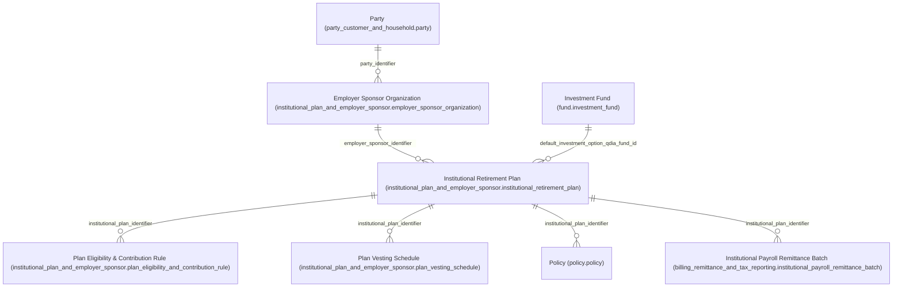

# L&A Ontology Knowledge Framework (OKF) -- Domain 12: Institutional Plan & Employer Sponsor (Workplace 403(b)/401(a)/457 Governance)

| OKF Metadata Attribute | Value |
| :--- | :--- |
| **OKF Catalog Document** | `L&A OKF/12 - OKF - Institutional Plan and Employer Sponsor.MD` |
| **Enterprise Data Domain** | **Domain 12: Institutional Plan & Employer Sponsor (Workplace 403(b)/401(a)/457 Governance)** |
| **Target Physical Database Engine** | Amazon RDS Aurora PostgreSQL (PostgreSQL 15/16 Compatible) |
| **Physical Database Schema** | `institutional_plan_and_employer_sponsor` |
| **Domain Table Count** | **4 Physical Tables / Logical Entities** |
| **Outbound Foreign Key Joins** | **5 Foreign Key Relationships** (Intra-Domain & Cross-Domain) |
| **Inbound Foreign Key Joins** | **2 Cross-Domain Referencing Relationships** |
| **Performance Indexes** | **5 B-Tree & Composite Indexes** |
| **Inherited Business Context Rules** | **`BC-219` through `BC-236` (18 Rules)** |
| **Source Knowledge Layer Artifacts** | `L&A - Ontology.MD`, `L&A Data Model - Logical.MD`, `L&A Data Model - Physical DDL.sql`, `L&A Data Model - Conceptual.MD` |

---

## 1. Domain Executive Ontology & Business Context Overview

The **Institutional Plan & Employer Sponsor** domain models the B2B2C workplace retirement architecture that distinguishes institutional retirement leaders—most notably Corebridge Financial, Fidelity, Voya, Empower, Lincoln Financial, Nationwide, and Principal—from purely retail insurance carriers. In the institutional market, the insurance carrier enters into a Master Services Agreement with an employer sponsor (a private or public university, academic medical center, research institute, K-12 school district, or municipality) to administer and fund one or more workplace retirement plans. Individual employees enroll as plan participants, receiving group annuity certificates or individual custodial/annuity contracts governed simultaneously by the underlying insurance product terms AND the employer's legal plan document. This domain is structured across four core logical entities: `Employer Sponsor Organization`, `Institutional Retirement Plan`, `Plan Eligibility & Contribution Rule`, and `Plan Vesting Schedule`.

`Employer Sponsor Organization` (`Employer Sponsor Identifier`, linked to `Party Identifier`) captures the corporate profile of the sponsoring institution, including its `Employer Identification Number (EIN)`, `Institution Legal Name` (e.g., Harvard College, State University of New York [SUNY], Mayo Clinic), `Institution Sector` (`Higher Education - Private University/College`, `Higher Education - Public State University System`, `Academic Medical Center & Healthcare System`, `K-12 Public School District`, `Independent Non-Profit Research & Museum`), `Master Services Agreement Effective Date`, and the assigned `Relationship Manager Assigned`.

Beneath each employer sponsor, `Institutional Retirement Plan` (`Institutional Plan Identifier`, `Plan Number`, `Plan Official Name`) codifies the legal plan document and Summary Plan Description (SPD) rules, classifying the plan via `Plan Tax Code Type`: `403(b) ERISA Covered Plan` (common at private 501(c)(3) universities and non-profit hospitals subject to Department of Labor Form 5500 audits and ERISA fiduciary duties), `403(b) Non-ERISA Governmental / Church Plan` (common at public universities and K-12 school districts), `401(a) Mandatory / Optional Retirement Program (ORP)` (where state university faculty elect between a state defined-benefit pension and a defined-contribution the carrier annuity plan), `457(b) Governmental Deferred Compensation`, `457(b) Tax-Exempt Top-Hat Plan` (for highly compensated hospital/university executives), `457(f) Non-Qualified Executive Plan`, or `401(k) Corporate Plan`. The entity governs plan-level operational guardrails including `Default Investment Option (QDIA) Fund Identifier` (Department of Labor Qualified Default Investment Alternative, typically a Nuveen Target Date Lifecycle fund), SECURE 2.0 `Auto-Enrollment Enabled Indicator` and `Auto-Escalation Default Percentage`, `Plan Loan Permitted Indicator`, `Maximum Active Loans Allowed`, and `Hardship Withdrawal Permitted Indicator`. Furthermore, `Plan Eligibility & Contribution Rule` defines class-specific waiting periods, mandatory employee contributions, and employer base/matching formulas (`Employer Base Contribution Percentage`, `Employer Matching Formula Description`), while `Plan Vesting Schedule` enforces ERISA cliff or graded vesting rules (`Vesting Schedule Type`, `Years of Service Required for Full Vesting`, `Forfeiture Reallocation Rule`) on employer-funded money sources.

---

## 2. Physical Schema & Logical Entity Architecture Catalog (Schema: `institutional_plan_and_employer_sponsor`)

| # | Logical Entity Name | Physical Table Name (`schema.table`) | Primary Key Column (`PK`) | Business Cols | Audit Cols | Constraints (`PK`/`UQ`/`CHK`) | Logical Entity & Physical Table Definition |
| :--- | :--- | :--- | :--- | :--- | :--- | :--- | :--- |
| **12.1** | **Employer Sponsor Organization** | `institutional_plan_and_employer_sponsor.employer_sponsor_organization` | `employer_sponsor_identifier` | 7 | 2 | `pk_employer_sponsor_organization`, `uq_employer_sponsor_ein` | Employer Sponsor Organization entity represents a university, hospital system, school district, research institute, or corporate employer that sponsors one or more retirement or benefit plans administered by the carrier. |
| **12.2** | **Institutional Retirement Plan** | `institutional_plan_and_employer_sponsor.institutional_retirement_plan` | `institutional_plan_identifier` | 12 | 2 | `pk_institutional_retirement_plan`, `uq_institutional_plan_number`, `chk_plan_max_loans` | Institutional Retirement Plan entity captures the master plan document terms for an employer-sponsored retirement plan (such as a 403(b), 401(a), 457(b), or 401(k) plan), governing eligible products, auto-enrollment rules, plan loan limits, hardship withdrawals, and Qualified Default Investment Alternatives (QDIA). |
| **12.3** | **Plan Eligibility & Contribution Rule** | `institutional_plan_and_employer_sponsor.plan_eligibility_and_contribution_rule` | `plan_eligibility_rule_identifier` | 8 | 2 | `pk_plan_eligibility_contribution_rule`, `chk_pecr_waiting_months` | Plan Eligibility & Contribution Rule entity defines employee class eligibility waiting periods, mandatory employee salary deferral rates, and employer basic and matching contribution formulas established by the Employer Sponsor for an Institutional Retirement Plan. |
| **12.4** | **Plan Vesting Schedule** | `institutional_plan_and_employer_sponsor.plan_vesting_schedule` | `plan_vesting_schedule_identifier` | 6 | 2 | `pk_plan_vesting_schedule`, `chk_pvs_vesting_years` | Plan Vesting Schedule entity specifies the years-of-service vesting rules (immediate, cliff, or graded vesting) governing when a participant acquires non-forfeitable ownership of employer matching and basic contributions inside an Institutional Retirement Plan. |

---

## 3. Relational Join Mining & Foreign Key Topology

### 3.1 Entity-Relationship & Foreign Key Join Diagram (Mermaid)



### 3.2 Outbound Foreign Key Join Matrix (Tables in `institutional_plan_and_employer_sponsor` Referencing Parent Entities)

| FK Constraint Name | Child Table (`institutional_plan_and_employer_sponsor`) | Child FK Column | Join Scope | Parent Referenced Table | Parent PK Column | Referential Action | Exact SQL Join Predicate |
| :--- | :--- | :--- | :--- | :--- | :--- | :--- | :--- |
| `fk_eso_party` | `institutional_plan_and_employer_sponsor.employer_sponsor_organization` | `party_identifier` | Cross-Domain (`party_customer_and_household`) | `party_customer_and_household.party` | `party_identifier` | `ON UPDATE CASCADE ON DELETE RESTRICT` | `institutional_plan_and_employer_sponsor.employer_sponsor_organization.party_identifier = party_customer_and_household.party.party_identifier` |
| `fk_irp_employer_sponsor` | `institutional_plan_and_employer_sponsor.institutional_retirement_plan` | `employer_sponsor_identifier` | Intra-Domain | `institutional_plan_and_employer_sponsor.employer_sponsor_organization` | `employer_sponsor_identifier` | `ON UPDATE CASCADE ON DELETE RESTRICT` | `institutional_plan_and_employer_sponsor.institutional_retirement_plan.employer_sponsor_identifier = institutional_plan_and_employer_sponsor.employer_sponsor_organization.employer_sponsor_identifier` |
| `fk_irp_qdia_fund` | `institutional_plan_and_employer_sponsor.institutional_retirement_plan` | `default_investment_option_qdia_fund_id` | Cross-Domain (`fund`) | `fund.investment_fund` | `investment_fund_identifier` | `ON UPDATE CASCADE ON DELETE SET NULL` | `institutional_plan_and_employer_sponsor.institutional_retirement_plan.default_investment_option_qdia_fund_id = fund.investment_fund.investment_fund_identifier` |
| `fk_pecr_institutional_plan` | `institutional_plan_and_employer_sponsor.plan_eligibility_and_contribution_rule` | `institutional_plan_identifier` | Intra-Domain | `institutional_plan_and_employer_sponsor.institutional_retirement_plan` | `institutional_plan_identifier` | `ON UPDATE CASCADE ON DELETE CASCADE` | `institutional_plan_and_employer_sponsor.plan_eligibility_and_contribution_rule.institutional_plan_identifier = institutional_plan_and_employer_sponsor.institutional_retirement_plan.institutional_plan_identifier` |
| `fk_pvs_institutional_plan` | `institutional_plan_and_employer_sponsor.plan_vesting_schedule` | `institutional_plan_identifier` | Intra-Domain | `institutional_plan_and_employer_sponsor.institutional_retirement_plan` | `institutional_plan_identifier` | `ON UPDATE CASCADE ON DELETE CASCADE` | `institutional_plan_and_employer_sponsor.plan_vesting_schedule.institutional_plan_identifier = institutional_plan_and_employer_sponsor.institutional_retirement_plan.institutional_plan_identifier` |

### 3.3 Inbound Cross-Domain Foreign Key Join Matrix (External Schemas Referencing `institutional_plan_and_employer_sponsor`)

| FK Constraint Name | Referencing Child Schema | Referencing Child Table | Child FK Column | Referenced Target Table (`institutional_plan_and_employer_sponsor`) | Target PK Column | Referential Action | Exact SQL Join Predicate |
| :--- | :--- | :--- | :--- | :--- | :--- | :--- | :--- |
| `fk_policy_institutional_plan` | `policy` | `policy.policy` | `institutional_plan_identifier` | `institutional_plan_and_employer_sponsor.institutional_retirement_plan` | `institutional_plan_identifier` | `ON UPDATE CASCADE ON DELETE RESTRICT` | `policy.policy.institutional_plan_identifier = institutional_plan_and_employer_sponsor.institutional_retirement_plan.institutional_plan_identifier` |
| `fk_iprb_institutional_plan` | `billing_remittance_and_tax_reporting` | `billing_remittance_and_tax_reporting.institutional_payroll_remittance_batch` | `institutional_plan_identifier` | `institutional_plan_and_employer_sponsor.institutional_retirement_plan` | `institutional_plan_identifier` | `ON UPDATE CASCADE ON DELETE RESTRICT` | `billing_remittance_and_tax_reporting.institutional_payroll_remittance_batch.institutional_plan_identifier = institutional_plan_and_employer_sponsor.institutional_retirement_plan.institutional_plan_identifier` |

---

## 4. Detailed Table-by-Table Schema, Column Dictionary & DDL Constraints

### 4.1 Logical Entity: `Employer Sponsor Organization` <-> Physical Table: `institutional_plan_and_employer_sponsor.employer_sponsor_organization`

- **Business & Technical Purpose**: Employer Sponsor Organization entity represents a university, hospital system, school district, research institute, or corporate employer that sponsors one or more retirement or benefit plans administered by the carrier.
- **PostgreSQL Catalog Comment**: _""_
- **Primary Key**: `employer_sponsor_identifier`

#### Attribute-to-Column Schema Mapping & Business Dictionary

| Ord | Logical Attribute Name | Physical Column Name | Logical Type | Physical PostgreSQL Type | Key | Column Modifiers / Default | Business Definition, Domain Semantics & Sample Values |
| :--- | :--- | :--- | :--- | :--- | :--- | :--- | :--- |
| **1** | **Employer Sponsor Identifier** | `employer_sponsor_identifier` | String | `VARCHAR(64)` | **PK** | `NOT NULL` | Unique primary key identifying an institutional employer organization that sponsors retirement or insurance plans with the carrier. Sample values: `EMP-HARV-001`, `EMP-SUNY-002`, `EMP-MAYO-003`. |
| **2** | **Party Identifier** | `party_identifier` | String | `VARCHAR(64)` | **FK** | `NOT NULL` | Foreign key linking the Employer Sponsor to its enterprise legal entity record in the Party table. Sample values: `PRTY-ORG-80012`. |
| **3** | **Employer Identification Number (EIN)** | `employer_identification_number_ein` | String | `VARCHAR(32)` | **NK** | `NOT NULL` | Nine-digit IRS federal tax identification number of the sponsoring employer institution. Sample values: `04-2103580`, `14-6013200`. |
| **4** | **Institution Legal Name** | `institution_legal_name` | String | `VARCHAR(200)` | **NK** | `NOT NULL` | Official chartered name of the university, hospital system, research institute, or school district. Sample values: `President and Fellows of Harvard College`, `State University of New York (SUNY)`, `Mayo Clinic Health System`, `Brookhaven Science Associates`. |
| **5** | **Institution Sector** | `institution_sector` | String | `VARCHAR(150)` | **NK** | `NOT NULL` | Industry classification of the institutional employer sponsor (core to institutional tax-exempt and public sector retirement plans). Sample values: `Higher Education - Private University/College`, `Higher Education - Public State University System`, `Academic Medical Center & Healthcare System`, `K-12 Public School District`, `Independent Non-Profit Research & Museum`, `State & Local Government`. |
| **6** | **Master Services Agreement Effective Date** | `master_services_agreement_effective_date` | Date | `DATE` | **NK** | `NOT NULL` | Date on which the institutional recordkeeping and annuity funding agreement with the employer sponsor originally commenced. Sample values: `1926-09-01`, `1974-01-01`, `2018-01-01`. |
| **7** | **Relationship Manager Assigned** | `relationship_manager_assigned` | String | `VARCHAR(150)` | **NK** | `NOT NULL` | Name or identifier of the dedicated Institutional Relationship Manager overseeing the employer sponsor relationship. Sample values: `Robert H. Vance (Managing Director - Institutional Relationships)`, ` Elena Rostova`. |
| **8** | **Record Created Timestamp (Audit)** | `created_at` | Timestamp | `TIMESTAMPTZ` | **AUDIT** | `NOT NULL DEFAULT CURRENT_TIMESTAMP` | System audit timestamp recording when the physical row was initially inserted into the Aurora PostgreSQL table. |
| **9** | **Record Updated Timestamp (Audit)** | `updated_at` | Timestamp | `TIMESTAMPTZ` | **AUDIT** | `NOT NULL DEFAULT CURRENT_TIMESTAMP` | System audit timestamp recording when the physical row was last modified in the Aurora PostgreSQL table. |

#### Declarative DDL Constraints & Indexes on `institutional_plan_and_employer_sponsor.employer_sponsor_organization`

| Constraint / Index Category | Identifier Name | Definition / Target Columns & Referential Integrity Rule |
| :--- | :--- | :--- |
| **PRIMARY KEY** | `pk_employer_sponsor_organization` | `PRIMARY KEY (employer_sponsor_identifier)` |
| **UNIQUE** | `uq_employer_sponsor_ein` | `UNIQUE (employer_identification_number_ein)` |
| **FOREIGN KEY** | `fk_eso_party` | `FOREIGN KEY (party_identifier) REFERENCES party_customer_and_household.party (party_identifier) ON UPDATE CASCADE ON DELETE RESTRICT` |
| **B-TREE INDEX** | `idx_eso_party_id` | `ON institutional_plan_and_employer_sponsor.employer_sponsor_organization (party_identifier)` |

### 4.2 Logical Entity: `Institutional Retirement Plan` <-> Physical Table: `institutional_plan_and_employer_sponsor.institutional_retirement_plan`

- **Business & Technical Purpose**: Institutional Retirement Plan entity captures the master plan document terms for an employer-sponsored retirement plan (such as a 403(b), 401(a), 457(b), or 401(k) plan), governing eligible products, auto-enrollment rules, plan loan limits, hardship withdrawals, and Qualified Default Investment Alternatives (QDIA).
- **PostgreSQL Catalog Comment**: _""_
- **Primary Key**: `institutional_plan_identifier`

#### Attribute-to-Column Schema Mapping & Business Dictionary

| Ord | Logical Attribute Name | Physical Column Name | Logical Type | Physical PostgreSQL Type | Key | Column Modifiers / Default | Business Definition, Domain Semantics & Sample Values |
| :--- | :--- | :--- | :--- | :--- | :--- | :--- | :--- |
| **1** | **Institutional Plan Identifier** | `institutional_plan_identifier` | String | `VARCHAR(64)` | **PK** | `NOT NULL` | Unique primary key identifying a specific employer-sponsored retirement plan administered by the carrier. Sample values: `PLAN-403B-HARV-01`, `PLAN-401A-SUNY-02`, `PLAN-457B-NY-03`. |
| **2** | **Employer Sponsor Identifier** | `employer_sponsor_identifier` | String | `VARCHAR(64)` | **FK** | `NOT NULL` | Foreign key linking the retirement plan to the sponsoring Employer Sponsor Organization. Sample values: `EMP-HARV-001`, `EMP-SUNY-002`. |
| **3** | **Default Investment Option (QDIA) Fund Identifier** | `default_investment_option_qdia_fund_id` | String | `VARCHAR(64)` | **FK** | `NULL` | Foreign key referencing the default Investment Fund (typically a Target Date Lifecycle fund or balanced annuity) into which auto-enrolled participants are invested if they make no affirmative fund election. Sample values: `FUND-NUV-IDX2050`, `FUND-CREF-SOC`. |
| **4** | **Plan Number** | `plan_number` | String | `VARCHAR(64)` | **NK** | `NOT NULL` | Unique carrier-assigned institutional plan code and 3-digit DOL Form 5500 plan number (e.g., `001`, `002`). Sample values: `INST-406021 (DOL Plan 001)`, `INST-109482 (DOL Plan 002)`. |
| **5** | **Plan Official Name** | `plan_official_name` | String | `VARCHAR(200)` | **NK** | `NOT NULL` | Full legal title of the retirement plan as stated in the Summary Plan Description (SPD) and Form 5500 filing. Sample values: `Harvard University Defined Contribution Retirement Plan`, `SUNY Optional Retirement Program (ORP) 401(a)`, `Supplemental Tax-Deferred Annuity 403(b) Plan`. |
| **6** | **Plan Tax Code Type** | `plan_tax_code_type` | String | `VARCHAR(120)` | **NK** | `NOT NULL` | Internal Revenue Code and ERISA regulatory classification of the plan, which dictates nondiscrimination testing, ERISA fiduciary rules, and contribution limits. Sample values: `403(b) ERISA Covered Plan`, `403(b) Non-ERISA Governmental / Church Plan`, `401(a) Mandatory / Optional Retirement Program (ORP)`, `457(b) Governmental Deferred Compensation`, `457(b) Tax-Exempt Top-Hat Plan`, `457(f) Non-Qualified Executive Plan`, `401(k) Corporate Plan`. |
| **7** | **Plan Effective Date** | `plan_effective_date` | Date | `DATE` | **NK** | `NOT NULL` | Original effective date of the retirement plan document. Sample values: `1968-07-01`, `1999-01-01`, `2020-01-01`. |
| **8** | **Auto-Enrollment Enabled Indicator** | `auto_enrollment_enabled_indicator` | String | `VARCHAR(100)` | **NK** | `NOT NULL` | Indicates whether newly hired eligible employees are automatically enrolled in salary deferral contributions unless they actively opt out (under SECURE 2.0 / PPA rules). Sample values: `True (Auto-Enroll at 5% Default)`, `False (Voluntary Affirmative Enrollment Only)`. |
| **9** | **Auto-Escalation Default Percentage** | `auto_escalation_default_percentage` | Decimal | `NUMERIC(9,6)` | **NK** | `NOT NULL DEFAULT 0.000000` | Annual percentage increase automatically applied to a participant's salary deferral rate each year (e.g., +1% per year up to a 10% cap). Sample values: `0.0100` (1.00% Annual Escalation), `0.0000` (No Auto-Escalation). |
| **10** | **Plan Loan Permitted Indicator** | `plan_loan_permitted_indicator` | String | `VARCHAR(100)` | **NK** | `NOT NULL` | Specifies whether the employer's plan document permits participants to borrow against their plan accumulations. Sample values: `True (General & Residential Loans Permitted)`, `False (No Loans Allowed under Plan Rules)`. |
| **11** | **Maximum Active Loans Allowed** | `maximum_active_loans_allowed` | Integer | `INTEGER` | **NK** | `NOT NULL DEFAULT 0` | Maximum number of concurrent outstanding loans a participant may hold under this plan (commonly 1, 2, or 3). Sample values: `1`, `2`, `3`, `0`. |
| **12** | **Hardship Withdrawal Permitted Indicator** | `hardship_withdrawal_permitted_indicator` | String | `VARCHAR(100)` | **NK** | `NOT NULL` | Indicates whether in-service financial hardship withdrawals are permitted under the plan document during active employment. Sample values: `True (IRS Safe Harbor Hardship Rules)`, `False (Not Permitted)`. |
| **13** | **Record Created Timestamp (Audit)** | `created_at` | Timestamp | `TIMESTAMPTZ` | **AUDIT** | `NOT NULL DEFAULT CURRENT_TIMESTAMP` | System audit timestamp recording when the physical row was initially inserted into the Aurora PostgreSQL table. |
| **14** | **Record Updated Timestamp (Audit)** | `updated_at` | Timestamp | `TIMESTAMPTZ` | **AUDIT** | `NOT NULL DEFAULT CURRENT_TIMESTAMP` | System audit timestamp recording when the physical row was last modified in the Aurora PostgreSQL table. |

#### Declarative DDL Constraints & Indexes on `institutional_plan_and_employer_sponsor.institutional_retirement_plan`

| Constraint / Index Category | Identifier Name | Definition / Target Columns & Referential Integrity Rule |
| :--- | :--- | :--- |
| **PRIMARY KEY** | `pk_institutional_retirement_plan` | `PRIMARY KEY (institutional_plan_identifier)` |
| **UNIQUE** | `uq_institutional_plan_number` | `UNIQUE (plan_number)` |
| **CHECK** | `chk_plan_max_loans` | `CHECK (maximum_active_loans_allowed >= 0)` |
| **FOREIGN KEY** | `fk_irp_employer_sponsor` | `FOREIGN KEY (employer_sponsor_identifier) REFERENCES institutional_plan_and_employer_sponsor.employer_sponsor_organization (employer_sponsor_identifier) ON UPDATE CASCADE ON DELETE RESTRICT` |
| **FOREIGN KEY** | `fk_irp_qdia_fund` | `FOREIGN KEY (default_investment_option_qdia_fund_id) REFERENCES fund.investment_fund (investment_fund_identifier) ON UPDATE CASCADE ON DELETE SET NULL` |
| **B-TREE INDEX** | `idx_irp_employer_sponsor` | `ON institutional_plan_and_employer_sponsor.institutional_retirement_plan (employer_sponsor_identifier, plan_tax_code_type)` |
| **B-TREE INDEX** | `idx_irp_qdia_fund_id` | `ON institutional_plan_and_employer_sponsor.institutional_retirement_plan (default_investment_option_qdia_fund_id)` |

### 4.3 Logical Entity: `Plan Eligibility & Contribution Rule` <-> Physical Table: `institutional_plan_and_employer_sponsor.plan_eligibility_and_contribution_rule`

- **Business & Technical Purpose**: Plan Eligibility & Contribution Rule entity defines employee class eligibility waiting periods, mandatory employee salary deferral rates, and employer basic and matching contribution formulas established by the Employer Sponsor for an Institutional Retirement Plan.
- **PostgreSQL Catalog Comment**: _""_
- **Primary Key**: `plan_eligibility_rule_identifier`

#### Attribute-to-Column Schema Mapping & Business Dictionary

| Ord | Logical Attribute Name | Physical Column Name | Logical Type | Physical PostgreSQL Type | Key | Column Modifiers / Default | Business Definition, Domain Semantics & Sample Values |
| :--- | :--- | :--- | :--- | :--- | :--- | :--- | :--- |
| **1** | **Plan Eligibility Rule Identifier** | `plan_eligibility_rule_identifier` | String | `VARCHAR(64)` | **PK** | `NOT NULL` | Unique primary key identifying an employee classification eligibility and contribution formula rule within an Institutional Retirement Plan. Sample values: `PER-81001`, `PER-81002`. |
| **2** | **Institutional Plan Identifier** | `institutional_plan_identifier` | String | `VARCHAR(64)` | **FK** | `NOT NULL` | Foreign key linking the eligibility and contribution rule to the parent Institutional Retirement Plan. Sample values: `PLAN-403B-HARV-01`, `PLAN-401A-SUNY-02`. |
| **3** | **Employee Classification Group** | `employee_classification_group` | String | `VARCHAR(150)` | **NK** | `NOT NULL` | Defines the employer's job category or bargaining unit to which this specific contribution formula applies. Sample values: `Tenured & Tenure-Track Faculty`, `Full-Time Administrative & Professional Staff`, `Union / Collective Bargaining Employees`, `Medical Center Physicians`, `Adjunct Faculty & Part-Time Staff`. |
| **4** | **Minimum Service Waiting Period Months** | `minimum_service_waiting_period_months` | Integer | `INTEGER` | **NK** | `NOT NULL DEFAULT 0` | Number of months of continuous employment required before an employee in this classification becomes eligible for employer contributions. Sample values: `0` (Immediate upon Hire), `6`, `12` (1 Year of Service), `24`. |
| **5** | **Employer Base Contribution Percentage** | `employer_base_contribution_percentage` | Decimal | `NUMERIC(9,6)` | **NK** | `NOT NULL DEFAULT 0.000000` | Non-elective percentage of eligible compensation contributed by the employer regardless of whether the employee makes voluntary deferrals (common in higher-education 401(a) plans). Sample values: `0.0800` (8.00% Base), `0.1000` (10.00% for Ages 40+), `0.0500` (5.00%), `0.0000`. |
| **6** | **Employer Matching Formula Description** | `employer_matching_formula_description` | String | `VARCHAR(250)` | **NK** | `NOT NULL` | Business-readable formula describing how the employer matches voluntary employee salary deferrals. Sample values: `100% match on the first 5% of employee salary deferral`, `200% match on first 5% (10% Employer for 5% Employee)`, `50% match up to 6% of pay`, `No Employer Match (Voluntary Supplemental Plan)`. |
| **7** | **Maximum Employer Match Cap Percentage** | `maximum_employer_match_cap_percentage` | Decimal | `NUMERIC(9,6)` | **NK** | `NOT NULL DEFAULT 0.000000` | Maximum percentage of eligible compensation the employer will contribute as a matching contribution. Sample values: `0.0500` (5.00%), `0.1000` (10.00%), `0.0300` (3.00%). |
| **8** | **Mandatory Employee Contribution Percentage** | `mandatory_employee_contribution_percentage` | Decimal | `NUMERIC(9,6)` | **NK** | `NOT NULL DEFAULT 0.000000` | Required condition-of-employment salary contribution percentage deducted from the employee's pay in mandatory 401(a) / ORP plans. Sample values: `0.0300` (3.00% Mandatory Employee Contribution), `0.0500` (5.00%), `0.0000` (Voluntary). |
| **9** | **Record Created Timestamp (Audit)** | `created_at` | Timestamp | `TIMESTAMPTZ` | **AUDIT** | `NOT NULL DEFAULT CURRENT_TIMESTAMP` | System audit timestamp recording when the physical row was initially inserted into the Aurora PostgreSQL table. |
| **10** | **Record Updated Timestamp (Audit)** | `updated_at` | Timestamp | `TIMESTAMPTZ` | **AUDIT** | `NOT NULL DEFAULT CURRENT_TIMESTAMP` | System audit timestamp recording when the physical row was last modified in the Aurora PostgreSQL table. |

#### Declarative DDL Constraints & Indexes on `institutional_plan_and_employer_sponsor.plan_eligibility_and_contribution_rule`

| Constraint / Index Category | Identifier Name | Definition / Target Columns & Referential Integrity Rule |
| :--- | :--- | :--- |
| **PRIMARY KEY** | `pk_plan_eligibility_contribution_rule` | `PRIMARY KEY (plan_eligibility_rule_identifier)` |
| **CHECK** | `chk_pecr_waiting_months` | `CHECK (minimum_service_waiting_period_months >= 0)` |
| **FOREIGN KEY** | `fk_pecr_institutional_plan` | `FOREIGN KEY (institutional_plan_identifier) REFERENCES institutional_plan_and_employer_sponsor.institutional_retirement_plan (institutional_plan_identifier) ON UPDATE CASCADE ON DELETE CASCADE` |
| **B-TREE INDEX** | `idx_pecr_plan_id` | `ON institutional_plan_and_employer_sponsor.plan_eligibility_and_contribution_rule (institutional_plan_identifier)` |

### 4.4 Logical Entity: `Plan Vesting Schedule` <-> Physical Table: `institutional_plan_and_employer_sponsor.plan_vesting_schedule`

- **Business & Technical Purpose**: Plan Vesting Schedule entity specifies the years-of-service vesting rules (immediate, cliff, or graded vesting) governing when a participant acquires non-forfeitable ownership of employer matching and basic contributions inside an Institutional Retirement Plan.
- **PostgreSQL Catalog Comment**: _""_
- **Primary Key**: `plan_vesting_schedule_identifier`

#### Attribute-to-Column Schema Mapping & Business Dictionary

| Ord | Logical Attribute Name | Physical Column Name | Logical Type | Physical PostgreSQL Type | Key | Column Modifiers / Default | Business Definition, Domain Semantics & Sample Values |
| :--- | :--- | :--- | :--- | :--- | :--- | :--- | :--- |
| **1** | **Plan Vesting Schedule Identifier** | `plan_vesting_schedule_identifier` | String | `VARCHAR(64)` | **PK** | `NOT NULL` | Unique primary key identifying a vesting rule configuration for an Institutional Retirement Plan. Sample values: `PVS-92001`, `PVS-92002`. |
| **2** | **Institutional Plan Identifier** | `institutional_plan_identifier` | String | `VARCHAR(64)` | **FK** | `NOT NULL` | Foreign key linking the vesting schedule to its parent Institutional Retirement Plan. Sample values: `PLAN-403B-HARV-01`, `PLAN-401A-SUNY-02`. |
| **3** | **Vesting Schedule Type** | `vesting_schedule_type` | String | `VARCHAR(150)` | **NK** | `NOT NULL` | Classifies the statutory ERISA/IRC vesting progression formula applied to employer-funded money sources. Sample values: `Immediate 100% Vesting (Traditional Institutional RA Standard)`, `1-Year Cliff Vesting (366 Days of Service)`, `3-Year Cliff Vesting (0% Years 1-2, 100% Year 3)`, `5-Year Graded Vesting (20% per Year)`, `6-Year Graded Vesting (0% Yr 1, 20%-40%-60%-80%-100%)`. |
| **4** | **Contribution Source Covered** | `contribution_source_covered` | String | `VARCHAR(150)` | **NK** | `NOT NULL` | Identifies which employer money source bucket is governed by this vesting schedule (employee pre-tax and Roth deferrals are always 100% immediately vested by law). Sample values: `Employer Basic Non-Elective Contribution`, `Employer Matching Contribution`, `Employer Supplemental Discretionary Profit Sharing`. |
| **5** | **Years of Service Required for Full Vesting** | `years_of_service_required_for_full_vesting` | Integer | `INTEGER` | **NK** | `NOT NULL DEFAULT 0` | Number of completed vesting service years required for a participant to reach 100% non-forfeitable ownership of the employer contribution source. Sample values: `0` (Immediate), `1`, `3`, `5`, `6`. |
| **6** | **Forfeiture Reallocation Rule** | `forfeiture_reallocation_rule` | String | `VARCHAR(150)` | **NK** | `NOT NULL` | Specifies how unvested employer balances forfeited by terminated employees are utilized by the plan sponsor under IRS rules. Sample values: `Offset Future Employer Contributions`, `Pay Permissible Plan Administrative Expenses`, `Reallocate Pro-Rata to Active Plan Participants`, `Not Applicable (100% Immediate Vesting)`. |
| **7** | **Record Created Timestamp (Audit)** | `created_at` | Timestamp | `TIMESTAMPTZ` | **AUDIT** | `NOT NULL DEFAULT CURRENT_TIMESTAMP` | System audit timestamp recording when the physical row was initially inserted into the Aurora PostgreSQL table. |
| **8** | **Record Updated Timestamp (Audit)** | `updated_at` | Timestamp | `TIMESTAMPTZ` | **AUDIT** | `NOT NULL DEFAULT CURRENT_TIMESTAMP` | System audit timestamp recording when the physical row was last modified in the Aurora PostgreSQL table. |

#### Declarative DDL Constraints & Indexes on `institutional_plan_and_employer_sponsor.plan_vesting_schedule`

| Constraint / Index Category | Identifier Name | Definition / Target Columns & Referential Integrity Rule |
| :--- | :--- | :--- |
| **PRIMARY KEY** | `pk_plan_vesting_schedule` | `PRIMARY KEY (plan_vesting_schedule_identifier)` |
| **CHECK** | `chk_pvs_vesting_years` | `CHECK (years_of_service_required_for_full_vesting >= 0)` |
| **FOREIGN KEY** | `fk_pvs_institutional_plan` | `FOREIGN KEY (institutional_plan_identifier) REFERENCES institutional_plan_and_employer_sponsor.institutional_retirement_plan (institutional_plan_identifier) ON UPDATE CASCADE ON DELETE CASCADE` |
| **B-TREE INDEX** | `idx_pvs_plan_id` | `ON institutional_plan_and_employer_sponsor.plan_vesting_schedule (institutional_plan_identifier)` |

---

## 5. Inherited Business Context Ontology Rules (`BC-219` to `BC-236`)

> **Semantic Inheritance Notice**: The following **18 Business Context rules** are inherited verbatim from `L&A Data Domain/L&A - Ontology.MD` to provide autonomous AI agents, data engineers, and actuaries with complete domain rules, accounting identities, statutory compliance mandates, and SQL join guardrails for the **Institutional Plan & Employer Sponsor** domain.

#### BC-219: Three-Tier Institutional Retirement Architecture (`Employer Sponsor Organization` $\rightarrow$ `Institutional Retirement Plan` $\rightarrow$ Participant `Policy` / Certificate)

**Domains**: Institutional Plan & Employer Sponsor, Policy & Contract Administration, Party, Customer & Household | **Entities**: `Employer Sponsor Organization`, `Institutional Retirement Plan`, `Policy`, `Policy Party Role` | **Key Attributes**: `Employer Sponsor Identifier`, `Institutional Plan Identifier`, `Policy Identifier`, `Tax Qualification Code`, `Role Type`

The defining architectural hallmark of an institutional retirement and annuity carrier like the carrier is its **Three-Tier Institutional Hierarchy**, which links an employer institution (`Employer Sponsor Organization`) to one or more formal retirement plans (`Institutional Retirement Plan`), and from each plan down to thousands of individual participant annuity contracts or group certificates (`Policy`). In retail insurance, a `Policy` is a standalone contract sold directly to an individual consumer (`Policy`.`Institutional Plan Identifier` IS NULL). In institutional retirement, however, every workplace participant contract (`Policy`) exists inside the legal and fiduciary framework of a sponsoring employer's retirement plan (`Policy`.`Institutional Plan Identifier` = `Institutional Retirement Plan`.`Institutional Plan Identifier`).

Tracing the three tiers from top to bottom is essential for any AI agent querying institutional retirement data:

1. **Tier 1 —** `Employer Sponsor Organization` **(**`Employer Sponsor Identifier`**, e.g.,** `EMP-HARV-001` **for** `President and Fellows of Harvard College` **or** `EMP-SUNY-002` **for** `State University of New York (SUNY)`**)**: Represents the university, hospital system, research institute, or school district that employs the participants, remits biweekly/monthly payroll contribution feeds, and serves as the Plan Sponsor and Named Fiduciary.
2. **Tier 2 —** `Institutional Retirement Plan` **(**`Institutional Plan Identifier`**, e.g.,** `PLAN-403B-HARV-01` **or** `PLAN-401A-SUNY-02`**)**: Represents a specific tax-qualified retirement plan established by that employer under a formal Plan Document and Summary Plan Description (SPD). A single `Employer Sponsor Organization` routinely sponsors **multiple** concurrent `Institutional Retirement Plan` records (commonly pairing a mandatory `401(a)` or ERISA `403(b)` base plan with a voluntary supplemental `403(b)` plan and a `457(b)` executive deferred compensation plan).
3. **Tier 3 — Participant** `Policy` **/ Certificate (**`Policy Identifier`**, e.g.,** `POL-UUID-90001421`**)**: Represents the individual annuity contract (such as a Institutional Retirement Annuity [RA], Group Retirement Annuity [GRA], Retirement Choice [RC], or Retirement Choice Plus [RCP] certificate) held by a specific employee (`Party` linked via `Policy Party Role`.`Role Type` = `Institutional Plan Participant`). Even when funded through an institutional plan, the carrier annuity contracts frequently vest individual contractual rights directly in the participant, meaning a participant who works at three different universities over their career may hold three distinct `Policy` rows—each linked to a different `Institutional Plan Identifier`—all rolling up to their single MDM `Party Identifier` (`BC-199`).

#### BC-220: `Employer Sponsor Organization` Identity Link to Enterprise `Party` and `Institution Sector` Segmentation

**Domains**: Institutional Plan & Employer Sponsor, Party, Customer & Household | **Entities**: `Employer Sponsor Organization`, `Party` | **Key Attributes**: `Employer Sponsor Identifier`, `Party Identifier`, `Employer Identification Number (EIN)`, `Institution Legal Name`, `Institution Sector`

In our logical data model, an `Employer Sponsor Organization` is not an isolated island disconnected from the enterprise customer master; instead, every `Employer Sponsor Organization` row links via `Employer Sponsor Organization`.`Party Identifier` (for example, `PRTY-ORG-80012`) to a master legal entity record in the `Party` table where `Party`.`Party Type` = `Employer Sponsor Institution`. This foreign key design ensures that the institution's nine-digit federal `Employer Identification Number (EIN)` (such as `04-2103580` for Harvard or `14-6013200` for SUNY, synchronized with `Party`.`Tax Identification Number (SSN/EIN)`), its `Institution Legal Name` (`President and Fellows of Harvard College`), and its corporate headquarters and billing addresses in `Party Contact & Address Profile` are governed by the same enterprise MDM and KYC/OFAC controls as all other legal entities.

Furthermore, `Employer Sponsor Organization`.`Institution Sector` classifies each sponsoring employer into the core tax-exempt and public-sector industry verticals that define institutional retirement eligibility under Internal Revenue Code Sections 403(b), 401(a), and 457(b):

- `Higher Education - Private University/College` (IRC Section 501(c)(3) private non-profit universities and liberal arts colleges, typically governed by ERISA)
- `Higher Education - Public State University System` (State land-grant and public university systems, which are governmental entities exempt from ERISA)
- `Academic Medical Center & Healthcare System` (Non-profit teaching hospitals, research clinics, and regional healthcare networks)
- `K-12 Public School District` (Public elementary and secondary school systems and private independent day/boarding schools)
- `Independent Non-Profit Research & Museum` (Think tanks, national laboratories such as `Brookhaven Science Associates`, foundations, and cultural institutions)
- `State & Local Government` (Municipalities, state agencies, and public authorities).

AI agents building institutional market-share analytics, benchmarking plan participation rates, or predicting cash flow seasonality must always segment by `Institution Sector`: for example, `Higher Education` and `K-12 Public School District` sponsors exhibit pronounced nine-month academic-year payroll contribution cycles and heavy May/June/August retirement annuitization spikes, whereas `Academic Medical Center & Healthcare System` sponsors exhibit year-round 24/7 clinical payroll patterns and high physician utilization of `457(b)` and `457(f)` plans.

#### BC-221: Master Services Agreement Tenure (`Master Services Agreement Effective Date`) and Dedicated `Relationship Manager Assigned` Governance

**Domains**: Institutional Plan & Employer Sponsor, Agent & Agency | **Entities**: `Employer Sponsor Organization`, `Institutional Retirement Plan`, `Producer / Advisor` | **Key Attributes**: `Employer Sponsor Identifier`, `Master Services Agreement Effective Date`, `Relationship Manager Assigned`, `Producer Role Type`

Unlike retail brokerage accounts that are opened one individual at a time, an institutional retirement relationship is governed by a comprehensive B2B recordkeeping, administration, and funding contract executed between the carrier and the `Employer Sponsor Organization`. The inception of this institutional partnership is recorded in `Employer Sponsor Organization`.`Master Services Agreement Effective Date`. Because the carrier was founded by Andrew Carnegie in 1918 specifically to provide portable lifetime pensions for college professors, many flagship university and research relationships in the `Employer Sponsor Organization` table carry `Master Services Agreement Effective Date` values stretching back half a century or more (for example, `1926-09-01` or `1974-01-01`), alongside modern competitive recordkeeping wins (`2018-01-01`).

Under modern Department of Labor (DOL) ERISA Section 408(b)(2) fee disclosure regulations and institutional fiduciary governance standards, each `Employer Sponsor Organization` is assigned a dedicated B2B lead stored in `Employer Sponsor Organization`.`Relationship Manager Assigned` (which maps to a `Producer / Advisor` record with `Producer Role Type` = `Institutional Relationship Manager (IRM)`). The `Relationship Manager Assigned` is responsible for conducting quarterly and annual Plan Sponsor Fiduciary Reviews with the institution's Retirement Investment Committee, negotiating recordkeeping revenue-sharing / plan expense offset budgets, coordinating Request for Proposal (RFP) defenses when the institution's independent plan consultant (`Agency Type` = `Institutional Retirement Plan Consultant / RIA`) conducts a periodic market fee benchmark, and orchestrating on-campus `Workplace Retirement Consultant` deployment. AI agents building institutional retention ("at-risk plan") models or B2B executive dashboards should join `Employer Sponsor Organization` to `Institutional Retirement Plan` and `Policy Valuation Snapshot` to calculate total institutional plan AUM, participant count, net contribution inflows vs. rollover outflows, and relationship tenure (`Current Date` minus `Master Services Agreement Effective Date`) grouped by `Relationship Manager Assigned`.

#### BC-222: Internal Revenue Code `Plan Tax Code Type` Taxonomy — `403(b) ERISA Covered Plan` vs. `403(b) Non-ERISA Governmental / Church Plan`

**Domains**: Institutional Plan & Employer Sponsor, Policy & Contract Administration | **Entities**: `Institutional Retirement Plan`, `Employer Sponsor Organization`, `Policy` | **Key Attributes**: `Institutional Plan Identifier`, `Plan Tax Code Type`, `Institution Sector`, `Tax Qualification Code`

The attribute `Institutional Retirement Plan`.`Plan Tax Code Type` is one of the most legally consequential fields in the entire data model because it dictates which federal regulatory body (Department of Labor vs. Internal Revenue Service vs. State Law) governs the plan and its underlying participant `Policy` contracts. While laymen often refer to all non-profit and academic retirement plans generically as "403(b) plans," our data model strictly separates `403(b)` plans into two fundamentally different legal regimes based on `Plan Tax Code Type`: `403(b) ERISA Covered Plan` and `403(b) Non-ERISA Governmental / Church Plan`.

1. `403(b) ERISA Covered Plan`: Sponsored by private 501(c)(3) non-profit universities (`Higher Education - Private University/College`, such as Harvard, Columbia, or NYU), private non-profit hospital systems, and research institutes whenever the employer makes matching or base contributions (`Employer Base Contribution Percentage` $>$ `0.0000`) or exercises discretionary administrative control. An ERISA 403(b) plan is subject to Title I of the Employee Retirement Income Security Act of 1974 (ERISA), which mandates: strict DOL fiduciary prudence duties (ERISA Section 404), annual audited **DOL Form 5500** filings (`Plan Number`), mandatory **ERISA Spousal Protection (QJSA/QPSA)** requiring notarized spousal consent for non-spouse beneficiaries (`BC-214`) and single-life annuities, and statutory ERISA vesting minimums (`BC-234`).
2. `403(b) Non-ERISA Governmental / Church Plan`: Sponsored by public state universities (`Higher Education - Public State University System`), `K-12 Public School District` employers, or qualified church organizations under ERISA Section 4(b), **OR** by a 501(c)(3) organization that offers a strictly voluntary, employee-deferral-only supplemental 403(b) plan complying with the DOL Safe Harbor Regulation (29 CFR 2510.3-2(f)) where the employer makes zero contributions and takes minimal administrative involvement. Non-ERISA 403(b) plans are **completely exempt from Title I of ERISA**: they do not file Form 5500, and unless the employer's plan document voluntarily adopts spousal consent rules, participants are not subject to federal ERISA QJSA/QPSA spousal waiver requirements. AI agents automating compliance checks, Form 5500 reporting extracts, or spousal waiver validation must always inspect `Plan Tax Code Type` (`403(b) ERISA Covered Plan` vs. `403(b) Non-ERISA Governmental / Church Plan`) rather than checking only whether `Policy`.`Tax Qualification Code` contains `403(b)`.

#### BC-223: Mandatory `401(a) Mandatory / Optional Retirement Program (ORP)` vs. Voluntary Supplemental `403(b)` Multi-Plan Employer Pairing

**Domains**: Institutional Plan & Employer Sponsor, Policy & Contract Administration | **Entities**: `Institutional Retirement Plan`, `Plan Eligibility & Contribution Rule`, `Employer Sponsor Organization`, `Policy` | **Key Attributes**: `Institutional Plan Identifier`, `Employer Sponsor Identifier`, `Plan Tax Code Type`, `Mandatory Employee Contribution Percentage`, `Employer Base Contribution Percentage`

In public higher education systems (such as the `State University of New York (SUNY)`, the University of North Carolina system, or state college systems across more than 40 US states) and many private research universities, an employer rarely administers all retirement money inside a single plan. Instead, the `Employer Sponsor Organization` establishes a **Paired Dual-Plan Architecture** consisting of two separate rows in `Institutional Retirement Plan` under the same `Employer Sponsor Identifier`:

1. **The Core Base Plan (**`Plan Tax Code Type` **=** `401(a) Mandatory / Optional Retirement Program (ORP)`**)**: In public higher education, newly hired faculty and professional staff are typically given a one-time, irrevocable statutory window (e.g., 30 to 90 days from hire) to choose between the state's traditional Defined Benefit (DB) public employee pension system and the **Optional Retirement Program (ORP)**—a Defined Contribution `401(a)` plan funded through the carrier annuity contracts (`PLAN-401A-SUNY-02`). Under a `401(a)` ORP, participation is a condition of employment: the employee is required to contribute a fixed percentage of salary (`Plan Eligibility & Contribution Rule`.`Mandatory Employee Contribution Percentage`, e.g., `0.0300` to `0.0600`), and the university contributes a generous statutory base percentage (`Employer Base Contribution Percentage`, e.g., `0.0800` to `0.1000`). Importantly, mandatory `401(a)` employee contributions picked up by the employer under IRC Section 414(h)(2) do **not** reduce the employee's IRC Section 402(g) voluntary elective deferral limit!
2. **The Voluntary Supplemental Plan (**`Plan Tax Code Type` **=** `403(b) Non-ERISA Governmental / Church Plan` **or** `403(b) ERISA Covered Plan`**)**: Because the `401(a)` ORP contribution rates are fixed by statute or plan formula and cannot be changed mid-year by the employee, the university simultaneously sponsors a second plan—a **Supplemental Tax-Deferred Annuity (TDA)** `403(b)` **Plan**—where the employee can voluntarily elect, increase, decrease, or stop pre-tax or Roth salary deferrals up to the annual IRS Section 402(g) limit ($23,500 base limit plus age-50 catch-up and 15-year service catch-up).

Consequently, a single university professor (`Party Identifier`) routinely holds **two active institutional** `Policy` **contracts** at the same employer: one linked to the `401(a)` `Institutional Plan Identifier` and a second linked to the `403(b)` `Institutional Plan Identifier`. AI agents analyzing participant savings rates at an institution must aggregate contributions across **all** `Institutional Retirement Plan` rows belonging to that `Employer Sponsor Identifier` to avoid under-reporting total retirement readiness.

#### BC-224: Public and Tax-Exempt Deferred Compensation Plans — `457(b) Governmental`, `457(b) Tax-Exempt Top-Hat Plan`, and `457(f) Non-Qualified Executive Plan`

**Domains**: Institutional Plan & Employer Sponsor, Policy & Contract Administration | **Entities**: `Institutional Retirement Plan`, `Employer Sponsor Organization`, `Policy` | **Key Attributes**: `Institutional Plan Identifier`, `Plan Tax Code Type`, `Institution Sector`, `Tax Qualification Code`

Beyond `403(b)` and `401(a)` plans, universities, academic medical centers, and state/local governments make extensive use of Internal Revenue Code Section 457 deferred compensation plans to allow high-earning faculty, hospital physicians, athletic directors, and executives to save above the IRC Section 402(g) `403(b)` limit (since IRC Section 457(b) has its own separate, non-coordinated annual elective deferral limit, effectively allowing a participant to contribute the full 403(b) maximum *plus* the full 457(b) maximum in the same tax year). However, AI agents must never treat all `457` plans as identical; `Institutional Retirement Plan`.`Plan Tax Code Type` distinguishes three radically different legal and insolvency-risk structures:

1. `457(b) Governmental Deferred Compensation`: Sponsored by public state universities (`EMP-SUNY-002`) and state/local governments. Like a 403(b) or 401(k), assets in a **Governmental 457(b)** are held in an insulated trust or annuity contract for the exclusive benefit of participants (completely protected from the employer's creditors), are eligible to be rolled over to an IRA or another qualified plan upon separation from service, and carry a huge tax advantage: distributions from a `457(b) Governmental` plan are **exempt from the 10% IRS early withdrawal penalty** under IRC Section 72(t) upon separation from service at *any* age (even at age 45!).
2. `457(b) Tax-Exempt Top-Hat Plan`: Sponsored by private 501(c)(3) non-profit universities and non-profit hospital systems. Under federal law, to avoid immediate taxation and ERISA funding conflicts, participation in a non-governmental 501(c)(3) `457(b)` plan MUST be strictly restricted to a **"Top-Hat" group** of management or highly compensated employees (such as hospital physicians, deans, and senior executives). Furthermore, by law (IRC Section 457(b)(6)), all assets in a `457(b) Tax-Exempt Top-Hat Plan` must remain the **unfunded general property of the employer Sponsor**, subject to the claims of the employer's general creditors in the event of the hospital or university's bankruptcy, and **cannot be rolled over to an IRA** (they may only be paid out as taxable distributions or transferred to another 501(c)(3) top-hat 457(b) plan).
3. `457(f) Non-Qualified Executive Plan`: Known as an "ineligible" deferred compensation plan used for university presidents, head coaches, and hospital CEOs for amounts exceeding the 457(b) dollar cap. Under IRC Section 457(f), the entire accumulated balance becomes **100% taxable as ordinary W-2 income on the exact day the substantial risk of forfeiture (cliff vesting date) lapses**, even if cash is distributed later. AI agents generating rollover propensity lists must strictly exclude `457(b) Tax-Exempt Top-Hat Plan` and `457(f) Non-Qualified Executive Plan` balances from IRA rollover marketing campaigns, as rolling those assets into an IRA is prohibited by the Internal Revenue Code.

#### BC-225: Department of Labor `Plan Number` (Form 5500 3-Digit Code) and `Plan Official Name` Regulatory Reporting Alignment

**Domains**: Institutional Plan & Employer Sponsor | **Entities**: `Institutional Retirement Plan`, `Employer Sponsor Organization` | **Key Attributes**: `Institutional Plan Identifier`, `Employer Sponsor Identifier`, `Plan Number`, `Plan Official Name`, `Plan Effective Date`, `Employer Identification Number (EIN)`

Every retirement plan administered on the carrier's recordkeeping platform is identified internally by its surrogate primary key (`Institutional Plan Identifier`, e.g., `PLAN-403B-HARV-01`) and externally by `Institutional Retirement Plan`.`Plan Number` (e.g., `INST-406021 (DOL Plan 001)`) and `Institutional Retirement Plan`.`Plan Official Name` (e.g., `Harvard University Defined Contribution Retirement Plan`). For all ERISA-covered plans (`Plan Tax Code Type` IN (`403(b) ERISA Covered Plan`, `401(k) Corporate Plan`, and ERISA-covered `401(a)` plans)), the plan sponsor is legally required to file an annual **Form 5500 (Annual Return/Report of Employee Benefit Plan)** jointly with the Department of Labor (DOL) Employee Benefits Security Administration (EBSA), the IRS, and the PBGC via the EFAST2 electronic filing system.

In the federal Form 5500 ecosystem, a retirement plan is uniquely identified across the United States by the composite natural key combining `Employer Sponsor Organization`.`Employer Identification Number (EIN)` and the three-digit DOL plan code embedded in `Institutional Retirement Plan`.`Plan Number` (which by IRS/DOL convention starts at `001`, `002`, `003` for retirement/pension plans, whereas health and welfare benefit plans use `501`, `502`, etc.), along with the exact legal string in `Plan Official Name` and the original inception date in `Plan Effective Date`. At the end of each plan year, the carrier generates the **Form 5500 Schedule A (Insurance Information)**, **Schedule C (Service Provider Fee & Compensation Information)**, and **Schedule H / Schedule I (Financial Information)** reporting package by aggregating all participant `Policy` balances (`Policy Valuation Snapshot`.`Total Account Value`), employer and employee contributions, loan balances (`Policy Loan`), benefit payouts, and direct/indirect advisor and recordkeeping compensation (`Compensation Schedule & Commission Statement`) tied to that `Institutional Plan Identifier`. AI agents generating Form 5500 regulatory extracts or Schedule C fee disclosures must group all underlying policy and transaction records strictly by `Institutional Plan Identifier` and include `Employer Identification Number (EIN)`, `Plan Number`, `Plan Official Name`, and `Plan Effective Date` in the header metadata.

#### BC-226: Qualified Default Investment Alternative (`Default Investment Option (QDIA) Fund Identifier`) Fiduciary Safe Harbor under DOL Rules

**Domains**: Institutional Plan & Employer Sponsor, Product & Coverage, Investment & Separate Account | **Entities**: `Institutional Retirement Plan`, `Investment Fund`, `Fund Allocation`, `Policy` | **Key Attributes**: `Institutional Plan Identifier`, `Default Investment Option (QDIA) Fund Identifier`, `Fund Identifier`, `Auto-Enrollment Enabled Indicator`, `Allocation Percentage`

When an eligible employee is automatically enrolled into an `Institutional Retirement Plan` (`Auto-Enrollment Enabled Indicator` = `True (Auto-Enroll at 5% Default)`), or when an employee enrolls via payroll feed without submitting an affirmative investment allocation election (`Fund Allocation`), the carrier cannot leave the incoming payroll contributions uninvested in cash without exposing the `Employer Sponsor Organization` to fiduciary breach lawsuits for lost market growth. Conversely, if the employer invests the participant's contributions into an equity/bond portfolio without the participant's affirmative direction and the market declines, the employer historically feared fiduciary liability for the investment losses. To resolve this dilemma, the Pension Protection Act of 2006 (PPA) and Department of Labor Regulation **29 CFR 2550.404c-5** established the **Qualified Default Investment Alternative (QDIA) Fiduciary Safe Harbor**, modeled in our schema via the foreign key `Institutional Retirement Plan`.`Default Investment Option (QDIA) Fund Identifier` referencing `Investment Fund`.`Fund Identifier`.

Under DOL regulation 2550.404c-5, to qualify for QDIA fiduciary protection, the plan's designated `Default Investment Option (QDIA) Fund Identifier` cannot be a money market fund or stable value/fixed account (except for short-term 120-day administrative holding periods); instead, it must be one of three approved diversified long-term structures:

1. **A Target-Date / Lifecycle Fund Series** (such as `FUND-NUV-IDX2050` for Nuveen Lifecycle Index 2050 Fund, where the specific vintage year is automatically selected based on the participant's `Party`.`Date of Birth` and a target retirement age of 65);
2. **A Balanced Fund** (such as `FUND-CREF-SOC` or a balanced stock/bond allocation consistent with the overall plan demographics); or
3. **A Professionally Managed Account Service** (such as Institutional Custom Target-Date custom target-date/managed models that blend `Participating General Account Fixed` fixed annuity with variable/mutual fund subaccounts based on age).

Whenever a payroll contribution arrives for a participant `Policy` that has no user-directed `Fund Allocation` rows on file, the recordkeeping engine automatically creates a `Fund Allocation` row pointing to `Default Investment Option (QDIA) Fund Identifier` with `Allocation Percentage` = `1.0000` (100.00%) and triggers mandatory initial and annual QDIA statutory notices (at least 30 days in advance). AI agents analyzing participant investment behavior should distinguish "Defaulted QDIA Participants" (whose `Fund Allocation` consists solely of `Default Investment Option (QDIA) Fund Identifier` with zero subsequent allocation changes) from "Self-Directed Investors."

#### BC-227: SECURE 2.0 Automatic Enrollment (`Auto-Enrollment Enabled Indicator`) and Annual Automatic Escalation (`Auto-Escalation Default Percentage`) Mechanics

**Domains**: Institutional Plan & Employer Sponsor, Policy & Contract Administration | **Entities**: `Institutional Retirement Plan`, `Policy`, `Financial Transaction` | **Key Attributes**: `Institutional Plan Identifier`, `Auto-Enrollment Enabled Indicator`, `Auto-Escalation Default Percentage`, `Default Investment Option (QDIA) Fund Identifier`, `Plan Effective Date`

Behavioral economics research in workplace retirement plans consistently demonstrates that requiring employees to actively fill out enrollment paperwork (`Auto-Enrollment Enabled Indicator` = `False (Voluntary Affirmative Enrollment Only)`) results in low participation among younger and lower-income staff, whereas **Automatic Enrollment** paired with **Automatic Escalation** boosts plan participation rates above 90%. Following the landmark enactment of the **SECURE 2.0 Act of 2022** (specifically Section 101, effective for plan years beginning after December 31, 2024), most newly established ERISA `401(k)` and `403(b)` plans (`Plan Effective Date` post-enactment, excluding governmental, church, small-business, and pre-enactment grandfathered plans) are statutorily required to operate as an Eligible Automatic Contribution Arrangement (EACA) or Qualified Automatic Contribution Arrangement (QACA), tracked via `Institutional Retirement Plan`.`Auto-Enrollment Enabled Indicator` and `Auto-Escalation Default Percentage`.

When `Auto-Enrollment Enabled Indicator` is `True (Auto-Enroll at 5% Default)` (under SECURE 2.0, the initial default deferral rate must be at least **3%** and no more than **10%** of eligible compensation), any newly hired eligible employee who does not affirmatively opt out or elect a custom deferral rate within the 30-to-90-day notice window is automatically issued a participant `Policy` certificate, enrolled at the plan's default pre-tax deferral rate, and invested 100% into the plan's `Default Investment Option (QDIA) Fund Identifier` (`BC-226`). Under EACA rules, an auto-enrolled participant who realizes within **90 days** of their first payroll deduction that they did not wish to participate may request a **Permissible Withdrawal** of their defaulted contributions plus earnings without incurring the 10% IRC Section 72(t) early withdrawal penalty.

Furthermore, to prevent participants from stagnating permanently at a low 3% or 5% initial default rate, `Institutional Retirement Plan`.`Auto-Escalation Default Percentage` (typically `0.0100`, representing +1.00% per year) automatically steps up the participant's salary deferral rate by 1 percentage point on each annual plan anniversary (or January 1) until the participant reaches the plan's auto-escalation cap (required under SECURE 2.0 to be at least **10%** and up to **15%** of compensation). AI agents modeling future plan contribution inflows (`Projected Premium Inflow Amount`) must incorporate `Auto-Escalation Default Percentage` compounding for all active defaulted participants below the escalation cap.

#### BC-228: `Plan Eligibility & Contribution Rule` Segmentation by `Employee Classification Group` (Tenured Faculty, Staff, Physicians, Union, Adjuncts)

**Domains**: Institutional Plan & Employer Sponsor, Party, Customer & Household | **Entities**: `Plan Eligibility & Contribution Rule`, `Institutional Retirement Plan`, `Party` | **Key Attributes**: `Plan Eligibility Rule Identifier`, `Institutional Plan Identifier`, `Employee Classification Group`, `Occupation Class`, `Employer Base Contribution Percentage`, `Employer Matching Formula Description`

Within a single `Institutional Retirement Plan` (for example, `PLAN-403B-HARV-01`), an employer rarely applies a single uniform contribution formula to every employee on the payroll. Large universities, academic medical centers, and non-profit institutions employ diverse workforce populations governed by distinct faculty senate statutes, physician practice plans, administrative HR handbooks, and union collective bargaining agreements (CBAs). To model these intra-plan differences with complete precision, the logical data model decomposes each `Institutional Retirement Plan` into one-to-many ($1:N$) child rows in `Plan Eligibility & Contribution Rule`, keyed by `Plan Eligibility Rule Identifier` (`PER-81001`, `PER-81002`) and segmented by `Plan Eligibility & Contribution Rule`.`Employee Classification Group`.

Typical segments stored in `Employee Classification Group` for the same `Institutional Plan Identifier` include:

- `Tenured & Tenure-Track Faculty`: Often receive immediate eligibility (`Minimum Service Waiting Period Months` = `0`) and the highest non-elective `Employer Base Contribution Percentage` (e.g., `0.1000` or 10.00% of salary) to remain competitive in national academic recruiting.
- `Medical Center Physicians`: Clinical faculty and hospitalists whose compensation includes base academic salary plus clinical incentive components, often governed by specific IRS Section 401(a)(17) compensation cap rules ($345,000+ annual recognizable compensation limit).
- `Full-Time Administrative & Professional Staff`: May be subject to a waiting period (`Minimum Service Waiting Period Months` = `6` or `12`) and a combined base plus matching formula (`Employer Base Contribution Percentage` = `0.0500` plus `Employer Matching Formula Description` = `100% match on the first 5% of employee salary deferral`).
- `Union / Collective Bargaining Employees`: Governed strictly by negotiated CBA terms.
- `Adjunct Faculty & Part-Time Staff`: Historically eligible immediately for voluntary employee salary deferrals under the **IRC Section 403(b)(12)(A)(ii) "Universal Availability Rule"** (which mandates that almost all employees must be permitted to make voluntary 403(b) salary deferrals from day one), and under **SECURE 2.0 Long-Term, Part-Time (LTPT) Employee Rules**, become eligible after **2 consecutive years** of working at least **500 hours/year**.

When an AI agent joins `Institutional Retirement Plan` to `Plan Eligibility & Contribution Rule`, it MUST join or filter using the participant's corresponding employee class (`Party`.`Occupation Class` $\leftrightarrow$ `Plan Eligibility & Contribution Rule`.`Employee Classification Group`) to avoid fan-out across all employee classes in the plan.

#### BC-229: `Minimum Service Waiting Period Months` and Eligibility Entry Date Tracking for Employer Contributions

**Domains**: Institutional Plan & Employer Sponsor, Policy & Contract Administration | **Entities**: `Plan Eligibility & Contribution Rule`, `Institutional Retirement Plan`, `Policy` | **Key Attributes**: `Plan Eligibility Rule Identifier`, `Institutional Plan Identifier`, `Employee Classification Group`, `Minimum Service Waiting Period Months`, `Employer Base Contribution Percentage`, `Maximum Employer Match Cap Percentage`

In institutional retirement plan administration, a critical regulatory distinction exists between **Eligibility to Make Employee Elective Deferrals** and **Eligibility to Receive Employer Base or Matching Contributions**. Under the IRC Section 403(b)(12) Universal Availability Rule, virtually any employee of an eligible 403(b) sponsor must be allowed to contribute their own money (pre-tax or Roth salary deferrals) immediately upon hire (`0` months waiting period). However, for employer-funded contributions (`Employer Base Contribution Percentage` and `Employer Matching Formula Description`), sponsors frequently impose a service tenure threshold stored in `Plan Eligibility & Contribution Rule`.`Minimum Service Waiting Period Months`.

The attribute `Minimum Service Waiting Period Months` records the integer number of months of continuous employment (`0` for Immediate upon Hire, `6` for Six Months, `12` for 1 Year of Service / 1,000 hours, or `24` for 2 Years of Service) that an employee in that `Employee Classification Group` must complete before the employer begins funding base or matching contributions into the participant's `Policy`. Under ERISA Section 202(a)(1) and Internal Revenue Code Section 410(a), federal law sets strict statutory ceilings on `Minimum Service Waiting Period Months`:

1. **Standard Maximum Waiting Period (**`12` **Months / 1 Year of Service)**: For any plan where employer contributions are subject to a delayed vesting schedule (`Plan Vesting Schedule`.`Years of Service Required for Full Vesting` $>$ `0`), the plan **cannot** require a waiting period longer than **12 months** (1 Year of Service, defined as 1,000 hours of service in a 12-month computation period) and minimum age 21.
2. **2-Year Waiting Period Exception (**`24` **Months — Requires 100% Immediate Vesting)**: Under IRC Section 410(a)(1)(B)(i), a higher-education `403(b)` or `401(a)` plan is legally permitted to impose a **24-month (2-year)** waiting period (`Minimum Service Waiting Period Months` = `24`) **ONLY IF** the plan grants **100% immediate vesting** (`Plan Vesting Schedule`.`Vesting Schedule Type` = `Immediate 100% Vesting (Traditional Institutional RA Standard)` and `Years of Service Required for Full Vesting` = `0`) on all employer contributions once the 24-month waiting period is satisfied!

Furthermore, prior academic service at another accredited university or research institution is often credited toward satisfying `Minimum Service Waiting Period Months` under higher-education portability reciprocity rules. AI agents auditing plan compliance must flag any `Institutional Retirement Plan` that combines `Minimum Service Waiting Period Months` $>$ `12` with `Years of Service Required for Full Vesting` $>$ `0` as a statutory ERISA/IRC Section 410(a) violation.

#### BC-230: Non-Elective `Employer Base Contribution Percentage` Mechanics and Age-Graded Contribution Tiers

**Domains**: Institutional Plan & Employer Sponsor, Policy & Contract Administration | **Entities**: `Plan Eligibility & Contribution Rule`, `Institutional Retirement Plan`, `Financial Transaction` | **Key Attributes**: `Plan Eligibility Rule Identifier`, `Employee Classification Group`, `Employer Base Contribution Percentage`, `Transaction Type`, `Gross Transaction Amount`

One of the defining generosity features of higher education, medical center, and research institute retirement plans (`Institution Sector` = `Higher Education` or `Independent Non-Profit Research & Museum`) compared to standard corporate `401(k)` plans is the prevalence of a **Non-Elective Employer Base Contribution**, modeled in `Plan Eligibility & Contribution Rule`.`Employer Base Contribution Percentage`. In a typical corporate `401(k)`, an employee who cannot afford to make voluntary salary deferrals receives $0.00 from their employer because corporate contributions are structured purely as a match. Conversely, when `Plan Eligibility & Contribution Rule`.`Employer Base Contribution Percentage` is greater than zero (for example, `0.0800` for an 8.00% base contribution or `0.1000` for a 10.00% base contribution), the `Employer Sponsor Organization` contributes that exact percentage of the employee's eligible compensation every payroll period (`Financial Transaction`.`Transaction Type` = `Employer Plan Contribution`) **regardless of whether the employee contributes a single dollar of their own voluntary salary deferrals**.

In many university `401(a)` and `403(b)` plans, `Employer Base Contribution Percentage` is further structured using **Age-Graded or Service-Graded Tiers** or **Social Security Integration (Permitted Disparity under IRC Section 401(l))**:

- **Age/Service-Graded Base Contributions**: For example, a university plan may provide an `Employer Base Contribution Percentage` of `0.0500` (5.00% of salary) for employees under age 40, stepping up automatically to `0.1000` (`0.1000 (10.00% for Ages 40+)`) once the participant's attained age (`Current Date` minus `Party`.`Date of Birth`) reaches age 40.
- **Social Security Wage Base Integration**: A university may contribute a lower base percentage (e.g., 5.7% or 8.0%) on compensation up to the annual Social Security Taxable Wage Base, and a higher percentage (e.g., 10.0% or 12.0%) on eligible compensation above the Social Security Wage Base up to the IRC Section 401(a)(17) compensation limit.

All non-elective base contributions are tracked in the participant's contract inside the dedicated money source bucket `Contribution Source Covered` = `Employer Basic Non-Elective Contribution` (`BC-233`). When AI agents project future retirement account growth or audit payroll remittance files, they must calculate the expected employer base contribution as `Eligible Payroll Compensation` $\times$ `Employer Base Contribution Percentage` for every eligible employee who has satisfied `Minimum Service Waiting Period Months`, even when the employee's voluntary deferral rate is 0%.

#### BC-231: `Employer Matching Formula Description` and `Maximum Employer Match Cap Percentage` Calculation Governance

**Domains**: Institutional Plan & Employer Sponsor, Policy & Contract Administration | **Entities**: `Plan Eligibility & Contribution Rule`, `Institutional Retirement Plan`, `Financial Transaction` | **Key Attributes**: `Plan Eligibility Rule Identifier`, `Employer Matching Formula Description`, `Maximum Employer Match Cap Percentage`, `Employer Base Contribution Percentage`, `Gross Transaction Amount`

In addition to (or instead of) a non-elective base contribution (`BC-230`), institutional sponsors incentivize voluntary employee retirement savings through matching contributions defined by two paired attributes on `Plan Eligibility & Contribution Rule`: the business-readable rule `Employer Matching Formula Description` and the numeric ceiling `Maximum Employer Match Cap Percentage`. While `Employer Matching Formula Description` captures the exact tiered progression of the match, `Maximum Employer Match Cap Percentage` records the maximum decimal fraction of eligible compensation that the employer will contribute as a match when the employee contributes at or above the full match threshold.

To ensure AI agents accurately parse and compute matching contributions across institutional plans, consider the three most common formula structures in `Employer Matching Formula Description`:

1. **Dollar-for-Dollar (100%) Single-Tier Match**: `100% match on the first 5% of employee salary deferral`, where `Maximum Employer Match Cap Percentage` = `0.0500` (5.00%). If an employee defers 3% of pay, the employer contributes 3%; if the employee defers 5% or 15% of pay, the employer match caps at `0.0500` (5.00% of pay).
2. **Super-Match (200% Institutional Match)**: `200% match on first 5% (10% Employer for 5% Employee)`, common in premier private universities and medical centers, where `Maximum Employer Match Cap Percentage` = `0.1000` (10.00%). Here, an employee who contributes just 5% of their salary receives a 10% employer contribution (yielding a 15% total savings rate).
3. **Fractional or Multi-Tier Safe Harbor Match**: `50% match up to 6% of pay` (where an employee must defer 6% of pay to receive the `Maximum Employer Match Cap Percentage` of `0.0300` or 3.00%), or the standard IRC Section 401(m) Safe Harbor match (100% on the first 3% of pay, plus 50% on the next 2% of pay, capping at `0.0400` or 4.00%).
4. **Supplemental Deferral-Only Plan**: `No Employer Match (Voluntary Supplemental Plan)`, where `Maximum Employer Match Cap Percentage` = `0.0000`.

A high-value analytical use case for AI agents in workplace financial wellness is identifying **"Match Left on the Table"**: querying active participants whose current voluntary salary deferral rate is strictly less than the employee deferral percentage required to capture the full `Maximum Employer Match Cap Percentage`, and quantifying the exact risk-free annual dollar amount of employer match the participant is forfeiting.

#### BC-232: Condition-of-Employment `Mandatory Employee Contribution Percentage` Pickup Rules under IRC Section 414(h)(2)

**Domains**: Institutional Plan & Employer Sponsor, Policy & Contract Administration | **Entities**: `Plan Eligibility & Contribution Rule`, `Institutional Retirement Plan`, `Financial Transaction` | **Key Attributes**: `Plan Eligibility Rule Identifier`, `Institutional Plan Identifier`, `Plan Tax Code Type`, `Mandatory Employee Contribution Percentage`, `Employer Base Contribution Percentage`

In corporate `401(k)` and standard supplemental `403(b)` plans, all employee contributions are voluntary (`Mandatory Employee Contribution Percentage` = `0.0000 (Voluntary)`). However, in public state university Optional Retirement Programs (`Plan Tax Code Type` = `401(a) Mandatory / Optional Retirement Program (ORP)`), municipal `401(a)` plans, and certain private university base retirement plans, eligible employees are required as an absolute condition of employment to contribute a fixed percentage of their gross salary, recorded in `Plan Eligibility & Contribution Rule`.`Mandatory Employee Contribution Percentage` (for example, `0.0300` for a 3.00% mandatory employee contribution or `0.0500` for a 5.00% mandatory contribution).

Why is `Mandatory Employee Contribution Percentage` tracked as a completely separate attribute from voluntary employee salary deferrals? Because under **Internal Revenue Code Section 414(h)(2)** (for governmental `401(a)` plans) and **IRC Section 402(g)(3)** (for `403(b)` condition-of-employment contributions), mandatory employee contributions are subject to specialized federal tax rules that differ fundamentally from voluntary elective deferrals:

1. **IRC Section 414(h)(2) "Employer Pick-Up" Tax Treatment**: In a public university `401(a)` ORP, when the state or university formally "picks up" the mandatory employee contribution (`Mandatory Employee Contribution Percentage`) via salary reduction, the contribution is treated as **pre-tax** for federal income tax purposes (excluded from Box 1 of the employee's W-2), even though it is deducted from the employee's stated salary.
2. **Exempt from the IRC Section 402(g) Elective Deferral Cap ($23,500 Limit)**: Crucially, because the employee has no cash-or-deferred choice once hired into the plan, a condition-of-employment `Mandatory Employee Contribution Percentage` is **NOT** counted as an "elective deferral" under IRC Section 402(g)! Instead, it counts only toward the much higher overall **IRC Section 415(c) Annual Additions Limit** ($69,000 / $70,000 per employer). This means a professor in a `401(a)` ORP with a 5% `Mandatory Employee Contribution Percentage` and a 10% `Employer Base Contribution Percentage` can still contribute **100% of the full IRC Section 402(g) voluntary limit** into their supplemental `403(b)` plan without any reduction. AI agents building IRS excess-deferral monitoring tools must never add `Mandatory Employee Contribution Percentage` inflows to a participant's IRC Section 402(g) elective deferral accumulator.

#### BC-233: Statutory Immediate 100% Vesting of Employee Deferrals vs. `Plan Vesting Schedule` (`Contribution Source Covered`) for Employer Money Sources

**Domains**: Institutional Plan & Employer Sponsor, Policy & Contract Administration | **Entities**: `Plan Vesting Schedule`, `Institutional Retirement Plan`, `Policy`, `Financial Transaction` | **Key Attributes**: `Plan Vesting Schedule Identifier`, `Institutional Plan Identifier`, `Contribution Source Covered`, `Vesting Schedule Type`, `Years of Service Required for Full Vesting`

In retirement plan recordkeeping, a participant's total `Policy Valuation Snapshot`.`Total Account Value` is internally partitioned into distinct **Money Source Buckets** (such as Employee Pre-Tax Elective Deferral, Employee Roth After-Tax Deferral, Employee Mandatory Contribution, Rollover In, Employer Basic Non-Elective Contribution, and Employer Matching Contribution). Under federal law (ERISA Section 203(a)(1) and IRC Section 411(a)(1)), **100% of all employee-funded money sources**—including voluntary pre-tax deferrals, designated Roth deferrals, mandatory employee contributions (`Mandatory Employee Contribution Percentage`), and employee rollover contributions—are **100% immediately and unconditionally vested** at all times. An employer can never forfeit a single cent of a participant's own salary contributions or the investment earnings thereon.

By contrast, employer-funded contributions may be subject to a service-based vesting schedule modeled in the `Plan Vesting Schedule` entity ($1:N$ child of `Institutional Retirement Plan`), where `Plan Vesting Schedule`.`Contribution Source Covered` explicitly identifies which employer money source bucket (`Employer Basic Non-Elective Contribution`, `Employer Matching Contribution`, or `Employer Supplemental Discretionary Profit Sharing`) is governed by that row. Why can an `Institutional Retirement Plan` have multiple rows in `Plan Vesting Schedule`? Because an employer frequently applies **different vesting schedules to different employer money sources** within the same plan! For example, a university hospital plan (`Institutional Plan Identifier` = `PLAN-403B-HARV-01`) might grant `Immediate 100% Vesting` on its `Employer Matching Contribution` (`Years of Service Required for Full Vesting` = `0` to satisfy QACA Safe Harbor rules), while applying a `3-Year Cliff Vesting (0% Years 1-2, 100% Year 3)` schedule (`Years of Service Required for Full Vesting` = `3`) to its `Employer Basic Non-Elective Contribution` or `Employer Supplemental Discretionary Profit Sharing`.

Furthermore, a vital statutory distinction exists for `403(b)` plans: under **IRC Section 403(b)(1)(C)**, every `403(b)` annuity contract must technically be "nonforfeitable." When an ERISA `403(b)` plan imposes a delayed vesting schedule (`Years of Service Required for Full Vesting` $>$ `0`) on employer contributions, the recordkeeping engine holds the unvested employer money source in a separate pre-vesting holding subaccount until the participant completes `Years of Service Required for Full Vesting` (or reaches normal retirement age, dies, or becomes disabled, any of which triggers automatic 100% accelerated vesting by law). AI agents calculating a participant's **Vested Account Balance** available for withdrawal, rollover, or loan collateral (`BC-236`) must apply the vesting percentage from `Plan Vesting Schedule` only to the matching `Contribution Source Covered` bucket while keeping all employee money sources at 100%.

#### BC-234: `Vesting Schedule Type` Progression Mechanics (`Immediate 100% Vesting`, `1-Year Cliff`, `3-Year Cliff`, `5-Year Graded`, `6-Year Graded`) and `Years of Service Required for Full Vesting`

**Domains**: Institutional Plan & Employer Sponsor | **Entities**: `Plan Vesting Schedule`, `Institutional Retirement Plan` | **Key Attributes**: `Plan Vesting Schedule Identifier`, `Institutional Plan Identifier`, `Vesting Schedule Type`, `Contribution Source Covered`, `Years of Service Required for Full Vesting`

For employer money sources modeled in `Plan Vesting Schedule`, the attributes `Vesting Schedule Type` and `Years of Service Required for Full Vesting` define the exact mathematical step-function by which a participant's non-forfeitable ownership percentage progresses from 0% to 100% based on completed years of vesting service (typically 1,000 hours of service per 12-month plan year, or elapsed-time tenure). Under Internal Revenue Code Section 411(a)(2) and ERISA Section 203(a)(2) (as tightened by the Pension Protection Act of 2006), defined contribution plans (`403(b)`, `401(a)`, `401(k)`) must vest employer contributions **at least as rapidly** as two statutory minimum schedules: **3-Year Cliff** or **6-Year Graded**.

Our logical data model supports five standard industry progressions in `Plan Vesting Schedule`.`Vesting Schedule Type`:

1. `Immediate 100% Vesting (Traditional Institutional RA Standard)` **(**`Years of Service Required for Full Vesting` **=** `0`**)**: The historic hallmark of the institutional higher-education retirement system. Every dollar of employer contribution is 100% owned by the faculty or staff member from the moment it hits their annuity contract, enabling seamless career mobility across universities without pension loss.
2. `1-Year Cliff Vesting (366 Days of Service)` **(**`Years of Service Required for Full Vesting` **=** `1`**)**: Common in state university ORPs (such as SUNY or state systems) where new hires are 0% vested during their first 12 months (or 365 days) of employment and jump to 100% vested on day 366.
3. `3-Year Cliff Vesting (0% Years 1-2, 100% Year 3)` **(**`Years of Service Required for Full Vesting` **=** `3`**)**: The statutory ERISA maximum cliff schedule for defined contribution plans. A participant who terminates employment with 1 year or 2.9 years of service is **0% vested** (forfeiting 100% of the employer bucket), and upon completing Year 3 jumps immediately from **0% to 100% vested**.
4. `5-Year Graded Vesting (20% per Year)` **(**`Years of Service Required for Full Vesting` **=** `5`**)**: Vests **20% after Year 1**, **40% after Year 2**, **60% after Year 3**, **80% after Year 4**, and **100% after Year 5**.
5. `6-Year Graded Vesting (0% Yr 1, 20%-40%-60%-80%-100%)` **(**`Years of Service Required for Full Vesting` **=** `6`**)**: The statutory ERISA maximum graded schedule for defined contribution plans, vesting **0% in Year 1**, **20% after Year 2**, **40% after Year 3**, **60% after Year 4**, **80% after Year 5**, and **100% after Year 6**.

AI agents building employee retention analytics or modeling termination cashouts must recognize that `3-Year Cliff Vesting` creates a sharp employee turnover spike immediately after the 36-month employment anniversary, whereas `Immediate 100% Vesting` and `5-Year Graded Vesting` produce smoother tenure distributions.

#### BC-235: Unvested Employer Balance Forfeitures and `Forfeiture Reallocation Rule` Permissible Uses

**Domains**: Institutional Plan & Employer Sponsor, Policy & Contract Administration | **Entities**: `Plan Vesting Schedule`, `Institutional Retirement Plan`, `Policy`, `Financial Transaction` | **Key Attributes**: `Plan Vesting Schedule Identifier`, `Institutional Plan Identifier`, `Vesting Schedule Type`, `Years of Service Required for Full Vesting`, `Forfeiture Reallocation Rule`

When a plan participant separates from employment prior to reaching `Plan Vesting Schedule`.`Years of Service Required for Full Vesting` (for example, an administrative staff member who leaves a university after 18 months under a `3-Year Cliff Vesting (0% Years 1-2, 100% Year 3)` schedule, or leaves after 3 years under a `5-Year Graded Vesting` schedule with 60% vested and 40% unvested), the unvested portion of their employer-funded account balance (`Contribution Source Covered`) is legally **forfeited** (upon the earlier of taking a full distribution of their vested balance or incurring 5 consecutive 1-year breaks in service under ERISA rules). Under the Internal Revenue Code's **Exclusive Benefit Rule (IRC Section 401(a)(2))**, forfeited retirement plan dollars can **NEVER** revert as cash back to the `Employer Sponsor Organization`'s corporate bank account; instead, they are swept into the plan's institutional **Plan Forfeiture Account** at the carrier and must be used strictly in accordance with `Plan Vesting Schedule`.`Forfeiture Reallocation Rule`.

Under IRS Treasury Regulations (including proposed 2023/2024 IRS forfeiture regulations requiring forfeitures to be utilized within 12 months following the close of the plan year in which they are incurred), `Plan Vesting Schedule`.`Forfeiture Reallocation Rule` specifies which of the three legally permissible methods the plan document authorizes:

1. `Offset Future Employer Contributions` **(Employer Contribution Credit)**: The most common institutional election. When the university or hospital transmits its next biweekly payroll contribution file (e.g., owing $500,000 in `Employer Base Contribution Percentage` and `Employer Matching Contribution`), the recordkeeping engine applies available cash in the Plan Forfeiture Account (e.g., $40,000) toward funding those participant allocations and bills the employer's bank wire only for the net $460,000 balance.
2. `Pay Permissible Plan Administrative Expenses`: The plan sponsor directs the carrier to use the Plan Forfeiture Account balance to pay reasonable recordkeeping, audit, or legal administration fees that would otherwise be charged to participant accounts (avoiding "settlor" corporate expenses).
3. `Reallocate Pro-Rata to Active Plan Participants`: The forfeited balance is allocated at plan year-end as an extra supplemental employer contribution across all active eligible participants in the plan.
4. `Not Applicable (100% Immediate Vesting)`: Populated whenever `Years of Service Required for Full Vesting` = `0`, since a 100% immediately vested plan generates zero vesting forfeitures. AI agents auditing institutional plans for DOL/IRS scrutiny must monitor unallocated Plan Forfeiture Account balances and ensure they are applied according to `Forfeiture Reallocation Rule` before the IRS 12-month deadline.

#### BC-236: Institutional Plan-Level Liquidity Governance — `Plan Loan Permitted Indicator`, `Maximum Active Loans Allowed`, and `Hardship Withdrawal Permitted Indicator`

**Domains**: Institutional Plan & Employer Sponsor, Policy & Contract Administration | **Entities**: `Institutional Retirement Plan`, `Policy`, `Policy Loan`, `Financial Transaction` | **Key Attributes**: `Institutional Plan Identifier`, `Plan Loan Permitted Indicator`, `Maximum Active Loans Allowed`, `Hardship Withdrawal Permitted Indicator`, `Loan Type`, `Transaction Type`

While Internal Revenue Code Sections 72(p), 403(b)(11), and 401(k)(2)(B) set the **outer federal statutory boundaries** for participant retirement plan loans ($50,000 or 50% of vested balance maximum) and in-service financial hardship withdrawals, an individual participant's right to take a loan or hardship withdrawal is NOT automatic by law. Instead, a participant on an institutional `Policy` may request a plan loan (`Policy Loan`) or hardship withdrawal (`Financial Transaction`) **ONLY IF** the sponsoring employer's `Institutional Retirement Plan` document explicitly permits those liquidity features, as governed by three attributes on `Institutional Retirement Plan`: `Plan Loan Permitted Indicator`, `Maximum Active Loans Allowed`, and `Hardship Withdrawal Permitted Indicator`.

1. **Plan Loan Governance (**`Plan Loan Permitted Indicator` **&** `Maximum Active Loans Allowed`**)**: Many mandatory base retirement plans (`Plan Tax Code Type` = `401(a) Mandatory / Optional Retirement Program (ORP)`) are designed by the university strictly to preserve lifetime retirement income and set `Plan Loan Permitted Indicator` = `False (No Loans Allowed under Plan Rules)` and `Maximum Active Loans Allowed` = `0`. Conversely, the university's paired supplemental `403(b)` plan often sets `Plan Loan Permitted Indicator` = `True (General & Residential Loans Permitted)` and sets `Maximum Active Loans Allowed` to `1`, `2`, or `3`. Before an AI servicing agent or loan origination engine allows a participant to model or request a `Retirement Plan Loan (IRC 72(p))` in `Policy Loan`, it must verify three conditions:
  - `Institutional Retirement Plan`.`Plan Loan Permitted Indicator` = `True (General & Residential Loans Permitted)`;
  - The count of currently active `Policy Loan` rows (`Loan Status` = `Active - In Good Standing`) for that participant across the plan is strictly less than `Institutional Retirement Plan`.`Maximum Active Loans Allowed`; and
  - The new `Original Loan Principal Amount` plus the highest outstanding loan balance across **all** plans of the same `Employer Sponsor Organization` in the prior 12 months does not exceed the lesser of $50,000 or 50% of the participant's **vested** account balance (`BC-233`).
2. **Hardship Withdrawal Governance (**`Hardship Withdrawal Permitted Indicator`**)**: During active employment prior to age $59\frac{1}{2}$, IRS rules prohibit in-service distributions of elective deferrals unless the plan sets `Hardship Withdrawal Permitted Indicator` = `True (IRS Safe Harbor Hardship Rules)` and the participant certifies an "immediate and heavy financial need" under the seven IRS Safe Harbor categories (unreimbursed medical expenses, purchase of principal residence, college tuition, prevention of eviction/foreclosure, funeral expenses, casualty repair, or FEMA-declared disaster). AI agents guiding workplace participants on liquidity options must always query the parent `Institutional Retirement Plan` flags before quoting loan or withdrawal availability on a policy.

---

## 6. Canonical AI Agent SQL Query Patterns & Join Recipes (`institutional_plan_and_employer_sponsor`)

When generating SQL queries or building enterprise data products against the `institutional_plan_and_employer_sponsor` schema, AI agents must use explicit schema-qualified table names, enforce active status / point-in-time `valuation_date` filters, and pre-aggregate `1:M` child tables in Common Table Expressions (`CTE`s) prior to joining to avoid Cartesian fan-out:

```sql
-- Canonical Verified Join Pattern for Domain 12: Institutional Plan & Employer Sponsor (Workplace 403(b)/401(a)/457 Governance)
SELECT
    t0.employer_sponsor_identifier,
    t0.party_identifier,
    t0.employer_identification_number_ein,
    t0.institution_legal_name,
    t0.institution_sector,
    t0.created_at
FROM institutional_plan_and_employer_sponsor.employer_sponsor_organization t0
LEFT JOIN party_customer_and_household.party p1
    ON t0.party_identifier = p1.party_identifier
ORDER BY t0.employer_sponsor_identifier
LIMIT 100;
```
