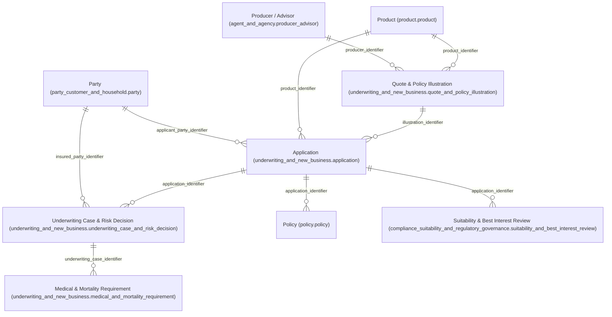

# L&A Ontology Knowledge Framework (OKF) -- Domain 13: Underwriting & New Business (Illustrations, E-App Intake & Risk Selection)

| OKF Metadata Attribute | Value |
| :--- | :--- |
| **OKF Catalog Document** | `L&A OKF/13 - OKF - Underwriting and New Business.MD` |
| **Enterprise Data Domain** | **Domain 13: Underwriting & New Business (Illustrations, E-App Intake & Risk Selection)** |
| **Target Physical Database Engine** | Amazon RDS Aurora PostgreSQL (PostgreSQL 15/16 Compatible) |
| **Physical Database Schema** | `underwriting_and_new_business` |
| **Domain Table Count** | **4 Physical Tables / Logical Entities** |
| **Outbound Foreign Key Joins** | **8 Foreign Key Relationships** (Intra-Domain & Cross-Domain) |
| **Inbound Foreign Key Joins** | **2 Cross-Domain Referencing Relationships** |
| **Performance Indexes** | **6 B-Tree & Composite Indexes** |
| **Inherited Business Context Rules** | **`BC-237` through `BC-254` (18 Rules)** |
| **Source Knowledge Layer Artifacts** | `L&A - Ontology.MD`, `L&A Data Model - Logical.MD`, `L&A Data Model - Physical DDL.sql`, `L&A Data Model - Conceptual.MD` |

---

## 1. Domain Executive Ontology & Business Context Overview

The **Underwriting & New Business** domain orchestrates the pre-issue acquisition funnel, transforming a prospect's initial financial quote or sales illustration into a formally submitted application, evaluating mortality and financial risk, and approving the contract for placement in force. Across the US Life and Annuity industry, new business acquisition bifurcates into two distinct operational tracks: (1) high-velocity, Guaranteed Issue or simplified-enrollment workflows for institutional retirement plan enrollments and retail deferred annuities, and (2) rigorous mortality, medical, and financial underwriting workflows for individual Term, Whole, Universal, Indexed Universal, and Variable Universal Life insurance policies. This domain unifies both tracks across four core logical entities: `Quote & Policy Illustration`, `Application`, `Underwriting Case & Risk Decision`, and `Medical & Mortality Requirement`.

`Quote & Policy Illustration` (`Illustration Identifier`, `Illustration Number`) captures the pre-sale ledger projection generated by the advisor (`Producer Identifier`) for a proposed `Product Identifier`. For life insurance and fixed/indexed annuities, NAIC Life Insurance Illustrations Model Regulation and Actuarial Guideline 49-A (AG49-A for IULs) strictly regulate how carriers illustrate `Guaranteed Values Projection Summary` (using guaranteed minimum crediting floors and maximum guaranteed Cost of Insurance charges) alongside `Non-Guaranteed Assumed Crediting Rate` projections, requiring a verified `Signed Illustration Received Indicator` matching the application at issue.

`Application` (`Application Identifier`, `Application Number`) records the formal request to purchase a policy or enroll in a plan (`Application Type`: `New Institutional Plan Enrollment`, `New Retail Cash Purchase`, `IRC 1035 Tax-Free Exchange (External Carrier)`, `Direct Qualified Plan-to-IRA Rollover`, `Internal Contract Replacement / Exchange`), ingested via digital platforms (`Application Channel` such as FireLight, AnnuityNet, iPipeline iGO, or Institutional Participant Web Enrollment). It tracks `Requested Face Amount`, `Planned Initial Contribution Amount`, the critical regulatory `Existing Insurance Replacement Indicator` (which triggers state Replacement Notices and heightened suitability scrutiny), `Electronic Signature Status`, and end-to-end `Application Status` (`Received - In Good Order (IGO)`, `Not In Good Order (NIGO - Pending Cure)`, `In Suitability & Compliance Review`, `In Medical Underwriting`, `Awaiting 1035 / Rollover Transfer Funds`, `Issued & Placed In Force`, `Withdrawn by Applicant`, `Declined`). For life and medically underwritten contracts, `Underwriting Case & Risk Decision` (`Underwriting Case Identifier`, `Underwriting Method`) manages risk triage—from `Guaranteed Issue` and `Accelerated Fluidless Algorithmic Underwriting` (using real-time predictive models) to `Full Traditional Medical & Financial Underwriting`—assigning the final `Assigned Mortality Risk Classification`, `Substandard Table Rating Factor` (e.g., Table B = 150%, Table D = 200% mortality), and `Flat Extra Premium Per Thousand Amount`. Supporting evidence items ordered during underwriting are tracked in `Medical & Mortality Requirement` (`Requirement Type`: MIB checks, Milliman Intelliscript / ExamOne Rx prescription histories, Motor Vehicle Reports, paramedical exams, blood/cotinine labs, and Attending Physician Statements [APS] / Electronic Health Records [EHR]).

---

## 2. Physical Schema & Logical Entity Architecture Catalog (Schema: `underwriting_and_new_business`)

| # | Logical Entity Name | Physical Table Name (`schema.table`) | Primary Key Column (`PK`) | Business Cols | Audit Cols | Constraints (`PK`/`UQ`/`CHK`) | Logical Entity & Physical Table Definition |
| :--- | :--- | :--- | :--- | :--- | :--- | :--- | :--- |
| **13.1** | **Quote & Policy Illustration** | `underwriting_and_new_business.quote_and_policy_illustration` | `illustration_identifier` | 11 | 2 | `pk_quote_and_policy_illustration`, `uq_illustration_number` | Quote & Policy Illustration entity stores pre-sale hypothetical and guaranteed ledger projections presented to a prospective customer for a Life or Annuity product, modeling future cash values, death benefits, and lifetime income streams under guaranteed and non-guaranteed rates. |
| **13.2** | **Application** | `underwriting_and_new_business.application` | `application_identifier` | 13 | 2 | `pk_application`, `uq_application_number` | Application entity captures a formal new business submission or institutional plan enrollment request to purchase a Life or Annuity contract, tracking requested coverage, initial contribution, 1035 exchange / rollover details, In-Good-Order (IGO) status, and e-signature completion. |
| **13.3** | **Underwriting Case & Risk Decision** | `underwriting_and_new_business.underwriting_case_and_risk_decision` | `underwriting_case_identifier` | 11 | 2 | `pk_underwriting_case_risk_decision`, `uq_underwriting_case_number` | Underwriting Case & Risk Decision entity manages the mortality and financial risk evaluation of an Application—spanning guaranteed issue, algorithmic accelerated underwriting, or full medical underwriting—and records the final approved risk class, table rating, or decline decision. |
| **13.4** | **Medical & Mortality Requirement** | `underwriting_and_new_business.medical_and_mortality_requirement` | `underwriting_requirement_identifier` | 7 | 2 | `pk_medical_and_mortality_requirement` | Medical & Mortality Requirement entity tracks individual underwriting evidence items ordered to evaluate an insured's mortality risk, including Attending Physician Statements (APS), paramedical exams, blood/fluid labs, prescription drug (Rx) histories, MIB checks, and Motor Vehicle Reports. |

---

## 3. Relational Join Mining & Foreign Key Topology

### 3.1 Entity-Relationship & Foreign Key Join Diagram (Mermaid)



### 3.2 Outbound Foreign Key Join Matrix (Tables in `underwriting_and_new_business` Referencing Parent Entities)

| FK Constraint Name | Child Table (`underwriting_and_new_business`) | Child FK Column | Join Scope | Parent Referenced Table | Parent PK Column | Referential Action | Exact SQL Join Predicate |
| :--- | :--- | :--- | :--- | :--- | :--- | :--- | :--- |
| `fk_qpi_product` | `underwriting_and_new_business.quote_and_policy_illustration` | `product_identifier` | Cross-Domain (`product`) | `product.product` | `product_identifier` | `ON UPDATE CASCADE ON DELETE RESTRICT` | `underwriting_and_new_business.quote_and_policy_illustration.product_identifier = product.product.product_identifier` |
| `fk_qpi_producer` | `underwriting_and_new_business.quote_and_policy_illustration` | `producer_identifier` | Cross-Domain (`agent_and_agency`) | `agent_and_agency.producer_advisor` | `producer_identifier` | `ON UPDATE CASCADE ON DELETE RESTRICT` | `underwriting_and_new_business.quote_and_policy_illustration.producer_identifier = agent_and_agency.producer_advisor.producer_identifier` |
| `fk_app_illustration` | `underwriting_and_new_business.application` | `illustration_identifier` | Intra-Domain | `underwriting_and_new_business.quote_and_policy_illustration` | `illustration_identifier` | `ON UPDATE CASCADE ON DELETE SET NULL` | `underwriting_and_new_business.application.illustration_identifier = underwriting_and_new_business.quote_and_policy_illustration.illustration_identifier` |
| `fk_app_product` | `underwriting_and_new_business.application` | `product_identifier` | Cross-Domain (`product`) | `product.product` | `product_identifier` | `ON UPDATE CASCADE ON DELETE RESTRICT` | `underwriting_and_new_business.application.product_identifier = product.product.product_identifier` |
| `fk_app_applicant_party` | `underwriting_and_new_business.application` | `applicant_party_identifier` | Cross-Domain (`party_customer_and_household`) | `party_customer_and_household.party` | `party_identifier` | `ON UPDATE CASCADE ON DELETE RESTRICT` | `underwriting_and_new_business.application.applicant_party_identifier = party_customer_and_household.party.party_identifier` |
| `fk_ucrd_application` | `underwriting_and_new_business.underwriting_case_and_risk_decision` | `application_identifier` | Intra-Domain | `underwriting_and_new_business.application` | `application_identifier` | `ON UPDATE CASCADE ON DELETE CASCADE` | `underwriting_and_new_business.underwriting_case_and_risk_decision.application_identifier = underwriting_and_new_business.application.application_identifier` |
| `fk_ucrd_insured_party` | `underwriting_and_new_business.underwriting_case_and_risk_decision` | `insured_party_identifier` | Cross-Domain (`party_customer_and_household`) | `party_customer_and_household.party` | `party_identifier` | `ON UPDATE CASCADE ON DELETE RESTRICT` | `underwriting_and_new_business.underwriting_case_and_risk_decision.insured_party_identifier = party_customer_and_household.party.party_identifier` |
| `fk_mmr_underwriting_case` | `underwriting_and_new_business.medical_and_mortality_requirement` | `underwriting_case_identifier` | Intra-Domain | `underwriting_and_new_business.underwriting_case_and_risk_decision` | `underwriting_case_identifier` | `ON UPDATE CASCADE ON DELETE CASCADE` | `underwriting_and_new_business.medical_and_mortality_requirement.underwriting_case_identifier = underwriting_and_new_business.underwriting_case_and_risk_decision.underwriting_case_identifier` |

### 3.3 Inbound Cross-Domain Foreign Key Join Matrix (External Schemas Referencing `underwriting_and_new_business`)

| FK Constraint Name | Referencing Child Schema | Referencing Child Table | Child FK Column | Referenced Target Table (`underwriting_and_new_business`) | Target PK Column | Referential Action | Exact SQL Join Predicate |
| :--- | :--- | :--- | :--- | :--- | :--- | :--- | :--- |
| `fk_policy_application` | `policy` | `policy.policy` | `application_identifier` | `underwriting_and_new_business.application` | `application_identifier` | `ON UPDATE CASCADE ON DELETE RESTRICT` | `policy.policy.application_identifier = underwriting_and_new_business.application.application_identifier` |
| `fk_sbir_application` | `compliance_suitability_and_regulatory_governance` | `compliance_suitability_and_regulatory_governance.suitability_and_best_interest_review` | `application_identifier` | `underwriting_and_new_business.application` | `application_identifier` | `ON UPDATE CASCADE ON DELETE CASCADE` | `compliance_suitability_and_regulatory_governance.suitability_and_best_interest_review.application_identifier = underwriting_and_new_business.application.application_identifier` |

---

## 4. Detailed Table-by-Table Schema, Column Dictionary & DDL Constraints

### 4.1 Logical Entity: `Quote & Policy Illustration` <-> Physical Table: `underwriting_and_new_business.quote_and_policy_illustration`

- **Business & Technical Purpose**: Quote & Policy Illustration entity stores pre-sale hypothetical and guaranteed ledger projections presented to a prospective customer for a Life or Annuity product, modeling future cash values, death benefits, and lifetime income streams under guaranteed and non-guaranteed rates.
- **PostgreSQL Catalog Comment**: _""_
- **Primary Key**: `illustration_identifier`

#### Attribute-to-Column Schema Mapping & Business Dictionary

| Ord | Logical Attribute Name | Physical Column Name | Logical Type | Physical PostgreSQL Type | Key | Column Modifiers / Default | Business Definition, Domain Semantics & Sample Values |
| :--- | :--- | :--- | :--- | :--- | :--- | :--- | :--- |
| **1** | **Illustration Identifier** | `illustration_identifier` | String | `VARCHAR(64)` | **PK** | `NOT NULL` | Unique primary key identifying a pre-sale quote or NAIC-compliant policy illustration ledger. Sample values: `ILL-2025-449102`, `ILL-2026-102948`. |
| **2** | **Product Identifier** | `product_identifier` | String | `VARCHAR(64)` | **FK** | `NOT NULL` | Foreign key linking the illustration to the proposed marketable Product being quoted. Sample values: `PROD-IUL-10`, `PROD-GA-RA-01`. |
| **3** | **Producer Identifier** | `producer_identifier` | String | `VARCHAR(64)` | **FK** | `NOT NULL` | Foreign key linking the illustration to the Producer / Advisor who prepared and presented it to the prospect. Sample values: `PRD-ADV-10042`. |
| **4** | **Illustration Number** | `illustration_number` | String | `VARCHAR(64)` | **NK** | `NOT NULL` | Business-facing reference code printed on the illustration PDF pages and matched against the signed application. Sample values: `QT-2026-884920-V1`, `QT-2026-884920-V2`. |
| **5** | **Illustration Preparation Date** | `illustration_preparation_date` | Date | `DATE` | **NK** | `NOT NULL` | Calendar date on which the sales illustration was generated. Sample values: `2026-10-01`, `2026-10-12`. |
| **6** | **Proposed Product Name** | `proposed_product_name` | String | `VARCHAR(200)` | **NK** | `NOT NULL` | Marketing name of the Life or Annuity product illustrated. Sample values: `Premier Indexed Universal Life`, `Participating General Account & Variable Retirement Income Illustration`. |
| **7** | **Illustrated Initial Contribution or Face Amount** | `illustrated_initial_contribution_or_face_amount` | Decimal | `NUMERIC(18,2)` | **NK** | `NOT NULL DEFAULT 0.00` | Initial single lump-sum contribution, rollover amount, or life insurance death benefit face amount modeled in the illustration. Sample values: `1000000.00`, `250000.00`, `50000.00`. |
| **8** | **Illustrated Periodic Premium Amount** | `illustrated_periodic_premium_amount` | Decimal | `NUMERIC(18,2)` | **NK** | `NOT NULL DEFAULT 0.00` | Planned recurring monthly or annual premium contribution modeled over the accumulation period. Sample values: `12000.00`, `1500.00`, `0.00` (Single Premium). |
| **9** | **Guaranteed Values Projection Summary** | `guaranteed_values_projection_summary` | String | `VARCHAR(500)` | **NK** | `NOT NULL` | Summarizes projected policy cash value and guaranteed annual lifetime income at target retirement age (e.g., age 65 or Yr 20) using strictly guaranteed minimum interest and maximum mortality charges. Sample values: `Age 65 Guaranteed Cash Value: $412,500 / Guaranteed Lifetime Income: $24,750/yr`. |
| **10** | **Non-Guaranteed Assumed Crediting Rate** | `non_guaranteed_assumed_crediting_rate` | Decimal | `NUMERIC(9,6)` | **NK** | `NOT NULL DEFAULT 0.000000` | Current declared crediting rate, AG49-A capped indexed rate, or hypothetical gross return rate used to project non-guaranteed illustrated values. Sample values: `0.0525` (5.25% Current Rate), `0.0615` (6.15% AG49-A IUL Cap Rate), `0.0600` (6.00% Hypothetical VA Return). |
| **11** | **Signed Illustration Received Indicator** | `signed_illustration_received_indicator` | String | `VARCHAR(100)` | **NK** | `NOT NULL` | Indicates whether a customer-signed and advisor-signed copy of the basic illustration (or certification of no illustration used) has been received in good order as required by NAIC Life Insurance Illustrations Model Regulation. Sample values: `True (Signed Illustration on File)`, `False (Pending Signature)`, `Exempt (Variable / Institutional Plan Enrollment)`. |
| **12** | **Record Created Timestamp (Audit)** | `created_at` | Timestamp | `TIMESTAMPTZ` | **AUDIT** | `NOT NULL DEFAULT CURRENT_TIMESTAMP` | System audit timestamp recording when the physical row was initially inserted into the Aurora PostgreSQL table. |
| **13** | **Record Updated Timestamp (Audit)** | `updated_at` | Timestamp | `TIMESTAMPTZ` | **AUDIT** | `NOT NULL DEFAULT CURRENT_TIMESTAMP` | System audit timestamp recording when the physical row was last modified in the Aurora PostgreSQL table. |

#### Declarative DDL Constraints & Indexes on `underwriting_and_new_business.quote_and_policy_illustration`

| Constraint / Index Category | Identifier Name | Definition / Target Columns & Referential Integrity Rule |
| :--- | :--- | :--- |
| **PRIMARY KEY** | `pk_quote_and_policy_illustration` | `PRIMARY KEY (illustration_identifier)` |
| **UNIQUE** | `uq_illustration_number` | `UNIQUE (illustration_number)` |
| **FOREIGN KEY** | `fk_qpi_product` | `FOREIGN KEY (product_identifier) REFERENCES product.product (product_identifier) ON UPDATE CASCADE ON DELETE RESTRICT` |
| **FOREIGN KEY** | `fk_qpi_producer` | `FOREIGN KEY (producer_identifier) REFERENCES agent_and_agency.producer_advisor (producer_identifier) ON UPDATE CASCADE ON DELETE RESTRICT` |
| **B-TREE INDEX** | `idx_qpi_product_producer` | `ON underwriting_and_new_business.quote_and_policy_illustration (product_identifier, producer_identifier)` |

### 4.2 Logical Entity: `Application` <-> Physical Table: `underwriting_and_new_business.application`

- **Business & Technical Purpose**: Application entity captures a formal new business submission or institutional plan enrollment request to purchase a Life or Annuity contract, tracking requested coverage, initial contribution, 1035 exchange / rollover details, In-Good-Order (IGO) status, and e-signature completion.
- **PostgreSQL Catalog Comment**: _""_
- **Primary Key**: `application_identifier`

#### Attribute-to-Column Schema Mapping & Business Dictionary

| Ord | Logical Attribute Name | Physical Column Name | Logical Type | Physical PostgreSQL Type | Key | Column Modifiers / Default | Business Definition, Domain Semantics & Sample Values |
| :--- | :--- | :--- | :--- | :--- | :--- | :--- | :--- |
| **1** | **Application Identifier** | `application_identifier` | String | `VARCHAR(64)` | **PK** | `NOT NULL` | Unique primary key identifying a formal new business application or institutional plan enrollment submission. Sample values: `APP-2024-883920`, `APP-2026-550192`. |
| **2** | **Illustration Identifier** | `illustration_identifier` | String | `VARCHAR(64)` | **FK** | `NULL` | Optional foreign key linking the Application to the final approved Quote & Policy Illustration presented at sale. Sample values: `ILL-2026-102948`, `Null (Direct Plan Web Enrollment)`. |
| **3** | **Product Identifier** | `product_identifier` | String | `VARCHAR(64)` | **FK** | `NOT NULL` | Foreign key linking the Application to the Product applied for. Sample values: `PROD-GA-RA-01`, `PROD-CREF-VA-02`, `PROD-IUL-10`. |
| **4** | **Applicant Party Identifier** | `applicant_party_identifier` | String | `VARCHAR(64)` | **FK** | `NOT NULL` | Foreign key referencing the primary applicant/owner or plan participant Party submitting the application. Sample values: `PRTY-MDM-10004921`. |
| **5** | **Application Number** | `application_number` | String | `VARCHAR(64)` | **NK** | `NOT NULL` | Business-facing tracking number assigned upon application intake (e.g., FireLight, iPipeline, or Institutional Web Enrollment confirmation number). Sample values: `NB-2026-994012`, `ENR-403B-882910`. |
| **6** | **Submission Date** | `submission_date` | Date | `DATE` | **NK** | `NOT NULL` | Calendar date on which the application was signed and transmitted to the carrier. Sample values: `2026-10-05`, `2026-10-14`. |
| **7** | **Application Channel** | `application_channel` | String | `VARCHAR(120)` | **NK** | `NOT NULL` | Digital or physical intake channel through which the new business application was submitted. Sample values: `Institutional Participant Web Enrollment`, `FireLight / AnnuityNet E-App Portal`, `iPipeline iGO Life E-App`, `Advisor Wealth Workbench`, `Paper Application via Imaging`. |
| **8** | **Application Type** | `application_type` | String | `VARCHAR(120)` | **NK** | `NOT NULL` | Classifies the business nature and funding mechanism of the application. Sample values: `New Institutional Plan Enrollment`, `New Retail Cash Purchase`, `IRC 1035 Tax-Free Exchange (External Carrier)`, `Direct Qualified Plan-to-IRA Rollover`, `Internal Contract Replacement / Exchange`, `Additional Policy Coverage Increase`. |
| **9** | **Requested Face Amount** | `requested_face_amount` | Decimal | `NUMERIC(18,2)` | **NK** | `NOT NULL DEFAULT 0.00` | Total death benefit coverage amount applied for on a Life Insurance application (`0.00` for pure annuity applications). Sample values: `1000000.00`, `500000.00`, `0.00`. |
| **10** | **Planned Initial Contribution Amount** | `planned_initial_contribution_amount` | Decimal | `NUMERIC(18,2)` | **NK** | `NOT NULL DEFAULT 0.00` | Expected initial lump-sum premium, transfer, or rollover dollar amount accompanying the application. Sample values: `100000.00`, `250000.00`, `1500.00`. |
| **11** | **Existing Insurance Replacement Indicator** | `existing_insurance_replacement_indicator` | String | `VARCHAR(120)` | **NK** | `NOT NULL` | Mandatory regulatory question indicating whether the applicant has existing life insurance or annuities in force and whether this purchase will replace, surrender, or borrow from an existing contract. Sample values: `No Existing Insurance Replaced`, `Yes - External 1035 Replacement (State Replacement Notice Required)`, `Yes - Internal Carrier Exchange`. |
| **12** | **Electronic Signature Status** | `electronic_signature_status` | String | `VARCHAR(100)` | **NK** | `NOT NULL` | Tracks completion of DocuSign / e-Signature ceremony by the applicant, joint owner, insured, and writing producer. Sample values: `All E-Signatures Completed`, `Awaiting Spousal / Joint Owner E-Signature`, `Wet Ink Signature Verified`, `Signature Deficient (NIGO)`. |
| **13** | **Application Status** | `application_status` | String | `VARCHAR(100)` | **NK** | `NOT NULL` | Current end-to-end new business workflow state of the application prior to policy activation. Sample values: `Received - In Good Order (IGO)`, `Not In Good Order (NIGO - Pending Cure)`, `In Suitability & Compliance Review`, `In Medical Underwriting`, `Awaiting 1035 / Rollover Transfer Funds`, `Approved - Pending Policy Issue`, `Issued & Placed In Force`, `Withdrawn by Applicant`, `Declined`. |
| **14** | **Record Created Timestamp (Audit)** | `created_at` | Timestamp | `TIMESTAMPTZ` | **AUDIT** | `NOT NULL DEFAULT CURRENT_TIMESTAMP` | System audit timestamp recording when the physical row was initially inserted into the Aurora PostgreSQL table. |
| **15** | **Record Updated Timestamp (Audit)** | `updated_at` | Timestamp | `TIMESTAMPTZ` | **AUDIT** | `NOT NULL DEFAULT CURRENT_TIMESTAMP` | System audit timestamp recording when the physical row was last modified in the Aurora PostgreSQL table. |

#### Declarative DDL Constraints & Indexes on `underwriting_and_new_business.application`

| Constraint / Index Category | Identifier Name | Definition / Target Columns & Referential Integrity Rule |
| :--- | :--- | :--- |
| **PRIMARY KEY** | `pk_application` | `PRIMARY KEY (application_identifier)` |
| **UNIQUE** | `uq_application_number` | `UNIQUE (application_number)` |
| **FOREIGN KEY** | `fk_app_illustration` | `FOREIGN KEY (illustration_identifier) REFERENCES underwriting_and_new_business.quote_and_policy_illustration (illustration_identifier) ON UPDATE CASCADE ON DELETE SET NULL` |
| **FOREIGN KEY** | `fk_app_product` | `FOREIGN KEY (product_identifier) REFERENCES product.product (product_identifier) ON UPDATE CASCADE ON DELETE RESTRICT` |
| **FOREIGN KEY** | `fk_app_applicant_party` | `FOREIGN KEY (applicant_party_identifier) REFERENCES party_customer_and_household.party (party_identifier) ON UPDATE CASCADE ON DELETE RESTRICT` |
| **B-TREE INDEX** | `idx_app_applicant_status` | `ON underwriting_and_new_business.application (applicant_party_identifier, application_status)` |
| **B-TREE INDEX** | `idx_app_product_sub_date` | `ON underwriting_and_new_business.application (product_identifier, submission_date DESC)` |

### 4.3 Logical Entity: `Underwriting Case & Risk Decision` <-> Physical Table: `underwriting_and_new_business.underwriting_case_and_risk_decision`

- **Business & Technical Purpose**: Underwriting Case & Risk Decision entity manages the mortality and financial risk evaluation of an Application—spanning guaranteed issue, algorithmic accelerated underwriting, or full medical underwriting—and records the final approved risk class, table rating, or decline decision.
- **PostgreSQL Catalog Comment**: _""_
- **Primary Key**: `underwriting_case_identifier`

#### Attribute-to-Column Schema Mapping & Business Dictionary

| Ord | Logical Attribute Name | Physical Column Name | Logical Type | Physical PostgreSQL Type | Key | Column Modifiers / Default | Business Definition, Domain Semantics & Sample Values |
| :--- | :--- | :--- | :--- | :--- | :--- | :--- | :--- |
| **1** | **Underwriting Case Identifier** | `underwriting_case_identifier` | String | `VARCHAR(64)` | **PK** | `NOT NULL` | Unique primary key identifying the underwriting risk evaluation case for an Application. Sample values: `UWC-2026-30019`, `UWC-2026-30020`. |
| **2** | **Application Identifier** | `application_identifier` | String | `VARCHAR(64)` | **FK** | `NOT NULL` | Foreign key linking the Underwriting Case to the originating Application. Sample values: `APP-2024-883920`, `APP-2026-550192`. |
| **3** | **Insured Party Identifier** | `insured_party_identifier` | String | `VARCHAR(64)` | **FK** | `NOT NULL` | Foreign key referencing the primary insured or annuitant Party whose mortality/longevity risk is being evaluated. Sample values: `PRTY-MDM-10004921`. |
| **4** | **Underwriting Case Number** | `underwriting_case_number` | String | `VARCHAR(64)` | **NK** | `NOT NULL` | Business-facing case number used by home office underwriters, reinsurers, and agency case managers. Sample values: `UW-CASE-904812`, `UW-CASE-904813`. |
| **5** | **Underwriting Method** | `underwriting_method` | String | `VARCHAR(120)` | **NK** | `NOT NULL` | Specifies the level of medical and algorithmic scrutiny applied to evaluate the application. Sample values: `Guaranteed Issue (Institutional Retirement Plan Enrollment)`, `Simplified Issue (Knockout Health Questions Only)`, `Accelerated Fluidless Algorithmic Underwriting`, `Full Traditional Medical & Financial Underwriting`. |
| **6** | **Underwriter Assigned Name** | `underwriter_assigned_name` | String | `VARCHAR(150)` | **NK** | `NOT NULL` | Name of the certified home office life underwriter (or automated rules engine ID) responsible for the risk decision. Sample values: `Automated Accelerated Rules Engine v4.2`, `Thomas J. Reynolds, FALU, FLMI`, `Not Applicable (Guaranteed Issue)`. |
| **7** | **Assigned Mortality Risk Classification** | `assigned_mortality_risk_classification` | String | `VARCHAR(120)` | **NK** | `NOT NULL` | Approved mortality risk class assigned to the insured upon completion of underwriting. Sample values: `Super Preferred Plus Non-Tobacco`, `Preferred Non-Tobacco`, `Standard Plus Non-Tobacco`, `Standard Non-Tobacco`, `Preferred Tobacco`, `Standard Tobacco`, `Substandard Table Rated`, `Guaranteed Issue Unisex`, `Declined`. |
| **8** | **Substandard Table Rating Factor** | `substandard_table_rating_factor` | String | `VARCHAR(100)` | **NK** | `NOT NULL` | Extra mortality percentage multiplier assigned when an insured has medical impairments placing them above standard risk (each table step is typically +25% mortality). Sample values: `None (100% Standard or Better)`, `Table B / Table 2 (150% Mortality)`, `Table D / Table 4 (200% Mortality)`, `Table H / Table 8 (300% Mortality)`. |
| **9** | **Flat Extra Premium Per Thousand Amount** | `flat_extra_premium_per_thousand_amount` | Decimal | `NUMERIC(18,2)` | **NK** | `NOT NULL DEFAULT 0.00` | Temporary or permanent extra dollar charge per $1,000 of life insurance face amount added for aviation, avocation, foreign travel, or recovering medical conditions. Sample values: `0.00`, `2.50` ($2.50 per $1,000 for 3 years), `5.00`. |
| **10** | **Underwriting Decision Date** | `underwriting_decision_date` | Date | `DATE` | **NK** | `NULL` | Calendar date on which the final underwriting risk decision was rendered. Sample values: `2026-10-14`, `2026-10-19`. |
| **11** | **Final Underwriting Decision** | `final_underwriting_decision` | String | `VARCHAR(120)` | **NK** | `NOT NULL` | Dispositive outcome of the underwriting evaluation. Sample values: `Approved as Applied`, `Approved Better than Applied`, `Approved with Substandard Rating / Counteroffer`, `Approved with Rider Exclusion`, `Postponed (6-12 Months)`, `Declined`, `Incomplete - Closed for Non-Response`. |
| **12** | **Record Created Timestamp (Audit)** | `created_at` | Timestamp | `TIMESTAMPTZ` | **AUDIT** | `NOT NULL DEFAULT CURRENT_TIMESTAMP` | System audit timestamp recording when the physical row was initially inserted into the Aurora PostgreSQL table. |
| **13** | **Record Updated Timestamp (Audit)** | `updated_at` | Timestamp | `TIMESTAMPTZ` | **AUDIT** | `NOT NULL DEFAULT CURRENT_TIMESTAMP` | System audit timestamp recording when the physical row was last modified in the Aurora PostgreSQL table. |

#### Declarative DDL Constraints & Indexes on `underwriting_and_new_business.underwriting_case_and_risk_decision`

| Constraint / Index Category | Identifier Name | Definition / Target Columns & Referential Integrity Rule |
| :--- | :--- | :--- |
| **PRIMARY KEY** | `pk_underwriting_case_risk_decision` | `PRIMARY KEY (underwriting_case_identifier)` |
| **UNIQUE** | `uq_underwriting_case_number` | `UNIQUE (underwriting_case_number)` |
| **FOREIGN KEY** | `fk_ucrd_application` | `FOREIGN KEY (application_identifier) REFERENCES underwriting_and_new_business.application (application_identifier) ON UPDATE CASCADE ON DELETE CASCADE` |
| **FOREIGN KEY** | `fk_ucrd_insured_party` | `FOREIGN KEY (insured_party_identifier) REFERENCES party_customer_and_household.party (party_identifier) ON UPDATE CASCADE ON DELETE RESTRICT` |
| **B-TREE INDEX** | `idx_ucrd_application_id` | `ON underwriting_and_new_business.underwriting_case_and_risk_decision (application_identifier)` |
| **B-TREE INDEX** | `idx_ucrd_insured_party_id` | `ON underwriting_and_new_business.underwriting_case_and_risk_decision (insured_party_identifier)` |

### 4.4 Logical Entity: `Medical & Mortality Requirement` <-> Physical Table: `underwriting_and_new_business.medical_and_mortality_requirement`

- **Business & Technical Purpose**: Medical & Mortality Requirement entity tracks individual underwriting evidence items ordered to evaluate an insured's mortality risk, including Attending Physician Statements (APS), paramedical exams, blood/fluid labs, prescription drug (Rx) histories, MIB checks, and Motor Vehicle Reports.
- **PostgreSQL Catalog Comment**: _""_
- **Primary Key**: `underwriting_requirement_identifier`

#### Attribute-to-Column Schema Mapping & Business Dictionary

| Ord | Logical Attribute Name | Physical Column Name | Logical Type | Physical PostgreSQL Type | Key | Column Modifiers / Default | Business Definition, Domain Semantics & Sample Values |
| :--- | :--- | :--- | :--- | :--- | :--- | :--- | :--- |
| **1** | **Underwriting Requirement Identifier** | `underwriting_requirement_identifier` | String | `VARCHAR(64)` | **PK** | `NOT NULL` | Unique primary key identifying a specific medical, laboratory, or third-party data evidence item ordered for an Underwriting Case. Sample values: `UWR-61001`, `UWR-61002`. |
| **2** | **Underwriting Case Identifier** | `underwriting_case_identifier` | String | `VARCHAR(64)` | **FK** | `NOT NULL` | Foreign key linking the requirement item to its parent Underwriting Case & Risk Decision. Sample values: `UWC-2026-30019`. |
| **3** | **Requirement Type** | `requirement_type` | String | `VARCHAR(150)` | **NK** | `NOT NULL` | Type of medical, biometric, or financial evidence ordered to assess the insured's risk profile. Sample values: `MIB Group Coded History Check`, `Prescription Drug Database Check (Milliman Intelliscript / ExamOne Rx)`, `Motor Vehicle Report (MVR)`, `Paramedical Exam, Vitals & Urinalysis`, `Full Blood Profile & Cotinine Screen`, `Attending Physician Statement (APS) / Electronic Health Record (EHR)`, `Resting EKG`, `Senior Cognitive & Functional Assessment`, `Third-Party Tax Transcript / Financial Verification`. |
| **4** | **Ordered Date** | `ordered_date` | Date | `DATE` | **NK** | `NOT NULL` | Calendar date on which the requirement was requested from the vendor, paramedical company, or physician. Sample values: `2026-10-06`, `2026-10-08`. |
| **5** | **Received Date** | `received_date` | Date | `DATE` | **NK** | `NULL` | Calendar date on which the completed lab results, EHR feed, or APS document was received and indexed into the underwriting workbench. Sample values: `2026-10-06` (Real-time Rx/MIB), `2026-10-15` (APS). |
| **6** | **Requirement Evaluation Result** | `requirement_evaluation_result` | String | `VARCHAR(250)` | **NK** | `NULL` | Summary risk score or clinical interpretation of the requirement item. Sample values: `Rx Score: 850 (Favorable - Green Triage)`, `Negative Cotinine / Normal Lipid & Liver Panel`, `MIB No Record Found`, `APS Confirmed Controlled Hypertension`. |
| **7** | **Requirement Status** | `requirement_status` | String | `VARCHAR(100)` | **NK** | `NOT NULL` | Current fulfillment status of the underwriting requirement. Sample values: `Ordered / Pending Vendor`, `Appointment Scheduled with Paramed`, `Received - Pending Underwriter Review`, `Reviewed & Satisfied`, `Waived by Accelerated Triage`. |
| **8** | **Record Created Timestamp (Audit)** | `created_at` | Timestamp | `TIMESTAMPTZ` | **AUDIT** | `NOT NULL DEFAULT CURRENT_TIMESTAMP` | System audit timestamp recording when the physical row was initially inserted into the Aurora PostgreSQL table. |
| **9** | **Record Updated Timestamp (Audit)** | `updated_at` | Timestamp | `TIMESTAMPTZ` | **AUDIT** | `NOT NULL DEFAULT CURRENT_TIMESTAMP` | System audit timestamp recording when the physical row was last modified in the Aurora PostgreSQL table. |

#### Declarative DDL Constraints & Indexes on `underwriting_and_new_business.medical_and_mortality_requirement`

| Constraint / Index Category | Identifier Name | Definition / Target Columns & Referential Integrity Rule |
| :--- | :--- | :--- |
| **PRIMARY KEY** | `pk_medical_and_mortality_requirement` | `PRIMARY KEY (underwriting_requirement_identifier)` |
| **FOREIGN KEY** | `fk_mmr_underwriting_case` | `FOREIGN KEY (underwriting_case_identifier) REFERENCES underwriting_and_new_business.underwriting_case_and_risk_decision (underwriting_case_identifier) ON UPDATE CASCADE ON DELETE CASCADE` |
| **B-TREE INDEX** | `idx_mmr_uw_case_status` | `ON underwriting_and_new_business.medical_and_mortality_requirement (underwriting_case_identifier, requirement_status)` |

---

## 5. Inherited Business Context Ontology Rules (`BC-237` to `BC-254`)

> **Semantic Inheritance Notice**: The following **18 Business Context rules** are inherited verbatim from `L&A Data Domain/L&A - Ontology.MD` to provide autonomous AI agents, data engineers, and actuaries with complete domain rules, accounting identities, statutory compliance mandates, and SQL join guardrails for the **Underwriting & New Business** domain.

#### BC-237: The Pre-Sale Illustration to Application to Issued Policy Conversion Funnel and Lineage Invariant

**Domains**: Underwriting & New Business, Policy, Product, Agent & Agency | **Entities**: Quote & Policy Illustration, Application, Policy, Product, Producer / Advisor | **Key Attributes**: Illustration Identifier, Application Identifier, Policy Identifier, Product Identifier, Producer Identifier, Application Status, Policy Status

In the Life and Annuity new business value chain, a prospective contract progresses through a structured three-stage conversion funnel: first, a pre-sale `Quote & Policy Illustration` is prepared by a `Producer / Advisor`; second, a formal `Application` is submitted by the `Applicant Party Identifier`; and third, once underwriting and suitability gates pass and initial funding settles, an in-force `Policy` is issued. Within the data model, this lineage is preserved through explicit foreign keys: `Application` references `Quote & Policy Illustration` via the nullable `Illustration Identifier` (nullable because institutional retirement plan web enrollments and certain variable contracts do not require a formal NAIC basic illustration), and `Policy` references `Application` via `Application Identifier`. Both `Quote & Policy Illustration` and `Application` also reference `Product` via `Product Identifier`. A critical business rule is that when an `Application` converts into an issued `Policy` (`Application Status` transitions to `'Issued & Placed In Force'`), the `Product Identifier` on `Policy` must match the final approved `Product Identifier` on `Application` (which may have been updated during underwriting if the applicant elected an alternative product or counteroffer). When an AI agent builds new-business conversion rate, placement ratio, or cycle-time data products (measuring days from `Illustration Preparation Date` to `Submission Date` to `Contract Issue Date`), it must recognize that not every `Quote & Policy Illustration` converts into an `Application` (a prospect may compare multiple quotes), and not every `Application` results in an issued `Policy` (applications may end in `'Withdrawn by Applicant'`, `'Declined'`, or `'Not In Good Order (NIGO - Pending Cure)'`). Therefore, placement rate analytics must use left outer joins from `Quote & Policy Illustration` to `Application` and from `Application` to `Policy` rather than inner joins that would artificially inflate conversion metrics to 100%.

#### BC-238: NAIC Life Insurance Illustrations Model Regulation and Actuarial Guideline 49-A (AG 49-A) Cap Rules

**Domains**: Underwriting & New Business, Product | **Entities**: Quote & Policy Illustration, Product, Application | **Key Attributes**: Illustration Identifier, Guaranteed Values Projection Summary, Non-Guaranteed Assumed Crediting Rate, Signed Illustration Received Indicator, Product Category

Under the NAIC Life Insurance Illustrations Model Regulation (#580) and Actuarial Guideline 49-A (AG 49-A), US life insurance carriers (such as Pacific Life, Lincoln Financial, Nationwide, Prudential, and John Hancock) are strictly regulated in how they illustrate non-guaranteed cash value accumulation and policy loans on Universal Life and Indexed Universal Life (`IUL`) policies. Specifically, `Quote & Policy Illustration` must present both a `Guaranteed Values Projection Summary`—calculated using the contract's `Guaranteed Minimum Interest Rate` and maximum guaranteed Cost of Insurance (`COI`) charges—and a non-guaranteed projection bounded by `Non-Guaranteed Assumed Crediting Rate`, which under AG 49-A cannot exceed the benchmark index net investment earned rate cap prescribed by the NAIC. Furthermore, if a life insurance product is marketed as an illustrated policy, state regulation requires that the applicant and the `Producer / Advisor` sign the exact illustration matching the policy applied for, tracked via `Signed Illustration Received Indicator`. If the policy is issued at a different `Mortality Risk Class` (for example, `Substandard Table Rated` instead of `Preferred Non-Tobacco`) or a different `Face Amount` than originally illustrated, a revised illustration must be generated and re-signed at policy delivery. When an AI agent builds new-businessIn-Good-Order (`IGO`) readiness engines or compliance audit dashboards, it must verify that for any `Application` where the parent `Product` has a `Product Category` of `Universal Life`, `Indexed Universal Life`, or `Whole Life`, the linked `Quote & Policy Illustration` has `Signed Illustration Received Indicator = 'True (Signed Illustration on File)'` before `Application Status` can advance to `'Issued & Placed In Force'`, whereas institutional plan enrollments and variable annuities carry `'Exempt (Variable / Institutional Plan Enrollment)'`.

#### BC-239: Application In-Good-Order (IGO) vs. Not-In-Good-Order (NIGO) Intake Gating and Cure Workflow

**Domains**: Underwriting & New Business, Compliance, Suitability & Regulatory Governance | **Entities**: Application, Suitability & Best Interest Review, Underwriting Case & Risk Decision | **Key Attributes**: Application Identifier, Application Number, Application Channel, Electronic Signature Status, Application Status, Submission Date

In modern US Life and Annuity operations, incoming new business is captured across digital order-entry platforms (`FireLight / AnnuityNet E-App Portal`, `iPipeline iGO Life E-App`, `Institutional Participant Web Enrollment`, `Advisor Wealth Workbench`) as well as `Paper Application via Imaging`. Upon intake, the `Application` is evaluated against In-Good-Order (`IGO`) completeness rules covering required applicant and beneficiary demographics, valid producer state licensing, completed replacement questionnaires, and `Electronic Signature Status`. If any mandatory field, disclosure form, or signature is missing—for example, `Electronic Signature Status` is `'Signature Deficient (NIGO)'` or `'Awaiting Spousal / Joint Owner E-Signature'`—the `Application Status` is set to `'Not In Good Order (NIGO - Pending Cure)'`. While an `Application` is in NIGO status, SEC Rule 22c-1 prohibits a carrier from pricing and allocating incoming variable annuity funds into Separate Account accumulation units until the application is cured into Good Order (`IGO`), meaning any accompanying cash is held in a non-interest or money-market suspense account (`Application Status = 'Not In Good Order (NIGO - Pending Cure)'`). Digital E-App channels (`FireLight` and `iPipeline`) enforce field-level validation up front, achieving 90%+ straight-through IGO rates, whereas paper applications experience significantly higher NIGO rates. When an AI agent constructs operational bottleneck or advisor scorecard data products, it should segment NIGO defect rates and cure cycle times by `Application Channel`, `Agency`, and `Producer / Advisor`, and must never treat `'Not In Good Order (NIGO - Pending Cure)'`, `'Withdrawn by Applicant'`, or `'Declined'` applications as active policies or committed premium revenue.

#### BC-240: Internal and External Insurance Replacement Detection (`Existing Insurance Replacement Indicator`) and 1035/Rollover Funding Holds

**Domains**: Underwriting & New Business, Compliance, Suitability & Regulatory Governance, Transactions | **Entities**: Application, Suitability & Best Interest Review, Financial Transaction | **Key Attributes**: Application Identifier, Application Type, Existing Insurance Replacement Indicator, Planned Initial Contribution Amount, Application Status

When a customer applies for a new Life Insurance policy or Annuity contract by surrendering, exchanging, or rolling over funds from an existing insurance or retirement contract, state insurance departments and FINRA impose heightened anti-churning and replacement regulations (such as the NAIC Life Insurance and Annuities Replacement Model Regulation). On the `Application` entity, `Application Type` identifies whether the transaction is a `'New Retail Cash Purchase'`, `'New Institutional Plan Enrollment'`, `'IRC 1035 Tax-Free Exchange (External Carrier)'`, `'Direct Qualified Plan-to-IRA Rollover'`, or `'Internal Contract Replacement / Exchange'`, while `Existing Insurance Replacement Indicator` explicitly flags `'Yes - External 1035 Replacement (State Replacement Notice Required)'` or `'Yes - Internal Carrier Exchange'`. Operationally, when an application is funded via a 1035 tax-free exchange or institutional transfer from an external carrier (such as transferring a contract from Prudential or MetLife into Corebridge or Athene via the DTCC Insurance & Retirement Services ACATS/IPS transfer network), the new `Application` often completes underwriting and suitability review before the external carrier liquidates and wires the transfer proceeds. During this window, `Application Status` sits in `'Awaiting 1035 / Rollover Transfer Funds'`, and `Planned Initial Contribution Amount` represents expected incoming cash rather than settled cash on hand. When an AI agent builds new-business pipeline or cash-inflow forecasting data products, it must distinguish `Planned Initial Contribution Amount` on pending applications in `'Awaiting 1035 / Rollover Transfer Funds'` from actual settled `Gross Transaction Amount` on `Financial Transaction` records (`Transaction Type` in `'IRC 1035 Tax-Free Exchange In'` or `'Direct Rollover In'`), and must ensure every replacement application has a linked `Suitability & Best Interest Review` evaluating surrender penalties.

#### BC-241: The Underwriting Method Spectrum: Guaranteed Issue vs. Simplified Issue vs. Accelerated Algorithmic vs. Full Medical Underwriting

**Domains**: Underwriting & New Business, Institutional Plan & Employer Sponsor, Policy | **Entities**: Underwriting Case & Risk Decision, Application, Medical & Mortality Requirement, Institutional Retirement Plan | **Key Attributes**: Underwriting Case Identifier, Underwriting Method, Assigned Mortality Risk Classification, Underwriting Decision Date, Final Underwriting Decision

Every `Application` for a Life or Annuity contract initiates a 1-to-1 `Underwriting Case & Risk Decision` record (`Application Identifier`), but the depth of risk evaluation varies dramatically across four distinct `Underwriting Method` regimes used by US L&A carriers. First, `'Guaranteed Issue (Institutional Retirement Plan Enrollment)'` applies to employer-sponsored 403(b), 401(a), and 457(b) retirement annuities (such as Institutional RA/GRA/RC enrollments) and group life policies within Guaranteed Issue limits, where no health questions or medical exams are permitted and `Assigned Mortality Risk Classification` defaults to `'Guaranteed Issue Unisex'` with immediate approval. Second, `'Simplified Issue (Knockout Health Questions Only)'` applies to final expense, smaller face-amount term life, and certain fixed annuities, relying on a short Part II medical questionnaire plus automated MIB and Rx database checks without bodily fluids. Third, `'Accelerated Fluidless Algorithmic Underwriting'` (offered by carriers like Lincoln, Pacific Life, Nationwide, and Prudential for healthy applicants typically aged 18–60 up to $1M–$3M of `Requested Face Amount`) uses real-time predictive models (`Underwriter Assigned Name = 'Automated Accelerated Rules Engine v4.2'`) scoring `MIB Group Coded History Check`, `Prescription Drug Database Check`, and `Motor Vehicle Report (MVR)` data to approve `Super Preferred Plus Non-Tobacco` or `Preferred Non-Tobacco` in minutes without a paramedical exam. Fourth, `'Full Traditional Medical & Financial Underwriting'` is required for jumbo face amounts, older ages, or applicants triaged out of accelerated underwriting due to medical history, ordering `Paramedical Exam, Vitals & Urinalysis`, `Full Blood Profile & Cotinine Screen`, and `Attending Physician Statement (APS)`. AI agents analyzing underwriting turnaround time or cost per application must always stratify by `Underwriting Method`.

#### BC-242: Mortality Risk Classifications, Substandard Table Ratings (+25% Per Table), and Flat Extra Premiums

**Domains**: Underwriting & New Business, Policy, Actuarial | **Entities**: Underwriting Case & Risk Decision, Policy Coverage Segment, Actuarial Valuation Reserve | **Key Attributes**: Assigned Mortality Risk Classification, Substandard Table Rating Factor, Flat Extra Premium Per Thousand Amount, Mortality Risk Class, Coverage Benefit Amount

In individual Life Insurance underwriting, the pricing of term premiums and Universal Life `Monthly Cost of Insurance (COI) Deduction` charges depends directly on the insured's approved mortality risk profile recorded on `Underwriting Case & Risk Decision` and copied onto `Policy Coverage Segment`.`Mortality Risk Class`. Applicants with optimal blood pressure, cholesterol, build (BMI), family history, and zero nicotine exposure qualify for `'Super Preferred Plus Non-Tobacco'` or `'Preferred Non-Tobacco'`, paying the lowest COI rates (often 60%–80% of standard mortality). Applicants with average health qualify for `'Standard Non-Tobacco'` (100% baseline mortality), while nicotine users are placed in `'Preferred Tobacco'` or `'Standard Tobacco'` (where mortality charges are often 200%–300% higher than non-tobacco rates). When an applicant has a chronic medical impairment—such as diabetes, coronary artery disease, or sleep apnea—that elevates mortality risk above Standard but remains insurable, underwriters assign `Assigned Mortality Risk Classification = 'Substandard Table Rated'` along with a `Substandard Table Rating Factor`. Under standard US life insurance actuarial conventions (Table A through Table P, or Table 1 through Table 16), each table step adds 25% extra mortality above the 100% Standard table: `Table B / Table 2` equals 150% of standard mortality, `Table D / Table 4` equals 200% of standard mortality, and `Table H / Table 8` equals 300% of standard mortality. Separately, for non-medical hazards or temporary post-surgical risks (such as private aviation, scuba diving, hazardous foreign travel, or early-stage cancer recovery), the underwriter assigns a `Flat Extra Premium Per Thousand Amount` (e.g., `$2.50` or `$5.00` per year per $1,000 of `Coverage Benefit Amount`). AI agents building pricing, COI audit, or mortality experience data products must incorporate all three attributes (`Assigned Mortality Risk Classification`, `Substandard Table Rating Factor`, and `Flat Extra Premium Per Thousand Amount`).

#### BC-243: Third-Party Underwriting Evidence Orchestration (`Medical & Mortality Requirement`) and Accelerated Triage Waivers

**Domains**: Underwriting & New Business | **Entities**: Medical & Mortality Requirement, Underwriting Case & Risk Decision | **Key Attributes**: Underwriting Requirement Identifier, Underwriting Case Identifier, Requirement Type, Ordered Date, Received Date, Requirement Evaluation Result, Requirement Status

To evaluate an `Underwriting Case & Risk Decision`, home office underwriters and automated underwriting engines order one or more `Medical & Mortality Requirement` records (`1:M` relationship via `Underwriting Case Identifier`). These requirements fall into two operational velocity tiers. Real-time digital data requirements—specifically `'MIB Group Coded History Check'` (which detects undisclosed medical conditions reported on prior insurance applications across member carriers), `'Prescription Drug Database Check (Milliman Intelliscript / ExamOne Rx)'`, and `'Motor Vehicle Report (MVR)'` (which flags DUI convictions or reckless driving)—typically have an `Ordered Date` and `Received Date` on the exact same day, returning a structured `Requirement Evaluation Result` such as `'Rx Score: 850 (Favorable - Green Triage)'`. If the real-time digital evidence passes accelerated underwriting thresholds, invasive physical requirements (`'Paramedical Exam, Vitals & Urinalysis'` and `'Full Blood Profile & Cotinine Screen'`) are automatically set to `Requirement Status = 'Waived by Accelerated Triage'`. Conversely, if digital triage flags a yellow or red condition (such as cardiac prescriptions) or if the `Requested Face Amount` exceeds the fluidless cap, physical requirements and an `'Attending Physician Statement (APS) / Electronic Health Record (EHR)'` are ordered (`Requirement Status = 'Ordered / Pending Vendor'`). Traditional paper APS retrieval is historically the longest bottleneck in life insurance new business (often taking 10 to 30 days between `Ordered Date` and `Received Date`), though modern Human API / Clareto EHR feeds reduce this to days. An `Underwriting Case & Risk Decision` cannot reach a `Final Underwriting Decision` of `'Approved as Applied'` or `'Approved with Substandard Rating / Counteroffer'` until every associated `Medical & Mortality Requirement` is in `'Reviewed & Satisfied'` or `'Waived by Accelerated Triage'`.

#### BC-244: Nicotine, Cotinine Lab Screening, and Smoker-to-Non-Smoker Reclassification Endorsements

**Domains**: Underwriting & New Business, Party, Customer & Household, Policy, Transactions | **Entities**: Medical & Mortality Requirement, Underwriting Case & Risk Decision, Party, Policy Coverage Segment, Non-Financial Service Transaction | **Key Attributes**: Smoking or Tobacco Status, Requirement Type, Requirement Evaluation Result, Assigned Mortality Risk Classification, Mortality Risk Class, Endorsement Type

Tobacco and nicotine usage is one of the single largest drivers of mortality differentials in Life Insurance (and inversely impacts enhanced-payout impaired-risk annuities). In our data model, self-reported tobacco history is captured on `Party`.`Smoking or Tobacco Status` (`'Never Used Tobacco'`, `'Former Smoker (> 5 Years Clean)'`, `'Current Cigarette / Nicotine User'`, `'Occasional Cigar User'`), and verified during new business underwriting via `Medical & Mortality Requirement` where `Requirement Type = 'Full Blood Profile & Cotinine Screen'` or urinalysis. Cotinine is a metabolite of nicotine; if an applicant self-reports `'Never Used Tobacco'` on the `Application` but the lab `Requirement Evaluation Result` returns positive cotinine (from cigarettes, vaping, e-cigarettes, or nicotine replacement patches), the `Underwriting Case & Risk Decision` overrides the self-reported status, assigns `'Standard Tobacco'` (or declines for misrepresentation), and sets `Final Underwriting Decision = 'Approved with Substandard Rating / Counteroffer'`. Furthermore, after a life policy is issued at a tobacco rate, if the insured quits smoking and remains 100% nicotine-free for at least 12 to 24 consecutive months (verified by a new negative cotinine urine screen and underwriting review), the policyholder can submit a `Non-Financial Service Transaction` with `Endorsement Type = 'Smoker to Non-Smoker Reclassification'`. Upon approval, `Party`.`Smoking or Tobacco Status` is updated to `'Former Smoker'` and `Policy Coverage Segment`.`Mortality Risk Class` is endorsed to `'Standard Non-Tobacco'` as of the endorsement `Effective Date`, lowering future monthly COI deductions. AI agents building customer demographic or mortality analytics must join `Policy Coverage Segment`.`Mortality Risk Class` for contract-specific pricing truth while checking `Non-Financial Service Transaction` for post-issue reclassification history.

#### BC-245: Financial Underwriting, Insurable Interest Verification, and Jumbo Limit Aggregation

**Domains**: Underwriting & New Business, Party, Customer & Household, Reinsurance | **Entities**: Application, Underwriting Case & Risk Decision, Medical & Mortality Requirement, Policy Party Role, Reinsured Policy Cession | **Key Attributes**: Requested Face Amount, Requirement Type, Relationship to Primary Insured or Annuitant, Carrier Retention Limit Amount, Automatic vs Facultative Indicator

When an `Application` requests a high life insurance death benefit (`Requested Face Amount` typically exceeding $2,000,000 to $5,000,000, or when total in-force and applied-for coverage across all carriers approaches a reinsurer's "Jumbo Limit" of $25,000,000 to $65,000,000), the carrier must perform rigorous Financial Underwriting in addition to medical underwriting. Financial underwriting serves two critical legal and actuarial purposes: first, verifying **Insurable Interest** under state law (ensuring the `Policy Owner` and `Primary Beneficiary` on `Policy Party Role` have a genuine economic interest in the continued life of the `Primary Insured`, recorded via `Relationship to Primary Insured or Annuitant` such as `'Legal Spouse'`, `'Child'`, `'Trust'`, or key-person business partner, rather than prohibited Stranger-Originated Life Insurance [STOLI]); and second, verifying that the `Requested Face Amount` is commensurate with the insured's earned income replacement multiple (e.g., 10x to 30x annual income depending on age) or estate tax liquidity need. To validate high face amounts, the underwriter orders a `Medical & Mortality Requirement` with `Requirement Type = 'Third-Party Tax Transcript / Financial Verification'` (such as IRS Form 4506-C tax transcripts, CPA audited financial statements, or estate planning documents). Additionally, if the new `Requested Face Amount` plus existing in-force `Direct Face Amount` on `Reinsured Policy Cession` for the same `Insured Party Identifier` exceeds the automatic binding limit or jumbo limit of the carrier's `Reinsurance Treaty`, the case must be submitted as a `'Facultative Only'` referral to the `Reinsurer Counterparty` before `Final Underwriting Decision` can be approved. AI agents building underwriting risk or jumbo exposure reports must aggregate `Face Amount` and `Requested Face Amount` by `Insured Party Identifier` across all active policies and pending applications.

#### BC-246: Senior Age Underwriting: Cognitive & Functional Assessments and Senior Suitability Scrutiny

**Domains**: Underwriting & New Business, Party, Customer & Household, Compliance, Suitability & Regulatory Governance | **Entities**: Underwriting Case & Risk Decision, Medical & Mortality Requirement, Party, Suitability & Best Interest Review | **Key Attributes**: Date of Birth, Requirement Type, Requirement Evaluation Result, Minimum Issue Age, Maximum Issue Age

When an `Insured Party Identifier` or `Applicant Party Identifier` is an older adult (typically attained age 70 and above, calculated from `Party`.`Date of Birth` and `Application`.`Submission Date`, up to `Product`.`Maximum Issue Age`), US Life and Annuity carriers apply specialized senior underwriting and compliance protocols. In life insurance underwriting (and long-term care / chronic illness rider underwriting), standard blood panels and resting EKGs are insufficient to detect early dementia, frailty, or Activities of Daily Living (`ADL`) impairments that strongly predict near-term mortality and chronic illness claims. Consequently, for applicants aged 70+ applying for life insurance or LTC riders, `Underwriting Case & Risk Decision` automatically orders a `Medical & Mortality Requirement` with `Requirement Type = 'Senior Cognitive & Functional Assessment'` (which includes delayed word-recall cognitive testing, clock-drawing tests, mobility/timed-get-up-and-go checks, and ADL independence verification). At the same time, on the annuity side, applications for applicants aged 65+ or 70+ trigger heightened senior suitability rules in `Suitability & Best Interest Review` (checking `Customer Investment Time Horizon` against `Surrender Charge Schedule Type` so an 80-year-old is not sold an illiquid 10-year surrender-charge product) and automatically qualify for extended statutory free-look periods (`State Mandated Free-Look Period Days` of 30 or 60 days on `Free-Look & Rescission Tracking`). AI agents building underwriting rules or senior protection analytics must always compute issue age from `Party`.`Date of Birth` and `Application`.`Submission Date` and verify both `Product`.`Maximum Issue Age` compliance and senior requirement completion.

#### BC-247: Underwriting Counteroffers ("Not Taken" Risk), Substandard Rate-Ups, and Rider Exclusions

**Domains**: Underwriting & New Business, Policy, Riders | **Entities**: Underwriting Case & Risk Decision, Application, Quote & Policy Illustration, Policy, Policy Rider Coverage | **Key Attributes**: Final Underwriting Decision, Assigned Mortality Risk Classification, Substandard Table Rating Factor, Requested Face Amount, Application Status

Not all approved underwriting cases are approved on the exact terms requested by the customer. When medical or financial underwriting uncovers elevated risk that does not warrant an outright `'Declined'` or `'Postponed (6-12 Months)'` decision, the underwriter issues a counteroffer by setting `Final Underwriting Decision` on `Underwriting Case & Risk Decision` to `'Approved with Substandard Rating / Counteroffer'` or `'Approved with Rider Exclusion'`. A counteroffer can take several forms: rating the policy down from `'Preferred Non-Tobacco'` to `'Standard Non-Tobacco'` or `'Substandard Table Rated'` (`Table B`, `Table D`), adding a `Flat Extra Premium Per Thousand Amount`, reducing the approved coverage below `Requested Face Amount`, or approving the base life policy while declining an attached `Waiver of Premium` or `Chronic & Terminal Illness Accelerated Death Benefit` rider (`Policy Rider Coverage`). Conversely, if lab results are exceptionally strong, accelerated underwriting may yield `'Approved Better than Applied'` (upgrading a Standard applicant to Preferred). Whenever a counteroffer increases the premium per thousand or reduces benefits relative to the original application, the `Producer / Advisor` must present a revised `Quote & Policy Illustration` (`Signed Illustration Received Indicator`) and obtain a signed policy delivery amendment from the applicant accepting the rated terms. If the applicant refuses the counteroffer, `Application Status` transitions to `'Withdrawn by Applicant'` (known in industry terminology as "Not Taken" or `NTO`). AI agents analyzing underwriting performance should track both the raw approval rate and the "Approved as Applied / Better than Applied" rate vs. the "Counteroffer Placement Rate" to measure how often rated counteroffers successfully convert into active `Policy` rows.

#### BC-248: Guaranteed Issue Institutional Plan Enrollment Straight-Through Processing (STP)

**Domains**: Underwriting & New Business, Institutional Plan & Employer Sponsor, Policy | **Entities**: Application, Underwriting Case & Risk Decision, Institutional Retirement Plan, Policy | **Key Attributes**: Application Channel, Application Type, Underwriting Method, Assigned Mortality Risk Classification, Institutional Plan Identifier, Policy Status

In core institutional higher-education, healthcare, and non-profit retirement business, the vast majority of new contracts originate not as medically underwritten retail applications, but as workplace plan enrollments under an `Institutional Retirement Plan` (`403(b)`, `401(a)`, `457(b)`). When a faculty member or hospital employee enrolls via `'Institutional Participant Web Enrollment'` or is auto-enrolled under SECURE 2.0 (`Auto-Enrollment Enabled Indicator = 'True'`), the system creates an `Application` with `Application Type = 'New Institutional Plan Enrollment'` and `Electronic Signature Status = 'All E-Signatures Completed'` (or auto-enrollment exemption). Because employer-sponsored retirement annuities have no mortality risk at issue during the accumulation phase and are governed by ERISA/IRC nondiscrimination rules, the linked `Underwriting Case & Risk Decision` is created with `Underwriting Method = 'Guaranteed Issue (Institutional Retirement Plan Enrollment)'`, `Assigned Mortality Risk Classification = 'Guaranteed Issue Unisex'`, `Underwriter Assigned Name = 'Not Applicable (Guaranteed Issue)'`, and `Final Underwriting Decision = 'Approved as Applied'` on the exact same `Submission Date`. Zero `Medical & Mortality Requirement` records are ordered, and the `Application` converts via Straight-Through Processing (`STP`) directly into an active `Policy` (`Policy Status = 'Active in Accumulation'`) linked to the `Institutional Plan Identifier`, with initial fund allocations defaulting to `Default Investment Option (QDIA) Fund Identifier` if the participant made no custom `Policy Fund Allocation Election`. AI agents querying `Underwriting Case & Risk Decision` must filter out `'Guaranteed Issue (Institutional Retirement Plan Enrollment)'` when benchmarking human medical underwriter productivity or mortality requirement vendor costs, or else institutional STP volume will skew medical underwriting metrics.

#### BC-249: Pre-Issue Suitability, Licensure, and Anti-Money Laundering (AML) Synchronized Release Gates

**Domains**: Underwriting & New Business, Compliance, Suitability & Regulatory Governance, Agent & Agency, Party, Customer & Household | **Entities**: Application, Underwriting Case & Risk Decision, Suitability & Best Interest Review, Producer License & Carrier Appointment, Party | **Key Attributes**: Application Status, Final Underwriting Decision, Compliance Review Decision, Carrier Appointment Status, KYC and AML Verification Status

In an enterprise L&A new-business engine, medical underwriting approval (`Final Underwriting Decision` on `Underwriting Case & Risk Decision`) is a necessary condition, but never a sufficient condition on its own, to issue a `Policy`. Before `Application`.`Application Status` can transition to `'Approved - Pending Policy Issue'` and `'Issued & Placed In Force'`, four parallel cross-domain compliance gates must all evaluate to green simultaneously:

1. **Underwriting Gate**: `Underwriting Case & Risk Decision`.`Final Underwriting Decision` must be in an approved state (`'Approved as Applied'`, `'Approved Better than Applied'`, `'Approved with Substandard Rating / Counteroffer'`, or `'Approved with Rider Exclusion'`).
2. **Suitability & Best Interest Gate**: The linked `Suitability & Best Interest Review` record (`Application Identifier`) must have `Compliance Review Decision` equal to `'Approved - Meets Best Interest Standard'` or `'Approved with Principal Exception & Customer Attestation'`.
3. **Producer Licensing & Training Gate**: The writing `Producer / Advisor` must hold an active `Producer License & Carrier Appointment` in the contract's `Issue State` with `Carrier Appointment Status = 'Appointed - Active'` and a `Product Training and Reg BI Completion Date` on or before `Application`.`Submission Date`.
4. **Customer KYC/AML Gate**: Every `Party` linked as owner, payor, or insured (`Applicant Party Identifier`, `Insured Party Identifier`) must have `Party`.`KYC and AML Verification Status = 'Verified - Passed CIP & OFAC'`.

When an AI agent builds a "New Business Pending Case Tracker" data product for advisors and operations teams, it must join all four entities to display the exact blocking gate holding up policy issuance.

#### BC-250: Conditional Receipt / Temporary Insurance Agreements (TIA) During Pending Underwriting

**Domains**: Underwriting & New Business, Transactions, Claims, Annuitization & Benefit Payouts | **Entities**: Application, Underwriting Case & Risk Decision, Financial Transaction, Claim & Benefit Settlement | **Key Attributes**: Application Identifier, Planned Initial Contribution Amount, Submission Date, Application Status, Final Underwriting Decision

In individual Life Insurance new business, applicants frequently submit an initial modal premium check or EFT authorization (`Planned Initial Contribution Amount`) along with their signed `Application` prior to completion of medical underwriting (`Application Status = 'In Medical Underwriting'`). In exchange, the carrier issues a Conditional Receipt or Temporary Insurance Agreement (`TIA`), which provides limited temporary accidental or full mortality coverage (typically capped between $250,000 and $1,000,000) during the underwriting window, provided the applicant was insurable at standard rates on the `Submission Date` (or under a Tia "insurability" vs. "approval" receipt rule). If the `Insured Party Identifier` dies while the `Application` is still in `'In Medical Underwriting'` before a `Policy` is formally issued, the carrier must still adjudicate a death claim under the Conditional Receipt / TIA terms if the `Underwriting Case & Risk Decision` determines from `Medical & Mortality Requirement` evidence that the applicant was insurable on the date of the receipt (or refund the collected premium deposit if uninsurable). Conversely, for variable annuities and 1035 exchanges, cash received while an application is pending NIGO or underwriting is held in new-business suspense and cannot be invested into Separate Account units until `Application Status` reaches In-Good-Order approval. AI agents designing new-business suspense reconciliation or early-claim audit models must understand how pending applications with collected cash interact with `Underwriting Case & Risk Decision` prior to formal `Policy` creation.

#### BC-251: Reinsurance Facultative Underwriting Referrals for High-Face or Complex Medical Cases

**Domains**: Underwriting & New Business, Reinsurance | **Entities**: Underwriting Case & Risk Decision, Application, Reinsurance Treaty, Reinsured Policy Cession | **Key Attributes**: Underwriting Case Identifier, Requested Face Amount, Assigned Mortality Risk Classification, Substandard Table Rating Factor, Automatic vs Facultative Indicator, Carrier Retention Limit Amount

While most life insurance applications within normal face amounts and table ratings are ceded automatically under `Reinsurance Treaty` agreements (`Automatic vs Facultative Indicator = 'Automatic Cession'`), three scenarios require the home office underwriter to pause `Underwriting Case & Risk Decision` and refer the entire file—including all `Medical & Mortality Requirement` lab results, EKGs, and Attending Physician Statements (`APS`)—to one or more `Reinsurer Counterparty` medical directors for **Facultative Underwriting**:

1. The `Requested Face Amount` on `Application` exceeds the treaty's Automatic Binding Limit (for example, an application for $35,000,000 when the carrier's `Carrier Retention Limit Amount` is $2,500,000 and automatic treaty capacity is $20,000,000).
2. The applicant's total in-force plus applied-for coverage across all insurance companies exceeds the treaty's Jumbo Limit (e.g., $65,000,000).
3. The applicant has a complex or combination medical history (such as treated malignancy plus cardiovascular disease) where the home office underwriter seeks competitive facultative rating bids (`Substandard Table Rating Factor`) from multiple reinsurers (such as RGA, Swiss Re, and Munich Re).

Once the facultative reinsurer returns a binding facultative offer and the carrier accepts it, `Underwriting Case & Risk Decision`.`Final Underwriting Decision` is finalized with the reinsurer's approved `Assigned Mortality Risk Classification` and `Substandard Table Rating Factor`, and upon policy issue, `Reinsured Policy Cession` links the policy to that facultative treaty arrangement. AI agents analyzing high-net-worth underwriting cycle times should segment cases where `Requested Face Amount > Carrier Retention Limit Amount`.

#### BC-252: Post-Issue Policy Delivery Requirements, Good Health Statements, and "Save Age" Backdating Rules

**Domains**: Underwriting & New Business, Policy, Compliance, Suitability & Regulatory Governance | **Entities**: Application, Policy, Free-Look & Rescission Tracking | **Key Attributes**: Application Identifier, Policy Identifier, Submission Date, Contract Issue Date, Policy Delivery Date, Policy Status, Minimum Issue Age

In Life Insurance administration, there is an important distinction between when an `Application` is approved by underwriting (`Underwriting Decision Date`), when the `Policy` contract is printed/issued (`Contract Issue Date`), and when the policy is actually delivered and placed in force (`Policy Delivery Date` on `Free-Look & Rescission Tracking`). First, if an applicant is within a few months of their next birthday (or half-birthday for "Age Nearest Birthday" products), the applicant may request **Backdating to Save Age**—setting `Policy`.`Contract Issue Date` up to 6 months prior to `Application`.`Submission Date` (subject to state statutory limits) so the policy is priced at a younger issue age and lower life-long COI/premium rates, in exchange for paying back-premiums from the backdated `Contract Issue Date`. Consequently, in valid production data, `Policy`.`Contract Issue Date` can legitimately be earlier than `Application`.`Submission Date` on "Save Age" policies! Second, if a policy is issued "Cash on Delivery" (`COD`) or with outstanding delivery requirements (such as a signed counteroffer amendment, an illustration certification, or a Statement of Good Health confirming no change in health since `Submission Date`), `Policy`.`Policy Status` remains `'Pending Issue'` until the delivery requirements and initial premium payment are received and `Free-Look & Rescission Tracking`.`Policy Delivery Date` is recorded. AI agents writing data quality rules must never flag `Contract Issue Date < Submission Date` as a data corruption error without checking for Save-Age backdating, and must exclude `'Pending Issue'` policies from active in-force counts until `Policy Status` transitions to `'Free Look'` or `'Active in Accumulation'`.

#### BC-253: Prescription Drug (`Rx`) Scoring Models and Electronic Health Record (`EHR`) Triage in Modern Underwriting

**Domains**: Underwriting & New Business | **Entities**: Medical & Mortality Requirement, Underwriting Case & Risk Decision | **Key Attributes**: Underwriting Requirement Identifier, Requirement Type, Requirement Evaluation Result, Underwriting Method, Assigned Mortality Risk Classification

Over the past decade, US Life Insurance carriers have transformed mortality underwriting by integrating instant `Prescription Drug Database Check (Milliman Intelliscript / ExamOne Rx)` and digital `Electronic Health Record (EHR)` feeds directly into `Medical & Mortality Requirement`. When an `Application` is submitted with HIPAA authorization, the underwriting workbench immediately queries Pharmacy Benefit Manager (`PBM`) fill histories covering the last 7 to 10 years. The vendor returns a composite mortality risk score and drug-severity rules stored in `Requirement Evaluation Result` (for example, `'Rx Score: 850 (Favorable - Green Triage)'`). Because prescription fills provide objective longitudinal evidence of chronic conditions—distinguishing, for example, an applicant with no fills or routine preventative statins from an applicant prescribed insulin, anticoagulants, antineoplastics, or memory-loss medications—the Rx score combined with `MIB Group Coded History Check` and `Motor Vehicle Report (MVR)` drives the `Underwriting Method` triage decision. If all digital requirements pass green thresholds, the case stays in `'Accelerated Fluidless Algorithmic Underwriting'` and is approved on the same day. If the Rx check reveals undisclosed prescriptions that contradict the application's health questionnaire, the engine automatically downgrades `Underwriting Method` to `'Full Traditional Medical & Financial Underwriting'` and orders an `'Attending Physician Statement (APS) / Electronic Health Record (EHR)'`. AI agents building underwriting analytics or automated triage models can join `Medical & Mortality Requirement` (`Requirement Type`, `Requirement Evaluation Result`) to `Underwriting Case & Risk Decision` to measure straight-through acceleration rates and predictive accuracy against subsequent `Experience Study` mortality outcomes.

#### BC-254: Multi-Insured Underwriting on Joint / Survivorship (Second-to-Die) Life Insurance Applications

**Domains**: Underwriting & New Business, Party, Customer & Household, Policy | **Entities**: Application, Underwriting Case & Risk Decision, Medical & Mortality Requirement, Policy Party Role, Policy Coverage Segment | **Key Attributes**: Application Identifier, Insured Party Identifier, Role Type, Assigned Mortality Risk Classification, Mortality Risk Class

In high-net-worth estate planning and wealth transfer (a key market for carriers like Pacific Life, Lincoln Financial, Nationwide, Prudential, and John Hancock distributed through LPL Financial advisors), customers frequently purchase **Survivorship Life Insurance** (also known as **Joint and Last Survivor** or **Second-to-Die** Universal Life / Variable Universal Life). Unlike a single-life policy that pays upon the death of one insured, a Survivorship policy insures two lives—typically spouses linked to the `Policy` via `Policy Party Role` with `Role Type = 'Primary Insured'` and `Role Type = 'Joint Second-to-Die Insured'`—and pays the `Face Amount` only after *both* insureds have died. During new business intake on `Application`, because two distinct natural persons (`Party Identifier`) must be medically and financially underwritten, the application evaluates both lives through `Underwriting Case & Risk Decision` (`Insured Party Identifier`) and orders separate `Medical & Mortality Requirement` items (blood labs, Rx checks, APS) for each spouse. Interestingly, because the joint probability of both spouses dying in any given early policy year is much lower than single-life mortality ($q_{xy}$ vs. $q_x$), Survivorship policies can often accommodate one spouse who is `'Substandard Table Rated'` or even individually uninsurable, combining the two individual `Assigned Mortality Risk Classification` results into a blended joint equivalent age or joint `Mortality Risk Class` on `Policy Coverage Segment`. AI agents querying `Underwriting Case & Risk Decision` or `Policy Party Role` must account for the fact that a single survivorship `Application` or `Policy` legitimately links to two insured parties rather than assuming a strict one-insured-per-policy constraint.

---

## 6. Canonical AI Agent SQL Query Patterns & Join Recipes (`underwriting_and_new_business`)

When generating SQL queries or building enterprise data products against the `underwriting_and_new_business` schema, AI agents must use explicit schema-qualified table names, enforce active status / point-in-time `valuation_date` filters, and pre-aggregate `1:M` child tables in Common Table Expressions (`CTE`s) prior to joining to avoid Cartesian fan-out:

```sql
-- Canonical Verified Join Pattern for Domain 13: Underwriting & New Business (Illustrations, E-App Intake & Risk Selection)
SELECT
    t0.illustration_identifier,
    t0.product_identifier,
    t0.producer_identifier,
    t0.illustration_number,
    t0.illustration_preparation_date,
    t0.created_at
FROM underwriting_and_new_business.quote_and_policy_illustration t0
LEFT JOIN product.product p1
    ON t0.product_identifier = p1.product_identifier
LEFT JOIN agent_and_agency.producer_advisor p2
    ON t0.producer_identifier = p2.producer_identifier
ORDER BY t0.illustration_identifier
LIMIT 100;
```
