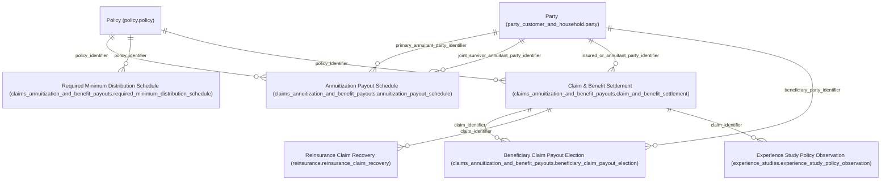

# L&A Ontology Knowledge Framework (OKF) -- Domain 14: Claims, Annuitization & Benefit Payouts (Lifetime Income, RMDs & Settlements)

| OKF Metadata Attribute | Value |
| :--- | :--- |
| **OKF Catalog Document** | `L&A OKF/14 - OKF - Claims Annuitization and Benefit Payouts.MD` |
| **Enterprise Data Domain** | **Domain 14: Claims, Annuitization & Benefit Payouts (Lifetime Income, RMDs & Settlements)** |
| **Target Physical Database Engine** | Amazon RDS Aurora PostgreSQL (PostgreSQL 15/16 Compatible) |
| **Physical Database Schema** | `claims_annuitization_and_benefit_payouts` |
| **Domain Table Count** | **4 Physical Tables / Logical Entities** |
| **Outbound Foreign Key Joins** | **8 Foreign Key Relationships** (Intra-Domain & Cross-Domain) |
| **Inbound Foreign Key Joins** | **2 Cross-Domain Referencing Relationships** |
| **Performance Indexes** | **7 B-Tree & Composite Indexes** |
| **Inherited Business Context Rules** | **`BC-255` through `BC-272` (18 Rules)** |
| **Source Knowledge Layer Artifacts** | `L&A - Ontology.MD`, `L&A Data Model - Logical.MD`, `L&A Data Model - Physical DDL.sql`, `L&A Data Model - Conceptual.MD` |

---

## 1. Domain Executive Ontology & Business Context Overview

The **Claims, Annuitization & Benefit Payouts** domain governs the decumulation, retirement income distribution, and benefit settlement phase of the Life and Annuity value chain—the ultimate moment of truth where the insurance carrier fulfills its long-term contractual promises to retirees, annuitants, and grieving beneficiaries. Taking deep architectural inspiration from the carrier's century-long leadership in guaranteed lifetime income alongside broad US retail life and annuity claim standards, this domain is organized across four core logical entities: `Annuitization Payout Schedule`, `Required Minimum Distribution Schedule`, `Claim & Benefit Settlement`, and `Beneficiary Claim Payout Election`.

`Annuitization Payout Schedule` (`Annuitization Payout Schedule Identifier`, `Payout Contract Number`) governs the income phase when a policyholder elects to convert accumulated savings (or purchase a Single Premium Immediate Annuity) into a structured payout stream (`Annuitization Effective Date`, `First Income Payment Date`). It links the originating `Policy Identifier` to the measuring life (`Primary Annuitant Party Identifier`) and optional spouse/partner (`Joint Survivor Annuitant Party Identifier`), defining the actuarial `Payout Option Type`: `Single Life Annuity (Life Only)`, `Single Life with 10/15/20-Year Guaranteed Period Certain`, `Joint and 100% / 75% / Two-Thirds (66.7%) / 50% to Survivor`, `Transfer Payout Annuity (TPA 10-Year Fixed Installment)`, `Interest-Only Payout Option (IPRO)`, or an institutional `Retirement Transition Benefit` (allowing up to 10% lump-sum cash at annuitization). Crucially, it separates the `Guaranteed Minimum Periodic Payment Amount` (backed by contractual guaranteed interest and mortality tables) from the `Current Variable or Additional Dividend Payment Amount` (driven by Board-declared payout dividends or CREF variable annuity unit revaluations under the elected `Assumed Investment Return (AIR) Election`).

For active qualified contracts (403(b), 401(a), 401(k), 457(b), Traditional IRAs), `Required Minimum Distribution Schedule` (`RMD Schedule Identifier`) enforces IRS Internal Revenue Code Section 401(a)(9) and SECURE 2.0 Act mandates (age 73 / 75 thresholds), dividing the `Prior Year December 31 Fair Market Value` (plus any `Actuarial Present Value of Additional Plan Benefits` required under Treasury Reg. 1.401(a)(9)-6) by the divisor from `Applicable IRS Life Expectancy Table` (Table III Uniform Lifetime, Table II Joint Life for spouses >10 years younger, or Table I Single Life) to track `Calculated Annual RMD Amount`, `Satisfied RMD Amount Year-to-Date`, `Remaining RMD Amount Due`, and automated Minimum Distribution Option (`Automated RMD Payout Election Indicator`) sweeps. Finally, `Claim & Benefit Settlement` (`Claim Identifier`, `Claim Number`, `Claim Type`) manages Death Benefit claims, Living Benefit rider triggers, Disability Waivers, and Maturity settlements—tracking `Date of Loss or Death`, 2-year contestability verification, and the exact settlement formula (`Base Contract Benefit Amount` + `Guaranteed Minimum Death Benefit (GMDB) Step-Up Amount` + statutory `Delayed Settlement Interest Credited Amount` - `Less Outstanding Policy Loan Balance` = `Net Payable Claim Benefit Amount`)—while `Beneficiary Claim Payout Election` records each beneficiary's `Share Percentage Paid` and `Elected Settlement Method` (Lump Sum, Spousal Continuation, 10-Year SECURE Act Inherited Stretch, or Life Income Settlement).

---

## 2. Physical Schema & Logical Entity Architecture Catalog (Schema: `claims_annuitization_and_benefit_payouts`)

| # | Logical Entity Name | Physical Table Name (`schema.table`) | Primary Key Column (`PK`) | Business Cols | Audit Cols | Constraints (`PK`/`UQ`/`CHK`) | Logical Entity & Physical Table Definition |
| :--- | :--- | :--- | :--- | :--- | :--- | :--- | :--- |
| **14.1** | **Annuitization Payout Schedule** | `claims_annuitization_and_benefit_payouts.annuitization_payout_schedule` | `annuitization_payout_schedule_identifier` | 13 | 2 | `pk_annuitization_payout_schedule`, `uq_payout_contract_number`, `chk_aps_payment_dates` | Annuitization Payout Schedule entity governs the income phase of an annuity contract after the owner elects to convert accumulated savings into guaranteed lifetime or fixed-period income (such as Single Life, Joint & Survivor, Period Certain, or Transfer Payout Annuity [TPA] installments). |
| **14.2** | **Required Minimum Distribution Schedule** | `claims_annuitization_and_benefit_payouts.required_minimum_distribution_schedule` | `rmd_schedule_identifier` | 10 | 2 | `pk_required_minimum_distribution_schedule`, `uq_rmd_policy_tax_year` | Required Minimum Distribution Schedule entity calculates and tracks the mandatory annual withdrawal amount a qualified retirement contract owner must take under IRS Internal Revenue Code Section 401(a)(9) based on prior year-end fair market value and IRS life expectancy tables. |
| **14.3** | **Claim & Benefit Settlement** | `claims_annuitization_and_benefit_payouts.claim_and_benefit_settlement` | `claim_identifier` | 14 | 2 | `pk_claim_and_benefit_settlement`, `uq_claim_number`, `chk_claim_dates` | Claim & Benefit Settlement entity manages the end-to-end adjudication and financial calculation of contractual benefit events—including Death Benefit claims, Living Benefit rider exercises, Disability Waivers, and Maturity settlements—from initial notice of loss to final disbursement. |
| **14.4** | **Beneficiary Claim Payout Election** | `claims_annuitization_and_benefit_payouts.beneficiary_claim_payout_election` | `beneficiary_payout_election_identifier` | 7 | 2 | `pk_beneficiary_claim_payout_election`, `chk_bcpe_share_pct` | Beneficiary Claim Payout Election entity records each individual beneficiary's verified claim share and elected settlement method (such as lump-sum check/ACH, spousal contract continuation, or 10-year inherited IRA stretch) under an approved Claim & Benefit Settlement. |

---

## 3. Relational Join Mining & Foreign Key Topology

### 3.1 Entity-Relationship & Foreign Key Join Diagram (Mermaid)



### 3.2 Outbound Foreign Key Join Matrix (Tables in `claims_annuitization_and_benefit_payouts` Referencing Parent Entities)

| FK Constraint Name | Child Table (`claims_annuitization_and_benefit_payouts`) | Child FK Column | Join Scope | Parent Referenced Table | Parent PK Column | Referential Action | Exact SQL Join Predicate |
| :--- | :--- | :--- | :--- | :--- | :--- | :--- | :--- |
| `fk_aps_policy` | `claims_annuitization_and_benefit_payouts.annuitization_payout_schedule` | `policy_identifier` | Cross-Domain (`policy`) | `policy.policy` | `policy_identifier` | `ON UPDATE CASCADE ON DELETE RESTRICT` | `claims_annuitization_and_benefit_payouts.annuitization_payout_schedule.policy_identifier = policy.policy.policy_identifier` |
| `fk_aps_primary_annuitant` | `claims_annuitization_and_benefit_payouts.annuitization_payout_schedule` | `primary_annuitant_party_identifier` | Cross-Domain (`party_customer_and_household`) | `party_customer_and_household.party` | `party_identifier` | `ON UPDATE CASCADE ON DELETE RESTRICT` | `claims_annuitization_and_benefit_payouts.annuitization_payout_schedule.primary_annuitant_party_identifier = party_customer_and_household.party.party_identifier` |
| `fk_aps_joint_annuitant` | `claims_annuitization_and_benefit_payouts.annuitization_payout_schedule` | `joint_survivor_annuitant_party_identifier` | Cross-Domain (`party_customer_and_household`) | `party_customer_and_household.party` | `party_identifier` | `ON UPDATE CASCADE ON DELETE RESTRICT` | `claims_annuitization_and_benefit_payouts.annuitization_payout_schedule.joint_survivor_annuitant_party_identifier = party_customer_and_household.party.party_identifier` |
| `fk_rmd_policy` | `claims_annuitization_and_benefit_payouts.required_minimum_distribution_schedule` | `policy_identifier` | Cross-Domain (`policy`) | `policy.policy` | `policy_identifier` | `ON UPDATE CASCADE ON DELETE CASCADE` | `claims_annuitization_and_benefit_payouts.required_minimum_distribution_schedule.policy_identifier = policy.policy.policy_identifier` |
| `fk_cbs_policy` | `claims_annuitization_and_benefit_payouts.claim_and_benefit_settlement` | `policy_identifier` | Cross-Domain (`policy`) | `policy.policy` | `policy_identifier` | `ON UPDATE CASCADE ON DELETE RESTRICT` | `claims_annuitization_and_benefit_payouts.claim_and_benefit_settlement.policy_identifier = policy.policy.policy_identifier` |
| `fk_cbs_insured_annuitant_party` | `claims_annuitization_and_benefit_payouts.claim_and_benefit_settlement` | `insured_or_annuitant_party_identifier` | Cross-Domain (`party_customer_and_household`) | `party_customer_and_household.party` | `party_identifier` | `ON UPDATE CASCADE ON DELETE RESTRICT` | `claims_annuitization_and_benefit_payouts.claim_and_benefit_settlement.insured_or_annuitant_party_identifier = party_customer_and_household.party.party_identifier` |
| `fk_bcpe_claim` | `claims_annuitization_and_benefit_payouts.beneficiary_claim_payout_election` | `claim_identifier` | Intra-Domain | `claims_annuitization_and_benefit_payouts.claim_and_benefit_settlement` | `claim_identifier` | `ON UPDATE CASCADE ON DELETE CASCADE` | `claims_annuitization_and_benefit_payouts.beneficiary_claim_payout_election.claim_identifier = claims_annuitization_and_benefit_payouts.claim_and_benefit_settlement.claim_identifier` |
| `fk_bcpe_beneficiary_party` | `claims_annuitization_and_benefit_payouts.beneficiary_claim_payout_election` | `beneficiary_party_identifier` | Cross-Domain (`party_customer_and_household`) | `party_customer_and_household.party` | `party_identifier` | `ON UPDATE CASCADE ON DELETE RESTRICT` | `claims_annuitization_and_benefit_payouts.beneficiary_claim_payout_election.beneficiary_party_identifier = party_customer_and_household.party.party_identifier` |

### 3.3 Inbound Cross-Domain Foreign Key Join Matrix (External Schemas Referencing `claims_annuitization_and_benefit_payouts`)

| FK Constraint Name | Referencing Child Schema | Referencing Child Table | Child FK Column | Referenced Target Table (`claims_annuitization_and_benefit_payouts`) | Target PK Column | Referential Action | Exact SQL Join Predicate |
| :--- | :--- | :--- | :--- | :--- | :--- | :--- | :--- |
| `fk_rcr_claim` | `reinsurance` | `reinsurance.reinsurance_claim_recovery` | `claim_identifier` | `claims_annuitization_and_benefit_payouts.claim_and_benefit_settlement` | `claim_identifier` | `ON UPDATE CASCADE ON DELETE RESTRICT` | `reinsurance.reinsurance_claim_recovery.claim_identifier = claims_annuitization_and_benefit_payouts.claim_and_benefit_settlement.claim_identifier` |
| `fk_espo_claim` | `experience_studies` | `experience_studies.experience_study_policy_observation` | `claim_identifier` | `claims_annuitization_and_benefit_payouts.claim_and_benefit_settlement` | `claim_identifier` | `ON UPDATE CASCADE ON DELETE SET NULL` | `experience_studies.experience_study_policy_observation.claim_identifier = claims_annuitization_and_benefit_payouts.claim_and_benefit_settlement.claim_identifier` |

---

## 4. Detailed Table-by-Table Schema, Column Dictionary & DDL Constraints

### 4.1 Logical Entity: `Annuitization Payout Schedule` <-> Physical Table: `claims_annuitization_and_benefit_payouts.annuitization_payout_schedule`

- **Business & Technical Purpose**: Annuitization Payout Schedule entity governs the income phase of an annuity contract after the owner elects to convert accumulated savings into guaranteed lifetime or fixed-period income (such as Single Life, Joint & Survivor, Period Certain, or Transfer Payout Annuity [TPA] installments).
- **PostgreSQL Catalog Comment**: _""_
- **Primary Key**: `annuitization_payout_schedule_identifier`

#### Attribute-to-Column Schema Mapping & Business Dictionary

| Ord | Logical Attribute Name | Physical Column Name | Logical Type | Physical PostgreSQL Type | Key | Column Modifiers / Default | Business Definition, Domain Semantics & Sample Values |
| :--- | :--- | :--- | :--- | :--- | :--- | :--- | :--- |
| **1** | **Annuitization Payout Schedule Identifier** | `annuitization_payout_schedule_identifier` | String | `VARCHAR(64)` | **PK** | `NOT NULL` | Unique primary key identifying an active or historical annuity income payout contract or schedule (core to institutional and retail lifetime income administration). Sample values: `APS-77001`, `APS-77002`. |
| **2** | **Policy Identifier** | `policy_identifier` | String | `VARCHAR(64)` | **FK** | `NOT NULL` | Foreign key linking the lifetime or fixed-period income schedule to the originating deferred or immediate Policy contract. Sample values: `POL-UUID-90001421`. |
| **3** | **Primary Annuitant Party Identifier** | `primary_annuitant_party_identifier` | String | `VARCHAR(64)` | **FK** | `NOT NULL` | Foreign key referencing the primary measuring life Party whose longevity governs lifetime annuity payments. Sample values: `PRTY-MDM-10004921`. |
| **4** | **Joint Survivor Annuitant Party Identifier** | `joint_survivor_annuitant_party_identifier` | String | `VARCHAR(64)` | **FK** | `NULL` | Optional foreign key referencing the second measuring life (spouse/partner) Party on a Joint and Survivor lifetime annuity payout. Sample values: `PRTY-MDM-10004922`, `Null (Single Life Annuity)`. |
| **5** | **Payout Contract Number** | `payout_contract_number` | String | `VARCHAR(64)` | **NK** | `NOT NULL` | Unique business-facing payout contract number issued when a deferred accumulation contract converts into a payout annuity certificate (e.g., Institutional Payout Annuity contract). Sample values: `PA-00948120`, `TPA-00419201`. |
| **6** | **Annuitization Effective Date** | `annuitization_effective_date` | Date | `DATE` | **NK** | `NOT NULL` | Calendar date on which accumulated contract values or vintage buckets were irrevocably converted into an annuity income stream. Sample values: `2024-07-01`, `2026-01-01`. |
| **7** | **First Income Payment Date** | `first_income_payment_date` | Date | `DATE` | **NK** | `NOT NULL` | Calendar date on which the first periodic annuity income disbursement was or will be paid to the annuitant. Sample values: `2024-08-01`, `2026-02-01`. |
| **8** | **Payout Option Type** | `payout_option_type` | String | `VARCHAR(150)` | **NK** | `NOT NULL` | Defines the actuarial structure of the income stream, survivor continuance percentage, and guaranteed minimum payment period. Sample values: `Single Life Annuity (Life Only)`, `Single Life with 10-Year Guaranteed Period Certain`, `Single Life with 15-Year Guaranteed Period Certain`, `Single Life with 20-Year Guaranteed Period Certain`, `Joint and 100% to Survivor with 10-Year Certain`, `Joint and Two-Thirds (66.7%) to Survivor`, `Joint and 50% to Survivor`, `Joint and 75% to Survivor`, `Transfer Payout Annuity (TPA 10-Year Fixed Installment)`, `Interest-Only Payout Option (IPRO)`, `Retirement Transition Benefit (10% Lump Sum at Annuitization)`. |
| **9** | **Payment Frequency** | `payment_frequency` | String | `VARCHAR(50)` | **NK** | `NOT NULL` | Recurring interval at which annuity income payments are disbursed to the payee. Sample values: `Monthly (1st of Month)`, `Quarterly`, `Semi-Annual`, `Annual`. |
| **10** | **Guaranteed Minimum Periodic Payment Amount** | `guaranteed_minimum_periodic_payment_amount` | Decimal | `NUMERIC(18,2)` | **NK** | `NOT NULL` | Contractual floor dollar amount guaranteed to be paid in each payment period based on guaranteed payout purchase rates (e.g., 2.5% or 3.0% guaranteed interest and guaranteed annuity mortality tables). Sample values: `2150.00`, `4800.00`, `1120.50`. |
| **11** | **Current Variable or Additional Dividend Payment Amount** | `current_variable_or_additional_dividend_amount` | Decimal | `NUMERIC(18,2)` | **NK** | `NOT NULL DEFAULT 0.00` | Additional periodic income dollar amount paid above the guaranteed floor from Board-declared payout dividends or CREF variable annuity unit revaluations. Sample values: `980.00`, `1450.25`, `0.00`. |
| **12** | **Assumed Investment Return (AIR) Election** | `assumed_investment_return_air_election` | String | `VARCHAR(100)` | **NK** | `NOT NULL` | Hurdle return rate (and revaluation frequency: Annual vs. Monthly) elected for variable annuity unit payouts such as CREF accounts. Sample values: `4.00% AIR - Annual Revaluation (May 1)`, `4.00% AIR - Monthly Revaluation`, `Not Applicable (Fixed / General Account Payout)`. |
| **13** | **Guaranteed Period Certain End Date** | `guaranteed_period_certain_end_date` | Date | `DATE` | **NK** | `NULL` | Expiration calendar date of the guaranteed period certain window (if the annuitant dies before this date, remaining guaranteed payments continue to the named beneficiary). Sample values: `2034-07-01`, `2046-01-01`, `Null (Life Only - No Period Certain)`. |
| **14** | **Record Created Timestamp (Audit)** | `created_at` | Timestamp | `TIMESTAMPTZ` | **AUDIT** | `NOT NULL DEFAULT CURRENT_TIMESTAMP` | System audit timestamp recording when the physical row was initially inserted into the Aurora PostgreSQL table. |
| **15** | **Record Updated Timestamp (Audit)** | `updated_at` | Timestamp | `TIMESTAMPTZ` | **AUDIT** | `NOT NULL DEFAULT CURRENT_TIMESTAMP` | System audit timestamp recording when the physical row was last modified in the Aurora PostgreSQL table. |

#### Declarative DDL Constraints & Indexes on `claims_annuitization_and_benefit_payouts.annuitization_payout_schedule`

| Constraint / Index Category | Identifier Name | Definition / Target Columns & Referential Integrity Rule |
| :--- | :--- | :--- |
| **PRIMARY KEY** | `pk_annuitization_payout_schedule` | `PRIMARY KEY (annuitization_payout_schedule_identifier)` |
| **UNIQUE** | `uq_payout_contract_number` | `UNIQUE (payout_contract_number)` |
| **CHECK** | `chk_aps_payment_dates` | `CHECK (first_income_payment_date >= annuitization_effective_date)` |
| **FOREIGN KEY** | `fk_aps_policy` | `FOREIGN KEY (policy_identifier) REFERENCES policy.policy (policy_identifier) ON UPDATE CASCADE ON DELETE RESTRICT` |
| **FOREIGN KEY** | `fk_aps_primary_annuitant` | `FOREIGN KEY (primary_annuitant_party_identifier) REFERENCES party_customer_and_household.party (party_identifier) ON UPDATE CASCADE ON DELETE RESTRICT` |
| **FOREIGN KEY** | `fk_aps_joint_annuitant` | `FOREIGN KEY (joint_survivor_annuitant_party_identifier) REFERENCES party_customer_and_household.party (party_identifier) ON UPDATE CASCADE ON DELETE RESTRICT` |
| **B-TREE INDEX** | `idx_aps_policy_id` | `ON claims_annuitization_and_benefit_payouts.annuitization_payout_schedule (policy_identifier)` |
| **B-TREE INDEX** | `idx_aps_primary_annuitant` | `ON claims_annuitization_and_benefit_payouts.annuitization_payout_schedule (primary_annuitant_party_identifier)` |

### 4.2 Logical Entity: `Required Minimum Distribution Schedule` <-> Physical Table: `claims_annuitization_and_benefit_payouts.required_minimum_distribution_schedule`

- **Business & Technical Purpose**: Required Minimum Distribution Schedule entity calculates and tracks the mandatory annual withdrawal amount a qualified retirement contract owner must take under IRS Internal Revenue Code Section 401(a)(9) based on prior year-end fair market value and IRS life expectancy tables.
- **PostgreSQL Catalog Comment**: _""_
- **Primary Key**: `rmd_schedule_identifier`

#### Attribute-to-Column Schema Mapping & Business Dictionary

| Ord | Logical Attribute Name | Physical Column Name | Logical Type | Physical PostgreSQL Type | Key | Column Modifiers / Default | Business Definition, Domain Semantics & Sample Values |
| :--- | :--- | :--- | :--- | :--- | :--- | :--- | :--- |
| **1** | **RMD Schedule Identifier** | `rmd_schedule_identifier` | String | `VARCHAR(64)` | **PK** | `NOT NULL` | Unique primary key identifying an annual IRS Required Minimum Distribution calculation and tracking record for a qualified Policy. Sample values: `RMD-2026-004912`, `RMD-2026-004913`. |
| **2** | **Policy Identifier** | `policy_identifier` | String | `VARCHAR(64)` | **FK** | `NOT NULL` | Foreign key linking the annual RMD calculation to the qualified retirement Policy or IRA contract. Sample values: `POL-UUID-90001421`. |
| **3** | **Tax Calendar Year** | `tax_calendar_year` | Integer | `INTEGER` | **NK** | `NOT NULL` | Four-digit calendar tax year for which the mandatory distribution must be satisfied under IRC Section 401(a)(9) and SECURE 2.0 rules (Age 73 / 75 threshold). Sample values: `2025`, `2026`. |
| **4** | **Applicable IRS Life Expectancy Table** | `applicable_irs_life_expectancy_table` | String | `VARCHAR(150)` | **NK** | `NOT NULL` | Specifies which IRS Publication 590-B life expectancy factor table governs the divisor for this contract owner or beneficiary. Sample values: `IRS Table III - Uniform Lifetime Table`, `IRS Table II - Joint Life and Last Survivor Expectancy (Spouse >10 Years Younger)`, `IRS Table I - Single Life Expectancy (Eligible Designated Beneficiary)`. |
| **5** | **Prior Year December 31 Fair Market Value** | `prior_year_december_31_fair_market_value` | Decimal | `NUMERIC(18,2)` | **NK** | `NOT NULL` | Total account value of the qualified contract as of December 31 of the immediately preceding calendar year, adjusted for any outstanding rollovers or recharacterizations. Sample values: `485200.00`, `1120400.00`. |
| **6** | **Actuarial Present Value of Additional Plan Benefits** | `actuarial_present_value_additional_benefits` | Decimal | `NUMERIC(18,2)` | **NK** | `NOT NULL DEFAULT 0.00` | Actuarial present value of any living/death benefit guarantees required to be added to the December 31 Fair Market Value under Treasury Regulation 1.401(a)(9)-6 before dividing by the life expectancy factor. Sample values: `0.00`, `14800.00`. |
| **7** | **Calculated Annual RMD Amount** | `calculated_annual_rmd_amount` | Decimal | `NUMERIC(18,2)` | **NK** | `NOT NULL` | Mandatory gross dollar distribution required to be withdrawn from this contract for the Tax Calendar Year to avoid IRS excise tax penalties. Sample values: `18309.43` (Divisor 26.5 at Age 73), `45360.32`. |
| **8** | **Satisfied RMD Amount Year-to-Date** | `satisfied_rmd_amount_year_to_date` | Decimal | `NUMERIC(18,2)` | **NK** | `NOT NULL DEFAULT 0.00` | Cumulative gross taxable distributions taken from the contract so far during the current calendar year that count toward satisfying the annual RMD requirement. Sample values: `18309.43`, `9154.72`, `0.00`. |
| **9** | **Remaining RMD Amount Due** | `remaining_rmd_amount_due` | Decimal | `NUMERIC(18,2)` | **NK** | `NOT NULL DEFAULT 0.00` | Unsatisfied dollar balance of the current year's RMD that must still be distributed on or before December 31 (or April 1 Required Beginning Date for first-year RMD). Sample values: `0.00` (Fully Satisfied), `9154.71`, `18309.43`. |
| **10** | **Automated RMD Payout Election Indicator** | `automated_rmd_payout_election_indicator` | String | `VARCHAR(150)` | **NK** | `NOT NULL` | Indicates whether the policyholder has enrolled in the carrier's automated Minimum Distribution Option (MDO) service to automatically disburse any remaining RMD balance each autumn/month. Sample values: `Enrolled - Monthly Automated MDO`, `Enrolled - Annual December 15 Auto-Sweep`, `Not Enrolled (Customer Self-Managed or Satisfied via Another 403(b)/IRA)`. |
| **11** | **Record Created Timestamp (Audit)** | `created_at` | Timestamp | `TIMESTAMPTZ` | **AUDIT** | `NOT NULL DEFAULT CURRENT_TIMESTAMP` | System audit timestamp recording when the physical row was initially inserted into the Aurora PostgreSQL table. |
| **12** | **Record Updated Timestamp (Audit)** | `updated_at` | Timestamp | `TIMESTAMPTZ` | **AUDIT** | `NOT NULL DEFAULT CURRENT_TIMESTAMP` | System audit timestamp recording when the physical row was last modified in the Aurora PostgreSQL table. |

#### Declarative DDL Constraints & Indexes on `claims_annuitization_and_benefit_payouts.required_minimum_distribution_schedule`

| Constraint / Index Category | Identifier Name | Definition / Target Columns & Referential Integrity Rule |
| :--- | :--- | :--- |
| **PRIMARY KEY** | `pk_required_minimum_distribution_schedule` | `PRIMARY KEY (rmd_schedule_identifier)` |
| **UNIQUE** | `uq_rmd_policy_tax_year` | `UNIQUE (policy_identifier, tax_calendar_year)` |
| **FOREIGN KEY** | `fk_rmd_policy` | `FOREIGN KEY (policy_identifier) REFERENCES policy.policy (policy_identifier) ON UPDATE CASCADE ON DELETE CASCADE` |
| **B-TREE INDEX** | `idx_rmd_policy_year` | `ON claims_annuitization_and_benefit_payouts.required_minimum_distribution_schedule (policy_identifier, tax_calendar_year DESC)` |

### 4.3 Logical Entity: `Claim & Benefit Settlement` <-> Physical Table: `claims_annuitization_and_benefit_payouts.claim_and_benefit_settlement`

- **Business & Technical Purpose**: Claim & Benefit Settlement entity manages the end-to-end adjudication and financial calculation of contractual benefit events—including Death Benefit claims, Living Benefit rider exercises, Disability Waivers, and Maturity settlements—from initial notice of loss to final disbursement.
- **PostgreSQL Catalog Comment**: _""_
- **Primary Key**: `claim_identifier`

#### Attribute-to-Column Schema Mapping & Business Dictionary

| Ord | Logical Attribute Name | Physical Column Name | Logical Type | Physical PostgreSQL Type | Key | Column Modifiers / Default | Business Definition, Domain Semantics & Sample Values |
| :--- | :--- | :--- | :--- | :--- | :--- | :--- | :--- |
| **1** | **Claim Identifier** | `claim_identifier` | String | `VARCHAR(64)` | **PK** | `NOT NULL` | Unique primary key identifying a contractual benefit claim registered against a Policy. Sample values: `CLM-2026-00912`, `CLM-2026-00913`. |
| **2** | **Policy Identifier** | `policy_identifier` | String | `VARCHAR(64)` | **FK** | `NOT NULL` | Foreign key linking the claim record to the underlying Policy contract. Sample values: `POL-UUID-90001421`. |
| **3** | **Insured or Annuitant Party Identifier** | `insured_or_annuitant_party_identifier` | String | `VARCHAR(64)` | **FK** | `NOT NULL` | Foreign key referencing the deceased or disabled Insured / Annuitant Party whose loss event triggered the claim. Sample values: `PRTY-MDM-10004921`. |
| **4** | **Claim Number** | `claim_number` | String | `VARCHAR(64)` | **NK** | `NOT NULL` | Business-facing claim dossier number used across beneficiary correspondence, death certificate verification, and statutory claim registers. Sample values: `DC-2026-088412`, `LC-2026-011204`. |
| **5** | **Claim Type** | `claim_type` | String | `VARCHAR(150)` | **NK** | `NOT NULL` | Categorizes the contractual benefit trigger being adjudicated. Sample values: `Life Insurance Death Benefit Claim`, `Deferred Annuity Death Benefit Claim`, `Annuitized Survivor Continuance / Period Certain Death Claim`, `GMWB / GMIB Living Benefit Guarantee Claim`, `Chronic or Terminal Illness Accelerated Benefit Claim`, `Waiver of Premium Disability Claim`, `Endowment / Contract Maturity Claim`. |
| **6** | **Date of Loss or Death** | `date_of_loss_or_death` | Date | `DATE` | **NK** | `NOT NULL` | Verified calendar date on which the insured/annuitant died or the qualifying disability/chronic illness event occurred. Sample values: `2026-09-14`, `2026-10-02`. |
| **7** | **Claim Notification Date** | `claim_notification_date` | Date | `DATE` | **NK** | `NOT NULL` | Date on which the carrier first received notice of the death or loss (via beneficiary call, advisor notice, or Social Security Death Master File match). Sample values: `2026-09-20`, `2026-10-05`. |
| **8** | **Proof of Death or Loss Verified Date** | `proof_of_death_or_loss_verified_date` | Date | `DATE` | **NK** | `NULL` | Date on which the certified death certificate, claimant statement, and contestability review (if within the 2-year contestable period) were verified in good order. Sample values: `2026-10-08`, `2026-10-18`. |
| **9** | **Base Contract Benefit Amount** | `base_contract_benefit_amount` | Decimal | `NUMERIC(18,2)` | **NK** | `NOT NULL` | Gross base death benefit face amount (for Life) or current contract accumulation value on the date of death/proof of death (for Annuities) before rider step-ups or loan offsets. Sample values: `500000.00`, `145230.85`. |
| **10** | **Guaranteed Minimum Death Benefit (GMDB) Step-Up Amount** | `guaranteed_minimum_death_benefit_step_up_amount` | Decimal | `NUMERIC(18,2)` | **NK** | `NOT NULL DEFAULT 0.00` | Additional positive benefit dollar amount payable above the base contract value when an attached GMDB rider's Return-of-Premium or High-Water-Mark Benefit Base exceeds the current market value. Sample values: `0.00`, `38450.15`. |
| **11** | **Delayed Settlement Interest Credited Amount** | `delayed_settlement_interest_credited_amount` | Decimal | `NUMERIC(18,2)` | **NK** | `NOT NULL DEFAULT 0.00` | Statutory interest credited on the claim proceeds from the Date of Death (or Notification Date, per state law) until the date of claim disbursement. Sample values: `1842.60`, `412.10`. |
| **12** | **Less Outstanding Policy Loan Balance** | `less_outstanding_policy_loan_balance` | Decimal | `NUMERIC(18,2)` | **NK** | `NOT NULL DEFAULT 0.00` | Total unpaid policy loan principal and accrued loan interest deducted from the gross death benefit proceeds at settlement. Sample values: `0.00`, `11382.80`. |
| **13** | **Net Payable Claim Benefit Amount** | `net_payable_claim_benefit_amount` | Decimal | `NUMERIC(18,2)` | **NK** | `NOT NULL` | Final net dollar amount available for distribution to beneficiaries (Base Benefit + GMDB Step-Up + Delayed Settlement Interest minus Outstanding Policy Loan Balance). Sample values: `501842.60`, `172710.30`. |
| **14** | **Claim Status** | `claim_status` | String | `VARCHAR(100)` | **NK** | `NOT NULL` | Current adjudication and payment lifecycle status of the claim. Sample values: `Reported - Awaiting Death Certificate & Claimant Forms`, `In 2-Year Contestability Investigation`, `Approved for Payment`, `Partially Settled (Multiple Beneficiaries)`, `Fully Paid & Closed`, `Denied`, `Referred to Unclaimed Property / Escheatment`. |
| **15** | **Record Created Timestamp (Audit)** | `created_at` | Timestamp | `TIMESTAMPTZ` | **AUDIT** | `NOT NULL DEFAULT CURRENT_TIMESTAMP` | System audit timestamp recording when the physical row was initially inserted into the Aurora PostgreSQL table. |
| **16** | **Record Updated Timestamp (Audit)** | `updated_at` | Timestamp | `TIMESTAMPTZ` | **AUDIT** | `NOT NULL DEFAULT CURRENT_TIMESTAMP` | System audit timestamp recording when the physical row was last modified in the Aurora PostgreSQL table. |

#### Declarative DDL Constraints & Indexes on `claims_annuitization_and_benefit_payouts.claim_and_benefit_settlement`

| Constraint / Index Category | Identifier Name | Definition / Target Columns & Referential Integrity Rule |
| :--- | :--- | :--- |
| **PRIMARY KEY** | `pk_claim_and_benefit_settlement` | `PRIMARY KEY (claim_identifier)` |
| **UNIQUE** | `uq_claim_number` | `UNIQUE (claim_number)` |
| **CHECK** | `chk_claim_dates` | `CHECK (claim_notification_date >= date_of_loss_or_death)` |
| **FOREIGN KEY** | `fk_cbs_policy` | `FOREIGN KEY (policy_identifier) REFERENCES policy.policy (policy_identifier) ON UPDATE CASCADE ON DELETE RESTRICT` |
| **FOREIGN KEY** | `fk_cbs_insured_annuitant_party` | `FOREIGN KEY (insured_or_annuitant_party_identifier) REFERENCES party_customer_and_household.party (party_identifier) ON UPDATE CASCADE ON DELETE RESTRICT` |
| **B-TREE INDEX** | `idx_cbs_policy_status` | `ON claims_annuitization_and_benefit_payouts.claim_and_benefit_settlement (policy_identifier, claim_status)` |
| **B-TREE INDEX** | `idx_cbs_insured_party` | `ON claims_annuitization_and_benefit_payouts.claim_and_benefit_settlement (insured_or_annuitant_party_identifier)` |

### 4.4 Logical Entity: `Beneficiary Claim Payout Election` <-> Physical Table: `claims_annuitization_and_benefit_payouts.beneficiary_claim_payout_election`

- **Business & Technical Purpose**: Beneficiary Claim Payout Election entity records each individual beneficiary's verified claim share and elected settlement method (such as lump-sum check/ACH, spousal contract continuation, or 10-year inherited IRA stretch) under an approved Claim & Benefit Settlement.
- **PostgreSQL Catalog Comment**: _""_
- **Primary Key**: `beneficiary_payout_election_identifier`

#### Attribute-to-Column Schema Mapping & Business Dictionary

| Ord | Logical Attribute Name | Physical Column Name | Logical Type | Physical PostgreSQL Type | Key | Column Modifiers / Default | Business Definition, Domain Semantics & Sample Values |
| :--- | :--- | :--- | :--- | :--- | :--- | :--- | :--- |
| **1** | **Beneficiary Payout Election Identifier** | `beneficiary_payout_election_identifier` | String | `VARCHAR(64)` | **PK** | `NOT NULL` | Unique primary key identifying an individual beneficiary's claim share and settlement election under a Claim & Benefit Settlement. Sample values: `BCPE-5001`, `BCPE-5002`. |
| **2** | **Claim Identifier** | `claim_identifier` | String | `VARCHAR(64)` | **FK** | `NOT NULL` | Foreign key linking the beneficiary settlement election to the parent Claim & Benefit Settlement. Sample values: `CLM-2026-00912`. |
| **3** | **Beneficiary Party Identifier** | `beneficiary_party_identifier` | String | `VARCHAR(64)` | **FK** | `NOT NULL` | Foreign key referencing the surviving Beneficiary Party receiving this share of the claim proceeds. Sample values: `PRTY-MDM-10004922`. |
| **4** | **Elected Settlement Method** | `elected_settlement_method` | String | `VARCHAR(150)` | **NK** | `NOT NULL` | Post-death settlement option chosen by the beneficiary under contract terms and SECURE Act inherited account rules. Sample values: `Single Lump-Sum Cash Disbursement`, `Spousal Contract Continuation (Surviving Spouse Becomes Owner)`, `Non-Spouse Designated Beneficiary 10-Year Inherited IRA / 403(b) Stretch`, `Eligible Designated Beneficiary Life Expectancy Payout`, `Life Income Settlement Annuity Option`, `Retained Asset Account (Total Control Account)`. |
| **5** | **Share Percentage Paid** | `share_percentage_paid` | Decimal | `NUMERIC(9,6)` | **NK** | `NOT NULL` | Verified decimal share of the total Net Payable Claim Benefit Amount disbursed or transferred to this beneficiary. Sample values: `1.0000` (100.00%), `0.5000` (50.00%), `0.2500` (25.00%). |
| **6** | **Disbursement Date** | `disbursement_date` | Date | `DATE` | **NK** | `NULL` | Calendar date on which the beneficiary's lump-sum payment was issued or their inherited continuation contract was established. Sample values: `2026-10-12`, `2026-10-20`. |
| **7** | **Payment Method** | `payment_method` | String | `VARCHAR(100)` | **NK** | `NOT NULL` | Financial rail used to deliver the claim settlement to the beneficiary. Sample values: `ACH Direct Deposit`, `Federal Reserve Same-Day Wire`, `Internal Inherited Contract Transfer`, `Physical Check`. |
| **8** | **Record Created Timestamp (Audit)** | `created_at` | Timestamp | `TIMESTAMPTZ` | **AUDIT** | `NOT NULL DEFAULT CURRENT_TIMESTAMP` | System audit timestamp recording when the physical row was initially inserted into the Aurora PostgreSQL table. |
| **9** | **Record Updated Timestamp (Audit)** | `updated_at` | Timestamp | `TIMESTAMPTZ` | **AUDIT** | `NOT NULL DEFAULT CURRENT_TIMESTAMP` | System audit timestamp recording when the physical row was last modified in the Aurora PostgreSQL table. |

#### Declarative DDL Constraints & Indexes on `claims_annuitization_and_benefit_payouts.beneficiary_claim_payout_election`

| Constraint / Index Category | Identifier Name | Definition / Target Columns & Referential Integrity Rule |
| :--- | :--- | :--- |
| **PRIMARY KEY** | `pk_beneficiary_claim_payout_election` | `PRIMARY KEY (beneficiary_payout_election_identifier)` |
| **CHECK** | `chk_bcpe_share_pct` | `CHECK (share_percentage_paid > 0 AND share_percentage_paid <= 1)` |
| **FOREIGN KEY** | `fk_bcpe_claim` | `FOREIGN KEY (claim_identifier) REFERENCES claims_annuitization_and_benefit_payouts.claim_and_benefit_settlement (claim_identifier) ON UPDATE CASCADE ON DELETE CASCADE` |
| **FOREIGN KEY** | `fk_bcpe_beneficiary_party` | `FOREIGN KEY (beneficiary_party_identifier) REFERENCES party_customer_and_household.party (party_identifier) ON UPDATE CASCADE ON DELETE RESTRICT` |
| **B-TREE INDEX** | `idx_bcpe_claim_id` | `ON claims_annuitization_and_benefit_payouts.beneficiary_claim_payout_election (claim_identifier)` |
| **B-TREE INDEX** | `idx_bcpe_beneficiary_party` | `ON claims_annuitization_and_benefit_payouts.beneficiary_claim_payout_election (beneficiary_party_identifier)` |

---

## 5. Inherited Business Context Ontology Rules (`BC-255` to `BC-272`)

> **Semantic Inheritance Notice**: The following **18 Business Context rules** are inherited verbatim from `L&A Data Domain/L&A - Ontology.MD` to provide autonomous AI agents, data engineers, and actuaries with complete domain rules, accounting identities, statutory compliance mandates, and SQL join guardrails for the **Claims, Annuitization & Benefit Payouts** domain.

#### BC-255: The Annuitization Transformation: Converting Accumulation Value into an `Annuitization Payout Schedule`

**Domains**: Claims, Annuitization & Benefit Payouts, Policy, Transactions, Actuarial | **Entities**: Annuitization Payout Schedule, Policy, Financial Transaction, Actuarial Valuation Reserve | **Key Attributes**: Annuitization Schedule Identifier, Policy Identifier, Annuitization Effective Date, Initial Annuitized Capital Amount, Policy Status, Gross Periodic Payout Amount

Annuitization is the defining contractual mechanism of an annuity company—particularly across institutional higher-education retirement carriers that pioneered educator lifetime income. When a contract owner elects to convert a deferred annuity (or a portion of an institutional `Retirement Choice` / `Retirement Annuity` accumulation balance) into a stream of guaranteed income, the contract undergoes a fundamental structural transition on `Annuitization Effective Date`. First, a `Financial Transaction` of `Transaction Type = 'Annuitization Capital Conversion'` liquidates the elected accumulation balance (`Initial Annuitized Capital Amount`), reducing liquid `Total Account Value` and `Cash Surrender Value` to `$0.00` (for a full annuitization, or setting the spun-off payout contract's `Policy Status = 'Annuitized in Payout'`). Second, an `Annuitization Payout Schedule` record is created, linking `Policy Identifier`, `Primary Annuitant Party Identifier`, and an optional `Joint Annuitant Party Identifier`. Third, the carrier's actuarial engine converts `Initial Annuitized Capital Amount` into a `Gross Periodic Payout Amount` payable at `Payout Frequency` (`'Monthly'`, `'Quarterly'`, `'Semi-Annual'`, `'Annual'`) using age- and gender/unisex-specific mortality tables (`1983 IAM`, `2012 IAR`, or the carrier institutional unisex payout rates) plus the contract's guaranteed settlement interest rate. Simultaneously, on `Actuarial Valuation Reserve`, the liability shifts from an accumulation deposit reserve to a present-value payout annuity reserve (`CARVM` / payout valuation basis). When an AI agent builds retirement income or AUM reporting, it must never misclassify an annuitized policy (`Policy Status = 'Annuitized in Payout'`) as a lapsed or zero-value policy merely because its liquid `Total Account Value` is `$0.00`; instead, its economic value resides in `Annuitization Payout Schedule` and `Actuarial Valuation Reserve`.`Statutory Reserve Amount`.

#### BC-256: Life Annuity Payout Options: Single Life, Life with Period Certain (10/15/20 Years), Joint & Survivor, and Period Certain Only

**Domains**: Claims, Annuitization & Benefit Payouts, Party, Customer & Household, Actuarial | **Entities**: Annuitization Payout Schedule, Policy Party Role, Party, Actuarial Valuation Reserve | **Key Attributes**: Payout Option Type, Primary Annuitant Party Identifier, Joint Annuitant Party Identifier, Joint Survivor Continuation Percentage, Guaranteed Period Certain End Date

On `Annuitization Payout Schedule`, the `Payout Option Type` attribute governs the mortality and longevity risk-sharing structure between the carrier and the annuitant(s) across five canonical elections:

1. `'Single Life Only'`: Pays the highest possible `Gross Periodic Payout Amount` for as long as `Primary Annuitant Party Identifier` lives, but payments cease immediately upon the primary annuitant's death with zero residual benefit to beneficiaries (pure mortality pooling / longevity credits).
2. `'Single Life with 10-Year Period Certain'` **/** `'Single Life with 20-Year Period Certain'`: Guarantees payments for the lifetime of the primary annuitant, *plus* guarantees that if the primary annuitant dies before `Guaranteed Period Certain End Date` (e.g., 10 or 20 years after `Annuitization Effective Date`), the remaining scheduled payments through `Guaranteed Period Certain End Date` continue to the designated beneficiary on `Policy Party Role`.
3. `'Joint and 100% Survivor Life'` **/** `'Joint and 50% Survivor Life'` **/** `'Joint and 66.7% Survivor Life'` **(and Joint Life with Period Certain)**: Bases payouts on two lives (`Primary Annuitant Party Identifier` and `Joint Annuitant Party Identifier`, typically a spouse). If the primary annuitant dies first, periodic payments continue for the lifetime of the surviving joint annuitant at `Joint Survivor Continuation Percentage` (`100.00%`, `66.67%`, or `50.00%` of the initial payout).
4. `'Fixed Period Certain Only'` **(e.g., 5 to 30 years)**: Pays for a fixed calendar duration ending on `Guaranteed Period Certain End Date` regardless of whether the annuitant lives or dies, carrying zero mortality contingency.

AI agents building longevity risk or reserve projection models must always inspect `Payout Option Type`, `Joint Survivor Continuation Percentage`, and `Guaranteed Period Certain End Date` to determine when a payout stream terminates upon death.

#### BC-257: General Account Participating Vintage Interest Credits and the "Loyalty Bonus" in Payout Annuitization

**Domains**: Claims, Annuitization & Benefit Payouts, Policy, Fund | **Entities**: Annuitization Payout Schedule, Policy Vintage Interest Bucket, Investment Fund | **Key Attributes**: Annuitization Schedule Identifier, Policy Vintage Bucket Identifier, Vintage Period Code, Initial Annuitized Capital Amount, Participating Dividend Payout Amount, Guaranteed Floor Payout Amount

A signature competitive advantage of Participating General Account Fixed (`Investment Fund` in `General Account Fixed Vintage`) is its vintage-based participating payout structure when a participant transitions from accumulation into `Annuitization Payout Schedule`. During the accumulation phase, every contribution made to Participating General Account Fixed over a participant's 20- to 40-year career is tracked in a specific `Policy Vintage Interest Bucket` (`Vintage Period Code`, `Accumulated Principal and Credited Interest Amount`). Because older vintages have been invested in long-duration General Account fixed-income, private placement, and real estate assets that have already amortized acquisition costs and built up statutory capital surplus, the carrier rewards long-tenured savers upon annuitization with a **Payout Vintage / Loyalty Bonus**. Specifically, when `Initial Annuitized Capital Amount` is converted into a lifetime `Annuitization Payout Schedule`, each underlying `Policy Vintage Interest Bucket` is converted using the payout settlement rate and participating dividend scale applicable to *when those dollars were originally contributed*! Consequently, a participant who contributed steadily across vintages from the 1990s through the 2020s receives a `Guaranteed Floor Payout Amount` (calculated at the contractual guaranteed minimum rate) plus a substantial `Participating Dividend Payout Amount` (declared annually by the Carrier Board of Trustees based on vintage surplus), often delivering 10% to 30% higher initial lifetime income than a brand-new cash purchaser of a retail SPIA (`Single Premium Immediate Annuity`). Furthermore, retirees can elect the carrier's "Standard" payout method (maximizing Day-1 `Participating Dividend Payout Amount`) or the "Graded" payment method (where a portion of the participating dividend is reinvested each year to provide inflation-fighting annual income increases). AI agents building retirement income comparison tools must always join `Policy Vintage Interest Bucket` to `Annuitization Payout Schedule` to capture vintage-weighted payout enhancements.

#### BC-258: CREF Variable Annuity Payout Units and the Assumed Investment Return (`AIR`) Revaluation Formula

**Domains**: Claims, Annuitization & Benefit Payouts, Fund, Policy | **Entities**: Annuitization Payout Schedule, Fund Daily Valuation & Price, Policy Fund Holding, Investment Fund | **Key Attributes**: Annuitization Schedule Identifier, Fund Identifier, Annuity Payout Unit Value, Gross Periodic Payout Amount, Guaranteed Floor Payout Amount

Whereas a fixed annuity pays a fixed or participating dollar amount (`Guaranteed Floor Payout Amount` + `Participating Dividend Payout Amount`), a Variable Annuity in payout—most famously the **CREF Stock Account** (`CREF-STK-R3`) and other CREF variable accounts—converts the retiree's accumulation units (`Policy Fund Holding`.`Unit Count` $\times$ `Accumulation Unit Value (AUV)`) on `Annuitization Effective Date` into a fixed number of **Annuity Units** tracked via `Annuitization Payout Schedule` and priced via `Fund Daily Valuation & Price`.`Annuity Payout Unit Value`. Under actuarial variable annuity payout mechanics, the initial number of Annuity Units is calculated using an **Assumed Investment Return (**`AIR`**)**—typically **4.00% per annum** at CREF (or 3.00% to 5.00% across retail variable annuities). Once the retiree's number of Annuity Units is locked in for life, their dollar `Gross Periodic Payout Amount` equals:
$$\text{Gross Periodic Payout Amount}_t = \text{Annuity Unit Count} \times \text{Annuity Payout Unit Value}_t$$
If the underlying CREF fund's net investment return over the valuation period (either **annually** on May 1 or **monthly**, depending on the participant's CREF revaluation election) exactly equals the 4.00% `AIR`, `Annuity Payout Unit Value` and `Gross Periodic Payout Amount` remain unchanged. If the fund's net return exceeds 4.00% (for example, +10.00% net return), `Annuity Payout Unit Value` increases by approximately $(1.10 / 1.04) - 1 = +5.77$, permanently raising the retiree's dollar income until the next revaluation date; if the fund's net return is less than 4.00%, `Annuity Payout Unit Value` decreases proportionally. For pure variable annuitizations, `Guaranteed Floor Payout Amount` on `Annuitization Payout Schedule` is `$0.00` because investment risk remains with the annuitant while Institutional Variable & General Account guarantees lifetime mortality pooling. AI agents must join `Fund Daily Valuation & Price`.`Annuity Payout Unit Value` when projecting variable payout streams.

#### BC-259: GLWB / GMIB Rider Lifetime Withdrawals (`Active in Accumulation`) vs. Formal Contract Annuitization (`Annuitized in Payout`)

**Domains**: Claims, Annuitization & Benefit Payouts, Riders, Policy, Transactions | **Entities**: Annuitization Payout Schedule, Policy Rider Coverage, Policy, Financial Transaction | **Key Attributes**: Policy Identifier, Policy Status, Rider Coverage Status, Current Benefit Base Amount, Maximum Annual Withdrawal Amount, Annuitization Schedule Identifier

One of the most common points of confusion in Life and Annuity data modeling is the difference between **taking lifetime income under a** `Guaranteed Lifetime Withdrawal Benefit (GLWB)` **rider** and **formally annuitizing a contract (**`Annuitization Payout Schedule`**)**. When a customer exercises a `GLWB` rider on a Deferred Variable Annuity or Fixed Indexed Annuity (`Policy Rider Coverage`.`Rider Coverage Status = 'Income Activated (Living Benefit Paying)'`), the contract is **NOT** annuitized: `Policy`.`Policy Status` remains `'Active in Accumulation'`, the customer retains control over their liquid `Total Account Value` and `Cash Surrender Value`, and the periodic income checks are processed as systematic withdrawals (`Financial Transaction`.`Transaction Type = 'GLWB / GMIB Guaranteed Lifetime Income Payment'`) capped at `Policy Rider Coverage`.`Maximum Annual Withdrawal Amount` (`Current Benefit Base Amount` $\times$ `Locked-In Lifetime Withdrawal Percentage`). Only if the contract's `Total Account Value` is eventually exhausted to `$0.00` by excess market drops and allowed GLWB withdrawals does the rider transition to `'Account Exhausted - Carrier Paying Lifetime Income'`, where the carrier pays `Maximum Annual Withdrawal Amount` out of its General Account reserve (`VACARVM` / `VM-21`). By contrast, when a customer elects a `GMIB` (`Guaranteed Minimum Income Benefit`) or traditional **Annuitization** (`Policy`.`Policy Status = 'Annuitized in Payout'`), the accumulation account is permanently surrendered in exchange for an `Annuitization Payout Schedule` row (`Annuitization Schedule Identifier`). Therefore, when an AI agent builds an enterprise "Total Retirees Receiving Lifetime Income" data product, it must union two distinct populations: (1) contracts with an active `Annuitization Payout Schedule` (`Schedules Status = 'Active Paying'`) and (2) contracts in accumulation where `Policy Rider Coverage`.`Rider Coverage Status` is `'Income Activated (Living Benefit Paying)'` or `'Account Exhausted - Carrier Paying Lifetime Income'`.

#### BC-260: SECURE Act 1.0 & SECURE 2.0 Required Minimum Distribution (`RMD`) Applicable Ages (70½, 72, 73, and 75)

**Domains**: Claims, Annuitization & Benefit Payouts, Party, Customer & Household, Policy | **Entities**: Required Minimum Distribution Schedule, Party, Policy | **Key Attributes**: RMD Schedule Identifier, Policy Identifier, Participant Party Identifier, Tax Year, RMD Applicable Age Basis, Calculated Annual RMD Amount, RMD Required Beginning Date

Under Internal Revenue Code Section 401(a)(9), owners of tax-qualified retirement contracts—including `403(b)`, `401(a)`, `401(k)`, Governmental `457(b)`, `Traditional IRA`, `SEP IRA`, and `SIMPLE IRA` contracts (`Policy`.`Tax Qualification Status`)—cannot defer income taxation indefinitely and must begin taking annual Required Minimum Distributions (`RMDs`) recorded in `Required Minimum Distribution Schedule`. Because Congress amended the statutory RMD starting age twice in recent years (via the SECURE Act of 2019 and the SECURE 2.0 Act of 2022), the `RMD Applicable Age Basis` attribute on `Required Minimum Distribution Schedule` explicitly tracks which statutory cohort applies based on `Party`.`Date of Birth`:

- `'Age 70.5 (Legacy Pre-2020 Rule)'`: Applies to participants born before July 1, 1949.
- `'Age 72 (SECURE 1.0 Rule)'`: Applies to participants born between July 1, 1949 and December 31, 1950.
- `'Age 73 (SECURE 2.0 Current Rule)'`: Applies to participants born between January 1, 1951 and December 31, 1959 (effective 2023–2032).
- `'Age 75 (SECURE 2.0 Post-2032 Rule)'`: Applies to participants born on or after January 1, 1960 (effective beginning January 1, 2033).
- `'Inherited Beneficiary 10-Year Rule'`: Applies to non-eligible designated beneficiaries under SECURE 1.0/2.0 following the participant's death.
Note also that under SECURE 2.0, beginning in 2024, designated Roth accounts inside employer plans (`403(b)` Roth, `401(k)` Roth) are completely exempt from lifetime RMDs, matching `Roth IRA` rules. AI agents building RMD compliance or outreach engines must compute cohort eligibility from `Party`.`Date of Birth` and `Policy`.`Tax Qualification Status` and match against `RMD Applicable Age Basis`.

#### BC-261: RMD Calculation Mechanics: Prior Year-End Fair Market Value, Actuarial Present Value of Guarantees, and IRS Life Expectancy Tables

**Domains**: Claims, Annuitization & Benefit Payouts, Policy, Riders, Party, Customer & Household | **Entities**: Required Minimum Distribution Schedule, Policy, Policy Rider Coverage, Party, Policy Party Role | **Key Attributes**: Prior Year-End Fair Market Value Amount, Actuarial Present Value of Additional Benefits Amount, IRS Life Expectancy Table Used, Life Expectancy Divisor Factor, Calculated Annual RMD Amount

For every in-force tax-qualified accumulation contract subject to an RMD in a given `Tax Year`, the carrier calculates `Calculated Annual RMD Amount` on `Required Minimum Distribution Schedule` using the formula prescribed by Treasury Regulation § 1.401(a)(9)-6:
$$\text{Calculated Annual RMD Amount} = \frac{\text{Prior Year-End Fair Market Value Amount} + \text{Actuarial Present Value of Additional Benefits Amount}}{\text{Life Expectancy Divisor Factor}}$$
Here, `Prior Year-End Fair Market Value Amount` is the contract's `Total Account Value` as of December 31 of `Tax Year - 1` (adjusted for any outstanding rollovers or recharacterized transfers in transit on December 31). Crucially, for annuity contracts with living or death benefit riders (`Policy Rider Coverage` such as a rich `GLWB`, `GMIB`, or enhanced `GMDB`), IRS regulations require adding `Actuarial Present Value of Additional Benefits Amount` whenever the actuarial value of those rider guarantees exceeds the base `Total Account Value` (unless exempted under IRS safe-harbor rules). The denominator, `Life Expectancy Divisor Factor`, is looked up from one of three IRS tables stored in `IRS Life Expectancy Table Used`:

1. `'IRS Uniform Lifetime Table (Table III)'`: Used by the vast majority of unmarried owners and married owners whose spouse is not more than 10 years younger.
2. `'IRS Joint and Last Survivor Table (Table II)'`: Used when the sole `Primary Beneficiary` on `Policy Party Role` for the entire `Tax Year` is a legal spouse (`Relationship to Primary Insured or Annuitant = 'Legal Spouse'`) who is **more than 10 years younger** than the participant (checked via both parties' `Date of Birth`), yielding a larger divisor and a smaller required taxable distribution!
3. `'IRS Single Life Expectancy Table (Table I)'`: Used for eligible designated beneficiaries on inherited accounts.

AI agents auditing `Calculated Annual RMD Amount` must verify both the numerator (including `Actuarial Present Value of Additional Benefits Amount`) and the correct table selection.

#### BC-262: Still-Working Exception, Qualified Plan vs. 403(b)/IRA RMD Aggregation Rules, and the Automated Minimum Distribution Option (`MDO`)

**Domains**: Claims, Annuitization & Benefit Payouts, Institutional Plan & Employer Sponsor, Policy, Transactions | **Entities**: Required Minimum Distribution Schedule, Institutional Retirement Plan, Policy, Financial Transaction | **Key Attributes**: RMD Schedule Identifier, RMD Fulfillment Status, RMD Amount Satisfied Year-to-Date, Remaining RMD Shortfall Amount, Auto-RMD / MDO Enrollment Indicator, RMD Required Beginning Date

When administering `Required Minimum Distribution Schedule` across an enterprise L&A portfolio, AI agents must enforce three critical IRS operational rules governing deferral, multi-contract aggregation, and automated payout fulfillment:

1. **The "Still-Working" Exception**: For employer-sponsored plans (`403(b)`, `401(a)`, `401(k)` linked to `Institutional Retirement Plan`), if the participant is still actively employed by the `Employer Sponsor Organization` and is not a 5%+ owner, `RMD Required Beginning Date` is deferred until **April 1 of the calendar year following the later of reaching RMD Applicable Age or actual retirement** (`RMD Fulfillment Status = 'Exempt - Still Working Exception Verified'`). This exception never applies to `Traditional IRA`, `SEP IRA`, or `SIMPLE IRA` contracts.
2. **IRS Multi-Contract RMD Aggregation Rules**: Under IRS rules, a customer who owns multiple `403(b)` contracts (across one or multiple carriers) may calculate the RMD separately for each `403(b)` contract and withdraw the combined total from any one or more of their `403(b)` contracts (`RMD Fulfillment Status = 'Satisfied via External Contract Aggregation'`). Similarly, multiple `Traditional IRA` contracts can be aggregated with other IRAs. However, qualified `401(a)` / `401(k)` plans **cannot** be aggregated across plans—each `401(a)` / `401(k)` plan's RMD must be satisfied separately from that specific plan, and `403(b)` RMDs can never be satisfied from an IRA or vice versa!
3. **Automated Minimum Distribution Option (**`MDO`**)**: To protect retirees from the IRS excise tax penalty (10% to 25% of `Remaining RMD Shortfall Amount`), participants elect `Auto-RMD / MDO Enrollment Indicator = 'Enrolled in Automated Minimum Distribution Option (MDO) Auto-Payout'`. Each year, the carrier automatically compares `RMD Amount Satisfied Year-to-Date` (from voluntary withdrawals or `Annuitization Payout Schedule` payments) against `Calculated Annual RMD Amount`, and automatically disburses any positive `Remaining RMD Shortfall Amount` via a `Financial Transaction` (`Transaction Type = 'Required Minimum Distribution (RMD) Withdrawal'`) before December 31.

#### BC-263: Death Claim Intake, Two-Year Contestability Investigation, and Cause of Death Verification

**Domains**: Claims, Annuitization & Benefit Payouts, Policy, Party, Customer & Household | **Entities**: Claim & Benefit Settlement, Policy, Party, Policy Coverage Segment | **Key Attributes**: Claim Identifier, Policy Identifier, Claim Type, Date of Loss or Death, Claim Notification Date, Cause of Death or Loss Category, Two-Year Contestability Investigation Indicator

When an insured or annuitant dies (`Party`.`Date of Death`), a `Claim & Benefit Settlement` record is created with `Claim Type = 'Life Insurance Death Claim'` or `'Deferred Annuity Death Benefit Claim'` and `Date of Loss or Death` equal to the certified date of death on the official death certificate. A fundamental legal doctrine in US life insurance is the **Two-Year Incontestability Clause** (and Suicide Exclusion Clause): if `Date of Loss or Death` occurs within two years (24 months) of `Policy`.`Contract Issue Date` (or within two years of a policy reinstatement `Effective Date` on `Non-Financial Service Transaction`), the carrier has the legal right and fiduciary duty to investigate whether the applicant made material misrepresentations on the original `Application` or `Medical & Mortality Requirement` questionnaire, or whether `Cause of Death or Loss Category = 'Suicide (Contestability Check)'`. In the data model, this is flagged by `Two-Year Contestability Investigation Indicator = 'Yes - Death Within 2 Years of Issue/Reinstatement (Full Medical & Application Audit)'`. During a contestable claim investigation, the claims examiner orders historic Attending Physician Statements (`APS`), pharmacy records, and coroner reports to verify pre-application medical history. Conversely, once a life insurance policy has been in force during the insured's lifetime for more than two years (`Two-Year Contestability Investigation Indicator = 'No - Beyond 2-Year Incontestability Period'`), the policy is statutory incontestable for health misrepresentation, and the claim proceeds rapidly to beneficiary verification and settlement upon receipt of the certified death certificate. AI agents building claims turnaround-time (`TAT`) benchmarks must always segment contestable (`< 2 years` from issue) vs. non-contestable (`>= 2 years` from issue) death claims.

#### BC-264: Life Insurance Death Benefit Settlement Formula: Base Face Amount, Corridor, Riders, Post-Mortem Interest, Less Outstanding Loans

**Domains**: Claims, Annuitization & Benefit Payouts, Policy, Riders, Reinsurance | **Entities**: Claim & Benefit Settlement, Policy, Policy Coverage Segment, Policy Rider Coverage, Reinsured Policy Cession | **Key Attributes**: Claim Identifier, Gross Claim Benefit Amount, Policy Loan Offset Deduction Amount, Post-Mortem Delayed Settlement Interest Amount, Net Claim Payable Amount, Reinsurance Claim Recovery Amount

When a `Life Insurance Death Claim` is approved on `Claim & Benefit Settlement` (`Claim Status = 'Approved - Pending Beneficiary Settlement Election'` or `'Settled & Disbursed'`), the `Net Claim Payable Amount` disbursed across all beneficiaries is governed by an exact accounting identity linking four components:
$$\text{Net Claim Payable Amount} = \text{Gross Claim Benefit Amount} - \text{Policy Loan Offset Deduction Amount} + \text{Post-Mortem Delayed Settlement Interest Amount}$$
First, `Gross Claim Benefit Amount` equals the sum of active `Policy Coverage Segment`.`Coverage Benefit Amount` (including paid-up additions and Accidental Death Double Indemnity riders if `Claim Type = 'Accidental Death Double Indemnity Claim'`), plus the `Account Value` if the Universal Life policy elected Death Benefit Option B (Increasing), plus any IRC Section 7702 statutory corridor uplift, less any prior accelerated death benefit advances taken under `Policy Rider Coverage`. Second, if the policy has an unpaid `Outstanding Loan Balance` (principal plus accrued loan interest up to `Date of Loss or Death`), that balance is deducted via `Policy Loan Offset Deduction Amount` because the loan collateralized the policy's cash value. Third, state insurance prompt-payment statutes require the carrier to pay statutory interest (`Post-Mortem Delayed Settlement Interest Amount`) on the death benefit accruing from `Date of Loss or Death` (or `Claim Notification Date`, depending on `Issue State`) through `Claim Settlement Date`. Separately, on the carrier's internal balance sheet, if the policy is reinsured under `Reinsured Policy Cession`, the carrier recovers `Reinsurance Claim Recovery Amount` from the `Reinsurer Counterparty`, which reduces net incurred claims in `Statutory Financial Statement Line` without reducing the `Net Claim Payable Amount` paid to the policyholder's beneficiaries. AI agents must verify this three-part formula on every settled claim.

#### BC-265: Deferred Annuity Death Benefit Valuation: Greater of `Total Account Value` vs. `GMDB` Rider `Current Benefit Base Amount`

**Domains**: Claims, Annuitization & Benefit Payouts, Policy, Riders | **Entities**: Claim & Benefit Settlement, Policy, Policy Rider Coverage, Rider Benefit Catalog | **Key Attributes**: Claim Identifier, Claim Type, Gross Claim Benefit Amount, Total Account Value, Current Benefit Base Amount, Rider Category

When the owner or annuitant (depending on whether the contract is owner-driven or annuitant-driven) dies during the accumulation phase of a Deferred Variable, Fixed, or Indexed Annuity, the carrier adjudicates a `Claim & Benefit Settlement` with `Claim Type = 'Deferred Annuity Death Benefit Claim'`. Unlike a life insurance policy with a fixed `Face Amount`, a deferred annuity's `Gross Claim Benefit Amount` is determined by comparing the contract's market `Total Account Value` (as of `Date of Loss or Death` or the date proof of death and all beneficiary elections are received in Good Order, depending on contract prospectus terms) against any active `Guaranteed Minimum Death Benefit (GMDB)` rider attached in `Policy Rider Coverage`:
$$\text{Gross Claim Benefit Amount} = \max\left(\text{Policy}.\text{Total Account Value}, \text{GMDB Policy Rider Coverage}.\text{Current Benefit Base Amount}\right)$$
For standard contracts without an optional rider, the base contract typically provides a Return-of-Premium GMDB (`Current Benefit Base Amount` = net premiums less proportional withdrawals). For contracts with an optional rich GMDB rider (such as a `'Highest Anniversary Value Step-Up'` or `'5% Annual Roll-Up'` GMDB in `Rider Benefit Catalog`), if equity markets have declined so that `Total Account Value` is `$380,000` while the GMDB `Current Benefit Base Amount` is `$500,000`, `Gross Claim Benefit Amount` equals `$500,000`—meaning the carrier funds the `$120,000` Net Amount at Risk (`NAR`) excess out of its General Account GMDB reserve! Furthermore, all deferred annuity surrender charges (`Surrender Charge Schedule Type`) are contractually waived upon death, so beneficiaries never pay a surrender penalty on a death claim. AI agents building annuity claim or GMDB NAR analytics must join `Claim & Benefit Settlement`, `Policy`, and `Policy Rider Coverage` (`Rider Category = 'Guaranteed Minimum Death Benefit (GMDB)'`).

#### BC-266: Living Benefit Claims: Accelerated Death Benefit (`ADB`) for Terminal or Chronic Illness (`2 of 6 ADLs`) and Waiver of Premium

**Domains**: Claims, Annuitization & Benefit Payouts, Riders, Policy, Transactions | **Entities**: Claim & Benefit Settlement, Policy Rider Coverage, Policy, Financial Transaction | **Key Attributes**: Claim Identifier, Claim Type, Cause of Death or Loss Category, Gross Claim Benefit Amount, Net Claim Payable Amount, Face Amount, Current Benefit Base Amount

Not all rows in `Claim & Benefit Settlement` represent the death of an insured; three critical `Claim Type` values represent **Living Benefit Claims** exercised while the insured is alive:

1. `'Terminal Illness Accelerated Death Benefit Claim'`: Triggered when a licensed physician certifies that the insured has a terminal illness (`Cause of Death or Loss Category = 'Malignancy / Cancer'`, etc.) with a life expectancy of 12 or 24 months or less. The policyholder accelerates 50% to 80% of `Policy`.`Face Amount` (up to a rider cap such as $500,000 or $1,000,000) tax-free under IRC Section 101(g).
2. `'Chronic Illness / LTC Accelerated Claim'`: Triggered when a licensed healthcare practitioner certifies `Cause of Death or Loss Category = 'Chronic Illness - Unable to Perform 2 of 6 ADLs'` (Bathing, Continence, Dressing, Eating, Toileting, Transferring for at least 90 days) or `'Severe Cognitive Impairment (Alzheimer''s / Dementia)'`. The carrier pays monthly or lump-sum tax-qualified long-term care benefits (`Net Claim Payable Amount`) that reduce `Policy Rider Coverage`.`Current Benefit Base Amount` and `Policy`.`Face Amount` dollar-for-dollar (or via an actuarial lien).
3. `'Waiver of Premium Disability Claim'`: Triggered when the insured becomes totally disabled for 6 consecutive months prior to age 60 or 65; rather than disbursing cash to the owner, the carrier waives monthly deductions (`Monthly Cost of Insurance (COI) Deduction`) or credits the scheduled premium to the policy while `Policy`.`Policy Status` remains `'Active in Accumulation'`.

When an AI agent queries `Claim & Benefit Settlement` to calculate mortality rates for `Experience Study` (`Study Type = 'Mortality Study'`), it must strictly filter out living benefit claims where `Claim Type` is terminal illness acceleration, chronic illness acceleration, or disability waiver, and ensure that a subsequent death claim on a policy that previously accelerated part of its `Face Amount` only pays the remaining unaccelerated death benefit!

#### BC-267: Beneficiary Claim Payout Elections: Lump Sum vs. Spousal Continuation vs. Stretch Life vs. SECURE Act 10-Year Rule

**Domains**: Claims, Annuitization & Benefit Payouts, Party, Customer & Household, Policy | **Entities**: Beneficiary Claim Payout Election, Claim & Benefit Settlement, Policy Party Role, Party, Policy | **Key Attributes**: Beneficiary Election Identifier, Claim Identifier, Beneficiary Party Identifier, Beneficiary Allocation Share Percentage, Beneficiary Payout Settlement Option, SECURE Act Beneficiary Classification

Once a death claim is approved on `Claim & Benefit Settlement`, the `Net Claim Payable Amount` is allocated across one or more `Beneficiary Claim Payout Election` records (`1:M` relationship via `Claim Identifier`). First, the sum of `Beneficiary Allocation Share Percentage` across all active `Beneficiary Claim Payout Election` rows for a given `Claim Identifier` must equal exactly `100.00%`, matching the in-force `Policy Party Role` (`Primary Beneficiary`, or `Contingent Beneficiary` if all primary beneficiaries predeceased the insured). Second, each beneficiary independently chooses how to receive their share via `Beneficiary Payout Settlement Option`, governed by their `SECURE Act Beneficiary Classification`:

- `'Eligible Designated Beneficiary - Surviving Spouse'`: Uniquely permitted under IRC Section 72(s) (for non-qualified annuities) and Section 401(a)(9) (for qualified plans/IRAs) to elect `'Spousal Continuation of Contract'` (stepping into the shoes of the deceased spouse as the new `Policy Owner` on the existing or new `Policy` with full tax deferral) or `'Spousal Inherited IRA Rollover'`.
- `'Eligible Designated Beneficiary - Minor Child of Decedent / Disabled / Chronically Ill / Not More Than 10 Years Younger'`: Permitted under SECURE 1.0/2.0 to elect `'Stretch Inherited IRA (Life Expectancy Annual RMDs)'` or `'Life Income Annuity Settlement'` over their own life expectancy (with minor children switching to the 10-year rule upon reaching age of majority, age 21).
- `'Non-Eligible Designated Beneficiary (Subject to 10-Year Liquidation Rule)'`: Most adult non-spouse children inheriting a qualified contract (`403(b)`, `401(a)`, `IRA`) after 2019 must elect either `'Lump Sum Check / EFT Wire'`, `'Retained Asset Account (Interest-Bearing Checkbook)'`, or `'10-Year Inherited Deferral Account (SECURE Act)'`, which requires 100% liquidation by December 31 of the 10th calendar year following the participant's death.
- `'Non-Natural Entity (Estate / Charity / Non-See-Through Trust - 5-Year Rule)'`: Subject to lump-sum payout or the 5-year liquidation rule.
AI agents building beneficiary wealth-retention or inherited-account compliance data products must join `Beneficiary Claim Payout Election` to `Claim & Benefit Settlement` and `Party`.

#### BC-268: Per Stirpes vs. Per Capita Beneficiary Distribution Rules When a Primary Beneficiary Predeceases the Insured

**Domains**: Claims, Annuitization & Benefit Payouts, Party, Customer & Household | **Entities**: Policy Party Role, Party, Claim & Benefit Settlement, Beneficiary Claim Payout Election | **Key Attributes**: Policy Party Role Identifier, Policy Identifier, Party Identifier, Role Type, Beneficiary Share Percentage, Per Stirpes Indicator, Date of Death, Date of Loss or Death

A critical legal rule in adjudicating `Claim & Benefit Settlement` and creating `Beneficiary Claim Payout Election` records is how a deceased beneficiary's share is redistributed if a named `Primary Beneficiary` on `Policy Party Role` dies (`Party`.`Date of Death <= Claim & Benefit Settlement`.`Date of Loss or Death`) before the insured/annuitant died, and the policy owner never updated the beneficiary designation prior to death. The redistribution depends strictly on `Policy Party Role`.`Per Stirpes Indicator`:

- `'False (Per Capita Distribution)'` **("By Heads")**: If the policy owner elected two primary beneficiaries—say, Child A (`50%`) and Child B (`50%`)—with `Per Stirpes Indicator = 'False (Per Capita Distribution)'`, and Child A predeceased the insured, Child A's `50%` share lapses and is absorbed proportionally by the surviving primary beneficiary(ies). Thus, Child B receives `100.00%` on `Beneficiary Claim Payout Election`, and Child A's children (the insured's grandchildren) receive nothing. Only if *all* `Primary Beneficiary` parties predeceased the insured does the benefit pass down to `Role Type = 'Contingent Beneficiary'`.
- `'True (Per Stirpes Distribution)'` **("By Roots / Branches")**: If Child A (`50%`) and Child B (`50%`) were designated with `Per Stirpes Indicator = 'True (Per Stirpes Distribution)'` and Child A predeceased the insured leaving two living children (Grandchild A1 and Grandchild A2), Child A's `50%` branch passes down by representation to Child A's lineal descendants (`25.00%` to Grandchild A1 and `25.00%` to Grandchild A2), while Child B still receives `50.00%`.
When an AI agent builds automated claims adjudication assistants or beneficiary audit checks, it must compare `Party`.`Date of Death` of every `Primary Beneficiary` against `Claim & Benefit Settlement`.`Date of Loss or Death` and apply `Per Stirpes Indicator` before computing `Beneficiary Allocation Share Percentage`.

#### BC-269: Retained Asset Accounts (`RAA`) and Beneficiary Wealth Retention / New Business Recapture

**Domains**: Claims, Annuitization & Benefit Payouts, Underwriting & New Business, Policy | **Entities**: Beneficiary Claim Payout Election, Claim & Benefit Settlement, Application, Policy | **Key Attributes**: Beneficiary Election Identifier, Beneficiary Party Identifier, Beneficiary Payout Settlement Option, Disbursed Share Amount, Elected New Policy Identifier, Settlement Disbursement Date

When a carrier pays out billions of dollars in death claims and maturing annuities each year (`Claim & Benefit Settlement`.`Net Claim Payable Amount`), one of the highest-value strategic priorities for both the carrier (such as Corebridge, Prudential, MetLife, or Lincoln) and the servicing wealth management firm (such as LPL Financial) is **Beneficiary Wealth Retention**—helping grieving spouses and heirs transition claim proceeds into continuing retirement or income contracts rather than losing the assets to external bank outflows. On `Beneficiary Claim Payout Election`, this is tracked through `Beneficiary Payout Settlement Option` and the nullable foreign key `Elected New Policy Identifier`. Specifically:

- When a surviving spouse elects `'Spousal Continuation of Contract'` or `'Spousal Inherited IRA Rollover'`, or when an adult child elects `'10-Year Inherited Deferral Account (SECURE Act)'` or `'Life Income Annuity Settlement'`, the carrier issues a continuing or successor `Policy` linked directly via `Beneficiary Claim Payout Election`.`Elected New Policy Identifier`, keeping 100% of `Disbursed Share Amount` inside the carrier's AUM!
- When a life insurance beneficiary wants immediate liquidity with time to decide on long-term financial planning, they may receive a `'Retained Asset Account (Interest-Bearing Checkbook)'` (such as MetLife's or Prudential's Alliance Account), which holds the proceeds in an interest-bearing draft account while the `Servicing Agent` (`Producer / Advisor`) consults with the beneficiary.
- Only when the beneficiary elects `'Lump Sum Check / EFT Wire'` without reinvestment is `Elected New Policy Identifier` null.
AI agents building "Asset Retention & Recapture Rate at Death" executive dashboards should divide the sum of `Disbursed Share Amount` where `Elected New Policy Identifier IS NOT NULL` by total `Net Claim Payable Amount` across all settled death claims, segmented by `Agency` and `Household`.

#### BC-270: Annuity Maturity Dates (`Maturity or Expiration Date`) and Forced Annuitization vs. Maturity Extension Elections

**Domains**: Claims, Annuitization & Benefit Payouts, Policy, Transactions | **Entities**: Policy, Annuitization Payout Schedule, Non-Financial Service Transaction | **Key Attributes**: Policy Identifier, Maturity or Expiration Date, Policy Status, Annuitization Effective Date, Endorsement Type

Every deferred annuity contract (`Fixed Annuity`, `Fixed Indexed Annuity`, `Variable Annuity`, `RILA`) specifies a contractual `Maturity or Expiration Date` on `Policy` (often called the "Maximum Annuitization Age" or "Forced Annuitization Date", typically set when the `Primary Annuitant` reaches attained age 90, 95, 100, or 115 depending on `Issue State` and `Product`). Under state insurance law, an annuity must have a stated date by which the accumulation phase ends and the contract converts into an `Annuitization Payout Schedule` (`Policy Status = 'Annuitized in Payout'`). Similarly, an endowment or older Whole Life policy calculated on the 1958 or 1980 CSO table matures when the insured reaches age 100 (`Claim Type = 'Endowment / Policy Maturity Claim'` on `Claim & Benefit Settlement`), whereas modern 2001/2017 CSO life policies mature at age 121. As an annuity owner approaches `Policy`.`Maturity or Expiration Date`, the carrier sends mandatory pre-maturity notifications offering three choices: (1) elect an `Annuitization Payout Schedule` (`Payout Option Type` such as `'Single Life with 10-Year Period Certain'`), (2) take a lump-sum surrender/distribution without surrender charges, or (3) execute a `Non-Financial Service Transaction` (`Endorsement Type`) to extend the `Maturity or Expiration Date` (if permitted by state law and rider terms). Crucially, if the contract holds an in-the-money `GLWB` or `GMDB` rider (`Policy Rider Coverage`), forced annuitization at standard contract terms could unintentionally forfeit the excess rider `Current Benefit Base Amount` unless the customer elects the rider's specific maturity continuation option. AI agents building proactive advisor alert data products should query `Policy` where `Policy Status = 'Active in Accumulation'` and `Maturity or Expiration Date` is within the next 365 days.

#### BC-271: Tax Treatment of Death Benefit Proceeds vs. Inherited Annuity Gains (`IRC Section 101(a)` vs. `IRC Section 691` Income in Respect of a Decedent)

**Domains**: Claims, Annuitization & Benefit Payouts, Billing, Remittance & Tax Reporting, Policy | **Entities**: Claim & Benefit Settlement, Beneficiary Claim Payout Election, Tax Reporting Statement, Policy | **Key Attributes**: Claim Identifier, Beneficiary Election Identifier, Product Category, Tax Qualification Status, Federal and State Tax Withheld Amount, Disbursed Share Amount, IRS Tax Form Type

A vital distinction in L&A claims and tax administration (`Domain 14` and `Domain 15`) is the dramatically different federal income tax treatment of **Life Insurance death claims** versus **Annuity death claims**:

1. **Life Insurance Death Benefits (**`IRC Section 101(a)`**)**: For `Term Life`, `Whole Life`, `Universal Life`, `Indexed Universal Life`, and `Variable Universal Life` (`Product`.`Product Category`), the `Gross Claim Benefit Amount` paid upon the death of the insured is **100% exempt from federal income tax** under Internal Revenue Code Section 101(a)(1) (absent a transfer-for-value violation under § 101(a)(2)). Consequently, on `Beneficiary Claim Payout Election`, `Federal and State Tax Withheld Amount` on the principal death benefit is `$0.00`, and no `1099-R` is issued for the face amount. However, any `Post-Mortem Delayed Settlement Interest Amount` paid by the carrier *is* taxable interest income and must be reported to the beneficiary on `Tax Reporting Statement` with `IRS Tax Form Type = 'IRS Form 1099-INT (Post-Mortem Claim Interest & Retained Asset Interest)'`!
2. **Annuity & Qualified Plan Death Benefits (**`IRC Section 72` **&** `Section 691` **IRD)**: By contrast, deferred annuities do **not** receive a step-up in cost basis at death under IRC Section 1014. All untaxed earnings above `Cumulative Net Premiums Paid (Cost Basis)` in a non-qualified annuity—and 100% of pre-tax balances in a `403(b)`, `401(a)`, or `Traditional IRA`—constitute **Income in Respect of a Decedent (**`IRD`**)** under IRC Section 691. When a beneficiary elects a lump-sum payout or periodic distribution on `Beneficiary Claim Payout Election`, the taxable portion is subject to `Federal and State Tax Withheld Amount` and reported on `IRS Form 1099-R` with `IRS Distribution Code (Box 7) = '4 - Death Distribution to Beneficiary'`. AI agents must never treat annuity death claims as income-tax-free or life insurance death claims as taxable `1099-R` events.

#### BC-272: Death Master File (`DMF`) Proactive Cross-Matching, Unreported Deaths, and Transition to Escheatment

**Domains**: Claims, Annuitization & Benefit Payouts, Compliance, Suitability & Regulatory Governance, Party, Customer & Household, Policy | **Entities**: Claim & Benefit Settlement, Unclaimed Property & Escheatment Case, Party, Policy, Annuitization Payout Schedule | **Key Attributes**: Date of Death, Date of Loss or Death, Claim Notification Date, DMF Match or Trigger Date, Dormancy Trigger Type, Policy Status, Schedules Status

Historically, if a policyholder's family did not know a life insurance policy or deferred annuity existed and failed to notify the carrier of the insured's death, the policy might sit dormant or lapse while payout annuities might inadvertently continue sending checks after an annuitant's death. Under the **NAIC Unclaimed Life Insurance Benefits Model Act** (adopted across US states following regulatory settlements in the 2010s), US L&A carriers are legally required to cross-match their entire in-force `Party` database (`Primary Insured`, `Policy Owner`, `Primary Annuitant`) at least quarterly—and in practice monthly or weekly—against the **Social Security Administration (**`SSA`**) Death Master File (**`DMF`**)** and state vital statistics registries. When a fuzzy or exact match on `Tax Identification Number (Masked)` (`SSN`), `Full Legal Name`, and `Date of Birth` identifies an unreported death:

1. `Party`.`Date of Death` is updated with the verified date of death.
2. If the deceased party is a `Primary Annuitant` on an `Annuitization Payout Schedule` with `Payout Option Type = 'Single Life Only'`, `Schedules Status` is immediately set to `'Terminated - Annuitant Deceased'` and any post-death overpayments are clawed back from the bank via ACH reclamation.
3. If the policy has a payable death benefit (`Life Insurance` or `Deferred Annuity`), the carrier proactively initiates beneficiary outreach (`Claim & Benefit Settlement`) and opens an `Unclaimed Property & Escheatment Case` (`Dormancy Trigger Type = 'Social Security Death Master File (DMF) Match - Unclaimed Death Benefit'`, `DMF Match or Trigger Date`).

If the beneficiaries cannot be located or fail to respond after mandatory statutory due-diligence letters over the 3-to-5-year state dormancy period (`Statutory Escheatment Deadline Date`), the unclaimed benefit plus statutory interest must be remitted to the state treasurer's Unclaimed Property division (`Policy Status = 'Terminated - Escheated'`).

---

## 6. Canonical AI Agent SQL Query Patterns & Join Recipes (`claims_annuitization_and_benefit_payouts`)

When generating SQL queries or building enterprise data products against the `claims_annuitization_and_benefit_payouts` schema, AI agents must use explicit schema-qualified table names, enforce active status / point-in-time `valuation_date` filters, and pre-aggregate `1:M` child tables in Common Table Expressions (`CTE`s) prior to joining to avoid Cartesian fan-out:

```sql
-- Canonical Verified Join Pattern for Domain 14: Claims, Annuitization & Benefit Payouts (Lifetime Income, RMDs & Settlements)
SELECT
    t0.annuitization_payout_schedule_identifier,
    t0.policy_identifier,
    t0.primary_annuitant_party_identifier,
    t0.joint_survivor_annuitant_party_identifier,
    t0.payout_contract_number,
    t0.created_at
FROM claims_annuitization_and_benefit_payouts.annuitization_payout_schedule t0
LEFT JOIN policy.policy p1
    ON t0.policy_identifier = p1.policy_identifier
LEFT JOIN party_customer_and_household.party p2
    ON t0.primary_annuitant_party_identifier = p2.party_identifier
LEFT JOIN party_customer_and_household.party p3
    ON t0.joint_survivor_annuitant_party_identifier = p3.party_identifier
ORDER BY t0.annuitization_payout_schedule_identifier
LIMIT 100;
```
