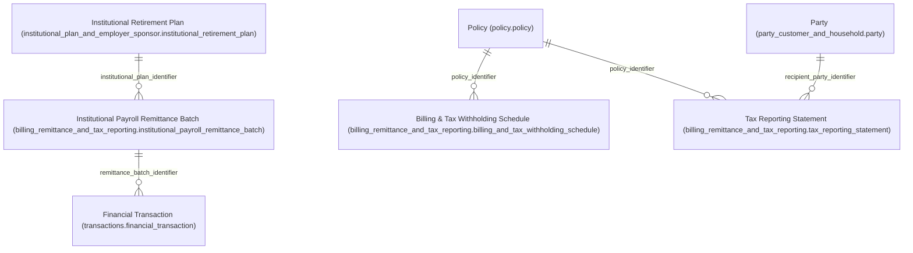

# L&A Ontology Knowledge Framework (OKF) -- Domain 15: Billing, Remittance & Tax Reporting (Payroll Batches, W-4P/R & IRS 1099-R/5498)

| OKF Metadata Attribute | Value |
| :--- | :--- |
| **OKF Catalog Document** | `L&A OKF/15 - OKF - Billing Remittance and Tax Reporting.MD` |
| **Enterprise Data Domain** | **Domain 15: Billing, Remittance & Tax Reporting (Payroll Batches, W-4P/R & IRS 1099-R/5498)** |
| **Target Physical Database Engine** | Amazon RDS Aurora PostgreSQL (PostgreSQL 15/16 Compatible) |
| **Physical Database Schema** | `billing_remittance_and_tax_reporting` |
| **Domain Table Count** | **3 Physical Tables / Logical Entities** |
| **Outbound Foreign Key Joins** | **4 Foreign Key Relationships** (Intra-Domain & Cross-Domain) |
| **Inbound Foreign Key Joins** | **10 Cross-Domain Referencing Relationships** |
| **Performance Indexes** | **4 B-Tree & Composite Indexes** |
| **Inherited Business Context Rules** | **`BC-273` through `BC-289` (17 Rules)** |
| **Source Knowledge Layer Artifacts** | `L&A - Ontology.MD`, `L&A Data Model - Logical.MD`, `L&A Data Model - Physical DDL.sql`, `L&A Data Model - Conceptual.MD` |

---

## 1. Domain Executive Ontology & Business Context Overview

The **Billing, Remittance & Tax Reporting** domain manages the operational cash collection rails for institutional employer payroll feeds and retail recurring premiums, alongside the statutory federal and state income tax withholding and annual IRS information reporting engine. In a hybrid institutional-and-retail L&A organization like Corebridge, Prudential, Empower, or Principal, premium inflows arrive through two vastly different mechanisms: high-volume institutional employer payroll remittance batches covering thousands of university or hospital employees simultaneously, and individual retail billing schedules (monthly EFT bank drafts, quarterly/annual bills, or flexible lump sums). At the other end of the lifecycle, every distribution, rollover, loan default, and annuity payment must be subjected to precise tax withholding and reported to the Internal Revenue Service and state revenue departments. This domain is structured across three core logical entities: `Institutional Payroll Remittance Batch`, `Billing & Tax Withholding Schedule`, and `Tax Reporting Statement`.

`Institutional Payroll Remittance Batch` (`Remittance Batch Identifier`, `Remittance Batch Number`) tracks the bi-weekly, semi-monthly, or monthly payroll contribution cycles submitted by an `Employer Sponsor Organization` for an `Institutional Plan Identifier`. Under Department of Labor (DOL) ERISA fiduciary rules, employee salary deferrals deducted from paychecks (`Payroll Pay Period End Date`) must be remitted to the carrier and invested as soon as reasonably possible. The entity reconciles the structured payroll data file (`Remittance File Received Date`) against the incoming cash wire or ACH settlement (`Wire or ACH Settlement Date`), breaking down batch totals across `Total Employee Pre-Tax Contribution Amount`, `Total Employee Roth After-Tax Amount`, `Total Employer Matching Contribution Amount`, `Total Employer Basic Contribution Amount`, and `Total Loan Repayment Amount`. Only when `Batch Reconciliation Status` reaches `Cash & Data Balanced - Posted to Participant Policies` are individual participant `Financial Transaction` rows released to buy units at the market close `Valuation Price Date` (otherwise held in `Out-of-Balance Suspense Exception`).

At the individual policy level, `Billing & Tax Withholding Schedule` (`Billing & Withholding Schedule Identifier`) governs recurring modal premium billing (`Billing Mode`, `Billed Modal Premium Amount`, `Next Bill Due Date`, and contractual `Grace Period Expiration Date`—typically 31 days for traditional life or 61 days for universal life before lapse) alongside standing tax withholding elections: `Federal Income Tax Withholding Election Type` (distinguishing IRS Form W-4P wage-table withholding for periodic annuity payments, IRS Form W-4R flat-rate withholding with a 10% default for non-periodic withdrawals, and mandatory 20% withholding on eligible rollover distributions paid directly to a participant), `Federal Withholding Percentage or Dollar Amount`, and `State Income Tax Withholding Percentage or Dollar Amount`. Finally, `Tax Reporting Statement` (`Tax Statement Identifier`, `Tax Year`, `Tax Form Type`) generates annual IRS filings—most notably **Form 1099-R** (`Gross Distribution Amount (Box 1)`, `Taxable Amount (Box 2a)`, `Taxable Amount Not Determined Indicator` Box 2b, `Federal Income Tax Withheld (Box 4)`, after-tax `Employee After-Tax Contributions or Cost Basis Recovered (Box 5)`, and `IRS Distribution Code (Box 7)` such as `7`, `1`, `2`, `4`, `G`, `6`, `L`, `Q`), **Form 5498** (`Rollover Contributions Amount`, `December 31 Fair Market Value`), **Form 1099-INT** (delayed claim settlement interest), and **Form 1042-S** (non-resident alien distributions).

---

## 2. Physical Schema & Logical Entity Architecture Catalog (Schema: `billing_remittance_and_tax_reporting`)

| # | Logical Entity Name | Physical Table Name (`schema.table`) | Primary Key Column (`PK`) | Business Cols | Audit Cols | Constraints (`PK`/`UQ`/`CHK`) | Logical Entity & Physical Table Definition |
| :--- | :--- | :--- | :--- | :--- | :--- | :--- | :--- |
| **15.1** | **Institutional Payroll Remittance Batch** | `billing_remittance_and_tax_reporting.institutional_payroll_remittance_batch` | `remittance_batch_identifier` | 12 | 2 | `pk_institutional_payroll_remittance_batch`, `uq_remittance_batch_number` | Institutional Payroll Remittance Batch entity tracks bulk payroll contribution files and wire/ACH cash remittances submitted by an Employer Sponsor for an Institutional Retirement Plan, reconciling employee pre-tax, Roth, employer match, and loan repayment totals before participant allocation. |
| **15.2** | **Billing & Tax Withholding Schedule** | `billing_remittance_and_tax_reporting.billing_and_tax_withholding_schedule` | `billing_and_withholding_schedule_identifier` | 9 | 2 | `pk_billing_and_tax_withholding_schedule` | Billing & Tax Withholding Schedule entity stores a policy's recurring premium billing frequency, EFT draft instructions, grace period dates, and standing Federal (W-4P/W-4R) and State income tax withholding elections for distributions. |
| **15.3** | **Tax Reporting Statement** | `billing_remittance_and_tax_reporting.tax_reporting_statement` | `tax_statement_identifier` | 14 | 2 | `pk_tax_reporting_statement` | Tax Reporting Statement entity stores annual regulatory tax forms issued to policyholders and filed with the IRS and state tax authorities (including Form 1099-R for distributions/annuity payments and Form 5498 for IRA contributions, rollovers, and year-end Fair Market Value). |

---

## 3. Relational Join Mining & Foreign Key Topology

### 3.1 Entity-Relationship & Foreign Key Join Diagram (Mermaid)



### 3.2 Outbound Foreign Key Join Matrix (Tables in `billing_remittance_and_tax_reporting` Referencing Parent Entities)

| FK Constraint Name | Child Table (`billing_remittance_and_tax_reporting`) | Child FK Column | Join Scope | Parent Referenced Table | Parent PK Column | Referential Action | Exact SQL Join Predicate |
| :--- | :--- | :--- | :--- | :--- | :--- | :--- | :--- |
| `fk_iprb_institutional_plan` | `billing_remittance_and_tax_reporting.institutional_payroll_remittance_batch` | `institutional_plan_identifier` | Cross-Domain (`institutional_plan_and_employer_sponsor`) | `institutional_plan_and_employer_sponsor.institutional_retirement_plan` | `institutional_plan_identifier` | `ON UPDATE CASCADE ON DELETE RESTRICT` | `billing_remittance_and_tax_reporting.institutional_payroll_remittance_batch.institutional_plan_identifier = institutional_plan_and_employer_sponsor.institutional_retirement_plan.institutional_plan_identifier` |
| `fk_btws_policy` | `billing_remittance_and_tax_reporting.billing_and_tax_withholding_schedule` | `policy_identifier` | Cross-Domain (`policy`) | `policy.policy` | `policy_identifier` | `ON UPDATE CASCADE ON DELETE CASCADE` | `billing_remittance_and_tax_reporting.billing_and_tax_withholding_schedule.policy_identifier = policy.policy.policy_identifier` |
| `fk_trs_policy` | `billing_remittance_and_tax_reporting.tax_reporting_statement` | `policy_identifier` | Cross-Domain (`policy`) | `policy.policy` | `policy_identifier` | `ON UPDATE CASCADE ON DELETE RESTRICT` | `billing_remittance_and_tax_reporting.tax_reporting_statement.policy_identifier = policy.policy.policy_identifier` |
| `fk_trs_recipient_party` | `billing_remittance_and_tax_reporting.tax_reporting_statement` | `recipient_party_identifier` | Cross-Domain (`party_customer_and_household`) | `party_customer_and_household.party` | `party_identifier` | `ON UPDATE CASCADE ON DELETE RESTRICT` | `billing_remittance_and_tax_reporting.tax_reporting_statement.recipient_party_identifier = party_customer_and_household.party.party_identifier` |

### 3.3 Inbound Cross-Domain Foreign Key Join Matrix (External Schemas Referencing `billing_remittance_and_tax_reporting`)

| FK Constraint Name | Referencing Child Schema | Referencing Child Table | Child FK Column | Referenced Target Table (`billing_remittance_and_tax_reporting`) | Target PK Column | Referential Action | Exact SQL Join Predicate |
| :--- | :--- | :--- | :--- | :--- | :--- | :--- | :--- |
| `fk_fin_tx_remittance_batch` | `transactions` | `transactions.financial_transaction` | `remittance_batch_identifier` | `billing_remittance_and_tax_reporting.institutional_payroll_remittance_batch` | `remittance_batch_identifier` | `ON UPDATE CASCADE ON DELETE SET NULL` | `transactions.financial_transaction.remittance_batch_identifier = billing_remittance_and_tax_reporting.institutional_payroll_remittance_batch.remittance_batch_identifier` |

---

## 4. Detailed Table-by-Table Schema, Column Dictionary & DDL Constraints

### 4.1 Logical Entity: `Institutional Payroll Remittance Batch` <-> Physical Table: `billing_remittance_and_tax_reporting.institutional_payroll_remittance_batch`

- **Business & Technical Purpose**: Institutional Payroll Remittance Batch entity tracks bulk payroll contribution files and wire/ACH cash remittances submitted by an Employer Sponsor for an Institutional Retirement Plan, reconciling employee pre-tax, Roth, employer match, and loan repayment totals before participant allocation.
- **PostgreSQL Catalog Comment**: _""_
- **Primary Key**: `remittance_batch_identifier`

#### Attribute-to-Column Schema Mapping & Business Dictionary

| Ord | Logical Attribute Name | Physical Column Name | Logical Type | Physical PostgreSQL Type | Key | Column Modifiers / Default | Business Definition, Domain Semantics & Sample Values |
| :--- | :--- | :--- | :--- | :--- | :--- | :--- | :--- |
| **1** | **Remittance Batch Identifier** | `remittance_batch_identifier` | String | `VARCHAR(64)` | **PK** | `NOT NULL` | Unique primary key identifying a payroll contribution file and cash settlement batch submitted by an institutional Employer Sponsor. Sample values: `RMB-20261015-HARV`, `RMB-20261015-SUNY`. |
| **2** | **Institutional Plan Identifier** | `institutional_plan_identifier` | String | `VARCHAR(64)` | **FK** | `NOT NULL` | Foreign key linking the payroll remittance batch to the target Institutional Retirement Plan. Sample values: `PLAN-403B-HARV-01`, `PLAN-401A-SUNY-02`. |
| **3** | **Remittance Batch Number** | `remittance_batch_number` | String | `VARCHAR(64)` | **NK** | `NOT NULL` | Business-facing transmission reference number used by the employer's payroll department and carrier institutional operations to track the payroll cycle file. Sample values: `PAY-HARV-2026-BW21`, `PAY-SUNY-2026-M10`. |
| **4** | **Payroll Pay Period End Date** | `payroll_pay_period_end_date` | Date | `DATE` | **NK** | `NOT NULL` | Ending calendar date of the employer's payroll cycle from which the employee salary deferrals were deducted (monitored under DOL ERISA timely remittance rules). Sample values: `2026-10-14`, `2026-10-15`. |
| **5** | **Remittance File Received Date** | `remittance_file_received_date` | Date | `DATE` | **NK** | `NOT NULL` | Date on which the structured payroll contribution data feed (e.g., SFTP/EDI 820 or Plan Sponsor Portal upload) was received by the carrier. Sample values: `2026-10-15`, `2026-10-16`. |
| **6** | **Wire or ACH Settlement Date** | `wire_or_ach_settlement_date` | Date | `DATE` | **NK** | `NULL` | Date on which the employer's aggregate cash wire or ACH debit settled in the carrier's institutional clearing bank account, enabling participant unit purchases. Sample values: `2026-10-15`, `2026-10-16`. |
| **7** | **Total Employee Pre-Tax Contribution Amount** | `total_employee_pre_tax_contribution_amount` | Decimal | `NUMERIC(18,2)` | **NK** | `NOT NULL DEFAULT 0.00` | Aggregate dollar sum of traditional pre-tax employee salary deferral contributions contained in the payroll batch. Sample values: `1845200.50`, `642100.00`. |
| **8** | **Total Employee Roth After-Tax Amount** | `total_employee_roth_after_tax_amount` | Decimal | `NUMERIC(18,2)` | **NK** | `NOT NULL DEFAULT 0.00` | Aggregate dollar sum of designated Roth 403(b)/401(k)/457(b) after-tax employee contributions contained in the payroll batch. Sample values: `412800.00`, `128400.00`. |
| **9** | **Total Employer Matching Contribution Amount** | `total_employer_matching_contribution_amount` | Decimal | `NUMERIC(18,2)` | **NK** | `NOT NULL DEFAULT 0.00` | Aggregate dollar sum of employer matching contributions funded in the payroll batch. Sample values: `1120400.25`, `385200.00`. |
| **10** | **Total Employer Basic Contribution Amount** | `total_employer_basic_contribution_amount` | Decimal | `NUMERIC(18,2)` | **NK** | `NOT NULL DEFAULT 0.00` | Aggregate dollar sum of non-elective employer base contributions funded in the payroll batch. Sample values: `2450000.00`, `890000.00`. |
| **11** | **Total Loan Repayment Amount** | `total_loan_repayment_amount` | Decimal | `NUMERIC(18,2)` | **NK** | `NOT NULL DEFAULT 0.00` | Aggregate dollar sum of participant payroll-deducted plan loan repayments included in the remittance batch. Sample values: `48250.75`, `19400.00`. |
| **12** | **Batch Reconciliation Status** | `batch_reconciliation_status` | String | `VARCHAR(120)` | **NK** | `NOT NULL` | Tracks whether the payroll data file detail totals match the settled cash wire amount and whether participant transactions have been posted. Sample values: `Cash & Data Balanced - Posted to Participant Policies`, `Data Received - Awaiting Wire Settlement`, `Out-of-Balance Suspense Exception`, `Partially Posted - NIGO Participant Records Held`. |
| **13** | **Record Created Timestamp (Audit)** | `created_at` | Timestamp | `TIMESTAMPTZ` | **AUDIT** | `NOT NULL DEFAULT CURRENT_TIMESTAMP` | System audit timestamp recording when the physical row was initially inserted into the Aurora PostgreSQL table. |
| **14** | **Record Updated Timestamp (Audit)** | `updated_at` | Timestamp | `TIMESTAMPTZ` | **AUDIT** | `NOT NULL DEFAULT CURRENT_TIMESTAMP` | System audit timestamp recording when the physical row was last modified in the Aurora PostgreSQL table. |

#### Declarative DDL Constraints & Indexes on `billing_remittance_and_tax_reporting.institutional_payroll_remittance_batch`

| Constraint / Index Category | Identifier Name | Definition / Target Columns & Referential Integrity Rule |
| :--- | :--- | :--- |
| **PRIMARY KEY** | `pk_institutional_payroll_remittance_batch` | `PRIMARY KEY (remittance_batch_identifier)` |
| **UNIQUE** | `uq_remittance_batch_number` | `UNIQUE (remittance_batch_number)` |
| **FOREIGN KEY** | `fk_iprb_institutional_plan` | `FOREIGN KEY (institutional_plan_identifier) REFERENCES institutional_plan_and_employer_sponsor.institutional_retirement_plan (institutional_plan_identifier) ON UPDATE CASCADE ON DELETE RESTRICT` |
| **B-TREE INDEX** | `idx_iprb_plan_pay_date` | `ON billing_remittance_and_tax_reporting.institutional_payroll_remittance_batch (institutional_plan_identifier, payroll_pay_period_end_date DESC)` |

### 4.2 Logical Entity: `Billing & Tax Withholding Schedule` <-> Physical Table: `billing_remittance_and_tax_reporting.billing_and_tax_withholding_schedule`

- **Business & Technical Purpose**: Billing & Tax Withholding Schedule entity stores a policy's recurring premium billing frequency, EFT draft instructions, grace period dates, and standing Federal (W-4P/W-4R) and State income tax withholding elections for distributions.
- **PostgreSQL Catalog Comment**: _""_
- **Primary Key**: `billing_and_withholding_schedule_identifier`

#### Attribute-to-Column Schema Mapping & Business Dictionary

| Ord | Logical Attribute Name | Physical Column Name | Logical Type | Physical PostgreSQL Type | Key | Column Modifiers / Default | Business Definition, Domain Semantics & Sample Values |
| :--- | :--- | :--- | :--- | :--- | :--- | :--- | :--- |
| **1** | **Billing & Withholding Schedule Identifier** | `billing_and_withholding_schedule_identifier` | String | `VARCHAR(64)` | **PK** | `NOT NULL` | Unique primary key identifying the active billing and tax withholding configuration for a Policy. Sample values: `BWS-44001`, `BWS-44002`. |
| **2** | **Policy Identifier** | `policy_identifier` | String | `VARCHAR(64)` | **FK** | `NOT NULL` | Foreign key linking the billing and tax withholding schedule to the parent Policy. Sample values: `POL-UUID-90001421`. |
| **3** | **Billing Mode** | `billing_mode` | String | `VARCHAR(100)` | **NK** | `NOT NULL` | Method and frequency by which recurring premiums are billed or drafted for the policy. Sample values: `Institutional Payroll Remittance`, `Monthly Automated EFT Bank Draft`, `Quarterly Direct Paper/E-Bill`, `Semi-Annual Bill`, `Annual Bill`, `Paid-Up / No Active Billing`. |
| **4** | **Billed Modal Premium Amount** | `billed_modal_premium_amount` | Decimal | `NUMERIC(18,2)` | **NK** | `NOT NULL DEFAULT 0.00` | Scheduled dollar amount billed or drafted via EFT on each recurring billing cycle date. Sample values: `250.00`, `1000.00`, `0.00` (Flexible / Payroll Driven). |
| **5** | **Next Bill Due Date** | `next_bill_due_date` | Date | `DATE` | **NK** | `NULL` | Next scheduled calendar date on which a recurring premium payment is due. Sample values: `2026-11-01`, `2027-01-15`, `Null`. |
| **6** | **Grace Period Expiration Date** | `grace_period_expiration_date` | Date | `DATE` | **NK** | `NULL` | Final calendar date (typically 31 days for traditional life or 61 days for universal life) to pay an overdue premium or cover monthly deductions before policy lapse. Sample values: `2026-12-02`, `Null (Policy Current)`. |
| **7** | **Federal Income Tax Withholding Election Type** | `federal_income_tax_withholding_election_type` | String | `VARCHAR(150)` | **NK** | `NOT NULL` | Specifies the IRS withholding form rule elected by the policyholder for distributions or annuity payments (IRS Form W-4P for periodic annuity payments vs. Form W-4R for non-periodic withdrawals). Sample values: `IRS Form W-4P Periodic Wage Withholding Table`, `IRS Form W-4R Non-Periodic Flat Percentage (10% Default)`, `Mandatory 20% Eligible Rollover Distribution Withholding`, `Elect Out of Federal Withholding (0% - Non-Rollover Only)`. |
| **8** | **Federal Withholding Percentage or Dollar Amount** | `federal_withholding_percentage_or_dollar_amount` | Decimal | `NUMERIC(18,4)` | **NK** | `NOT NULL DEFAULT 0.0000` | Specific flat percentage rate or additional dollar amount elected by the customer to be withheld for federal income tax on each distribution. Sample values: `0.1000` (10.00%), `0.2000` (20.00%), `0.2400` (24.00%), `0.0000`. |
| **9** | **State Income Tax Withholding Percentage or Dollar Amount** | `state_income_tax_withholding_pct_or_dollar_amount` | Decimal | `NUMERIC(18,4)` | **NK** | `NOT NULL DEFAULT 0.0000` | Specific percentage rate or dollar amount withheld for state income taxes based on the customer's Primary Residence State rules (mandatory vs. voluntary states). Sample values: `0.0500` (5.00% State Tax), `0.0685` (6.85%), `0.0000` (No State Income Tax - e.g., FL, TX). |
| **10** | **Record Created Timestamp (Audit)** | `created_at` | Timestamp | `TIMESTAMPTZ` | **AUDIT** | `NOT NULL DEFAULT CURRENT_TIMESTAMP` | System audit timestamp recording when the physical row was initially inserted into the Aurora PostgreSQL table. |
| **11** | **Record Updated Timestamp (Audit)** | `updated_at` | Timestamp | `TIMESTAMPTZ` | **AUDIT** | `NOT NULL DEFAULT CURRENT_TIMESTAMP` | System audit timestamp recording when the physical row was last modified in the Aurora PostgreSQL table. |

#### Declarative DDL Constraints & Indexes on `billing_remittance_and_tax_reporting.billing_and_tax_withholding_schedule`

| Constraint / Index Category | Identifier Name | Definition / Target Columns & Referential Integrity Rule |
| :--- | :--- | :--- |
| **PRIMARY KEY** | `pk_billing_and_tax_withholding_schedule` | `PRIMARY KEY (billing_and_withholding_schedule_identifier)` |
| **FOREIGN KEY** | `fk_btws_policy` | `FOREIGN KEY (policy_identifier) REFERENCES policy.policy (policy_identifier) ON UPDATE CASCADE ON DELETE CASCADE` |
| **B-TREE INDEX** | `idx_btws_policy_due_date` | `ON billing_remittance_and_tax_reporting.billing_and_tax_withholding_schedule (policy_identifier, next_bill_due_date)` |

### 4.3 Logical Entity: `Tax Reporting Statement` <-> Physical Table: `billing_remittance_and_tax_reporting.tax_reporting_statement`

- **Business & Technical Purpose**: Tax Reporting Statement entity stores annual regulatory tax forms issued to policyholders and filed with the IRS and state tax authorities (including Form 1099-R for distributions/annuity payments and Form 5498 for IRA contributions, rollovers, and year-end Fair Market Value).
- **PostgreSQL Catalog Comment**: _""_
- **Primary Key**: `tax_statement_identifier`

#### Attribute-to-Column Schema Mapping & Business Dictionary

| Ord | Logical Attribute Name | Physical Column Name | Logical Type | Physical PostgreSQL Type | Key | Column Modifiers / Default | Business Definition, Domain Semantics & Sample Values |
| :--- | :--- | :--- | :--- | :--- | :--- | :--- | :--- |
| **1** | **Tax Statement Identifier** | `tax_statement_identifier` | String | `VARCHAR(64)` | **PK** | `NOT NULL` | Unique primary key identifying an annual regulatory tax reporting statement generated for a Policy. Sample values: `TAX-2025-1099R-009481`, `TAX-2025-5498-001294`. |
| **2** | **Policy Identifier** | `policy_identifier` | String | `VARCHAR(64)` | **FK** | `NOT NULL` | Foreign key linking the annual tax statement to the Policy on which the distributions or contributions occurred. Sample values: `POL-UUID-90001421`. |
| **3** | **Recipient Party Identifier** | `recipient_party_identifier` | String | `VARCHAR(64)` | **FK** | `NOT NULL` | Foreign key referencing the taxpayer Party (Policy Owner, Annuitant, or Beneficiary) under whose SSN/TIN the form is reported to the IRS. Sample values: `PRTY-MDM-10004921`. |
| **4** | **Tax Year** | `tax_year` | Integer | `INTEGER` | **NK** | `NOT NULL` | Four-digit calendar tax year covered by the IRS information return. Sample values: `2024`, `2025`, `2026`. |
| **5** | **Tax Form Type** | `tax_form_type` | String | `VARCHAR(150)` | **NK** | `NOT NULL` | Official IRS tax form number generated by the tax reporting engine. Sample values: `IRS Form 1099-R (Distributions From Pensions, Annuities, Retirement Plans, IRAs, or Insurance Contracts)`, `IRS Form 5498 (IRA Contribution & Fair Market Value Information)`, `IRS Form 1099-INT (Delayed Claim Settlement Interest)`, `IRS Form 1042-S (Foreign Person's U.S. Source Income)`. |
| **6** | **Gross Distribution Amount (Box 1)** | `gross_distribution_amount_box_1` | Decimal | `NUMERIC(18,2)` | **NK** | `NOT NULL DEFAULT 0.00` | Total gross dollar amount distributed, surrendered, annuitized, or rolled over from the contract during the tax year (Form 1099-R Box 1). Sample values: `36000.00`, `18309.43`, `150000.00`, `0.00` (Form 5498 Only). |
| **7** | **Taxable Amount (Box 2a)** | `taxable_amount_box_2a` | Decimal | `NUMERIC(18,2)` | **NK** | `NOT NULL DEFAULT 0.00` | Portion of the Gross Distribution Amount that is includible in the recipient's federal taxable ordinary income after accounting for cost basis exclusion ratios or direct rollovers (Form 1099-R Box 2a). Sample values: `36000.00`, `28400.00`, `0.00` (Direct Rollover or Tax-Free 1035 Exchange). |
| **8** | **Taxable Amount Not Determined Indicator** | `taxable_amount_not_determined_indicator` | String | `VARCHAR(100)` | **NK** | `NOT NULL` | Indicates whether Box 2b ("Taxable amount not determined") is checked on Form 1099-R (common for traditional IRA withdrawals where the taxpayer tracks aggregate basis on Form 8606). Sample values: `False (Taxable Amount Calculated by Carrier)`, `True (Box 2b Checked - IRA Owner Calculates Basis)`. |
| **9** | **Federal Income Tax Withheld (Box 4)** | `federal_income_tax_withheld_box_4` | Decimal | `NUMERIC(18,2)` | **NK** | `NOT NULL DEFAULT 0.00` | Total federal income tax withheld and remitted to the IRS across all distributions on the contract during the tax year (Form 1099-R Box 4). Sample values: `3600.00`, `1830.94`, `0.00`. |
| **10** | **Employee After-Tax Contributions or Cost Basis Recovered (Box 5)** | `employee_after_tax_basis_recovered_box_5` | Decimal | `NUMERIC(18,2)` | **NK** | `NOT NULL DEFAULT 0.00` | Non-taxable portion of the distribution representing recovery of the policyholder's after-tax investment in the contract under the General Rule or Simplified Method exclusion ratio (Form 1099-R Box 5). Sample values: `0.00`, `7600.00`. |
| **11** | **IRS Distribution Code (Box 7)** | `irs_distribution_code_box_7` | String | `VARCHAR(50)` | **NK** | `NULL` | One- or two-character IRS code reported in Box 7 of Form 1099-R explaining the tax nature and penalty exceptions of the distribution. Sample values: `7` (Normal Distribution Age 59½+), `1` (Early Distribution, No Known Exception), `2` (Early Distribution, Exception Applies - e.g., Annuitization / Age 55 Separation), `4` (Death Benefit Distribution to Beneficiary), `G` (Direct Rollover to Qualified Plan or IRA), `6` (Tax-Free Section 1035 Exchange), `L` (Loan Treated as Deemed Distribution under Section 72(p)), `Q` (Qualified Roth Distribution). |
| **12** | **Rollover Contributions Amount** | `rollover_contributions_amount` | Decimal | `NUMERIC(18,2)` | **NK** | `NOT NULL DEFAULT 0.00` | Total dollar amount of incoming rollover contributions received into an IRA during the tax year (reported on Form 5498 Box 2). Sample values: `0.00`, `250000.00`. |
| **13** | **December 31 Fair Market Value** | `december_31_fair_market_value` | Decimal | `NUMERIC(18,2)` | **NK** | `NOT NULL DEFAULT 0.00` | Year-end fair market value of the IRA or qualified annuity reported on Form 5498 Box 5 to the IRS and taxpayer for RMD computation. Sample values: `485200.00`, `1120400.00`. |
| **14** | **Correction or Amended Filing Indicator** | `correction_or_amended_filing_indicator` | String | `VARCHAR(100)` | **NK** | `NOT NULL DEFAULT 'Original Tax Filing'` | Indicates whether this tax statement is the original January/May filing or a corrected `1099-R CORRECTED` / `5498 CORRECTED` statement re-issued after a retro-adjustment. Sample values: `Original Tax Filing`, `Corrected Tax Filing (Amended Box Values)`. |
| **15** | **Record Created Timestamp (Audit)** | `created_at` | Timestamp | `TIMESTAMPTZ` | **AUDIT** | `NOT NULL DEFAULT CURRENT_TIMESTAMP` | System audit timestamp recording when the physical row was initially inserted into the Aurora PostgreSQL table. |
| **16** | **Record Updated Timestamp (Audit)** | `updated_at` | Timestamp | `TIMESTAMPTZ` | **AUDIT** | `NOT NULL DEFAULT CURRENT_TIMESTAMP` | System audit timestamp recording when the physical row was last modified in the Aurora PostgreSQL table. |

#### Declarative DDL Constraints & Indexes on `billing_remittance_and_tax_reporting.tax_reporting_statement`

| Constraint / Index Category | Identifier Name | Definition / Target Columns & Referential Integrity Rule |
| :--- | :--- | :--- |
| **PRIMARY KEY** | `pk_tax_reporting_statement` | `PRIMARY KEY (tax_statement_identifier)` |
| **FOREIGN KEY** | `fk_trs_policy` | `FOREIGN KEY (policy_identifier) REFERENCES policy.policy (policy_identifier) ON UPDATE CASCADE ON DELETE RESTRICT` |
| **FOREIGN KEY** | `fk_trs_recipient_party` | `FOREIGN KEY (recipient_party_identifier) REFERENCES party_customer_and_household.party (party_identifier) ON UPDATE CASCADE ON DELETE RESTRICT` |
| **B-TREE INDEX** | `idx_trs_policy_tax_year` | `ON billing_remittance_and_tax_reporting.tax_reporting_statement (policy_identifier, tax_year DESC, tax_form_type)` |
| **B-TREE INDEX** | `idx_trs_recipient_tax_year` | `ON billing_remittance_and_tax_reporting.tax_reporting_statement (recipient_party_identifier, tax_year DESC)` |

---

## 5. Inherited Business Context Ontology Rules (`BC-273` to `BC-289`)

> **Semantic Inheritance Notice**: The following **17 Business Context rules** are inherited verbatim from `L&A Data Domain/L&A - Ontology.MD` to provide autonomous AI agents, data engineers, and actuaries with complete domain rules, accounting identities, statutory compliance mandates, and SQL join guardrails for the **Billing, Remittance & Tax Reporting** domain.

#### BC-273: Institutional Payroll Remittance Batch Reconciliation: Wire Settlement vs. File Detail (`SPARK` / `EDI 820`)

**Domains**: Billing, Remittance & Tax Reporting, Institutional Plan & Employer Sponsor, Transactions | **Entities**: Institutional Payroll Remittance Batch, Institutional Retirement Plan, Employer Sponsor Organization, Financial Transaction | **Key Attributes**: Remittance Batch Identifier, Institutional Plan Identifier, Total Batch Remittance Amount, Expected Participant Detail Count, Remittance File Format, Batch Reconciliation Status

In institutional retirement plan recordkeeping (the carrier's core `403(b)`, `401(a)`, and `457(b)` business), contributions do not arrive as individual retail checks; instead, university, hospital, and research institute payroll systems (`Workday`, `PeopleSoft`, `ADP`, `Banner`) transmit biweekly or monthly `Institutional Payroll Remittance Batch` files (`Remittance File Format` in `'SPARK Standard Layout'`, `'ASC X12 EDI 820 Payroll Remittance'`, or `'Workday / PeopleSoft Payroll API XML'`) paired with an aggregated bank wire or ACH credit (`Total Batch Remittance Amount`). Before the carrier can split the batch into individual participant `Financial Transaction` rows (`Transaction Type = 'Scheduled Premium / Payroll Contribution'`) and purchase `Investment Fund` units, the remittance engine must reconcile two independent dimensions:

1. **Cash-to-File Header Reconciliation**: The exact dollar amount received on the Fedwire / ACH NACHA bank settlement (`Settlement Wire Reference Number`) must equal the sum of `Employee Pre-Tax Deferral Total Amount` + `Employee Roth After-Tax Total Amount` + `Employer Match and Non-Elective Total Amount` across all `Expected Participant Detail Count` rows in the payroll file.
2. **Participant & Eligibility Validation**: Every SSN (`Party`), `Policy Identifier`, and contribution source code in the file must map to an enrolled or auto-enrolled participant under `Institutional Plan Identifier` without violating `IRC Annual Elective Deferral Limit Amount` or `IRC 415(c) Total Annual Additions Limit Amount`.

Only when cash and file totals match to the penny does `Batch Reconciliation Status` advance to `'Balanced & Posted to Participant Contracts'`. If the wire is short/over (`'Out-of-Balance Variance Hold'`) or the file arrives before the wire (`'File Received - Awaiting Wire Settlement'`), participant posting is held in plan-level suspense (`'Partial Posting with NIGO Suspense Exception'`). AI agents building institutional plan operations dashboards must monitor `Batch Reconciliation Status` and cycle time from `Payroll Period End Date` to `Remittance Received Date`.

#### BC-274: Three-Bucket Contribution Source Accounting: Employee Pre-Tax vs. Designated Roth vs. Employer Match & Non-Elective

**Domains**: Billing, Remittance & Tax Reporting, Institutional Plan & Employer Sponsor, Policy, Transactions | **Entities**: Institutional Payroll Remittance Batch, Plan Contribution & Vesting Rule, Policy, Financial Transaction | **Key Attributes**: Employee Pre-Tax Deferral Total Amount, Employee Roth After-Tax Total Amount, Employer Match and Non-Elective Total Amount, Contribution Source Type, Cumulative Net Premiums Paid (Cost Basis)

Every `Institutional Payroll Remittance Batch` decomposes `Total Batch Remittance Amount` into three legally and tax-distinct money source buckets that must be tracked separately throughout the entire lifecycle of each participant's `Policy`:
$$\text{Total Batch Remittance Amount} = \text{Employee Pre-Tax Deferral Total Amount} + \text{Employee Roth After-Tax Total Amount} + \text{Employer Match and Non-Elective Total Amount}$$
First, `Employee Pre-Tax Deferral Total Amount` (`IRC Section 402(g)` elective deferrals and `IRC Section 414(h)(2)` mandatory salary pick-ups) reduces the employee's current W-2 taxable wages, has `$0.00` tax cost basis (`Cumulative Net Premiums Paid (Cost Basis) = $0.00`), is always **100% immediately vested** (`Plan Contribution & Vesting Rule`), and is 100% taxable as ordinary income upon distribution (`Tax Reporting Statement`). Second, `Employee Roth After-Tax Total Amount` (`IRC Section 402A` designated Roth contributions) is deducted from payroll *after* income taxes are paid, establishing positive after-tax cost basis (`Cumulative Net Premiums Paid (Cost Basis)`), is 100% immediately vested, and generates **100% tax-free** distributions of both principal and earnings once the participant satisfies the 5-tax-year Roth aging clock and reaches age 59½ (or dies/becomes disabled). Third, `Employer Match and Non-Elective Total Amount` is funded by the `Employer Sponsor Organization` on a pre-tax basis (`$0.00` cost basis), is subject to the plan's vesting schedule (`Plan Contribution & Vesting Rule`.`Vesting Schedule Type` such as 3-year cliff or 6-year graded vesting), and is frequently subject to stricter withdrawal or transfer restrictions (`Retirement Annuity` vs. `Supplemental Retirement Annuity`). AI agents must never commingle Pre-Tax, Roth, and Employer money sources when calculating vested balances, loan maximums, or taxable distributions.

#### BC-275: DOL ERISA Timely Remittance Safe Harbor and Delayed Payroll Contribution Lost-Earnings Makeup Rules

**Domains**: Billing, Remittance & Tax Reporting, Institutional Plan & Employer Sponsor | **Entities**: Institutional Payroll Remittance Batch, Institutional Retirement Plan, Employer Sponsor Organization | **Key Attributes**: Remittance Batch Identifier, Payroll Period End Date, Remittance Received Date, ERISA Regulatory Framework, Batch Reconciliation Status

For institutional retirement plans governed by ERISA (`Institutional Retirement Plan`.`ERISA Regulatory Framework = 'ERISA Title I Fully Governed Plan'`, such as private university `403(b)` and `401(k)` plans), the US Department of Labor (`DOL`) enforces strict fiduciary rules under **29 CFR § 2510.3-102** governing how quickly an `Employer Sponsor Organization` must remit employee payroll deductions (`Employee Pre-Tax Deferral Total Amount` and `Employee Roth After-Tax Total Amount`) to the carrier. Specifically, employee elective deferrals become ERISA plan assets as of the earliest date they can reasonably be segregated from the employer's general corporate assets, and in no event later than the **15th business day of the month following the month in which the amounts were withheld from payroll** (with large plans generally expected to remit within 1 to 3 business days after `Payroll Period End Date`). In the data model, the lag between `Payroll Period End Date` and `Remittance Received Date` on `Institutional Payroll Remittance Batch` measures employer remittance timeliness. Furthermore, once the carrier receives both the wire and an In-Good-Order (`IGO`) payroll file (`Batch Reconciliation Status = 'Balanced & Posted to Participant Contracts'`), SEC Rule 22c-1 requires the carrier to price participant `Financial Transaction` rows at that day's `Fund Daily Valuation & Price`.`Valuation Date`. If an ERISA employer remits a batch late (`Remittance Received Date` significantly past `Payroll Period End Date`), the employer must fund a "Lost Earnings" makeup contribution (calculated using the DOL Voluntary Fiduciary Correction Program [`VFCP`] calculator) and report the delinquent remittance on IRS/DOL **Form 5500 Schedule H**. AI agents building Plan Sponsor Fiduciary Compliance dashboards should flag any ERISA `Institutional Payroll Remittance Batch` where `Remittance Received Date - Payroll Period End Date > 5 business days`.

#### BC-276: Individual Retail Modal Billing Schedules, Modal Fractional Factors, and EFT Auto-Draft vs. Direct Bill

**Domains**: Billing, Remittance & Tax Reporting, Policy, Transactions | **Entities**: Billing & Tax Withholding Schedule, Policy, Financial Transaction | **Key Attributes**: Billing Schedule Identifier, Policy Identifier, Billing Mode and Frequency, Payment Collection Method, Scheduled Modal Billing Amount, Billing Schedule Status

For retail Life Insurance (`Term Life`, `Whole Life`, `Universal Life`) and Flexible Premium Deferred Annuities not funded through employer payroll (`Payment Collection Method != 'Institutional Employer Payroll Deduction'`), premium collection and systematic payout withholding are orchestrated by `Billing & Tax Withholding Schedule`. On the inflow side, a policyholder selects a `Billing Mode and Frequency` (`'Monthly'`, `'Quarterly'`, `'Semi-Annual'`, `'Annual'`, or `'Single Sum / Ad-Hoc Only'`) and a `Payment Collection Method` (`'Automated Bank ACH / EFT Draft'`, `'Direct Paper / Electronic Invoice'`, or `'Government Allotment'`). In traditional `Term Life` and `Whole Life` pricing, if a policyholder elects to pay more frequently than `'Annual'`, the carrier applies a **Modal Fractional Factor** (for example, `0.085` to `0.0875` per month for `'Monthly'` EFT, or `0.26` per quarter for `'Quarterly'` direct bill) to compensate the carrier for lost investment interest during the policy year and administrative billing costs; many carriers waive or reduce this modal load if the customer enrolls in `'Automated Bank ACH / EFT Draft'`. When a life insurance policy enters a `'Waiver of Premium Disability Claim'` (`Claim & Benefit Settlement`) or becomes `'Paid-Up'` (`Policy Status = 'Paid-Up'`), `Billing & Tax Withholding Schedule`.`Billing Schedule Status` must immediately transition to `'Premium Waived (Disability Waiver Rider Active)'` or `'Suspended / Paid-Up'` so the billing engine halts bank ACH drafts and invoice generation. AI agents building persistency and lapse-prediction models should always include `Billing Mode and Frequency` and `Payment Collection Method`, as `'Automated Bank ACH / EFT Draft'` exhibits 40%–60% lower accidental lapse rates than `'Direct Paper / Electronic Invoice'`.

#### BC-277: Grace Period Mechanics (`31-Day` vs. `61-Day` UL No-Lapse), Statutory Lapse Notices, and Secondary Addressee Protection

**Domains**: Billing, Remittance & Tax Reporting, Policy, Party, Customer & Household | **Entities**: Billing & Tax Withholding Schedule, Policy, Policy Party Role, Party | **Key Attributes**: Billing Schedule Identifier, Next Billing or Payout Date, Billing Schedule Status, Policy Status, Cash Surrender Value, Role Type

When a retail Life Insurance policyholder misses a `Scheduled Modal Billing Amount` due on `Next Billing or Payout Date` (or when an ACH draft returns NSF), the policy does **not** terminate on the due date; instead, state insurance law mandates a contractual **Grace Period**:

- **Traditional** `Term Life` **and** `Whole Life`: Provide a **31-day Grace Period** following `Next Billing or Payout Date` during which `Billing Schedule Status` transitions to `'In Grace Period - Past Due Notice Sent'` while `Policy`.`Policy Status` remains `'Active in Accumulation'` (`'Active'`) with full death benefit protection. If the insured dies during the 31-day Grace Period, the carrier must pay the full `Face Amount` on `Claim & Benefit Settlement`, deducting only the single overdue modal premium!
- `Universal Life`**,** `Indexed Universal Life`**, and** `Variable Universal Life`: Do not lapse merely because a planned modal premium is skipped, so long as `Cash Surrender Value` (net of `Outstanding Loan Balance`) is sufficient to cover the `Monthly Cost of Insurance (COI) Deduction` on the monthly processing date, OR so long as a `Secondary No-Lapse Guarantee (NLG)` rider (`Policy Rider Coverage`) is satisfied. Only when net `Cash Surrender Value` drops below the monthly COI deduction (and NLG is inactive) does the policy enter a **61-day UL Grace Period**.
Furthermore, under senior-protection statutes across US states, before a life insurance policy (especially on an insured aged 64+) can transition to `Policy Status = 'Lapsed'`, the carrier must send a formal Past-Due / Pending Lapse Notice not only to the `Policy Owner`, but also to any designated **Secondary Addressee / Third-Party Designee** recorded in `Policy Party Role` (`30 days` prior to lapse termination). AI agents building conservation/retention workflows must join `Billing & Tax Withholding Schedule` (`Billing Schedule Status = 'In Grace Period - Past Due Notice Sent'`) with `Policy` and `Producer / Advisor` to trigger urgent conservation outreach before the grace period expires.

#### BC-278: Automatic Premium Loan (`APL`) Non-Forfeiture Protection on Whole Life Policies

**Domains**: Billing, Remittance & Tax Reporting, Policy, Transactions | **Entities**: Billing & Tax Withholding Schedule, Policy, Financial Transaction | **Key Attributes**: Billing Schedule Identifier, Scheduled Modal Billing Amount, Billing Schedule Status, Total Account Value, Cash Surrender Value, Outstanding Loan Balance, Policy Status

On cash-value `Whole Life` policies (`Product Category = 'Whole Life'`), policyholders can elect an **Automatic Premium Loan (**`APL`**)** provision at application or via endorsement. If a scheduled modal premium (`Scheduled Modal Billing Amount` on `Billing & Tax Withholding Schedule`) remains unpaid at the end of the 31-day Grace Period (`Billing Schedule Status = 'In Grace Period - Past Due Notice Sent'`), and the policy has sufficient positive net `Cash Surrender Value` (`Cash Surrender Value >= Scheduled Modal Billing Amount`), the carrier does **not** lapse the policy or convert it to Reduced Paid-Up insurance. Instead, on the final day of the grace period, the carrier automatically executes a `Financial Transaction` of `Transaction Type = 'Policy Loan Disbursement'` (internal APL transfer) paired with a `'Scheduled Premium / Payroll Contribution'` transaction for `Scheduled Modal Billing Amount`. This increases `Policy`.`Outstanding Loan Balance` by the overdue premium amount, reduces net `Cash Surrender Value` accordingly, resets `Billing Schedule Status` to `'Active'`, advances `Next Billing or Payout Date` to the next modal cycle, and preserves `Policy`.`Policy Status = 'Active in Accumulation'` along with 100% of the base `Face Amount` and attached `Policy Rider Coverage`! However, if repeated unpaid premiums cause `Outstanding Loan Balance` plus accrued loan interest to exhaust `Total Account Value`, the APL provision can no longer fire and the policy enters final lapse notice. AI agents analyzing `Policy Loan Disbursement` transactions or rising `Outstanding Loan Balance` must distinguish intentional customer cash loans from protective Automatic Premium Loans (`APL`) triggered by `Billing & Tax Withholding Schedule`.

#### BC-279: Federal Income Tax Withholding Elections (`Form W-4P` for Periodic Annuity Payouts vs. `Form W-4R` for Non-Periodic Distributions)

**Domains**: Billing, Remittance & Tax Reporting, Claims, Annuitization & Benefit Payouts, Transactions | **Entities**: Billing & Tax Withholding Schedule, Annuitization Payout Schedule, Financial Transaction | **Key Attributes**: Billing Schedule Identifier, Policy Identifier, Federal Income Tax Withholding Election Rate, State Income Tax Withholding Election Rate, Tax Withholding Form Type, Federal Tax Withheld Amount

Beginning January 1, 2023, the IRS split federal income tax withholding certificates for pensions, annuities, and retirement distributions into two mandatory distinct forms tracked in `Billing & Tax Withholding Schedule`.`Tax Withholding Form Type`:

1. `'IRS Form W-4P (Withholding Certificate for Periodic Pension or Annuity Payments)'`: Applies exclusively to **periodic payments** payable over a period of more than one year, such as monthly or quarterly lifetime annuity checks under `Annuitization Payout Schedule` or systematic multi-year installment payouts. On `Form W-4P`, withholding is calculated like wage withholding based on the recipient's marital filing status, multiple-jobs adjustments, and dependents, with a default setting (if no W-4P is submitted) of **Single with no adjustments** (unless the payee elects out of withholding on non-eligible periodic payments).
2. `'IRS Form W-4R (Withholding Certificate for Nonperiodic Payments and Eligible Rollover Distributions)'`: Applies to **non-periodic distributions**—including single-sum surrenders, ad-hoc partial withdrawals, RMD lump sums (`Required Minimum Distribution Schedule`), and systematic `GLWB` withdrawals that are eligible rollover distributions or on-demand withdrawals. Under IRC Section 3405 and `Form W-4R` rules:
  - For an **Eligible Rollover Distribution** (`ERD`) from a qualified plan (`403(b)`, `401(a)`, `401(k)`, Governmental `457(b)`) paid directly to the participant rather than rolled over directly to another plan/IRA, the carrier is statutorily required to withhold a mandatory `20.00%` **floor** (`Federal Income Tax Withholding Election Rate >= 20.00%`)—the participant may elect *more* than 20% on Form W-4R, but is legally prohibited from electing less than 20%!
  - For a **Non-Periodic Distribution that is NOT an Eligible Rollover Distribution** (such as an IRA withdrawal, an RMD distribution, or a non-qualified annuity partial withdrawal), the default `Federal Income Tax Withholding Election Rate` is `10.00%`, and the customer can elect any rate from `0.00%` to `100.00%` on Form W-4R.

AI agents validating `Financial Transaction`.`Federal Tax Withheld Amount` must match the transaction type and `Policy`.`Tax Qualification Status` against `Billing & Tax Withholding Schedule`.`Tax Withholding Form Type` and `Federal Income Tax Withholding Election Rate`.

#### BC-280: IRS Form 1099-R Box-by-Box Reconciliation (`Box 1` Gross, `Box 2a` Taxable, `Box 4` Federal Tax, `Box 5` Basis Recovery, `Box 7` Code)

**Domains**: Billing, Remittance & Tax Reporting, Transactions, Policy | **Entities**: Tax Reporting Statement, Financial Transaction, Policy | **Key Attributes**: Tax Statement Identifier, Policy Identifier, Tax Year, IRS Tax Form Type, Gross Distribution or Contribution Amount (Box 1), Taxable Amount (Box 2a), Employee Basis or Net Investment Recovered Amount (Box 5), Federal Income Tax Withheld Total Amount (Box 4), IRS Distribution Code (Box 7)

Whenever a `Policy` experiences one or more reportable outflow or conversion events during a calendar `Tax Year` (totalling `$10.00` or more), the carrier generates an annual `Tax Reporting Statement` with `IRS Tax Form Type = 'IRS Form 1099-R (Distributions From Pensions, Annuities, Retirement or Profit-Sharing Plans, IRAs, Insurance Contracts)'`. For AI agents building tax reconciliation, audit, or customer tax-center explanation tools, the attributes on `Tax Reporting Statement` must reconcile directly to the underlying `Financial Transaction` rows (`Transaction Effective Date` within `Tax Year` and `Transaction Status = 'Posted'`) and satisfy the IRS Form 1099-R accounting identity:
$$\text{Gross Distribution (Box 1)} = \text{Taxable Amount (Box 2a)} + \text{Employee Basis / Net Investment Recovered (Box 5)}$$
Specifically:

- `Gross Distribution or Contribution Amount (Box 1)` equals the sum of `Gross Transaction Amount` across all reportable distribution transactions (`Partial Surrender / Withdrawal`, `Full Contract Surrender`, `Required Minimum Distribution (RMD) Withdrawal`, `GLWB / GMIB Guaranteed Lifetime Income Payment`, `Annuitization Payout`, `IRC 1035 Tax-Free Exchange Out`, `Direct Rollover Out`, and defaulted loan `Deemed Distribution`).
- `Taxable Amount (Box 2a)` equals the sum of `Taxable Gain Amount` across those transactions.
- `Employee Basis or Net Investment Recovered Amount (Box 5)` equals `Box 1 - Box 2a`—the portion of the distribution representing a tax-free return of the customer's after-tax investment (`Cumulative Net Premiums Paid (Cost Basis)`), or `$0.00` for 100% pre-tax contracts, or `Box 1` for a tax-free `'IRC 1035 Tax-Free Exchange Out'` (`Box 2a = $0.00`, `Box 7 = '6'`) or `'Direct Rollover Out'` (`Box 2a = $0.00`, `Box 7 = 'G'`).
- `Federal Income Tax Withheld Total Amount (Box 4)` and `State Income Tax Withheld Total Amount (Box 14)` equal the exact sum of `Federal Tax Withheld Amount` and `State Tax Withheld Amount` remitted to the IRS and state revenue authorities.

#### BC-281: IRS Form 1099-R Box 7 Distribution Code Semantics (`1`, `2`, `3`, `4`, `6`, `7`, `D`, `G`, `L`, `Q`) and Separate Statement Rules

**Domains**: Billing, Remittance & Tax Reporting, Party, Customer & Household, Policy, Transactions | **Entities**: Tax Reporting Statement, Party, Policy, Financial Transaction | **Key Attributes**: Tax Statement Identifier, IRS Distribution Code (Box 7), Date of Birth, Tax Qualification Status, Transaction Type, Gross Distribution or Contribution Amount (Box 1)

On `Tax Reporting Statement` (`IRS Form 1099-R`), the `IRS Distribution Code (Box 7)` attribute tells the IRS automated matching system whether a distribution is taxable, tax-free, or subject to the **10% early withdrawal penalty tax** under IRC Section 72(t) (for qualified plans/IRAs) or IRC Section 72(q) (for non-qualified annuities). Furthermore, if a customer executes multiple distributions with *different* `IRS Distribution Code (Box 7)` values in the same `Tax Year` (for example, a partial rollover `'G'` in March and a normal cash distribution `'7'` in October), the carrier must issue **separate** `Tax Reporting Statement` **rows** for each distinct `IRS Distribution Code (Box 7)`! AI agents must understand the ten primary L&A Box 7 codes:

- `'1 - Early Distribution, No Known Exception (Under Age 59.5)'`: Recipient is under age 59½ (`Party`.`Date of Birth`), distribution is taxable and subject to the 10% early withdrawal penalty (unless the taxpayer claims an exception on Form 5329).
- `'2 - Early Distribution, Exception Applies (Under Age 59.5)'`: Recipient is under age 59½, but a statutory penalty exception applies—such as Separation from Service in or after the year turning age 55 on a `403(b)`/`401(a)` plan, or Substantially Equal Periodic Payments (`SEPP` / 72(t)) or life annuitization (`Annuitization Payout Schedule`).
- `'3 - Disability Distribution'`: Paid due to permanent and total disability under IRC § 72(m)(7).
- `'4 - Death Distribution to Beneficiary'`: Paid to a beneficiary (`Beneficiary Claim Payout Election`) following the death of the owner/participant; always exempt from the 10% early penalty regardless of age.
- `'6 - Tax-Free Section 1035 Exchange'`: Direct carrier-to-carrier exchange of a life or annuity contract under IRC § 1035 (`Taxable Amount (Box 2a) = $0.00`).
- `'7 - Normal Distribution (Age 59.5 or Older)'`: Standard taxable distribution after attaining age 59½ (`Box 7 = '7D'` when paired with `'D - Non-Qualified Annuity Distribution Subject to NIIT'`).
- `'G - Direct Rollover to Qualified Plan or IRA'`: Trustee-to-trustee rollover (`Taxable Amount (Box 2a) = $0.00`).
- `'L - Policy Loan Treated as Deemed Distribution (IRC 72(p))'`: Defaulted plan loan or loan exceeding the $50,000 / 50% IRC § 72(p) limit.
- `'Q - Qualified Roth Distribution (Tax-Free)'`: Distribution from a `Roth IRA` or Roth `403(b)`/`401(k)` after both age 59½ and the 5-year aging rule (`Taxable Amount (Box 2a) = $0.00`).

#### BC-282: Non-Qualified Annuity Taxation: LIFO Earnings-First Withdrawals (`IRC Section 72(e)`) vs. Exclusion Ratio Annuitization (`IRC Section 72(b)`)

**Domains**: Billing, Remittance & Tax Reporting, Policy, Transactions, Claims, Annuitization & Benefit Payouts | **Entities**: Policy, Financial Transaction, Annuitization Payout Schedule, Tax Reporting Statement | **Key Attributes**: Tax Qualification Status, Total Account Value, Cumulative Net Premiums Paid (Cost Basis), Gross Transaction Amount, Taxable Gain Amount, Taxable Exclusion Ratio Percentage

For a `Non-Qualified` annuity contract (`Policy`.`Tax Qualification Status = 'Non-Qualified'`) purchased with after-tax savings (`Cumulative Net Premiums Paid (Cost Basis) > $0.00`), the Internal Revenue Code applies two radically different tax calculation formulas depending on whether the contract is in **accumulation** or **annuitization**:

1. **Unannuitized Withdrawals — LIFO "Income-First" Rule (**`IRC Section 72(e)(2)(B)`**)**: For any partial withdrawal, systematic `GLWB` withdrawal, or policy loan taken *before* formal annuitization on a post-August 13, 1982 contract, earnings come out **first** (`Last-In, First-Out` / `LIFO`). Specifically, as long as `Total Account Value > Cumulative Net Premiums Paid (Cost Basis)`, 100% of every dollar withdrawn up to the untaxed gain (`Total Account Value - Cumulative Net Premiums Paid (Cost Basis)`) is fully taxable ordinary income (`Financial Transaction`.`Taxable Gain Amount = Gross Transaction Amount`, and `Cumulative Net Premiums Paid (Cost Basis)` does not decrease!). Only after 100% of contract earnings have been withdrawn and taxed do subsequent withdrawals begin recovering tax-free cost basis (`Box 5`). (Additionally, under the IRC § 72(e)(12) **Aggregation Rule**, all non-qualified annuities issued by the same carrier to the same `Policy Owner` in the same calendar year must be combined when computing LIFO taxable gain).
2. **Formal Annuitization Payouts — Exclusion Ratio Rule (**`IRC Section 72(b)`**)**: By contrast, when the owner formally annuitizes the contract into an `Annuitization Payout Schedule`, each periodic payment receives blended tax treatment via `Taxable Exclusion Ratio Percentage`:

$$\text{Exclusion Ratio} = \frac{\text{Investment in the Contract (Cost Basis)}}{\text{Expected Return (Periodic Payment} \times \text{IRS Life Expectancy Multiple)}}$$
Each periodic payment is tax-free return of basis up to `Exclusion Ratio`, and taxable above it, until the annuitant outlives their IRS life expectancy table and has recovered 100% of `Cumulative Net Premiums Paid (Cost Basis)`, after which 100% of future payments are taxable!

#### BC-283: Modified Endowment Contract (`MEC`) Testing (`IRC Section 7702A` 7-Pay Test) and Life Insurance Loan/Withdrawal Tax Inversion

**Domains**: Billing, Remittance & Tax Reporting, Policy, Transactions | **Entities**: Policy, Financial Transaction, Tax Reporting Statement | **Key Attributes**: Policy Identifier, Product Category, Total Account Value, Cumulative Net Premiums Paid (Cost Basis), Outstanding Loan Balance, Taxable Gain Amount, IRS Distribution Code (Box 7)

Under standard US tax law (`IRC Section 72(e)(5)`), a permanent Life Insurance policy (`Whole Life`, `Universal Life`, `Indexed Universal Life`, `Variable Universal Life`) enjoys **FIFO ("Basis-First")** taxation during the insured's lifetime: partial withdrawals recover `Cumulative Net Premiums Paid (Cost Basis)` tax-free first (`Taxable Gain Amount = $0.00` until withdrawals exceed total premiums paid), and policy loans (`Transaction Type = 'Policy Loan Disbursement'`) are treated as non-taxable debt advances rather than distributions! However, under the Technical and Miscellaneous Revenue Act of 1988 (`TAMRA`, **IRC Section 7702A**), if a policyholder over-funds a life insurance policy too rapidly so that cumulative premiums paid during the first 7 policy years (or within 7 years after a material benefit change) exceed the **7-Pay Test** cumulative net level premium limit, the policy permanently becomes a **Modified Endowment Contract (**`MEC`**)**. Once a life policy becomes a `MEC` (note: its death benefit under IRC § 101(a) remains 100% income-tax-free to beneficiaries), its living distribution tax rules invert from FIFO life insurance treatment to **LIFO annuity treatment**:

1. Partial withdrawals are taxed **LIFO (earnings-first)** up to `Total Account Value - Cumulative Net Premiums Paid (Cost Basis)`.
2. **Policy Loans (**`Policy Loan Disbursement`**) and Automatic Premium Loans (**`APL`**) are taxed as distributions** up to the untaxed gain in the policy!
3. Any taxable withdrawal or loan taken from a `MEC` prior to age 59½ is subject to the **10% early withdrawal penalty** on `Tax Reporting Statement` (`IRS Form 1099-R`).

AI agents building life insurance cash-access or loan recommendation engines must always check whether a permanent life policy is a `MEC` (or would violate the 7-Pay limit upon an unscheduled dump-in premium) before advising a client that a policy loan or withdrawal will be tax-free.

#### BC-284: Policy Loan Default, Lapse with an Outstanding Loan ("Phantom Income"), and IRC Section 72(p) Qualified Plan Loan Limits

**Domains**: Billing, Remittance & Tax Reporting, Policy, Transactions | **Entities**: Policy, Financial Transaction, Tax Reporting Statement | **Key Attributes**: Policy Identifier, Tax Qualification Status, Total Account Value, Cash Surrender Value, Outstanding Loan Balance, Cumulative Net Premiums Paid (Cost Basis), IRS Distribution Code (Box 7)

One of the most severe tax traps in Life and Annuity administration—and a critical domain rule for AI agents—occurs when a policy with an `Outstanding Loan Balance` lapses, is surrendered, or defaults on loan repayments under two distinct scenarios:

1. **Retail Life Insurance Lapse/Surrender with an Outstanding Loan ("Phantom Income")**: Suppose a customer owns a non-MEC `Whole Life` or `Universal Life` policy with `Cumulative Net Premiums Paid (Cost Basis) = $100,000`, `Total Account Value = $180,000`, and has borrowed `Outstanding Loan Balance = $175,000` (leaving `Cash Surrender Value = $5,000`). While the policy stays in force (`Policy Status = 'Active in Accumulation'`), the `$175,000` loan is completely untaxed. However, if the policyholder stops paying premiums/interest and allows the policy to **Lapse** (`Policy Status = 'Lapsed'`) or surrenders it, the carrier extinguishes the `$175,000` `Outstanding Loan Balance` against the `$180,000` `Total Account Value`. For IRS tax purposes, loan extinguishment at lapse/surrender is treated as a cash distribution! Thus, on `Tax Reporting Statement` (`IRS Form 1099-R`), `Gross Distribution (Box 1)` is `$180,000`, and `Taxable Amount (Box 2a)` is `$180,000 - $100,000 = $80,000` of taxable ordinary income—even though the policyholder receives at most `$5,000` in cash!
2. **Qualified Plan (**`403(b)` **/** `401(a)` **/** `401(k)`**) Loan Limits and Deemed Distributions (**`IRC Section 72(p)`**)**: For employer retirement plans that permit participant loans (`Plan Contribution & Vesting Rule`.`Plan Loan Allowed Indicator = 'True'`), IRC Section 72(p) caps the maximum loan at the lesser of **$50,000** (reduced by the highest outstanding loan balance in the prior 12 months) or **50% of the vested account balance**, repayable via level amortization over 5 years (longer for a primary residence). If a participant fails to make scheduled loan repayments on `Billing & Tax Withholding Schedule` past the end of the calendar quarter following the quarter of the missed payment (the statutory cure period), the unpaid `Outstanding Loan Balance` plus accrued interest triggers a `Tax Reporting Statement` (`IRS Form 1099-R`) with `IRS Distribution Code (Box 7) = 'L - Policy Loan Treated as Deemed Distribution (IRC 72(p))'`.

#### BC-285: IRS Form 5498 Information Reporting: IRA Contributions, Rollover Inflows, Year-End FMV, and RMD Flags

**Domains**: Billing, Remittance & Tax Reporting, Policy, Claims, Annuitization & Benefit Payouts | **Entities**: Tax Reporting Statement, Policy, Required Minimum Distribution Schedule, Financial Transaction | **Key Attributes**: Tax Statement Identifier, IRS Tax Form Type, Tax Qualification Status, Gross Distribution or Contribution Amount (Box 1), Year-End Fair Market Value Amount (Form 5498 Box 5), Corrected Return Indicator

While `IRS Form 1099-R` reports money leaving a contract, `IRS Form 5498 (IRA Contribution Information)` on `Tax Reporting Statement` reports money entering—and year-end fair market values of—Individual Retirement Annuities (`Policy`.`Tax Qualification Status` in `'Traditional IRA'`, `'Roth IRA'`, `'SEP IRA'`, `'SIMPLE IRA'`). Unlike Form 1099-R (which is mailed by January 31), Form 5498 is issued by **May 31** following the `Tax Year` because taxpayers can make prior-year Traditional and Roth IRA contributions up until the April 15 tax filing deadline! On a `Tax Reporting Statement` where `IRS Tax Form Type = 'IRS Form 5498 (IRA Contribution, Rollover & Fair Market Value Information)'`:

- `Gross Distribution or Contribution Amount (Box 1)` captures regular/rollover IRA inflows from `Financial Transaction` (`Scheduled Premium / Payroll Contribution`, `Direct Rollover In`, Roth conversions) designated for that `Tax Year`.
- `Year-End Fair Market Value Amount (Form 5498 Box 5)` captures the IRA contract's exact `Total Account Value` as of December 31 of `Tax Year` (which simultaneously becomes `Prior Year-End Fair Market Value Amount` on the next year's `Required Minimum Distribution Schedule`!).
- Form 5498 also reports to the IRS (in Boxes 11, 12a, and 12b) whether the IRA owner is required to take a Required Minimum Distribution in the upcoming calendar year and the `Calculated Annual RMD Amount` from `Required Minimum Distribution Schedule`.
Note that employer-sponsored qualified plans (`403(b)`, `401(a)`, `401(k)`, `457(b)`) do **not** receive Form 5498 (their contributions are reported by the employer on Form W-2 Box 12); only IRA contracts receive Form 5498. AI agents building tax-document completeness checks must filter for IRA `Tax Qualification Status` when auditing `IRS Form 5498` generation.

#### BC-286: Post-Mortem Claim Interest and Retained Asset Account Interest Reporting (`IRS Form 1099-INT`)

**Domains**: Billing, Remittance & Tax Reporting, Claims, Annuitization & Benefit Payouts | **Entities**: Tax Reporting Statement, Claim & Benefit Settlement, Beneficiary Claim Payout Election | **Key Attributes**: Tax Statement Identifier, Policy Identifier, Recipient Party Identifier, IRS Tax Form Type, Post-Mortem Delayed Settlement Interest Amount, Gross Distribution or Contribution Amount (Box 1), Taxable Amount (Box 2a)

As established in `BC-271`, when a carrier settles a `Claim & Benefit Settlement`, state insurance laws require the carrier to pay statutory delayed-settlement interest (`Post-Mortem Delayed Settlement Interest Amount`) on the death benefit from `Date of Loss or Death` through `Claim Settlement Date`. Similarly, if a beneficiary elects `Beneficiary Payout Settlement Option = 'Retained Asset Account (Interest-Bearing Checkbook)'` on `Beneficiary Claim Payout Election`, the retained asset account credits daily or monthly interest until the beneficiary writes drafts to withdraw the funds. Because interest paid on held claim proceeds is not an annuity distribution or life insurance face amount, it cannot be reported on `IRS Form 1099-R`. Instead, whenever total interest paid to a `Beneficiary Party Identifier` (`Recipient Party Identifier` on `Tax Reporting Statement`) equals or exceeds `$10.00` (or `$600.00` under certain statutory thresholds, though carriers universally issue at `$10.00` for interest) during a `Tax Year`, the carrier generates a `Tax Reporting Statement` with `IRS Tax Form Type = 'IRS Form 1099-INT (Post-Mortem Claim Interest & Retained Asset Interest)'`, where both `Gross Distribution or Contribution Amount (Box 1)` and `Taxable Amount (Box 2a)` equal the beneficiary's allocated share (`Beneficiary Allocation Share Percentage`) of `Post-Mortem Delayed Settlement Interest Amount` plus any Retained Asset Account interest earned during the year! Consequently, on a single deferred annuity death claim settled via lump sum with delayed settlement interest, the same `Beneficiary Party Identifier` will legitimately receive **two** `Tax Reporting Statement` records for that `Tax Year`: an `IRS Form 1099-R` (Box 7 Code `'4'`) for the annuity death benefit and an `IRS Form 1099-INT` for the post-mortem interest.

#### BC-287: IRC Section 1035 Tax-Free Exchanges: Carryover Cost Basis, Boot Taxation, and Long-Term Care (`LTC`) Riders

**Domains**: Billing, Remittance & Tax Reporting, Transactions, Policy, Underwriting & New Business | **Entities**: Tax Reporting Statement, Financial Transaction, Policy, Application | **Key Attributes**: Transaction Type, Gross Transaction Amount, Taxable Gain Amount, Cumulative Net Premiums Paid (Cost Basis), IRS Distribution Code (Box 7), Existing Insurance Replacement Indicator

Internal Revenue Code Section 1035 permits a policyholder to exchange an existing insurance or annuity contract for a new contract directly between insurance companies without recognizing current taxable gain (`Taxable Gain Amount = $0.00`), provided the exchange follows strict directional hierarchy rules:

1. **Permitted 1035 Directions**: A **Life Insurance policy** can be exchanged 1035 tax-free for another Life Insurance policy, an Endowment/Annuity contract, or a Qualified Long-Term Care (`LTC`) policy. An **Annuity contract** can be exchanged 1035 tax-free for another Annuity contract or a Qualified LTC contract—**NEVER** for a Life Insurance policy! (Allowing an appreciated deferred annuity to exchange into a life insurance policy would let the owner convert taxable IRC § 72 annuity gains into tax-free IRC § 101(a) life insurance death benefits, which the IRS strictly prohibits).
2. **Carryover of Cost Basis and Holding Period**: When an outbound `'IRC 1035 Tax-Free Exchange Out'` is processed on `Financial Transaction`, the relinquishing carrier issues a `Tax Reporting Statement` (`IRS Form 1099-R`) with `Gross Distribution (Box 1) = Gross Transaction Amount`, `Taxable Amount (Box 2a) = $0.00`, `Employee Basis (Box 5) = Cumulative Net Premiums Paid (Cost Basis)`, and `IRS Distribution Code (Box 7) = '6 - Tax-Free Section 1035 Exchange'`. Simultaneously, when the receiving carrier posts the inbound `'IRC 1035 Tax-Free Exchange In'` (`Application`.`Application Type = 'IRC 1035 Tax-Free Exchange (External Carrier)'`), it must initialize the new `Policy`.`Cumulative Net Premiums Paid (Cost Basis)` to the exact transferred basis reported by the relinquishing carrier (not the transferred cash value!), and carry over any pre-August 1982 grandfathered basis or MEC status!
3. **Partial 1035 Annuity Exchanges (180-Day Rule)**: Under IRS Revenue Procedure 2011-38, if a customer executes a partial 1035 exchange of a deferred annuity, neither the surrendering contract nor the receiving contract may take a non-annuitized withdrawal within **180 days** of the transfer, or the IRS may recharacterize the transfer as a taxable LIFO withdrawal.

#### BC-288: Non-Resident Alien Cross-Border Withholding (`IRS Form 1042-S`), `W-8BEN` Certification, and Tax Treaty Overrides

**Domains**: Billing, Remittance & Tax Reporting, Party, Customer & Household, Policy | **Entities**: Tax Reporting Statement, Billing & Tax Withholding Schedule, Party, Party Address & Contact | **Key Attributes**: Tax Statement Identifier, Recipient Party Identifier, IRS Tax Form Type, Tax Withholding Form Type, Federal Income Tax Withholding Election Rate, Country Code

While US citizens and resident aliens (`Party`.`Tax Identification Number` SSN/ITIN with `IRS Form W-9` / `W-4P` / `W-4R`) are reported on `IRS Form 1099-R`, major US institutional and retail L&A carriers serve many international faculty, visiting researchers, diplomats, and retirees who retire abroad as **Non-Resident Aliens (**`NRAs`**)** (`Party Address & Contact`.`Country Code != 'US'`). Under Internal Revenue Code Sections 1441 and 1442 (Chapter 3 withholding), U.S.-source fixed or determinable annual or periodical (`FDAP`) income—including taxable pension/annuity distributions and taxable life insurance gains paid to a Non-Resident Alien—is subject to a statutory **flat** `30.00%` **federal withholding tax** on the taxable amount unless reduced or exempted by an income tax treaty between the United States and the recipient's country of tax residence. In the data model:

- The recipient must submit an `'IRS Form W-8BEN (Certificate of Foreign Status of Beneficial Owner)'` recorded on `Billing & Tax Withholding Schedule`.`Tax Withholding Form Type` (which expires at the end of the third calendar year after signature unless renewed!).
- If a valid unexpired `Form W-8BEN` claims an active US income tax treaty pension/annuity article (for example, the US-UK, US-Canada, or US-Germany tax treaty), `Federal Income Tax Withholding Election Rate` is set to the treaty rate (`0.00%` or `15.00%`); if no valid `W-8BEN` is on file, `Federal Income Tax Withholding Election Rate` is forced to `30.00%`.
- At year-end (by March 15), instead of Form 1099-R, the carrier issues `Tax Reporting Statement` with `IRS Tax Form Type = 'IRS Form 1042-S (Foreign Person''s U.S. Source Income Subject to Withholding)'`. AI agents building tax-reporting pipelines must route any recipient with `Tax Withholding Form Type = 'IRS Form W-8BEN'` to the `1042-S` engine rather than `1099-R`.

#### BC-289: Corrected Tax Statements (`Corrected Return Indicator`), Prior-Year Recharacterizations, and IRS Electronic Filing (`FIRE` / `IRIS`)

**Domains**: Billing, Remittance & Tax Reporting, Transactions | **Entities**: Tax Reporting Statement, Financial Transaction | **Key Attributes**: Tax Statement Identifier, Policy Identifier, Tax Year, IRS Tax Form Type, Statement Issue Date, IRS Electronic Filing Status, Corrected Return Indicator

In enterprise tax administration, post-year-end adjustments occasionally require amending a previously issued `Tax Reporting Statement` after the original January 31 (`1099-R` / `1099-INT`), March 15 (`1042-S`), or May 31 (`5498`) issuance run. Common triggers include: (1) a retroactive payroll or vesting correction on an `Institutional Payroll Remittance Batch` that reclassifies pre-tax vs. Roth contributions or adjusts excess deferral refunds (`IRC Section 402(g)` corrective distributions made before April 15), (2) a late cost-basis statement received from an external carrier on a prior-year `'IRC 1035 Tax-Free Exchange In'` that changes `Taxable Amount (Box 2a)` and `Employee Basis (Box 5)`, (3) a retroactive disability date determination changing `IRS Distribution Code (Box 7)` from `'1'` (early distribution) to `'3'` (disability exception), or (4) a reversal/reprocessing of a December `Financial Transaction` (`Reversal Indicator = 'True'`). When a tax statement must be amended, the carrier never overwrites and destroys the audit trail of the original filing; instead, it issues a revised statement with `Corrected Return Indicator = 'Amended / Corrected Return (Box Checked)'`, a new `Statement Issue Date`, and `IRS Electronic Filing Status = 'Corrected Filing Transmitted to IRS'` (transmitted to the IRS via the Filing Information Returns Electronically [`FIRE`] or Information Returns Intake System [`IRIS`] platform and state combined federal/state filing programs). AI agents querying `Tax Reporting Statement` for a customer's authoritative tax totals in a given `Tax Year` must select the latest active statement per `(Policy Identifier, Recipient Party Identifier, Tax Year, IRS Tax Form Type, IRS Distribution Code (Box 7))` ordered by `Statement Issue Date DESC` so that an `'Amended / Corrected Return (Box Checked)'` supersedes the original filing.

---

## 6. Canonical AI Agent SQL Query Patterns & Join Recipes (`billing_remittance_and_tax_reporting`)

When generating SQL queries or building enterprise data products against the `billing_remittance_and_tax_reporting` schema, AI agents must use explicit schema-qualified table names, enforce active status / point-in-time `valuation_date` filters, and pre-aggregate `1:M` child tables in Common Table Expressions (`CTE`s) prior to joining to avoid Cartesian fan-out:

```sql
-- Canonical Verified Join Pattern for Domain 15: Billing, Remittance & Tax Reporting (Payroll Batches, W-4P/R & IRS 1099-R/5498)
SELECT
    t0.remittance_batch_identifier,
    t0.institutional_plan_identifier,
    t0.remittance_batch_number,
    t0.payroll_pay_period_end_date,
    t0.remittance_file_received_date,
    t0.created_at
FROM billing_remittance_and_tax_reporting.institutional_payroll_remittance_batch t0
LEFT JOIN institutional_plan_and_employer_sponsor.institutional_retirement_plan p1
    ON t0.institutional_plan_identifier = p1.institutional_plan_identifier
ORDER BY t0.remittance_batch_identifier
LIMIT 100;
```
