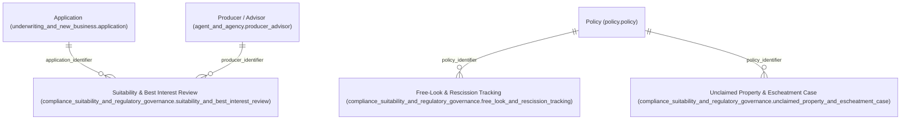

# L&A Ontology Knowledge Framework (OKF) -- Domain 16: Compliance, Suitability & Regulatory Governance (Reg BI, Free-Look & Escheatment)

| OKF Metadata Attribute | Value |
| :--- | :--- |
| **OKF Catalog Document** | `L&A OKF/16 - OKF - Compliance Suitability and Regulatory Governance.MD` |
| **Enterprise Data Domain** | **Domain 16: Compliance, Suitability & Regulatory Governance (Reg BI, Free-Look & Escheatment)** |
| **Target Physical Database Engine** | Amazon RDS Aurora PostgreSQL (PostgreSQL 15/16 Compatible) |
| **Physical Database Schema** | `compliance_suitability_and_regulatory_governance` |
| **Domain Table Count** | **3 Physical Tables / Logical Entities** |
| **Outbound Foreign Key Joins** | **4 Foreign Key Relationships** (Intra-Domain & Cross-Domain) |
| **Inbound Foreign Key Joins** | **0 Cross-Domain Referencing Relationships** |
| **Performance Indexes** | **5 B-Tree & Composite Indexes** |
| **Inherited Business Context Rules** | **`BC-290` through `BC-305` (16 Rules)** |
| **Source Knowledge Layer Artifacts** | `L&A - Ontology.MD`, `L&A Data Model - Logical.MD`, `L&A Data Model - Physical DDL.sql`, `L&A Data Model - Conceptual.MD` |

---

## 1. Domain Executive Ontology & Business Context Overview

The **Compliance, Suitability & Regulatory Governance** domain enforces the legal, fiduciary, consumer-protection, and market-conduct guardrails that govern the sale, post-issue cancellation, and unclaimed-property administration of Life Insurance and Annuity contracts across all 50 US states and federal regulatory regimes. Because annuities and permanent life insurance are complex, long-term financial instruments carrying surrender charges, market risk, or mortality fees, they are regulated by an overlapping mosaic of authorities: the Securities and Exchange Commission (SEC) and FINRA for registered variable and RILA products, the Department of Labor (DOL) for ERISA retirement plans and rollovers, and state Departments of Insurance (modeled on NAIC standards or stringent state-specific statutes like New York DFS). This domain is modeled across three core logical entities: `Suitability & Best Interest Review`, `Free-Look & Rescission Tracking`, and `Unclaimed Property & Escheatment Case`.

`Suitability & Best Interest Review` (`Compliance Review Identifier`, linked to `Application Identifier` and `Producer Identifier`) records the mandatory pre-issue supervisory compliance evaluation required before a recommended contract can be issued. It identifies the governing `Regulatory Framework`—such as `SEC Regulation Best Interest (Reg BI - Variable Products)`, `NAIC Suitability in Annuity Transactions Model Regulation #275 (Best Interest)` (adopted across nearly all US states), `New York Insurance Regulation 187 (Life & Annuity Best Interest)` (which uniquely extends strict best-interest rules to both life insurance and annuities in NY), or `DOL ERISA PTE 2020-02 Rollover Fiduciary Advice`—and captures the customer's Consumer Profile Information: `Customer Risk Tolerance`, `Customer Financial Objectives`, `Customer Investment Time Horizon`, `Existing Liquid Net Worth Amount`, and `Source of Funds`. When an application involves an external 1035 exchange or rollover replacement, compliance engines evaluate `1035 Replacement Surrender Penalty Incurred Amount` and compute a `Replacement Benefit Comparison Score` to prevent illegal "churning" or "twisting," requiring sign-off from a FINRA Series 24 / Series 26 principal (`Supervisory Principal Name`, `Compliance Review Decision`).

Immediately following policy issuance, `Free-Look & Rescission Tracking` (`Free-Look Tracking Identifier`) monitors the statutory post-delivery examination window starting on `Policy Delivery Date` and running for `State Mandated Free-Look Period Days` (typically 10 days for standard policies, but extended to 30 or 60 days for replacements or senior citizens aged 60+/65+ in states like California and New York) until `Free-Look Expiration Date`. If the owner exercises their right to cancel (`Free-Look Exercised Indicator = True`), `Refund Basis Rule` dictates whether the carrier refunds `Return of Full Gross Premium Paid` (where the carrier absorbs any interim market loss) or `Return of Current Account Value Plus Deducted Fees`, rescinding the contract from inception and triggering a 100% producer commission chargeback. Finally, `Unclaimed Property & Escheatment Case` (`Escheatment Case Identifier`) enforces NCOIL Unclaimed Life Insurance Benefits Act and state Revised Uniform Unclaimed Property Act (RUUPA) mandates—monitoring automated `Social Security Death Master File (DMF) Fuzzy/Exact Match` sweeps, `Returned Undeliverable Mail (RPO)`, and uncashed checks (`Trigger Source`), executing statutory due diligence outreach (`Good Faith Outreach Due Diligence Status`), and remitting unclaimed funds (`Escheatable Amount`) to the `Target Escheatment State Jurisdiction` after `State Dormancy Period Years` (typically 3 to 5 years).

---

## 2. Physical Schema & Logical Entity Architecture Catalog (Schema: `compliance_suitability_and_regulatory_governance`)

| # | Logical Entity Name | Physical Table Name (`schema.table`) | Primary Key Column (`PK`) | Business Cols | Audit Cols | Constraints (`PK`/`UQ`/`CHK`) | Logical Entity & Physical Table Definition |
| :--- | :--- | :--- | :--- | :--- | :--- | :--- | :--- |
| **16.1** | **Suitability & Best Interest Review** | `compliance_suitability_and_regulatory_governance.suitability_and_best_interest_review` | `compliance_review_identifier` | 14 | 2 | `pk_suitability_and_best_interest_review` | Suitability & Best Interest Review entity records the supervisory compliance evaluation of an annuity or life transaction under SEC Regulation Best Interest (Reg BI), NAIC Model Regulation #275, and ERISA fiduciary standards, verifying alignment with customer risk tolerance, liquidity needs, and replacement cost-benefit rules. |
| **16.2** | **Free-Look & Rescission Tracking** | `compliance_suitability_and_regulatory_governance.free_look_and_rescission_tracking` | `free_look_tracking_identifier` | 8 | 2 | `pk_free_look_and_rescission_tracking`, `uq_free_look_policy`, `chk_free_look_dates` | Free-Look & Rescission Tracking entity monitors the statutory post-delivery window during which a policyholder may cancel a newly issued contract without surrender penalty, governing whether refund calculations follow Return of Premium or Return of Account Value rules. |
| **16.3** | **Unclaimed Property & Escheatment Case** | `compliance_suitability_and_regulatory_governance.unclaimed_property_and_escheatment_case` | `escheatment_case_identifier` | 10 | 2 | `pk_unclaimed_property_escheatment_case` | Unclaimed Property & Escheatment Case entity tracks policies flagged via Social Security Death Master File (DMF) matches, returned mail (RPO), or uncashed checks, managing mandatory state due diligence outreach and eventual escheatment remittance to state unclaimed property authorities. |

---

## 3. Relational Join Mining & Foreign Key Topology

### 3.1 Entity-Relationship & Foreign Key Join Diagram (Mermaid)



### 3.2 Outbound Foreign Key Join Matrix (Tables in `compliance_suitability_and_regulatory_governance` Referencing Parent Entities)

| FK Constraint Name | Child Table (`compliance_suitability_and_regulatory_governance`) | Child FK Column | Join Scope | Parent Referenced Table | Parent PK Column | Referential Action | Exact SQL Join Predicate |
| :--- | :--- | :--- | :--- | :--- | :--- | :--- | :--- |
| `fk_sbir_application` | `compliance_suitability_and_regulatory_governance.suitability_and_best_interest_review` | `application_identifier` | Cross-Domain (`underwriting_and_new_business`) | `underwriting_and_new_business.application` | `application_identifier` | `ON UPDATE CASCADE ON DELETE CASCADE` | `compliance_suitability_and_regulatory_governance.suitability_and_best_interest_review.application_identifier = underwriting_and_new_business.application.application_identifier` |
| `fk_sbir_producer` | `compliance_suitability_and_regulatory_governance.suitability_and_best_interest_review` | `producer_identifier` | Cross-Domain (`agent_and_agency`) | `agent_and_agency.producer_advisor` | `producer_identifier` | `ON UPDATE CASCADE ON DELETE RESTRICT` | `compliance_suitability_and_regulatory_governance.suitability_and_best_interest_review.producer_identifier = agent_and_agency.producer_advisor.producer_identifier` |
| `fk_flrt_policy` | `compliance_suitability_and_regulatory_governance.free_look_and_rescission_tracking` | `policy_identifier` | Cross-Domain (`policy`) | `policy.policy` | `policy_identifier` | `ON UPDATE CASCADE ON DELETE CASCADE` | `compliance_suitability_and_regulatory_governance.free_look_and_rescission_tracking.policy_identifier = policy.policy.policy_identifier` |
| `fk_upec_policy` | `compliance_suitability_and_regulatory_governance.unclaimed_property_and_escheatment_case` | `policy_identifier` | Cross-Domain (`policy`) | `policy.policy` | `policy_identifier` | `ON UPDATE CASCADE ON DELETE RESTRICT` | `compliance_suitability_and_regulatory_governance.unclaimed_property_and_escheatment_case.policy_identifier = policy.policy.policy_identifier` |

### 3.3 Inbound Cross-Domain Foreign Key Join Matrix (External Schemas Referencing `compliance_suitability_and_regulatory_governance`)

_No external cross-domain schemas hold direct inbound foreign keys to `compliance_suitability_and_regulatory_governance` (tables in this domain act as child/analytical fact or associative tables)._

---

## 4. Detailed Table-by-Table Schema, Column Dictionary & DDL Constraints

### 4.1 Logical Entity: `Suitability & Best Interest Review` <-> Physical Table: `compliance_suitability_and_regulatory_governance.suitability_and_best_interest_review`

- **Business & Technical Purpose**: Suitability & Best Interest Review entity records the supervisory compliance evaluation of an annuity or life transaction under SEC Regulation Best Interest (Reg BI), NAIC Model Regulation #275, and ERISA fiduciary standards, verifying alignment with customer risk tolerance, liquidity needs, and replacement cost-benefit rules.
- **PostgreSQL Catalog Comment**: _""_
- **Primary Key**: `compliance_review_identifier`

#### Attribute-to-Column Schema Mapping & Business Dictionary

| Ord | Logical Attribute Name | Physical Column Name | Logical Type | Physical PostgreSQL Type | Key | Column Modifiers / Default | Business Definition, Domain Semantics & Sample Values |
| :--- | :--- | :--- | :--- | :--- | :--- | :--- | :--- |
| **1** | **Compliance Review Identifier** | `compliance_review_identifier` | String | `VARCHAR(64)` | **PK** | `NOT NULL` | Unique primary key identifying a pre-issue or post-issue suitability and Regulation Best Interest (Reg BI) supervisory review record. Sample values: `SBR-2026-00419`, `SBR-2026-00420`. |
| **2** | **Application Identifier** | `application_identifier` | String | `VARCHAR(64)` | **FK** | `NOT NULL` | Foreign key linking the suitability and best-interest review to the new business Application being supervised. Sample values: `APP-2024-883920`, `APP-2026-550192`. |
| **3** | **Producer Identifier** | `producer_identifier` | String | `VARCHAR(64)` | **FK** | `NOT NULL` | Foreign key referencing the recommending Producer / Advisor whose Care, Disclosure, and Conflict Obligation is being reviewed. Sample values: `PRD-ADV-10042`. |
| **4** | **Regulatory Framework** | `regulatory_framework` | String | `VARCHAR(150)` | **NK** | `NOT NULL` | Identifies the applicable federal, ERISA, and state suitability / fiduciary standard governing the recommendation. Sample values: `SEC Regulation Best Interest (Reg BI - Variable Products)`, `NAIC Suitability in Annuity Transactions Model Regulation #275 (Best Interest)`, `New York Insurance Regulation 187 (Life & Annuity Best Interest)`, `DOL ERISA PTE 2020-02 Rollover Fiduciary Advice`, `Participant Self-Directed Institutional Enrollment (No Recommendation)`. |
| **5** | **Customer Risk Tolerance** | `customer_risk_tolerance` | String | `VARCHAR(100)` | **NK** | `NOT NULL` | Documented investment risk tolerance profile of the customer captured on the Consumer Profile Information questionnaire. Sample values: `Conservative (Principal Preservation Priority)`, `Moderate Conservative`, `Moderate / Balanced`, `Moderate Aggressive`, `Aggressive Growth`. |
| **6** | **Customer Financial Objectives** | `customer_financial_objectives` | String | `VARCHAR(150)` | **NK** | `NOT NULL` | Primary financial goal stated by the customer for purchasing the life or annuity contract. Sample values: `Guaranteed Lifetime Retirement Income`, `Tax-Deferred Retirement Accumulation`, `Principal Protection with Downside Floor`, `Survivor Income & Family Mortality Protection`, `Legacy & Wealth Transfer`. |
| **7** | **Customer Investment Time Horizon** | `customer_investment_time_horizon` | String | `VARCHAR(100)` | **NK** | `NOT NULL` | Expected number of years before the customer plans to access lump-sum principal or begin lifetime income distributions (compared against the product's surrender charge period). Sample values: `1 to 3 Years`, `4 to 7 Years`, `8 to 10 Years`, `10+ Years (Long-Term Retirement)`. |
| **8** | **Existing Liquid Net Worth Amount** | `existing_liquid_net_worth_amount` | Decimal | `NUMERIC(18,2)` | **NK** | `NOT NULL DEFAULT 0.00` | Customer's verified non-annuity liquid net worth remaining after the proposed purchase, ensuring the customer retains adequate emergency liquidity outside surrender-restricted contracts. Sample values: `250000.00`, `850000.00`, `75000.00`. |
| **9** | **Source of Funds** | `source_of_funds` | String | `VARCHAR(150)` | **NK** | `NOT NULL` | Identifies where the money used to fund the new policy is coming from (heavily scrutinized to prevent "churning" or unsuitable reverse-mortgage/loan funding). Sample values: `Ongoing Employer Payroll Salary Deferral`, `Checking / Savings / Money Market Cash`, `Maturing CD`, `401(k) / 403(b) Employer Plan Rollover`, `Existing Annuity or Life 1035 Exchange`, `Brokerage Mutual Fund Liquidation`. |
| **10** | **1035 Replacement Surrender Penalty Incurred Amount** | `replacement_1035_surrender_penalty_incurred_amount` | Decimal | `NUMERIC(18,2)` | **NK** | `NOT NULL DEFAULT 0.00` | Dollar amount of surrender charges or forfeited bonus/living benefit value the customer will lose on the replaced contract if this is a 1035 exchange or rollover replacement (`0.00` if not a replacement). Sample values: `0.00`, `1420.00`, `8500.00` (Triggers Heightened Supervisory Review). |
| **11** | **Replacement Benefit Comparison Score** | `replacement_benefit_comparison_score` | String | `VARCHAR(150)` | **NK** | `NOT NULL` | Automated compliance scoring result (e.g., CapitalROCK / FireLight Suitability Engine) evaluating whether the new contract provides a demonstrable net tangible financial benefit over the replaced contract. Sample values: `Pass - Score 92/100 (Lower Fees & Higher Guaranteed Income)`, `Warning - Score 64/100 (Requires Principal Override Justification)`, `Fail - Score 35/100 (Excessive Surrender Loss / Longer Lockup)`, `Not Applicable (New Money)`. |
| **12** | **Supervisory Principal Name** | `supervisory_principal_name` | String | `VARCHAR(150)` | **NK** | `NOT NULL` | Name and FINRA Series 24 / Series 26 principal registration of the home office or broker-dealer compliance officer who reviewed and signed off on the transaction. Sample values: `Margaret A. Holloway (Series 24 / Series 26 Principal)`, `Automated Straight-Through Suitability Engine`. |
| **13** | **Compliance Review Decision** | `compliance_review_decision` | String | `VARCHAR(120)` | **NK** | `NOT NULL` | Final supervisory determination governing whether the application may proceed to policy issuance. Sample values: `Approved - Meets Best Interest Standard`, `Approved with Principal Exception & Customer Attestation`, `Pending Additional Financial Documentation`, `Rejected - Unsuitable Replacement / Liquidity Mismatch`. |
| **14** | **Approval Date** | `approval_date` | Date | `DATE` | **NK** | `NULL` | Calendar date on which supervisory principal approval was granted. Sample values: `2026-10-12`, `2026-10-16`. |
| **15** | **Record Created Timestamp (Audit)** | `created_at` | Timestamp | `TIMESTAMPTZ` | **AUDIT** | `NOT NULL DEFAULT CURRENT_TIMESTAMP` | System audit timestamp recording when the physical row was initially inserted into the Aurora PostgreSQL table. |
| **16** | **Record Updated Timestamp (Audit)** | `updated_at` | Timestamp | `TIMESTAMPTZ` | **AUDIT** | `NOT NULL DEFAULT CURRENT_TIMESTAMP` | System audit timestamp recording when the physical row was last modified in the Aurora PostgreSQL table. |

#### Declarative DDL Constraints & Indexes on `compliance_suitability_and_regulatory_governance.suitability_and_best_interest_review`

| Constraint / Index Category | Identifier Name | Definition / Target Columns & Referential Integrity Rule |
| :--- | :--- | :--- |
| **PRIMARY KEY** | `pk_suitability_and_best_interest_review` | `PRIMARY KEY (compliance_review_identifier)` |
| **FOREIGN KEY** | `fk_sbir_application` | `FOREIGN KEY (application_identifier) REFERENCES underwriting_and_new_business.application (application_identifier) ON UPDATE CASCADE ON DELETE CASCADE` |
| **FOREIGN KEY** | `fk_sbir_producer` | `FOREIGN KEY (producer_identifier) REFERENCES agent_and_agency.producer_advisor (producer_identifier) ON UPDATE CASCADE ON DELETE RESTRICT` |
| **B-TREE INDEX** | `idx_sbir_application_id` | `ON compliance_suitability_and_regulatory_governance.suitability_and_best_interest_review (application_identifier)` |
| **B-TREE INDEX** | `idx_sbir_producer_decision` | `ON compliance_suitability_and_regulatory_governance.suitability_and_best_interest_review (producer_identifier, compliance_review_decision)` |

### 4.2 Logical Entity: `Free-Look & Rescission Tracking` <-> Physical Table: `compliance_suitability_and_regulatory_governance.free_look_and_rescission_tracking`

- **Business & Technical Purpose**: Free-Look & Rescission Tracking entity monitors the statutory post-delivery window during which a policyholder may cancel a newly issued contract without surrender penalty, governing whether refund calculations follow Return of Premium or Return of Account Value rules.
- **PostgreSQL Catalog Comment**: _""_
- **Primary Key**: `free_look_tracking_identifier`

#### Attribute-to-Column Schema Mapping & Business Dictionary

| Ord | Logical Attribute Name | Physical Column Name | Logical Type | Physical PostgreSQL Type | Key | Column Modifiers / Default | Business Definition, Domain Semantics & Sample Values |
| :--- | :--- | :--- | :--- | :--- | :--- | :--- | :--- |
| **1** | **Free-Look Tracking Identifier** | `free_look_tracking_identifier` | String | `VARCHAR(64)` | **PK** | `NOT NULL` | Unique primary key identifying the post-issue delivery and statutory free-look tracking record for a Policy. Sample values: `FLT-88001`, `FLT-88002`. |
| **2** | **Policy Identifier** | `policy_identifier` | String | `VARCHAR(64)` | **FK** | `NOT NULL` | Foreign key linking the free-look tracking record to the newly issued Policy. Sample values: `POL-UUID-90001421`. |
| **3** | **Policy Delivery Date** | `policy_delivery_date` | Date | `DATE` | **NK** | `NOT NULL` | Verified date on which the issued contract was physically delivered or electronically opened/signed for by the policyholder (starts the statutory free-look clock). Sample values: `2025-01-16`, `2026-10-18`. |
| **4** | **State Mandated Free-Look Period Days** | `state_mandated_free_look_days` | Integer | `INTEGER` | **NK** | `NOT NULL DEFAULT 10` | Number of calendar days mandated by the Issue State's insurance statute during which the owner may cancel the contract (extended to 30 or 60 days in many states for replacements or senior citizens aged 60+/65+). Sample values: `10` (Standard Non-Replacement), `20`, `30` (Senior Citizen or Replacement Statutory Window), `60` (California Senior Replacement). |
| **5** | **Free-Look Expiration Date** | `free_look_expiration_date` | Date | `DATE` | **NK** | `NOT NULL` | Final calendar date on which the policyholder's statutory right to cancel under the free-look provision expires. Sample values: `2025-01-26`, `2026-11-17`. |
| **6** | **Refund Basis Rule** | `refund_basis_rule` | String | `VARCHAR(150)` | **NK** | `NOT NULL` | Statutory rule in the Issue State governing whether the carrier must refund 100% of gross premiums paid (carrier bears market loss risk during free-look) or current account value plus fees. Sample values: `Return of Full Gross Premium Paid (State Mandate / Senior Rule)`, `Return of Current Account Value Plus Deducted Fees (SEC Variable Rule)`. |
| **7** | **Free-Look Exercised Indicator** | `free_look_exercised_indicator` | String | `VARCHAR(100)` | **NK** | `NOT NULL` | Indicates whether the policyholder exercised their free-look right to cancel the policy (`True` triggers contract rescission and 100% producer commission chargeback). Sample values: `False (Free-Look Expired - Policy Retained In Force)`, `True (Cancelled Under Free-Look - Rescinded)`, `Active - Currently Within Free-Look Window`. |
| **8** | **Rescission Processed Date** | `rescission_processed_date` | Date | `DATE` | **NK** | `NULL` | Calendar date on which the free-look cancellation refund was disbursed and the policy was marked void/rescinded from inception (`Null` if not exercised). Sample values: `2026-10-21`, `Null (Not Exercised)`. |
| **9** | **Record Created Timestamp (Audit)** | `created_at` | Timestamp | `TIMESTAMPTZ` | **AUDIT** | `NOT NULL DEFAULT CURRENT_TIMESTAMP` | System audit timestamp recording when the physical row was initially inserted into the Aurora PostgreSQL table. |
| **10** | **Record Updated Timestamp (Audit)** | `updated_at` | Timestamp | `TIMESTAMPTZ` | **AUDIT** | `NOT NULL DEFAULT CURRENT_TIMESTAMP` | System audit timestamp recording when the physical row was last modified in the Aurora PostgreSQL table. |

#### Declarative DDL Constraints & Indexes on `compliance_suitability_and_regulatory_governance.free_look_and_rescission_tracking`

| Constraint / Index Category | Identifier Name | Definition / Target Columns & Referential Integrity Rule |
| :--- | :--- | :--- |
| **PRIMARY KEY** | `pk_free_look_and_rescission_tracking` | `PRIMARY KEY (free_look_tracking_identifier)` |
| **UNIQUE** | `uq_free_look_policy` | `UNIQUE (policy_identifier)` |
| **CHECK** | `chk_free_look_dates` | `CHECK (free_look_expiration_date >= policy_delivery_date)` |
| **FOREIGN KEY** | `fk_flrt_policy` | `FOREIGN KEY (policy_identifier) REFERENCES policy.policy (policy_identifier) ON UPDATE CASCADE ON DELETE CASCADE` |
| **B-TREE INDEX** | `idx_flrt_policy_exp_date` | `ON compliance_suitability_and_regulatory_governance.free_look_and_rescission_tracking (policy_identifier, free_look_expiration_date)` |

### 4.3 Logical Entity: `Unclaimed Property & Escheatment Case` <-> Physical Table: `compliance_suitability_and_regulatory_governance.unclaimed_property_and_escheatment_case`

- **Business & Technical Purpose**: Unclaimed Property & Escheatment Case entity tracks policies flagged via Social Security Death Master File (DMF) matches, returned mail (RPO), or uncashed checks, managing mandatory state due diligence outreach and eventual escheatment remittance to state unclaimed property authorities.
- **PostgreSQL Catalog Comment**: _""_
- **Primary Key**: `escheatment_case_identifier`

#### Attribute-to-Column Schema Mapping & Business Dictionary

| Ord | Logical Attribute Name | Physical Column Name | Logical Type | Physical PostgreSQL Type | Key | Column Modifiers / Default | Business Definition, Domain Semantics & Sample Values |
| :--- | :--- | :--- | :--- | :--- | :--- | :--- | :--- |
| **1** | **Escheatment Case Identifier** | `escheatment_case_identifier` | String | `VARCHAR(64)` | **PK** | `NOT NULL` | Unique primary key identifying an unclaimed property, Death Master File match, or state escheatment investigation case for a Policy. Sample values: `ESC-2026-00310`, `ESC-2026-00311`. |
| **2** | **Policy Identifier** | `policy_identifier` | String | `VARCHAR(64)` | **FK** | `NOT NULL` | Foreign key linking the unclaimed property case to the affected Policy. Sample values: `POL-UUID-90001421`. |
| **3** | **Trigger Source** | `trigger_source` | String | `VARCHAR(150)` | **NK** | `NOT NULL` | Operational or regulatory event that flagged the policy as potentially unclaimed or owner-deceased (under NCOIL Unclaimed Life Insurance Benefits Act rules). Sample values: `Social Security Death Master File (DMF) Fuzzy/Exact Match`, `Returned Undeliverable Mail (RPO - 2 Consecutive Statements)`, `Uncashed Annuity or Distribution Check (> 180 Days)`, `Matured / Mandatory Annuitization Age Reached with No Owner Contact`. |
| **4** | **Date of First Dormancy or DMF Match** | `date_of_first_dormancy_or_dmf_match` | Date | `DATE` | **NK** | `NOT NULL` | Calendar date on which the Death Master File match occurred, the check went uncashed, or owner contact was lost (starts the statutory state dormancy clock). Sample values: `2023-11-15`, `2025-04-01`. |
| **5** | **Good Faith Outreach Due Diligence Status** | `good_faith_outreach_due_diligence_status` | String | `VARCHAR(150)` | **NK** | `NOT NULL` | Tracks statutory locator efforts (LexisNexis relative searches, certified mail outreach, email/phone attempts) required before escheating funds to the state. Sample values: `90-Day Beneficiary Locator Outreach In Progress`, `Certified Statutory Due Diligence Notice Mailed`, `Owner / Beneficiary Located & Re-Engaged`, `Exhausted - Unlocatable (Ready for State Escheatment)`. |
| **6** | **State Dormancy Period Years** | `state_dormancy_period_years` | Integer | `INTEGER` | **NK** | `NOT NULL DEFAULT 3` | Statutory number of years (typically 3 or 5 years under state Revised Uniform Unclaimed Property Act [RUUPA] laws) before unclaimed insurance proceeds must be remitted to the state. Sample values: `3`, `5`. |
| **7** | **Target Escheatment State Jurisdiction** | `target_escheatment_state_jurisdiction` | String | `VARCHAR(10)` | **NK** | `NOT NULL` | Two-letter US state code of the jurisdiction entitled to receive the unclaimed property under Supreme Court priority rules (owner/beneficiary last known residence state, or carrier state of domicile NY if address unknown). Sample values: `NY`, `CA`, `PA`, `FL`, `TX`. |
| **8** | **Escheatable Amount** | `escheatable_amount` | Decimal | `NUMERIC(18,2)` | **NK** | `NOT NULL DEFAULT 0.00` | Total dollar amount of unclaimed death benefit proceeds, matured contract value, or uncashed distribution checks subject to state escheatment. Sample values: `42580.19`, `1850.00`, `112400.00`. |
| **9** | **State Remittance Filing Date** | `state_remittance_filing_date` | Date | `DATE` | **NK** | `NULL` | Calendar date on which the NAIC/NAUPA unclaimed property report and cash remittance were transmitted to the state Comptroller/Treasurer (`Null` if resolved prior to escheatment). Sample values: `2026-10-31`, `Null (Active Outreach or Resolved)`. |
| **10** | **Case Status** | `case_status` | String | `VARCHAR(120)` | **NK** | `NOT NULL` | Current disposition of the unclaimed property case. Sample values: `Active Due Diligence Outreach`, `Resolved - Living Owner Verified Address (RPO Cleared)`, `Resolved - Beneficiary Claim Initiated`, `Escheated & Remitted to State Unclaimed Property Division`. |
| **11** | **Record Created Timestamp (Audit)** | `created_at` | Timestamp | `TIMESTAMPTZ` | **AUDIT** | `NOT NULL DEFAULT CURRENT_TIMESTAMP` | System audit timestamp recording when the physical row was initially inserted into the Aurora PostgreSQL table. |
| **12** | **Record Updated Timestamp (Audit)** | `updated_at` | Timestamp | `TIMESTAMPTZ` | **AUDIT** | `NOT NULL DEFAULT CURRENT_TIMESTAMP` | System audit timestamp recording when the physical row was last modified in the Aurora PostgreSQL table. |

#### Declarative DDL Constraints & Indexes on `compliance_suitability_and_regulatory_governance.unclaimed_property_and_escheatment_case`

| Constraint / Index Category | Identifier Name | Definition / Target Columns & Referential Integrity Rule |
| :--- | :--- | :--- |
| **PRIMARY KEY** | `pk_unclaimed_property_escheatment_case` | `PRIMARY KEY (escheatment_case_identifier)` |
| **FOREIGN KEY** | `fk_upec_policy` | `FOREIGN KEY (policy_identifier) REFERENCES policy.policy (policy_identifier) ON UPDATE CASCADE ON DELETE RESTRICT` |
| **B-TREE INDEX** | `idx_upec_policy_status` | `ON compliance_suitability_and_regulatory_governance.unclaimed_property_and_escheatment_case (policy_identifier, case_status)` |
| **B-TREE INDEX** | `idx_upec_state_status` | `ON compliance_suitability_and_regulatory_governance.unclaimed_property_and_escheatment_case (target_escheatment_state_jurisdiction, case_status)` |

---

## 5. Inherited Business Context Ontology Rules (`BC-290` to `BC-305`)

> **Semantic Inheritance Notice**: The following **16 Business Context rules** are inherited verbatim from `L&A Data Domain/L&A - Ontology.MD` to provide autonomous AI agents, data engineers, and actuaries with complete domain rules, accounting identities, statutory compliance mandates, and SQL join guardrails for the **Compliance, Suitability & Regulatory Governance** domain.

#### BC-290: Multi-Regulator Best Interest Regimes: NAIC Model #275 vs. SEC Reg BI vs. NY DFS Reg 187 vs. DOL PTE 2020-02

**Domains**: Compliance, Suitability & Regulatory Governance, Underwriting & New Business, Product, Policy | **Entities**: Suitability & Best Interest Review, Application, Product, Policy | **Key Attributes**: Suitability Review Identifier, Application Identifier, Regulatory Standard Applied, Product Category, Tax Qualification Status, Issue State, Compliance Review Decision

In the US Life and Annuity industry, every new retail or rollover recommendation (`Application`) must pass a formal pre-issue `Suitability & Best Interest Review`, but the governing legal standard stored in `Regulatory Standard Applied` depends on the intersection of `Product`.`Product Category`, `Policy`.`Tax Qualification Status`, and `Policy`.`Issue State`:

1. `'NAIC Model #275 Annuity Suitability & Best Interest'`: Applies across nearly all US states to Fixed Annuities (`MYGA`, traditional fixed) and Fixed Indexed Annuities (`FIA`), requiring the producer and carrier to satisfy Care, Disclosure, Conflict of Interest, and Documentation obligations.
2. `'SEC Regulation Best Interest (Reg BI) & FINRA Rule 2330'`: Applies whenever the recommended product is a registered security—specifically `Variable Annuity`, `Registered Index-Linked Annuity (RILA)`, and `Variable Universal Life (VUL)`—requiring broker-dealer Registered Principal sign-off (`Principal Reviewer Name`) under FINRA Rule 2330 within 7 business days after the customer signs the application and before the carrier transmits the contract for issuance.
3. `'NY DFS Regulation 187 (11 NYCRR 224) Life & Annuity Best Interest'`: When `Policy`.`Issue State = 'NY'`, New York uniquely extends strict Best Interest suitability scrutiny not only to Annuities, but also to all **Life Insurance** sales (`Term Life`, `Whole Life`, `Universal Life`) as well as in-force post-issue recommendations!
4. `'DOL Prohibited Transaction Exemption (PTE 2020-02) Rollover Fiduciary'`: Applies whenever an advisor recommends rolling assets out of an ERISA-governed workplace plan (`401(k)`, `403(b)`, `401(a)`) into an Individual Retirement Annuity (`Traditional IRA`, `Roth IRA`), requiring a written comparative fee, service, and investment analysis proving why the rollover is in the retirement investor's Best Interest.

AI agents building compliance audit or regulatory reporting tools must join `Suitability & Best Interest Review` to `Application`, `Product`, and `Policy` to verify that `Regulatory Standard Applied` matches the contract's jurisdiction, tax status, and security registration.

#### BC-291: Annuity Liquidity Concentration Ratio and Post-Purchase Liquid Net Worth Guardrails

**Domains**: Compliance, Suitability & Regulatory Governance, Party, Customer & Household, Underwriting & New Business, Product | **Entities**: Suitability & Best Interest Review, Party, Application, Product | **Key Attributes**: Suitability Review Identifier, Annuity Concentration Ratio Percentage, Liquid Net Worth Range, Planned Initial Contribution Amount, Surrender Charge Schedule Type, Compliance Review Decision

Because deferred annuities (`Fixed Annuity`, `Fixed Indexed Annuity`, `Variable Annuity`, `RILA`) carry multi-year surrender charge schedules (`Product`.`Surrender Charge Schedule Type` such as a 7-year or 10-year declining schedule), supervisory principals at broker-dealers (like LPL Financial) and carrier suitability teams strictly police **Annuity Concentration Risk** and **Post-Purchase Liquidity** on `Suitability & Best Interest Review`. Specifically, `Annuity Concentration Ratio Percentage` measures the customer's total proposed annuity purchase (`Application`.`Planned Initial Contribution Amount`) plus all existing deferred annuity holdings across all carriers divided by the customer's `Liquid Net Worth Range` on `Party`:
$$\text{Annuity Concentration Ratio Percentage} = \frac{\text{Proposed Annuity Purchase} + \text{Existing Illiquid Annuity Balances}}{\text{Total Pre-Purchase Liquid Net Worth}} \times 100$$
Most carrier and broker-dealer supervisory engines enforce quantitative concentration thresholds (for example, flagging any application where `Annuity Concentration Ratio Percentage` exceeds **50.00%** for applicants under age 65, or **35.00%–40.00%** for seniors aged 65+, or where remaining liquid emergency reserves after purchase fall below $25,000 to $50,000 or 6 months of living expenses). Notice, however, that for an institutional retirement saver whose primary retirement nest egg was accumulated inside a liquid or no-surrender-charge workplace `403(b)`/`401(a)` plan (such as Institutional Retirement Choice or CREF accounts with `Surrender Charge Schedule Type = 'None'`), transitioning a high percentage (`e.g., 60%–75%`) into lifetime income or an IRA rollover with adequate remaining liquid reserves can legitimately pass suitability (`Compliance Review Decision = 'Approved - Meets Best Interest Standard'`). AI agents building suitability scoring models must evaluate `Annuity Concentration Ratio Percentage` in combination with `Surrender Charge Schedule Type`, `Party`.`Date of Birth`, and `Liquid Net Worth Range`.

#### BC-292: Anti-Churning and Twisting Detection: 1035 Replacement Surrender Penalty vs. Bonus/Benefit Comparison (`Replacement Penalty Incurred Amount`)

**Domains**: Compliance, Suitability & Regulatory Governance, Underwriting & New Business, Agent & Agency | **Entities**: Suitability & Best Interest Review, Application, Producer / Advisor | **Key Attributes**: Suitability Review Identifier, Existing Insurance Replacement Indicator, Replacement Penalty Incurred Amount, Compliance Review Decision, Producer Identifier

"Twisting" (inducing a policyholder to replace an existing life or annuity contract with a new carrier through misrepresentation or incomplete comparison) and "Churning" (repeatedly replacing contracts internally or externally to generate new first-year sales commissions) are among the most heavily sanctioned violations in insurance regulation. Whenever `Application`.`Existing Insurance Replacement Indicator` is `'Yes - External 1035 Replacement'` or `'Yes - Internal Carrier Exchange'`, the `Suitability & Best Interest Review` entity captures the exact economic cost forfeited on the surrendered contract in `Replacement Penalty Incurred Amount`—including any remaining surrender charge (`CDSC`), negative Market Value Adjustment (`MVA`), forfeited unvested bonus, or loss of an in-the-money `GLWB` / `GMDB` benefit base (`Current Benefit Base Amount > Total Account Value`) on the old contract! Under FINRA Rule 2330 and NAIC Model #275, a replacement recommendation generally **cannot** be approved (`Compliance Review Decision = 'Rejected - Unsuitable Replacement Penalty'`) if:

1. The customer incurs a significant `Replacement Penalty Incurred Amount` (e.g., `> 2%–3%` of contract value) that is not demonstrably outweighed by superior contractual guarantees, lower ongoing M&E/fund fees, or a material change in financial objectives.
2. The customer has already executed another 1035 exchange or replacement within the preceding **36 to 60 months** (the FINRA Rule 2330 36-month replacement lookback).
3. The replacement forfeits an existing living or death benefit guarantee whose `Current Benefit Base Amount` substantially exceeds the cash surrender value being transferred.

AI agents building producer surveillance dashboards should aggregate replacement frequency and average `Replacement Penalty Incurred Amount` by `Producer Identifier` and `Agency` to detect abnormal replacement clustering.

#### BC-293: Customer Investment Time Horizon vs. Product Surrender Charge Period and Rider Waiting Period Alignment

**Domains**: Compliance, Suitability & Regulatory Governance, Product, Riders, Party, Customer & Household | **Entities**: Suitability & Best Interest Review, Product, Rider Benefit Catalog, Party | **Key Attributes**: Suitability Review Identifier, Customer Investment Time Horizon, Surrender Charge Schedule Type, Waiting Period Years, Date of Birth, Compliance Review Decision

A foundational suitability rule enforced on `Suitability & Best Interest Review` is **Time Horizon Alignment**: the customer's stated `Customer Investment Time Horizon` (`'Short-Term (1 to 3 Years)'`, `'Medium-Term (4 to 7 Years)'`, `'Long-Term (7 to 10 Years)'`, `'Lifetime Retirement Income (10+ Years)'`) and life expectancy (derived from `Party`.`Date of Birth`) must equal or exceed the illiquidity lock-up period of the recommended `Product` and attached `Rider Benefit Catalog` options. Specifically:

- If a `Product` has a `'7-Year Declining (7% to 0%)'` or `'10-Year Declining'` `Surrender Charge Schedule Type`, a customer whose `Customer Investment Time Horizon` is `'Short-Term (1 to 3 Years)'` or `'Medium-Term (4 to 7 Years)'` (where max horizon is less than the surrender charge schedule) will incur surrender penalties when they need their principal; such a mismatch must trigger a suitability exception or rejection!
- Similarly, if the applicant elects an optional `GLWB` or `GMIB` rider from `Rider Benefit Catalog` that imposes a `Waiting Period Years` (for example, a 5-year or 10-year deferral period before lifetime withdrawals can begin or before a roll-up benefit vests), and the customer states on their suitability profile that they intend to begin taking systematic retirement income immediately in Year 1 or Year 2, paying `Annual Rider Fee Rate` (`1.15%–1.25%` per year) for a deferral roll-up feature they will immediately break is per se unsuitable!
When an AI agent builds automated pre-issue suitability validation rules, it must parse `Customer Investment Time Horizon` against `Product`.`Surrender Charge Schedule Type` and `Rider Benefit Catalog`.`Waiting Period Years` to flag horizon mismatches before principal review.

#### BC-294: Customer Risk Tolerance vs. Product & Fund Risk Classification Alignment

**Domains**: Compliance, Suitability & Regulatory Governance, Party, Customer & Household, Product, Policy, Fund | **Entities**: Suitability & Best Interest Review, Party, Product, Policy Fund Allocation Election, Investment Fund | **Key Attributes**: Risk Tolerance Profile, Product Category, Fund Asset Class, Allocation Percentage, Compliance Review Decision

Every natural-person investor (`Party`) has a stated `Risk Tolerance Profile` (`'Conservative'`, `'Moderately Conservative'`, `'Moderate'`, `'Moderately Aggressive'`, `'Aggressive'`) captured during KYC and evaluated during `Suitability & Best Interest Review`. To satisfy SEC Reg BI and NAIC Model #275 Care Obligations, the principal reviewer and automated suitability engine must verify consistency across three layers:

1. **Customer** `Risk Tolerance Profile` **vs.** `Product`**.**`Product Category`: A customer with a `'Conservative'` risk tolerance who seeks 100% principal protection is suitable for a `Fixed Annuity` (`MYGA`), `Participating General Account Fixed` (`General Account Fixed Vintage`), or a `Fixed Indexed Annuity (FIA)` (which guarantees 0% floor against market loss), whereas a `Variable Annuity`, `Variable Universal Life`, or `Registered Index-Linked Annuity (RILA)` with a `-10%` or `-20%` buffer exposes principal to equity market loss beyond the buffer.
2. **Customer** `Risk Tolerance Profile` **vs. Initial** `Policy Fund Allocation Election`: Even inside a variable contract or institutional plan, the weighted average risk of the elected `Investment Fund` lineup (`Allocation Percentage` across `Fund Asset Class` in `'US Equity'`, `'International Equity'`, `'Fixed Income'`, `'Real Estate'`, `'Multi-Asset Target Date'`, `'Guaranteed Fixed'`) must align with `Risk Tolerance Profile`. For example, if a `'Conservative'` investor allocates 100% of their variable annuity into aggressive small-cap equity subaccounts rather than balanced/fixed accounts, `Suitability & Best Interest Review` flags a risk-allocation exception requiring either reallocation or a documented `'Approved with Principal Exception & Customer Attestation'`. AI agents building portfolio drift and suitability monitoring tools should join `Party`.`Risk Tolerance Profile` with `Policy Fund Holding` (`Fund Asset Class`) to identify post-issue risk drift.

#### BC-295: Statutory Free-Look Right to Examine and Cancel: Standard 10–20 Day vs. Senior Citizen & Replacement 30–60 Day Windows

**Domains**: Compliance, Suitability & Regulatory Governance, Policy, Party, Customer & Household, Underwriting & New Business | **Entities**: Free-Look & Rescission Tracking, Policy, Party, Application | **Key Attributes**: Free-Look Tracking Identifier, Policy Identifier, Policy Delivery Date, State Mandated Free-Look Period Days, Free-Look Expiration Date, Issue State, Existing Insurance Replacement Indicator

Every retail Life Insurance policy and Annuity contract issued in the United States contains a mandatory statutory **Free-Look Provision** ("Right to Examine and Cancel") tracked in `Free-Look & Rescission Tracking`. The free-look clock does **not** start on `Application`.`Submission Date` or `Policy`.`Contract Issue Date`; instead, it starts strictly on `Policy Delivery Date`—the calendar date the customer physically or electronically receives the issued policy contract and signs the delivery receipt! From `Policy Delivery Date`, the customer has `State Mandated Free-Look Period Days` (ending on `Free-Look Expiration Date = Policy Delivery Date + State Mandated Free-Look Period Days`) to cancel the contract for any reason and receive a full statutory refund without surrender charges. The required `State Mandated Free-Look Period Days` varies based on three statutory factors:

1. **Standard Retail New Business**: Typically `10` **to** `20` **calendar days** depending on `Policy`.`Issue State` and `Product Category`.
2. **Replacement Contracts (**`Existing Insurance Replacement Indicator` **=** `'Yes'`**)**: Most states mandate an extended `30`**-day** free-look window whenever a new policy replaces an existing life or annuity contract.
3. **Senior Citizen Protections (e.g., California, Florida, New York)**: For purchasers aged 60+ or 65+ (computed from `Party`.`Date of Birth` and `Contract Issue Date`), state statutes mandate an extended `30`**-day** (or up to `60`**-day** in specific states/channels) free-look period, and in states like California (`Issue State = 'CA'`), seniors aged 60+ purchasing a Variable Annuity must have their funds held in a money-market/fixed account during the 30-day free-look window unless they explicitly waive the investment hold!

While `CURRENT_DATE <= Free-Look Expiration Date` and `Free-Look Disposition Status = 'In Active Free-Look Window'`, `Policy`.`Policy Status` may be tracked as `'Free Look'` or `'Active in Accumulation'`.

#### BC-296: Free-Look Refund Accounting: Return of Gross Premium Paid vs. Return of Market Account Value (`SEC Rule 22c-1`)

**Domains**: Compliance, Suitability & Regulatory Governance, Policy, Transactions, Agent & Agency | **Entities**: Free-Look & Rescission Tracking, Policy, Financial Transaction, Commission Transaction | **Key Attributes**: Free-Look Tracking Identifier, Policy Identifier, Free-Look Exercised Indicator, Free-Look Refund Basis, Refunded Amount, Policy Status, Chargeback Reason Code

When a customer exercises their statutory right to cancel a contract prior to `Free-Look Expiration Date` (`Free-Look Exercised Indicator = 'True - Cancelled by Customer Within Free-Look'`), the contract is rendered void *ab initio* (as if never issued): `Policy`.`Policy Status` transitions to `'Terminated - Free Look Cancelled'`, `Total Account Value` and `Cash Surrender Value` become `$0.00`, zero surrender charges or Market Value Adjustments (`MVA`) may be deducted, and `100%` of any first-year commission paid to the `Producer / Advisor` is clawed back via a `Commission Transaction` with `Commission Transaction Type = 'First-Year Lapse / Surrender Chargeback'` and `Chargeback Reason Code = 'Free-Look Cancellation (100% Recall)'`. Crucially, the exact dollar amount refunded (`Refunded Amount` on `Free-Look & Rescission Tracking` and `Financial Transaction`.`Transaction Type = 'Free-Look Cancellation Refund'`) depends on `Free-Look Refund Basis`, which is governed by state law (`Issue State`) and security registration:

1. `'Return of 100% Gross Premiums Paid (State Guarantee)'`: Required for all fixed life insurance, fixed annuities, and fixed indexed annuities, as well as variable contracts in "Return-of-Premium" states or senior citizen accounts. Even if underlying Separate Account funds declined by 4% during the 15-day free-look window, the carrier must absorb the market loss out of its General Account and refund 100% of the initial premium paid!
2. `'Return of Current Separate Account Market Value Plus Fees (Variable Product Rule)'`: Permitted under SEC rules and state insurance laws in "Market-Value" states for non-senior `Variable Annuity`, `RILA`, and `VUL` contracts: the customer receives the current Separate Account `Total Account Value` on the date the cancellation request is received in Good Order (`SEC Rule 22c-1`) plus a refund of any M&E, administrative, or premium load charges deducted.

#### BC-297: Unclaimed Property Dormancy Triggers: Death Master File (`DMF`) Matches, Returned Mail (`RPO`), and Uncashed Checks

**Domains**: Compliance, Suitability & Regulatory Governance, Party, Customer & Household, Policy, Claims, Annuitization & Benefit Payouts | **Entities**: Unclaimed Property & Escheatment Case, Party, Party Address & Contact, Policy, Claim & Benefit Settlement | **Key Attributes**: Escheatment Case Identifier, Policy Identifier, Owner or Deceased Party Identifier, Dormancy Trigger Type, DMF Match or Trigger Date, Escheatment Case Status

State Unclaimed Property laws (based on the Revised Uniform Unclaimed Property Act [`RUUPA`] and the NAIC Unclaimed Life Insurance Benefits Model Act) prevent insurance companies from holding onto matured, unclaimed, or abandoned funds indefinitely. In the data model, an `Unclaimed Property & Escheatment Case` is opened whenever one of four `Dormancy Trigger Type` events occurs on a `Policy`:

1. `'Social Security Death Master File (DMF) Match - Unclaimed Death Benefit'`: Periodic automated cross-matching of `Party` against the SSA Death Master File detects that an insured or annuitant has died (`DMF Match or Trigger Date`), but no beneficiary has come forward to complete a `Claim & Benefit Settlement` within 90 to 120 days of the carrier's outreach.
2. `'Returned Mail / Undeliverable Address (RPO) & No Customer Contact'`: Annual statements or tax forms mailed to `Party Address & Contact` are returned by the US Postal Service as Undeliverable / Returned Post Office (`RPO`), and the `Policy Owner` has initiated zero login, phone, or financial activity for the statutory dormancy period.
3. `'Uncashed Distribution or Claim Settlement Check'`: A paper disbursement check issued for a `Financial Transaction` (such as an RMD check or annuity payout) or `Beneficiary Claim Payout Election` remains uncashed past its stale-date window (180 days) and replacement outreach goes unanswered.
4. `'Limiting Age / Policy Maturity Reached Without Response'`: A deferred annuity or life policy reaches its contractual `Maturity or Expiration Date` (e.g., age 95, 100, or 121) and the owner cannot be reached to elect a payout option.

AI agents building regulatory operations dashboards must track open cases by `Dormancy Trigger Type` and `Last Verified Customer Contact Date`.

#### BC-298: Statutory Due Diligence Outreach, State Dormancy Periods (`3 to 5 Years`), and Escheatment Remittance (`NAUPA II`)

**Domains**: Compliance, Suitability & Regulatory Governance, Policy, Transactions, Billing, Remittance & Tax Reporting | **Entities**: Unclaimed Property & Escheatment Case, Policy, Financial Transaction, Tax Reporting Statement | **Key Attributes**: Escheatment Case Identifier, Reporting State Jurisdiction, Statutory Escheatment Deadline Date, Due Diligence Outreach Status, Escheatable Balance Amount, Escheatment Case Status, Policy Status

Once an `Unclaimed Property & Escheatment Case` is opened on `DMF Match or Trigger Date`, the carrier enters a regulated multi-step statutory cure and reporting workflow governed by `Reporting State Jurisdiction` (which under the US Supreme Court's *Texas v. New Jersey* priority rules is the state of the `Policy Owner`'s or beneficiary's last known address in `Party Address & Contact`, or the carrier's state of corporate domicile [e.g., `'NY'` for the carrier] if no address is on record). During the state's **3-year to 5-year dormancy window** ending on `Statutory Escheatment Deadline Date`, the carrier must perform skip-tracing (using LexisNexis Accurint / TransUnion TLO address locator services) and mail mandatory statutory notices (`Due Diligence Outreach Status` progressing from `'Initial Outreach Letter Sent'`, `'Skip-Trace & LexisNexis Locator In Progress'`, to `'Final Statutory Certified Notice Sent (60-90 Days Prior to Escheatment)'`).

- **Happy Path (Owner/Beneficiary Located)**: If the owner updates their address or the beneficiary submits a claim before `Statutory Escheatment Deadline Date`, `Due Diligence Outreach Status` becomes `'Owner / Beneficiary Located - Case Resolved'`, `Escheatment Case Status` closes as `'Resolved - Paid to Beneficiary / Owner Re-Engaged'`, and escheatment is averted!
- **Escheatment Path (No Response by Deadline)**: If the deadline arrives with `'No Response Received'`, the carrier liquidates the contract (`Policy`.`Policy Status = 'Terminated - Escheated'`, `Total Account Value = $0.00`), remits `Escheatable Balance Amount` plus statutory interest to the State Unclaimed Property Administrator in standard **NAUPA II** electronic format (`Escheatment Case Status = 'Escheated & Remitted to State Treasurer'`), and issues a `Tax Reporting Statement` (`IRS Form 1099-R`) reporting the escheated distribution!

#### BC-299: Contestable Material Misrepresentation Rescission vs. Customer Free-Look Cancellation

**Domains**: Compliance, Suitability & Regulatory Governance, Claims, Annuitization & Benefit Payouts, Underwriting & New Business, Policy | **Entities**: Free-Look & Rescission Tracking, Claim & Benefit Settlement, Underwriting Case & Risk Decision, Policy | **Key Attributes**: Free-Look Tracking Identifier, Policy Identifier, Free-LookDisposition Status, Two-Year Contestability Investigation Indicator, Policy Status, Refunded Amount

In the `Free-Look & Rescission Tracking` entity, AI agents must clearly distinguish between a customer-initiated **Free-Look Cancellation** (which occurs within 10–60 days of `Policy Delivery Date`) and a carrier-initiated **Contestable Policy Rescission** (`Free-Look Disposition Status = 'Rescinded for Contestable Material Misrepresentation'`). Under state insurance law, during the first two years after `Policy`.`Contract Issue Date` (the two-year contestability period), if the carrier discovers—either during a `Claim & Benefit Settlement` investigation (`Two-Year Contestability Investigation Indicator = 'Yes'`) or a post-issue underwriting audit—that the applicant knowingly made a **material misrepresentation** on the `Application` or Part II medical history (for example, concealing a recent cancer diagnosis, cardiology hospitalization, or active felony/hazardous activity that, had it been disclosed, would have caused `Underwriting Case & Risk Decision` to decline the policy), the carrier has the legal right to **Rescind** the contract. When a policy is rescinded for material misrepresentation:

1. The carrier voids the contract back to `Contract Issue Date`, setting `Policy`.`Policy Status` to a terminated status and `Free-Look Disposition Status = 'Rescinded for Contestable Material Misrepresentation'`.
2. If triggered by a contestable death claim, `Claim & Benefit Settlement`.`Claim Status` is set to `'Denied (Contestability / Exclusion)'` with `$0.00` death benefit paid.
3. Legally, to rescind a contract *ab initio*, the carrier must tender back to the policy owner or estate a refund of all premiums paid (`Refunded Amount` = cumulative gross premiums paid less any prior partial withdrawals or loans). AI agents must never confuse a contestable rescission refund with a standard surrender or a paid death claim.

#### BC-300: OFAC Sanctions Screening, USA PATRIOT Act AML Red Flags, and Suspicious Activity Report (`SAR`) Controls on Early Surrenders

**Domains**: Compliance, Suitability & Regulatory Governance, Party, Customer & Household, Transactions, Underwriting & New Business | **Entities**: Party, Suitability & Best Interest Review, Free-Look & Rescission Tracking, Financial Transaction | **Key Attributes**: Party Identifier, KYC and AML Verification Status, Payment Method, Gross Transaction Amount, Free-Look Exercised Indicator, Transaction Type

Under the **USA PATRIOT Act (31 CFR § 1025.210)** and FinCEN regulations, US Life and Annuity carriers are required to maintain a formal **Anti-Money Laundering (**`AML`**) Program** covering permanent life insurance policies, annuity contracts, and any other insurance product with cash value or an investment feature. Across the data model, AML and OFAC controls operate at three critical lifecycle checkpoints:

1. **Onboarding & Daily OFAC Screening (**`Party`**.**`KYC and AML Verification Status`**)**: Before issuing any `Policy` or disbursing any `Financial Transaction` or `Claim & Benefit Settlement`, every `Party` (owner, insured, payor, beneficiary, trustee, and beneficial owner of an entity) is screened against the US Treasury Office of Foreign Assets Control (`OFAC`) Specially Designated Nationals (`SDN`) list and FinCEN 314(a) requests. If `KYC and AML Verification Status = 'Restricted - OFAC / AML Hold'`, all outbound disbursements (`Partial Surrender / Withdrawal`, `Policy Loan Disbursement`, `Claim & Benefit Settlement`) must be frozen immediately.
2. **Cash Equivalent Monitoring**: Inflows on `Financial Transaction` paid via cashier's checks, money orders, or third-party wires are monitored for structuring (`IRS/FinCEN Form 8300` reporting for cash equivalents exceeding $10,000).
3. **FinCEN Red Flag: Rapid Free-Look or Early High-Penalty Surrender**: A classic money-laundering typology in life and annuities occurs when a bad actor funds a large single-premium life or annuity contract (`Gross Transaction Amount >= $100,000`) and then immediately exercises a `Free-Look & Rescission Tracking` cancellation (`Free-Look Exercised Indicator = 'True'`) or an early `Full Contract Surrender` accepting a steep `Surrender Charge Amount` just to receive a "clean" check or wire from a reputable insurance company, especially if requesting disbursement to a different bank account or third party! AI agents building Financial Crimes / AML surveillance models must join `Financial Transaction`, `Free-Look & Rescission Tracking`, and `Party` to flag rapid in-and-out cash movements exceeding $5,000 for FinCEN Suspicious Activity Report (`SAR`) review.

#### BC-301: End-to-End Policy Lifecycle State Machine and Cross-Domain Event Synchronization

**Domains**: Policy, Underwriting & New Business, Transactions, Claims, Annuitization & Benefit Payouts, Compliance, Suitability & Regulatory Governance | **Entities**: Application, Policy, Financial Transaction, Annuitization Payout Schedule, Claim & Benefit Settlement, Free-Look & Rescission Tracking, Unclaimed Property & Escheatment Case | **Key Attributes**: Application Status, Policy Status, Transaction Type, Claim Status, Schedules Status, Free-Look Disposition Status, Escheatment Case Status

To build reliable enterprise data products, an AI agent must treat `Policy`.`Policy Status` as the central state machine of the L&A Knowledge Layer, strictly synchronized with events across all 16 domains:

1. **Pre-Issue to Issue (**`Domain 13` **$\rightarrow$** `Domain 2`**)**: When `Application`.`Application Status` reaches `'Issued & Placed In Force'` (requiring approved `Underwriting Case & Risk Decision` and `Suitability & Best Interest Review`), `Policy` is created in `'Pending Issue'` or `'Free Look'`, and upon delivery (`Free-Look & Rescission Tracking`.`Policy Delivery Date`) transitions to `'Active in Accumulation'`.
2. **Active Accumulation to Free-Look Cancellation (**`Domain 16` **$\rightarrow$** `Domain 2`**)**: If `Free-Look & Rescission Tracking`.`Free-Look Exercised Indicator = 'True'`, a `'Free-Look Cancellation Refund'` `Financial Transaction` posts and `Policy Status` transitions to `'Terminated - Free Look Cancelled'` (`Total Account Value = $0.00`).
3. **Active Accumulation to Paid-Up or Lapsed (**`Domain 15` **/** `Domain 5` **$\rightarrow$** `Domain 2`**)**: If a whole life policy completes its payment period or elects Reduced Paid-Up non-forfeiture, `Policy Status` becomes `'Paid-Up'` (retaining positive `Cash Surrender Value`). If a policy exhausts its grace period on `Billing & Tax Withholding Schedule` without value, `Policy Status` becomes `'Lapsed'` (`$0.00` value).
4. **Active Accumulation to Annuitized Payout (**`Domain 5` **$\rightarrow$** `Domain 14` **$\rightarrow$** `Domain 2`**)**: Upon an `'Annuitization Capital Conversion'` transaction, an `Annuitization Payout Schedule` (`Schedules Status = 'Active Paying'`) is created and `Policy Status` becomes `'Annuitized in Payout'` (liquid accumulation values become `$0.00`, while economic value shifts to `Annuitization Payout Schedule` and `Actuarial Valuation Reserve`).
5. **Terminal Dispositions (**`Surrendered`**,** `Death Claim Settled`**,** `Terminated - Escheated`**)**: A `'Full Contract Surrender'` sets `Policy Status = 'Surrendered'`; a settled death claim on `Claim & Benefit Settlement` sets `Policy Status = 'Death Claim Settled'`; and an escheated `Unclaimed Property & Escheatment Case` sets `Policy Status = 'Terminated - Escheated'`, all enforcing `$0.00` remaining account value.

#### BC-302: Enterprise Assets Under Management (`AUM`) and Reserves Aggregation Rules Across Accumulation vs. Payout Contracts

**Domains**: Policy, Fund, Actuarial, Claims, Annuitization & Benefit Payouts, Finance | **Entities**: Policy, Policy Fund Holding, Policy Vintage Interest Bucket, Actuarial Valuation Reserve, Annuitization Payout Schedule, Statutory Financial Statement Line | **Key Attributes**: Policy Status, Total Account Value, Current Market Value Amount, Accumulated Principal and Credited Interest Amount, Statutory Reserve Amount, GAAP Reserve Amount

One of the highest-visibility executive metrics in a Life and Annuity organization (such as an institutional retirement carrier's $1+ trillion asset base or LPL Financial's annuity book of business) is **Total Enterprise Assets Under Management / Administration (**`AUM` **/** `AUA`**)**. An AI agent calculating Enterprise AUM from this data model would commit a severe multi-billion-dollar error if it simply executed `SELECT SUM(total_account_value) FROM policy.policy`! Instead, Enterprise L&A Balance Sheet and AUM reporting must combine two mutually exclusive populations without double-counting:

1. **In-Force Accumulation Contracts (**`Policy Status` **in** `'Active in Accumulation'`**,** `'Free Look'`**,** `'Paid-Up'`**)**: Measured by `Policy`.`Total Account Value`, which reconciles exactly to the sum of `Policy Fund Holding`.`Current Market Value Amount` across Separate Account variable funds plus `Policy Vintage Interest Bucket`.`Accumulated Principal and Credited Interest Amount` across General Account fixed vintage buckets.
2. **In-Force Payout Annuity Contracts (**`Policy Status = 'Annuitized in Payout'`**) & Disabled/Exhausted Living Benefit Contracts**: Because a formally annuitized contract (`Annuitization Payout Schedule`) has converted its liquid account balance into a lifetime income obligation, its `Policy`.`Total Account Value` is `$0.00`! Its economic balance-sheet size is measured by the latest `Actuarial Valuation Reserve`.`Statutory Reserve Amount` (or `GAAP Reserve Amount` for GAAP reporting) on `Valuation Date`!

Therefore, **Total Policy & Annuity Liabilities / AUM under Administration** as of a given `Valuation Date` equals:
$$\text{Total LA Assets Under Administration} = \sum_{\text{Accumulation}} \text{Policy}.\text{Total Account Value} + \sum_{\text{Payout / Claims}} \text{Actuarial Valuation Reserve}.\text{Statutory Reserve Amount}$$
Segmented by `Investment Fund`.`Account Backing Type` (`General Account Fixed Vintage` vs. `Separate Account Variable`), this reconciles directly to `Statutory Financial Statement Line` asset and liability schedules.

#### BC-303: Customer 360 & Household Total Wealth Aggregation Across Retail Contracts, Institutional Plans, and Payout Streams

**Domains**: Party, Customer & Household, Policy, Institutional Plan & Employer Sponsor, Claims, Annuitization & Benefit Payouts, Agent & Agency | **Entities**: Household, Party, Policy Party Role, Policy, Institutional Retirement Plan, Annuitization Payout Schedule, Producer / Advisor | **Key Attributes**: Household Identifier, Party Identifier, Role Type, Policy Identifier, Total Account Value, Face Amount, Gross Periodic Payout Amount, Servicing Agent Identifier

When building a **Customer 360** or **Advisor Wealth Workbench** data product for field advisors (`Producer / Advisor` via `Servicing Agent Identifier`), an AI agent must aggregate a client's and their family's (`Household`) complete financial footprint across workplace retirement plans, retail wealth annuities, life insurance protection, and active retirement income streams—while carefully avoiding fan-out duplication caused by multiple `Policy Party Role` rows! Specifically:

1. **Deduplicated Contract Ownership**: Join `Household` $\rightarrow$ `Party` (`Household Identifier`) $\rightarrow$ `Policy Party Role` (`Role Type IN ('Policy Owner', 'Plan Participant')` and `Role Status = 'Active'`) $\rightarrow$ `Policy`. Because spouses in the same `Household` may be `'Policy Owner'` and `'Joint Owner'` on the exact same `Policy Identifier`, the agent **must deduplicate by** `DISTINCT Policy Identifier` before summing `Total Account Value`, `Cash Surrender Value`, or `Face Amount` at the `Household` level!
2. **Workplace vs. Retail Segmentation**: Segment each household's `Policy` rows by `Institutional Plan Identifier IS NOT NULL` (workplace `403(b)`/`401(a)`/`457(b)` plans under `Employer Sponsor Organization`, identifying rollover-eligible balances when employment ends) versus `Institutional Plan Identifier IS NULL` (individual retail `IRA`, `Roth IRA`, `Non-Qualified` annuities, and individual Life Insurance).
3. **Total Household Protection & Guaranteed Lifetime Income**: Sum `Policy`.`Face Amount` (plus `Policy Rider Coverage`.`Current Benefit Base Amount` on active `GMDB` riders) to display **Total Household Mortality Protection**, and sum annualized `Annuitization Payout Schedule`.`Gross Periodic Payout Amount` (where `Schedules Status = 'Active Paying'`) plus activated `GLWB` `Policy Rider Coverage`.`Maximum Annual Withdrawal Amount` to display **Total Guaranteed Annual Household Retirement Income**.

#### BC-304: End-to-End Audit Trail and Lineage from Customer Transaction to Sub-Ledger Journal to General Ledger Trial Balance to Statutory Filing

**Domains**: Transactions, Policy, Fund, Reinsurance, Agent & Agency, Finance | **Entities**: Financial Transaction, Transaction Fund Allocation Detail, Commission Transaction, Reinsurance Settlement Statement, General Ledger Journal Entry, General Ledger Account, Statutory Financial Statement Line | **Key Attributes**: Transaction Identifier, Policy Identifier, Journal Entry Identifier, General Ledger Account Identifier, Accounting Basis, Statutory Line Identifier, Reported Line Amount

In a regulated insurance enterprise audited by state insurance examiners (NAIC quadrennial financial examinations), external CPA firms (SOX 404 internal controls over financial reporting), and IRS auditors, every dollar reported on a quarterly or annual financial statement must have unbroken, bi-directional **Audit Lineage** from the top-level statement line down to the atomic policy event:

1. **Level 1 — Atomic Operational Sub-Ledger Events**: Every cash inflow, outflow, fee deduction, unit trade (`Financial Transaction` + `Transaction Fund Allocation Detail` in `Domain 5`), producer compensation event (`Commission Transaction` in `Domain 10`), claim settlement (`Claim & Benefit Settlement` in `Domain 14`), reinsurance settlement (`Reinsurance Settlement Statement` in `Domain 6`), and reserve valuation change (`Actuarial Valuation Reserve` in `Domain 9`) is recorded with an immutable primary key, `Policy Identifier`, `Effective Date`, and `Posted Date`.
2. **Level 2 — Double-Entry General Ledger Journal Entries (**`Domain 7`**)**: Operational sub-ledger events post to `General Ledger Journal Entry` (linking `Policy Identifier`, `Transaction Identifier`, `General Ledger Account Identifier`, and `Accounting Basis` in `'STAT'`, `'GAAP'`, or `'TAX'`), enforcing balanced `Debit Amount` and `Credit Amount` double-entry accounting across `General Ledger Account` (`Separate Account` vs. `General Account`).
3. **Level 3 — Statutory Blue Book & GAAP Financial Statements (**`Domain 7`**)**: At period close, `General Ledger Journal Entry` balances roll up by `General Ledger Account` into `Statutory Financial Statement Line` (`NAIC Schedule / Exhibit Name`, `Line Item Number`, `Reported Line Amount`).

Whenever an AI agent builds financial explainability or variance-analysis tools, it can traverse this exact 3-level lineage forward (from policy transaction to financial statement impact) or backward (drilling down from a spike in `Statutory Financial Statement Line` directly to the underlying `Policy`, `Product`, and `Financial Transaction` records).

#### BC-305: AI Agent Semantic Query Guardrails: Preventing Multi-Join Fan-Out, Point-in-Time Snapshot Leakage, and Cross-Basis Contamination

**Domains**: All 16 Enterprise L&A Domains | **Entities**: Policy, Policy Party Role, Policy Fund Holding, Policy Vintage Interest Bucket, Policy Rider Coverage, Actuarial Valuation Reserve, General Ledger Journal Entry | **Key Attributes**: Policy Identifier, Valuation Date, Effective Date, Accounting Basis, Policy Status, Role Status, Rider Coverage Status

As the capstone rule of this Life & Annuity Business Ontology (`BC-305`), any AI agent generating SQL queries, semantic views, feature engineering pipelines, or executive analytics against the `L&A Data Model - Logical.MD` and `L&A Data Model - Physical DDL.sql` schemas must obey five universal architectural guardrails:

1. **Prevent Multi-Child Join Fan-Out ("The Chasm Trap")**: `Policy` is the parent (`1:M`) of multiple independent child tables: `Policy Coverage Segment`, `Policy Party Role`, `Policy Rider Coverage`, `Policy Fund Holding`, `Policy Vintage Interest Bucket`, `Financial Transaction`, and `Actuarial Valuation Reserve`. Joining `Policy` to two or more `1:M` child tables in the same flat `SELECT` query before aggregating (for example, joining `Policy` to both `Policy Fund Holding` and `Policy Party Role` and summing `Total Account Value` or `Current Market Value Amount`) will multiply balances by the Cartesian product of child rows! **Always pre-aggregate each child table by** `Policy Identifier` **in a CTE or subquery before joining to** `Policy`**.**
2. **Filter Time-Series Snapshot Tables to a Single** `Valuation Date`: Entities such as `Fund Daily Valuation & Price`, `Actuarial Valuation Reserve`, `Statutory Capital & Risk-Based Capital Summary`, and `Statutory Financial Statement Line` store historical point-in-time snapshots. Summing `Statutory Reserve Amount` across `Actuarial Valuation Reserve` without filtering to a single `Valuation Date` (or `MAX(Valuation Date)`) will sum every historical quarter together!
3. **Never Mix** `Accounting Basis` **Values (**`STAT` **vs.** `GAAP` **vs.** `TAX`**)**: Always filter `General Ledger Journal Entry` by a single `Accounting Basis` and select the matching reserve column on `Actuarial Valuation Reserve`.
4. **Always Filter Active Status on Role and Rider Bridges**: When querying current policyholders, beneficiaries, or riders, filter `Policy Party Role`.`Role Status = 'Active'` and `Policy Rider Coverage`.`Rider Coverage Status` to active states.
5. **Enforce the Inactive Policy Zero-Value Invariant (**`BC-023`**)**: Never include terminated policies (`Surrendered`, `Lapsed`, `Death Claim Settled`, `Terminated - Free Look Cancelled`, `Terminated - Escheated`) in active in-force counts, and always union `Policy`.`Total Account Value` (for accumulation policies) with `Actuarial Valuation Reserve` (for `'Annuitized in Payout'` policies) when measuring total enterprise book of business.

---

## 6. Canonical AI Agent SQL Query Patterns & Join Recipes (`compliance_suitability_and_regulatory_governance`)

When generating SQL queries or building enterprise data products against the `compliance_suitability_and_regulatory_governance` schema, AI agents must use explicit schema-qualified table names, enforce active status / point-in-time `valuation_date` filters, and pre-aggregate `1:M` child tables in Common Table Expressions (`CTE`s) prior to joining to avoid Cartesian fan-out:

```sql
-- Canonical Verified Join Pattern for Domain 16: Compliance, Suitability & Regulatory Governance (Reg BI, Free-Look & Escheatment)
SELECT
    t0.compliance_review_identifier,
    t0.application_identifier,
    t0.producer_identifier,
    t0.regulatory_framework,
    t0.customer_risk_tolerance,
    t0.created_at
FROM compliance_suitability_and_regulatory_governance.suitability_and_best_interest_review t0
LEFT JOIN underwriting_and_new_business.application p1
    ON t0.application_identifier = p1.application_identifier
LEFT JOIN agent_and_agency.producer_advisor p2
    ON t0.producer_identifier = p2.producer_identifier
ORDER BY t0.compliance_review_identifier
LIMIT 100;
```
